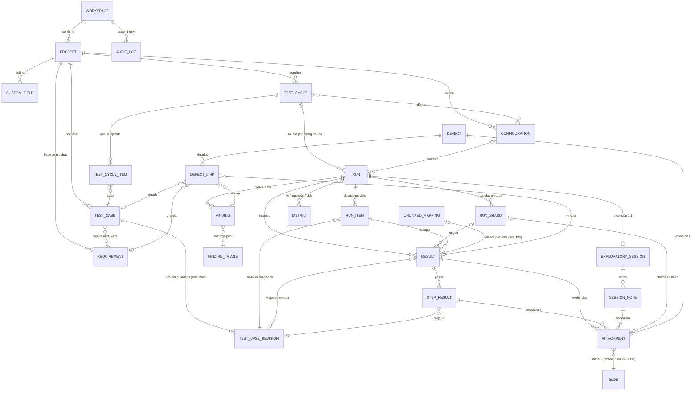

# Diseño 0.2.0 · Modelo de ejecución

> Documento de diseño de la compuerta C (pista C, 2026-10-28). Reúne los ADR
> [0011](../adr/0011-revision-del-caso-y-pasos-estables.md) a
> [0019](../adr/0019-diseno-workspaces-compartidos.md), **aceptados** por el
> usuario el 2026-10-28 con la opción y las respuestas recomendadas, y revisados
> ese día tras la revisión independiente (§7). Los tres cambios que esa revisión
> introdujo sobre lo aceptado también los confirmó el usuario. La compuerta C
> queda cerrada.
> Fuentes: el estudio `Pharos QA estado del arte.md` (§"Modelo de ejecución
> inspirado en CTRF"), el spike [ING-01](../spikes/ING-01-formatos-resultados.md)
> y el esquema actual (`src-tauri/migrations/`, `server/migrations/`).

## 1. Idea en una frase

Todo lo que se ejecuta, a mano o con cualquier herramienta, es un **Run** con su
contexto (entorno, build, commit, dataset, configuración). Dentro del Run hay
cuatro tipos genéricos de resultado: **Result**, **Finding**, **Metric** y la
**sesión exploratoria**. Cada uno es inmutable y apunta a la **revisión** exacta
del caso ejecutado. Así una sola matriz va de requisito → caso → resultado →
defecto, con independencia de la herramienta.

## 2. Entidades y vínculos

Lo que dice cada ADR:

| Pieza                                                           | ADR                                                                | En una línea                                                                               |
| --------------------------------------------------------------- | ------------------------------------------------------------------ | ------------------------------------------------------------------------------------------ |
| `TEST_CASE_REVISION`, `step_id`, filas de Outline               | [0011 · DAT-02](../adr/0011-revision-del-caso-y-pasos-estables.md) | Revisiones inmutables, sincronizadas, con id determinista; pasos `{id, text}`              |
| `RESULT` / `FINDING` / `METRIC` / `EXPLORATORY_SESSION`         | [0012 · KND-01](../adr/0012-tipos-de-resultado-genericos.md)       | Un sobre común (Run) y una tabla por tipo; formatos nuevos sin migrar                      |
| `RUN`, `RUN_SHARD`, `RUN_ITEM`, `RESULT`, `STEP_RESULT`, riesgo | [0013 · RUN-00](../adr/0013-campos-del-run.md)                     | Contexto completo desde el día 1; intentos append-only; final y flaky derivados            |
| `ATTACHMENT`, `BLOB`                                            | [0014 · DAT-03](../adr/0014-evidencias-cifradas-por-hash.md)       | Archivos `.pev` cifrados en streaming, nombrados por HMAC del sha256                       |
| `AUDIT_LOG`                                                     | [0015 · AUD-01](../adr/0015-registro-de-auditoria.md)              | Una sola puerta (`journal::record`) para oplog y auditoría; cadena de hash por dispositivo |
| `DEFECT`, `DEFECT_LINK`                                         | [0016 · DEF-01](../adr/0016-defecto-como-entidad.md)               | Módulo `defects`; migración determinista desde las tarjetas `defect`                       |
| `TEST_CYCLE`, `TEST_CYCLE_ITEM`, `CONFIGURATION`                | [0017 · CYC-01](../adr/0017-ciclos-y-configuraciones.md)           | Selección estática que genera un Run por configuración                                     |
| `CUSTOM_FIELD`, `case_type`, `automation_status`                | [0018 · FLD-01](../adr/0018-campos-personalizados.md)              | Definiciones como entidad; valores en `data.custom` de cada registro                       |
| `WORKSPACE`, miembros, roles                                    | [0019 · TEN-01](../adr/0019-diseno-workspaces-compartidos.md)      | El workspace es la frontera de datos y permisos; protocolo de sync v2 (0.3.0)              |

## 3. Reglas transversales

1. **Campos comunes.** Toda tabla nueva lleva `workspace_id` y
   `created_by`/`created_at`. Las editables llevan además `updated_by`,
   `updated_at`, `deleted_at` y `revision` (GLOSARIO, "Audit fields"). Las
   append-only no tienen `updated_*` ni `revision`.
2. **Tres clases de sync:**

   | Clase         | Reglas                                                                                                               | Entidades                                                                                                                                                                                                                        |
   | ------------- | -------------------------------------------------------------------------------------------------------------------- | -------------------------------------------------------------------------------------------------------------------------------------------------------------------------------------------------------------------------------- |
   | `lww`         | La de hoy: por entidad, HLC, `baseRevision`, panel de conflictos ([ADR-0002](../adr/0002-conflictos-por-entidad.md)) | project, test_plan, test_case, requirement, run, run_item, unlinked_mapping, defect, defect_link, test_cycle, test_cycle_item, configuration, custom_field, finding_triage y exploratory_session (desde 0.4.0/0.5.0), attachment |
   | `append_only` | Se inserta si no existe; sin base; nunca hay conflicto; el servidor rechaza cambiar el contenido                     | test_case_revision, run_shard, result (con sus step_results dentro), finding, metric y session_note (desde 0.4.0/0.5.0), audit_event                                                                                             |
   | `local`       | No se sincroniza                                                                                                     | execution_drafts, blobs (estado local), oplog, sync_state, sync_base, sync_conflicts                                                                                                                                             |

   La clase `append_only` es un cambio de protocolo y viaja con la versión de
   SYNC-08. Los bytes de las evidencias nunca pasan por el oplog (ADR-0014).

3. **Ids deterministas donde dos equipos pueden crear "lo mismo".** El id se
   deriva de lo que identifica la fila (UUIDv5 o sha256), nunca es aleatorio:
   - **migraciones**: revisión vigente, ids de pasos, defectos desde tarjetas,
     vínculos;
   - **filas únicas por concepto**: `finding_triage` (por `fingerprint`),
     `unlinked_mapping` (por `test_key`), `custom_field` (por
     `field_key`), `defect_link` (por destino);
   - **importación**: el shard (por `run_id` y el hash del archivo) y cada
     resultado importado (por shard, `test_key`, configuración e intento).

   Así dos equipos convergen sin duplicados, y un documento antiguo que llega por
   pull se normaliza con la misma función. Los intentos manuales sí usan ids
   aleatorios: dos intentos simultáneos son dos hechos distintos.

4. **Ningún índice `UNIQUE` sobre filas sincronizadas**, salvo la clave
   primaria, como en la fase 2 de [ADR-0010](../adr/0010-claves-entre-equipos.md)
   y en [ADR-0020](../adr/0020-sync-por-usuario-cascada-y-version.md). Un pull
   con un choque haría fallar `write_doc` y todo el pull.
   - La unicidad que importa (las claves visibles) se comprueba en el
     repositorio al crear.
   - Los choques que trae un pull van al panel de conflictos.
5. **Inmutabilidad práctica.** Los resultados nunca se sobrescriben:
   - una corrección es un intento nuevo;
   - un enlace posterior es una regla `unlinked_mapping`;
   - un triaje es `finding_triage`.

   El intento final y el flaky se derivan. El final se ordena por tiempo,
   `attempt` y `hlc`; el flaky se toma de `attributes.flaky` si la
   herramienta solo envía el intento final. Lo inmutable es el **contenido**: la
   ubicación (`workspace_id`) no entra en ningún hash, y el servidor admite
   tres operaciones sobre un documento `append_only`:
   - lápida (cascada o purga);
   - redacción;
   - cambio de ubicación (ADR-0011).

6. **Identidad de un test.** `test_key` está siempre presente:
   - importado: ruta normalizada + nombre + fila;
   - manual: `manual:<caso>/<flujo>/<fila>`.

   Un caso avanzado produce un test por flujo (`flow_id`). Las filas de un
   Outline se resuelven a `example_row_id` contra la revisión ejecutada.

7. **Compatibilidad con la versión anterior (VERSIONING §6.5).**
   - **Un campo que falta en el payload conserva el valor local:** `data.custom`,
     `case_type`, `automation_status`, `risk_*` y los ids de pasos nunca
     vuelven a su valor por defecto por culpa de un emisor antiguo.
   - **El cursor vuelve a 0** en el primer sync de cada versión que añade
     entidades al conjunto que se aplica. Un cliente antiguo avanzó el cursor
     saltándose lo que no conocía.
   - **Clientes de la MENOR anterior solo en lectura** (confirmado por el usuario el 2026-10-28): el
     servidor 0.2 deja leer a un 0.1, pero rechaza su push sin escribir nada y
     con un mensaje claro (ADR-0011; excepción escrita en VERSIONING §6.5).
8. **Dueño de cada fila hasta 0.3.0** (regla 1 de ADR-0020). Toda entidad
   nueva lleva `project_id` y deriva su dueño del proyecto. Un evento de
   auditoría sin proyecto toma el usuario del actor; si el actor es `system:`,
   se queda en local. En 0.3.0, ADR-0019 sustituye esta regla por el filtro por
   `workspace_id`.
9. **Claves visibles** (`<scenario_id>` como `ATS_001`, `REQ`, `DEF`, `RUN`,
   `CYC`), todas con el mecanismo de [ADR-0010](../adr/0010-claves-entre-equipos.md):
   - `RUN` y `CYC` exigen reconstruir `key_counters`, cuyo `CHECK` solo admite
     `case`, `requirement` y `defect` (ADR-0013);
   - las claves tienen que ser únicas entre usuarios de un workspace (TEN-01).
10. **Pharos Run JSON** es el único formato que entra en el núcleo:

- cada importador (Cucumber Messages, CTRF, JUnit, Playwright JSON;
  [ADR-0005](../adr/0005-alcance-hasta-1-0.md)) produce este formato, y lo
  persiste un solo código;
- es un superconjunto de CTRF, con `schemaVersion`;
- se versiona como formato exportado (VERSIONING §6.6).

11. **El servidor valida, no interpreta.** Hasta INT-02 (0.5.0) todo viaja como
    documentos en `documents`. Las tablas reales en Postgres llegan cuando la
    API y la web (ADR-0004) consulten resultados.

## 4. Flujos

**Ejecución manual (EJE-02):**

1. Se crea un Run desde un ciclo (uno por configuración) o desde una selección
   de casos. Sus `run_items` congelan la revisión vigente de cada caso.
2. Ejecutar un elemento abre un borrador local (`execution_drafts`): estado y
   nota por paso, y adjuntos que se cifran al guardarse en `evidence/`.
3. "Guardar resultado" escribe en una transacción:
   - el Result (`attempt` n);
   - sus StepResult;
   - los `attachments`;
   - un evento `execute` de la auditoría.

   A partir de ahí es inmutable.

4. "Crear defecto" desde un paso fallido rellena el defecto con la revisión,
   lo obtenido, el build y el entorno, y apunta a las mismas evidencias.

**Importación de un informe (ING-02..05):**

1. El usuario elige el archivo, el Run (nuevo o existente), el shard y,
   opcionalmente, el ciclo.
2. Se calcula `source_file_sha256`. El id del shard es
   `UUIDv5(run_id ‖ sha256)`: si ese Run ya lo tiene, aquí o en otro equipo, no
   se hace nada (idempotencia).
3. El parser normaliza a Pharos Run JSON siguiendo las reglas de ING-01 §3:
   - el tag `@<prefijo><n>`, anclado y con el prefijo del proyecto;
   - la fila de Outline por `astNodeIds[1]` o `Example #n`;
   - un intento por `testCaseStarted`;
   - los hooks se ignoran.
4. Cada test recibe su `test_key` y un id determinista. Se vincula por el tag
   `@<scenario_id>` al caso y a la revisión vigente en `run.started_at`.
   - El flujo se identifica por el nombre del escenario.
   - La fila se resuelve a `example_row_id` en esa revisión.
   - Un test sin tag queda en la bandeja (enlace posterior por `test_key`).
   - Uno con dos tags de caso queda sin vincular, con aviso.
5. Se escribe un único evento `import` en la auditoría, con los recuentos.

**Matriz (EJE-04):**

- requisito → casos (`requirement_keys`);
- → para cada caso, el run de su resultado final más reciente, por
  `coalesce(result.finished_at, run.started_at)` (incluye runs en curso). Dentro
  de ese run, el peor resultado final entre flujos, filas y configuraciones,
  más las métricas con umbral. Se marca como desactualizado si la revisión
  ejecutada no es la vigente. Se puede filtrar por ciclo, configuración y
  build;
- → defectos abiertos (vinculados al caso o a sus resultados);
- se ordena por riesgo (`risk_likelihood × risk_impact`).

## 5. Orden de implementación

Para 0.2.0, salvo donde se indica otra versión. Cada paso es una fase con su
plan aprobado. Los números de migración los reserva el plan de cada pista
(VERSIONING §6.1).

| #   | Paso                                                                                                                                                                                  | ADR        | Depende de                                | Notas                                                                                                                          |
| --- | ------------------------------------------------------------------------------------------------------------------------------------------------------------------------------------- | ---------- | ----------------------------------------- | ------------------------------------------------------------------------------------------------------------------------------ |
| 1   | `journal::record` (oplog + auditoría) y clase de sync `append_only`                                                                                                                   | 0015, 0011 | Compuerta A (FIX-01..07, DAT-01, SYNC-08) | Todo lo demás escribe a través de aquí; incluye la regla "el campo que falta conserva el valor local" y el reinicio del cursor |
| 2   | Revisiones inmutables y sincronizadas, `Step {id, text}`, filas con id; migración de datos                                                                                            | 0011       | 1                                         | Toca `test_case.rs`, `gherkin.ts` y el editor; test de actualización desde 0.1.0                                               |
| 3   | Almacén `evidence/` y migración de `planner_attachments`                                                                                                                              | 0014       | 1                                         | Paralelo a 2: no comparten archivos                                                                                            |
| 4   | Tablas de ejecución: runs, run_shards, run_items, results, step_results, unlinked_mappings; `risk_*`; esquema de Pharos Run JSON con `findings[]`, `metrics[]` y `exploratorySession` | 0012, 0013 | 2                                         | Una sola migración; incluye la reconstrucción de `key_counters` para `run`/`cycle` (coordinar con A2)                          |
| 5   | Campos personalizados, `case_type` y `automation_status`                                                                                                                              | 0018       | 1                                         | Paralelo a 3 y 4. Los campos personalizados son recortables a 0.3.0; `case_type` y `automation_status`, no                     |
| 6   | Configuraciones y ciclos                                                                                                                                                              | 0017       | 4                                         | Recortable a 0.3.0                                                                                                             |
| 7   | Ejecución manual por pasos con evidencias (EJE-02)                                                                                                                                    | 0013, 0014 | 3, 4 (y 6, si no se recorta)              | Primera funcionalidad visible                                                                                                  |
| 8   | Módulo `defects` y migración desde las tarjetas                                                                                                                                       | 0016       | 3, 4                                      | Paralelo a 7                                                                                                                   |
| 9   | Importadores: Cucumber Messages, CTRF, JUnit, Playwright JSON + bandeja de no vinculados (ING-02..05)                                                                                 | 0012, 0013 | 4                                         | Muestras de ING-01 como tests de contrato                                                                                      |
| 10  | Matriz extendida (EJE-04) e informe de estado (EJE-03)                                                                                                                                | —          | 7, 8, 9                                   | Criterio de salida de 0.2.0                                                                                                    |
| —   | Sesiones exploratorias (UI)                                                                                                                                                           | 0012       | 4                                         | 0.4.0 (EXP-01); crea `exploratory_sessions` y `session_notes` (migración aditiva)                                              |
| —   | Importadores SARIF, k6, axe                                                                                                                                                           | 0012       | 4                                         | 0.5.0 (ING-06); crea `findings`, `finding_triage` y `metrics`, sin cambiar Pharos Run JSON                                     |
| —   | Workspaces compartidos, protocolo v2, subida y descarga de blobs                                                                                                                      | 0019, 0014 | 0.2.0 publicada                           | 0.3.0 (SYNC-07) y 0.4.0 (SYNC-04b)                                                                                             |

Criterio de salida de 0.2.0 (ROADMAP §3):

- un run manual y uno de Playwright aparecen en la misma matriz;
- editar un caso ejecutado no altera sus resultados.

Los pasos 2, 4, 7, 9 y 10 lo hacen comprobable.

## 6. Decisiones del usuario que fijan el esquema

Todas resueltas el 2026-10-28 con la recomendación de cada ADR. Las que más
condicionan el esquema:

- **0011:** el id de cada paso se conserva al reparsear el Gherkin crudo;
  resultado esperado opcional por paso.
- **0012:** un hallazgo no marca como fallido el caso (lo decide una quality
  gate); la UI de sesiones llega en 0.4.0.
- **0013:** riesgo 1–5 por factor; borrador local hasta cerrar el intento
  manual; clave `RUN-001`; la matriz muestra el último resultado por fecha, con
  filtros.
- **0014:** 200 MB por archivo; cifrado en reposo gestionado por el servidor (sin
  extremo a extremo antes de 1.0); descarga bajo demanda; retención por tipo.
- **0015:** cadena de hash desde 0.2.0, por dispositivo y workspace; la
  auditoría la ve el usuario y, desde 0.3.0, solo el Test Manager.
- **0016:** los defectos salen del kanban; ciclo de vida fijo; severidad de 4
  niveles.
- **0017:** sin test sets aparte (se clona el ciclo); avisar, no bloquear, con
  casos no aprobados; la revisión se congela al crear el Run.
- **0018:** `case_type` separado de `automation_status`; la checklist entra si
  cabe en 0.2.0; campos personalizados en una hoja aparte del `.xlsx`;
  definiciones por proyecto.
- **0019:** solo roles por workspace en 0.3.0; al revocar a un miembro se borra
  su copia local con aviso; "compartir proyecto" en 0.3.0; invitaciones por
  enlace, sin SMTP.

## 7. Revisión independiente (2026-10-28)

La revisión de la rama pidió correcciones antes de fusionar. Están aplicadas en
los ADR, y cada uno tiene una sección "Revisión".

- **Bloqueantes corregidos:**
  - identidad de resultados: `test_key`, `flow_id`, ids deterministas,
    clave natural no única, final ordenado por tiempo;
  - compatibilidad con 0.1: el campo que falta conserva el valor local y el
    cursor vuelve a 0.
- **Mayores corregidos:**
  - inmutabilidad del contenido frente a la ubicación;
  - cadena de auditoría por workspace;
  - `example_row_id`;
  - ids deterministas para filas únicas por concepto;
  - sin índices `UNIQUE`;
  - `key_counters` y el dueño de cada fila;
  - retención de evidencias.

**Cambios sobre lo aceptado, confirmado por el usuario el 2026-10-28:**

1. El servidor 0.2 acepta clientes 0.1 solo en lectura (excepción a VERSIONING
   §6.5; ADR-0011).
2. Retención de evidencias por tipo en lugar de "no se borran nunca" (ADR-0014).
3. La auditoría la ve solo el Test Manager, sin el rol "auditor" (ADR-0015).

**Simplificaciones** (decisión del usuario, 2026-10-28):

1. **Aceptada.** Las tablas de hallazgos, métricas y sesiones no se crean en
   0.2.0. Su forma queda fijada en Pharos Run JSON, y las tablas se añaden en
   0.4.0/0.5.0 (ADR-0012).
2. **Descartada.** La auditoría sigue copiando las diferencias en lugar de
   apuntar a ids de revisión (ADR-0015).
3. **Aceptada.** Ciclos y configuraciones (ADR-0017) y campos personalizados
   (ADR-0018) son recortables de 0.2.0 (pasos 5 y 6).
4. **Aceptada.** ADR-0019 es "dirección; se revisa al planificar SYNC-07".
