<!-- Generado por `npm run manual` desde e2e/tours/01-acceso.tour.ts y docs/manual/fuentes/acceso.md. No lo edites a mano: edita la fuente. -->

# 1. Acceso y cuenta

## Para qué sirve

Pharos guarda tus datos cifrados en tu equipo y los sincroniza con un servidor
cuando hay conexión. Para eso necesitas una cuenta: con ella entras, queda
registrado quién hizo cada cambio y tus proyectos llegan a tus otros equipos.

Tu cuenta tiene dos nombres:

- El **alias** es el nombre con el que Pharos te nombra: el menú lateral, el
  menú de usuario, los miembros de un workspace, las revisiones y los avisos.
- El **nombre oficial** (nombre y apellidos) queda guardado en tu perfil.

Si olvidas la contraseña, entras con uno de tus **códigos de recuperación de
la cuenta**: diez códigos de un solo uso que Pharos te enseña una sola vez, al
crear la cuenta. Guárdalos bien. Si el servidor de tu equipo tiene configurado
el envío de correo, también puedes pedir un enlace para elegir una contraseña
nueva. No los confundas con la clave de recuperación de la base local, que
sirve para abrir tus datos en un equipo nuevo (capítulo 15).

**El servidor.** En la app de escritorio, encima del correo aparece
«Servidor: …», el servidor al que se envían tu correo y tu contraseña.

- Si trabajas solo en tu equipo, dice «Este equipo» y la dirección del servidor
  que corre en él.
- Para trabajar con tu equipo, pulsa **«Cambiar»** y escribe la dirección que
  te dé quien administra Pharos, por ejemplo `https://pharos.miempresa.com`.
  - Pharos comprueba el servidor antes de guardarlo. Si algo falla, el
    servidor anterior sigue elegido.
  - Un candado indica que la conexión va cifrada.
  - «Usados en este equipo» lista los servidores en los que ya entraste.
- Solo se puede cambiar con la sesión cerrada. Una vez dentro, el menú de
  usuario dice «Conectado a …».
- Cada servidor tiene sus propias cuentas, y los datos de una cuenta en este
  equipo no se mezclan con los de otro servidor.

En la versión web no aparece: su servidor es el que la sirve.

En este manual, el proyecto que se prueba es **la propia aplicación Pharos**.
Lo recorre **Liomar Rodríguez**, responsable de QA de Pharos, con su cuenta
«Liomar QA». Los proyectos y los datos son solo un ejemplo: en tu caso verás
los tuyos.

## Paso a paso

### 1.1. La pantalla de entrada

Al abrir Pharos sin una sesión iniciada aparece «Iniciar sesión». A la izquierda está el formulario: tu correo electrónico, tu contraseña y el botón «Entrar»; bajo el título, el enlace «Regístrate» por si aún no tienes cuenta. «Continuar con Google» ya se ve, pero todavía no funciona («Próximamente»). A la derecha, un resumen de lo que ofrece Pharos. Al pie, la versión instalada: dila siempre si informas de un fallo.

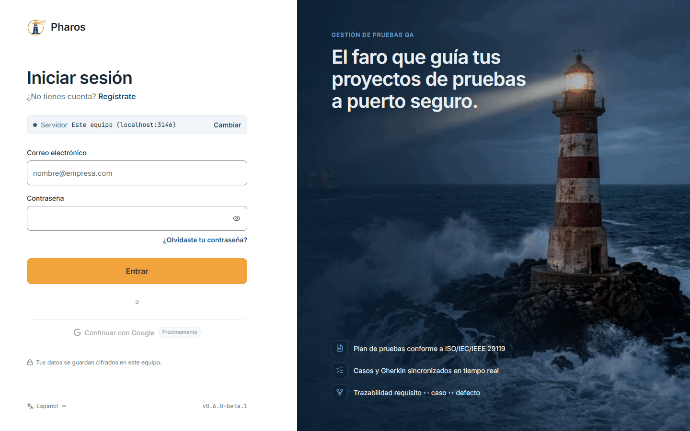

### 1.2. El servidor al que te conectas

Encima del correo, la línea «Servidor» dice adónde van tu correo y tu contraseña; si trabajas solo en tu equipo, «Este equipo» y la dirección de tu servidor local. «Cambiar» abre «Servidor», donde escribes la dirección https:// que te dé quien administra Pharos y pulsas «Conectar»: Pharos comprueba el servidor antes de quedarse con él. Si ya entraste en otros, «Usados en este equipo» los lista para elegirlos con un clic. «Cancelar» o Esc vuelven sin cambiar nada. En la versión web no aparece: su servidor es el que la sirve.

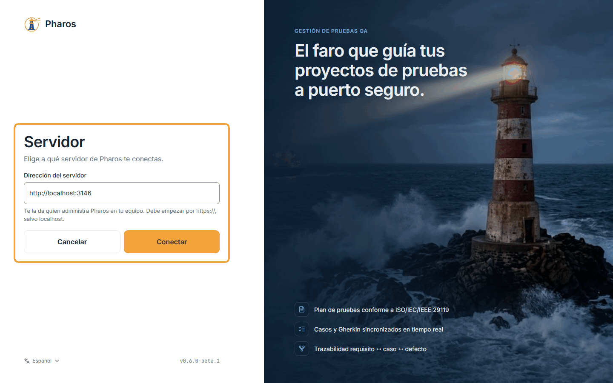

### 1.3. Elegir el idioma antes de entrar

El selector de idioma, en la esquina inferior izquierda (muestra el idioma actual, «Español»), despliega los idiomas disponibles: español e inglés. Muévete por la lista con las flechas y elige con Intro, o haz clic. Toda la interfaz cambia al momento, también esta pantalla, y Pharos lo recuerda en este equipo; una vez dentro, el idioma viaja con tu cuenta a tus otros equipos. Después se cambia desde el menú de usuario o desde «Mi perfil».

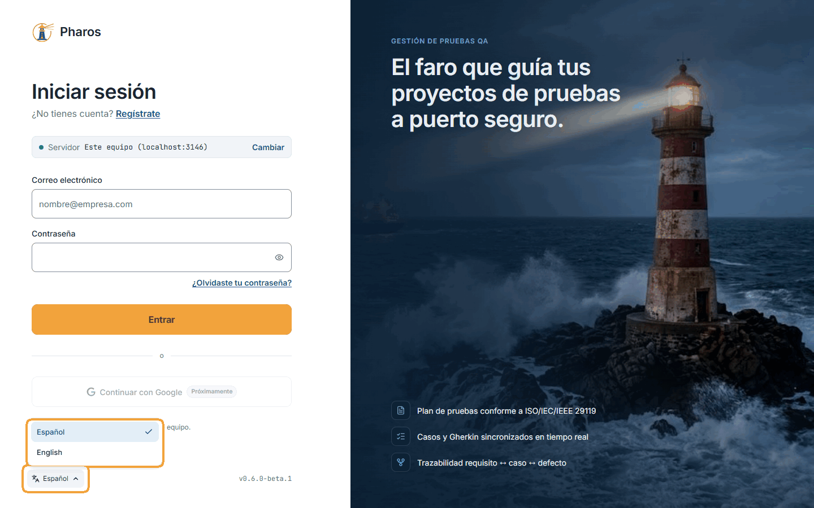

### 1.4. La contraseña se escribe oculta

Por seguridad, cada carácter de la contraseña aparece como un punto. Si dudas de lo que has tecleado, el icono del ojo, a la derecha del campo («Mostrar contraseña»), te deja comprobarlo.

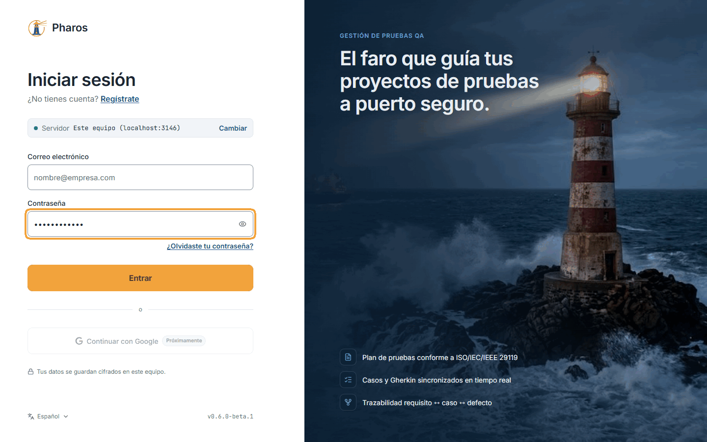

### 1.5. Ver la contraseña mientras escribes

Al pulsar el ojo, la contraseña se muestra en claro (en este ejemplo, «Ejemplo-2026») y el icono pasa a un ojo tachado. Vuelve a pulsarlo para ocultarla antes de que otra persona pueda verla en tu pantalla.

### 1.6. Si el correo o la contraseña no son correctos

Si el correo o la contraseña no corresponden a ninguna cuenta, Pharos no entra y lo indica bajo el formulario: «Correo o contraseña incorrectos.». Por seguridad no dice cuál de los dos falla, así que revisa ambos (el ojo te ayuda con la contraseña) y vuelve a intentarlo. Tras varios intentos seguidos, pide que esperes un momento antes de probar otra vez.

### 1.7. Crear una cuenta

Si es tu primera vez, «Regístrate» abre «Crear cuenta». Escribe tu nombre, tus apellidos, tu alias, tu correo y una contraseña de al menos 8 caracteres. En este ejemplo, Liomar Rodríguez, responsable de QA de Pharos, crea la cuenta con la que hará todas las pruebas del manual, con el alias «Liomar QA» (escribe «Rodriguez» sin tilde, por descuido: lo corrige en «Mi perfil»). El alias es el nombre con el que Pharos te saluda en tu menú; el nombre y los apellidos forman tu nombre oficial, el que figura en los miembros de un workspace, las revisiones, las firmas y la auditoría. Todos los campos son obligatorios: si falta uno, el formulario te lleva a él.

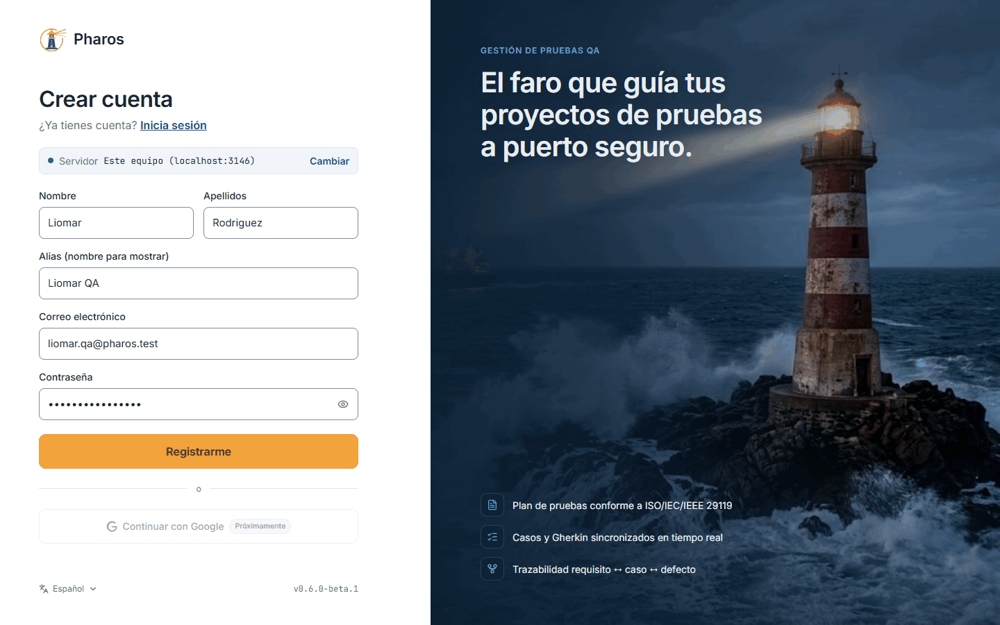

El correo de una cuenta solo puede registrarse una vez. Si ya existe, Pharos
lo dice («Ese correo ya está registrado»).

### 1.8. Guardar los códigos de recuperación

«Registrarme» (o Intro) crea la cuenta y, antes de entrar, muestra tus 10 códigos de recuperación de la cuenta. Sirven para entrar si un día olvidas la contraseña, y cada uno vale una vez. Es la única vez que Pharos los enseña: cópialos o descarga el .txt y guárdalos en un gestor de contraseñas o en papel, nunca junto a la contraseña. «Continuar» se activa cuando marcas «He guardado los códigos en un lugar seguro».

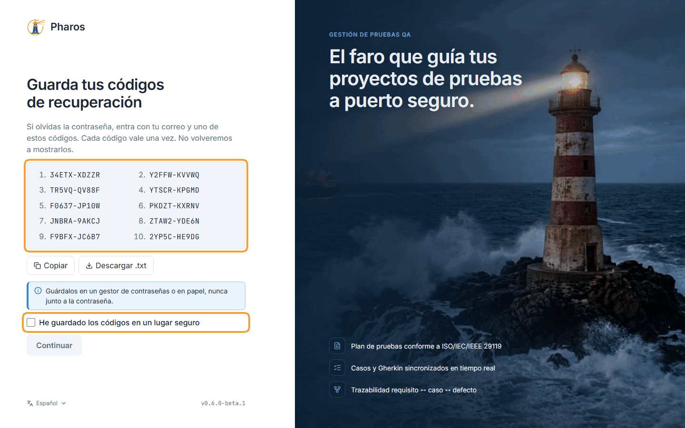

Los códigos solo se guardan en el servidor como un resumen cifrado: ni Pharos
ni quien administra el servidor pueden volver a enseñártelos. Si los pierdes,
genera otros desde «Mi perfil» mientras aún puedas entrar.

### 1.9. Primera entrada con la cuenta nueva

Con los códigos guardados, «Continuar» abre Pharos. Como la cuenta es nueva, «Inicio» aparece vacío: el saludo y la invitación a crear tu primer proyecto con «Nuevo proyecto» (capítulo 4). Arriba del menú lateral ya está el selector de workspace, con «Personal», tu espacio propio, y tu rol en él (capítulo 2). Tu alias y tu correo quedan al pie del menú lateral, junto al estado de la sincronización.

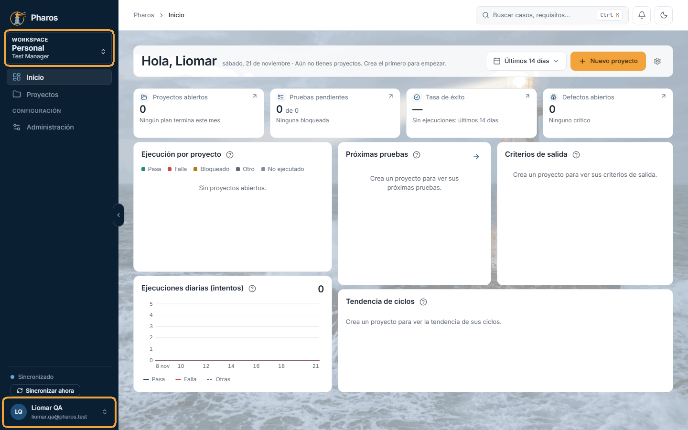

### 1.10. El menú de usuario

Un clic en tu avatar, al pie del menú lateral, abre el menú de usuario. Reúne lo que es tuyo y no de un proyecto: «Mi perfil», «Administración» (la configuración de la aplicación, capítulo 15), el idioma de la interfaz (español o inglés, con una ✓ en el actual; se aplica al momento y viaja con tu cuenta) y «Cerrar sesión». En la app de escritorio, encima de «Cerrar sesión», «Conectado a …» dice a qué servidor está conectada tu sesión (aquí, el de este equipo). Se recorre con las flechas ↑ ↓ y se cierra con Esc.

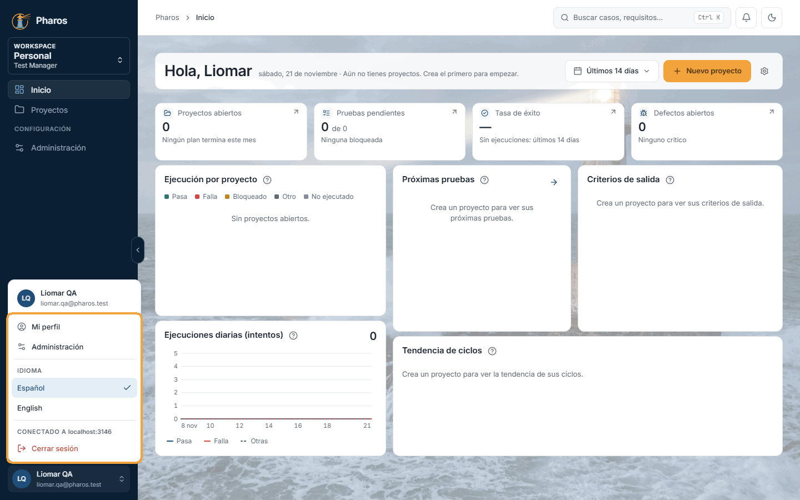

### 1.11. Cerrar sesión

Para salir, elige «Cerrar sesión» en ese mismo menú. Pharos vuelve a la pantalla de entrada y borra de este equipo los datos en caché de tu cuenta; lo que ya está sincronizado sigue en el servidor. Ciérrala siempre si compartes el equipo: si no, la sesión sigue abierta la próxima vez que alguien abra la aplicación.

### 1.12. La entrada en el móvil

En una pantalla estrecha (un móvil, o la ventana muy reducida), la foto queda arriba con el logotipo y el selector de idioma, y el formulario sube como una hoja desde abajo. Es el mismo formulario, con los mismos campos y errores; solo se desplaza la hoja, no la foto.

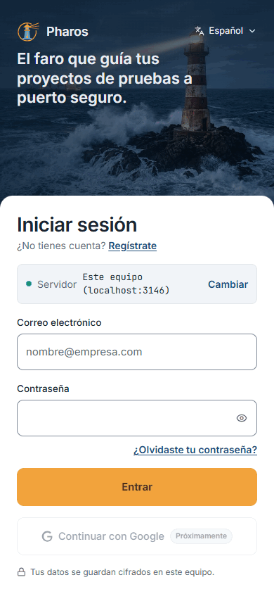

### 1.13. ¿Olvidaste tu contraseña?

Bajo la contraseña, «¿Olvidaste tu contraseña?» abre «Recupera el acceso». En «Con un código» escribes tu correo, uno de tus códigos de recuperación y la contraseña nueva dos veces; «Cambiar la contraseña y entrar» la cambia, gasta ese código, cierra la sesión en todos tus equipos y te deja dentro. Si te quedan 3 códigos o menos, Pharos te avisa para que generes otros en «Mi perfil». Tus datos locales no se tocan.

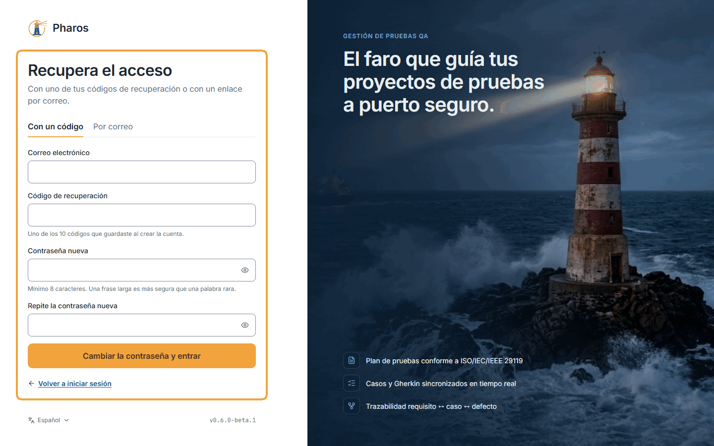

Recuperar el acceso cambia la contraseña de la cuenta en el servidor. Tus datos
locales no cambian.

### 1.14. Recuperar por correo

«Por correo» depende del servidor. Si no envía correo, como aquí, Pharos lo dice y te queda el código de recuperación; debajo siguen «¿Ya tienes el enlace?» y «Continuar», para quien ya recibió uno. En un servidor con correo configurado, esta pestaña pide tu correo y «Enviar enlace» te manda un enlace para elegir una contraseña nueva: caduca en 30 minutos y sirve una vez, y Pharos responde lo mismo exista o no la cuenta. En la app de escritorio, ese enlace se pega en «¿Ya tienes el enlace?».

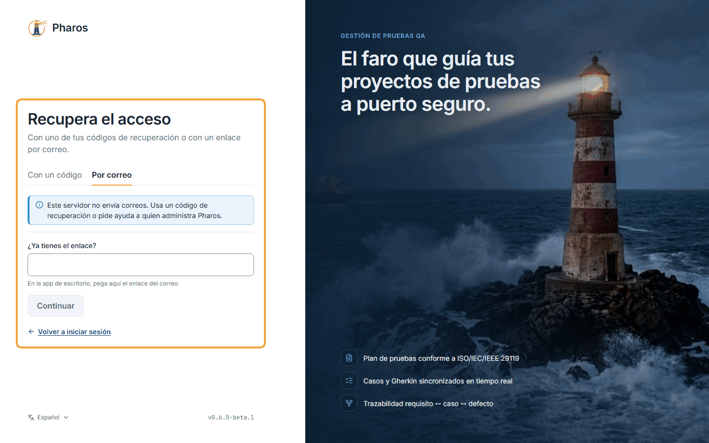

### 1.15. Iniciar sesión

Para entrar, escribe tu correo y tu contraseña y pulsa «Entrar» (o Intro); el botón pasa a «Entrando…» mientras tanto. Pharos abre «Inicio» y recuerda la sesión en este equipo hasta que la cierres, así que no tendrás que escribirla cada vez que abras la aplicación. En el resto del manual, Liomar trabaja con esta misma cuenta.

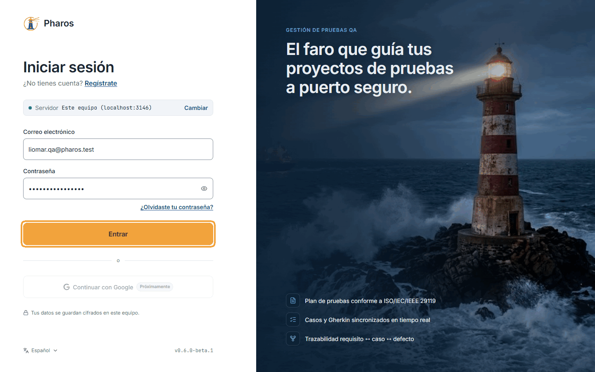

En la app de escritorio, Pharos guarda la sesión en el almacén de credenciales
del sistema (en Windows, el Administrador de credenciales), nunca en un archivo
de texto. En la versión web la guarda el navegador.

### 1.16. Tu perfil

«Mi perfil» reúne lo tuyo: arriba, el alias y tu nombre oficial (nombre y apellidos), con el estado de la sincronización y «Sincronizar ahora»; más abajo, «Seguridad de la cuenta», «Tokens personales» y «Preferencias». La cuenta de este ejemplo tiene los datos con los que Liomar la creó.

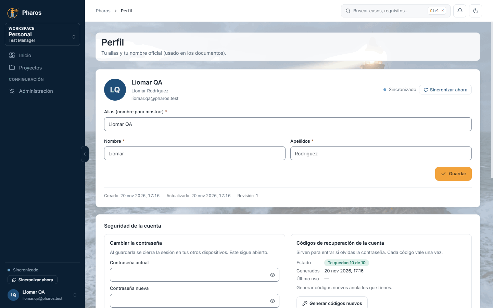

### 1.17. Cambiar el alias y el nombre

Corrige lo que haga falta y pulsa «Guardar» (o Intro). En este ejemplo, Liomar escribió su apellido sin tilde al registrarse y lo corrige: «Rodríguez». Junto al botón aparece «Guardado» (si cambias el alias, el avatar y el pie del menú lateral lo muestran al momento) y, debajo, cuándo se creó y se actualizó tu perfil y su número de revisión, que sube con cada cambio. Los cambios llegan a tus otros equipos con la siguiente sincronización.

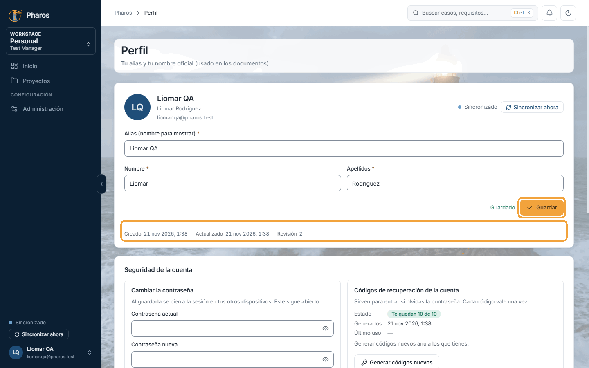

### 1.18. Seguridad de la cuenta

Más abajo, «Seguridad de la cuenta». En «Cambiar la contraseña» escribes la actual y la nueva dos veces; al guardarla se cierra la sesión en tus otros equipos y este sigue abierto. «Códigos de recuperación de la cuenta» dice cuántos te quedan, cuándo se generaron y cuándo usaste uno por última vez. Las dos cosas necesitan conexión con el servidor. No es la clave de recuperación de la base local, que está en «Administración › Seguridad».

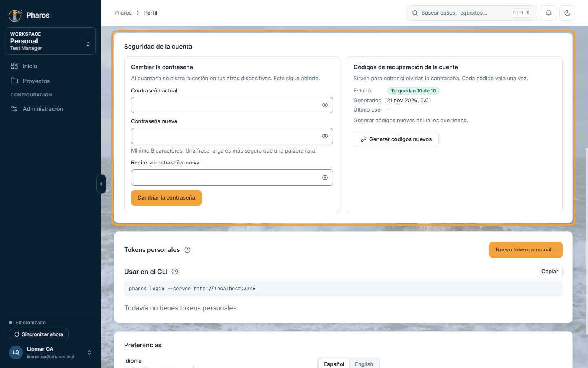

### 1.19. Generar códigos nuevos

«Generar códigos nuevos» pide tu contraseña actual, porque los códigos que tienes dejan de funcionar. Hazlo si has gastado varios o si crees que alguien los ha visto.

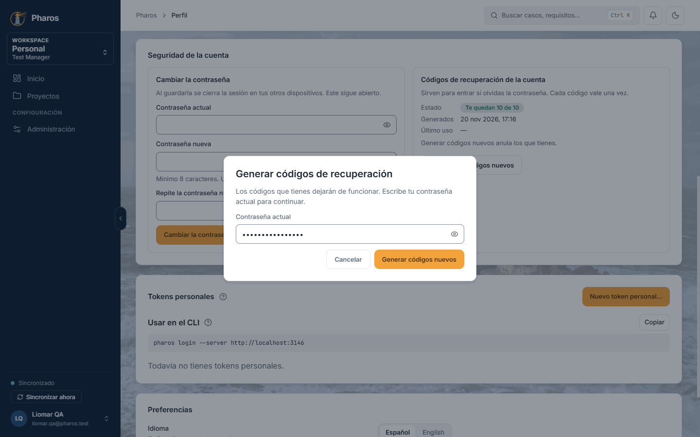

### 1.20. Los códigos nuevos, una sola vez

Pharos muestra los 10 códigos nuevos una sola vez, como al registrarte. Guárdalos, marca «He guardado los códigos en un lugar seguro» y pulsa «Listo». El cambio queda en «Administración › Auditoría» como «Códigos de recuperación generados».

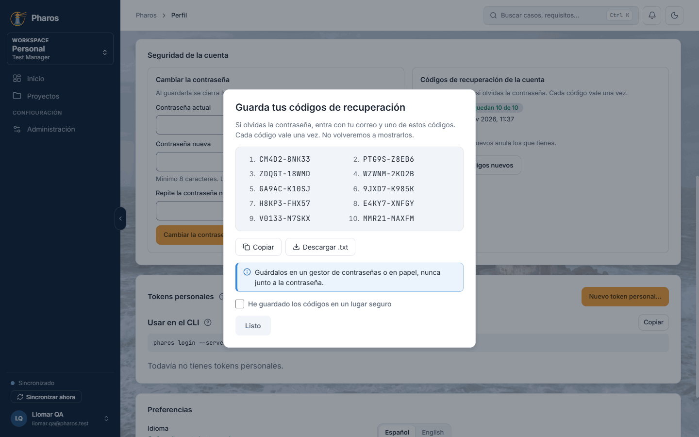

### 1.21. Preferencias: idioma y tema

Al final de «Mi perfil», «Preferencias» guarda el idioma y el tema: claro, oscuro o «Según el sistema», que sigue el ajuste de Windows. Se aplican al momento y viajan con tu cuenta: tus otros equipos los toman al sincronizar («Se aplica en todos tus equipos»). Justo encima, «Tokens personales» crea los tokens para el CLI `pharos` y tus scripts (capítulo 21).

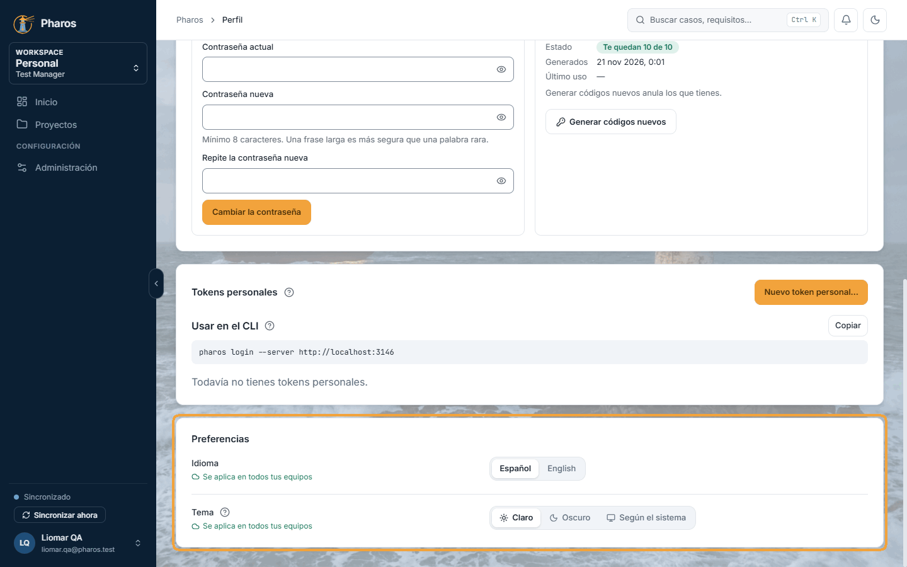

## Atajos de teclado

| Tecla | Dónde | Qué hace |
| --- | --- | --- |
| Tab / Mayús+Tab | Formulario de entrada | Pasa de un campo al siguiente o al anterior |
| Intro | Formulario de entrada o de registro | Envía el formulario («Entrar» o «Registrarme») |
| Intro | «Mi perfil» | Guarda el alias y el nombre |
| Intro | «Recupera el acceso» y «Cambiar la contraseña» | Envía el formulario |
| ← → | Pestañas «Con un código» / «Por correo» | Pasan de una pestaña a la otra (con Tab y Intro) |
| ↑ ↓ e Intro | Selector de idioma y menú de usuario | Recorren las opciones y eligen una |
| Esc | Selector de idioma y menú de usuario | Cierra el menú y devuelve el foco a su botón |

## Si algo no sale

- **«Correo o contraseña incorrectos.»** Revisa los dos: Pharos no dice cuál
  falla. El ojo del campo de la contraseña te deja ver lo que has escrito.
- **«Demasiados intentos. Espera un momento y vuelve a intentarlo.»** Tras
  10 intentos en un minuto, el servidor deja de aceptar más hasta que pasa
  ese minuto. Espera y vuelve a probar.
- **«Ese correo ya está registrado.»** Ya existe una cuenta con ese correo:
  entra con ella en lugar de crear otra.
- **«Revisa los datos introducidos.»** Falta un campo, el correo no tiene
  formato de correo o la contraseña tiene menos de 8 caracteres.
- **«El correo o el código no son válidos.»** El código no existe, ya lo
  usaste o generaste códigos nuevos después. Pharos no dice cuál de las dos
  cosas falla. Mayúsculas, espacios y guiones dan igual.
- **«Demasiados intentos. Espera 15 minutos y vuelve a intentarlo.»** Tras 5
  códigos equivocados en 15 minutos, la recuperación por código de esa cuenta
  se bloquea 15 minutos.
- **«Este enlace no es válido o ha caducado.»** Los enlaces del correo duran 30
  minutos y sirven una vez; pedir otro anula el anterior, y cambiar la
  contraseña anula los que hubiera. Pulsa «Pedir otro enlace».
- **«Este servidor no envía correos.»** Quien administra el servidor no ha
  configurado el correo. Usa un código de recuperación.
- **«La contraseña actual no es correcta.»** Al cambiarla en «Mi perfil» o al
  generar códigos nuevos, Pharos pide la contraseña que usas ahora.
- **«No se puede conectar con pharos.miempresa.com.»** Para entrar por primera
  vez en un equipo, Pharos necesita el servidor. Comprueba tu conexión y que
  el nombre del mensaje sea el de tu servidor; si no lo es, cámbialo con
  «Cambiar». Si ya habías entrado antes en este equipo, Pharos abre tu sesión
  guardada aunque no haya conexión.
- **Al cambiar de servidor**, Pharos explica qué falla y no guarda nada:
  - **«Pharos solo se conecta con https:// a otro equipo.»** La dirección
    empieza por `http://` y no es este equipo. Pide la dirección `https://`.
  - **«… no responde.»** El nombre no existe, el servidor está apagado o
    necesitas la VPN de tu empresa.
  - **«No se puede comprobar la identidad de …»** El certificado del servidor
    está caducado, es de otro nombre o Windows no confía en quien lo firmó.
    Avisa a quien administra el servidor: Pharos no deja seguir.
  - **«Esa dirección responde, pero no es un servidor de Pharos.»** Es otra
    web; revisa la dirección.
  - **«Este servidor necesita una versión más nueva de Pharos.»** o **«Este
    servidor tiene una versión anterior de Pharos.»** Actualiza la app o pide
    que actualicen el servidor.
  - **«Hay 3 cambios sin enviar a …»** No es un error: son cambios de otra
    cuenta en el servidor anterior. Se quedan en el equipo y se envían cuando
    vuelvas a ese servidor con esa cuenta.
- **«El servidor rechazó la conexión por no estar cifrada.»** El fallo está en
  la instalación del servidor, no en tu equipo. Pasa el código
  `https_required` a quien lo administra (guía `docs/despliegue.md`).
- **«Esta cuenta ya tiene datos en este equipo de otro servidor.»** Esa cuenta
  entró antes en este equipo a través de otro servidor. Para no mezclar sus
  datos, Pharos no la deja entrar aquí: vuelve a ese servidor o usa otra
  cuenta.
- **«Esta cuenta está desactivada. Habla con el administrador del servidor para
  reactivarla.»** Quien administra el servidor desactivó tu cuenta (capítulo
  15, «Usuarios»). Tus datos se conservan: cuando la reactive, entras como
  siempre.
- **«Actualizando el formato de tus datos»** u **«Otro Pharos está
  actualizando tus datos»**, al abrir la app. Pharos prepara tus datos locales
  para la versión nueva o espera a otra ventana suya. Lo explica el capítulo
  19, «Si algo sale mal».
- **«Sin conexión»**, en una pastilla de la barra superior. Pharos no llega al
  servidor, pero puedes seguir trabajando: tus cambios se guardan en el equipo
  y se envían solos cuando vuelve la conexión (capítulo 15, «Sincronización»).
- **«Tu sesión ha caducado. Vuelve a iniciar sesión.»** Por seguridad, la
  sesión dura un tiempo limitado, y Pharos la renueva sola mientras la usas. Si
  el servidor ya no la acepta (por ejemplo, tras un mes sin abrir Pharos en ese
  equipo), te devuelve a la pantalla de entrada. Lo que tenías sin guardar en
  una ejecución manual se conserva: lo encontrarás al volver a entrar.

## En el móvil

- En una pantalla estrecha, la foto queda arriba y el formulario sube como una
  hoja; el selector de idioma pasa a la barra de la foto.
- Una vez dentro, el menú de usuario se abre desde tu avatar, en la barra
  superior, como una hoja inferior. Incluye además el cambio de tema y el
  estado de la sincronización.
- «Perfil» tiene su propio botón en la barra inferior, y desde el perfil
  también puedes cerrar la sesión.

## Consejos

- La sesión se recuerda en el equipo: no hace falta entrar cada vez. Cierra la
  sesión si compartes el equipo.
- Si dos personas usan el mismo equipo y las dos son miembros de un mismo
  workspace compartido, sus proyectos se ven en este equipo desde la cuenta
  que los sincronizó primero. La otra los ve en sus otros equipos y en la web.
- Elige un alias que tus compañeros reconozcan: es el nombre con el que te
  ven en el workspace.
- El idioma también se puede cambiar después, desde el menú de usuario o desde
  «Mi perfil › Preferencias»; el tema, desde «Mi perfil › Preferencias», la
  barra superior o «Administración › General» (capítulo 15). En el perfil y en
  Administración puedes elegir además «Según el sistema», que sigue el ajuste
  de Windows.
- Guarda los códigos de recuperación en un gestor de contraseñas o en papel,
  nunca junto a la contraseña. Cuando te queden pocos, genera otros en «Mi
  perfil › Seguridad de la cuenta».
- Al cambiar la contraseña, tus otros equipos tendrán que volver a entrar. Una
  sesión ya abierta en otro equipo puede seguir funcionando hasta 15 minutos.
- El idioma, el tema y tus nombres viajan con tu cuenta: si los cambias en un
  equipo, tus otros equipos los toman al sincronizar («Se aplica en todos tus
  equipos», en el perfil). Gana el cambio más reciente.
- La cuenta que administra el servidor lleva en su perfil la etiqueta
  «Administrador del servidor». Liomar no la tiene: en este manual, el
  servidor lo administra la cuenta «Administrador» (capítulo 15, «Usuarios»).
- La clave de recuperación, que sirve para abrir tus datos en un equipo nuevo,
  ya no está en el perfil: está en «Administración › Seguridad» (capítulo 15).

## Véase también

- [Guía de pruebas de la beta](../guia-beta.md), apartado 2 «Antes de empezar».
- [Glosario](../GLOSARIO.md): «Alias / nombre para mostrar», «Nombre oficial», «Elaborado por / Autor».
- Capítulo 2, «La aplicación de un vistazo»: el menú lateral, la barra
  superior y el menú de usuario.
- Capítulo 19, «Si algo sale mal»: si la base de datos local no abre.

---

[Índice](README.md) · [La aplicación de un vistazo](02-navegacion.md) →
