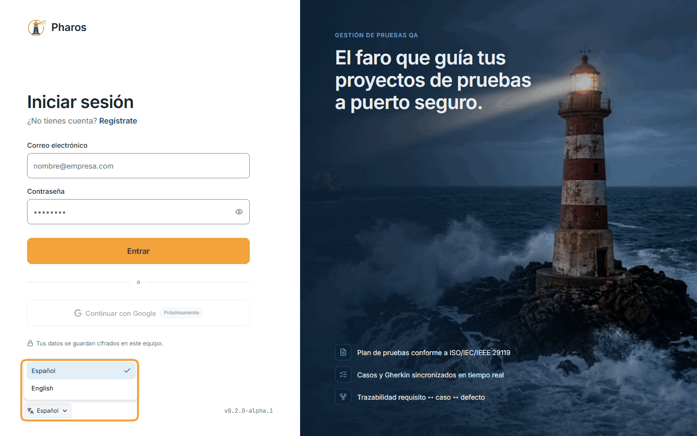
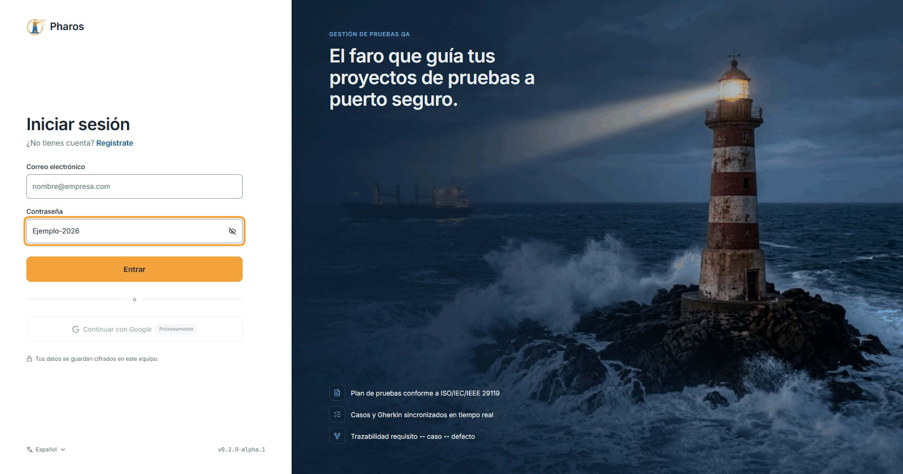
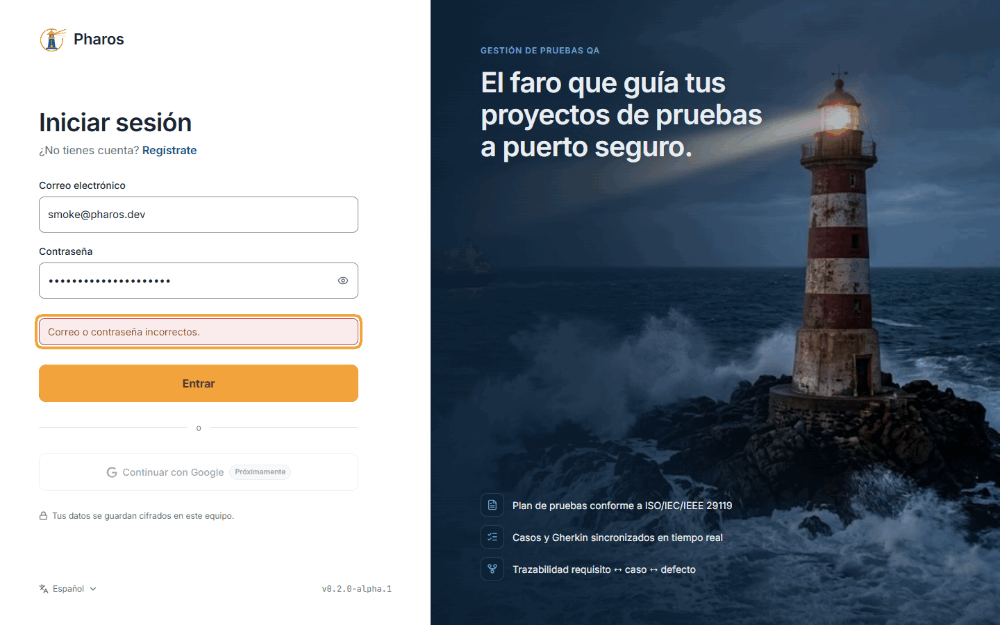
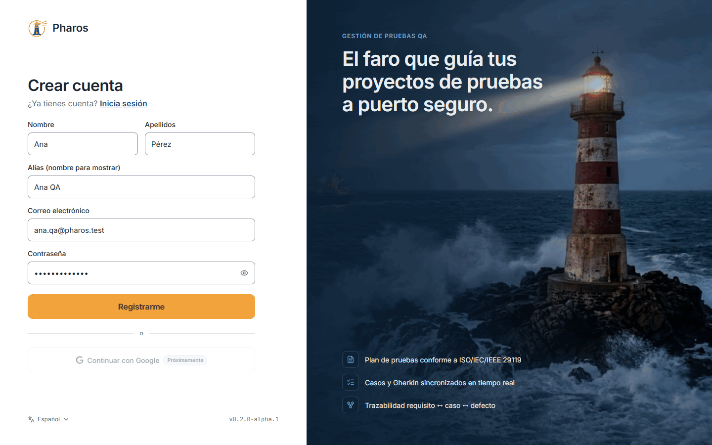
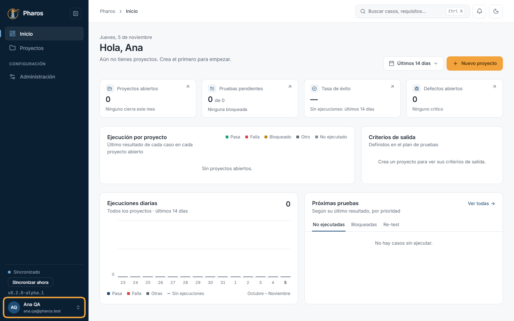
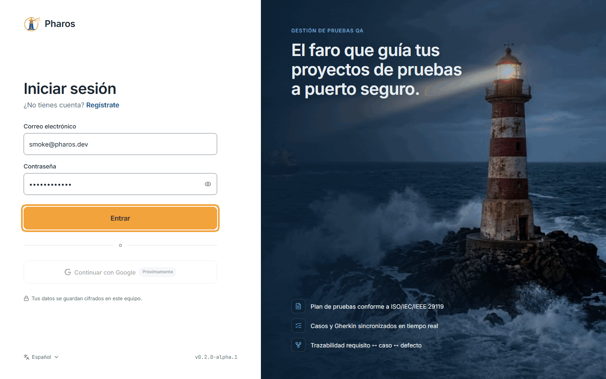
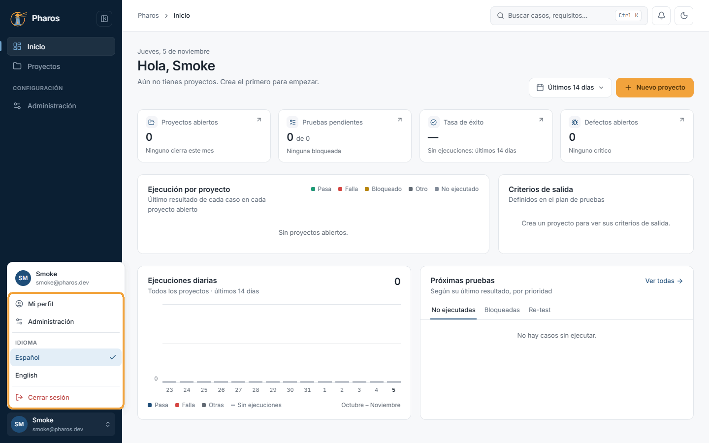
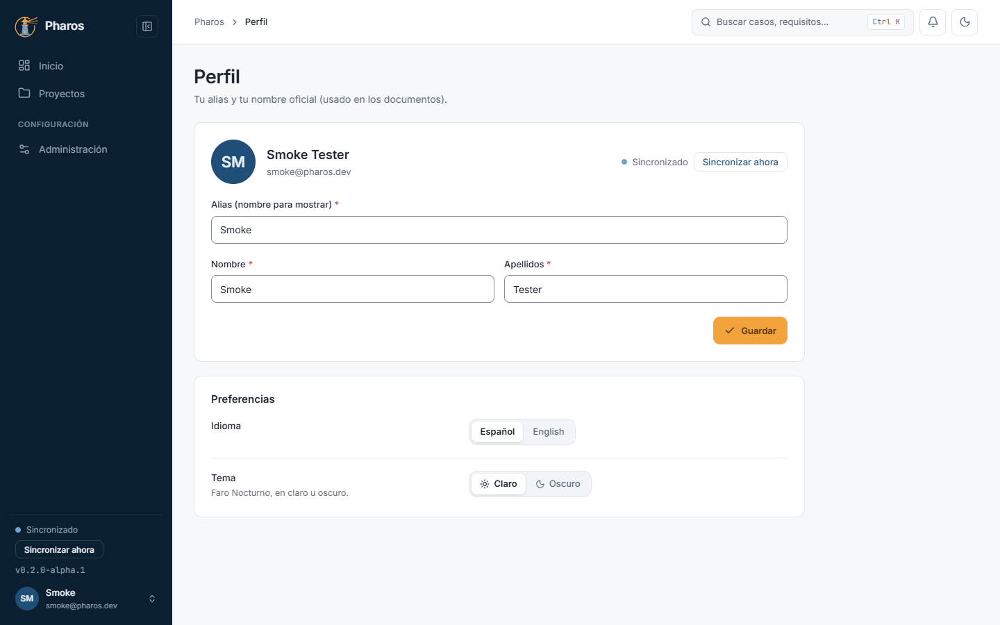
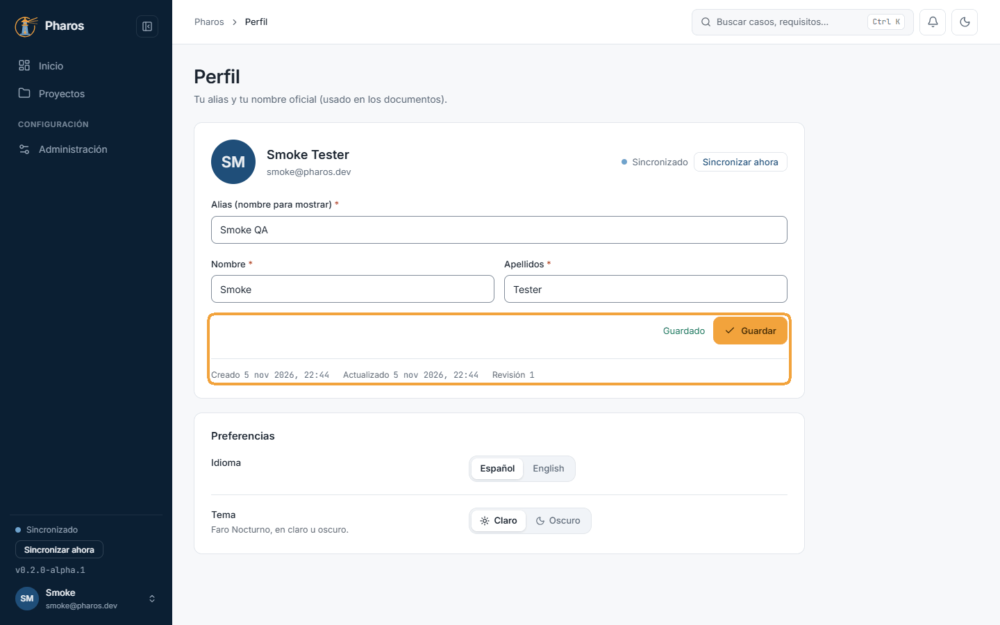

<!-- Generado por `npm run manual` desde e2e/tours/01-acceso.tour.ts y docs/manual/fuentes/acceso.md. No lo edites a mano: edita la fuente. -->

# 1. Acceso y cuenta

## Para qué sirve

Pharos guarda tus datos cifrados en tu equipo y los sincroniza con un servidor
cuando hay conexión. Para eso necesitas una cuenta: con ella entras, se
identifica quién hizo cada cambio y tus proyectos llegan a tus otros equipos.
Tu **nombre oficial** (nombre y apellidos) firma los documentos que exportas;
el **alias** es como te ve el resto de la aplicación.

## Paso a paso

### 1.1. La pantalla de entrada

Al abrir Pharos sin una sesión iniciada aparece «Iniciar sesión». A la izquierda está el formulario: tu correo electrónico, tu contraseña y el botón «Entrar»; bajo el título, el enlace «Regístrate» por si aún no tienes cuenta. «Continuar con Google» ya se ve, pero todavía no está disponible («Próximamente»). A la derecha, un resumen de lo que ofrece la aplicación.

### 1.2. Elegir el idioma antes de entrar

El selector de idioma, en la esquina inferior izquierda (muestra el idioma actual, «Español»), despliega los idiomas disponibles: español e inglés. Al elegir uno, toda la interfaz cambia al momento, también esta pantalla. Una vez dentro, el idioma se cambia desde el menú de usuario o desde «Mi perfil».

### 1.3. La contraseña se escribe oculta

Por seguridad, cada carácter de la contraseña aparece como un punto. Si dudas de lo que has tecleado, el icono del ojo, a la derecha del campo («Mostrar contraseña»), te deja comprobarlo.

### 1.4. Ver la contraseña mientras escribes

Al pulsar el ojo, la contraseña se muestra en claro (en este ejemplo, «Ejemplo-2026») y el icono pasa a un ojo tachado. Vuelve a pulsarlo para ocultarla antes de que otra persona pueda verla en tu pantalla.

### 1.5. Si el correo o la contraseña no son correctos

Si el correo o la contraseña no corresponden a ninguna cuenta, Pharos no entra y lo indica bajo el formulario: «Correo o contraseña incorrectos.». Por seguridad no dice cuál de los dos falla, así que revisa ambos (el ojo te ayuda con la contraseña) y vuelve a intentarlo. Tras varios intentos seguidos, pide esperar un momento.

### 1.6. Crear una cuenta

Si es tu primera vez, «Regístrate» abre «Crear cuenta». Escribe tu alias, tu nombre y apellidos, tu correo y una contraseña de al menos 8 caracteres (en este ejemplo, la cuenta de Ana Pérez, con el alias «Ana QA»). El alias es como te verá el resto de la aplicación; el nombre y los apellidos forman tu nombre oficial, el que firma los documentos que exportas.

El correo de una cuenta solo puede registrarse una vez; si ya existe, Pharos
lo dice («Ese correo ya está registrado»).

### 1.7. Primera entrada con la cuenta nueva

«Registrarme» crea la cuenta y entra directamente, sin pasos intermedios. Como la cuenta es nueva, «Inicio» aparece todavía vacío, con el saludo y la invitación a crear tu primer proyecto (capítulo 2). Tu alias y tu correo quedan al pie del menú lateral.

### 1.8. Cerrar sesión

Para salir, abre el menú de usuario con un clic en tu avatar, al pie del menú lateral, y elige «Cerrar sesión». Pharos vuelve a la pantalla de entrada. Hazlo siempre si compartes el equipo: si no, la sesión sigue abierta la próxima vez que alguien abra la aplicación.

### 1.9. Iniciar sesión

Para entrar, escribe tu correo y tu contraseña y pulsa «Entrar» (o Intro). Pharos abre «Inicio» con el resumen de tus proyectos (capítulo 2) y recuerda la sesión en este equipo hasta que la cierres, así que no tendrás que volver a escribirla cada vez que abras la aplicación.

### 1.10. El menú de usuario

El menú de tu avatar reúne lo que es tuyo y no de un proyecto: «Mi perfil», «Administración» (la configuración de la aplicación, capítulo 10), el idioma de la interfaz (español o inglés, se aplica al momento) y «Cerrar sesión».

### 1.11. Tu perfil

«Mi perfil» reúne tus datos personales: el alias y tu nombre oficial (nombre y apellidos, el que firma los documentos que exportas), el estado de la sincronización con «Sincronizar ahora» y, en «Preferencias», el idioma y el tema (claro u oscuro), que se aplican al momento en este equipo.

### 1.12. Cambiar el alias

Cambia el alias o el nombre (en este ejemplo, el alias pasa a «Smoke QA») y pulsa «Guardar». Junto al botón aparece «Guardado» y, debajo, cuándo se creó y se actualizó por última vez tu perfil y su número de revisión, que sube con cada cambio guardado. El nuevo alias llega a tus otros equipos con la siguiente sincronización.

## Consejos

- La sesión se recuerda en el equipo: no hace falta entrar cada vez. Cierra
  sesión si compartes el equipo.
- Sin conexión puedes seguir trabajando; los cambios se envían al volver a
  conectar (capítulo 10, «Sincronización»).
- El idioma también se cambia después, desde el menú de usuario o el perfil.

## Véase también

- [Guía de pruebas de la beta](../guia-beta.md), apartado 2 «Antes de empezar».
- [Glosario](../GLOSARIO.md): «Elaborado por / Autor».

---

[Índice](README.md) · [Inicio, proyectos y ajustes](02-proyectos.md) →
