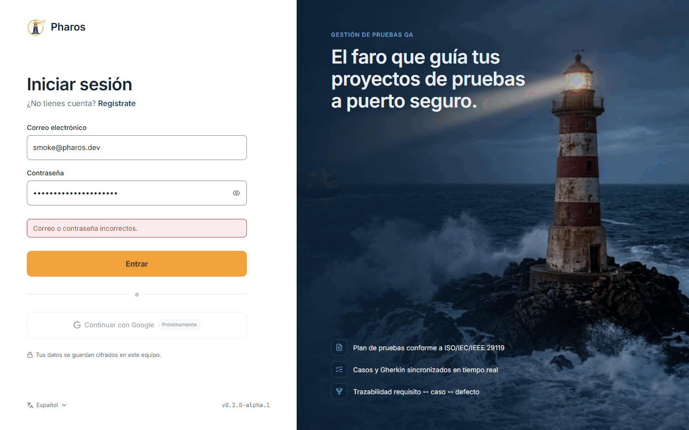
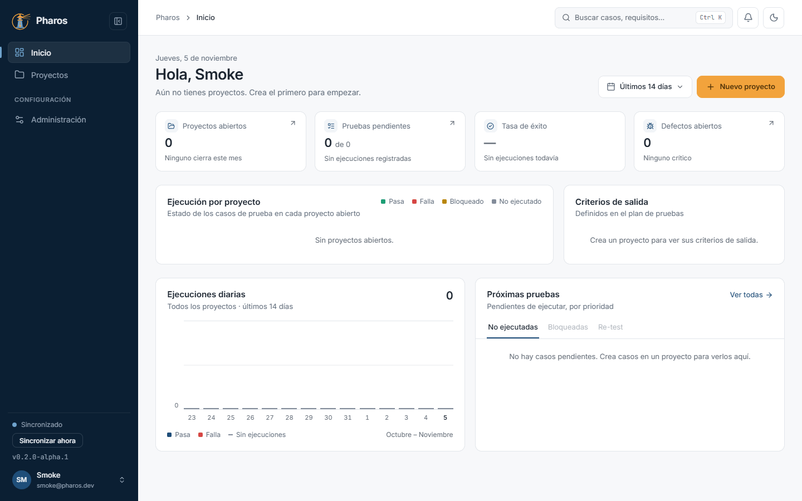
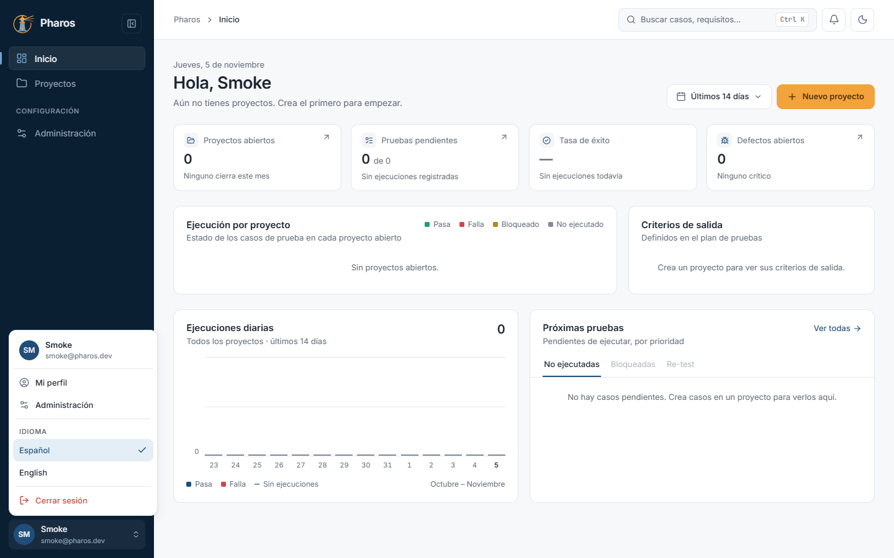
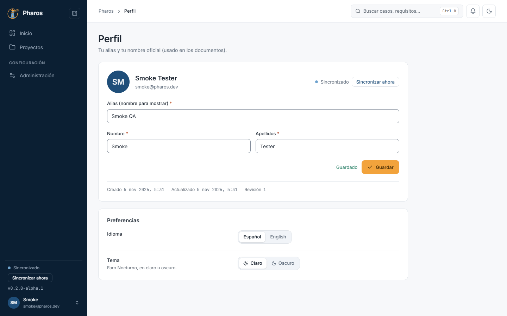

<!-- Generado por `npm run manual` desde e2e/tours/01-acceso.tour.ts y docs/manual/fuentes/acceso.md. No lo edites a mano: edita la fuente. -->

# 1. Acceso y cuenta

## Para qué sirve

Pharos guarda tus datos cifrados en tu equipo y los sincroniza con un servidor
cuando hay conexión. Para eso necesitas una cuenta: con ella entras, se
identifica quién hizo cada cambio y tus proyectos llegan a tus otros equipos.
Tu **nombre oficial** (nombre y apellidos) firma los documentos que exportas;
el **alias** es como te ve el resto de la aplicación.

## Paso a paso

### 1.1. La pantalla de entrada

Al abrir Pharos sin sesión ves «Iniciar sesión»: correo, contraseña y el botón «Entrar». «Continuar con Google» llegará más adelante («Próximamente»). A la derecha, lo que ofrece la aplicación.

### 1.2. Si la contraseña no es correcta

Con un correo o una contraseña incorrectos, Pharos lo dice bajo el formulario y no entra.

### 1.3. Ver la contraseña mientras escribes

El ojo del campo «Contraseña» la muestra u oculta, para comprobar lo que has tecleado.

### 1.4. Idioma de la aplicación

Desde la entrada puedes cambiar el idioma (español o inglés) antes de iniciar sesión.

### 1.5. Crear una cuenta

«Regístrate» abre «Crear cuenta»: alias, nombre, apellidos, correo y contraseña. El nombre oficial es el que firma los documentos.

El correo de una cuenta solo puede registrarse una vez; si ya existe, Pharos
lo dice («Ese correo ya está registrado»).

### 1.6. Primera entrada con la cuenta nueva

«Registrarme» crea la cuenta y entra directamente en «Inicio», todavía sin proyectos.

### 1.7. Cerrar sesión

El menú de usuario (tu avatar, arriba a la derecha) tiene «Cerrar sesión». Al cerrar, Pharos vuelve a la entrada.

### 1.8. Iniciar sesión

Escribe tu correo y contraseña y pulsa «Entrar». La sesión se recuerda en este equipo hasta que la cierres.

### 1.9. El menú de usuario

Desde el avatar llegas a «Mi perfil», a «Administración», al idioma (español o inglés) y a «Cerrar sesión».

### 1.10. Tu perfil

«Mi perfil» muestra tu alias y tu nombre oficial, la auditoría de la cuenta y tus preferencias de idioma y tema.

### 1.11. Cambiar el alias

Edita el alias o el nombre y pulsa «Guardar»: aparece «Guardado» y sube la revisión del perfil.

## Consejos

- La sesión se recuerda en el equipo: no hace falta entrar cada vez. Cierra
  sesión si compartes el equipo.
- Sin conexión puedes seguir trabajando; los cambios se envían al volver a
  conectar (capítulo 10, «Sincronización»).
- El idioma también se cambia después, desde el menú de usuario o el perfil.

## Véase también

- [Guía de pruebas de la beta](../guia-beta.md), apartado 2 «Antes de empezar».
- [Glosario](../GLOSARIO.md): «Elaborado por / Autor».

---

[Índice](README.md) · [Inicio, proyectos y ajustes](02-proyectos.md) →
