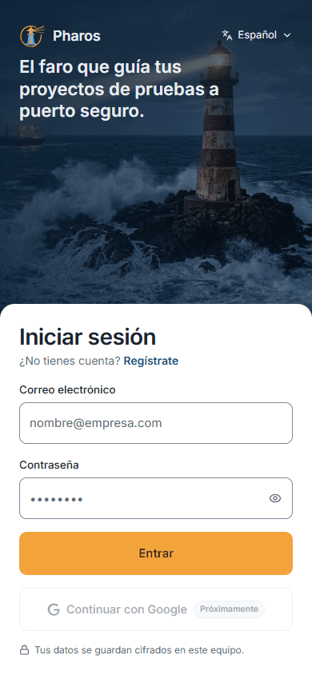
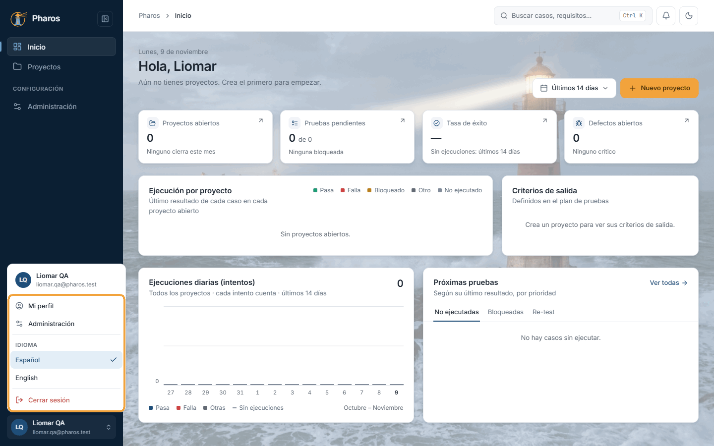
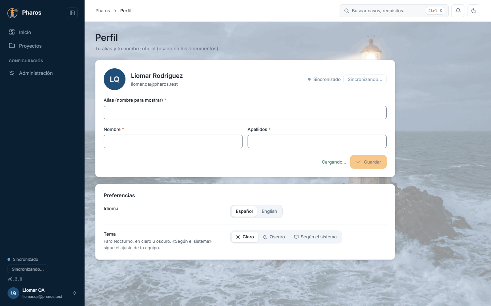
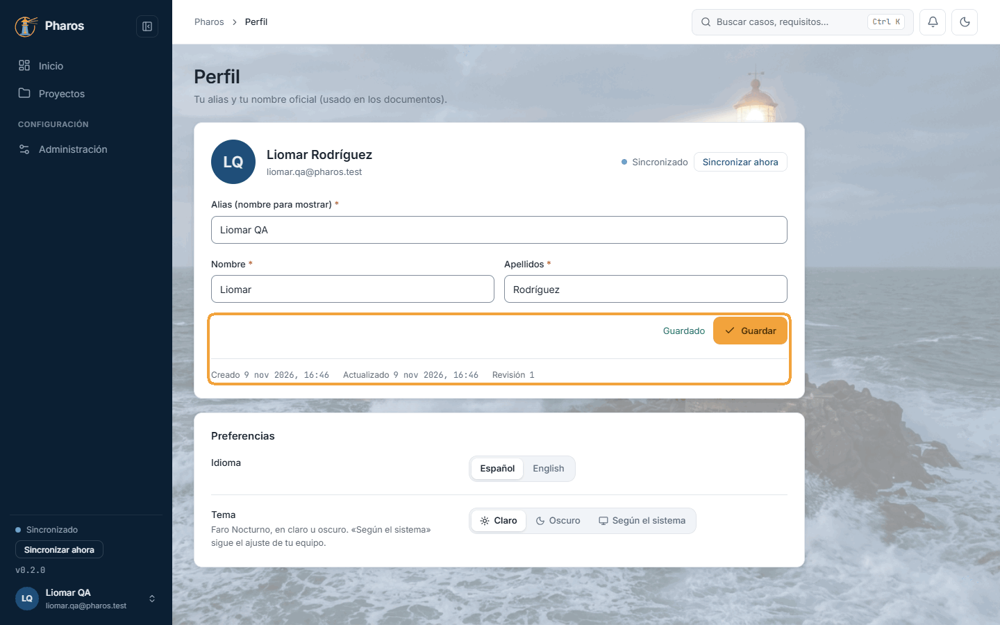

<!-- Generado por `npm run manual` desde e2e/tours/01-acceso.tour.ts y docs/manual/fuentes/acceso.md. No lo edites a mano: edita la fuente. -->

# 1. Acceso y cuenta

## Para qué sirve

Pharos guarda tus datos cifrados en tu equipo y los sincroniza con un servidor
cuando hay conexión. Para eso necesitas una cuenta: con ella entras, queda
registrado quién hizo cada cambio y tus proyectos llegan a tus otros equipos.

Tu cuenta tiene dos nombres:

- El **alias** es como te ve el resto de la aplicación: el menú lateral, el
  menú de usuario, los cambios que haces.
- El **nombre oficial** (nombre y apellidos) firma los documentos que exportas,
  como el plan de pruebas («Elaborado por»).

En este manual, el proyecto que se prueba es **la propia aplicación Pharos**.
Lo recorre **Liomar Rodríguez**, responsable de QA de Pharos, con su cuenta
«Liomar QA». Los proyectos y los datos son solo un ejemplo: en tu caso verás
los tuyos.

## Paso a paso

### 1.1. La pantalla de entrada

Al abrir Pharos sin una sesión iniciada aparece «Iniciar sesión». A la izquierda está el formulario: tu correo electrónico, tu contraseña y el botón «Entrar»; bajo el título, el enlace «Regístrate» por si aún no tienes cuenta. «Continuar con Google» ya se ve, pero todavía no funciona («Próximamente»). A la derecha, un resumen de lo que ofrece Pharos. Al pie, la versión instalada: dila siempre si informas de un fallo.

### 1.2. Elegir el idioma antes de entrar

El selector de idioma, en la esquina inferior izquierda (muestra el idioma actual, «Español»), despliega los idiomas disponibles: español e inglés. Muévete por la lista con las flechas y elige con Intro, o haz clic. Toda la interfaz cambia al momento, también esta pantalla, y Pharos lo recuerda en este equipo. Una vez dentro, el idioma se cambia desde el menú de usuario o desde «Mi perfil».

### 1.3. La contraseña se escribe oculta

Por seguridad, cada carácter de la contraseña aparece como un punto. Si dudas de lo que has tecleado, el icono del ojo, a la derecha del campo («Mostrar contraseña»), te deja comprobarlo.

### 1.4. Ver la contraseña mientras escribes

Al pulsar el ojo, la contraseña se muestra en claro (en este ejemplo, «Ejemplo-2026») y el icono pasa a un ojo tachado. Vuelve a pulsarlo para ocultarla antes de que otra persona pueda verla en tu pantalla.

### 1.5. Si el correo o la contraseña no son correctos

Si el correo o la contraseña no corresponden a ninguna cuenta, Pharos no entra y lo indica bajo el formulario: «Correo o contraseña incorrectos.». Por seguridad no dice cuál de los dos falla, así que revisa ambos (el ojo te ayuda con la contraseña) y vuelve a intentarlo. Tras varios intentos seguidos, pide que esperes un momento antes de probar otra vez.

### 1.6. Crear una cuenta

Si es tu primera vez, «Regístrate» abre «Crear cuenta». Escribe tu alias, tu nombre, tus apellidos, tu correo y una contraseña de al menos 8 caracteres. En este ejemplo, Liomar Rodríguez, responsable de QA de Pharos, crea la cuenta con la que hará todas las pruebas del manual, con el alias «Liomar QA». El alias es como te ve el resto de la aplicación; el nombre y los apellidos forman tu nombre oficial, el que firma los documentos que exportas (el plan de pruebas, por ejemplo). Todos los campos son obligatorios: si falta uno, el formulario te lleva a él.

El correo de una cuenta solo puede registrarse una vez. Si ya existe, Pharos
lo dice («Ese correo ya está registrado»).

### 1.7. Primera entrada con la cuenta nueva

«Registrarme» (o Intro) crea la cuenta y entra directamente, sin pasos intermedios. Como la cuenta es nueva, «Inicio» aparece vacío: el saludo y la invitación a crear tu primer proyecto con «Nuevo proyecto» (capítulo 4). Tu alias y tu correo quedan al pie del menú lateral, junto al estado de la sincronización.

### 1.8. Cerrar sesión

Para salir, abre el menú de usuario con un clic en tu avatar, al pie del menú lateral, y elige «Cerrar sesión». Pharos vuelve a la pantalla de entrada y borra de este equipo los datos en caché de tu cuenta; lo que ya está sincronizado sigue en el servidor. Ciérrala siempre si compartes el equipo: si no, la sesión sigue abierta la próxima vez que alguien abra la aplicación.

### 1.9. La entrada en el móvil

En una pantalla estrecha (un móvil, o la ventana muy reducida), la foto queda arriba con el logotipo y el selector de idioma, y el formulario sube como una hoja desde abajo. Es el mismo formulario, con los mismos campos y errores; solo se desplaza la hoja, no la foto.

### 1.10. Iniciar sesión

Para entrar, escribe tu correo y tu contraseña y pulsa «Entrar» (o Intro); el botón pasa a «Entrando…» mientras tanto. Pharos abre «Inicio» y recuerda la sesión en este equipo hasta que la cierres, así que no tendrás que escribirla cada vez que abras la aplicación. En el resto del manual, Liomar trabaja con esta misma cuenta.

En la app de escritorio, Pharos guarda la sesión en el almacén de credenciales
del sistema (en Windows, el Administrador de credenciales), nunca en un archivo
de texto. En la versión web la guarda el navegador.

### 1.11. El menú de usuario

El menú de tu avatar reúne lo que es tuyo y no de un proyecto: «Mi perfil», «Administración» (la configuración de la aplicación, capítulo 15), el idioma de la interfaz (español o inglés, con una ✓ en el actual; se aplica al momento) y «Cerrar sesión». Se recorre con las flechas ↑ ↓ y se cierra con Esc.

### 1.12. Tu perfil

«Mi perfil» reúne tus datos: el alias y tu nombre oficial (nombre y apellidos), el estado de la sincronización con «Sincronizar ahora» y, en «Preferencias», el idioma y el tema (claro u oscuro), que se aplican al momento en este equipo. La cuenta de este ejemplo tiene los datos con los que Liomar la creó.

### 1.13. Cambiar el alias y el nombre

Corrige lo que haga falta y pulsa «Guardar» (o Intro). En este ejemplo, Liomar escribió su apellido sin tilde al registrarse y lo corrige: «Rodríguez». Ese nombre oficial es el que firma el plan de pruebas que redacta en el capítulo 5. Junto al botón aparece «Guardado» (si cambias el alias, el avatar y el pie del menú lateral lo muestran al momento) y, debajo, cuándo se creó y se actualizó tu perfil y su número de revisión, que sube con cada cambio. Los cambios llegan a tus otros equipos con la siguiente sincronización.

## Atajos de teclado

| Tecla | Dónde | Qué hace |
| --- | --- | --- |
| Tab / Mayús+Tab | Formulario de entrada | Pasa de un campo al siguiente o al anterior |
| Intro | Formulario de entrada o de registro | Envía el formulario («Entrar» o «Registrarme») |
| Intro | «Mi perfil» | Guarda el alias y el nombre |
| ↑ ↓ e Intro | Selector de idioma y menú de usuario | Recorren las opciones y eligen una |
| Esc | Selector de idioma y menú de usuario | Cierra el menú y devuelve el foco a su botón |

## Si algo no sale

- **«Correo o contraseña incorrectos.»** Revisa los dos: Pharos no dice cuál
  falla. El ojo del campo de la contraseña te deja ver lo que has escrito.
- **«Demasiados intentos. Espera un momento y vuelve a intentarlo.»** Tras
  10 intentos en un minuto, el servidor deja de aceptar más hasta que pasa
  ese minuto. Espera y vuelve a probar.
- **«Ese correo ya está registrado.»** Ya existe una cuenta con ese correo:
  entra con ella en lugar de crear otra.
- **«Revisa los datos introducidos.»** Falta un campo, el correo no tiene
  formato de correo o la contraseña tiene menos de 8 caracteres.
- **«No se pudo conectar con el servidor.»** Para entrar por primera vez en un
  equipo, Pharos necesita el servidor. Comprueba tu conexión. Si ya habías
  entrado antes en este equipo, Pharos abre tu sesión guardada aunque no haya
  conexión.
- **«Sin conexión»**, en una pastilla de la barra superior. Pharos no llega al
  servidor, pero puedes seguir trabajando: tus cambios se guardan en el equipo
  y se envían solos cuando vuelve la conexión (capítulo 15, «Sincronización»).
- **«Tu sesión ha caducado. Vuelve a iniciar sesión.»** Por seguridad, la
  sesión dura un tiempo limitado, y Pharos la renueva sola mientras la usas. Si
  el servidor ya no la acepta (por ejemplo, tras un mes sin abrir Pharos en ese
  equipo), te devuelve a la pantalla de entrada. Lo que tenías sin guardar en
  una ejecución manual se conserva: lo encontrarás al volver a entrar.

## En el móvil

- En una pantalla estrecha, la foto queda arriba y el formulario sube como una
  hoja; el selector de idioma pasa a la barra de la foto.
- Una vez dentro, el menú de usuario se abre desde tu avatar, en la barra
  superior, como una hoja inferior. Incluye además el cambio de tema y el
  estado de la sincronización.
- «Perfil» tiene su propio botón en la barra inferior, y desde el perfil
  también puedes cerrar la sesión.

## Consejos

- La sesión se recuerda en el equipo: no hace falta entrar cada vez. Cierra la
  sesión si compartes el equipo.
- Escribe bien tu nombre y tus apellidos antes de exportar documentos: son los
  que firman el plan de pruebas.
- El idioma también se puede cambiar después, desde el menú de usuario o desde
  el perfil; el tema, desde el perfil, la barra superior o «Administración ›
  General» (capítulo 15), donde además puedes elegir «Según el sistema».
- La clave de recuperación, que sirve para abrir tus datos en un equipo nuevo,
  ya no está en el perfil: está en «Administración › Seguridad» (capítulo 15).

## Véase también

- [Guía de pruebas de la beta](../guia-beta.md), apartado 2 «Antes de empezar».
- [Glosario](../GLOSARIO.md): «Alias / nombre para mostrar», «Nombre oficial», «Elaborado por / Autor».
- Capítulo 2, «La aplicación de un vistazo»: el menú lateral, la barra
  superior y el menú de usuario.
- Capítulo 19, «Si algo sale mal»: si la base de datos local no abre.

---

[Índice](README.md) · [La aplicación de un vistazo](02-navegacion.md) →
