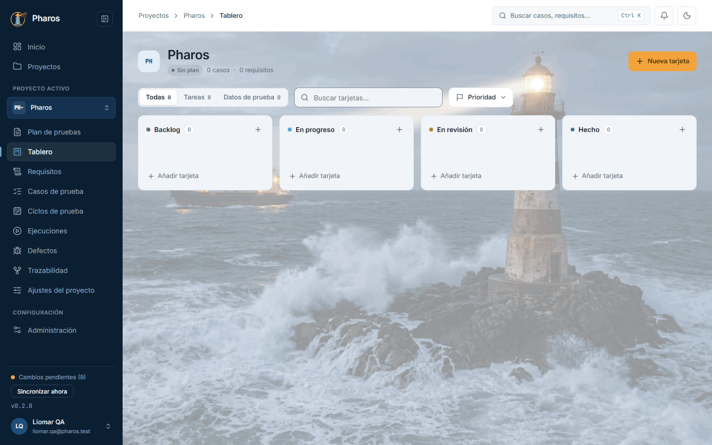
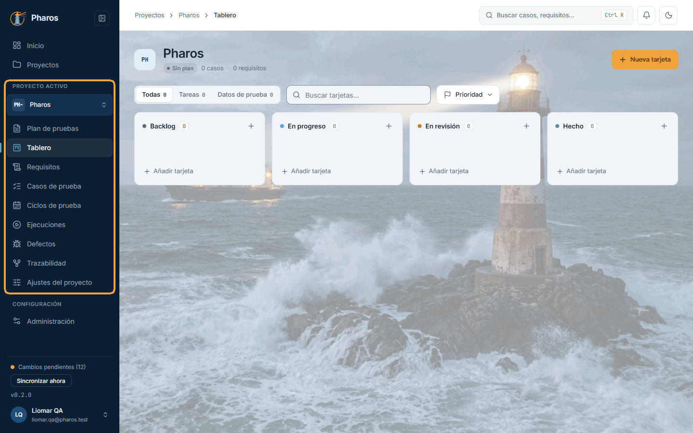
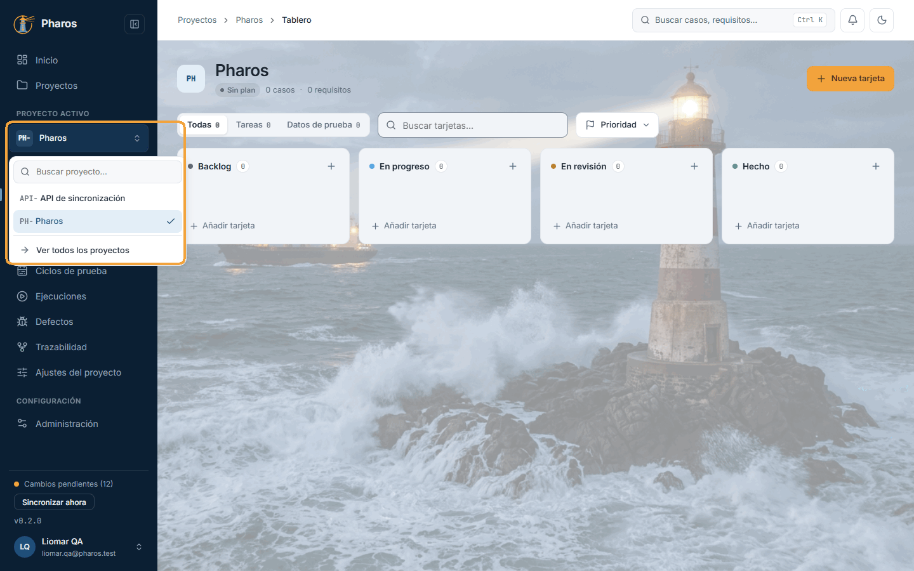
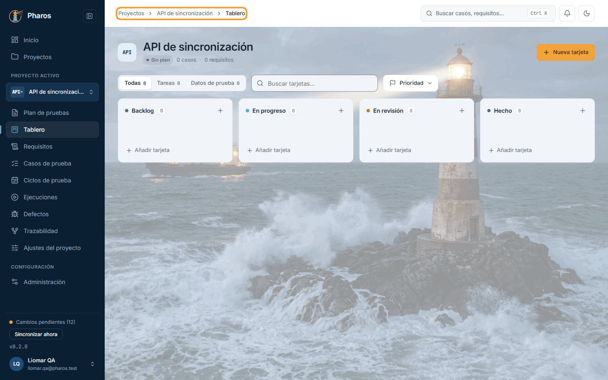
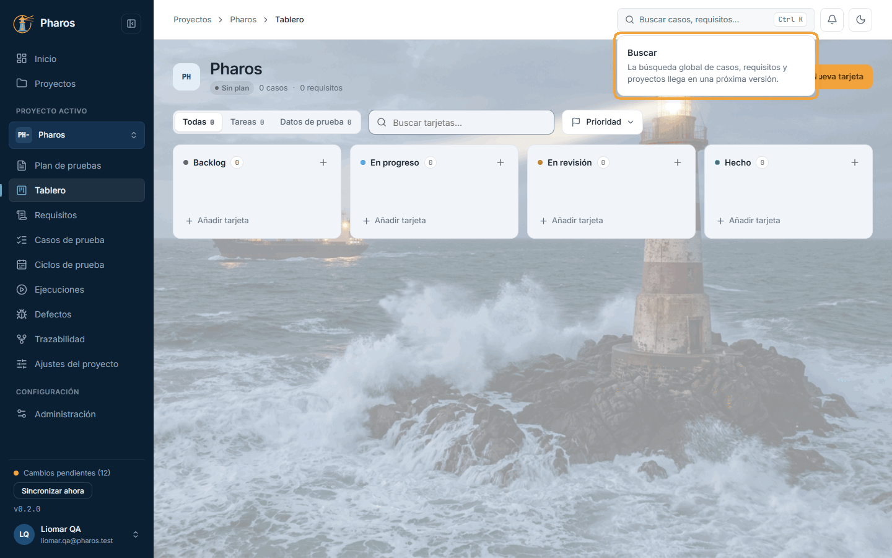
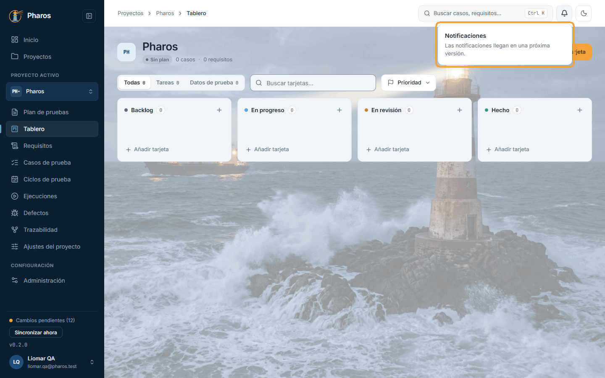
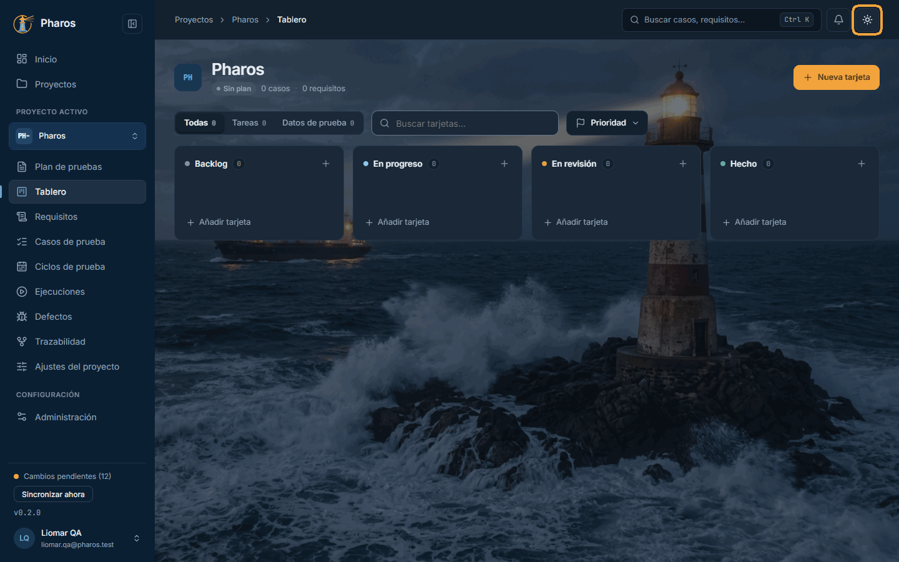
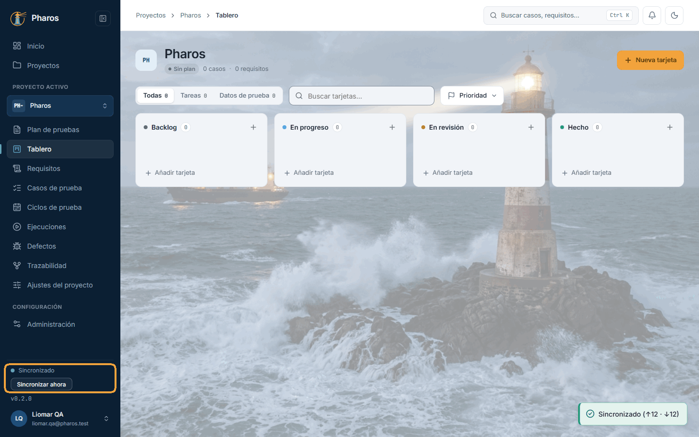
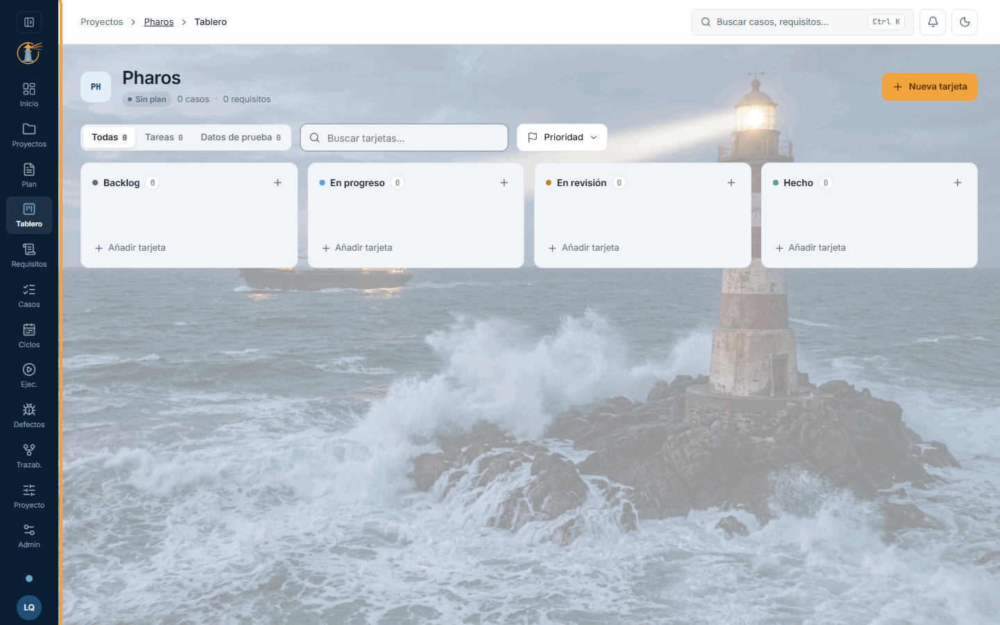
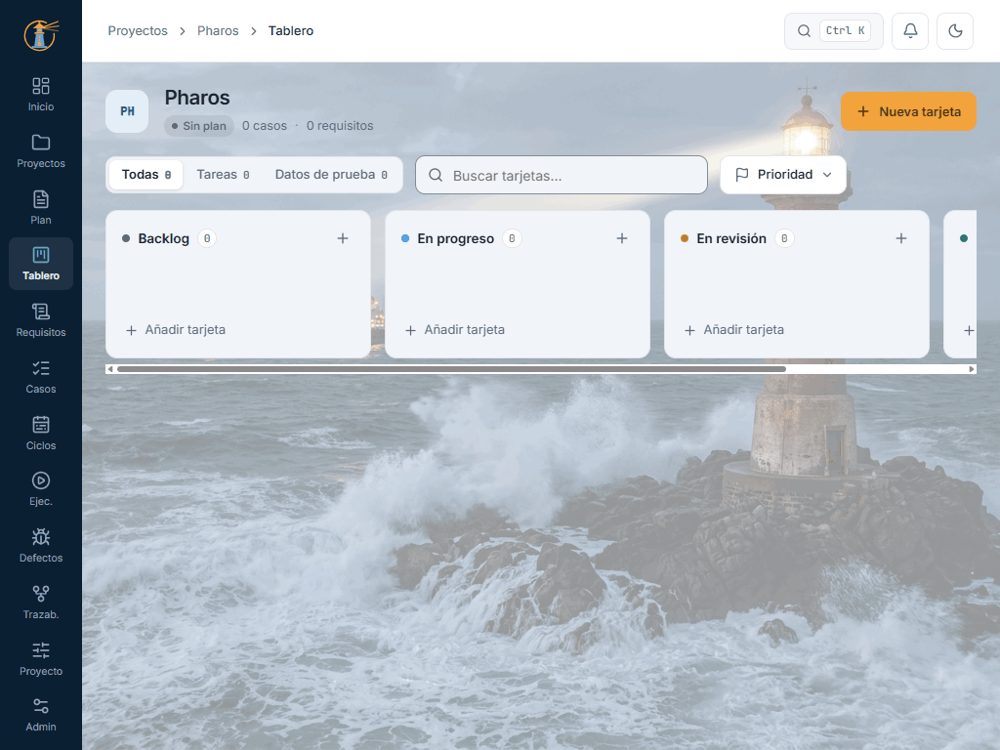

<!-- Generado por `npm run manual` desde e2e/tours/02-navegacion.tour.ts y docs/manual/fuentes/navegacion.md. No lo edites a mano: edita la fuente. -->

# 2. La aplicación de un vistazo

## Para qué sirve

Antes de entrar en cada tarea, conviene conocer lo que todas las pantallas de
Pharos tienen en común: el **menú lateral**, la **barra superior** y el
**contenido**. Con esto sabrás siempre dónde estás, cómo moverte de un proyecto
a otro y cómo está la sincronización de tus datos.

Dentro de un proyecto, el menú sigue el orden en que se hace el trabajo de
pruebas:

1. **Plan de pruebas:** qué se prueba, cómo, con quién y cuándo.
2. **Tablero:** las tareas del equipo y la preparación de datos.
3. **Requisitos:** la base de prueba, lo que la aplicación debe hacer.
4. **Casos de prueba:** cómo se comprueba cada requisito.
5. **Ciclos de prueba:** qué casos se ejecutan, dónde y contra qué versión.
6. **Ejecuciones:** los resultados, manuales o importados de la automatización.
7. **Defectos:** lo que falló y su seguimiento hasta cerrarlo.
8. **Trazabilidad:** la matriz que une requisitos, casos, resultados y defectos.
9. **Ajustes del proyecto:** nombre, numeración, campos y configuraciones.

## Paso a paso

### 2.1. La pantalla de Pharos

Todas las pantallas comparten la misma estructura. A la izquierda, el menú lateral: «Inicio» y «Proyectos» arriba; dentro de un proyecto, el bloque «Proyecto activo» con sus secciones; «Administración» en «Configuración» y, al pie, la sincronización, la versión instalada y tu menú de usuario. Arriba, la barra con la ruta (migas de pan), el buscador, las notificaciones y el cambio de tema. El resto es el contenido de la sección abierta: en este ejemplo, el «Tablero» del proyecto «Pharos».

### 2.2. Las secciones y el proceso de prueba

El bloque «Proyecto activo» va en el orden del proceso de prueba: cada sección sirve a una de sus actividades, como resume la tabla de debajo. La sección abierta queda resaltada. Al abrir un proyecto existente, Pharos entra en su «Tablero»; uno recién creado se abre en su «Plan de pruebas».

Cada sección del proyecto sirve a una actividad del proceso de prueba
(ISTQB CTFL v4, «Proceso de prueba»):

| Actividad del proceso | Sección de Pharos | Para qué la usas |
| --- | --- | --- |
| Planificación | Plan de pruebas | Fijar el alcance, el enfoque, los recursos, el calendario y los criterios de salida |
| Análisis | Requisitos | Definir la base de prueba: qué hay que comprobar y con qué riesgo |
| Diseño | Casos de prueba | Escribir cómo se comprueba cada requisito, con sus datos y su Gherkin |
| Implementación | Ciclos de prueba (y el Tablero, para preparar datos y entorno) | Decidir qué se ejecuta, en qué configuraciones y contra qué build |
| Ejecución | Ejecuciones y Defectos | Registrar los resultados, manuales o importados, e informar de lo que falla |
| Monitorización y control | Tablero, Trazabilidad e Inicio | Seguir el avance del trabajo, la cobertura de los requisitos y el estado de cada proyecto |
| Compleción | Criterios de salida (Inicio), informe de estado y cierre del ciclo | Decidir si se puede cerrar y dejar constancia del resultado |

«Ajustes del proyecto» no es una actividad: es la configuración del proyecto
(numeración, campos personalizados y configuraciones) que usan las demás.

### 2.3. Cambiar de proyecto

El selector de la parte superior del bloque, con el prefijo y el nombre del proyecto, salta a otro proyecto sin volver a la lista. Escribe para filtrar (útil con muchos proyectos), muévete con ↑ ↓ y elige con Intro o con un clic. Pharos abre la misma sección en el otro proyecto: si estabas en su «Tablero», llegas al «Tablero» del nuevo. «Ver todos los proyectos», al pie, abre la lista.

### 2.4. Dónde estás: las migas de pan

Tras elegir «API de sincronización», la barra superior muestra la ruta: «Proyectos › API de sincronización › Tablero». Cada tramo, menos el último, es un enlace: «Proyectos» vuelve a la lista. Si un nombre es muy largo, se recorta con «…» y se lee entero al pasar el ratón.

### 2.5. Buscar (Ctrl+K)

El buscador de la barra superior, o Ctrl+K desde cualquier pantalla (⌘K en Mac), será la búsqueda global de casos, requisitos y proyectos. En esta versión todavía no busca: el panel avisa de que llega en una próxima versión. Mientras tanto, cada lista tiene su propio buscador y, en los casos, Ctrl+P salta a uno concreto (capítulo 8). Esc cierra el panel.

### 2.6. Notificaciones

La campana, junto al buscador, abrirá tus notificaciones. Como la búsqueda, todavía es un adelanto: el panel avisa de que llegan en una próxima versión. Los avisos de lo que haces (guardado, exportado, sincronizado) aparecen por ahora un momento abajo a la derecha.

### 2.7. Tema claro u oscuro

El botón de la luna, a la derecha de la barra superior, pasa Pharos al tema oscuro («Faro Nocturno»); en el tema oscuro es un sol y vuelve al claro. Se aplica al momento y se recuerda en este equipo. En «Administración › General» (capítulo 15) hay además la opción «Según el sistema», que sigue el ajuste de Windows.

### 2.8. La sincronización, al pie del menú

Al pie del menú lateral, un punto de color y una palabra dicen cómo está la sincronización con el servidor: «Sincronizado», «Cambios pendientes (N)», «Sin conexión» o «Conflictos (N)». Pharos sincroniza solo al entrar y cuando vuelve la conexión (y, si activas «Sincronización automática» en Administración › Sincronización, capítulo 15, cada pocos minutos); «Sincronizar ahora» lo hace al momento y avisa de cuántos cambios envió (↑) y recibió (↓). Con conflictos aparece «Revisar conflictos» (capítulo 15).

### 2.9. Contraer el menú lateral

El botón junto al logotipo contrae el menú lateral a una tira de iconos con su nombre corto, para dar más espacio a tablas y editores; al pasar el ratón, cada icono dice su nombre completo. Vuelve a pulsarlo para expandirlo. Pharos recuerda tu elección en este equipo. En la tira, la sincronización es solo el punto: púlsalo para sincronizar.

### 2.10. Pantallas medianas: la tira de iconos

Pharos se adapta al ancho de la ventana. Por debajo de 1280 px (una tableta, o la ventana a media pantalla), el menú lateral es siempre la tira de iconos, el buscador se reduce a la lupa (Ctrl+K sigue funcionando), las tablas ocultan sus columnas menos importantes y lo que no cabe, como las columnas del Tablero, se desplaza de lado. Si la ventana es baja, desplaza la tira para llegar a tu avatar. Por debajo de 600 px pasa al diseño del móvil, con una barra inferior (capítulo 18).

## Las preguntas de Pharos

Cuando una acción necesita tu visto bueno, Pharos lo pregunta con un diálogo
propio, nunca con una ventana del navegador. Hay dos clases:

| Clase | Cuándo aparece | Cómo se responde |
| --- | --- | --- |
| Normal | Lo que se puede rehacer o solo pierde lo que no guardaste: descartar cambios, restaurar una revisión, cerrar un run, cambiar de proveedor de IA o reemplazar su clave, quitar un caso del ciclo, desvincular | Con sus botones, o con Esc o un clic fuera, que equivalen a «Cancelar» |
| Crítica | El botón borra algo guardado y no hay vuelta atrás: eliminar un proyecto, caso, requisito, defecto, tarjeta, ciclo, run o plantilla, acortar la retención, descartar un borrador de ejecución con sus adjuntos, quitar una evidencia | Solo con sus botones: Esc y el clic fuera no hacen nada, para que no se acepte ni se descarte por accidente. El botón de confirmar es rojo |

## Atajos de teclado

Estos atajos funcionan en cualquier pantalla. Cada capítulo explica los suyos.

| Tecla | Qué hace |
| --- | --- |
| Ctrl+K (⌘K en Mac) | Abre la búsqueda. No actúa si hay un diálogo abierto |
| Tab / Mayús+Tab | Pasa al control siguiente o al anterior. El primer Tab de cada pantalla muestra «Saltar al contenido», que lleva directamente al contenido sin recorrer el menú |
| Intro o Espacio | Pulsa el botón o el enlace enfocado |
| Esc | Cierra el menú, panel o diálogo abierto y devuelve el foco al botón que lo abrió. En una confirmación normal equivale a «Cancelar»; las confirmaciones críticas (las que borran algo guardado para siempre) solo responden a sus botones |
| ↑ ↓ | Recorren las opciones de un menú (también el selector de proyecto) |
| Inicio / Fin | Saltan a la primera o a la última opción de un menú |
| ← → | Cambian de pestaña en las pestañas y en los controles segmentados (por ejemplo, Lista / Tablero) |

Dentro de un diálogo, Tab no sale de él: recorre solo sus controles hasta que
lo cierras.

## Si algo no sale

- **No veo «Proyecto activo» en el menú.** Solo aparece dentro de un proyecto.
  Abre uno desde «Proyectos» o desde el Inicio.
- **El menú lateral es una tira de iconos y no puedo expandirlo.** La ventana
  mide menos de 1280 px de ancho. Agrándala o maximízala: el botón de contraer
  solo existe en pantallas anchas.
- **La búsqueda y la campana solo dicen «próximamente».** Es lo esperado en
  esta versión. Usa el buscador de cada lista y, en los casos, Ctrl+P.
- **Ctrl+K no hace nada.** Hay un diálogo abierto: ciérralo antes con Esc.
- **«Sincronizar ahora» no aparece.** Estás sin conexión. Pharos sincroniza
  solo cuando vuelve la conexión.
- **Mis cambios tardan en llegar al otro equipo.** Sin la sincronización
  automática, Pharos solo sincroniza al entrar, al volver la conexión y con
  «Sincronizar ahora». Púlsalo, o activa «Sincronización automática» en
  Administración › Sincronización (capítulo 15).
- **Veo «Conflictos (N)».** El mismo elemento se cambió en dos equipos a la
  vez. Pulsa «Revisar conflictos» y elige qué versión conservar (capítulo 15).

## En el móvil

- Por debajo de 600 px de ancho, el menú lateral desaparece:
  - Arriba queda una barra con el logotipo o, dentro de un proyecto, la
    flecha «Volver a Proyectos», la sección y el nombre del proyecto.
  - Abajo, una barra con «Inicio», «Proyectos», «Admin» y «Perfil».
- Las secciones del proyecto se recorren con las píldoras que hay bajo la barra
  superior. Desliza para ver las demás: van en el mismo orden que en el
  escritorio.
- La lupa convierte la barra superior en un buscador. La flecha o Esc lo
  cierran.
- El tema y la sincronización están en el menú de tu avatar, arriba a la
  derecha.
- Los menús se abren como hojas desde abajo.

## Consejos

- Contrae el menú lateral cuando trabajes con tablas anchas, como la matriz de
  trazabilidad o el editor de casos en vista dividida.
- El selector de proyecto conserva la sección: compara rápidamente el Tablero
  o los Defectos de dos proyectos.
- Si informas de un fallo, di la versión que aparece al pie del menú lateral
  (en este manual, la 0.2.0).

## Véase también

- Capítulo 1, «Acceso y cuenta»: el menú de usuario.
- Capítulo 4, «Proyectos»: crear y abrir proyectos.
- Capítulo 15, «Administración»: tema, idioma, sincronización y conflictos.
- Capítulo 18, «Pantallas estrechas y móvil».
- [Glosario](../GLOSARIO.md): «Conflicto de sincronización», «Conflicto de clave».

---

← [Acceso y cuenta](01-acceso.md) · [Índice](README.md) · [Inicio](03-inicio.md) →
