<!-- Generado por `npm run manual` desde e2e/tours/02-navegacion.tour.ts y docs/manual/fuentes/navegacion.md. No lo edites a mano: edita la fuente. -->

# 2. La aplicación de un vistazo

## Para qué sirve

Antes de entrar en cada tarea, conviene conocer lo que todas las pantallas de
Pharos tienen en común: el **menú lateral**, la **barra superior** y el
**contenido**. Con esto sabrás siempre dónde estás, cómo moverte de un proyecto
a otro y cómo está la sincronización de tus datos.

Dentro de un proyecto, el menú sigue el orden en que se hace el trabajo de
pruebas:

1. **Plan de pruebas:** qué se prueba, cómo, con quién y cuándo.
2. **Tablero:** las tareas del equipo y la preparación de datos.
3. **Requisitos:** la base de prueba, lo que la aplicación debe hacer.
4. **Casos de prueba:** cómo se comprueba cada requisito.
5. **Biblioteca:** los pasos compartidos y las tablas de datos (datasets) que
   reutilizan los casos.
6. **Ciclos de prueba:** qué casos se ejecutan, dónde y contra qué versión.
7. **Ejecuciones:** los resultados, manuales o importados de la automatización.
8. **Defectos:** lo que falló y su seguimiento hasta cerrarlo.
9. **Trazabilidad:** la matriz que une requisitos, casos, resultados y defectos.
10. **Ajustes del proyecto:** nombre, numeración, campos y configuraciones.

Encima de todo, el **selector de workspace** dice en qué espacio de trabajo
estás y con qué rol. Al empezar solo tienes «Personal», tu espacio propio;
los workspaces compartidos con tu equipo llegan en los capítulos 20 y 21.
«Proyectos» muestra solo los proyectos del workspace elegido.

## Paso a paso

### 2.1. La pantalla de Pharos

Todas las pantallas comparten la misma estructura. A la izquierda, el menú lateral: arriba, el selector de workspace («Personal», con tu rol); debajo, «Inicio» y «Proyectos»; dentro de un proyecto, el bloque «Proyecto activo» con sus secciones; «Administración» en «Configuración» y, al pie, la sincronización y tu menú de usuario. Arriba del todo, el logotipo y el nombre «Pharos», que abren «Acerca de Pharos»; en el borde derecho del menú, a media altura, la pestaña que lo contrae. Arriba, la barra con la ruta (migas de pan), el buscador, las notificaciones y el cambio de tema. El buscador (o Ctrl+K, ⌘K en Mac) abre un panel que de momento solo avisa de que la búsqueda global llega en una próxima versión: mientras tanto, cada lista tiene su propio buscador y, en los casos, Ctrl+P salta a uno concreto (capítulo 8). El resto es el contenido de la sección abierta: en este ejemplo, el «Tablero» del proyecto «Pharos».

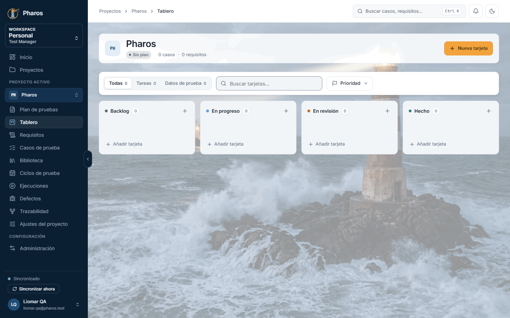

### 2.2. El selector de workspace

Un workspace es un espacio de trabajo con sus proyectos y sus personas. El selector de la parte de arriba del menú lateral dice en cuál estás y con qué rol: al entrar, «Personal», tu espacio propio, donde eres Test Manager. Despliégalo para cambiar a otro workspace, «Crear workspace», «Unirse con un código…» o abrir «Miembros y roles». «Proyectos» y el selector de proyecto muestran solo los proyectos del workspace elegido. Los workspaces compartidos con tu equipo se explican en los capítulos 20 y 21.

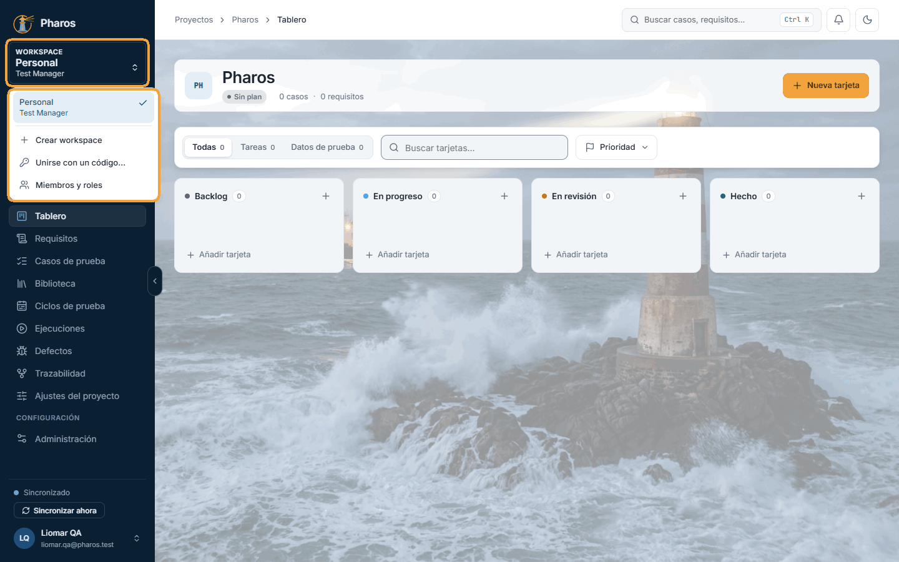

### 2.3. Acerca de Pharos

Un clic en el logotipo o en el nombre «Pharos», arriba del menú lateral, abre «Acerca de Pharos»: la versión instalada y su compilación, la plataforma (escritorio o web), las tecnologías con que está hecha, la licencia, el responsable del proyecto y el asistente de IA que ayuda en su desarrollo. Con el teclado, llega a él con Tab y pulsa Intro o Espacio. Si informas de un fallo, di siempre la versión y la compilación. «Cerrar» o Esc lo cierran. En la tira de iconos también se abre desde el logotipo.

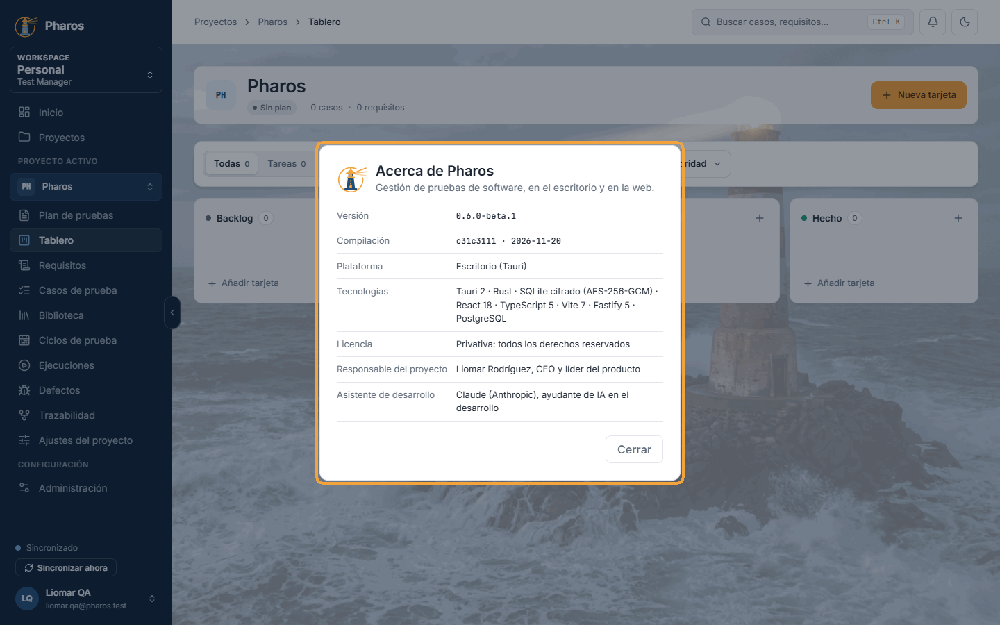

### 2.4. Las secciones y el proceso de prueba

El bloque «Proyecto activo» va en el orden del proceso de prueba: cada sección sirve a una de sus actividades, como resume la tabla de debajo. Un clic en una sección la abre y la deja resaltada: aquí, «Plan de pruebas». Al abrir un proyecto existente, Pharos entra en su «Tablero»; uno recién creado se abre en su «Plan de pruebas».

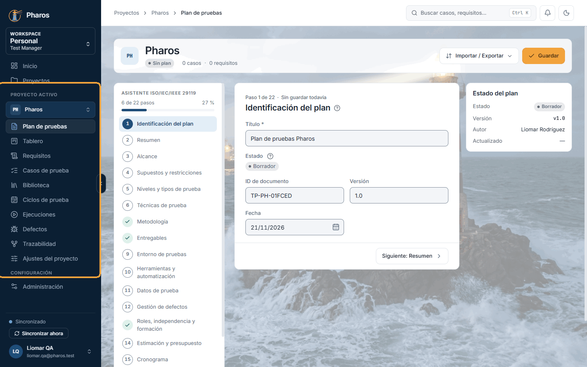

Cada sección del proyecto sirve a una actividad del proceso de prueba
(ISTQB CTFL v4, «Proceso de prueba»):

| Actividad del proceso | Sección de Pharos | Para qué la usas |
| --- | --- | --- |
| Planificación | Plan de pruebas | Fijar el alcance, el enfoque, los recursos, el calendario y los criterios de salida |
| Análisis | Requisitos | Definir la base de prueba: qué hay que comprobar y con qué riesgo |
| Diseño | Casos de prueba y Biblioteca | Escribir cómo se comprueba cada requisito, con sus datos y su Gherkin, y reutilizar pasos y tablas de datos en muchos casos |
| Implementación | Ciclos de prueba (y el Tablero, para preparar datos y entorno) | Decidir qué se ejecuta, en qué configuraciones y contra qué build |
| Ejecución | Ejecuciones y Defectos | Registrar los resultados, manuales o importados, e informar de lo que falla |
| Monitorización y control | Tablero, Trazabilidad e Inicio | Seguir el avance del trabajo, la cobertura de los requisitos y el estado de cada proyecto |
| Compleción | Criterios de salida (Inicio), informe de estado y cierre del ciclo | Decidir si se puede cerrar y dejar constancia del resultado |

«Ajustes del proyecto» no es una actividad: es la configuración del proyecto
(numeración, campos personalizados y configuraciones) que usan las demás.

### 2.5. Cambiar de proyecto

El selector de la parte superior del bloque, con el prefijo y el nombre del proyecto, salta a otro proyecto sin volver a la lista. Escribe para filtrar (útil con muchos proyectos), muévete con ↑ ↓ y elige con Intro o con un clic. Pharos abre la misma sección en el otro proyecto: si estabas en su «Plan de pruebas», llegas al «Plan de pruebas» del nuevo. «Ver todos los proyectos», al pie, abre la lista.

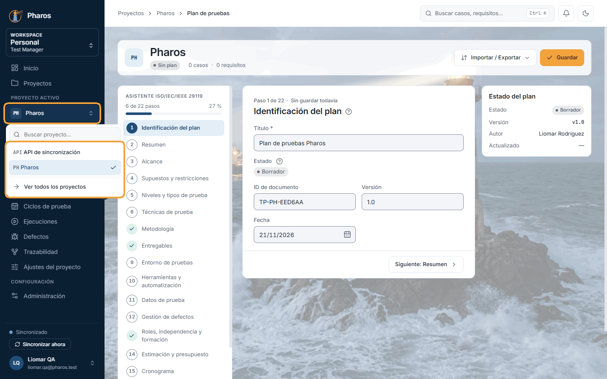

### 2.6. Dónde estás: las migas de pan

Tras elegir «API de sincronización», la barra superior muestra la ruta: «Proyectos › API de sincronización › Plan de pruebas». Cada tramo, menos el último, es un enlace: «Proyectos» vuelve a la lista. Si un nombre es muy largo, se recorta con «…» y se lee entero al pasar el ratón.

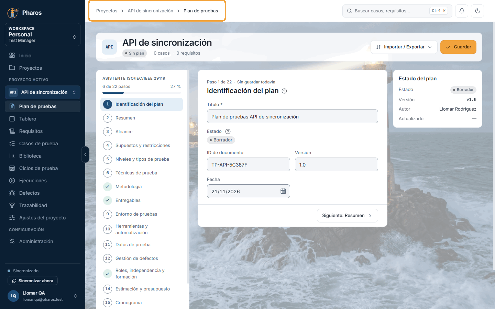

### 2.7. Notificaciones

La campana, junto al buscador, abre tus notificaciones: lo que otras personas hacen y te afecta (una invitación, un caso que te envían a revisar o que te aprueban, un defecto que te asignan, un ciclo que se cierra, quién entra o sale de tu workspace) y los conflictos de sincronización de este equipo. Se agrupan por día, el número rojo de la campana cuenta las que no has leído, «Sin leer» las filtra y cada una tiene su acción directa («Revisar», «Ver defecto», «Resolver»…). Abrirla la marca como leída; «Marcar todo como leído» las marca todas, también en tus otros equipos. Se guardan 90 días. Mientras Liomar trabaja solo, el panel dice «Estás al día»: lo de otras personas llega al compartir un workspace con el equipo (capítulo 20). Los avisos de lo que haces tú (guardado, exportado, sincronizado) siguen apareciendo un momento abajo a la derecha.

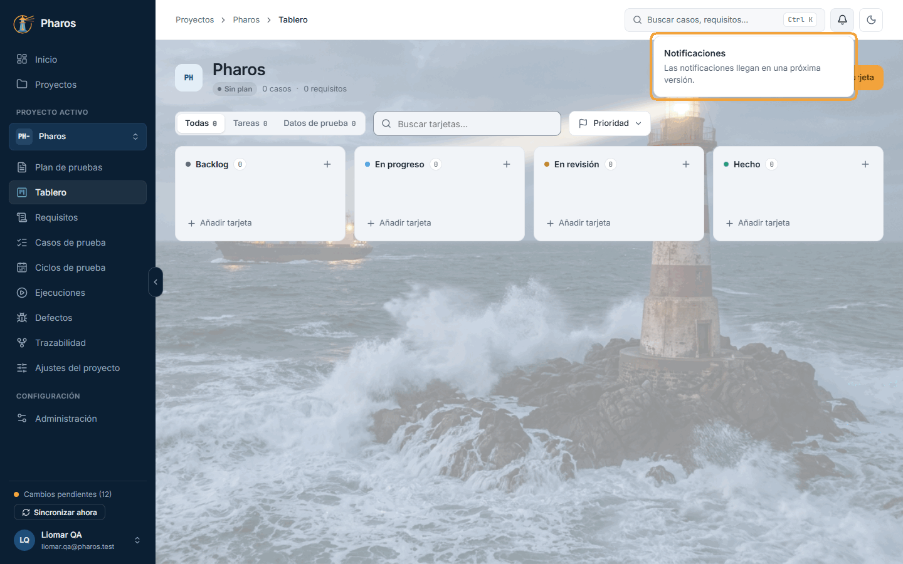

### 2.8. Tema claro u oscuro

El botón de la luna, a la derecha de la barra superior, pasa Pharos al tema oscuro («Faro Nocturno»); en el tema oscuro es un sol y vuelve al claro. Se aplica al momento y viaja con tu cuenta a tus otros equipos. En «Mi perfil › Preferencias» (capítulo 1) y en «Administración › General» (capítulo 15) hay además la opción «Según el sistema», que sigue el ajuste de Windows.

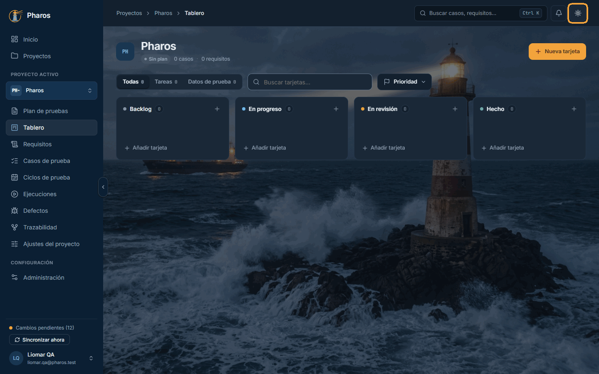

### 2.9. La sincronización, al pie del menú

Al pie del menú lateral, un punto de color y una palabra dicen cómo está la sincronización con el servidor: «Sincronizado», «Cambios pendientes (N)», «Sin conexión» o «Conflictos (N)». Pharos sincroniza solo al entrar y cuando vuelve la conexión (y, si activas «Sincronización automática» en Administración › Sincronización, capítulo 15, cada pocos minutos); «Sincronizar ahora» lo hace al momento y avisa de cuántos cambios envió (↑) y recibió (↓). Mientras sincroniza, también cuando lo hace solo, las flechas del botón giran y el punto se vuelve un anillo; si tu sistema pide reducir el movimiento, las flechas no giran y basta el anillo. Con conflictos aparece «Revisar conflictos» (capítulo 15). Lo que guarda otra ventana de Pharos o el CLI `pharos` en este equipo aparece solo en unos segundos, sin sincronizar.

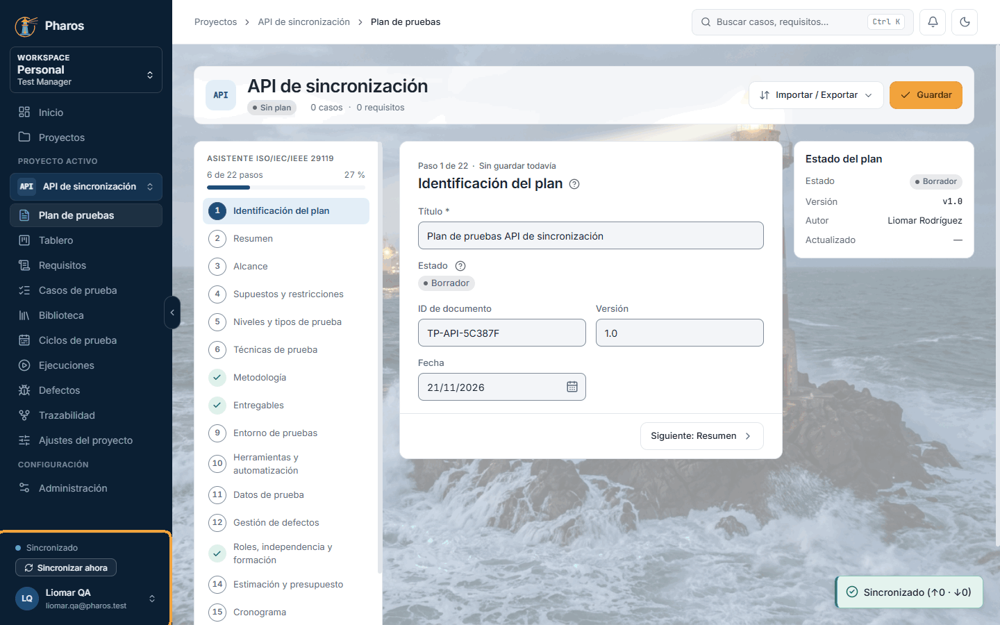

### 2.10. Contraer el menú lateral

La pestaña con la flecha ‹, en el borde derecho del menú lateral y a media altura, lo contrae a una tira de iconos con su nombre corto, para dar más espacio a tablas y editores; al pasar el ratón, cada icono dice su nombre completo. En la tira la flecha es ›: púlsala para expandirlo. Pharos recuerda tu elección en este equipo. Al pie de la tira, el icono de las flechas con el punto de estado sincroniza al pulsarlo; al pasar el ratón dice cómo está la sincronización, y sus flechas giran mientras sincroniza.

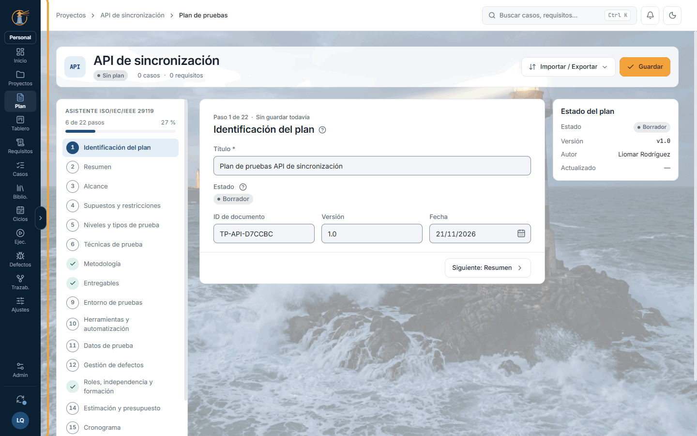

### 2.11. Pantallas medianas: la tira de iconos

Pharos se adapta al ancho de la ventana. Por debajo de 1280 px (una tableta, o la ventana a media pantalla), el menú lateral es siempre la tira de iconos, el buscador se reduce a la lupa (Ctrl+K sigue funcionando), las tablas ocultan sus columnas menos importantes y lo que no cabe, como las columnas del Tablero, se desplaza de lado. Si la ventana es baja y no caben todas las secciones, la tira de secciones se desplaza; la sincronización y tu avatar quedan siempre a la vista, abajo. Por debajo de 600 px pasa al diseño del móvil, con una barra inferior (capítulo 18).

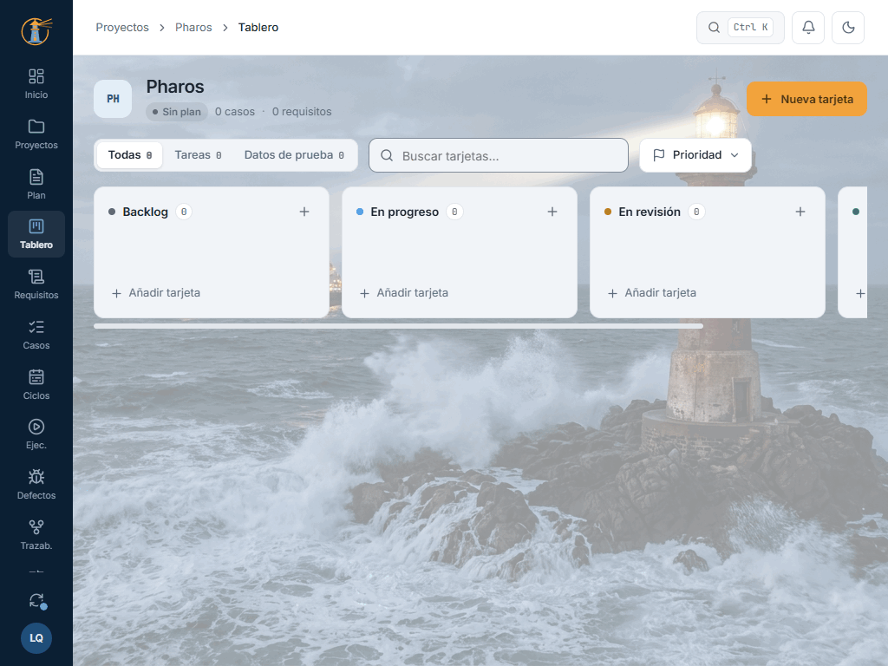

## Las preguntas de Pharos

Cuando una acción necesita tu visto bueno, Pharos lo pregunta con un diálogo
propio, nunca con una ventana del navegador. Hay dos clases:

| Clase | Cuándo aparece | Cómo se responde |
| --- | --- | --- |
| Normal | Lo que se puede rehacer o solo pierde lo que no guardaste: descartar cambios, restaurar una revisión, cerrar un run, cambiar de proveedor de IA o reemplazar su clave, quitar un caso del ciclo, desvincular | Con sus botones, o con Esc o un clic fuera, que equivalen a «Cancelar» |
| Crítica | El botón borra algo guardado: eliminar un proyecto, caso, requisito, defecto, tarjeta, ciclo, run o plantilla, acortar la retención, descartar un borrador de ejecución con sus adjuntos, quitar una evidencia | Solo con sus botones: Esc y el clic fuera no hacen nada, para que no se acepte ni se descarte por accidente. El botón de confirmar es rojo |

En la app de escritorio, lo que eliminas (proyectos, casos, requisitos,
defectos, tarjetas, ciclos, runs y plantillas) no desaparece al momento: va a
la **Papelera**, en «Administración › General» (capítulo 15), y desde allí se
restaura con todo lo que se borró con ello hasta que se cumple su plazo. En la
versión web, lo eliminado no se recupera. Quitar una evidencia, descartar un
borrador de ejecución o acortar la retención sí son definitivos.

## Los cuadros de texto

- Los cuadros de varias líneas (resumen del plan, descripciones, pasos para
  reproducir, notas…) empiezan con unas pocas líneas y crecen solos mientras
  escribes: no hace falta estirarlos. Solo un texto muy largo llega a su tope
  (en los textos del plan, la mitad de la ventana) y entonces se desplaza
  dentro del cuadro.
- Las palabras no se cortan con guion: pasan enteras a la línea siguiente.
- Donde algo se desplaza, Pharos muestra una barra fina sin flechas que se
  marca al pasar el ratón. En el móvil, la del sistema.

## Atajos de teclado

Estos atajos funcionan en cualquier pantalla. Cada capítulo explica los suyos.

| Tecla | Qué hace |
| --- | --- |
| Ctrl+K (⌘K en Mac) | Abre el panel de búsqueda (la búsqueda global llega en una próxima versión). No actúa si hay un diálogo abierto |
| Tab / Mayús+Tab | Pasa al control siguiente o al anterior. El primer Tab de cada pantalla muestra «Saltar al contenido», que lleva directamente al contenido sin recorrer el menú |
| Intro o Espacio | Pulsa el botón o el enlace enfocado |
| Esc | Cierra el menú, panel o diálogo abierto y devuelve el foco al botón que lo abrió. En una confirmación normal equivale a «Cancelar»; las confirmaciones críticas (las que borran algo guardado) solo responden a sus botones |
| ↑ ↓ | Recorren las opciones de un menú (también el selector de proyecto) |
| Inicio / Fin | Saltan a la primera o a la última opción de un menú |
| ← → | Cambian de pestaña en las pestañas y en los controles segmentados (por ejemplo, Lista / Tablero) |
| Alt+← / Alt+→ | Vuelven a la pantalla anterior o pasan a la siguiente. Si hay cambios sin guardar, Pharos pregunta antes |

Dentro de un diálogo, Tab no sale de él: recorre solo sus controles hasta que
lo cierras.

En la app de escritorio no hacen nada los atajos de navegador que sacarían algo
de Pharos: imprimir (Ctrl+P), abrir un archivo (Ctrl+O), guardar la página
(Ctrl+S), ver el código (Ctrl+U), abrir otra ventana (Ctrl+N), descargas
(Ctrl+J), historial (Ctrl+H), favoritos (Ctrl+D) y las herramientas de
desarrollo (F12). Recargar (F5), el zoom (Ctrl con +, − o 0, o con la rueda) y
buscar en la página (Ctrl+F) sí funcionan. Los atajos de Pharos van primero:
Ctrl+P en el editor de casos abre «Ir a un caso…». En la versión web, esos
atajos siguen siendo los de tu navegador.

## Si algo no sale

- **No veo «Proyecto activo» en el menú.** Solo aparece dentro de un proyecto.
  Abre uno desde «Proyectos» o desde el Inicio.
- **El menú lateral es una tira de iconos y no puedo expandirlo.** La ventana
  mide menos de 1280 px de ancho. Agrándala o maximízala: la pestaña de
  contraer y expandir, en el borde derecho del menú, solo existe en pantallas
  anchas.
- **La búsqueda solo dice «próximamente».** Es lo esperado en esta versión.
  Usa el buscador de cada lista y, en los casos, Ctrl+P.
- **La campana no muestra nada de otra persona.** Las notificaciones de otras
  personas llegan cuando trabajáis en el mismo workspace. Sin conexión, el
  panel enseña lo último que llegó; lo nuevo aparece al volver la conexión o
  tras sincronizar.
- **Una notificación no se abre.** Lo que señala ya no existe o no tienes
  acceso: la acción queda desactivada.
- **Ctrl+K no hace nada.** Hay un diálogo abierto: ciérralo antes con Esc.
- **«Sincronizar ahora» no aparece.** Estás sin conexión. Pharos sincroniza
  solo cuando vuelve la conexión. En la tira de iconos, el botón de las
  flechas sigue ahí, pero no hace nada hasta entonces: su tooltip lo dice.
- **Las flechas de sincronizar giran y no he pulsado nada.** Pharos está
  sincronizando solo: al entrar, al volver la conexión o con la
  sincronización automática. Paran al terminar.
- **Mis cambios tardan en llegar al otro equipo.** Sin la sincronización
  automática, Pharos solo sincroniza al entrar, al volver la conexión y con
  «Sincronizar ahora». Púlsalo, o activa «Sincronización automática» en
  Administración › Sincronización (capítulo 15).
- **Veo «Conflictos (N)».** El mismo campo de un elemento se cambió en dos
  equipos a la vez. Si se cambiaron campos distintos, Pharos los combina solo y
  no pregunta. Pulsa «Revisar conflictos»: el panel enseña solo los campos que
  chocan y eliges, campo a campo, cuál conservar, o «La mía en todo» o «La del
  servidor en todo» (capítulo 15).
- **Veo un aviso de solo lectura.** Tu rol en ese workspace es Viewer: puedes
  ver y exportar, pero no cambiar nada. Pide otro rol a su Test Manager
  (capítulo 20).
- **«Rechazado por permisos».** El servidor no aceptó un cambio porque tu rol
  en ese workspace no lo permite. «Descartar» deja la versión del servidor
  (capítulo 20).
- **No veo un proyecto en «Proyectos».** Está en otro workspace: cámbialo en el
  selector de la parte de arriba del menú lateral.

## En el móvil

- Por debajo de 600 px de ancho, el menú lateral desaparece:
  - Arriba queda una barra con el logotipo o, dentro de un proyecto, la
    flecha «Volver a Proyectos», la sección y el nombre del proyecto.
  - Abajo, una barra con «Inicio», «Proyectos», «Admin» y «Perfil».
- Las secciones del proyecto se recorren con las píldoras que hay bajo la barra
  superior. Desliza para ver las demás: van en el mismo orden que en el
  escritorio.
- La lupa convierte la barra superior en un buscador. La flecha o Esc lo
  cierran.
- La campana abre las notificaciones como una hoja desde abajo.
- El tema y la sincronización están en el menú de tu avatar, arriba a la
  derecha.
- Los menús se abren como hojas desde abajo.

## Consejos

- Contrae el menú lateral cuando trabajes con tablas anchas, como la matriz de
  trazabilidad o el editor de casos en vista dividida.
- El selector de proyecto conserva la sección: compara rápidamente el Tablero
  o los Defectos de dos proyectos.
- Si informas de un fallo, di la versión y la compilación de «Acerca de
  Pharos»: un clic en el logotipo o en el nombre, arriba del menú lateral.

## Véase también

- Capítulo 1, «Acceso y cuenta»: el menú de usuario.
- Capítulo 4, «Proyectos»: crear y abrir proyectos.
- Capítulos 20, «Trabajo en equipo», y 21, «Integraciones»: los workspaces
  compartidos, los roles y las notificaciones de otras personas.
- Capítulo 15, «Administración»: tema, idioma, sincronización y conflictos.
- Capítulo 18, «Pantallas estrechas y móvil».
- [Glosario](../GLOSARIO.md): «Conflicto de sincronización», «Conflicto de clave».

---

← [Acceso y cuenta](01-acceso.md) · [Índice](README.md) · [Inicio](03-inicio.md) →
