<!-- Generado por `npm run manual` desde e2e/tours/02-proyectos.tour.ts y docs/manual/fuentes/proyectos.md. No lo edites a mano: edita la fuente. -->

# 2. Inicio, proyectos y ajustes

## Para qué sirve

Un **proyecto** es la carpeta de un producto o una versión que pruebas: tiene
un plan de pruebas, sus casos, requisitos, ciclos, ejecuciones, defectos y un
planificador. «Inicio» resume todos tus proyectos de un vistazo, y en los
**ajustes** de cada proyecto se decide cómo se numeran sus casos, qué campos
propios tienen y en qué configuraciones (navegadores, dispositivos) se
ejecutan.

## Paso a paso

### 2.1. Inicio

«Inicio» resume tus proyectos: proyectos abiertos, pruebas pendientes, tasa de éxito y defectos abiertos, con la ejecución por proyecto y las próximas pruebas. Con una cuenta nueva aparece vacío.

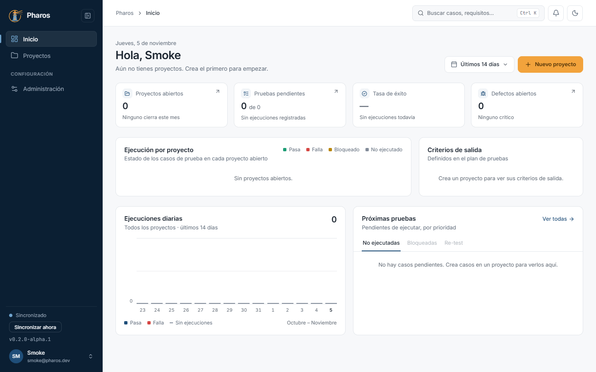

### 2.2. El periodo de los datos

El selector de periodo («Últimos 14 días») cambia el intervalo de las cifras: hoy, 7, 14 o 30 días o el mes en curso.

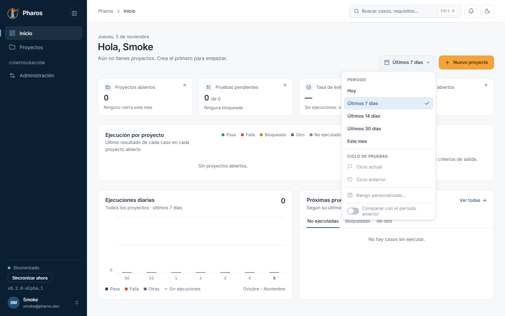

### 2.3. Buscar (Ctrl+K)

La lupa de la barra superior, o Ctrl+K desde cualquier pantalla, abre la búsqueda. En esta versión avisa de que la búsqueda global llega más adelante; la campana hace lo mismo con las notificaciones.

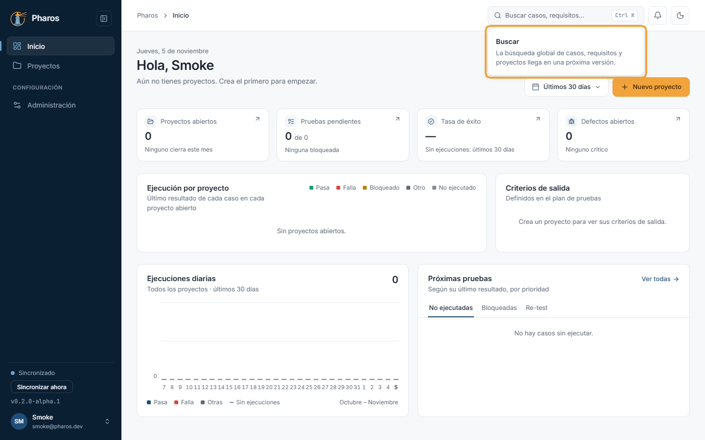

### 2.4. Contraer el menú lateral

El botón junto al logotipo contrae el menú a una tira de iconos y lo vuelve a expandir; Pharos recuerda tu elección.

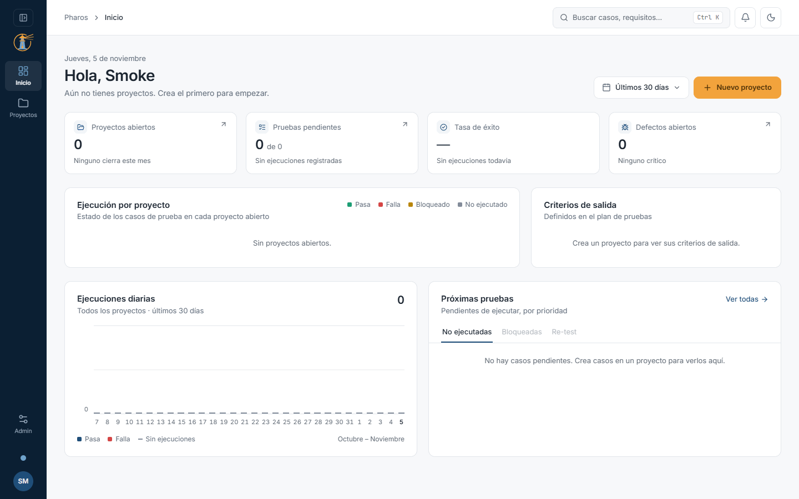

### 2.5. La lista de proyectos, vacía

«Proyectos» lista todos tus proyectos. Sin ninguno, invita a crear el primero.

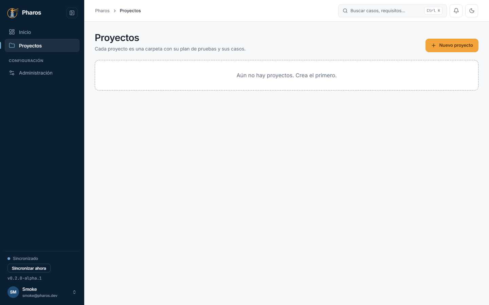

### 2.6. El nombre es obligatorio

«Nuevo proyecto» abre una fila para escribir el nombre. Si pulsas «Crear» sin escribirlo, Pharos lo pide.

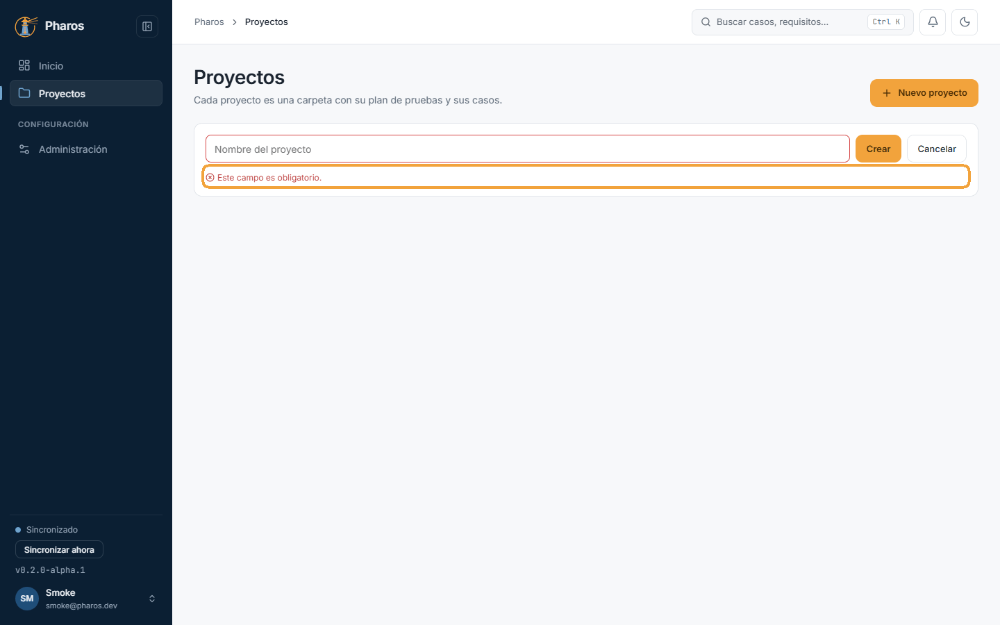

### 2.7. Crear un proyecto

Escribe el nombre («Banca Móvil») y pulsa «Crear». Pharos abre el proyecto en su plan de pruebas, todavía sin plan.

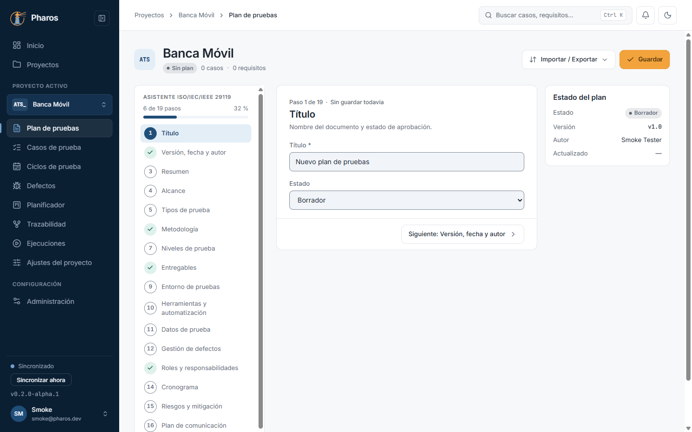

### 2.8. Ajustes del proyecto: prefijo de los casos

En «Ajustes del proyecto» cambias el nombre, el prefijo y los dígitos de los IDs de caso; la vista previa muestra cómo se numerarán. «Guardar» confirma con «Ajustes actualizados».

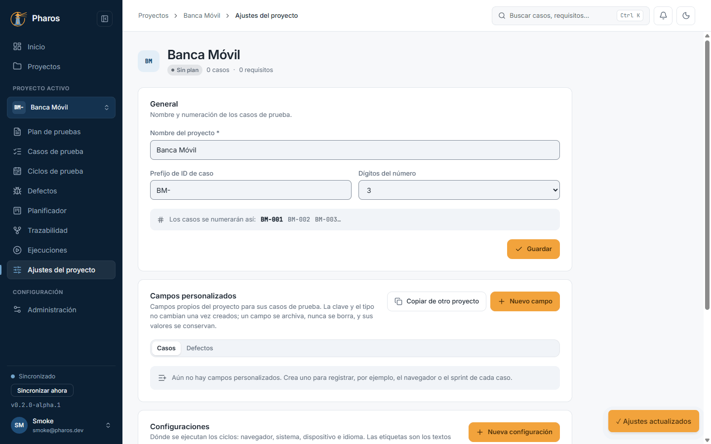

### 2.9. Nuevo campo personalizado

En «Campos personalizados», «Nuevo campo» abre el diálogo: nombre, clave, tipo (texto, número, fecha, sí/no, selección…), opciones y si es obligatorio. El botón [?] junto a «Clave» explica su formato (minúsculas, números y guion bajo) al pasar el ratón, con el tabulador o al tocarlo; debajo se recuerda que no se puede cambiar después. Aquí, una selección «Navegador» con tres opciones.

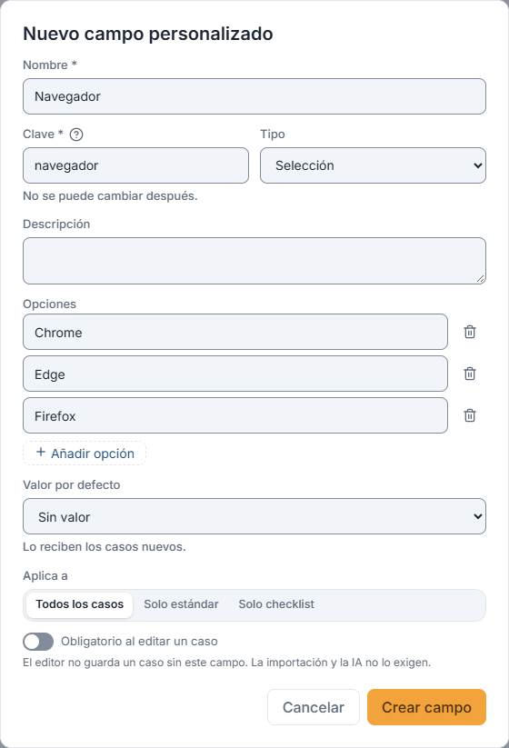

### 2.10. El campo, en la lista

«Crear campo» lo guarda y aparece en la lista; los casos del proyecto ya pueden usarlo. Se reordena arrastrando o con el menú de cada campo.

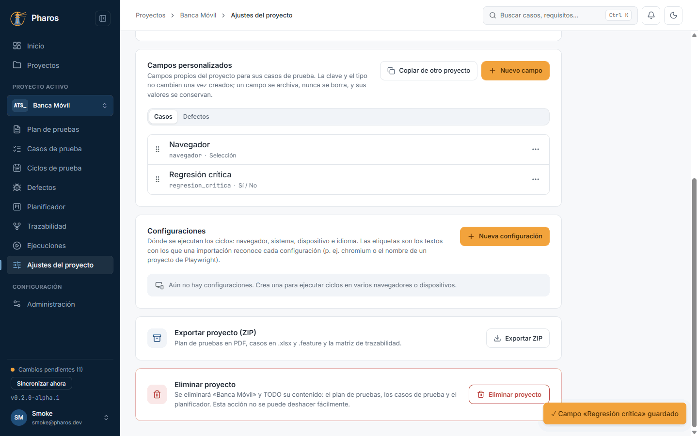

### 2.11. Archivar un campo

Un campo no se borra: se archiva desde su menú («Archivar») y sus valores se conservan. «Mostrar archivados» lo enseña y «Desarchivar» lo recupera.

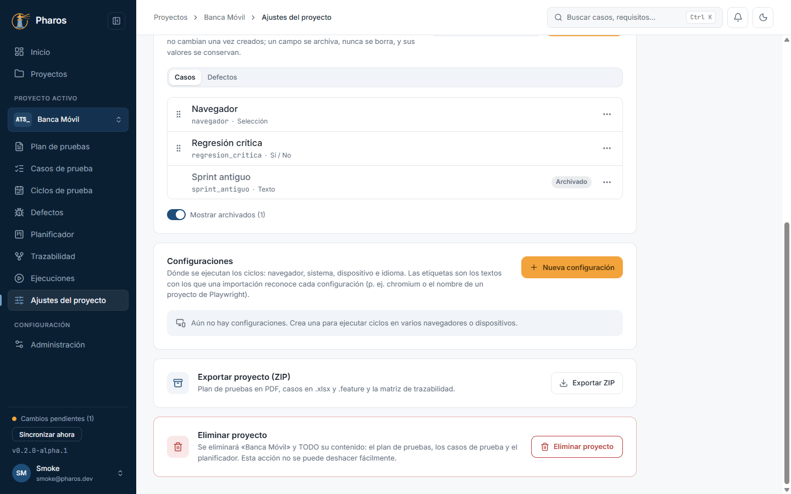

### 2.12. Cerrar sin guardar

Si cierras el diálogo de un campo con cambios sin guardar, Pharos pregunta antes de descartarlos.

### 2.13. Campos de los defectos

El selector «Casos / Defectos» de la tarjeta elige de qué entidad son los campos. Con «Defectos», «Nuevo campo» crea un campo que aparece en el editor de cada defecto; aquí, «Cliente afectado». Los campos de casos y de defectos son independientes, y «Copiar de otro proyecto» copia los de la entidad elegida.

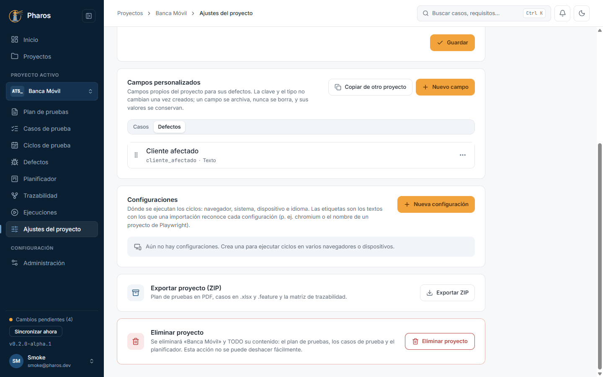

### 2.14. Nueva configuración

En «Configuraciones», «Nueva configuración» define dónde se ejecuta un ciclo: navegador, sistema, dispositivo e idioma. Las etiquetas de importación (Intro o coma para añadir cada una) son los nombres con los que un informe importado reconoce la configuración.

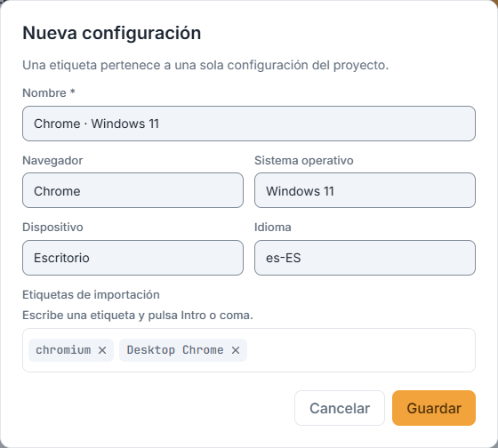

### 2.15. Configuraciones del proyecto

«Guardar» la añade a la lista. Aquí hay dos (Chrome y Edge); una tercera se archivó desde su menú y solo se ve con «Mostrar archivadas».

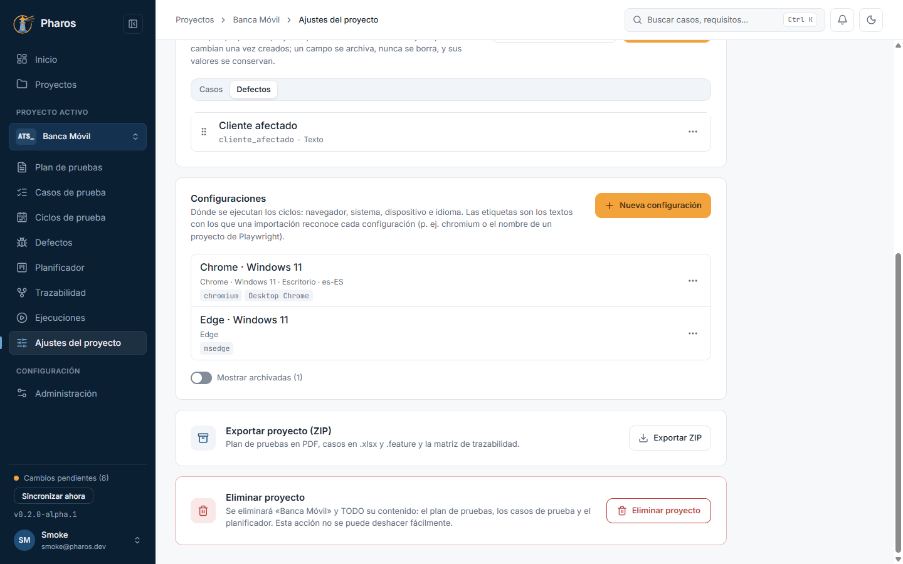

### 2.16. Crear con Intro y copiar campos

Un segundo proyecto («Portal Clientes», creado pulsando Intro tras el nombre) puede copiar los campos personalizados de otro con «Copiar de otro proyecto».

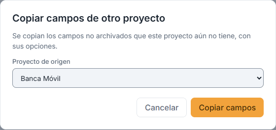

### 2.17. Todos los proyectos

Con proyectos, la lista muestra los recientes arriba y la tabla de todos: plan, casos, ejecución, cobertura y último acceso. Busca por nombre o prefijo y ordena con «Ordenar por».

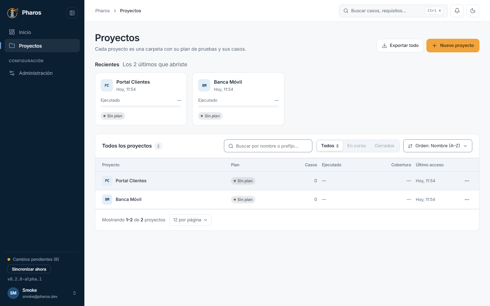

### 2.18. Acciones de un proyecto

El menú «⋯» de cada fila abre el proyecto, sus ajustes o lo exporta en un ZIP (plan, casos y documentos).

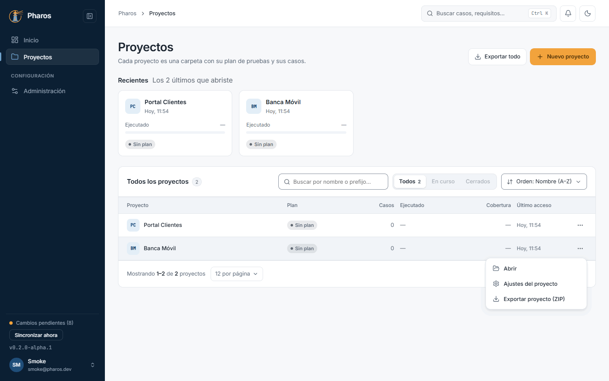

### 2.19. Exportar un proyecto

«Exportar proyecto (ZIP)» genera los documentos con una barra de progreso y guarda el ZIP en tu carpeta de descarga; «Exportar todo» hace lo mismo con todos los proyectos.

### 2.20. Cambiar de proyecto

Dentro de un proyecto, el selector de la parte superior del menú lateral salta a otro proyecto sin volver a la lista.

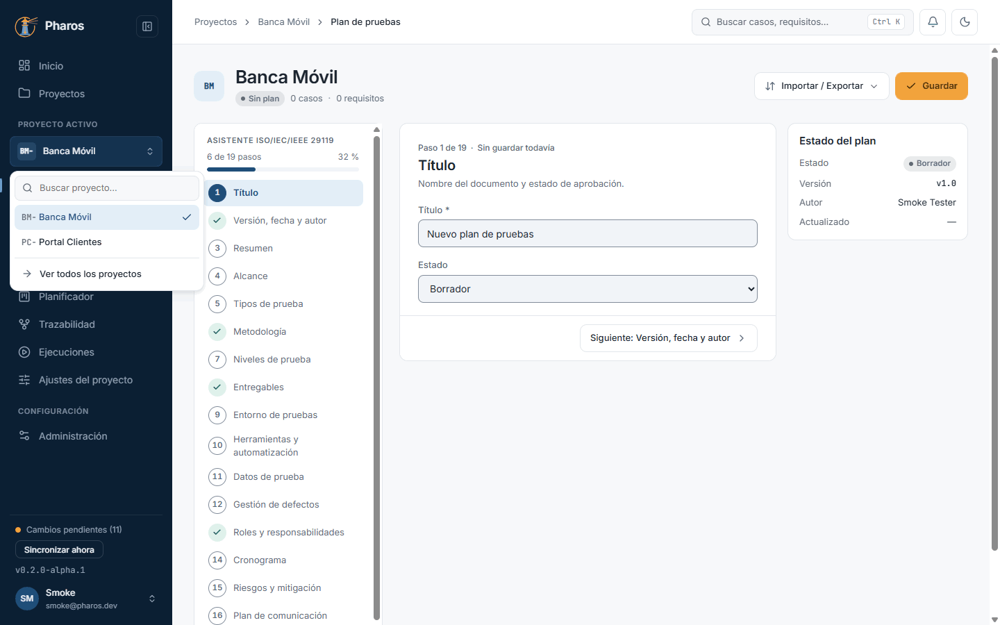

### 2.21. Eliminar un proyecto

«Eliminar proyecto», al pie de los ajustes, cuenta lo que se perderá y pide escribir el prefijo (o el nombre) para confirmar. «Sí, eliminar todo» lo borra y vuelve a la lista.

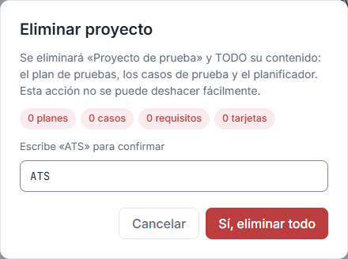

### 2.22. Proyecto eliminado

Tras confirmar, un aviso lo confirma y la lista ya no lo muestra.

## Consejos

- Elige el **prefijo** de los casos al principio (por ejemplo `BM-`): el ID de
  un caso no cambia una vez asignado, porque viaja como tag (`@BM-001`) en la
  automatización.
- Los **campos personalizados** nunca se borran, se archivan: así los valores
  que ya tienen los casos no se pierden.
- Las **etiquetas de importación** de una configuración deben coincidir con
  los nombres que usa tu herramienta (por ejemplo, el nombre del proyecto de
  Playwright, `chromium`). Así un informe importado sabe en qué configuración
  se ejecutó.
- Eliminar un proyecto borra todo su contenido: exporta antes un ZIP si
  quieres conservarlo.

## Véase también

- [Guía de pruebas de la beta](../guia-beta.md), apartado 4.3 «Plan, casos y exportaciones».
- [Glosario](../GLOSARIO.md): «Proyecto», «Prefijo de ID de caso», «Recientes».

---

← [Acceso y cuenta](01-acceso.md) · [Índice](README.md) · [Plan de pruebas](03-plan.md) →
