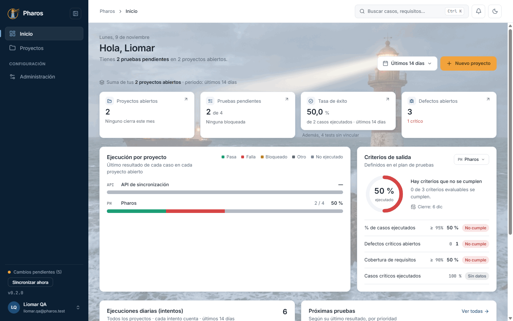
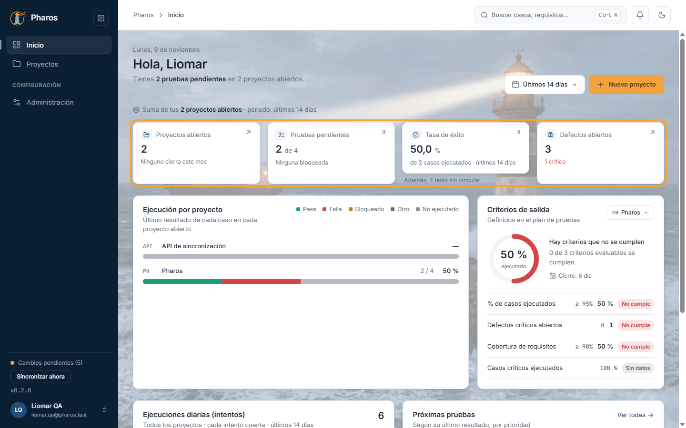
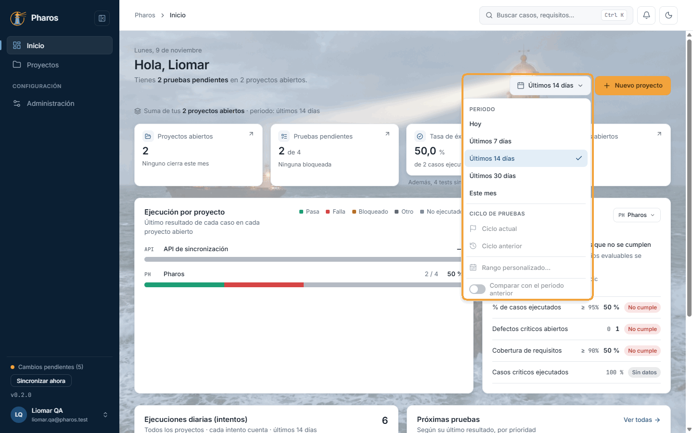
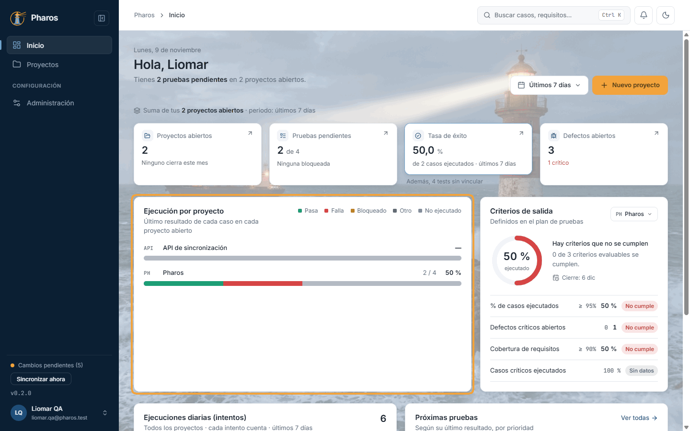
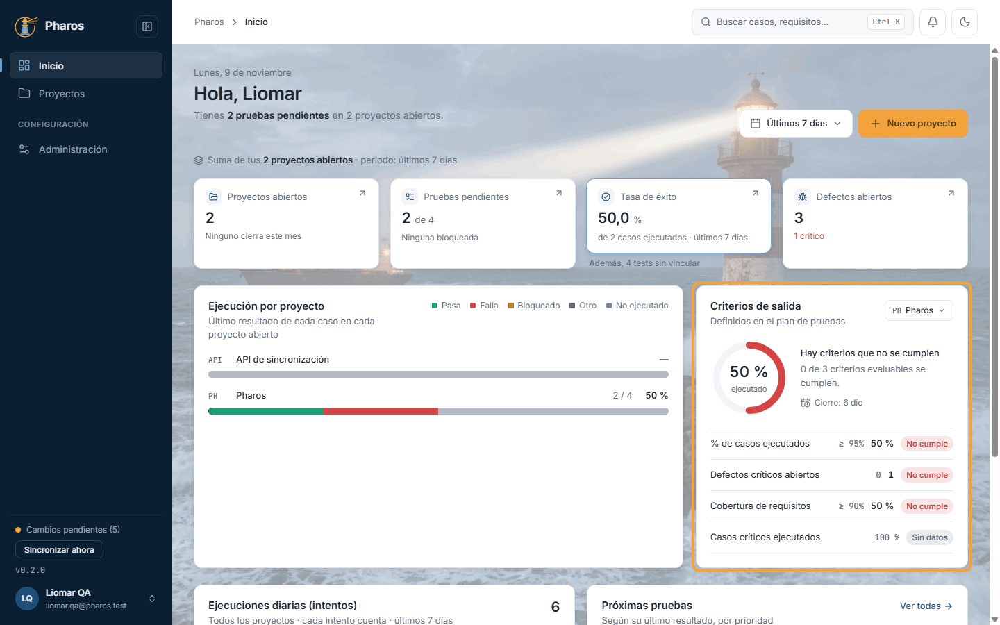
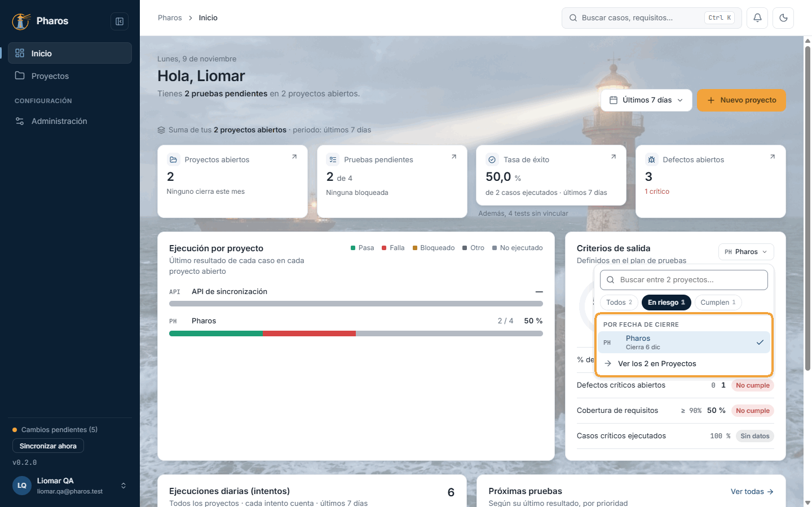
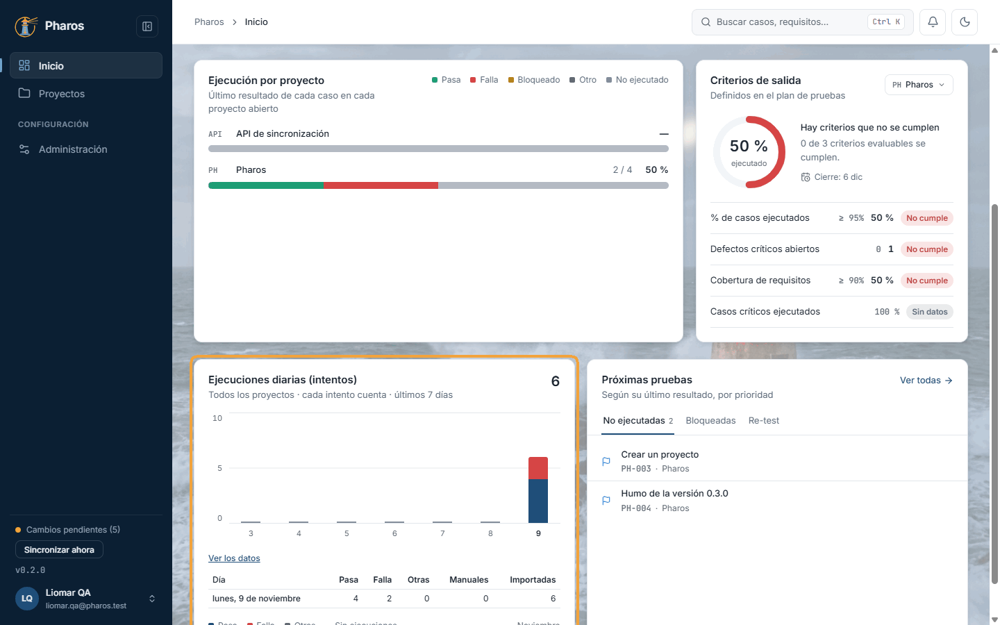
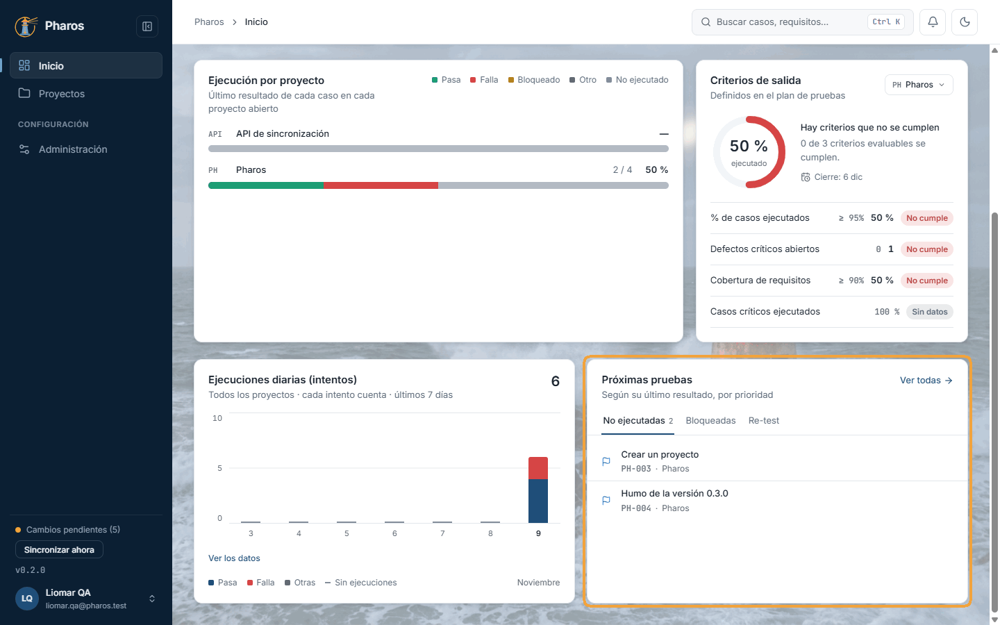
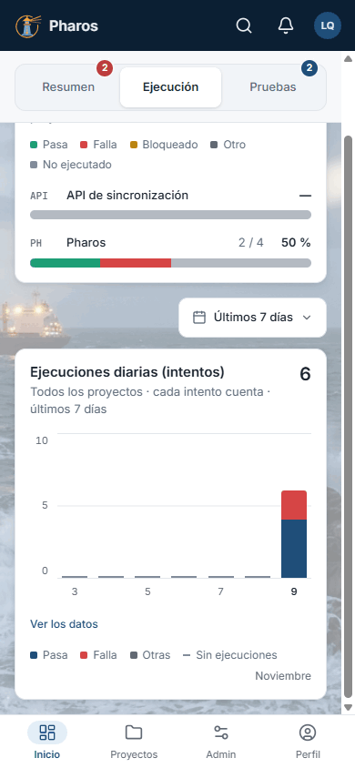

<!-- Generado por `npm run manual` desde e2e/tours/03-inicio.tour.ts y docs/manual/fuentes/inicio.md. No lo edites a mano: edita la fuente. -->

# 3. Inicio

## Para qué sirve

**Inicio** responde, al abrir Pharos, a tres preguntas de cualquier
responsable de QA:

- **¿Cómo vamos?** Lo dicen las cuatro cifras clave y la ejecución por proyecto.
- **¿Podemos cerrar?** Lo dicen los criterios de salida del plan de cada
  proyecto.
- **¿Qué hago ahora?** Lo dicen las próximas pruebas, por prioridad.

Suma todos tus proyectos abiertos. Para ver uno solo, entra en él: sus cifras
están en cada sección.

## Paso a paso

### 3.1. Tu Inicio

«Inicio» es lo primero que ves al entrar: un resumen de todos tus proyectos abiertos. Arriba, la fecha, el saludo y una frase con lo pendiente (en este ejemplo, las pruebas sin hacer en los proyectos de Liomar); a la derecha, el periodo de los datos y «Nuevo proyecto». Debajo, cuatro tarjetas con las cifras clave y cuatro paneles: la ejecución por proyecto, los criterios de salida, las ejecuciones diarias y las próximas pruebas. Se actualiza solo cada vez que llegan datos de otro equipo.

### 3.2. Las cuatro cifras clave

«Proyectos abiertos» (y cuántos cierran este mes), «Pruebas pendientes» (casos sin ejecutar o bloqueados, sobre el total), «Tasa de éxito» (casos que pasan sobre los casos ejecutados en el periodo; un caso con varios flujos, filas o configuraciones pasa solo si pasan todos, y los tests importados sin vincular no cuentan: si los hay, debajo pone «Además, N tests sin vincular», con enlace a Ejecuciones) y «Defectos abiertos» (con los críticos aparte, en rojo). Cada tarjeta es un enlace: lleva a la lista de proyectos o, si solo tienes un proyecto, directamente a sus casos, sus ejecuciones o sus defectos.

### 3.3. El periodo de los datos

El selector de periodo («Últimos 14 días», por defecto) decide qué días cuentan para la tasa de éxito y para «Ejecuciones diarias»: hoy, los últimos 7, 14 o 30 días, o el mes en curso. Las demás cifras son el estado actual de cada proyecto. Pharos recuerda el periodo en este equipo. Las opciones por ciclo, el rango personalizado y la comparación con el periodo anterior llegan en una próxima versión.

### 3.4. Ejecución por proyecto

Una barra por proyecto abierto con el último resultado de cada uno de sus casos: «Pasa», «Falla», «Bloqueado», «Otro» y «No ejecutado». Así ves de un vistazo cuánto falta por probar y dónde están los fallos. Pasa el ratón por un tramo para ver la cifra; el nombre del proyecto lo abre en su «Tablero».

### 3.5. Criterios de salida

«Criterios de salida» evalúa los criterios de cierre del plan de pruebas de un proyecto (capítulo 5): el anillo da el porcentaje ejecutado y cada criterio dice «Cumple», «No cumple» o «Sin datos» (los que Pharos no puede medir solo). El titular resume si el proyecto está «Listo para cerrar» o si «Hay criterios que no se cumplen». Si el plan no define criterios, se usan los de por defecto; «Abrir el plan» lleva a él.

### 3.6. Elegir el proyecto: en riesgo o cumplen

El botón con el nombre del proyecto abre el selector: escribe para buscar por nombre o prefijo, y filtra con «Todos», «En riesgo» (algún criterio no se cumple) o «Cumplen» (se cumplen todos los que se pueden evaluar). Los proyectos van ordenados por su fecha de cierre, la más próxima primero; por eso el Inicio muestra de entrada el que cierra antes.

### 3.7. Ejecuciones diarias y sus datos

Una columna por día del periodo con los intentos: cada vez que se ejecutó algo, reintentos y tests sin vincular incluidos, por eso puede sumar más que la tasa de éxito, que cuenta casos. Cada columna separa «Pasa», «Falla» y «Otras», sumando todos los proyectos; arriba a la derecha, el total del periodo. Pasa el ratón por una columna para ver su día. «Ver los datos» despliega la misma información en una tabla (día, pasa, falla, otras, manuales e importadas), más cómoda de leer con un lector de pantalla o para copiar.

### 3.8. Próximas pruebas

«Próximas pruebas» propone qué ejecutar a continuación, por prioridad, según el último resultado de cada caso: «No ejecutadas», «Bloqueadas» y «Re-test» (casos que fallaron y cuyo defecto ya está corregido). Cada fila abre el caso; «Ver todas» lleva a la lista de casos. Cambia de pestaña con un clic o con las flechas ← →.

### 3.9. El Inicio en el móvil

En el móvil, el Inicio se reparte en tres pestañas para no hacer un desplazamiento interminable: «Resumen» (las cifras clave y los criterios de salida; su burbuja roja cuenta los problemas: defectos críticos y proyectos en riesgo), «Ejecución» (la ejecución por proyecto y las ejecuciones diarias, con su propio selector de periodo) y «Pruebas» (las próximas pruebas; su burbuja cuenta las pendientes).

## Atajos de teclado

| Tecla | Dónde | Qué hace |
| --- | --- | --- |
| Tab | Inicio | Recorre las tarjetas (son enlaces) y los paneles en orden |
| Intro | Una tarjeta o una fila de «Próximas pruebas» | La abre |
| ↑ ↓ e Intro | Selector de periodo y selector de proyecto de «Criterios de salida» | Recorren y eligen una opción |
| ← → | Pestañas de «Próximas pruebas» (y las del Inicio en el móvil) | Cambian de pestaña |
| Esc | Un selector abierto | Lo cierra |

## Si algo no sale

- **«Aún no tienes proyectos. Crea el primero para empezar.»** Es una cuenta
  nueva o sin proyectos abiertos. Usa «Nuevo proyecto» (capítulo 4).
- **La tasa de éxito dice «—» y «Sin ejecuciones».** En el periodo elegido no
  hay resultados. Amplía el periodo («Últimos 30 días») o ejecuta casos
  (capítulos 10 y 11).
- **Bajo la tasa de éxito pone «Además, N tests sin vincular».** Son tests
  importados que aún esperan en la bandeja «Sin vincular» (capítulo 10). La
  tasa, como el progreso de cada proyecto, cuenta casos, así que no los
  incluye. Vincúlalos a su caso desde «Ejecuciones» y entrarán en la tasa.
- **«Ejecuciones diarias» suma más que la tasa.** La gráfica cuenta intentos:
  cada vez que se ejecutó algo, también los reintentos y los tests sin
  vincular. La tasa cuenta casos, una vez cada uno, con su último resultado.
- **«No se pudieron cargar las ejecuciones.»** Las cifras de ejecución no se
  pudieron leer, aunque el resto del Inicio sí. Pulsa «Reintentar»; las
  tarjetas afectadas muestran «No disponible» mientras tanto.
- **«No se pudieron cargar tus proyectos.»** No se pudo leer nada. Pulsa
  «Reintentar» y, si sigue, revisa la conexión (en la web) o exporta un
  diagnóstico (capítulo 15).
- **«Datos de las HH:MM: no se pudieron actualizar.»** Ves los últimos datos
  que sí se cargaron; Pharos lo vuelve a intentar con la próxima sincronización.
- **«Este proyecto aún no tiene plan de pruebas» o «El plan de este proyecto no
  define criterios de salida».** Pharos aplica los criterios por defecto (95 %
  ejecutado, ningún defecto crítico abierto, 90 % de cobertura de requisitos).
  Con «Abrir el plan» puedes definir los tuyos en el paso 17.
- **Un criterio dice «Sin datos».** Pharos no sabe medirlo solo (por ejemplo,
  uno escrito a mano que no reconoce). Compruébalo tú.
- **«Ciclo actual», «Rango personalizado…» o «Comparar con el periodo anterior»
  no se pueden elegir.** Llegan en una próxima versión.

## En el móvil

- El Inicio se divide en tres pestañas:
  - **Resumen:** las cifras clave y los criterios de salida.
  - **Ejecución:** la ejecución por proyecto y las ejecuciones diarias, con su
    propio selector de periodo.
  - **Pruebas:** las próximas pruebas.
- Las burbujas de las pestañas avisan sin tener que abrirlas. La roja de
  «Resumen» cuenta los defectos críticos y los proyectos en riesgo; la de
  «Pruebas», las pruebas pendientes.
- Los selectores (periodo, proyecto) se abren como hojas desde abajo.

## Consejos

- Empieza el día por «Próximas pruebas»: ordena por prioridad lo que falta,
  lo bloqueado y lo que espera re-test.
- Antes de una reunión de seguimiento, revisa «Criterios de salida» con el
  filtro «En riesgo»: son los proyectos de los que hay que hablar.
- Para un informe formal del estado, usa el «Informe de estado» de Ejecuciones
  (capítulo 11), que sigue la norma ISO/IEC/IEEE 29119-3 y se exporta a PDF.

## Véase también

- Capítulo 5, «Plan de pruebas»: paso 17, «Criterios de cierre».
- Capítulo 11, «Ejecución manual»: el informe de estado.
- Capítulo 13, «Trazabilidad»: la cobertura de requisitos.
- [Glosario](../GLOSARIO.md): «Criterios de salida», «Tasa de éxito».

---

← [La aplicación de un vistazo](02-navegacion.md) · [Índice](README.md) · [Proyectos](04-proyectos.md) →
