<!-- Generado por `npm run manual` desde e2e/tours/03-inicio.tour.ts y docs/manual/fuentes/inicio.md. No lo edites a mano: edita la fuente. -->

# 3. Inicio

## Para qué sirve

**Inicio** responde, al abrir Pharos, a tres preguntas de cualquier
responsable de QA:

- **¿Cómo vamos?** Lo dicen las cuatro cifras clave y la ejecución por proyecto.
- **¿Podemos cerrar?** Lo dicen los criterios de salida del plan de cada
  proyecto.
- **¿Qué hago ahora?** Lo dicen las próximas pruebas, por prioridad.

Suma todos tus proyectos abiertos. Para ver uno solo, entra en él: sus cifras
están en cada sección.

**¿Vamos mejor o peor?** «Comparar con el periodo anterior», al final del menú
del periodo, enfrenta el periodo con otro de la misma duración justo antes
(los 7 días con los 7 anteriores, «Hoy» con ayer, «Este mes» con los mismos
días antes del día 1). Solo comparan las cifras que dependen del periodo: la
tasa de éxito, en puntos (pp), y las ejecuciones diarias, en %. Las demás son
el estado de ahora.

## Paso a paso

### 3.1. Tu Inicio

«Inicio» es lo primero que ves al entrar: un resumen de todos tus proyectos abiertos. Arriba, en una sola línea, el saludo y la fecha; a la derecha, el periodo de los datos, «Nuevo proyecto» y el engranaje para personalizarlo. Debajo, cuatro tarjetas con las cifras clave y cinco paneles: la ejecución por proyecto, las próximas pruebas, los criterios de salida, las ejecuciones diarias y la tendencia de ciclos. Ningún panel se desplaza por dentro: una lista muestra las filas que caben y termina en «+N más». Se actualiza solo cuando llegan datos de otro equipo, de otra ventana de Pharos o del CLI `pharos`. Las capturas de este capítulo muestran el Inicio de Liomar con el trabajo de los capítulos siguientes ya hecho: los proyectos del capítulo 4 y, en «Pharos», su plan, sus casos, sus ejecuciones y sus defectos (capítulos 5 a 12).

### 3.2. Las cuatro cifras clave

«Proyectos abiertos» (y cuántos cierran este mes), «Pruebas pendientes» (casos sin ejecutar o bloqueados, sobre el total), «Tasa de éxito» (casos que pasan sobre los casos ejecutados en el periodo; un caso con varios flujos, filas o configuraciones pasa solo si pasan todos, y los tests importados sin vincular no cuentan: si los hay, la tarjeta lo dice con «+N sin vincular», un enlace a Ejecuciones) y «Defectos abiertos» (con los críticos aparte, en rojo). Cada tarjeta es un enlace (al pasar el ratón se resalta, como «Tasa de éxito» en la captura): lleva a la lista de proyectos o, si solo tienes un proyecto, directamente a sus casos, sus ejecuciones o sus defectos.

### 3.3. El periodo de los datos

El selector de periodo («Últimos 14 días», por defecto) decide qué días cuentan para la tasa de éxito y para «Ejecuciones diarias»: hoy, los últimos 7, 14 o 30 días, o el mes en curso. Las demás cifras son el estado actual de cada proyecto. Pharos recuerda el periodo en este equipo. Las opciones por ciclo y el rango personalizado, en gris con la etiqueta «Próximamente», llegan en una próxima versión.

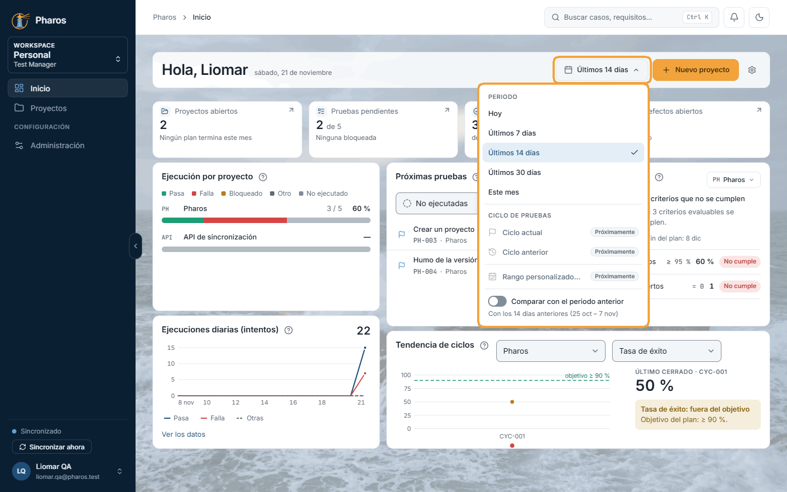

### 3.4. Comparar con el periodo anterior

Al final del menú del periodo, «Comparar con el periodo anterior» enfrenta el periodo con otro de la misma duración justo antes: los 7 días con los 7 anteriores, «Hoy» con ayer y «Este mes» con los mismos días antes del día 1; debajo del interruptor ves sus fechas. Encendido, el botón del periodo dice «vs anterior», la «Tasa de éxito» muestra la diferencia en puntos (▲ en verde si sube, ▼ en rojo si baja) y «Ejecuciones diarias» suma una línea gris de puntos con el total de cada día del periodo anterior, su diferencia en % junto al total y una columna «Anterior» en «Ver los datos». Las demás cifras son el estado de ahora y no cambian. El interruptor no cierra el menú (Esc lo cierra), y Pharos lo recuerda en este equipo, como el periodo. En este ejemplo la semana anterior no tiene datos: cada intento lleva la fecha en que entró en Pharos (el de un informe importado, la de la importación) y todos son de esta semana. Los dos paneles lo dicen con «sin datos antes» y la línea gris queda en cero.

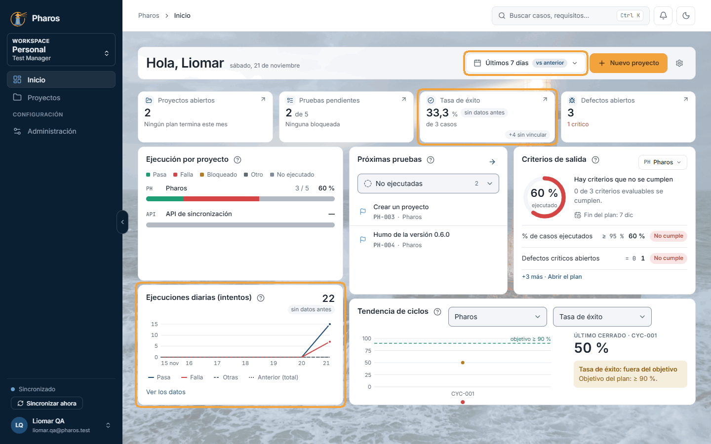

### 3.5. Ejecución por proyecto

Una barra por proyecto abierto con el último resultado de cada uno de sus casos: «Pasa», «Falla», «Bloqueado», «Otro» y «No ejecutado». Así ves de un vistazo cuánto falta por probar y dónde están los fallos. Pasa el ratón por un tramo para ver la cifra; el nombre del proyecto lo abre en su «Tablero».

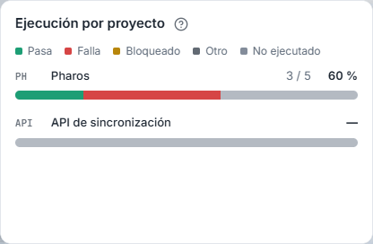

### 3.6. La ayuda de cada panel

Junto al título de cada panel, el botón «?» explica qué muestra: «Ejecución por proyecto», el último resultado de cada caso en cada proyecto abierto; «Próximas pruebas», qué ejecutar según su último resultado y por prioridad; «Criterios de salida», los definidos en el plan de pruebas; «Ejecuciones diarias», qué cuenta como intento; y «Tendencia de ciclos», qué métrica sigue. Se abre al pasar el ratón, con un clic o con el teclado (Tab), y se cierra con Esc.

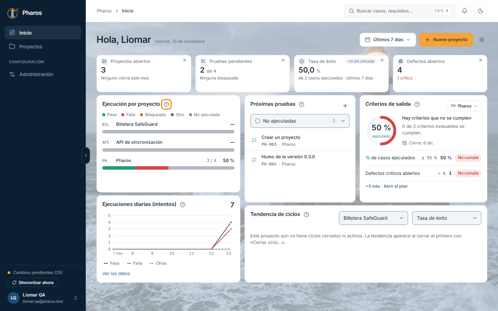

### 3.7. Criterios de salida

«Criterios de salida» evalúa los criterios de cierre del plan de pruebas de un proyecto (capítulo 5): el anillo da el porcentaje ejecutado y cada criterio dice «Cumple», «No cumple» o «Sin datos» (los que Pharos no puede medir solo). El titular resume si el proyecto está «Listo para cerrar» o si «Hay criterios que no se cumplen». Son cifras del proyecto entero, no de un ciclo: en «Pharos», 3 de sus 5 casos tienen resultado (PH-003 y PH-004 no se han ejecutado), por eso el anillo marca menos que el cierre del ciclo «Regresión 0.6.0» (capítulo 9), que solo cuenta PH-001 y PH-002. Si el plan no define criterios, se usan los de por defecto; «Abrir el plan» lleva a él.

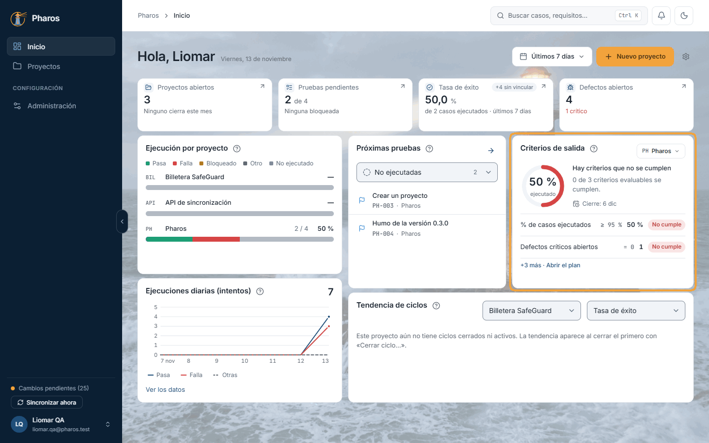

### 3.8. Elegir el proyecto: en riesgo o cumplen

El botón con el nombre del proyecto abre el selector: escribe para buscar por nombre o prefijo, y filtra con «Todos», «En riesgo» (algún criterio no se cumple) o «Cumplen» (se cumplen todos los que se pueden evaluar). Los proyectos van ordenados por su fecha de cierre, la más próxima primero; por eso el Inicio muestra de entrada el que cierra antes.

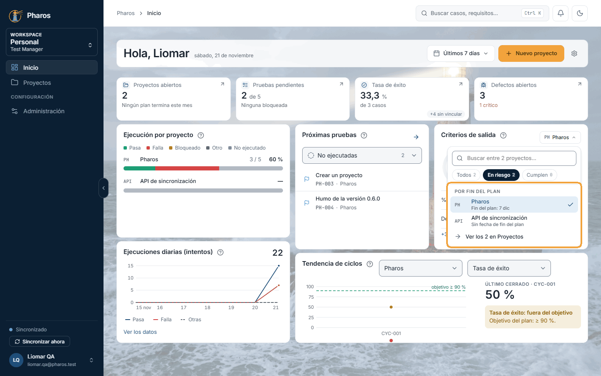

### 3.9. Ejecuciones diarias y sus datos

Una línea por estado («Pasa», «Falla» y «Otras», esta discontinua) con los intentos de cada día del periodo: cada vez que se ejecutó algo, reintentos y tests sin vincular incluidos, por eso puede sumar más que la tasa de éxito, que cuenta casos. Un punto marca cada día con alguno; arriba a la derecha, el total del periodo. «Ver los datos» abre la misma información en una tabla (día, pasa, falla, otras, manuales e importadas), más cómoda de leer con un lector de pantalla o para copiar; en el escritorio se abre en una ventana, para que el panel no crezca.

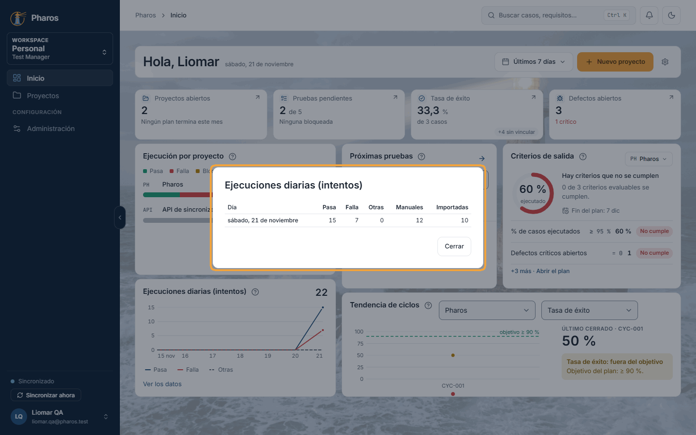

### 3.10. Treinta días de un vistazo

Con «Últimos 30 días» el eje de fechas solo rotula el primer día, uno por semana y el último, con el mes cuando cambia, para que nunca se pisen; la escala llega al valor más alto que se ve (como poco, 5). Pasa el ratón, toca la gráfica o recórrela con las flechas del teclado: una línea vertical marca el día y una burbuja muestra su fecha y lo de cada estado. La leyenda también filtra: pulsa un estado para ocultar o mostrar su línea (siempre queda al menos uno) y la escala se ajusta a lo visible.

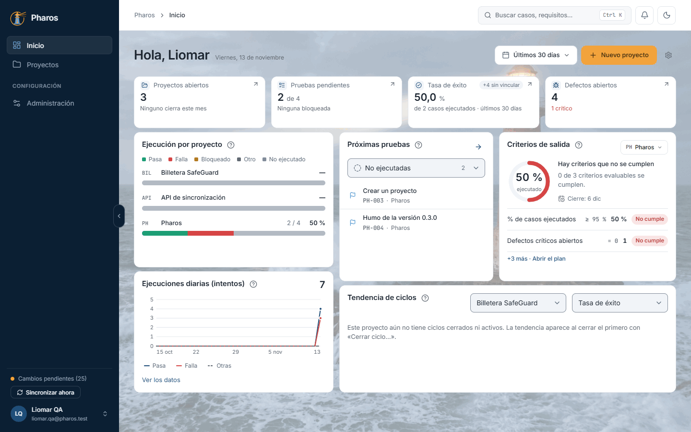

### 3.11. Próximas pruebas

«Próximas pruebas» propone qué ejecutar a continuación, por prioridad, según el último resultado de cada caso. El selector bajo el título elige la lista, con su número: «No ejecutadas», «Bloqueadas» o «Por confirmar» (casos que fallaron y cuyo defecto ya está corregido; cada fila dice cuándo falló). Cada fila abre el caso; la flecha de la derecha («Ver todas») lleva a la lista de casos, y si no caben todas, «+N más» también.

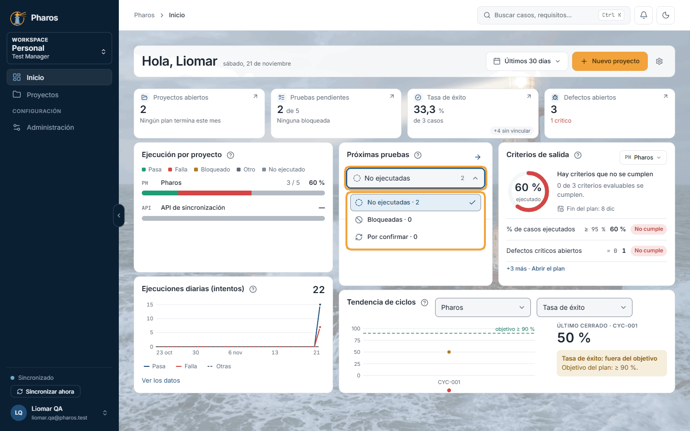

### 3.12. Tendencia de ciclos

«Tendencia de ciclos» sigue una métrica a lo largo de los últimos ciclos cerrados del proyecto (con las cifras congeladas al cerrarlos) y del ciclo activo, en vivo y punteado: la tasa de éxito, la densidad de defectos, los escapes, el tiempo de corrección, la reapertura o el flaky. La línea verde es el objetivo del plan y el punto bajo cada ciclo, su veredicto (Go, Go con riesgos o No-go). Si una métrica empeora dos ciclos seguidos o se sale del objetivo, el gadget lo avisa. El selector de la cabecera elige el proyecto. Aquí, «Pharos» tiene un ciclo cerrado, la «Regresión 0.6.0» del capítulo 9 (CYC-001): su tasa de éxito, 50 %, con el punto rojo de su «No-go» debajo; a la derecha, «Último cerrado» con su cifra y el aviso «fuera del objetivo», porque el plan pide al menos un 90 %. La línea se completa a medida que se cierran más ciclos con «Cerrar ciclo…». Un proyecto sin ningún ciclo dice cómo empezar.

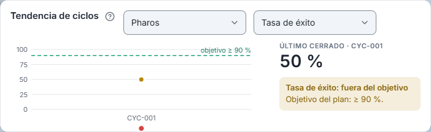

### 3.13. Todo a la vista, sin desplazarte

En el escritorio, el Inicio es una pizarra de 24 columnas por 24 filas que ocupa justo el alto de la ventana: desde 1280 × 800 en una ventana como esta, de 1280 × 820, lo ves todo sin desplazarte, y ningún panel se desplaza por dentro. Con menos alto, los paneles se compactan (menos márgenes y leyendas solo con puntos de color, con su nombre al pasar el ratón); por debajo de unos 700 px de alto aparece un único desplazamiento de página. Cada tarjeta es un «gadget» con su sitio y su tamaño en la cuadrícula. En una tableta los gadgets se apilan uno debajo de otro, y en el móvil se reparten en pestañas.

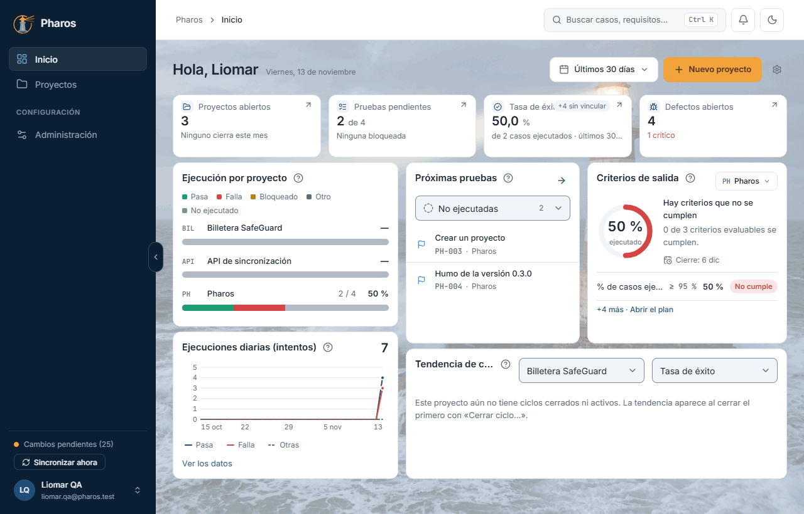

### 3.14. Personalizar el Inicio

El engranaje junto a «Nuevo proyecto» («Personalizar Inicio») activa el modo configurar: se ve la cuadrícula punteada y cada gadget con un borde discontinuo, su asa para moverlo (arriba a la izquierda), su tamaño y su mínimo («9×10 · mín 8×7») y la esquina inferior derecha para cambiar el tamaño. Al mover o agrandar uno, los demás se apartan y suben a llenar los huecos: nunca se solapan. Cada gadget tiene un tamaño mínimo para que su contenido se lea bien. «Listo» guarda la distribución en tu cuenta, así que la verás igual en tus otros equipos; Esc sale sin guardar (y pregunta si cambiaste algo).

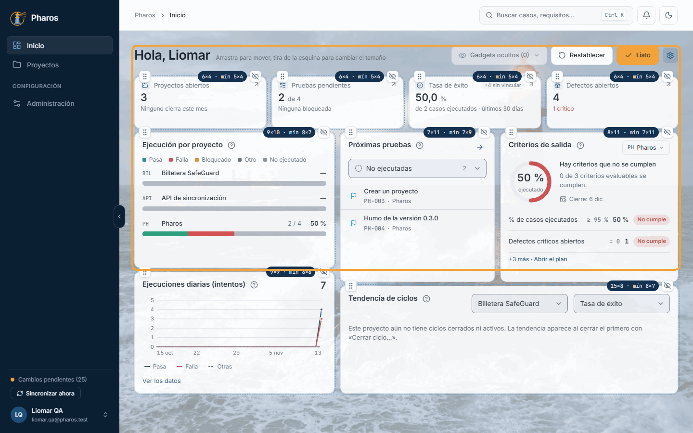

### 3.15. Mover y cambiar el tamaño con el teclado

Con el teclado: pasa de un gadget a otro con Tab, muévelo con las flechas y cambia su tamaño con Mayús + flechas. Dos gadgets iguales y contiguos, como las cifras clave, se intercambian. Cada cambio se anuncia a los lectores de pantalla, por ejemplo «Proyectos abiertos: columna 7, fila 1, 6×4». Aquí, «Proyectos abiertos» ha pasado a la derecha de «Pruebas pendientes».

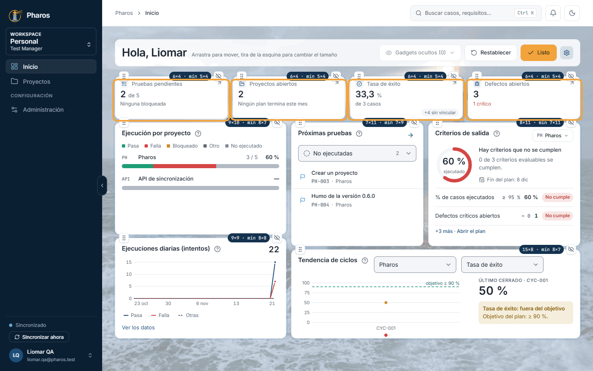

### 3.16. Ocultar un gadget

El ojo tachado de cada gadget lo oculta. Aquí se ha ocultado «Criterios de salida»: su sitio queda libre, y un gadget de debajo sube a ocuparlo solo si cabe en él (si no, puedes llevar otro allí o agrandarlo). Los gadgets ocultos no se pierden: se cuentan en «Gadgets ocultos», arriba.

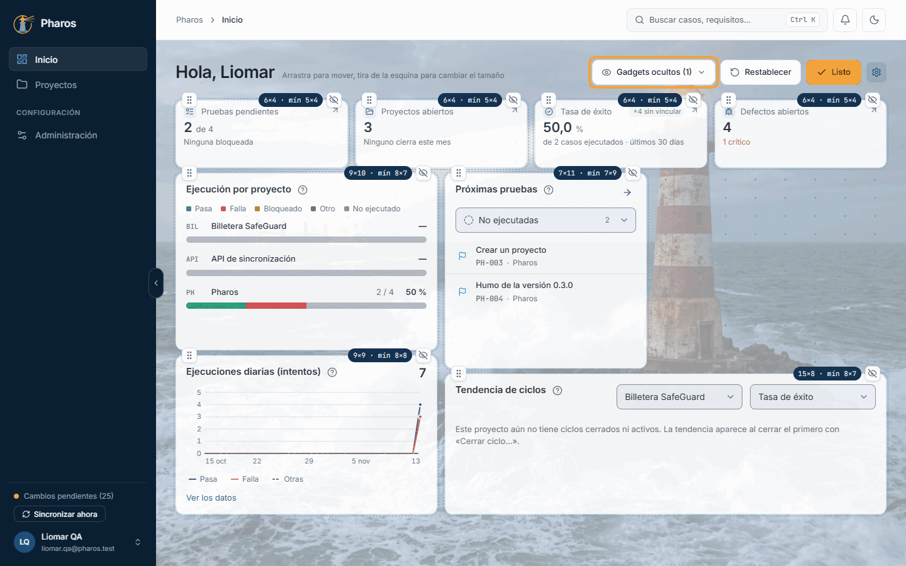

### 3.17. Volver a mostrar un gadget

«Gadgets ocultos» lista los que has ocultado. Al elegir uno, vuelve al primer hueco donde quepa, con su tamaño o, si no cabe, con su tamaño mínimo. Si no queda sitio en las 24 filas, se coloca debajo y el Inicio pasa a tener desplazamiento; la línea de ayuda lo avisa.

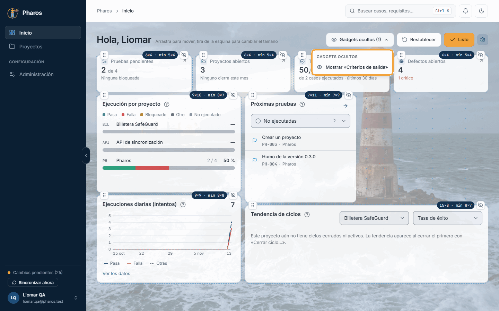

### 3.18. Salir sin guardar

Esc sale del modo configurar sin guardar. Si has cambiado algo, Pharos pregunta antes: «Descartar cambios» deja el Inicio como estaba y «Seguir editando» vuelve a la pizarra. Lo mismo ocurre si sales a otra pantalla con cambios sin guardar.

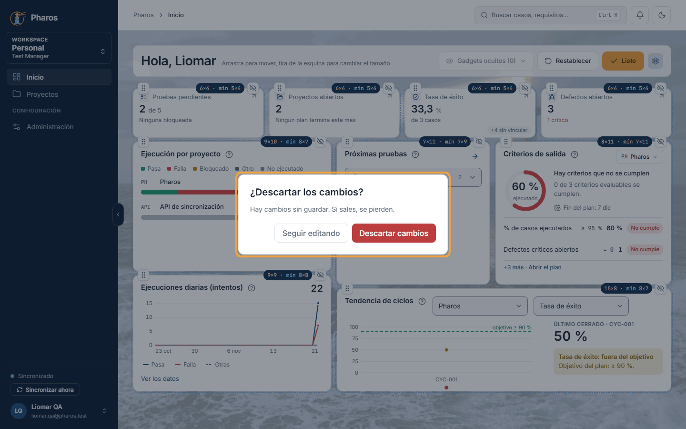

### 3.19. Restablecer la distribución

«Restablecer» vuelve a la distribución de siempre, con todos los gadgets visibles y sin desplazar la página: arriba las cuatro cifras clave; a la izquierda «Ejecución por proyecto» con «Ejecuciones diarias» debajo; en el centro y a la derecha «Próximas pruebas» y «Criterios de salida», y bajo ambos «Tendencia de ciclos». Antes pide confirmación, y el cambio se guarda al pulsar «Listo».

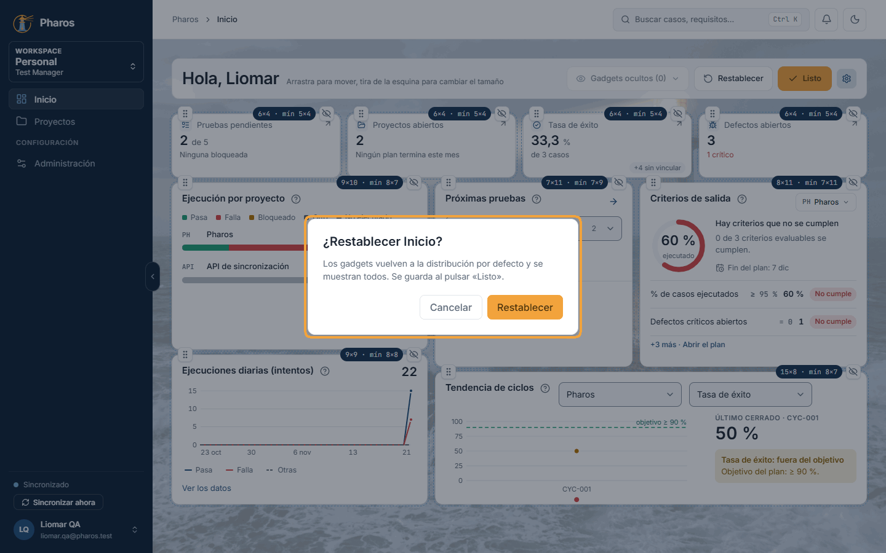

### 3.20. El Inicio en el móvil

En el móvil, el Inicio se reparte en tres pestañas para no hacer un desplazamiento interminable: «Resumen» (las cifras clave y los criterios de salida; su burbuja roja cuenta los problemas: defectos críticos y proyectos en riesgo), «Ejecución» (la ejecución por proyecto y las ejecuciones diarias, con su propio selector de periodo) y «Pruebas» (las próximas pruebas; su burbuja cuenta las pendientes).

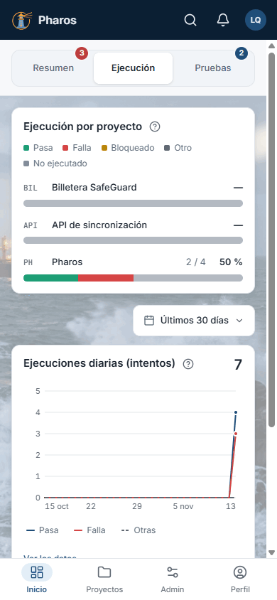

## Tu pizarra: colócala a tu gusto

En el escritorio, el Inicio es una **pizarra** de 24 columnas por 24 filas que
ocupa justo el alto de la ventana: en una ventana de 1280 × 820 lo ves todo
sin desplazarte, y ningún panel se desplaza por dentro. Cada tarjeta es un **gadget** (las cuatro cifras clave, la
ejecución por proyecto, los criterios de salida, las ejecuciones diarias, las
próximas pruebas y la tendencia de ciclos) con su sitio y su tamaño en la
cuadrícula.

- **Personalizar.** El engranaje pequeño junto a «Nuevo proyecto»
  («Personalizar Inicio») activa el modo configurar. Se ven la cuadrícula, el
  asa de cada gadget para moverlo, su esquina para cambiar el tamaño y una
  etiqueta con su tamaño y su mínimo, por ejemplo «9×10 · mín 8×7».
- **Nada se solapa.** Al mover o agrandar un gadget, los vecinos se apartan y
  todo sube a llenar los huecos. Ningún gadget baja de su tamaño mínimo, el
  que necesita para que su contenido esencial se vea entero.
- **Sin desplazamiento dentro de los paneles.** Una lista (proyectos,
  próximas pruebas, criterios) muestra las filas que caben y termina en
  «+N más», que lleva a la lista completa. «Ver los datos» de las ejecuciones
  diarias se abre en una ventana.
- **Con poco alto, compacto.** En una ventana baja los paneles se compactan:
  menos márgenes, leyendas solo con puntos de color (pasa el ratón para ver
  su nombre) y sin el texto bajo el gráfico diario. Por debajo de unos 700 px
  de alto, la pizarra deja de encogerse y aparece un único desplazamiento de
  página.
- **Ayuda «?».** Junto al título de cada panel, «?» explica qué muestra. Se
  abre al pasar el ratón, con un clic o con el teclado, y se cierra con Esc.
- **Lo que suman las cifras.** Pasa el ratón por el periodo («Últimos 14
  días») para ver que las cifras suman todos tus proyectos abiertos.
- **Ocultar y mostrar.** El ojo tachado oculta un gadget. «Gadgets ocultos»
  lista los ocultos; al elegir uno, vuelve al primer hueco donde quepa.
- **Restablecer** vuelve a la distribución de siempre, con todo visible.
  Pregunta antes.
- **Listo** guarda. La distribución es de tu cuenta: la verás igual en tus
  otros equipos, y otra persona en el mismo equipo tiene la suya. Esc sale
  sin guardar.
- Si la pizarra pasa de 24 filas (por ejemplo, al agrandar mucho un gadget),
  el Inicio vuelve a tener desplazamiento; la línea de ayuda lo avisa.
- **Un gadget nuevo** llega a tu pizarra guardada solo si cabe sin desplazar
  la página. Si no cabe, queda en «Gadgets ocultos» y un aviso lo dice:
  «Personalizar Inicio» para hacerle sitio, o «Entendido» para dejarlo oculto.

## Tendencia de ciclos

«Tendencia de ciclos» responde a «¿vamos mejor o peor?». Elige un proyecto y
una métrica: **tasa de éxito**, **densidad de defectos** (defectos encontrados
por cada 100 casos ejecutados), **escapes** (defectos encontrados fuera de las
pruebas, capítulo 12), **tiempo de corrección** (mediana de días hasta
«Corregido»), **reapertura** o **flaky**.

- Cada punto es un ciclo cerrado, con las cifras congeladas al cerrarlo
  (capítulo 9), salvo los escapes, que siguen llegando después. El ciclo
  activo va al final, en vivo y con la línea punteada.
- La línea verde es el **objetivo** del plan para esa métrica (capítulo 5).
- El punto bajo cada ciclo es su **veredicto**: verde «Go», ámbar «Go con
  riesgos», rojo «No-go» y hueco si aún no se ha cerrado.
- A la derecha, el último ciclo cerrado y su cambio frente al anterior. Si la
  métrica **empeora dos ciclos seguidos** o se sale del objetivo, el gadget lo
  avisa.
- Con sitio suficiente, la fila de abajo muestra las seis métricas a la vez;
  al pulsar una, pasa a ser la principal.

Al iniciar sesión, Pharos abre siempre el Inicio, aunque la última vez
salieras desde otra pantalla.

## «Ejecuciones diarias» y «Próximas pruebas»

- **Ejecuciones diarias** dibuja una línea por estado: «Pasa», «Falla» y
  «Otras» (esta, discontinua). Un punto marca cada día con algún intento. La
  escala llega al valor más alto de lo que se ve, como poco 5. La leyenda
  filtra: pulsa un estado para ocultar o mostrar su línea. Si el panel es muy
  estrecho, muestra solo el total grande con una línea de tendencia.
- **Próximas pruebas** elige su lista con un selector bajo el título: «No
  ejecutadas», «Bloqueadas» o «Por confirmar», cada una con su número. En
  «Por confirmar», cada fila dice cuándo falló («· falló el 8 nov»). La flecha a la
  derecha del título es «Ver todas».

## Atajos de teclado

| Tecla | Dónde | Qué hace |
| --- | --- | --- |
| Tab | Inicio | Recorre las tarjetas (son enlaces) y los paneles en orden |
| Intro | Una tarjeta o una fila de «Próximas pruebas» | La abre |
| ↑ ↓ e Intro | Selector de periodo y selector de proyecto de «Criterios de salida» | Recorren y eligen una opción |
| ← → | Pestañas del Inicio en el móvil | Cambian de pestaña |
| ↑ ↓ e Intro | Selector de «Próximas pruebas» | Eligen la lista |
| ← → , Inicio, Fin | La gráfica de «Ejecuciones diarias» (con Tab) | Recorren los días y muestran sus valores |
| Esc | Un selector abierto | Lo cierra |
| Tab | Modo configurar | Pasa de un gadget a otro |
| ← → ↑ ↓ | Un gadget, en el modo configurar | Lo mueve; dos gadgets iguales y contiguos se intercambian |
| Mayús + ← → ↑ ↓ | Un gadget, en el modo configurar | Cambia su tamaño, nunca por debajo del mínimo |
| Esc | Modo configurar | Sale sin guardar (pregunta si cambiaste algo) |

## Si algo no sale

- **«Aún no tienes proyectos. Crea el primero para empezar.»** Es una cuenta
  nueva o sin proyectos abiertos. Usa «Nuevo proyecto» (capítulo 4).
- **La tasa de éxito dice «—» y «Sin ejecuciones».** En el periodo elegido no
  hay resultados. Amplía el periodo («Últimos 30 días») o ejecuta casos
  (capítulos 10 y 11).
- **La tasa de éxito dice «+N sin vincular»** (en el móvil, «Además, N tests
  sin vincular»). Son tests
  importados que aún esperan en la bandeja «Sin vincular» (capítulo 10). La
  tasa, como el progreso de cada proyecto, cuenta casos, así que no los
  incluye. Vincúlalos a su caso desde «Ejecuciones» y entrarán en la tasa.
- **La gráfica de «Ejecuciones diarias» no rotula todos los días.** A propósito:
  con muchos días las fechas se pisarían. Muestra el primero, uno por semana y
  el último (con el mes cuando cambia). Pasa el ratón, toca la gráfica o
  recórrela con las flechas para ver cada día.
- **Falta una línea en la gráfica.** La ocultaste desde la leyenda: pulsa su
  nombre para mostrarla. Siempre queda al menos una.
- **«Ejecuciones diarias» suma más que la tasa.** La gráfica cuenta intentos:
  cada vez que se ejecutó algo, también los reintentos y los tests sin
  vincular. La tasa cuenta casos, una vez cada uno, con su último resultado.
- **«No se pudieron cargar las ejecuciones.»** Las cifras de ejecución no se
  pudieron leer, aunque el resto del Inicio sí. Pulsa «Reintentar»; las
  tarjetas afectadas muestran «No disponible» mientras tanto.
- **«No se pudieron cargar tus proyectos.»** No se pudo leer nada. Pulsa
  «Reintentar» y, si sigue, revisa la conexión (en la web) o exporta un
  diagnóstico (capítulo 15).
- **«Datos de las HH:MM: no se pudieron actualizar.»** Ves los últimos datos
  que sí se cargaron; Pharos lo vuelve a intentar con la próxima sincronización.
- **«Este proyecto aún no tiene plan de pruebas» o «El plan de este proyecto no
  define criterios de salida».** Pharos aplica los criterios por defecto (95 %
  ejecutado, ningún defecto crítico abierto, 90 % de cobertura de requisitos).
  Con «Abrir el plan» puedes definir los tuyos en el paso 20.
- **Un criterio dice «Sin datos».** Pharos no sabe medirlo solo (por ejemplo,
  uno escrito a mano que no reconoce). Compruébalo tú.
- **«Ciclo actual» o «Rango personalizado…» no se pueden elegir.** Llegan en
  una próxima versión.
- **Con la comparación encendida, la tasa de éxito dice «sin datos antes».**
  En el periodo anterior no se ejecutó ningún caso: no hay con qué comparar.
- **Falta una tarjeta del Inicio.** La ocultaste al personalizarlo. Pulsa el
  engranaje, abre «Gadgets ocultos» y elígela, o usa «Restablecer».
- **El Inicio tiene desplazamiento en el escritorio.** O la ventana mide menos
  de unos 700 px de alto, o tu distribución pasa de 24 filas. Reduce algún gadget o
  pulsa «Restablecer».
- **No veo el engranaje.** Solo está en el escritorio, con la ventana a 1280 px
  de ancho o más. En la tableta los gadgets se apilan y en el móvil van en
  pestañas, en el orden de tu distribución y sin los ocultos.
- **Cambié la distribución en otro equipo y aquí no se ve.** Llega con la
  siguiente sincronización o al volver a abrir el Inicio. Sin conexión, el
  cambio se guarda en este equipo y se envía después; si en otro equipo hiciste
  uno más reciente, gana el más reciente.

## En el móvil

- El Inicio se divide en tres pestañas:
  - **Resumen:** las cifras clave y los criterios de salida.
  - **Ejecución:** la ejecución por proyecto y las ejecuciones diarias, con su
    propio selector de periodo.
  - **Pruebas:** las próximas pruebas.
- Las burbujas de las pestañas avisan sin tener que abrirlas. La roja de
  «Resumen» cuenta los defectos críticos y los proyectos en riesgo; la de
  «Pruebas», las pruebas pendientes.
- Los selectores (periodo, proyecto) se abren como hojas desde abajo.
- Las pestañas siguen el orden de tu distribución y no muestran los gadgets
  ocultos. La distribución se cambia en el escritorio.

## Consejos

- Pon arriba a la izquierda lo que miras primero: en el Inicio se lee de
  izquierda a derecha y de arriba abajo, y en ese orden se apilan en la tableta.

- Empieza el día por «Próximas pruebas»: ordena por prioridad lo que falta,
  lo bloqueado y lo que espera confirmación tras un arreglo.
- Antes de una reunión de seguimiento, revisa «Criterios de salida» con el
  filtro «En riesgo»: son los proyectos de los que hay que hablar.
- Para un informe formal del estado, usa el «Informe de estado» de Ejecuciones
  (capítulo 11), que sigue la norma ISO/IEC/IEEE 29119-3 y se exporta a PDF.

## Véase también

- Capítulo 5, «Plan de pruebas»: paso 19, «Métricas y objetivos medibles», y paso 20, «Criterios de cierre».
- Capítulo 11, «Ejecución manual»: el informe de estado.
- Capítulo 13, «Trazabilidad»: la cobertura de requisitos.
- [Glosario](../GLOSARIO.md): «Criterios de salida», «Tasa de éxito».

---

← [La aplicación de un vistazo](02-navegacion.md) · [Índice](README.md) · [Proyectos](04-proyectos.md) →
