<!-- Generado por `npm run manual` desde e2e/tours/03-plan.tour.ts y docs/manual/fuentes/plan.md. No lo edites a mano: edita la fuente. -->

# 3. Plan de pruebas

## Para qué sirve

El **plan de pruebas** es el documento que dice qué se prueba, cómo, con qué
medios, quién y cuándo. Pharos lo guía en 19 pasos que siguen la norma
ISO/IEC/IEEE 29119-3, guarda cada versión como una revisión y lo exporta en
PDF (listo para firmar) o en Excel. El cronograma y los criterios de cierre
del plan alimentan otras pantallas: «Inicio» muestra los criterios de salida
y la cabecera del proyecto, la fecha de cierre del ciclo.

## Paso a paso

### 3.1. El asistente del plan

El plan de pruebas se redacta con un asistente de 19 pasos que sigue la norma ISO/IEC/IEEE 29119. Entra en el proyecto y pulsa «Plan de pruebas» en el menú lateral. A la izquierda tienes la lista de pasos, con una marca en los que ya están completos y el porcentaje de avance; en el centro, el paso actual (el primero pide el título del plan, en este ejemplo «Plan de pruebas · Banca Móvil 2.0», y su estado); a la derecha, «Estado del plan» resume estado, versión, autor y última actualización. No hace falta seguir el orden: puedes saltar a cualquier paso desde la lista.

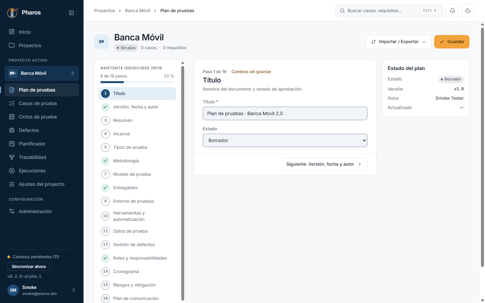

### 3.2. Paso 2 · Versión, fecha y autor

«Siguiente», al pie, avanza al paso 2. Indica la versión del documento (en este ejemplo, «2.0») y su fecha. El autor no se escribe: es tu nombre oficial del perfil (capítulo 1), el mismo que firma el plan cuando lo exportas.

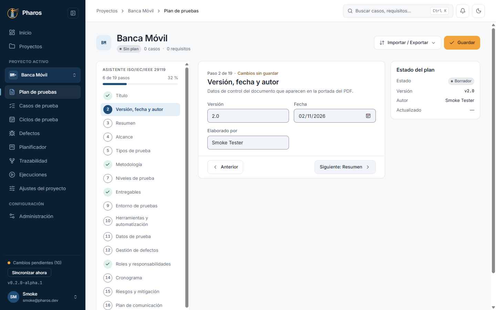

### 3.3. Paso 3 · Resumen

El resumen es lo primero que leerá quien reciba el plan: describe en pocas líneas qué se prueba y por qué (en este ejemplo, la versión 2.0 de una app de banca móvil). Si has configurado un motor de IA (capítulo 10), el botón de IA (✨, «Asistir con IA») propone un borrador que puedes usar, editar o descartar; nada se aplica sin que lo aceptes (capítulo 11).

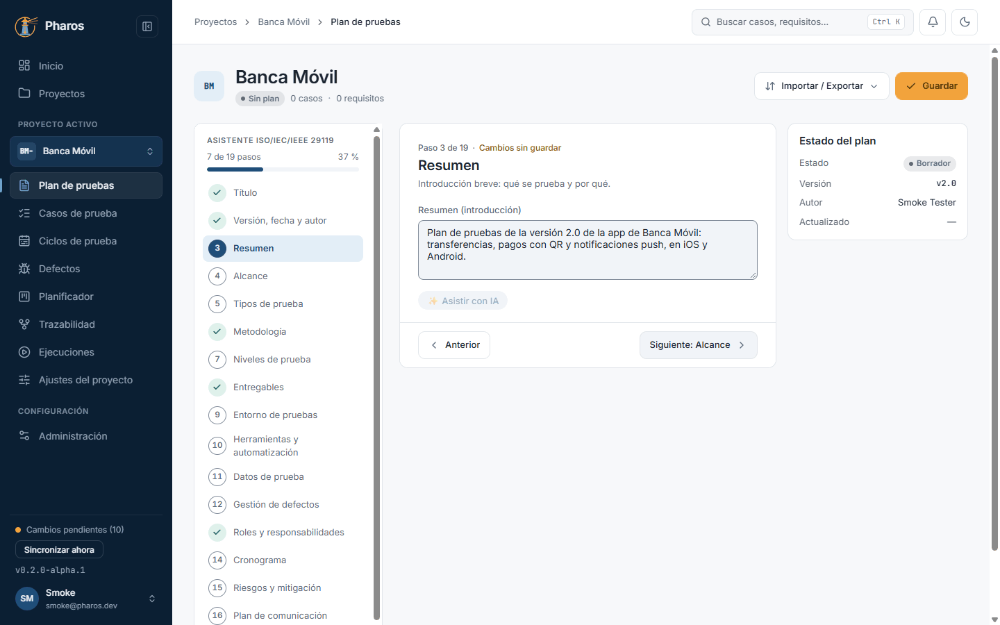

### 3.4. Paso 4 · Alcance

El alcance fija qué se prueba y, tan importante como eso, qué no: así nadie da por cubierto lo que queda fuera. En «Elementos dentro del alcance» y «Fuera del alcance», «+ Añadir» crea una fila por elemento (en este ejemplo, transferencias, pagos con QR y notificaciones dentro; banca de empresas y migración de datos fuera). El icono de papelera de cada fila («Quitar») la elimina; si la fila tiene texto, el botón pide confirmarlo con «Sí, eliminar» o «Cancelar».

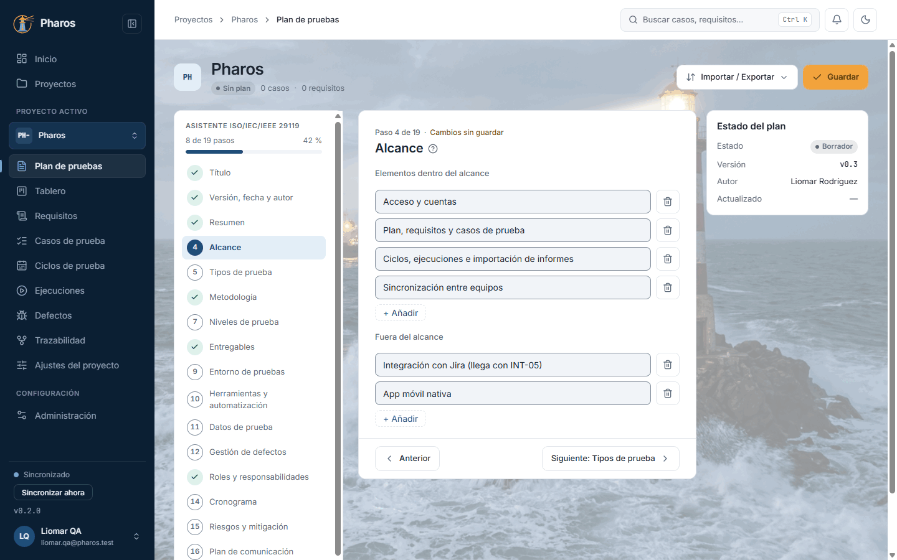

### 3.5. Paso 5 · Tipos de prueba

Marca los tipos de prueba que el equipo se compromete a ejecutar, agrupados en cobertura funcional (funcional, regresión…) y no funcional (seguridad, usabilidad, rendimiento…). En este ejemplo hay cinco marcados. Si el que necesitas no está en la lista, «Otro» añade uno propio.

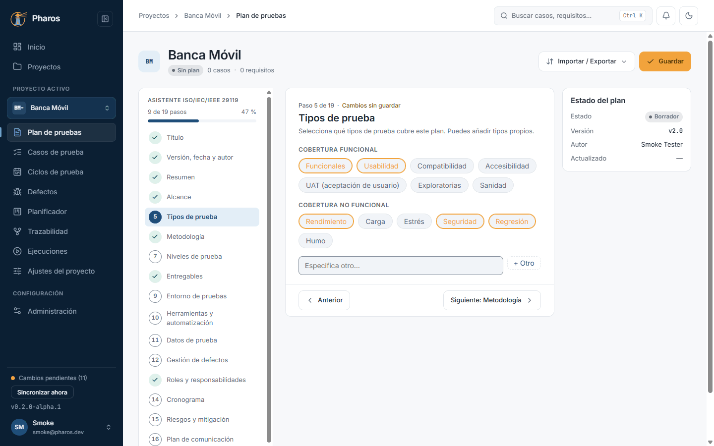

### 3.6. Paso 6 · Metodología

Indica cómo trabaja el equipo. Con «Ágil» defines la duración del sprint (en semanas) y las reuniones del equipo, cada una con su frecuencia (por ejemplo, una vez por sprint); con «Tradicional», las fases del proyecto. La duración del sprint no es solo informativa: el cronograma (paso 14) la usa para proponer el siguiente sprint.

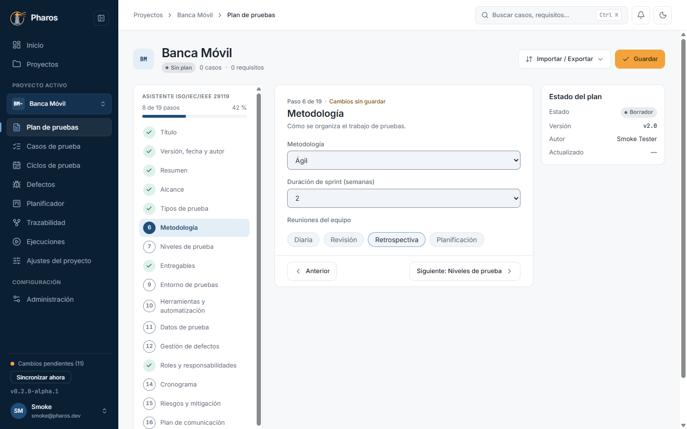

### 3.7. Paso 7 · Niveles de prueba

Los niveles indican en qué capas del producto se prueba: unitarias, integración, sistema y aceptación. Marca solo los que cubre este plan (en este ejemplo, integración, sistema y aceptación); lo que no marques queda, de forma explícita, fuera de este plan.

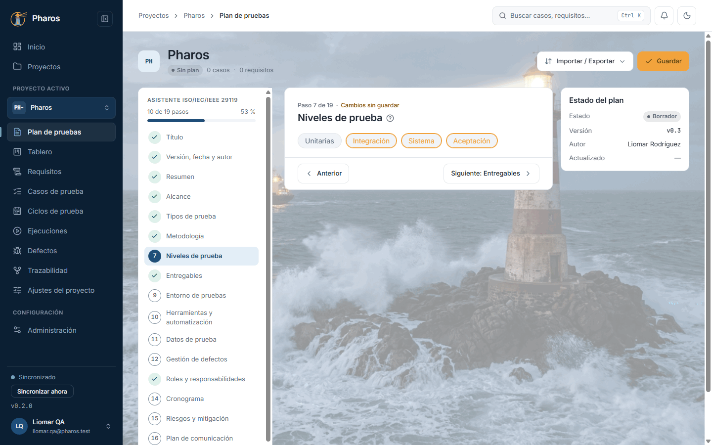

### 3.8. Paso 8 · Entregables

Los entregables son los documentos y artefactos que el equipo de pruebas se compromete a producir. La lista sigue la documentación de ISO/IEC/IEEE 29119-3, agrupada en gestión de pruebas, especificación, datos y entorno, ejecución y resultados, y aceptación. Marca los que se acordaron con el proyecto y desmarca los que no se van a entregar: el plan deja constancia de ese acuerdo y sirve de referencia al cerrar el ciclo. Si se acordó algo que no está en la lista, escríbelo en «Otro entregable» y pulsa «Añadir» (en este ejemplo, «Informe de accesibilidad»): aparece en «Aceptación y otros» con la etiqueta «Propio» y su papelera para quitarlo.

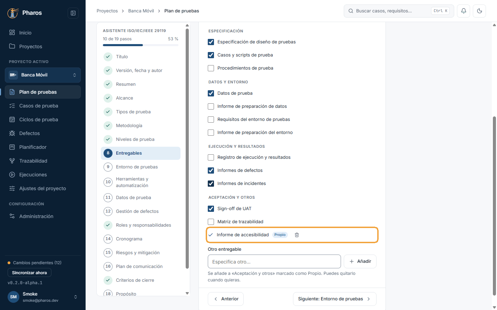

### 3.9. Paso 9 · Entorno de pruebas

Describe dónde se va a probar: la configuración del entorno (en este ejemplo, preproducción con datos anonimizados y la API de pagos en modo sandbox) y el hardware y software que necesita (dispositivos, sistemas y navegadores). Sirve para preparar el entorno a tiempo y para saber, ante un fallo, en qué condiciones se encontró.

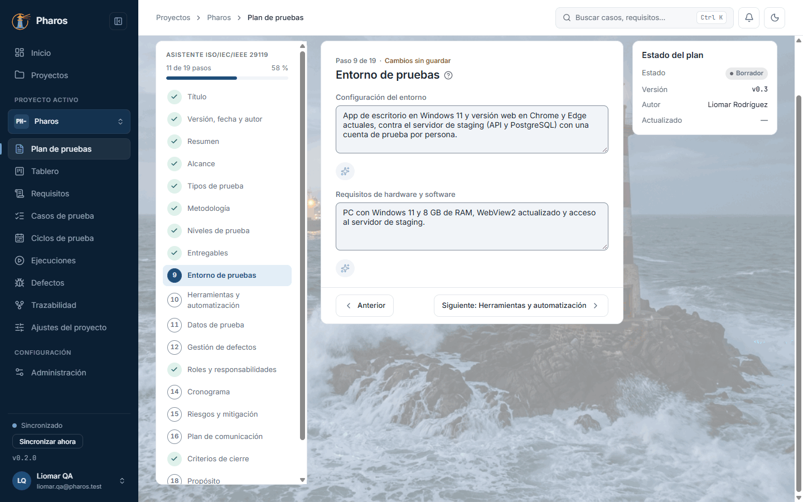

### 3.10. Paso 10 · Herramientas y automatización

Elige las herramientas del proyecto: arriba, las más usadas en QA; «Más herramientas» despliega el resto por categorías, con buscador; si la tuya no está, escríbela en «¿No está en la lista?» y pulsa «Añadir». Las elegidas quedan resaltadas (en este ejemplo, Playwright, Selenium y Cypress). Después describe la estrategia de automatización: qué se automatiza, con qué y cuándo se ejecuta. el botón de IA (✨, «Asistir con IA») propone un borrador de esa estrategia; se activa cuando configuras un motor de IA en Administración (capítulo 10), como en esta captura, donde aún aparece en gris.

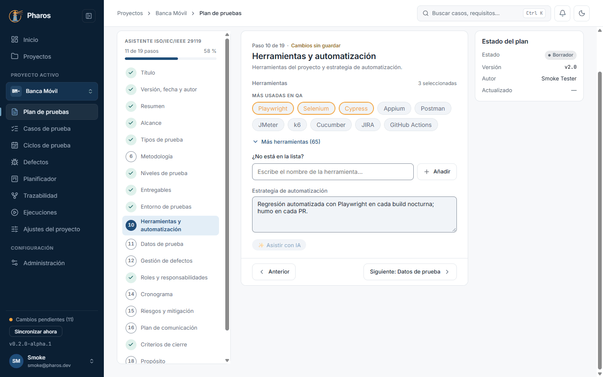

### 3.11. Pasos 11 y 12 · Datos y defectos

Dos pasos de texto libre. En el 11, cómo se consiguen y se protegen los datos de prueba (en este ejemplo, clientes sintéticos generados por script, sin datos reales). En el 12, el que muestra la captura, cómo se gestionan los defectos: dónde se registran, con qué severidad y prioridad y quién los revisa.

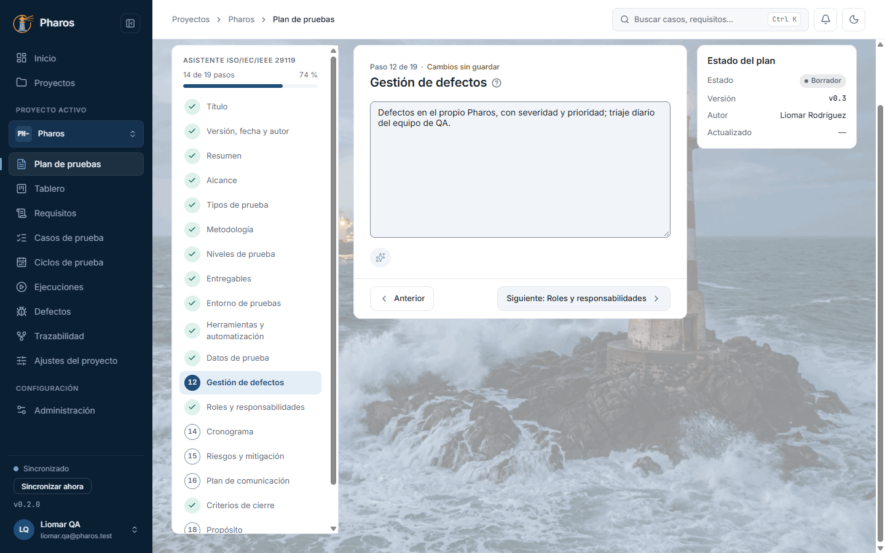

### 3.12. Paso 13 · Roles y responsabilidades

Cada fila une un rol con su responsabilidad, para que quede claro quién decide y quién hace qué (en este ejemplo, el «Líder de QA» planifica, prioriza y aprueba el cierre, y el «Analista de pruebas» diseña y ejecuta los casos). «+ Añadir» crea otra fila y la papelera de cada una la quita. Si has configurado un motor de IA, «Sugerir responsabilidades con IA» propone la responsabilidad de los roles que escribiste y aún no la tienen; eliges cuáles usar, y los roles y lo ya escrito no cambian.

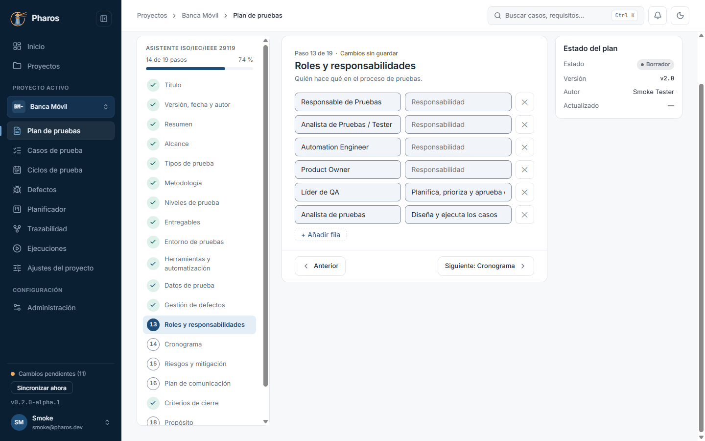

### 3.13. Paso 14 · Cronograma: sprints

El cronograma sitúa en el calendario los sprints y los hitos del ciclo de pruebas. Con «Sprint» elegido, haz clic en el día de inicio y después en el de fin: el sprint aparece como una franja sobre las semanas que ocupa y en la lista «Sprints», con su nombre y sus fechas, que puedes editar. La lista se desplaza por su cuenta, sin mover el calendario. «Siguiente sprint» añade el siguiente a continuación, con la duración que fijaste en la metodología (paso 6). La leyenda explica el calendario: las franjas de sprint alternan azul y ámbar para distinguir un sprint del siguiente, el rombo marca un hito, el círculo ámbar es el día de hoy y el rojo claro señala los días en que dos sprints se solapan (es un aviso: el plan se guarda igualmente). El sprint seleccionado se ve en azul oscuro (en este ejemplo, el segundo) y se resalta su fila; puedes arrastrar sus extremos en el calendario. Las flechas de arriba cambian de mes.

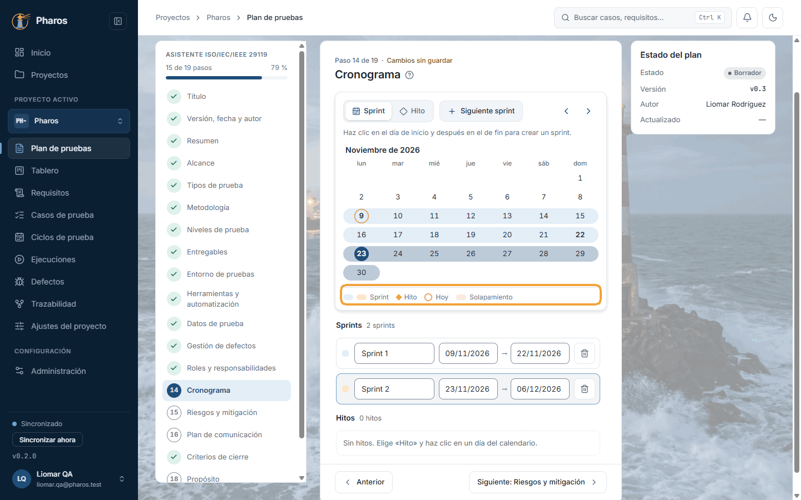

Un sprint seleccionado se puede alargar o acortar arrastrando sus extremos en
el calendario, o editando sus fechas en la fila (dd/mm/aaaa e Intro).

### 3.14. Cronograma: hitos

Un hito es una fecha clave que no ocupa días, como una congelación de código o una salida a producción. Elige «Hito» y haz clic en un día: el hito se marca con un rombo ámbar bajo la fecha y se añade a la lista «Hitos», donde le das nombre (en este ejemplo, «Congelación de código» y «Salida a producción») y puedes corregir la fecha. El hito seleccionado se ve con un rombo mayor, con borde azul. También funciona con el teclado: las flechas mueven el foco por los días e Intro marca el día enfocado.

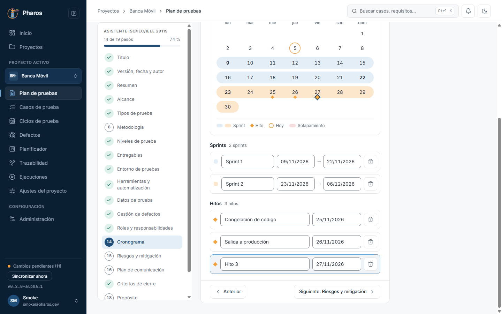

### 3.15. Paso 15 · Riesgos y mitigación

Cada fila es un riesgo que podría afectar a las pruebas y su mitigación, es decir, lo que se hará para reducirlo (en este ejemplo, el retraso del proveedor de pagos QR se mitiga con un simulador propio). Cada campo crece con su texto, para que se lea entero. Si has configurado un motor de IA, «Sugerir riesgos con IA» propone riesgos con su mitigación para que elijas cuáles añadir (capítulo 11).

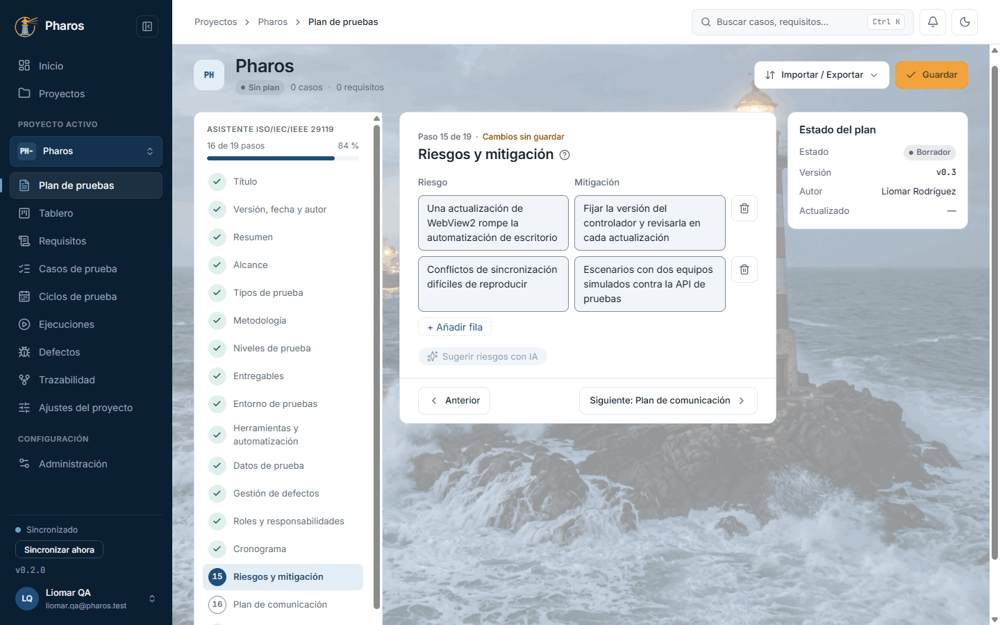

### 3.16. Pasos 16 a 18 · Comunicación, cierre y propósito

Tres pasos de texto que completan el plan: el plan de comunicación (paso 16: qué se informa, a quién y cada cuánto), los criterios de cierre (paso 17: cada criterio con su métrica objetivo, en este ejemplo «Casos críticos ejecutados» al «100 %»; «Inicio» los muestra como criterios de salida; con un motor de IA, «Sugerir criterios con IA» propone criterios ligados a los riesgos del plan para que elijas cuáles añadir) y el propósito del documento (paso 18, el de la captura).

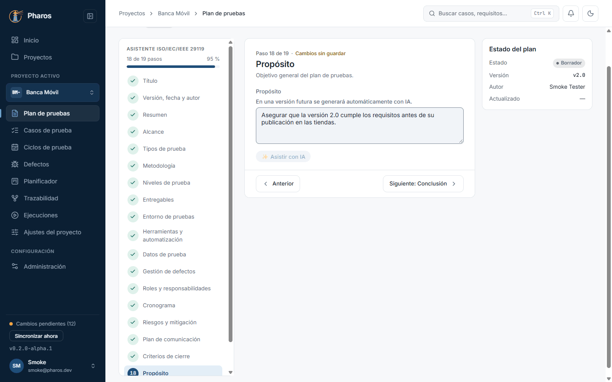

### 3.17. Paso 19 · Conclusión y «Antes de terminar»

El paso 19 recoge la conclusión del plan y, debajo, «Antes de terminar»: la lista de los pasos que aún están incompletos, cada uno con un enlace que lleva directamente a él. Úsala como lista de comprobación antes de finalizar; un plan con pasos pendientes se guarda igualmente, como borrador.

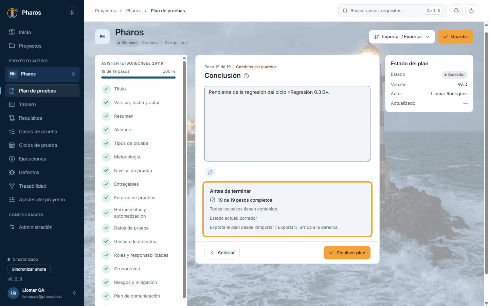

### 3.18. Guardar el plan

«Finalizar plan» (o «Guardar», en la cabecera, desde cualquier paso) guarda el plan: aparece el aviso «Plan de pruebas guardado» y la cabecera del proyecto pasa a «Plan borrador». Guarda a menudo: cada guardado crea además una revisión a la que puedes volver.

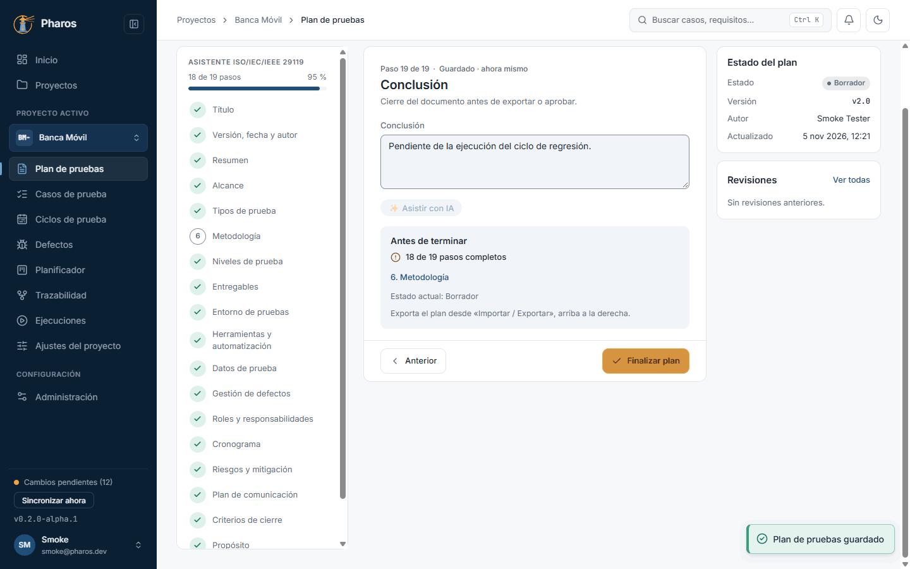

### 3.19. Salir con cambios sin guardar

Si cambias algo y vas a otra sección sin guardar, Pharos te avisa antes de perder el trabajo. «Seguir editando» te devuelve al plan para guardarlo; «Descartar cambios» sale sin guardar.

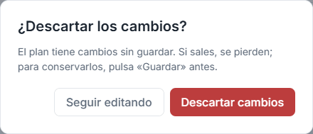

### 3.20. Revisiones del plan

Cada guardado crea una revisión, una copia fechada del plan. «Revisiones», en la cabecera, abre la lista con el número, el título y la fecha de cada una. «Restaurar» vuelve al contenido de una revisión anterior, tras pedir confirmación.

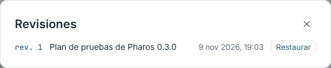

### 3.21. Restaurar una revisión

Al confirmar, el asistente carga el contenido de esa revisión, todavía sin guardar, para que lo revises. Si es lo que buscabas, pulsa «Guardar»: se crea una revisión nueva y las anteriores se conservan, así que restaurar nunca borra el historial.

### 3.22. Exportar el plan

«Importar / Exportar», en la cabecera, ofrece el plan en .pdf, maquetado y listo para firmar, o en .xlsx, editable en Excel. El archivo se guarda en tu carpeta de descarga (Administración › General, capítulo 10) y un aviso indica su nombre.

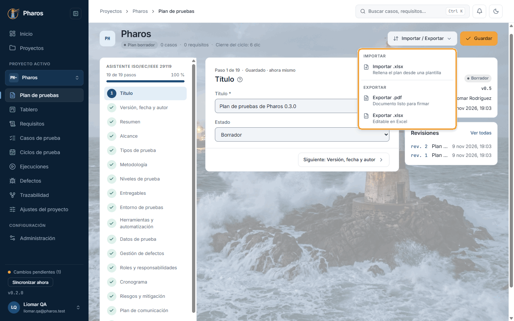

### 3.23. Importar un plan desde .xlsx

Para traer un plan escrito fuera de Pharos, «Importar / Exportar → Importar .xlsx» lee una plantilla rellenada en Excel o un plan exportado antes (en este ejemplo, el .xlsx que se acaba de exportar). Antes de tocar nada, el informe de importación muestra qué campos reconoció, para que decidas si aplicarlo.

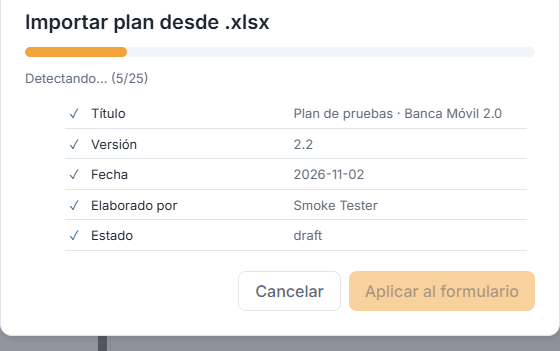

### 3.24. Plan importado

«Aplicar al formulario» carga los datos reconocidos en el asistente, sin guardar todavía: revisa cada paso y pulsa «Guardar» para conservarlos como una revisión nueva.

## Consejos

- No hace falta rellenar los 19 pasos de una vez: el carril de la izquierda
  marca los completos y «Antes de terminar» lista lo que falta.
- La duración del sprint (paso 6) se usa en el cronograma: si un sprint dura
  otra cosa, Pharos lo avisa en su fila.
- Para empezar un plan desde Excel, descarga una plantilla en
  «Administración → Plantillas», rellénala e impórtala con «Importar .xlsx».
- «Restaurar» una revisión no guarda nada hasta que pulses «Guardar».

## Véase también

- [Guía de pruebas de la beta](../guia-beta.md), apartado 4.3.
- [Glosario](../GLOSARIO.md): «Plan de pruebas», «Entregable», «Paso completado», «Cierre del ciclo».

---

← [Inicio, proyectos y ajustes](02-proyectos.md) · [Índice](README.md) · [Casos de prueba](04-casos.md) →
