<!-- Generado por `npm run manual` desde e2e/tours/04-casos.tour.ts y docs/manual/fuentes/casos.md. No lo edites a mano: edita la fuente. -->

# 4. Casos de prueba

## Para qué sirve

Un **caso de prueba** describe cómo comprobar un comportamiento: precondiciones,
pasos y resultado esperado. En Pharos cada caso tiene a la vez un formulario
(«Editor») y su escenario Gherkin, sincronizados: lo que escribes en uno
aparece en el otro, listo para la automatización con playwright-bdd o
Cucumber. Hay tres niveles de escenario (básico, Outline con ejemplos y
avanzado con flujos alternos) y un tipo checklist para revisiones rápidas.

## Paso a paso

### 4.1. La lista de casos, vacía

Los casos de prueba describen qué se comprueba y cómo, paso a paso. Pulsa «Casos de prueba» en el menú lateral. Arriba están «Importar / Exportar», «Sugerir casos con IA» (con un motor de IA configurado, capítulo 11) y «Nuevo caso»; mientras el proyecto no tenga casos, la lista lo indica.

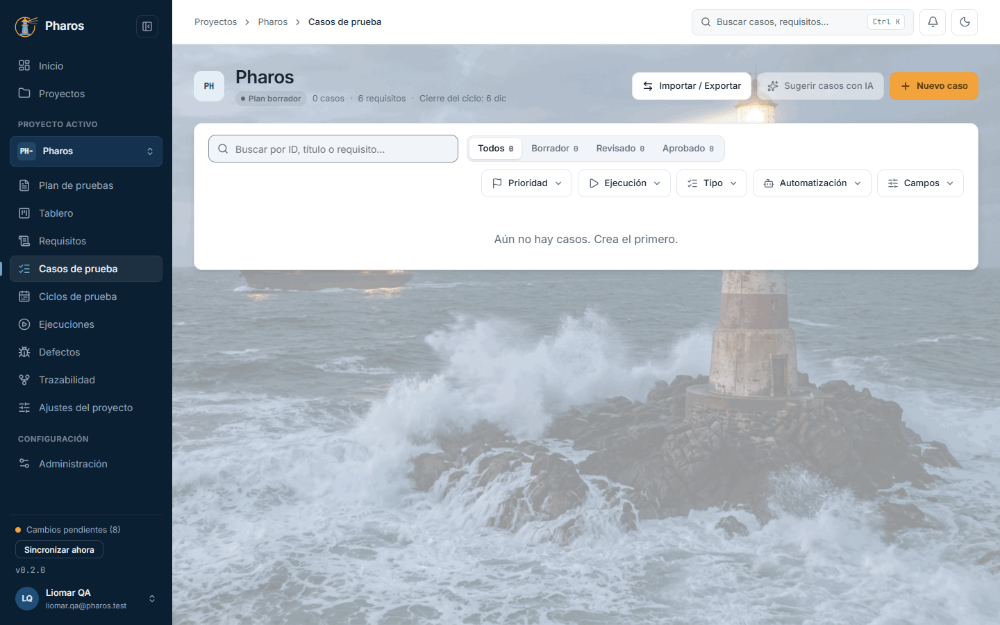

### 4.2. Elegir el tipo de escenario

«Nuevo caso» pregunta primero qué tipo de escenario quieres escribir: «Básico», un escenario Given/When/Then; «Básico avanzado», un Scenario Outline que se repite con una tabla de ejemplos; o «Avanzado», con precondiciones comunes (Background) y varios flujos. Empieza por el más simple que te sirva: un caso se puede subir de nivel después.

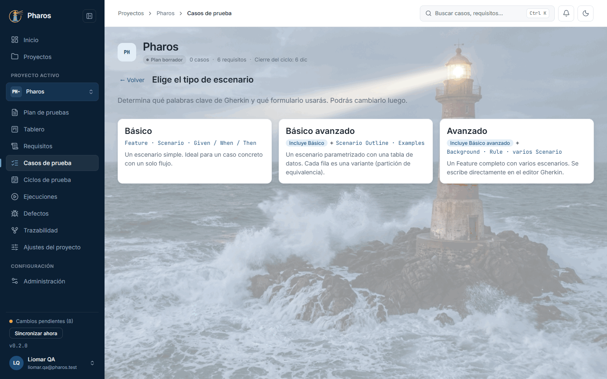

### 4.3. El título es obligatorio

El título es lo único obligatorio. Si guardas un caso sin título, Pharos marca el campo con el error y no lo guarda hasta que lo escribas.

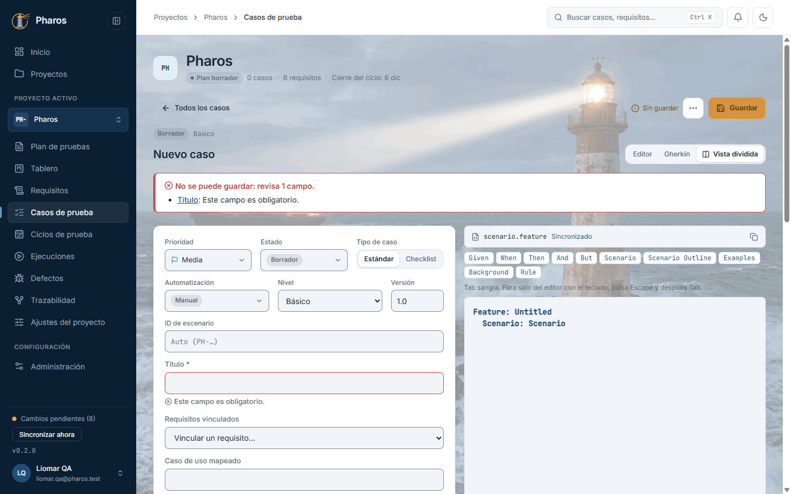

### 4.4. Un caso básico

Rellena el caso: el título (en este ejemplo, «Transferencia a un tercero con saldo suficiente»), las precondiciones, los pasos (cada uno con «+ Añadir paso»; la papelera de un paso lo quita) y el resultado esperado, los que muestra la captura. Más arriba, en el mismo formulario, se clasifica: prioridad, estado, tipo de caso, automatización, nivel y versión. Y a la derecha del título está el mismo caso escrito en Gherkin: lo que escribes en una vista se refleja en la otra (los pasos 4.6 y 4.7 lo muestran). Al guardarlo recibe su ID con el prefijo del proyecto (en este ejemplo, BM-001).

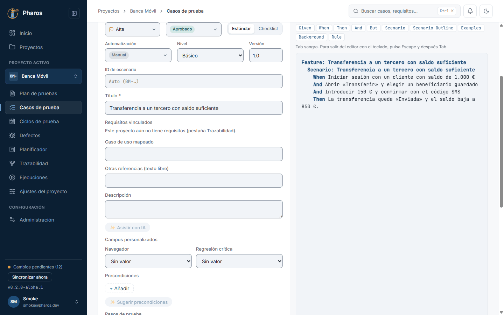

### 4.5. Campos personalizados en el caso

Los campos personalizados del proyecto (capítulo 2) aparecen al final del editor, en «Campos personalizados». Sirven para clasificar los casos con lo que tu equipo necesite y luego filtrar por ello (en este ejemplo, «Navegador», una selección, y «Regresión crítica», un sí/no).

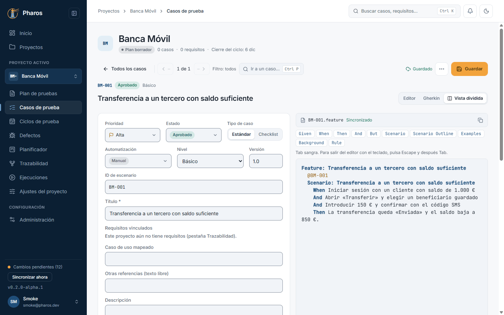

### 4.6. La vista Gherkin

El selector de vista, a la derecha del título, cambia entre «Editor», «Gherkin» y «Vista dividida». «Gherkin» muestra el mismo caso escrito como un escenario .feature. No son dos copias: es el mismo caso visto de dos formas, así que lo que escribes en el formulario aparece en el Gherkin y lo que editas en el Gherkin vuelve al formulario. La barra de palabras clave (Given, When, Then…) las inserta donde está el cursor.

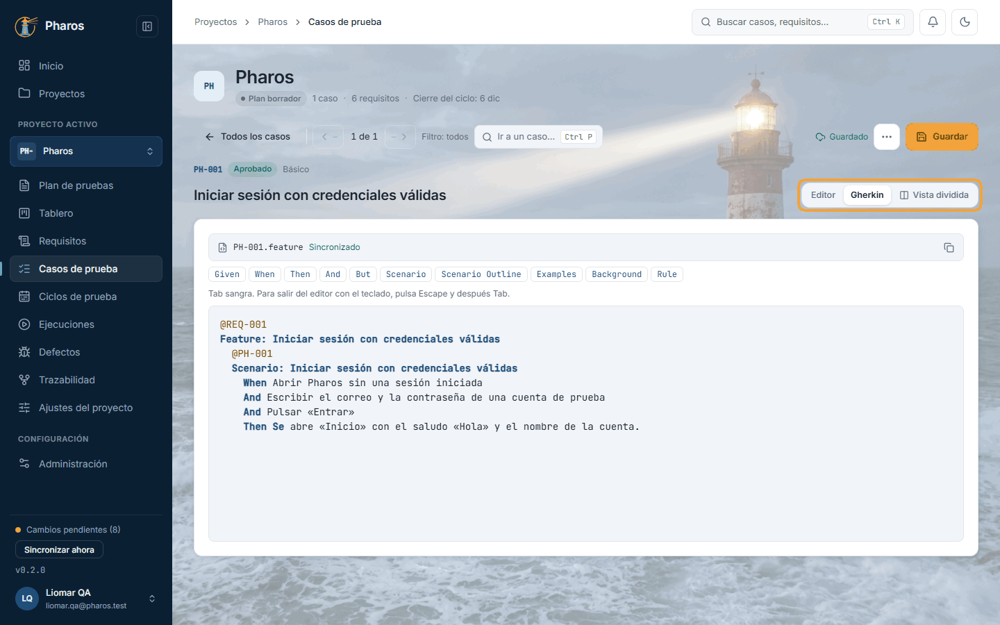

### 4.7. Vista dividida y copiar el Gherkin

«Vista dividida» pone el formulario y el Gherkin uno junto a otro, y es la forma más cómoda de ver cómo cada campo se traduce en el escenario mientras escribes; «Sincronizado», sobre el Gherkin, confirma que ambos coinciden. El botón de copiar, arriba a la derecha del Gherkin, lo lleva al portapapeles («Gherkin copiado») para pegarlo en tu proyecto de automatización.

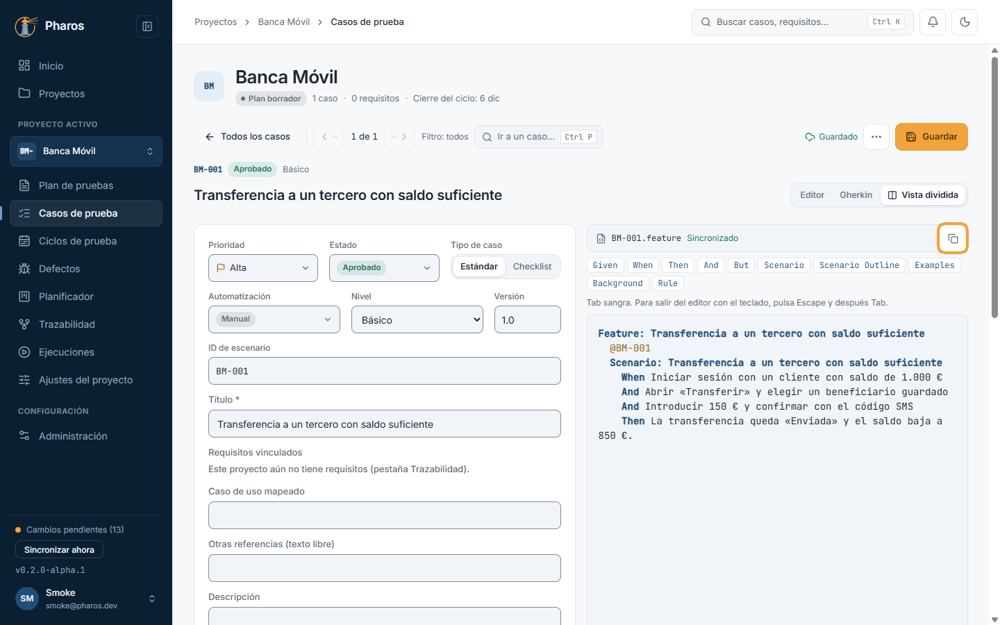

### 4.8. Un caso «Básico avanzado» (Outline)

Un caso «Básico avanzado» (Scenario Outline) prueba el mismo escenario con varios datos. En los pasos, los valores que cambian se escriben como marcadores entre ángulos (en este ejemplo, `<importe>`), y la tabla «Examples» da un valor por fila: cada fila es una ejecución del escenario. «+ Columna» y «+ Fila» amplían la tabla; la papelera quita una fila o una columna.

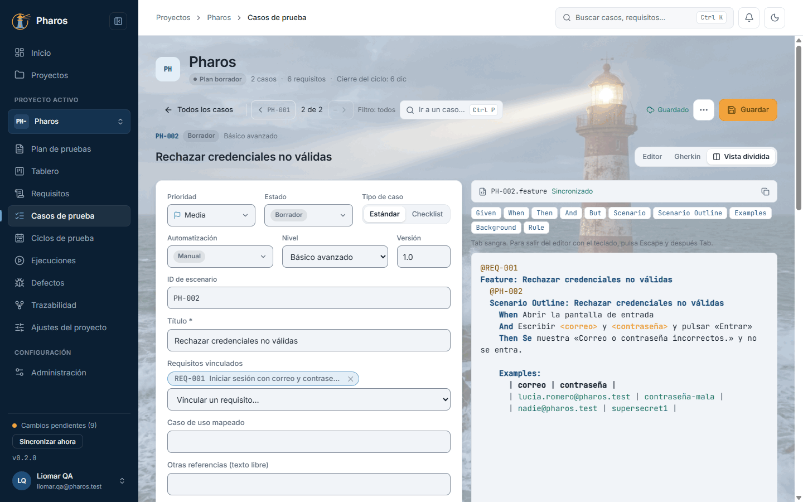

### 4.9. Un caso «Avanzado» con flujos alternos

El nivel «Avanzado» añade precondiciones compartidas (Background), que se cumplen antes de cada flujo, y flujos alternativos además del principal, cada uno con su nombre, sus pasos y su resultado (en este ejemplo, «Huella no reconocida»). En Gherkin, cada flujo es un Scenario. La papelera junto al nombre quita un flujo.

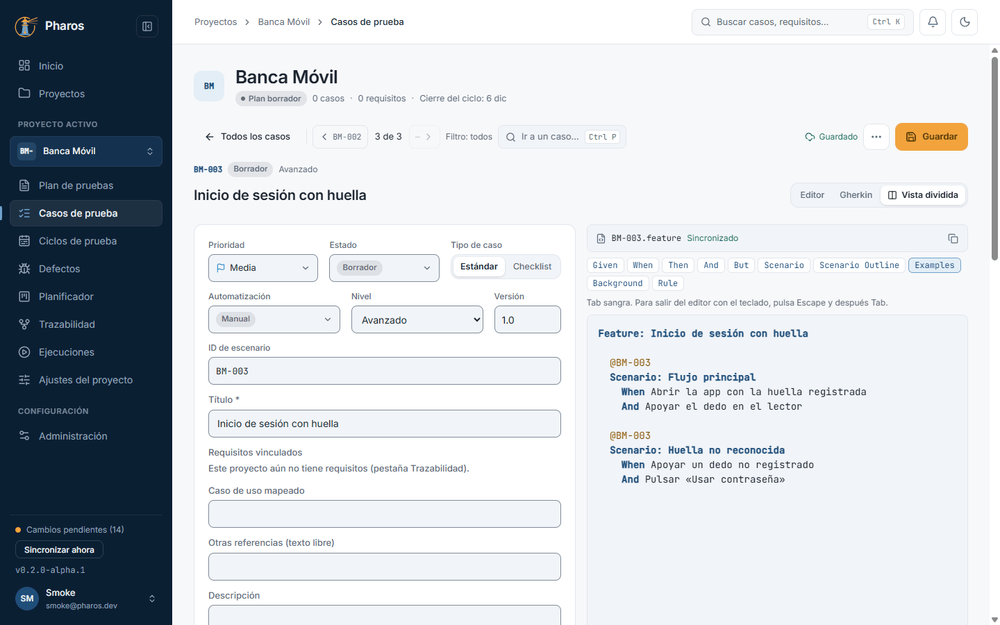

### 4.10. Un caso de tipo checklist

Con «Tipo de caso: Checklist», los pasos se convierten en una lista de comprobaciones sin Given/When/Then y sin Gherkin. Es útil para revisiones rápidas, como una prueba de humo o una revisión de accesibilidad, donde lo que importa es no olvidar nada.

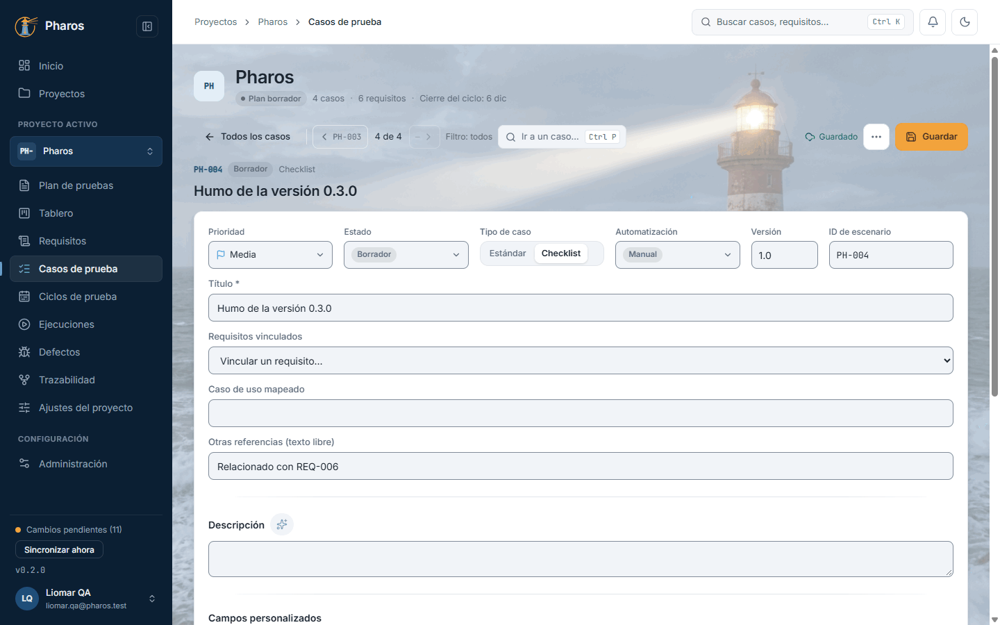

### 4.11. Reordenar con el teclado

Para cambiar el orden de los pasos, arrastra el asa que tiene cada uno. Con el teclado: lleva el foco al asa, pulsa Espacio para cogerlo, muévelo con las flechas y suéltalo con Intro o Espacio.

### 4.12. La lista de casos

Con casos, la tabla muestra ID, título, requisito, prioridad, estado y fecha de la última edición. Si un caso tiene contenido sugerido por IA que nadie ha revisado, su estado (normalmente «Borrador») lleva un ✨ y un borde discontinuo, y al pasar el puntero lo explica. Busca por ID, título o requisito y filtra por estado (cada uno con su recuento), prioridad, tipo, automatización o un campo personalizado de sí/no, para quedarte, por ejemplo, con los casos aprobados de prioridad alta.

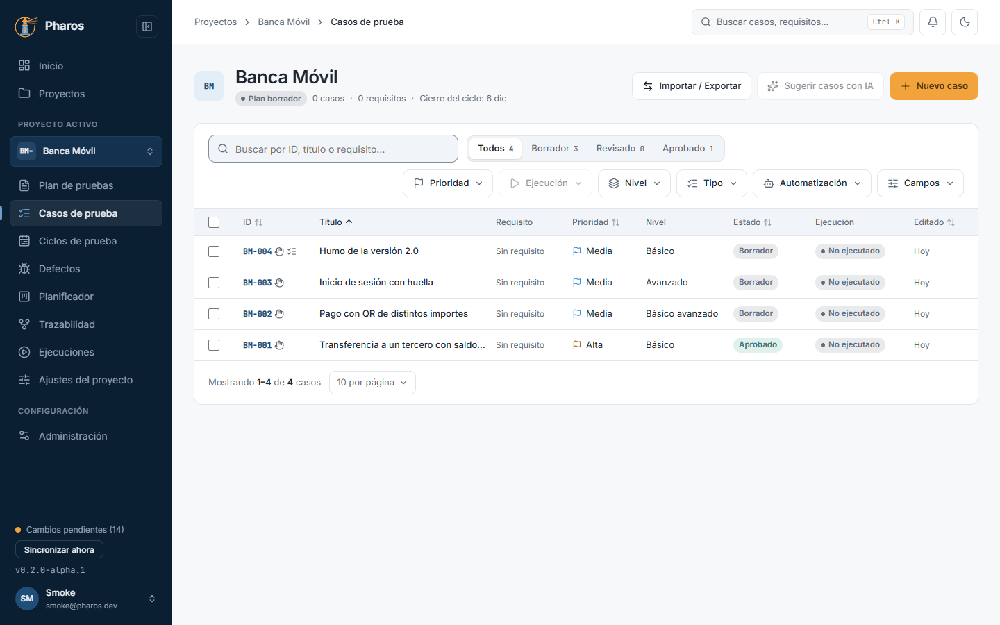

### 4.13. Ningún caso coincide

Si la búsqueda o los filtros no dejan ningún caso, la lista lo dice y ofrece «Quitar filtros» para volver a verlos todos.

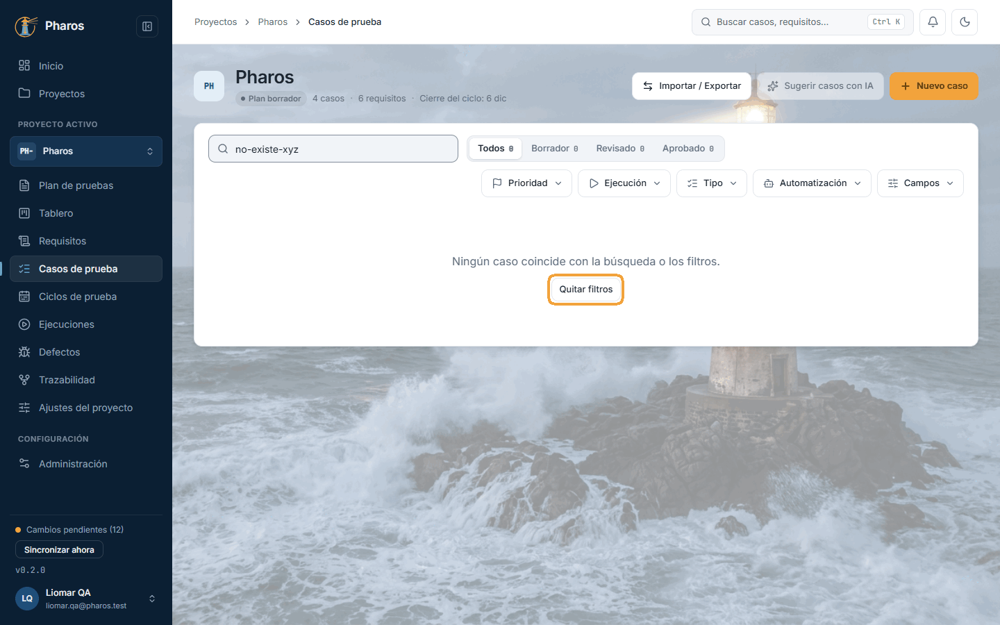

### 4.14. Editar y recorrer los casos

Con un caso abierto, la barra superior indica su posición en la lista (por ejemplo, «2 de 3») y sus flechas pasan al anterior o al siguiente respetando el filtro activo, para revisar varios casos seguidos sin volver a la lista. A la derecha, el estado de guardado avisa si hay cambios sin guardar.

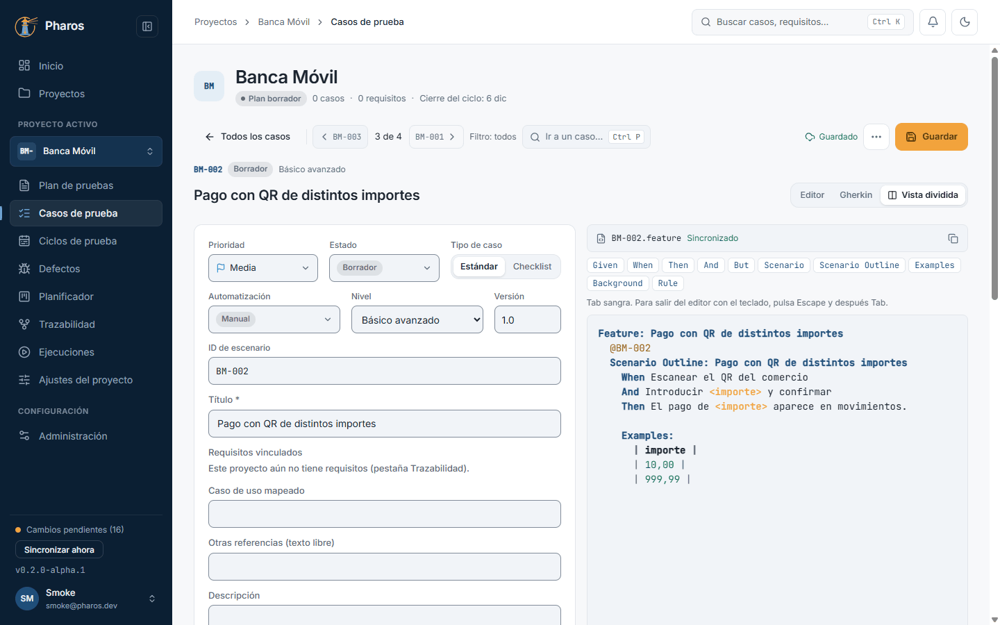

### 4.15. Ir a un caso (Ctrl+P)

«Ir a un caso…» (o Ctrl+P desde el editor) abre un buscador: escribe parte del ID o del título, elige con las flechas y pulsa Intro para abrirlo sin pasar por la lista.

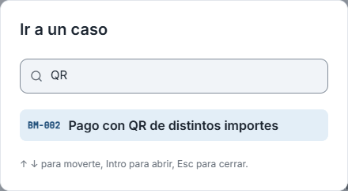

### 4.16. Revisiones y exportación de un caso

El menú «⋯» del caso reúne sus revisiones (una por cada guardado, para ver o recuperar versiones anteriores) y la exportación a .xlsx, .pdf o .feature. El aviso indica dónde se guardó el archivo.

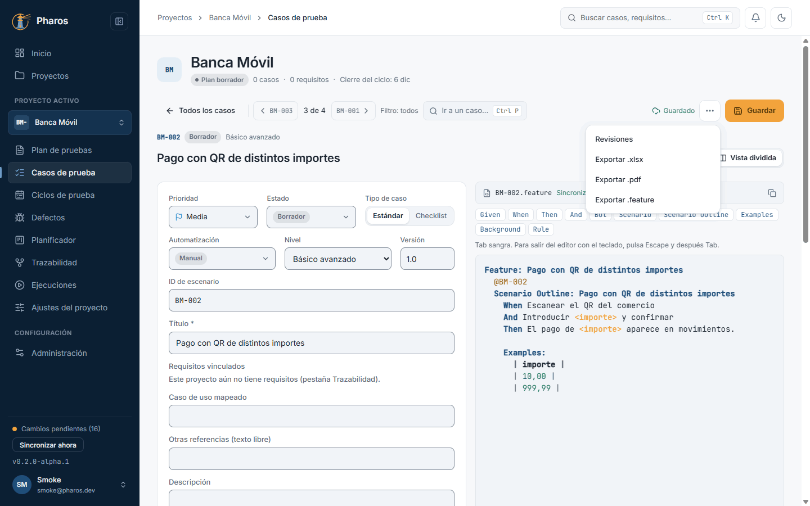

### 4.17. Importar un caso desde .xlsx

Para traer un caso escrito en Excel, «Importar / Exportar → Importar .xlsx» lee una plantilla rellenada o un caso exportado antes. El informe enseña qué campos se reconocieron y «Aplicar» abre el editor con esos datos, todavía sin guardar.

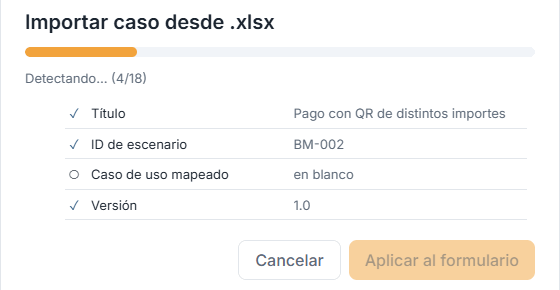

### 4.18. Caso importado

Revisa el caso importado y guárdalo: entra en la lista con el siguiente ID libre del proyecto.

### 4.19. Exportar todos los .feature

«Importar / Exportar → Exportar .feature» genera un archivo .feature por caso, listo para un proyecto de automatización con playwright-bdd o Cucumber. Las checklists se omiten porque no tienen Gherkin.

### 4.20. Acciones con varios casos

Marca uno o varios casos con su casilla (en este ejemplo, uno): aparece una barra con el número de casos seleccionados y lo que puedes hacer con todos a la vez, exportarlos a .feature o eliminarlos.

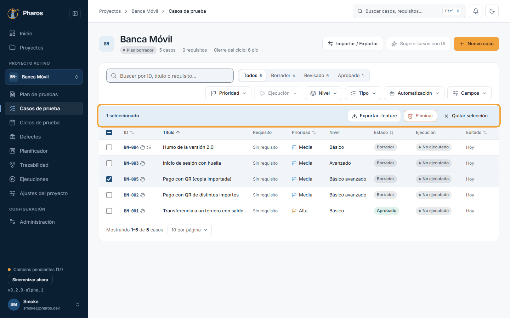

### 4.21. Eliminar casos

«Eliminar» pide confirmación antes de quitar los casos del proyecto («¿Eliminar 1 caso?»); «Cancelar» los deja como estaban.

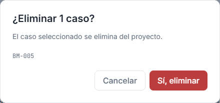

### 4.22. Casos eliminados

Al confirmar, un aviso dice cuántos casos se eliminaron y la lista deja de mostrarlos.

## Consejos

- Empieza en «Básico»: siempre puedes subir de nivel, pero no bajar por
  debajo de lo que ya usa el Gherkin.
- Usa marcadores entre ángulos (`<importe>`) y la tabla de ejemplos cuando el
  mismo escenario deba probarse con varios datos.
- Ctrl+P salta a cualquier caso sin volver a la lista; la barra superior dice
  si hay cambios sin guardar.
- Al importar un .xlsx, los valores que no encajan con un campo personalizado
  se omiten y Pharos lo avisa.

## Véase también

- [Guía de pruebas de la beta](../guia-beta.md), apartado 4.3.
- [Glosario](../GLOSARIO.md): «Caso de prueba», «ID de escenario», «Pasos de prueba», «Prioridad», «Estado (del caso)».

---

← [Plan de pruebas](03-plan.md) · [Índice](README.md) · [Trazabilidad y requisitos](05-trazabilidad.md) →
