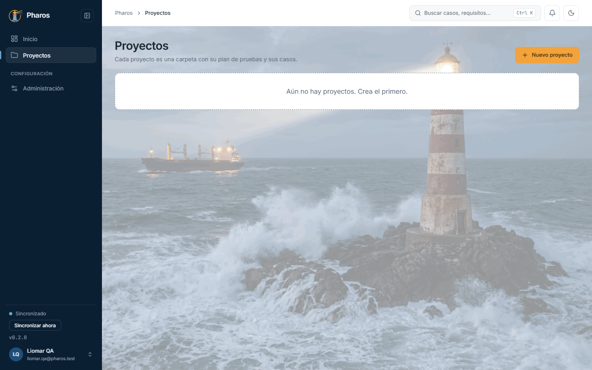
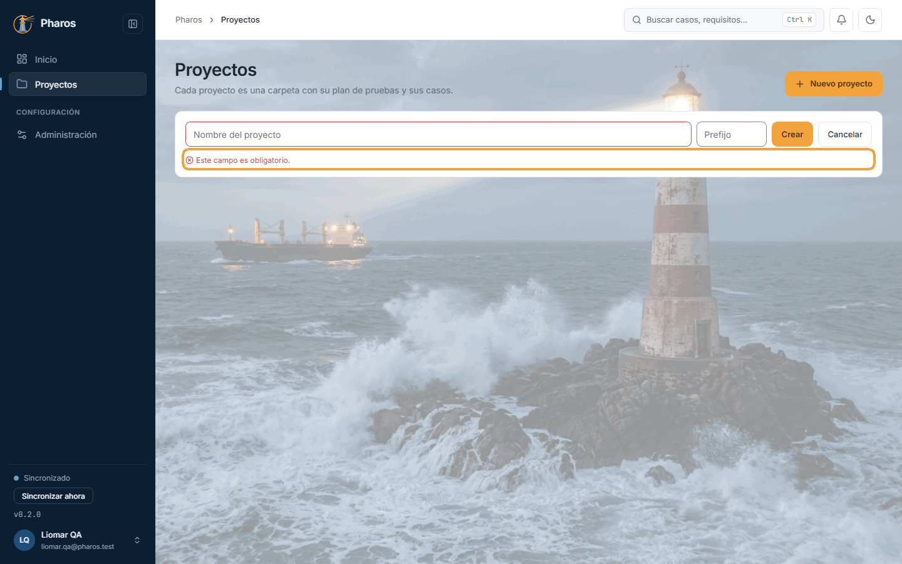
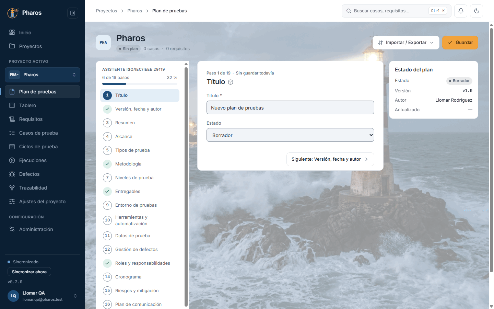
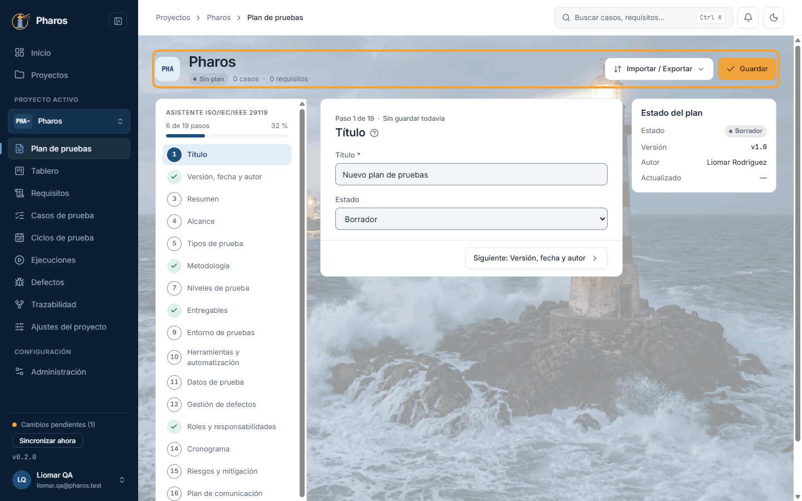
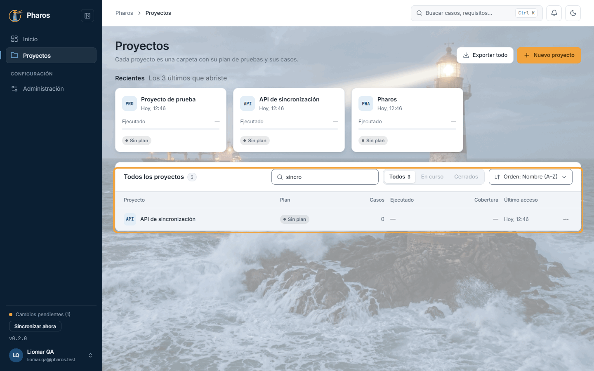
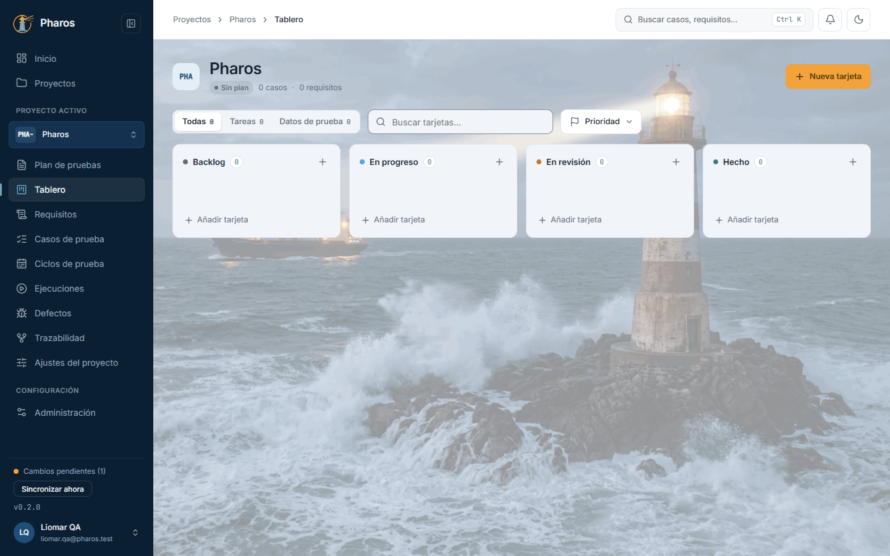
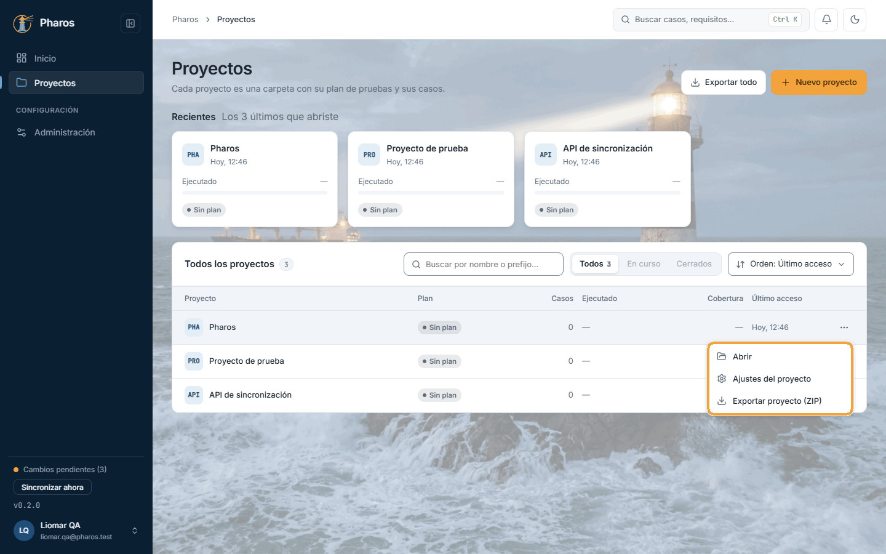
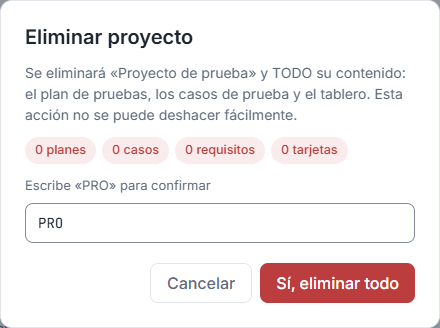

<!-- Generado por `npm run manual` desde e2e/tours/04-proyectos.tour.ts y docs/manual/fuentes/proyectos.md. No lo edites a mano: edita la fuente. -->

# 4. Proyectos

## Para qué sirve

Un **proyecto** es el producto, o la versión de un producto, que pruebas. Todo
lo demás vive dentro de él:

- su plan de pruebas;
- su tablero de tareas;
- sus requisitos y sus casos;
- los ciclos, las ejecuciones y los defectos;
- la matriz de trazabilidad.

Lo primero es crear el proyecto. Después, Pharos te lleva de la mano: un
proyecto nuevo se abre en su **plan de pruebas**, el punto de partida natural.
Uno que ya existe se abre en su **Tablero**, donde está el trabajo del día a
día.

En este manual, Liomar crea dos proyectos:

- **Pharos** (prefijo `PH`): la propia aplicación.
- **API de sincronización** (prefijo `API`): el servidor con el que Pharos
  sincroniza.

## Paso a paso

### 4.1. La lista de proyectos, vacía

Todo en Pharos vive dentro de un proyecto: el plan, los requisitos, los casos, los ciclos, las ejecuciones y los defectos. Un proyecto es el producto (o la versión) que pruebas. «Proyectos», en el menú lateral, lista los tuyos; sin ninguno, la lista invita a crear el primero con «Nuevo proyecto».

### 4.2. El nombre es obligatorio

«Nuevo proyecto» (aquí o en el Inicio) abre una fila para escribir el nombre. Si pulsas «Crear» sin escribirlo, Pharos lo indica bajo el campo («Este campo es obligatorio.») y no crea nada. «Cancelar» cierra la fila.

### 4.3. Crear un proyecto

Escribe el nombre del producto que vas a probar y pulsa «Crear». En este ejemplo, Liomar crea «Pharos»: el equipo de QA prueba la propia aplicación. A la vez que escribes, el campo de al lado sugiere el prefijo de las claves de sus casos, sacado del nombre y libre entre tus proyectos (aquí, «PHA-», así que los casos serán PHA-001, PHA-002…); puedes cambiarlo antes de crear o después, en sus ajustes. Dos proyectos no pueden tener prefijos que se solapen: iguales, o uno que empiece por el otro (como «PH-» y «PHA-»). Si escribes uno así, Pharos dice con qué proyecto choca y no lo crea. Un proyecto recién creado se abre en su «Plan de pruebas», todavía vacío, porque es lo primero que conviene escribir (capítulo 5).

### 4.4. La cabecera del proyecto

Todas las secciones del proyecto comparten su cabecera: la insignia con el prefijo de sus claves (aquí «PHA», el que Pharos sugirió; Liomar lo acorta a «PH» en el capítulo 14), el nombre, el estado de su plan («Sin plan», «Plan borrador», «Plan aprobado»…) y una línea con sus casos, sus requisitos y la fecha de cierre del ciclo, cuando el plan la tiene. A la derecha van los botones de la sección abierta (aquí, los del plan). En el móvil solo quedan los botones, para ganar espacio.

### 4.5. Crear con Intro

Para ir más rápido, escribe el nombre y pulsa Intro en lugar de «Crear». En este ejemplo, el segundo proyecto es «API de sincronización», el servidor con el que se sincroniza Pharos. Como el primero, se abre en su «Plan de pruebas».

### 4.6. Todos los proyectos

Con proyectos, la lista muestra arriba los «Recientes» (los últimos que abriste) y debajo la tabla de todos: el estado del plan, los casos, la cobertura de requisitos y el último acceso. Busca por nombre o prefijo (en este ejemplo, «sincro» deja solo «API de sincronización») y cambia el orden con el menú de orden: último acceso, nombre, última modificación, cierre del ciclo o cobertura. Con muchos proyectos, la tabla se pagina de 5, 10 o 20.

### 4.7. Abrir un proyecto

Haz clic en el nombre de un proyecto (en la tabla, en «Recientes» o en el Inicio) para abrirlo. Un proyecto que ya existe se abre en su «Tablero», donde está el trabajo del día a día del equipo (capítulo 6); desde ahí, el menú lateral lleva a las demás secciones.

### 4.8. Acciones de un proyecto

El menú «⋯» de cada fila reúne las acciones del proyecto: «Abrir», «Ajustes del proyecto» (capítulo 14) y «Exportar proyecto (ZIP)». Se recorre con ↑ ↓ y se cierra con Esc.

### 4.9. Exportar un proyecto

«Exportar proyecto (ZIP)» reúne en un solo archivo el plan en PDF, los casos en .xlsx y .feature y la matriz de trazabilidad: sirve como copia o para entregar el trabajo a alguien que no usa Pharos. Una ventana muestra el progreso («Generando archivos…», «Comprimiendo el ZIP…») y no se puede cerrar hasta que termina; al acabar, un aviso dice cuántos archivos se exportaron y en qué carpeta (la carpeta de descarga de «Administración › General»).

### 4.10. Exportar todos los proyectos

«Exportar todo», arriba a la derecha de la lista, hace lo mismo con todos tus proyectos a la vez, una carpeta por proyecto dentro del ZIP. Si algún PDF no se pudo generar, el aviso lo dice y el resto del ZIP se guarda igualmente.

### 4.11. Eliminar un proyecto

«Eliminar proyecto», al pie de sus ajustes, borra el proyecto con todo lo que contiene. Por eso el diálogo cuenta antes lo que se perderá (planes, casos, requisitos, tarjetas) y, para evitar un borrado por error, pide escribir el prefijo (o el nombre) antes de habilitar «Sí, eliminar todo». Esc no lo cierra: solo «Cancelar». Si quieres conservar una copia, exporta antes el ZIP.

### 4.12. Proyecto eliminado

Al confirmar, Pharos vuelve a la lista de proyectos, que ya no lo muestra, y avisa de que se eliminó.

## Atajos de teclado

| Tecla | Dónde | Qué hace |
| --- | --- | --- |
| Intro | Campo «Nombre del proyecto» | Crea el proyecto |
| Esc | Fila de crear proyecto | No la cierra: usa «Cancelar» |
| Tab | Lista | Recorre las tarjetas de «Recientes», el buscador, el orden y las filas de la tabla |
| Intro | El nombre de un proyecto | Lo abre |
| ↑ ↓ e Intro | Menú «⋯» de una fila y menú de orden | Recorren y eligen una opción |
| Esc | Un menú abierto | Lo cierra |

## Si algo no sale

- **«Este campo es obligatorio.»** Escribe un nombre antes de pulsar «Crear».
- **«No se pudo crear el proyecto.»** Pulsa «Reintentar». En la versión web,
  comprueba la conexión.
- **«No se pudo cargar la lista de proyectos.»** Pulsa «Reintentar».
- **«Ningún proyecto coincide con «…».»** El buscador busca en el nombre y en
  el prefijo. Borra el texto para volver a ver todos.
- **«Ejecutado» dice «—».** El proyecto aún no tiene casos o ninguno tiene
  un resultado. Al pasar el cursor se ve el recuento («3 de 4 casos con
  resultado»); es la misma cifra que «Ejecución por proyecto» del Inicio
  (capítulo 3).
- **Los filtros «En curso» y «Cerrados», y el orden «Defectos abiertos», no se
  pueden elegir.** Llegan en una próxima versión: los proyectos aún no tienen
  estado abierto o cerrado.
- **«No se pudo exportar «…».»** Pulsa «Reintentar». Si el aviso dice que
  algún PDF no se pudo generar, el ZIP se guarda igualmente sin ese archivo.
- **«Sí, eliminar todo» no se activa.** Escribe exactamente la palabra que
  pide el diálogo: el prefijo del proyecto sin su separador (por ejemplo, `PH`)
  o, si no tiene prefijo, su nombre.
- **El proyecto que buscaba ha desaparecido.** Si se eliminó en otro equipo, al
  sincronizar desaparece también aquí. Si abres un enlace a un proyecto que ya
  no existe, Pharos te lleva a la lista.

## En el móvil

- La lista muestra cada proyecto como una tarjeta: su insignia, su nombre y una
  línea con el plan, la ejecución y el último acceso.
- El menú de orden no aparece; el buscador sí.
- El menú «⋯» de cada proyecto se abre como una hoja desde abajo.
- Dentro de un proyecto, la cabecera se reduce a los botones de la sección, y
  el nombre del proyecto pasa a la barra superior.

## Consejos

- Crea un proyecto por producto o por versión importante que pruebes por
  separado (por ejemplo, «Pharos 0.3» y «Pharos 0.4»), no uno por ciclo de
  pruebas: los ciclos van dentro del proyecto (capítulo 9).
- Al crear un proyecto, Pharos sugiere un prefijo sacado del nombre y libre
  entre tus proyectos («Pharos» → `PHA-`). Ajústalo antes de crear casos, ahí
  mismo o en «Ajustes del proyecto» (capítulo 14): la clave de un caso no
  cambia una vez asignada, porque viaja como tag (por ejemplo, `@PH-001`) en
  la automatización.
- Dos prefijos se solapan si son iguales (sin contar el separador final ni
  las mayúsculas) o si uno empieza por el otro, como `PH-` y `PHA-`: Pharos no
  lo permite, porque una búsqueda o una importación por `PH` encontraría los
  casos de los dos proyectos.
- Exporta el ZIP antes de eliminar un proyecto, o como copia periódica fuera de
  Pharos.

## Véase también

- Capítulo 3, «Inicio»: el resumen de todos tus proyectos.
- Capítulo 5, «Plan de pruebas»: lo primero que se escribe en un proyecto
  nuevo.
- Capítulo 14, «Ajustes del proyecto».
- [Guía de pruebas de la beta](../guia-beta.md), apartado 4.3 «Plan, casos y
  exportaciones».
- [Glosario](../GLOSARIO.md): «Proyecto», «Prefijo de ID de caso», «Recientes».

---

← [Inicio](03-inicio.md) · [Índice](README.md) · [Plan de pruebas](05-plan.md) →
