<!-- Generado por `npm run manual` desde e2e/tours/05-plan.tour.ts y docs/manual/fuentes/plan.md. No lo edites a mano: edita la fuente. -->

# 5. Plan de pruebas

## Para qué sirve

El **plan de pruebas** es el documento que dice qué se prueba, cómo, con qué
medios, quién y cuándo. Hay un plan por proyecto. Pharos lo redacta con un
asistente de **22 pasos** que sigue la norma ISO/IEC/IEEE 29119-3 y el apartado
5.1.1 de ISTQB CTFL v4:

| Pasos | Qué decides |
| --- | --- |
| 1–2 | Identificación del plan (título, estado, ID de documento, versión y fecha; el autor es tu nombre del perfil y lo ves en «Estado del plan») y resumen |
| 3–8 | Alcance, supuestos y restricciones, niveles y tipos de prueba, técnicas de prueba, metodología y entregables |
| 9–12 | Entorno, herramientas y automatización, datos de prueba y gestión de defectos |
| 13–16 | Roles, independencia y formación; estimación y presupuesto; cronograma (sprints e hitos) y riesgos con su mitigación |
| 17–20 | Comunicación; entrada, suspensión y reanudación; métricas y objetivos medibles; criterios de cierre |
| 21–22 | Propósito y conclusión |

Hasta la versión 0.2 el asistente tenía 19 pasos: «Título» y «Versión, fecha y
autor» son ahora el paso 1, y «Tipos de prueba» y «Niveles de prueba» el
paso 5. En la 0.3 tenía 17: los pasos 4, 6, 14, 18 y 19 son nuevos en la 0.4.
Un plan guardado entonces se abre con todos sus datos y los pasos nuevos por
completar.

**Niveles y tipos de prueba** (paso 5) responde, como propone ISTQB, a qué se
prueba, en qué nivel y con qué tipo. Los niveles dicen dónde: unitarias (un
componente), integración (sus interfaces), sistema (de extremo a extremo) y
aceptación (usuario y negocio). Los tipos dicen qué característica se
comprueba, en tres grupos: funcionales; no funcionales (rendimiento, carga,
estrés, seguridad, usabilidad, compatibilidad, accesibilidad); y
**confirmación y regresión**, las pruebas que siguen a un cambio:

- **Confirmación:** volver a probar lo que falló, una vez arreglado.
- **Regresión:** comprobar que lo que funcionaba sigue funcionando.
- **Humo:** una pasada rápida por lo básico de una versión nueva.
- **Sanidad:** una comprobación corta de lo que se acaba de cambiar.

Las casillas van en columnas por grupo. Lo que el equipo añade queda en la
columna **«Propios»**, con una ✕ para quitarlo y, al pie, el campo para añadir
otro; las **Técnicas de prueba** (paso 6) y los **Entregables** (paso 8) siguen
el mismo diseño. Las técnicas son las de CTFL v4: de caja negra (particiones de
equivalencia, valores límite, tablas de decisión, transición de estados), de
caja blanca (sentencias y ramas), basadas en la experiencia (predicción de
errores, exploratoria, listas de comprobación) y colaborativas (historias de
usuario, criterios de aceptación, ATDD).

**Supuestos y restricciones** (paso 4) separa lo que se da por hecho al
planificar (un entorno disponible, que las historias lleguen con criterios de
aceptación) de los límites que el equipo no puede cambiar (plazos, personas,
normas). **Entrada, suspensión y reanudación** (paso 18) dice cuándo puede
empezar un ciclo, cuándo se detiene la prueba y qué tiene que pasar para
retomarla. En los dos pasos, «Sugerir con IA» propone elementos de cada lista.

**Roles, independencia y formación** (paso 13) añade, bajo la tabla de roles,
la **independencia de las pruebas** en una escala de cinco (de quien escribe el
código a un equipo externo) con cómo se garantiza, y las **necesidades de
formación** del equipo con su plazo.

**Estimación y presupuesto** (paso 14) recoge la técnica (por proporciones, por
extrapolación, Wideband Delphi, tres puntos o juicio experto), el esfuerzo en
persona-días y el presupuesto. Con la de tres puntos escribes el optimista, el
más probable y el pesimista, y Pharos calcula E = (O + 4·M + P) / 6 y su
desviación.

**Métricas y objetivos medibles** (paso 19) es una fila por métrica con su
comparador y su objetivo. Las del catálogo las mide Pharos y su unidad es fija:
casos ejecutados, tasa de éxito, cobertura, reapertura e inestables en %;
defectos críticos abiertos y defectos escapados en número; la densidad de
defectos por cada 100 casos ejecutados, y el tiempo de corrección en días (la
mediana hasta «Corregido»). Las **propias** llevan nombre y unidad y se valoran
a mano. Marcar **«Criterio de salida»** lleva la métrica a «Criterios de
cierre» (paso 20), donde cada criterio dice **«Medido por»** qué métrica lo mide
y si es **«Bloqueante»** (por defecto) u **«Orientativo»**. El texto de un
criterio medido se escribe desde su métrica y se actualiza si la cambias. Un
plan nuevo empieza con cuatro métricas y los tres criterios de siempre
enlazados.

**Metodología** (paso 7) va en dos columnas con ese mismo aspecto. En **«Método
de trabajo»**, la metodología y, si es ágil, la duración del sprint («2
semanas»). En **«Reuniones del equipo»**, una fila por reunión (diaria,
revisión, retrospectiva y planificación) con su casilla, su nombre y su
frecuencia; la frecuencia de una reunión sin marcar se ve en gris hasta que la
marcas. «Tradicional / V-model» no trabaja por sprints: en lugar de la duración
y las reuniones, pide las fases del proyecto.

**Las fechas** (la del plan, las de los ciclos, el periodo del informe de
estado y los campos personalizados de tipo fecha) usan el selector de fechas de
Pharos: se escriben dd/mm/aaaa o se eligen en un calendario con el mismo
aspecto que el del cronograma, que se abre con el botón del calendario al final
del campo (en el móvil, como una hoja desde abajo). Al pie, «Hoy» y «Borrar».
En un rango, el calendario del fin abre en el mes del inicio y no deja elegir
un día anterior.

El plan alimenta otras pantallas:

- Los **criterios de cierre** (paso 20) son los criterios de salida que evalúa
  el Inicio (capítulo 3) y el informe de estado (capítulo 11); los medidos por
  una métrica se evalúan con ella.
- El **cronograma** da la fecha de cierre que se ve en la cabecera del
  proyecto y en «Criterios de salida».
- Los **tipos y niveles** guían las sugerencias de casos con IA (capítulo 17).

Cada guardado **con cambios** crea una revisión y sube la versión (1.3 → 1.4);
guardar sin cambios avisa de que no hay nada que guardar, y cambiar solo el
estado no sube la versión. El plan se exporta en PDF (listo para firmar) o en
Excel, con su **ID de documento** (por defecto `TP-<prefijo del proyecto>-<6
caracteres>`, editable en el paso 1).

**Aprobar el plan.** «Aprobado» no se elige en el estado: con el plan guardado y
en «Revisado», pulsa **«Aprobar versión N»** en «Estado del plan» y confirma.
Queda quién lo aprobó y cuándo, en el panel y en la cabecera del PDF y del
Excel; aprobar no sube la versión. Si después cambias el contenido, un aviso lo
dice antes de guardar y el plan vuelve a «Revisado» con una versión nueva. El
panel **«Historial»** muestra los últimos cambios de estado y versión, quién
los hizo y qué pasos tocó, con «pierde la aprobación» cuando toca; «Revisiones»
abre la lista para restaurar una.

En este manual, Liomar escribe el «Plan de pruebas de Pharos 0.3.0»: qué se
prueba de la propia aplicación en esta versión.

## Paso a paso

### 5.1. El asistente del plan

El plan de pruebas dice qué se prueba, cómo, con qué medios, quién y cuándo. Pharos lo redacta con un asistente de 22 pasos que sigue la norma ISO/IEC/IEEE 29119-3 y el apartado 5.1.1 de ISTQB CTFL v4: «Plan de pruebas», la primera sección del proyecto. A la izquierda, la lista de pasos con una ✓ en los completos y el porcentaje de avance; en el centro, el paso actual, con «Paso N de 22» y si hay cambios sin guardar; a la derecha, «Estado del plan» (estado, versión, autor, última actualización y el botón para aprobarlo) y el «Historial» de sus últimos cambios. No hace falta seguir el orden: salta a cualquier paso desde la lista.

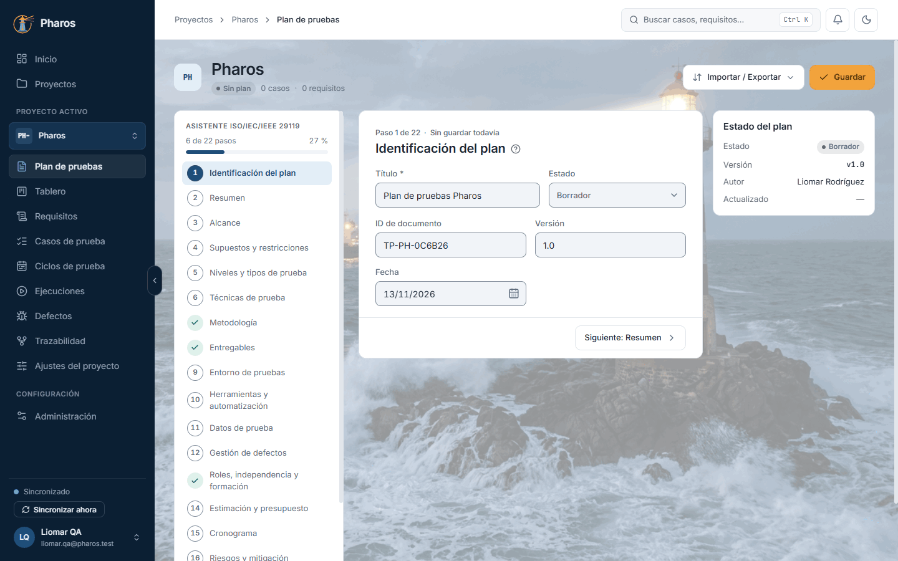

### 5.2. Paso 1 · Identificación del plan

El paso 1 es el bloque de identificación del documento de ISO/IEC/IEEE 29119-3: el título (en este ejemplo, «Plan de pruebas de Pharos 0.3.0»), el estado (Borrador, Revisado u Obsoleto; «Aprobado» se da con el botón «Aprobar» de «Estado del plan», que deja constancia de quién y cuándo), el ID de documento (por defecto «TP-», el prefijo del proyecto y seis caracteres; se puede cambiar), la versión («0.3») y la fecha. El autor no se escribe: es tu nombre oficial del perfil (en este ejemplo, Liomar Rodríguez, capítulo 1); lo ves en el panel «Estado del plan» y firma el plan cuando lo exportas. El estado se elige en una lista desplegable de Pharos, como todas las de la aplicación: la opción elegida lleva una ✓, y con el teclado ↑ ↓ recorren las opciones, una letra salta a la que empieza por ella, Intro elige y Esc cierra; en el móvil se abre como una hoja desde abajo.

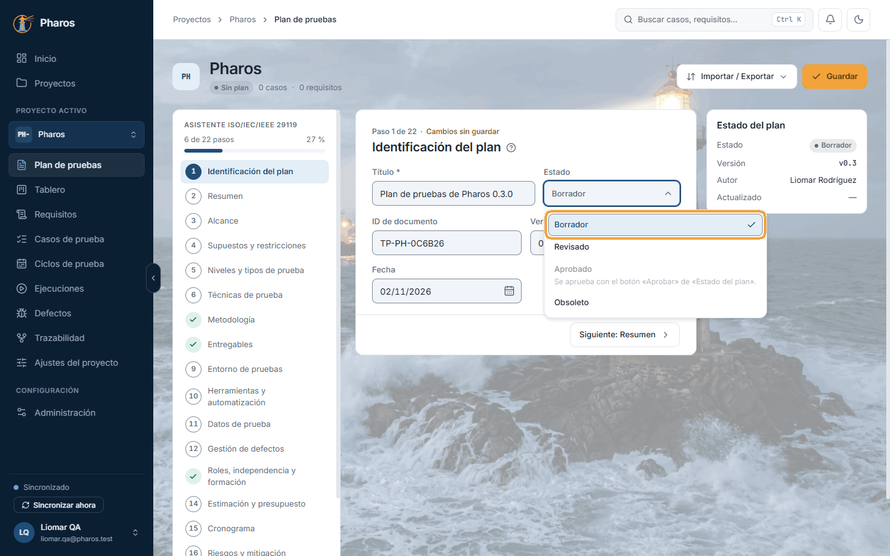

### 5.3. La fecha: el selector de fechas de Pharos

La fecha se escribe dd/mm/aaaa (en este ejemplo, 02/11/2026) o se elige en el calendario de Pharos, el mismo del cronograma: el botón del calendario, al final del campo, lo abre en el mes de la fecha, con el mes y el año arriba («Noviembre de 2026») y ‹ › para cambiar de mes. Hoy lleva un anillo naranja y el día elegido va relleno. Con el teclado, las flechas recorren los días, RePág y AvPág cambian de mes, Inicio y Fin van al principio y al final de la semana, Intro elige y Esc cierra y vuelve al botón. Al pie, «Hoy» elige el día de hoy y «Borrar» vacía el campo. En el móvil se abre como una hoja desde abajo. El mismo selector está en los ciclos (capítulo 9), en el informe de estado (capítulo 11) y en los campos personalizados de tipo fecha (capítulo 14).

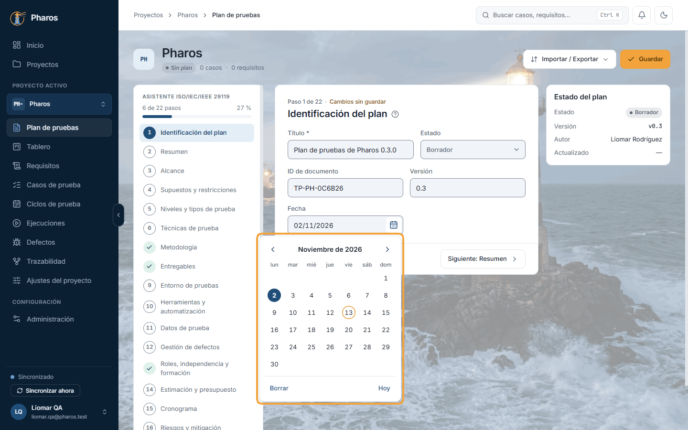

### 5.4. Paso 2 · Resumen

«Siguiente: …», al pie, avanza al paso siguiente y lo nombra; «Anterior» vuelve. El resumen es lo primero que leerá quien reciba el plan: en pocas líneas, qué se prueba y por qué (en este ejemplo, la versión 0.3.0 de Pharos, en escritorio y en la web). Con un motor de IA configurado (capítulo 15), el botón ✨ «Asistir con IA» redacta un borrador a partir de lo que hayas escrito; lo usas, lo editas o lo descartas, y nada se aplica sin que lo aceptes (capítulo 17).

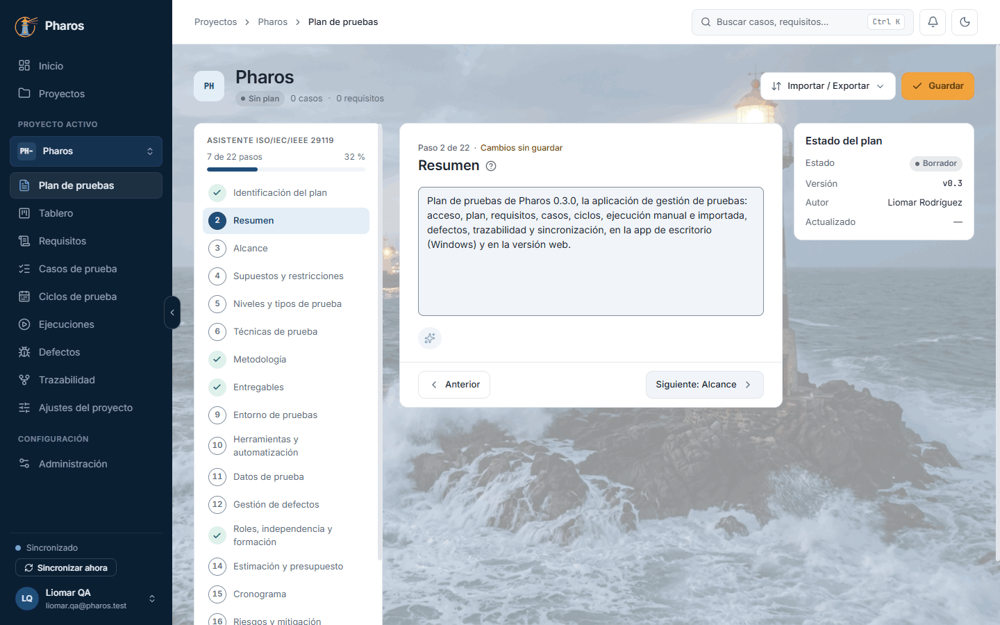

### 5.5. Paso 3 · Alcance

El alcance fija qué se prueba y, tan importante como eso, qué no: así nadie da por cubierto lo que queda fuera. En «Elementos dentro del alcance» y «Fuera del alcance», «+ Añadir» crea una fila por elemento (en este ejemplo, el acceso, el plan con los requisitos y los casos, la ejecución y la sincronización dentro; la integración con Jira y una app móvil nativa fuera). La papelera de cada fila («Quitar») la elimina; si la fila tiene texto, pide confirmarlo con «Sí, eliminar» o «Cancelar». Pharos avisa de las filas repetidas.

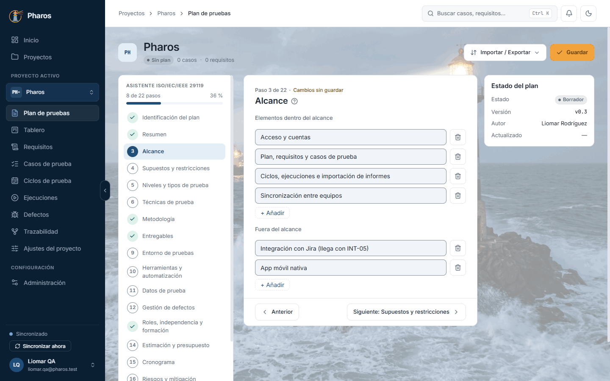

### 5.6. Paso 4 · Supuestos y restricciones

Dos listas, una junto a otra. Los supuestos son lo que se da por hecho al planificar (en este ejemplo, que el servidor de staging esté disponible en horario laboral); si uno deja de cumplirse, hay que revisar el plan. Las restricciones son los límites que el equipo no puede cambiar (una sola persona de QA, la fecha de la versión). Con un motor de IA, «Sugerir supuestos y restricciones con IA» propone elementos de las dos listas a partir del plan, y eliges cuáles añadir.

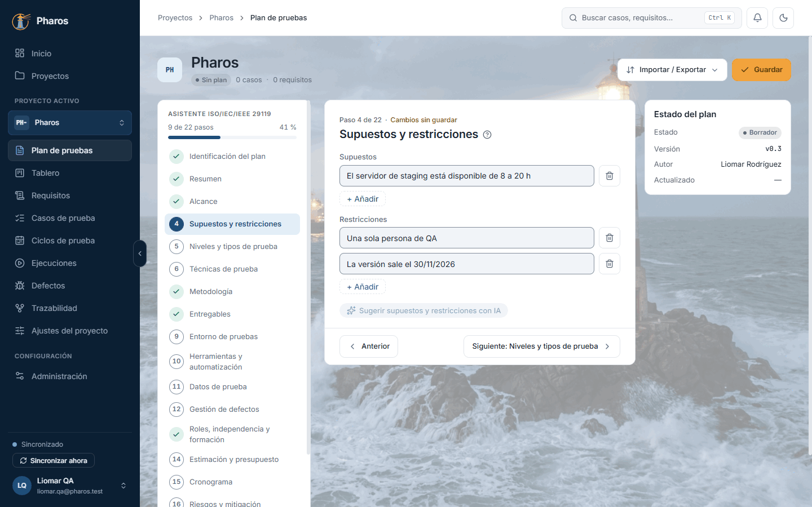

### 5.7. Paso 5 · Niveles y tipos de prueba

Qué se prueba, en qué nivel y con qué tipo (ISTQB), en columnas. Los niveles dicen dónde se prueba: unitarias (un componente), integración (sus interfaces), sistema (de extremo a extremo) y aceptación (usuario y negocio); en este ejemplo, integración, sistema y aceptación, porque las unitarias son cosa del equipo de desarrollo. Los tipos dicen qué se comprueba: funcionales, no funcionales (rendimiento, seguridad, usabilidad…) y «Confirmación y regresión», las pruebas que siguen a un cambio: confirmación (volver a probar lo que falló, una vez arreglado), regresión, humo y sanidad; pasa el ratón por cada una para leer qué es. Si falta un tipo, escríbelo al pie de «Propios» y pulsa Intro o «Añadir» (en este ejemplo, «Pruebas de sincronización»); la ✕ lo quita. La ayuda «?» del título lo explica.

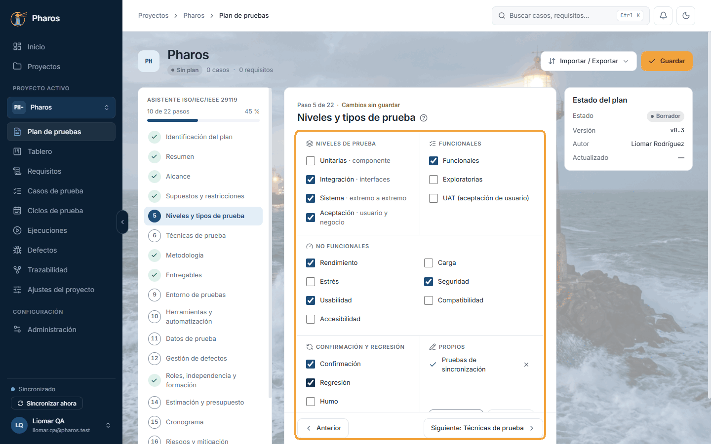

### 5.8. Paso 6 · Técnicas de prueba

Cómo se diseñan los casos, con las técnicas de ISTQB CTFL v4 en columnas: de caja negra (particiones de equivalencia, valores límite, tablas de decisión, transición de estados), de caja blanca (sentencias y ramas), basadas en la experiencia (predicción de errores, exploratoria, listas de comprobación) y colaborativas (historias de usuario, criterios de aceptación, ATDD). En este ejemplo, valores límite y particiones para los formularios, transición de estados para los ciclos y exploratoria en cada versión. Las del equipo van en «Propias», como en los entregables.

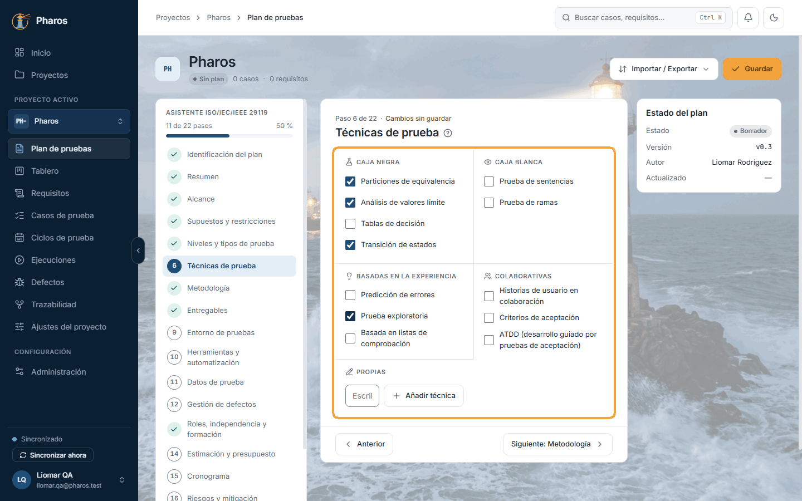

### 5.9. Paso 7 · Metodología

Indica cómo trabaja el equipo, en dos columnas. En «Método de trabajo», la metodología y, con «Ágil», la duración del sprint («2 semanas»; de 1 a 4). En «Reuniones del equipo», una fila por reunión (diaria, revisión, retrospectiva y planificación): su casilla, su nombre y su frecuencia en la misma fila; la frecuencia de una reunión sin marcar se ve en gris y no se puede cambiar hasta marcarla (en este ejemplo, la planificación). Con «Tradicional / V-model», que no trabaja por sprints, la duración y las reuniones desaparecen y la segunda columna pide las fases del proyecto. Si falta algo, una línea bajo el paso dice qué. La duración del sprint no es solo informativa: el cronograma (paso 15) la usa para proponer el siguiente sprint y avisa si uno dura otra cosa.

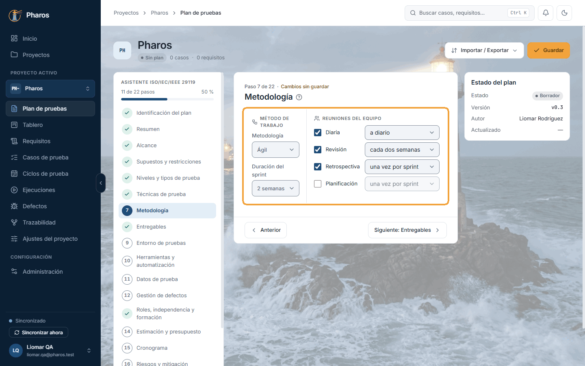

### 5.10. Paso 8 · Entregables

Los entregables son los documentos y artefactos que el equipo de pruebas se compromete a producir. La lista sigue la documentación de ISO/IEC/IEEE 29119-3, en columnas: gestión de pruebas, especificación, datos y entorno, ejecución y resultados, y aceptación. Marca los que se acordaron con el proyecto y desmarca los que no se van a entregar: el plan deja constancia de ese acuerdo y sirve de referencia al cerrar el ciclo. Si se acordó algo que no está en la lista, escríbelo al pie de la sexta columna, «Propios», y pulsa Intro o «Añadir» (en este ejemplo, «Informe de accesibilidad WCAG 2.2»): queda en esa columna con su ✕ para quitarlo.

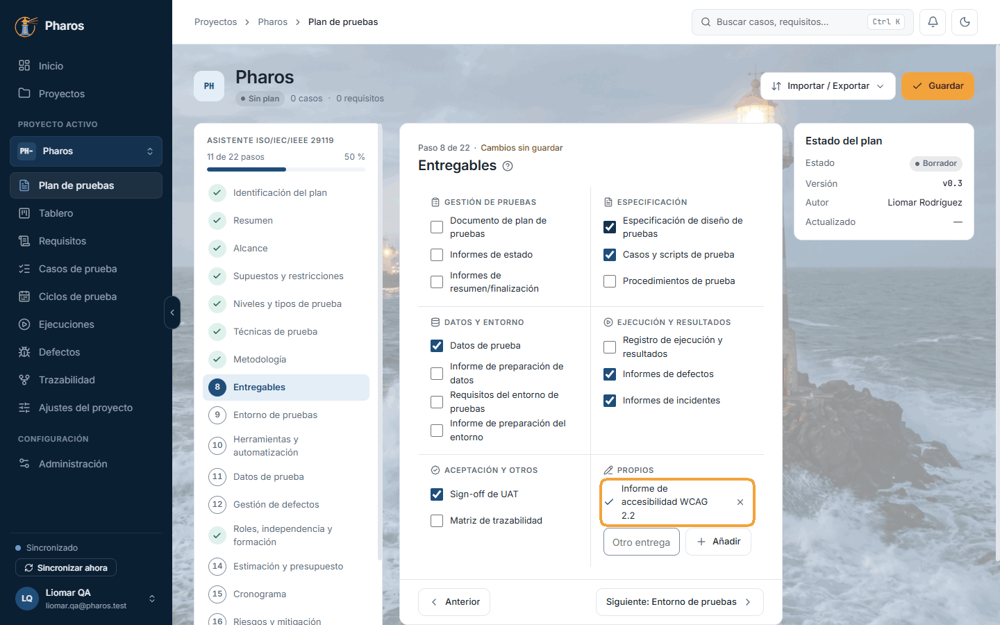

### 5.11. Paso 9 · Entorno de pruebas

Describe dónde se va a probar: la configuración del entorno (en este ejemplo, la app de escritorio en Windows 11 y la versión web contra el servidor de staging) y el hardware y software que necesita. Sirve para preparar el entorno a tiempo y para saber, ante un fallo, en qué condiciones se encontró. Los dos campos tienen su botón ✨ de IA.

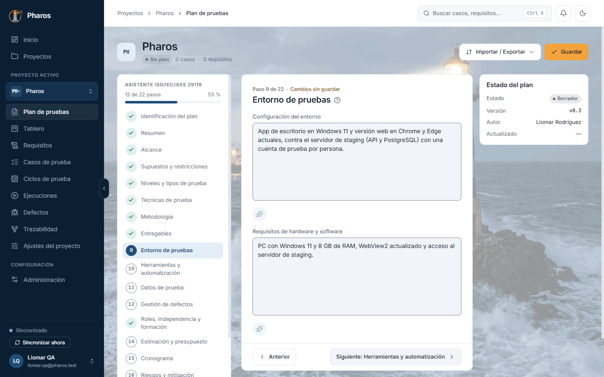

### 5.12. Paso 10 · Herramientas y automatización

Elige las herramientas del proyecto: arriba, las más usadas en QA; «Más herramientas» despliega el resto por categorías, con un buscador que no distingue acentos; si la tuya no está, escríbela en «¿No está en la lista?» y pulsa Intro o «Añadir». Las elegidas quedan resaltadas y se cuentan («N seleccionadas»). Después describe la estrategia de automatización: qué se automatiza, con qué y cuándo se ejecuta. El botón ✨ «Asistir con IA» propone un borrador; sin un motor de IA configurado (capítulo 15) aparece en gris, como en esta captura, y su aviso explica por qué.

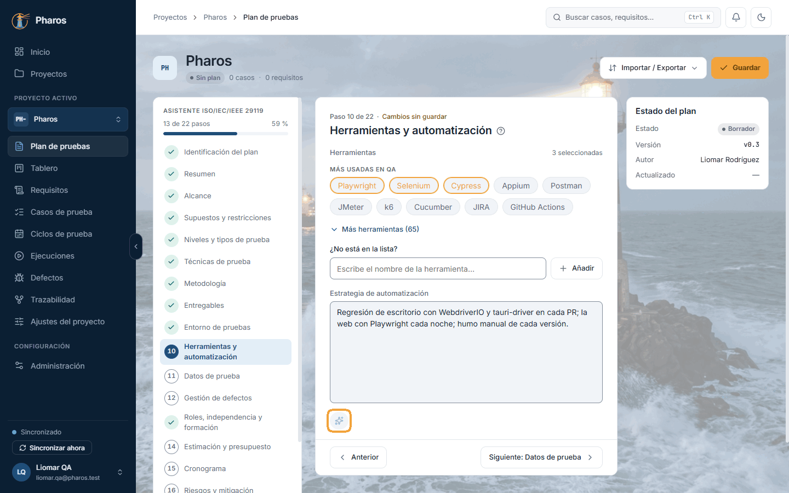

### 5.13. Pasos 11 y 12 · Datos y defectos

Dos pasos de texto libre. En el 11, cómo se consiguen y se protegen los datos de prueba (en este ejemplo, cuentas y proyectos de prueba creados por script, sin datos reales). En el 12, el que muestra la captura, cómo se gestionan los defectos: dónde se registran, con qué severidad y prioridad y quién los revisa. Los dos tienen su botón ✨ de IA.

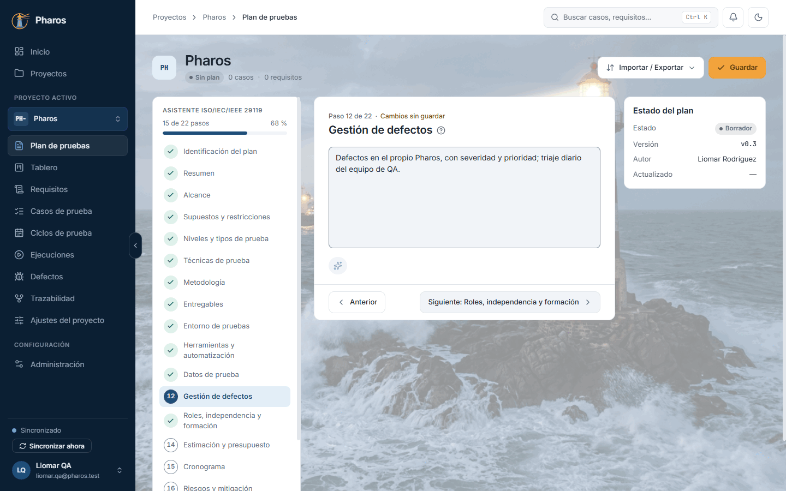

### 5.14. Paso 13 · Roles, independencia y formación

Cada fila une un rol con su responsabilidad, para que quede claro quién decide y quién hace qué (en este ejemplo, el «Responsable de QA» planifica, prioriza y aprueba el cierre, y el «Analista de pruebas» diseña y ejecuta los casos; en Pharos, Liomar lleva los dos roles). «+ Añadir fila» crea otra y la papelera de cada una la quita. Con un motor de IA, «Sugerir responsabilidades con IA» propone la responsabilidad de los roles que escribiste y aún no la tienen; eliges cuáles usar, y lo ya escrito no cambia. Debajo, la independencia de las pruebas en una escala de cinco, de quien escribe el código a un equipo externo (en este ejemplo, «Probadores del equipo»), con cómo se garantiza, y las necesidades de formación con su plazo.

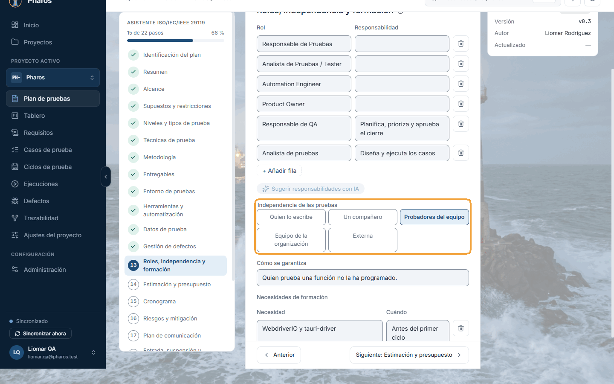

### 5.15. Paso 14 · Estimación y presupuesto

Cuánto esfuerzo y dinero hace falta y con qué técnica se calculó (CTFL v4 §5.1.4): por proporciones, por extrapolación, Wideband Delphi, tres puntos o juicio experto. Con la de tres puntos escribes el esfuerzo optimista, el más probable y el pesimista en persona-días (en este ejemplo, 12, 18 y 30), y Pharos calcula la estimación, E = (O + 4·M + P) / 6, y su desviación. Debajo, el presupuesto y en qué se basan las cifras.

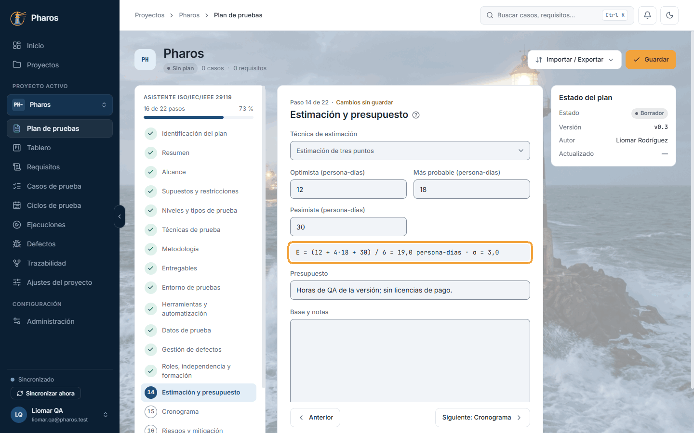

### 5.16. Paso 15 · Cronograma: sprints

El cronograma sitúa en el calendario los sprints y los hitos del ciclo de pruebas. Con «Sprint» elegido, haz clic en el día de inicio y después en el de fin (Esc cancela el rango a medias; la ayuda «?» del título lo recuerda, y el calendario queda justo debajo de la barra): el sprint aparece como una franja y en la lista «Sprints», con su nombre y sus fechas, que puedes editar (dd/mm/aaaa e Intro). «Siguiente sprint» añade el siguiente a continuación, con la duración del paso 7 (Metodología). La leyenda explica el calendario: las franjas alternan azul y ámbar para distinguir un sprint del siguiente, el rombo marca un hito, el círculo ámbar es hoy y el rojo claro señala días en que dos sprints se solapan (es un aviso: el plan se guarda igualmente). El sprint seleccionado se ve en azul oscuro y se resalta su fila; con el ratón puedes arrastrar sus extremos. Las flechas de arriba cambian de mes.

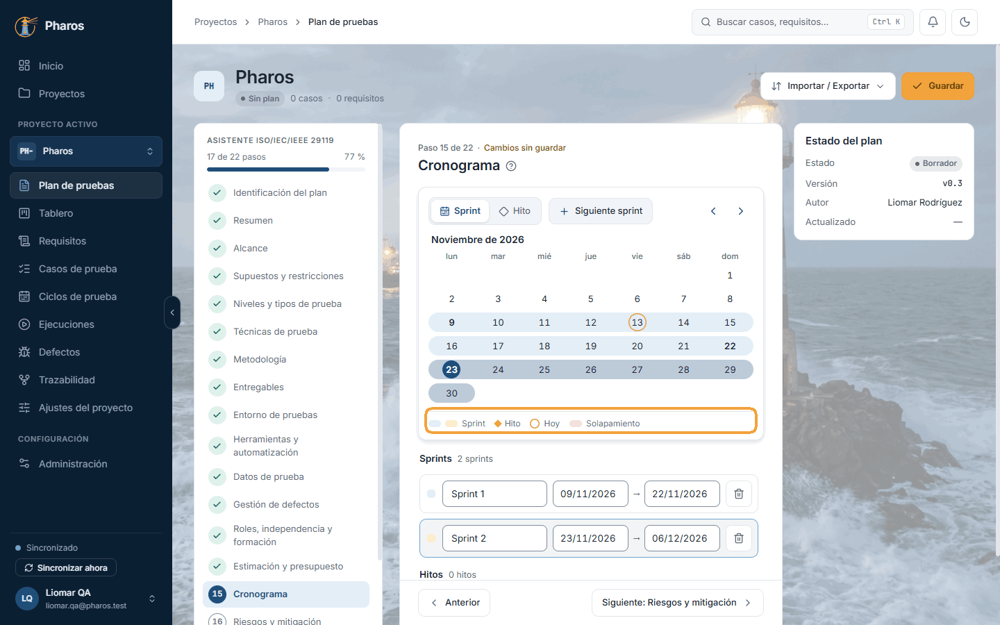

Cómo se marca un sprint o un hito está en la ayuda «?» del título del paso,
como en los demás; el calendario queda justo debajo de la barra «Sprint /
Hito / Siguiente sprint». Un sprint seleccionado se puede alargar o acortar arrastrando sus extremos en
el calendario, o editando sus fechas en la fila (dd/mm/aaaa e Intro).

### 5.17. Cronograma: hitos

Un hito es una fecha clave que no ocupa días, como una congelación de código o una publicación. Elige «Hito» y haz clic en un día: el hito se marca con un rombo ámbar y se añade a la lista «Hitos», donde le das nombre (en este ejemplo, «Congelación de código» y «Publicación de la 0.3.0»; el tercero, «Hito 3», se marcó con el teclado) y puedes corregir la fecha. Todo el calendario funciona también con el teclado: ← → mueven el foco un día, ↑ ↓ una semana, Inicio y Fin van al principio y al final de la semana, RePág y AvPág cambian de mes, e Intro o Espacio marcan el día enfocado.

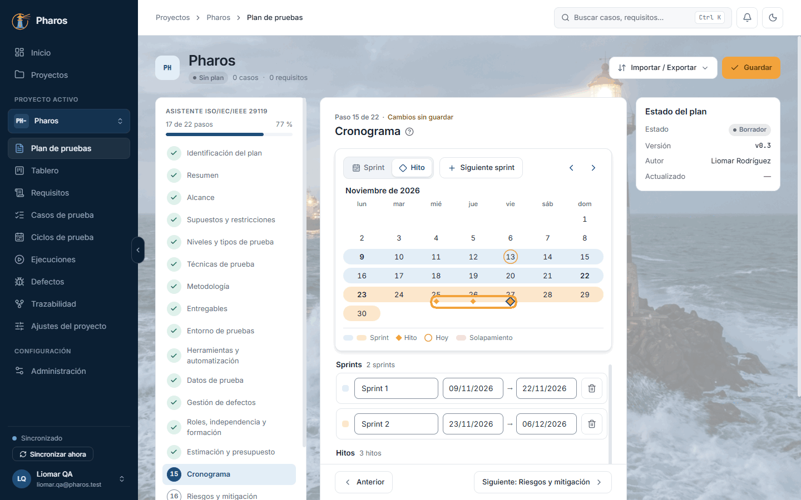

### 5.18. Paso 16 · Riesgos y mitigación

Cada fila es un riesgo que podría afectar a las pruebas y su mitigación, lo que se hará para reducirlo (en este ejemplo, que una actualización de WebView2 rompa la automatización de escritorio se mitiga fijando la versión del controlador). Cada campo crece con su texto, para que se lea entero. Con un motor de IA, «Sugerir riesgos con IA» propone riesgos con su mitigación según el resto del plan, y eliges cuáles añadir (capítulo 17).

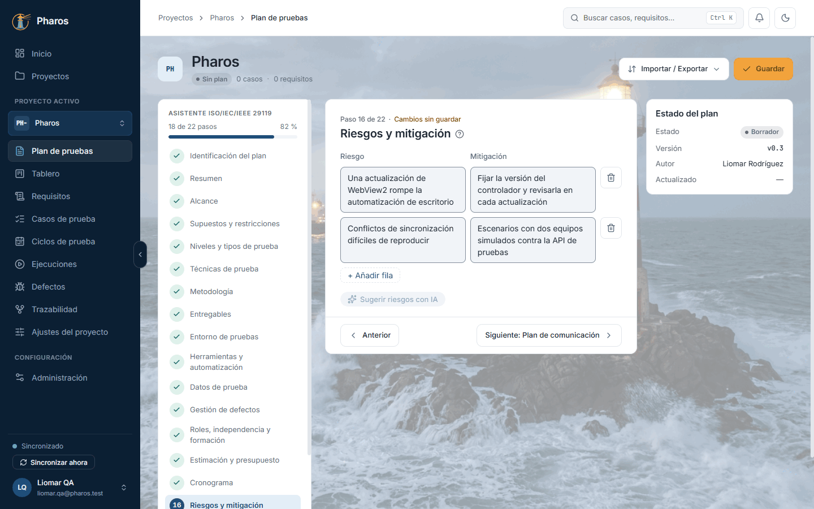

### 5.19. Pasos 17 y 18 · Comunicación; entrada, suspensión y reanudación

El plan de comunicación (paso 17) dice qué se informa, a quién y cada cuánto. El paso 18, el de la captura, fija cuándo puede empezar un ciclo (criterios de entrada: en este ejemplo, la versión instalada en staging y la prueba de humo en verde), cuándo se detiene la prueba (si falla el acceso) y qué tiene que pasar para retomarla (una versión con el bloqueo corregido). Con un motor de IA, «Sugerir criterios con IA» propone elementos de las tres listas.

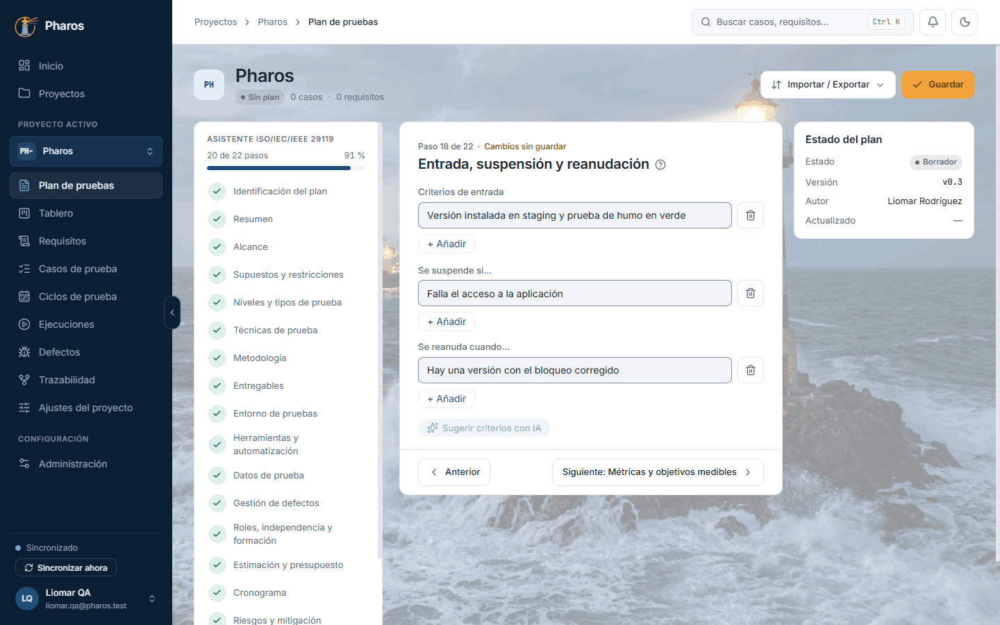

### 5.20. Paso 19 · Métricas y objetivos medibles

Qué se mide y qué objetivo debe alcanzar, una fila por métrica: su comparador (≥, >, ≤, <, =), su objetivo y su unidad. El plan trae cuatro: casos ejecutados ≥ 95 %, tasa de éxito ≥ 90 %, defectos críticos abiertos = 0 y cobertura de requisitos ≥ 90 %. Las del catálogo (también densidad de defectos por cada 100 casos, defectos escapados, tiempo de corrección en días, reapertura e inestables) las mide Pharos y su unidad es fija; una propia lleva nombre y unidad y se valora a mano (en este ejemplo, «Satisfacción del producto en la demo» ≥ 4). «Criterio de salida» la lleva a los criterios de cierre, para que cuente al cerrar un ciclo.

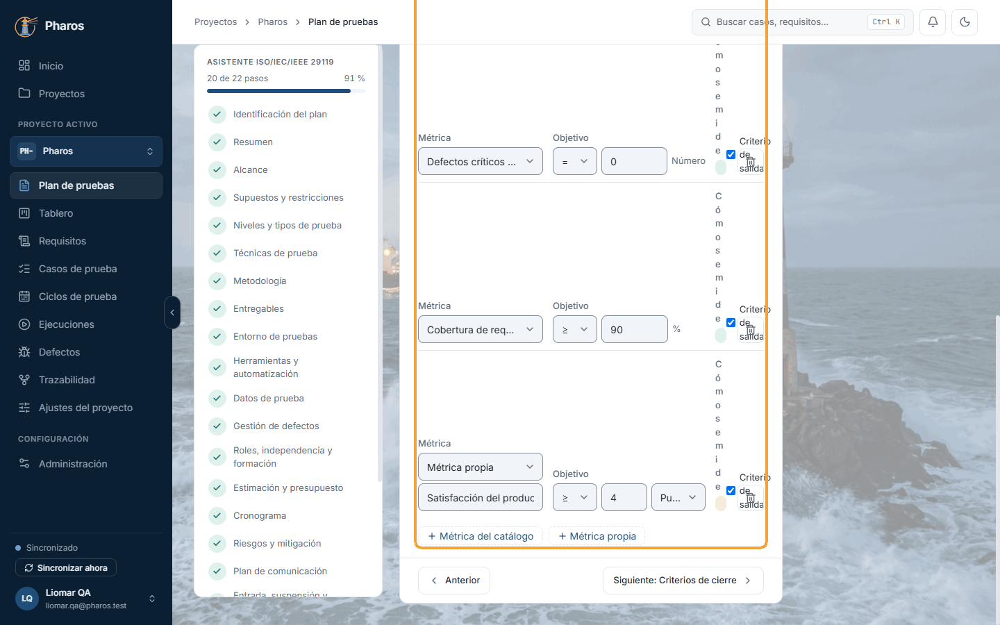

### 5.21. Pasos 20 y 21 · Criterios de cierre y propósito

Los criterios de cierre (paso 20) son los criterios de salida del plan. «Medido por» dice qué métrica mide cada uno: entonces su texto sale de la métrica y se evalúa solo al cerrar un ciclo (el Inicio también los muestra, capítulo 3). Sin métrica, el criterio es texto libre y se marca a mano. Cada uno es «Bloqueante» (por defecto: en «No cumple» pide una justificación para cerrar el ciclo) u «Orientativo» (solo se informa); en este ejemplo, la satisfacción en la demo es orientativa y se añade «Casos críticos ejecutados» al «100 %». Con un motor de IA, «Sugerir criterios con IA» propone criterios ligados a los riesgos del plan. Después, el propósito del documento (paso 21).

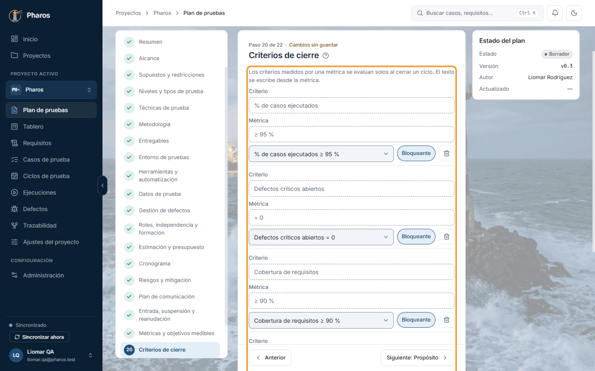

### 5.22. Paso 22 · Conclusión y «Antes de terminar»

El paso 22, el último, recoge la conclusión del plan y, debajo, «Antes de terminar»: cuántos pasos están completos y la lista de los que no, cada uno con un enlace que lleva a él, junto con el estado actual del plan. Úsala como lista de comprobación; un plan con pasos pendientes se guarda igualmente. Solo el título es obligatorio.

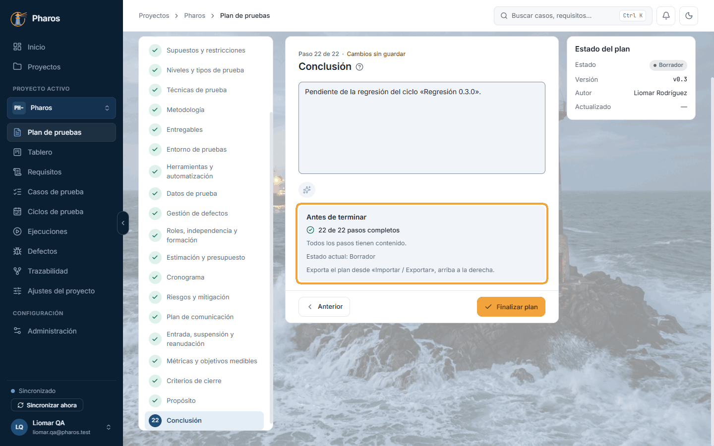

### 5.23. Guardar el plan

«Finalizar plan» (o «Guardar», en la cabecera, desde cualquier paso) guarda el plan: aparece el aviso «Plan de pruebas guardado», la línea de estado pasa a «Guardado · ahora mismo» y la cabecera del proyecto pasa a «Plan borrador». Guarda a menudo: cada guardado con cambios sube la versión y crea una revisión a la que puedes volver; guardar sin cambios avisa de que no hay nada que guardar.

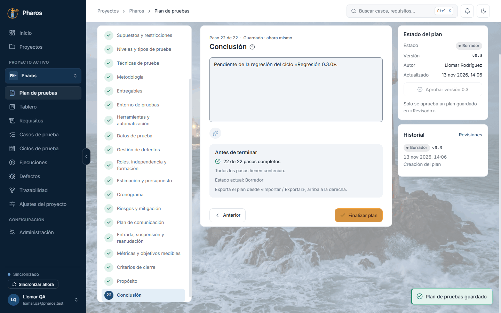

### 5.24. Salir con cambios sin guardar

Si cambias algo y vas a otra sección sin guardar (o cierras la ventana), Pharos te avisa antes de perder el trabajo: «Seguir editando» te devuelve al plan para guardarlo; «Descartar cambios» sale sin guardar. La línea de estado del paso ya te lo advertía: «Cambios sin guardar».

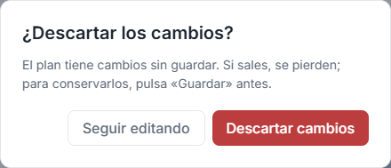

### 5.25. Revisiones del plan

Cada guardado con cambios crea una revisión, una copia fechada del plan. El panel «Historial», junto al formulario o debajo en pantallas estrechas, enseña los últimos cambios: estado, versión, fecha, quién y qué pasos tocó. Su enlace «Revisiones» abre la lista con el número, el título y la fecha de cada copia. «Restaurar» vuelve al contenido de una revisión anterior, tras pedir confirmación. En la versión web todavía no se guardan copias, pero el «Historial» sí se ve.

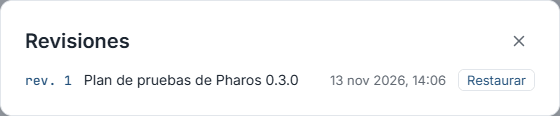

### 5.26. Restaurar una revisión

Al confirmar, el asistente carga el contenido de esa revisión, todavía sin guardar, para que lo revises. Si es lo que buscabas, pulsa «Guardar»: se crea una revisión nueva y las anteriores se conservan, así que restaurar nunca borra el historial.

### 5.27. Exportar el plan

«Importar / Exportar», en la cabecera, ofrece el plan en .pdf, maquetado y listo para firmar, o en .xlsx, editable en Excel. Al pie, el menú indica qué historial lleva el documento: «Solo la versión vigente» o «Historial de revisiones», según «Ajustes del proyecto» (capítulo 14). Se exporta lo que ves, aunque no esté guardado. El archivo va a tu carpeta de descarga (Administración › General, capítulo 15) y un aviso dice su nombre.

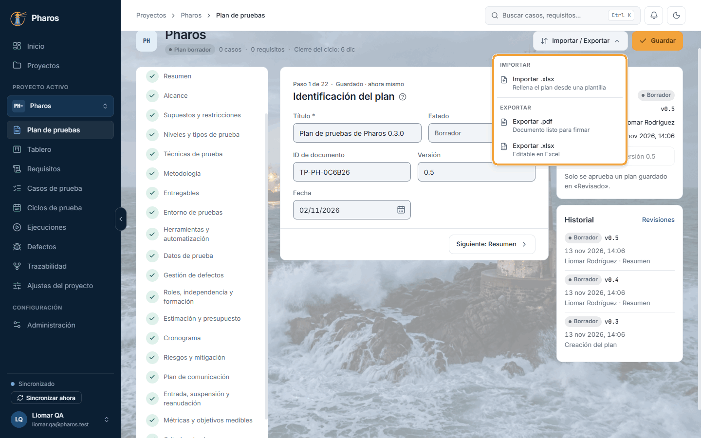

### 5.28. Importar un plan desde .xlsx

Para traer un plan escrito fuera de Pharos, «Importar / Exportar → Importar .xlsx» lee una plantilla rellenada en Excel (Administración › Plantillas) o un plan exportado antes (en este ejemplo, el .xlsx que se acaba de exportar). Antes de tocar nada, el informe de importación muestra, campo a campo, qué reconoció («no detectado», «en blanco»…), para que decidas si aplicarlo.

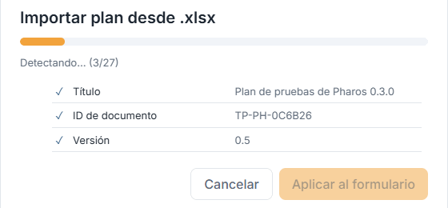

### 5.29. Plan importado

«Aplicar al formulario» carga los datos reconocidos en el asistente, sin guardar todavía: revisa cada paso y pulsa «Guardar» para conservarlos como una revisión nueva.

### 5.30. Aprobar el plan

Un plan revisado se aprueba en «Estado del plan». Primero pon el estado en «Revisado» (paso 1) y guarda: «Aprobar versión N» solo se activa con el plan guardado y en «Revisado», y si no, dice por qué debajo. Al pulsarlo, Pharos pide confirmación y recuerda que, si después se edita el contenido, el plan volverá a «Revisado» y habrá que aprobarlo de nuevo.

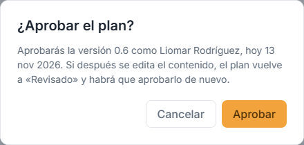

### 5.31. Plan aprobado

Al confirmar, el plan pasa a «Aprobado» sin cambiar de versión, y «Estado del plan» muestra quién lo aprobó y cuándo; el PDF y el Excel lo llevan en la cabecera. El «Historial» lo apunta. Si luego cambias el contenido, un aviso lo dice antes de guardar, el plan vuelve a «Revisado» con una versión nueva y el historial indica que perdió la aprobación.

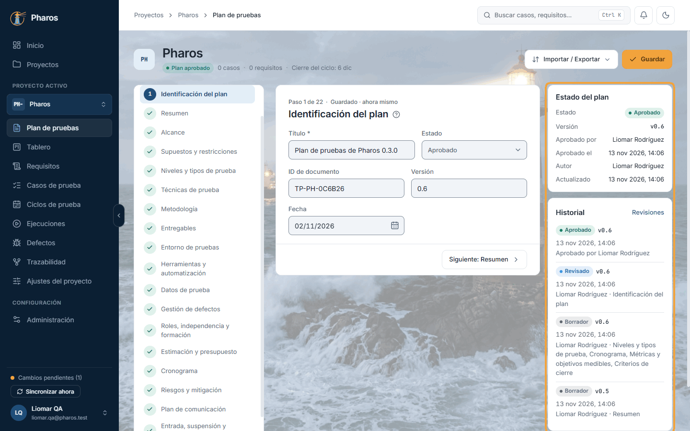

## Atajos de teclado

| Tecla | Dónde | Qué hace |
| --- | --- | --- |
| Tab / Mayús+Tab | Cualquier paso | Recorre los campos; al cambiar de paso, el foco va a su título |
| Intro | «Otro tipo de prueba…», «Otro entregable…», «¿No está en la lista?» (herramientas) | Añade lo escrito |
| ↑ ↓ / Inicio / Fin | Una lista desplegable abierta (estado, metodología, frecuencia…) | Recorre las opciones; una letra salta a la que empieza por ella |
| Intro o Espacio | Una lista desplegable | La abre; abierta, elige la opción marcada |
| Esc | Una lista desplegable abierta | La cierra sin cambiar nada; el foco vuelve al campo |
| Intro | Fecha de un sprint o un hito (dd/mm/aaaa) | Aplica la fecha; salir del campo también la aplica |
| Alt+↓ | Un campo de fecha (la del plan, un ciclo, el informe…) | Abre el calendario |
| ← → / ↑ ↓ | Calendario de un campo de fecha | Día anterior o siguiente / semana anterior o siguiente |
| Inicio / Fin | Calendario de un campo de fecha | Primer o último día de la semana |
| RePág / AvPág | Calendario de un campo de fecha | Mes anterior o siguiente |
| Intro o Espacio | Calendario de un campo de fecha | Elige el día enfocado y cierra |
| Esc | Calendario de un campo de fecha | Lo cierra sin cambiar nada; el foco vuelve al botón del calendario |
| ← → | Calendario del cronograma | Día anterior o siguiente |
| ↑ ↓ | Calendario del cronograma | Semana anterior o siguiente |
| Inicio / Fin | Calendario del cronograma | Primer o último día de la semana |
| RePág / AvPág | Calendario del cronograma | Mes anterior o siguiente |
| Intro o Espacio | Calendario del cronograma | Marca el día enfocado (inicio o fin del sprint, o un hito) |
| Esc | Calendario del cronograma | Cancela el sprint que estás marcando |

## Si algo no sale

- **«Aprobar versión N» está en gris.** Debajo dice por qué: guarda antes de
  aprobar, o pon el plan en «Revisado» y guárdalo.
- **«Sin cambios: no hay nada que guardar».** El plan no ha cambiado desde el
  último guardado; no se crea versión ni revisión.
- **Un criterio de cierre no se deja editar.** Lo mide una métrica: su texto
  sale de ella. Cambia la métrica en el paso 19, o elige «Sin métrica» en
  «Medido por».
- **«No se puede guardar: revisa 1 campo».** Falta el título (paso 1, «Identificación del plan»): es lo
  único obligatorio. Pharos te lleva a ese paso.
- **«Guardado con N avisos por revisar».** El plan se guardó, pero hay filas
  repetidas o fechas del cronograma que revisar.
- **«Niveles y tipos de prueba» no queda completo.** Marca al menos un nivel
  y un tipo.
- **«Metodología» (paso 7) no queda completa.** La línea bajo el paso dice qué falta: la
  duración del sprint, al menos una reunión o, en «Tradicional», al menos una
  fase.
- **Una fila del cronograma dice «Fecha no válida», «La fecha de fin es
  anterior a la de inicio», «Se solapa con…» o «Dura N días; la Metodología
  indica M».** Son avisos: el plan se guarda igualmente, pero conviene
  corregirlos.
- **No puedo arrastrar los extremos de un sprint.** Arrastrar solo funciona con
  ratón y en ventanas anchas. En pantallas táctiles o estrechas, edita las
  fechas en su fila.
- **«No se pudo leer el archivo. Prueba con un .xlsx sin comentarios de
  celda.»** Quita los comentarios del Excel y vuelve a importarlo.
- **«No se pudo cargar el plan de pruebas.»** Pulsa «Reintentar». Mientras no
  carga, Pharos no muestra el asistente, para no crear un segundo plan por
  error.
- **«Sin revisiones anteriores» en la versión web.** La web todavía no guarda
  revisiones del plan; la app de escritorio sí.
- **Los botones ✨ están en gris.** No hay un motor de IA configurado
  (Administración › Motor de IA, capítulo 15). El plan funciona igual sin IA.

## En el móvil

- La lista de pasos se sustituye por «Ver pasos», que la abre como una hoja
  desde abajo, con los pasos completos marcados.
- En pantallas medianas, los pasos se ven como una tira horizontal centrada en
  el paso actual.
- El menú «Importar / Exportar» y las listas desplegables (estado,
  metodología, frecuencia…) se abren como una hoja, con la opción elegida
  marcada.
- El calendario de un campo de fecha también se abre como una hoja desde
  abajo, con días más grandes para el dedo.
- En el cronograma, las fechas se editan en las filas: en pantallas táctiles no
  se arrastran los extremos de los sprints.

## Consejos

- No hace falta rellenar los 22 pasos de una vez: la lista marca los completos
  y «Antes de terminar» (paso 22) enlaza a los que faltan.
- Marca como «Orientativo» un criterio que quieres ver en el cierre sin que lo
  frene, por ejemplo una métrica propia que todavía se mide a mano.
- Un .xlsx importado nunca llega aprobado: entra como «Revisado», para que
  alguien lo apruebe aquí.
- La duración del sprint (paso 7) se usa en el cronograma: si un sprint dura
  otra cosa, Pharos lo avisa en su fila.
- Para empezar un plan desde Excel, descarga una plantilla en «Administración ›
  Plantillas», rellénala e impórtala con «Importar .xlsx».
- «Restaurar» una revisión no guarda nada hasta que pulses «Guardar».
- El plan en PDF mantiene cada título de sección junto al inicio de su
  contenido; si una tabla sigue en otra página, su título y sus columnas se
  repiten arriba. Los niveles de prueba van antes que los tipos, y los tipos, por grupo
  («Funcionales: …», «Confirmación y regresión: …», «Propios: …»), antes de la
  Metodología, que muestra una entrada por línea y los rangos del
  cronograma se leen «2026-11-09 – 2026-11-22». Los hitos aparecen bajo el
  cronograma y los ciclos, al final. Los apartados nuevos de la 0.4 van donde
  los pide el asistente; en el Excel, en las hojas «Estrategia 29119-3»,
  «Métricas» y «Criterios de salida», que «Importar .xlsx» vuelve a leer.
- Si el documento debe llevar su historial, elige «Historial de revisiones» en
  «Ajustes del proyecto › Historial en el plan exportado» (capítulo 14). El
  .pdf y el .xlsx (también los del ZIP del proyecto) añaden entonces la tabla
  «Historial de revisiones»:
  - **Dónde va:** tras la cabecera en el PDF, y en una hoja propia en el .xlsx.
  - **Qué filas tiene:** una por persona y día, que es su último guardado de
    ese día. Van de la más antigua (arriba) a la más reciente (abajo).
  - **Qué dice cada fila:** la versión, la fecha y hora, quién la hizo (nombre
    y apellidos del perfil), el estado y las secciones que cambió.
  - **Qué no entra:** los guardados sin cambios y lo que aún no has guardado.
    El día es el de tu zona horaria.
  - **En la web:** el historial empieza en los cambios hechos desde la versión
    0.2.0. Si de un guardado antiguo no se sabe la versión o el estado, la
    celda muestra «—».

## Véase también

- Capítulo 3, «Inicio»: los criterios de salida.
- Capítulo 14, «Ajustes del proyecto»: el historial en el plan exportado.
- Capítulo 17, «Asistente de IA»: asistir en un campo y sugerir riesgos,
  responsabilidades, criterios, supuestos y restricciones.
- [Guía de pruebas de la beta](../guia-beta.md), apartado 4.3.
- [Glosario](../GLOSARIO.md): «Plan de pruebas», «Identificación del plan», «Prueba de confirmación», «Entregable», «Paso completado», «Cierre del ciclo».

---

← [Proyectos](04-proyectos.md) · [Índice](README.md) · [Tablero](06-tablero.md) →
