<!-- Generado por `npm run manual` desde e2e/tours/05-plan.tour.ts y docs/manual/fuentes/plan.md. No lo edites a mano: edita la fuente. -->

# 5. Plan de pruebas

## Para qué sirve

El **plan de pruebas** es el documento que dice qué se prueba, cómo, con qué
medios, quién y cuándo. Hay un plan por proyecto. Pharos lo redacta con un
asistente de **19 pasos** que sigue la norma ISO/IEC/IEEE 29119-3:

| Pasos | Qué decides |
| --- | --- |
| 1–3 | Título y estado; versión, fecha y autor; resumen |
| 4–8 | Alcance, tipos y niveles de prueba, metodología y entregables |
| 9–12 | Entorno, herramientas y automatización, datos de prueba y gestión de defectos |
| 13–15 | Roles, cronograma (sprints e hitos) y riesgos con su mitigación |
| 16–19 | Comunicación, criterios de cierre, propósito y conclusión |

El plan alimenta otras pantallas:

- Los **criterios de cierre** (paso 17) son los criterios de salida que evalúa
  el Inicio (capítulo 3) y el informe de estado (capítulo 11).
- El **cronograma** da la fecha de cierre que se ve en la cabecera del
  proyecto y en «Criterios de salida».
- Los **tipos y niveles** guían las sugerencias de casos con IA (capítulo 17).

Cada guardado crea una **revisión**, y el plan se exporta en PDF (listo para
firmar) o en Excel.

En este manual, Liomar escribe el «Plan de pruebas de Pharos 0.3.0»: qué se
prueba de la propia aplicación en esta versión.

## Paso a paso

### 5.1. El asistente del plan

El plan de pruebas dice qué se prueba, cómo, con qué medios, quién y cuándo. Pharos lo redacta con un asistente de 19 pasos que sigue la norma ISO/IEC/IEEE 29119-3: «Plan de pruebas», la primera sección del proyecto. A la izquierda, la lista de pasos con una ✓ en los completos y el porcentaje de avance; en el centro, el paso actual, con «Paso N de 19» y si hay cambios sin guardar; a la derecha, «Estado del plan» (estado, versión, autor y última actualización). El paso 1 pide el título (en este ejemplo, «Plan de pruebas de Pharos 0.3.0») y el estado: Borrador, Revisado, Aprobado u Obsoleto. No hace falta seguir el orden: salta a cualquier paso desde la lista.

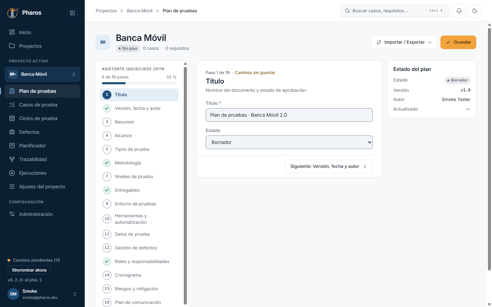

### 5.2. Paso 2 · Versión, fecha y autor

«Siguiente: …», al pie, avanza al paso 2 y lo nombra; «Anterior» vuelve. Indica la versión del documento (en este ejemplo, «0.3») y su fecha. «Elaborado por» no se escribe: es tu nombre oficial del perfil (en este ejemplo, Liomar Rodríguez, capítulo 1), el que firma el plan cuando lo exportas.

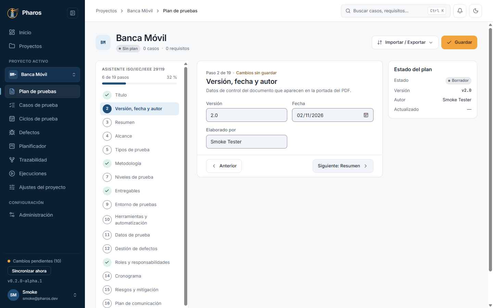

### 5.3. Paso 3 · Resumen

El resumen es lo primero que leerá quien reciba el plan: en pocas líneas, qué se prueba y por qué (en este ejemplo, la versión 0.3.0 de Pharos, en escritorio y en la web). Con un motor de IA configurado (capítulo 15), el botón ✨ «Asistir con IA» redacta un borrador a partir de lo que hayas escrito; lo usas, lo editas o lo descartas, y nada se aplica sin que lo aceptes (capítulo 17).

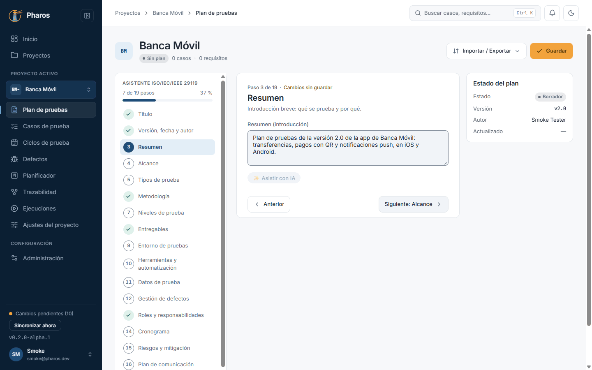

### 5.4. Paso 4 · Alcance

El alcance fija qué se prueba y, tan importante como eso, qué no: así nadie da por cubierto lo que queda fuera. En «Elementos dentro del alcance» y «Fuera del alcance», «+ Añadir» crea una fila por elemento (en este ejemplo, el acceso, el plan con los requisitos y los casos, la ejecución y la sincronización dentro; la integración con Jira y una app móvil nativa fuera). La papelera de cada fila («Quitar») la elimina; si la fila tiene texto, pide confirmarlo con «Sí, eliminar» o «Cancelar». Pharos avisa de las filas repetidas.

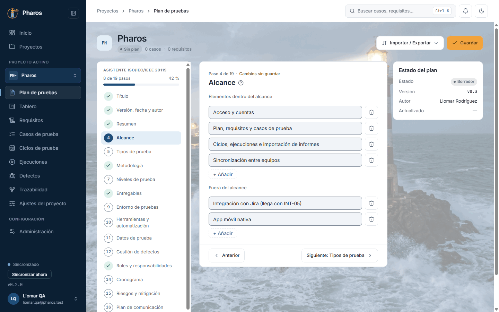

### 5.5. Paso 5 · Tipos de prueba

Marca los tipos de prueba que el equipo se compromete a ejecutar, agrupados en cobertura funcional (funcional, regresión…) y no funcional (seguridad, usabilidad, rendimiento…). En este ejemplo hay cinco marcados. Si el que necesitas no está en la lista, escríbelo en «Especifica otro…» y pulsa Intro o «+ Otro».

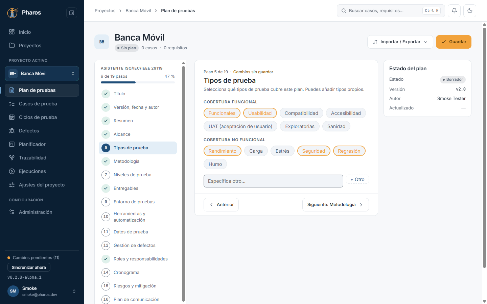

### 5.6. Paso 6 · Metodología

Indica cómo trabaja el equipo. Con «Ágil» eliges la duración del sprint (de 1 a 4 semanas) y las reuniones del equipo (diaria, revisión, retrospectiva, planificación), cada una con su frecuencia; con «Tradicional / V-model», las fases del proyecto. Si falta algo, una línea bajo el paso dice qué. La duración del sprint no es solo informativa: el cronograma (paso 14) la usa para proponer el siguiente sprint y avisa si uno dura otra cosa.

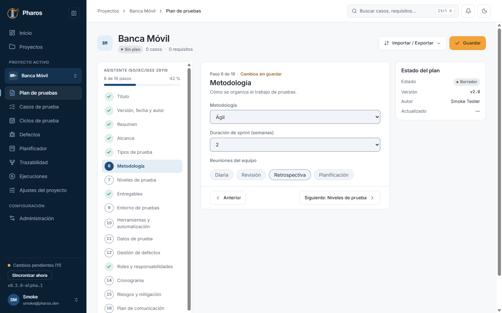

### 5.7. Paso 7 · Niveles de prueba

Los niveles indican en qué capas del producto se prueba: unitarias, integración, sistema y aceptación. Marca solo los que cubre este plan (en este ejemplo, integración, sistema y aceptación: las pruebas unitarias son cosa del equipo de desarrollo); lo que no marques queda, de forma explícita, fuera de este plan.

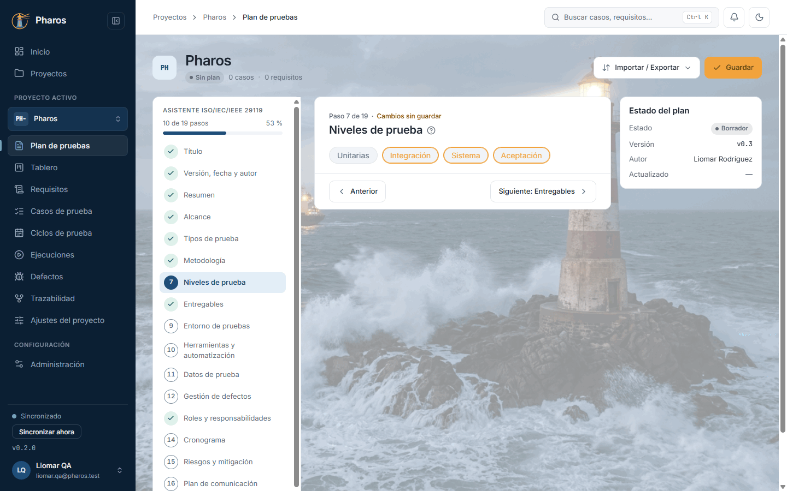

### 5.8. Paso 8 · Entregables

Los entregables son los documentos y artefactos que el equipo de pruebas se compromete a producir. La lista sigue la documentación de ISO/IEC/IEEE 29119-3, agrupada en gestión de pruebas, especificación, datos y entorno, ejecución y resultados, y aceptación. Marca los que se acordaron con el proyecto y desmarca los que no se van a entregar: el plan deja constancia de ese acuerdo y sirve de referencia al cerrar el ciclo. Si se acordó algo que no está en la lista, escríbelo en «Otro entregable» y pulsa Intro o «Añadir» (en este ejemplo, «Informe de accesibilidad WCAG 2.2»): aparece en «Aceptación y otros» con la etiqueta «Propio» y su papelera para quitarlo.

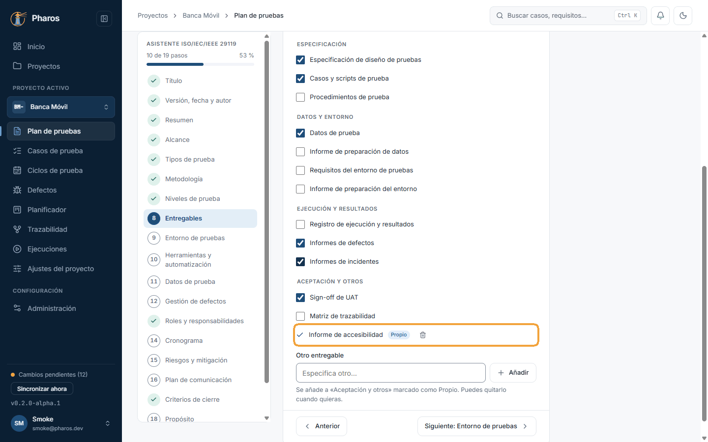

### 5.9. Paso 9 · Entorno de pruebas

Describe dónde se va a probar: la configuración del entorno (en este ejemplo, la app de escritorio en Windows 11 y la versión web contra el servidor de staging) y el hardware y software que necesita. Sirve para preparar el entorno a tiempo y para saber, ante un fallo, en qué condiciones se encontró. Los dos campos tienen su botón ✨ de IA.

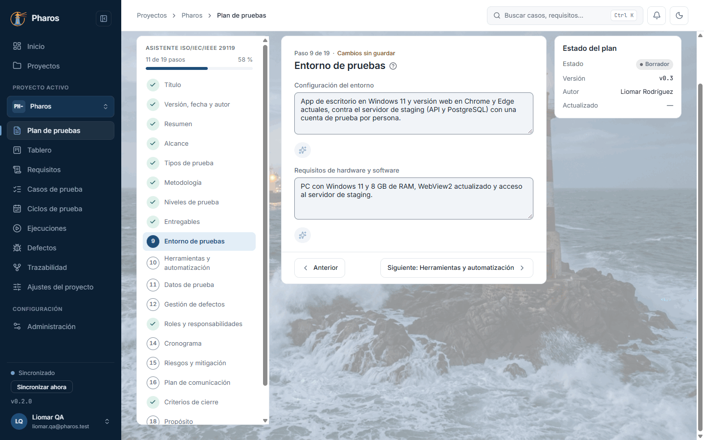

### 5.10. Paso 10 · Herramientas y automatización

Elige las herramientas del proyecto: arriba, las más usadas en QA; «Más herramientas» despliega el resto por categorías, con un buscador que no distingue acentos; si la tuya no está, escríbela en «¿No está en la lista?» y pulsa Intro o «Añadir». Las elegidas quedan resaltadas y se cuentan («N seleccionadas»). Después describe la estrategia de automatización: qué se automatiza, con qué y cuándo se ejecuta. El botón ✨ «Asistir con IA» propone un borrador; sin un motor de IA configurado (capítulo 15) aparece en gris, como en esta captura, y su aviso explica por qué.

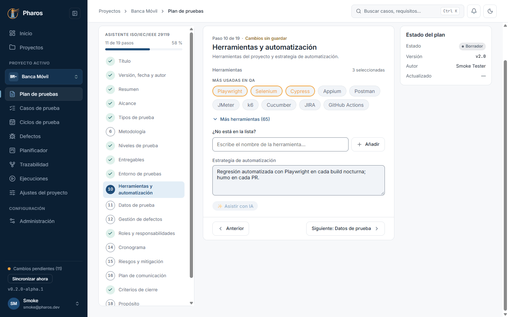

### 5.11. Pasos 11 y 12 · Datos y defectos

Dos pasos de texto libre. En el 11, cómo se consiguen y se protegen los datos de prueba (en este ejemplo, cuentas y proyectos de prueba creados por script, sin datos reales). En el 12, el que muestra la captura, cómo se gestionan los defectos: dónde se registran, con qué severidad y prioridad y quién los revisa. Los dos tienen su botón ✨ de IA.

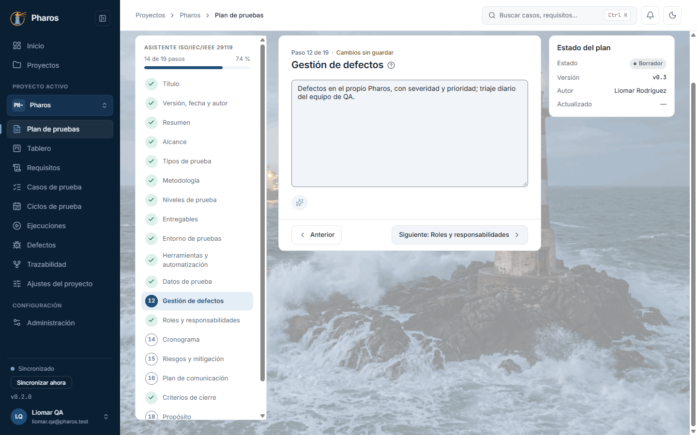

### 5.12. Paso 13 · Roles y responsabilidades

Cada fila une un rol con su responsabilidad, para que quede claro quién decide y quién hace qué (en este ejemplo, el «Responsable de QA» planifica, prioriza y aprueba el cierre, y el «Analista de pruebas» diseña y ejecuta los casos; en Pharos, Liomar lleva los dos roles). «+ Añadir fila» crea otra y la papelera de cada una la quita. Con un motor de IA, «Sugerir responsabilidades con IA» propone la responsabilidad de los roles que escribiste y aún no la tienen; eliges cuáles usar, y lo ya escrito no cambia.

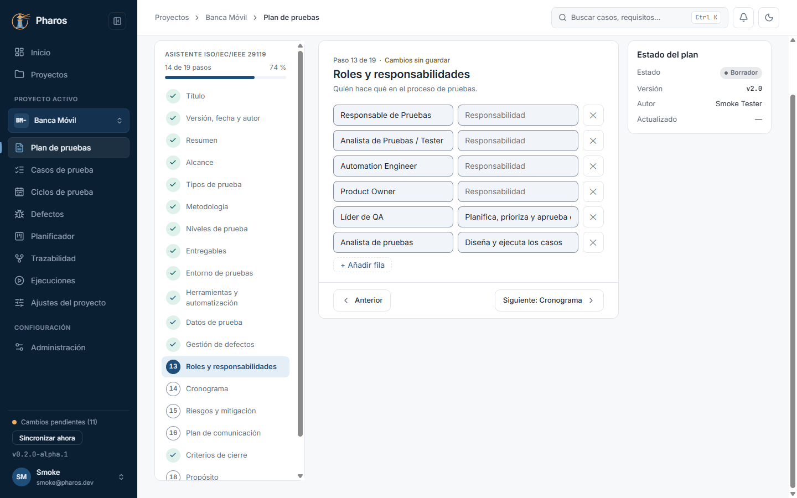

### 5.13. Paso 14 · Cronograma: sprints

El cronograma sitúa en el calendario los sprints y los hitos del ciclo de pruebas. Con «Sprint» elegido, haz clic en el día de inicio y después en el de fin (Esc cancela el rango a medias): el sprint aparece como una franja y en la lista «Sprints», con su nombre y sus fechas, que puedes editar (dd/mm/aaaa e Intro). «Siguiente sprint» añade el siguiente a continuación, con la duración del paso 6. La leyenda explica el calendario: las franjas alternan azul y ámbar para distinguir un sprint del siguiente, el rombo marca un hito, el círculo ámbar es hoy y el rojo claro señala días en que dos sprints se solapan (es un aviso: el plan se guarda igualmente). El sprint seleccionado se ve en azul oscuro y se resalta su fila; con el ratón puedes arrastrar sus extremos. Las flechas de arriba cambian de mes.

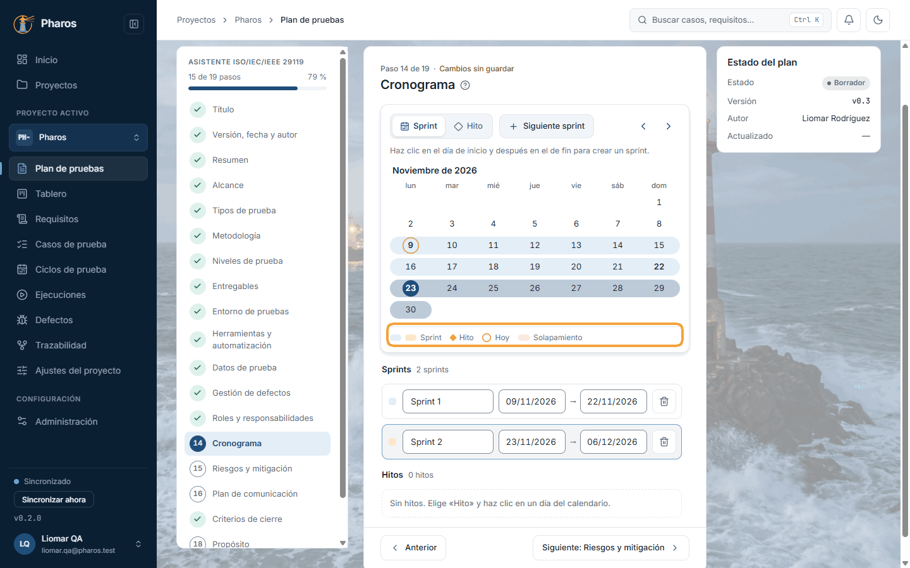

Un sprint seleccionado se puede alargar o acortar arrastrando sus extremos en
el calendario, o editando sus fechas en la fila (dd/mm/aaaa e Intro).

### 5.14. Cronograma: hitos

Un hito es una fecha clave que no ocupa días, como una congelación de código o una publicación. Elige «Hito» y haz clic en un día: el hito se marca con un rombo ámbar y se añade a la lista «Hitos», donde le das nombre (en este ejemplo, «Congelación de código» y «Publicación de la 0.3.0»; el tercero, «Hito 3», se marcó con el teclado) y puedes corregir la fecha. Todo el calendario funciona también con el teclado: ← → mueven el foco un día, ↑ ↓ una semana, Inicio y Fin van al principio y al final de la semana, RePág y AvPág cambian de mes, e Intro o Espacio marcan el día enfocado.

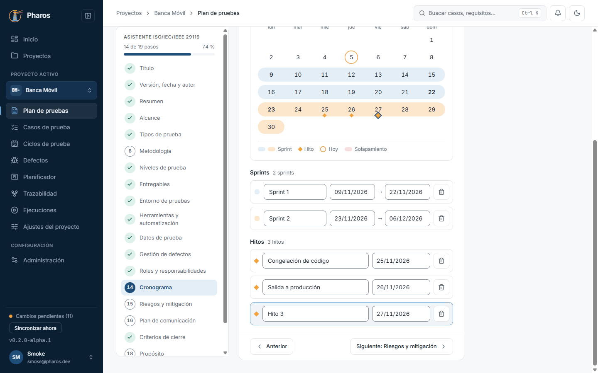

### 5.15. Paso 15 · Riesgos y mitigación

Cada fila es un riesgo que podría afectar a las pruebas y su mitigación, lo que se hará para reducirlo (en este ejemplo, que una actualización de WebView2 rompa la automatización de escritorio se mitiga fijando la versión del controlador). Cada campo crece con su texto, para que se lea entero. Con un motor de IA, «Sugerir riesgos con IA» propone riesgos con su mitigación según el resto del plan, y eliges cuáles añadir (capítulo 17).

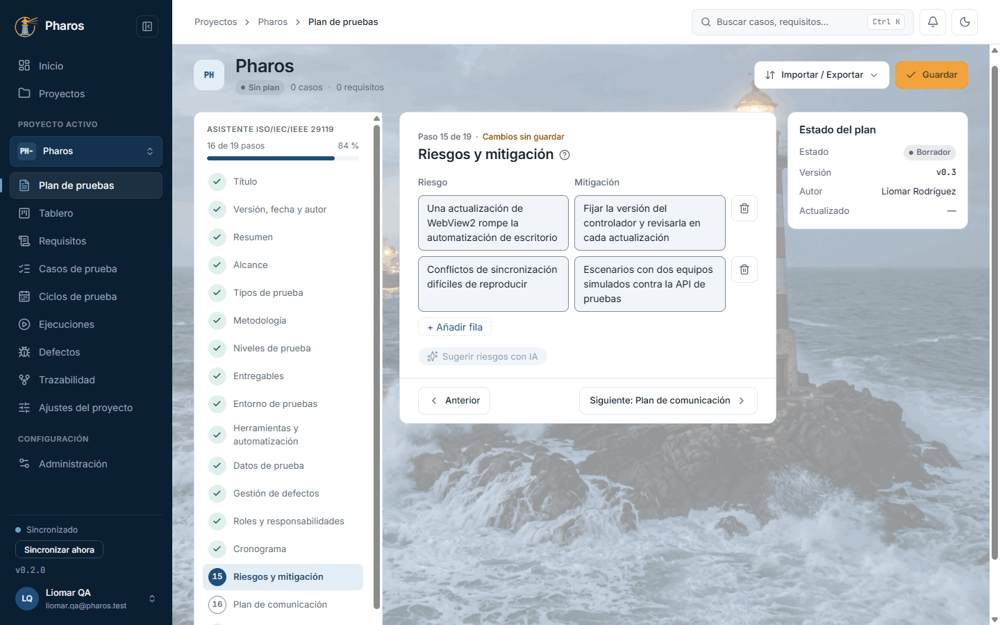

### 5.16. Pasos 16 a 18 · Comunicación, cierre y propósito

Tres pasos de texto que completan el plan: el plan de comunicación (paso 16: qué se informa, a quién y cada cuánto), los criterios de cierre (paso 17: cada criterio con su métrica objetivo; el plan trae tres por defecto, «% de casos ejecutados ≥ 95%», «Defectos críticos abiertos 0» y «Cobertura de requisitos ≥ 90%», y en este ejemplo se añade «Casos críticos ejecutados» al «100 %»; el Inicio los evalúa como criterios de salida, capítulo 3; con un motor de IA, «Sugerir criterios con IA» propone criterios ligados a los riesgos del plan) y el propósito del documento (paso 18, el de la captura).

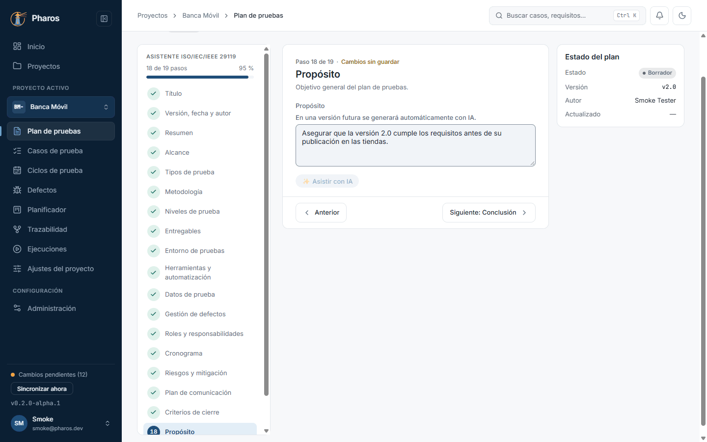

### 5.17. Paso 19 · Conclusión y «Antes de terminar»

El paso 19 recoge la conclusión del plan y, debajo, «Antes de terminar»: cuántos pasos están completos y la lista de los que no, cada uno con un enlace que lleva a él, junto con el estado actual del plan. Úsala como lista de comprobación; un plan con pasos pendientes se guarda igualmente. Solo el título es obligatorio.

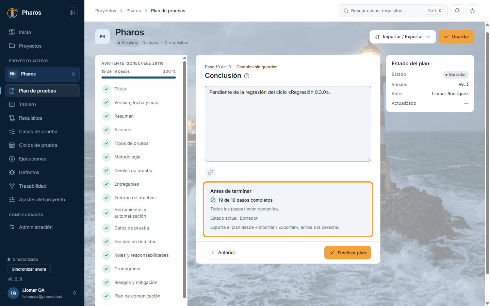

### 5.18. Guardar el plan

«Finalizar plan» (o «Guardar», en la cabecera, desde cualquier paso) guarda el plan: aparece el aviso «Plan de pruebas guardado», la línea de estado pasa a «Guardado · ahora mismo», sube la versión y la cabecera del proyecto pasa a «Plan borrador». Guarda a menudo: cada guardado crea además una revisión a la que puedes volver.

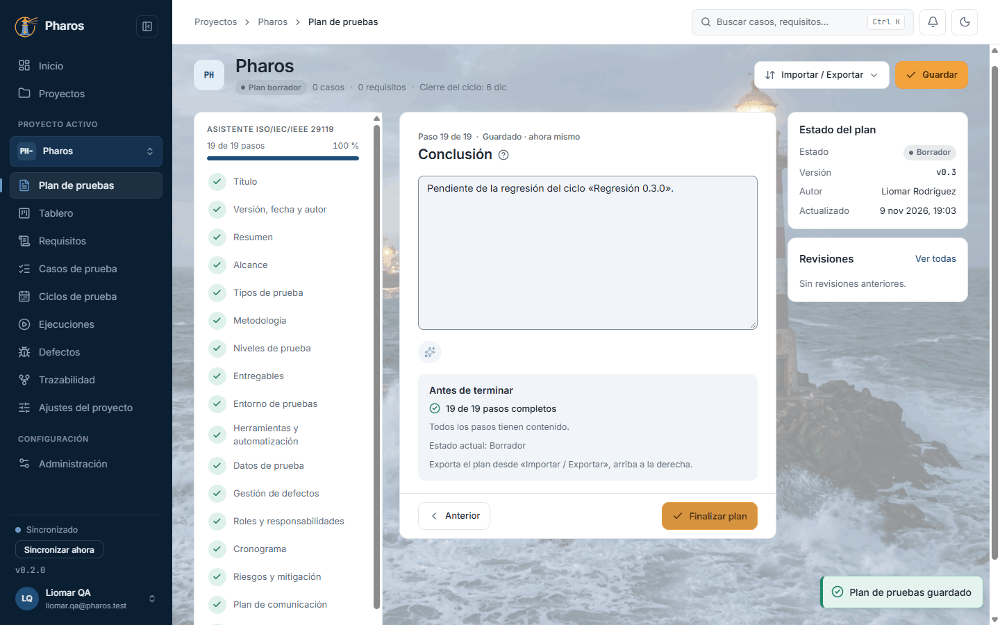

### 5.19. Salir con cambios sin guardar

Si cambias algo y vas a otra sección sin guardar (o cierras la ventana), Pharos te avisa antes de perder el trabajo: «Seguir editando» te devuelve al plan para guardarlo; «Descartar cambios» sale sin guardar. La línea de estado del paso ya te lo advertía: «Cambios sin guardar».

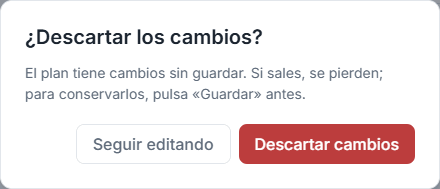

### 5.20. Revisiones del plan

Cada guardado crea una revisión, una copia fechada del plan. «Ver todas», en el panel «Revisiones» (que enseña las tres últimas, junto al formulario o debajo en pantallas estrechas), abre la lista con el número, el título y la fecha de cada una. «Restaurar» vuelve al contenido de una revisión anterior, tras pedir confirmación. En la versión web todavía no se guardan revisiones.

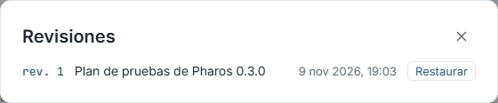

### 5.21. Restaurar una revisión

Al confirmar, el asistente carga el contenido de esa revisión, todavía sin guardar, para que lo revises. Si es lo que buscabas, pulsa «Guardar»: se crea una revisión nueva y las anteriores se conservan, así que restaurar nunca borra el historial.

### 5.22. Exportar el plan

«Importar / Exportar», en la cabecera, ofrece el plan en .pdf, maquetado y listo para firmar, o en .xlsx, editable en Excel. Al pie, el menú indica qué historial lleva el documento: «Solo la versión vigente» o «Historial de revisiones», según «Ajustes del proyecto» (capítulo 14). Se exporta lo que ves, aunque no esté guardado. El archivo va a tu carpeta de descarga (Administración › General, capítulo 15) y un aviso dice su nombre.

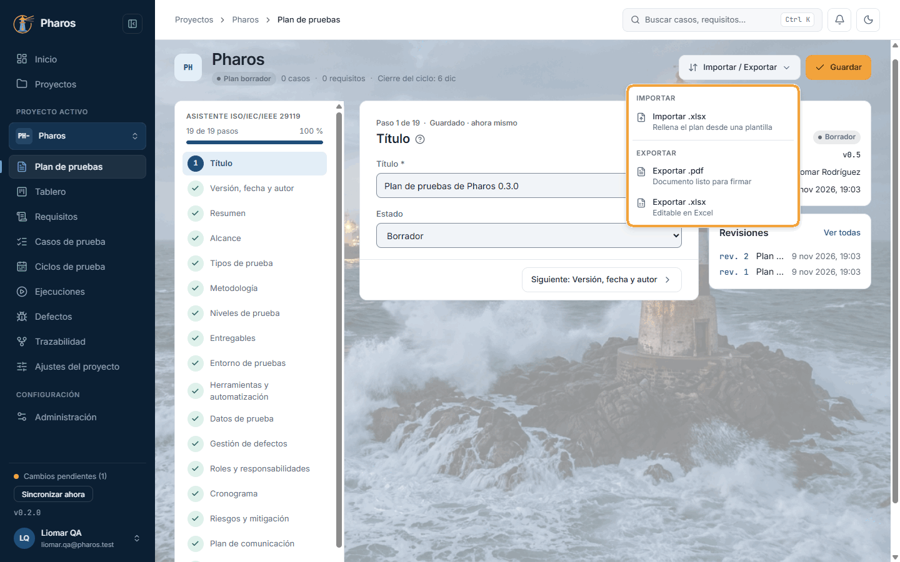

### 5.23. Importar un plan desde .xlsx

Para traer un plan escrito fuera de Pharos, «Importar / Exportar → Importar .xlsx» lee una plantilla rellenada en Excel (Administración › Plantillas) o un plan exportado antes (en este ejemplo, el .xlsx que se acaba de exportar). Antes de tocar nada, el informe de importación muestra, campo a campo, qué reconoció («no detectado», «en blanco»…), para que decidas si aplicarlo.

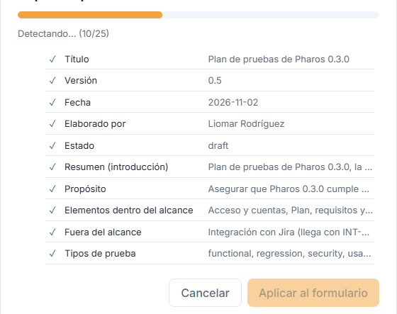

### 5.24. Plan importado

«Aplicar al formulario» carga los datos reconocidos en el asistente, sin guardar todavía: revisa cada paso y pulsa «Guardar» para conservarlos como una revisión nueva.

## Atajos de teclado

| Tecla | Dónde | Qué hace |
| --- | --- | --- |
| Tab / Mayús+Tab | Cualquier paso | Recorre los campos; al cambiar de paso, el foco va a su título |
| Intro | «Especifica otro…» (tipos), «Otro entregable», «¿No está en la lista?» (herramientas) | Añade lo escrito |
| Intro | Fecha de un sprint o un hito (dd/mm/aaaa) | Aplica la fecha; salir del campo también la aplica |
| ← → | Calendario del cronograma | Día anterior o siguiente |
| ↑ ↓ | Calendario del cronograma | Semana anterior o siguiente |
| Inicio / Fin | Calendario del cronograma | Primer o último día de la semana |
| RePág / AvPág | Calendario del cronograma | Mes anterior o siguiente |
| Intro o Espacio | Calendario del cronograma | Marca el día enfocado (inicio o fin del sprint, o un hito) |
| Esc | Calendario del cronograma | Cancela el sprint que estás marcando |

## Si algo no sale

- **«No se puede guardar: revisa 1 campo».** Falta el título (paso 1): es lo
  único obligatorio. Pharos te lleva a ese paso.
- **«Guardado con N avisos por revisar».** El plan se guardó, pero hay filas
  repetidas o fechas del cronograma que revisar.
- **El paso 6 no queda completo.** La línea bajo el paso dice qué falta: la
  duración del sprint, al menos una reunión o, en «Tradicional», al menos una
  fase.
- **Una fila del cronograma dice «Fecha no válida», «La fecha de fin es
  anterior a la de inicio», «Se solapa con…» o «Dura N días; la Metodología
  indica M».** Son avisos: el plan se guarda igualmente, pero conviene
  corregirlos.
- **No puedo arrastrar los extremos de un sprint.** Arrastrar solo funciona con
  ratón y en ventanas anchas. En pantallas táctiles o estrechas, edita las
  fechas en su fila.
- **«No se pudo leer el archivo. Prueba con un .xlsx sin comentarios de
  celda.»** Quita los comentarios del Excel y vuelve a importarlo.
- **«No se pudo cargar el plan de pruebas.»** Pulsa «Reintentar». Mientras no
  carga, Pharos no muestra el asistente, para no crear un segundo plan por
  error.
- **«Sin revisiones anteriores» en la versión web.** La web todavía no guarda
  revisiones del plan; la app de escritorio sí.
- **Los botones ✨ están en gris.** No hay un motor de IA configurado
  (Administración › Motor de IA, capítulo 15). El plan funciona igual sin IA.

## En el móvil

- La lista de pasos se sustituye por «Ver pasos», que la abre como una hoja
  desde abajo, con los pasos completos marcados.
- En pantallas medianas, los pasos se ven como una tira horizontal centrada en
  el paso actual.
- El menú «Importar / Exportar» se abre como una hoja.
- En el cronograma, las fechas se editan en las filas: en pantallas táctiles no
  se arrastran los extremos de los sprints.

## Consejos

- No hace falta rellenar los 19 pasos de una vez: la lista marca los completos
  y «Antes de terminar» (paso 19) enlaza a los que faltan.
- La duración del sprint (paso 6) se usa en el cronograma: si un sprint dura
  otra cosa, Pharos lo avisa en su fila.
- Para empezar un plan desde Excel, descarga una plantilla en «Administración ›
  Plantillas», rellénala e impórtala con «Importar .xlsx».
- «Restaurar» una revisión no guarda nada hasta que pulses «Guardar».
- El plan en PDF mantiene cada título de sección junto al inicio de su
  contenido; si una tabla sigue en otra página, su título y sus columnas se
  repiten arriba. La Metodología muestra una entrada por línea y los rangos del
  cronograma se leen «2026-11-09 – 2026-11-22». Los hitos aparecen bajo el
  cronograma y los ciclos, al final.
- Si el documento debe llevar su historial, elige «Historial de revisiones» en
  «Ajustes del proyecto › Historial en el plan exportado» (capítulo 14). El
  .pdf y el .xlsx (también los del ZIP del proyecto) añaden entonces la tabla
  «Historial de revisiones»:
  - **Dónde va:** tras la cabecera en el PDF, y en una hoja propia en el .xlsx.
  - **Qué filas tiene:** una por persona y día, que es su último guardado de
    ese día. Van de la más antigua (arriba) a la más reciente (abajo).
  - **Qué dice cada fila:** la versión, la fecha y hora, quién la hizo (nombre
    y apellidos del perfil), el estado y las secciones que cambió.
  - **Qué no entra:** los guardados sin cambios y lo que aún no has guardado.
    El día es el de tu zona horaria.
  - **En la web:** el historial empieza en los cambios hechos desde la versión
    0.2.0. Si de un guardado antiguo no se sabe la versión o el estado, la
    celda muestra «—».

## Véase también

- Capítulo 3, «Inicio»: los criterios de salida.
- Capítulo 14, «Ajustes del proyecto»: el historial en el plan exportado.
- Capítulo 17, «Asistente de IA»: asistir en un campo y sugerir riesgos,
  responsabilidades y criterios.
- [Guía de pruebas de la beta](../guia-beta.md), apartado 4.3.
- [Glosario](../GLOSARIO.md): «Plan de pruebas», «Entregable», «Paso completado», «Cierre del ciclo».

---

← [Proyectos](04-proyectos.md) · [Índice](README.md) · [Tablero](06-tablero.md) →
