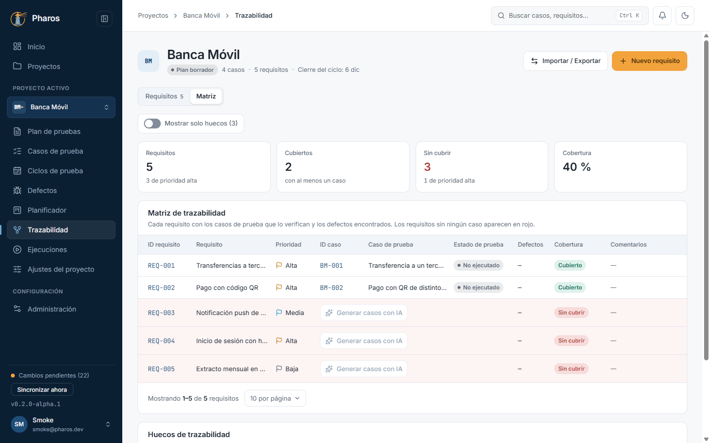
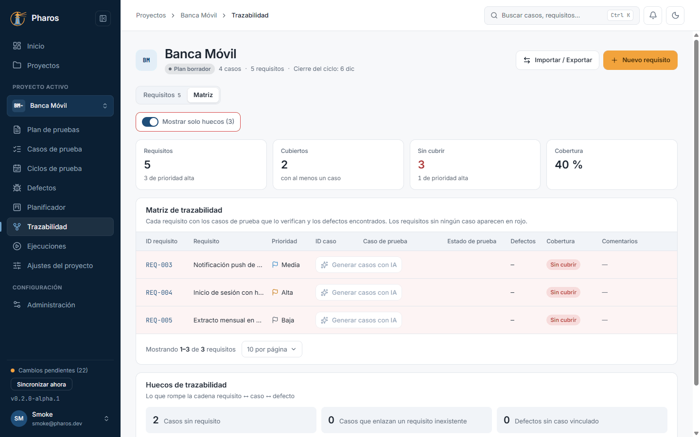
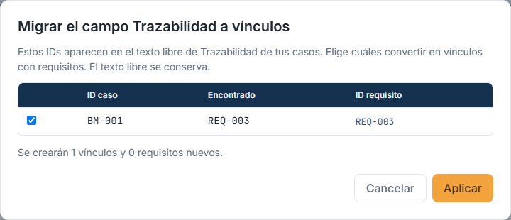

<!-- Generado por `npm run manual` desde e2e/tours/05-trazabilidad.tour.ts y docs/manual/fuentes/trazabilidad.md. No lo edites a mano: edita la fuente. -->

# 5. Trazabilidad y requisitos

## Para qué sirve

La **trazabilidad** responde a «¿está probado este requisito?». Cada requisito
tiene un ID estable (`REQ-001`) que los casos enlazan como tag; la matriz
cruza requisitos, casos, su último resultado y los defectos, y marca en rojo
los requisitos sin ningún caso. Así sabes qué cubre tu plan y qué falta.

## Paso a paso

### 5.1. Trazabilidad, sin requisitos

Pulsa «Trazabilidad» en el menú lateral y elige la vista «Requisitos». Arriba, «Importar / Exportar» y «Nuevo requisito»; sin requisitos, la lista lo indica.

### 5.2. Nuevo requisito

«Nuevo requisito» pide título, descripción y prioridad. Si dejas vacío el ID, Pharos lo numera solo (REQ-001…); una vez creado, no cambia.

### 5.3. Importar requisitos desde CSV

«Importar / Exportar → Importar requisitos (.csv)» acepta un CSV con coma o punto y coma (como lo guarda Excel en español). La vista previa muestra las columnas detectadas y qué se creará o actualizará.

### 5.4. La lista de requisitos

«Importar 4» los añade: cada requisito con su ID, prioridad y cuántos casos lo cubren. Desde cada fila, editarlo, generar casos con IA o eliminarlo.

### 5.5. Editar un requisito

Haz clic en el título para editarlo; el ID queda fijo. «Guardar» confirma con «Requisito guardado».

### 5.6. Cerrar un requisito sin guardar

Cerrar el diálogo con cambios sin guardar pide confirmación; «Aceptar» los descarta.

### 5.7. Vincular casos a requisitos

En el editor del caso, «Vincular un requisito…» añade el requisito; el caso lleva su tag (@REQ-001) en el Gherkin y la matriz lo cuenta como cubierto.

### 5.8. La matriz de trazabilidad

«Matriz» muestra cada requisito con los casos que lo verifican, su estado de prueba y sus defectos, con la cobertura arriba (requisitos cubiertos y sin cubrir).

### 5.9. Solo los huecos

«Mostrar solo huecos» deja los requisitos sin ningún caso. Debajo, «Huecos de trazabilidad» lista casos sin requisito, vínculos a requisitos inexistentes y defectos sin caso.

### 5.10. Migrar referencias escritas a mano

Si un caso menciona un ID de requisito en su texto libre («Relacionado con REQ-003»), «Migrar trazabilidad» propone convertirlo en un vínculo real. Marca los que quieras y pulsa «Aplicar».

### 5.11. Exportar la matriz

«Importar / Exportar → Exportar matriz (.xlsx)» guarda requisitos, casos, estados y defectos en un libro de Excel.

### 5.12. Eliminar un requisito

La papelera de la fila pide confirmación. El ID eliminado no se reutiliza: los casos que lo enlazaban lo muestran como vínculo a un requisito inexistente.

### 5.13. Requisito eliminado

Al confirmar aparece «REQ-005 eliminado».

## Consejos

- Importa los requisitos de tu herramienta de gestión con un CSV: Pharos
  reconoce columnas en español o inglés («Título», «Title», «Clave», «ID»…) y
  actualiza los que ya existen por su ID.
- Un ID eliminado no se reutiliza nunca, para que ningún caso antiguo apunte
  a otro requisito por error.
- «Mostrar solo huecos» es la vista de trabajo antes de cerrar un ciclo.

## Véase también

- [Guía de pruebas de la beta](../guia-beta.md), apartado 4.4 «Trazabilidad».
- [Glosario](../GLOSARIO.md): «Requisito», «Clave de requisito», «Requisitos vinculados», «Trazabilidad (texto libre)».

---

← [Casos de prueba](04-casos.md) · [Índice](README.md) · [Planificador](06-planificador.md) →
