<!-- Generado por `npm run manual` desde e2e/tours/05-trazabilidad.tour.ts y docs/manual/fuentes/trazabilidad.md. No lo edites a mano: edita la fuente. -->

# 5. Trazabilidad y requisitos

## Para qué sirve

La **trazabilidad** responde a «¿está probado este requisito?». Cada requisito
tiene un ID estable (`REQ-001`) que los casos enlazan como tag; la matriz
cruza requisitos, casos, su último resultado y los defectos, y marca en rojo
los requisitos sin ningún caso. Así sabes qué cubre tu plan y qué falta.

El **último resultado** de cada caso es el último resultado final de sus
ejecuciones, manuales o importadas (por ejemplo, de Playwright), con la clave
del run y la fecha. «Flaky» avisa de un test que pasó tras fallar,
«Desactualizado» de que se ejecutó una revisión anterior del caso y «Re-test»
de un caso que falló y cuyo defecto ya está corregido. El **riesgo** del
requisito (probabilidad × impacto) ordena la matriz: lo más arriesgado,
primero.

## Paso a paso

### 5.1. Trazabilidad, sin requisitos

La trazabilidad responde a una pregunta: ¿qué requisitos están probados y cuáles no? Pulsa «Trazabilidad» en el menú lateral y elige la vista «Requisitos». Arriba, «Importar / Exportar» y «Nuevo requisito»; sin requisitos, la lista lo indica.

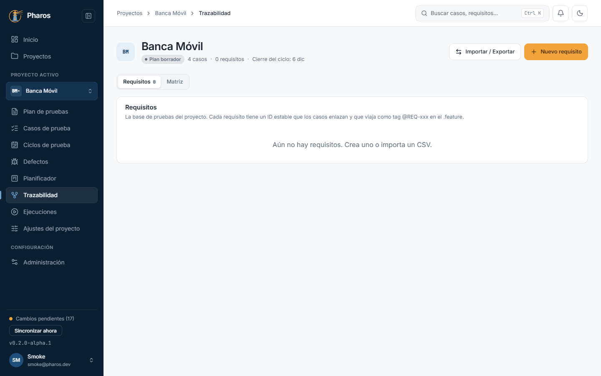

### 5.2. Nuevo requisito

«Nuevo requisito» pide título, descripción y prioridad. Si dejas vacío el ID, Pharos lo numera solo (REQ-001…); una vez creado, no cambia, para que los vínculos con casos y defectos sigan siendo válidos.

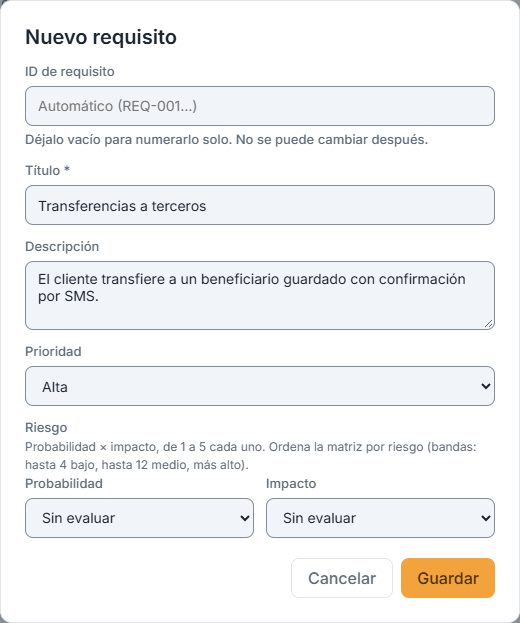

### 5.3. Importar requisitos desde CSV

Si tus requisitos ya están en una hoja de cálculo, «Importar / Exportar → Importar requisitos (.csv)» acepta un CSV con coma o punto y coma (como lo guarda Excel en español). La vista previa muestra las columnas detectadas y qué se creará o actualizará antes de tocar nada.

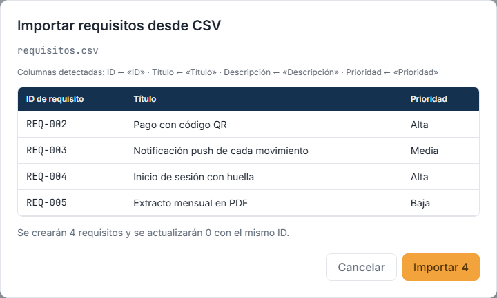

### 5.4. La lista de requisitos

«Importar 4» los añade (en este ejemplo, cuatro requisitos): cada uno con su ID, su prioridad y cuántos casos lo cubren. Desde cada fila puedes editarlo, generar casos con IA (capítulo 11) o eliminarlo.

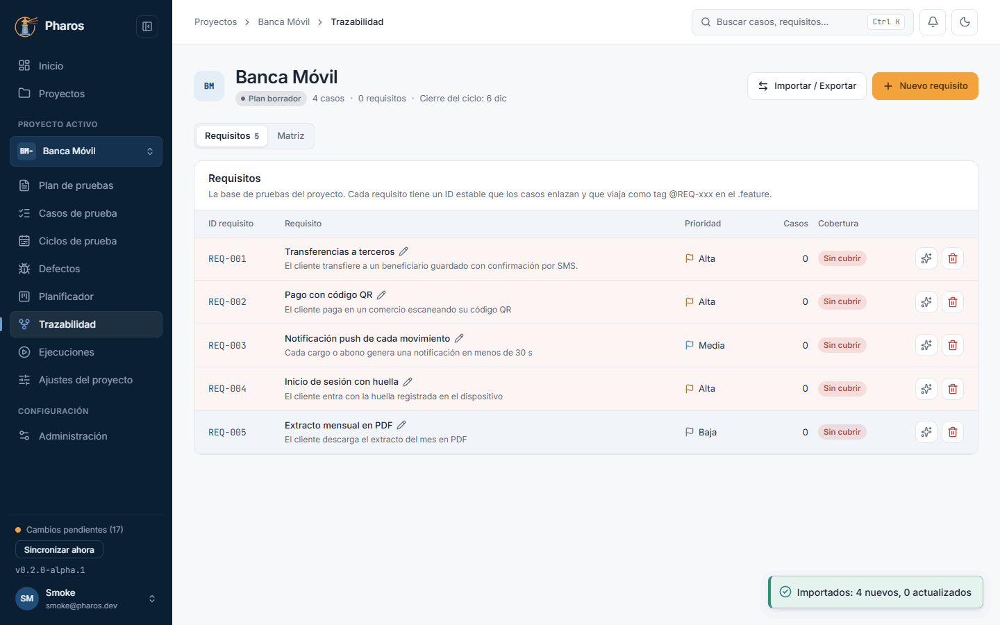

### 5.5. Editar un requisito

Haz clic en el título de un requisito para editarlo; el ID queda fijo. «Guardar» lo confirma con el aviso «Requisito guardado».

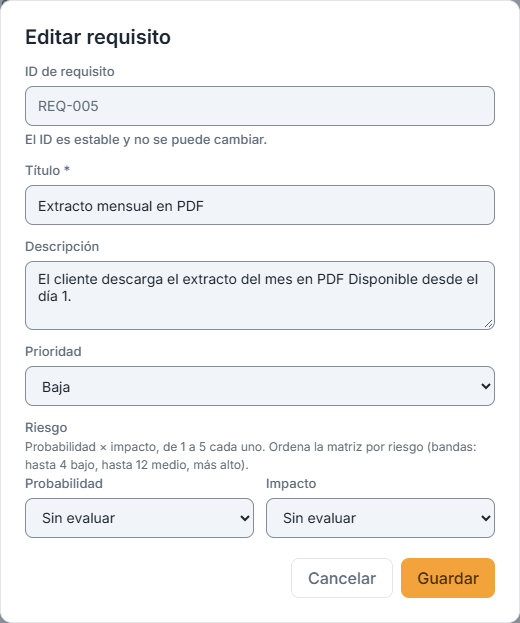

### 5.6. El riesgo de un requisito

En el mismo diálogo, «Riesgo» pide la probabilidad y el impacto, de 1 a 5 cada uno. Su producto es el nivel de riesgo, que ordena la matriz: hasta 4 es bajo, hasta 12 medio y por encima alto.

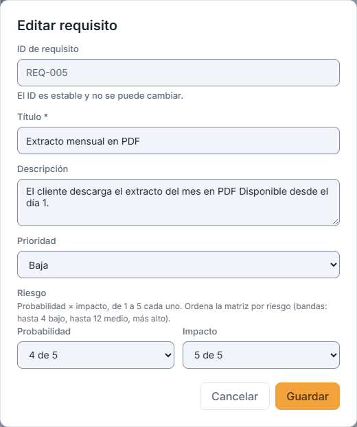

### 5.7. Cerrar un requisito sin guardar

Cerrar el diálogo con cambios sin guardar pide confirmación, para que no los pierdas por un clic; «Aceptar» los descarta.

### 5.8. Vincular casos a requisitos

El vínculo entre caso y requisito es lo que hace funcionar la matriz. En el editor del caso, «Vincular un requisito…» lo añade (en este ejemplo, REQ-001): el caso lleva su etiqueta (@REQ-001) en el Gherkin y la matriz lo cuenta como cubierto.

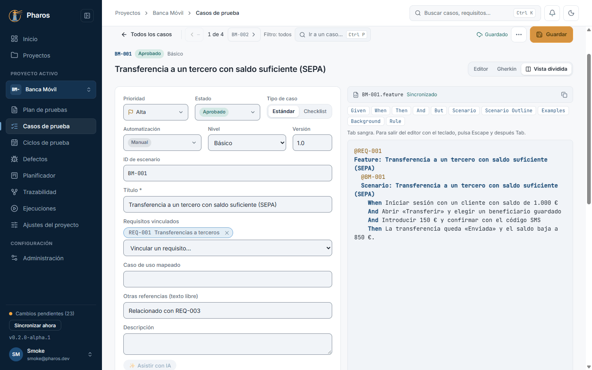

### 5.9. La matriz de trazabilidad

«Matriz» muestra cada requisito con los casos que lo verifican, su estado de prueba y sus defectos, y arriba la cobertura: cuántos requisitos están cubiertos y cuántos no. Es la vista que enseñar cuando alguien pregunta qué se ha probado.

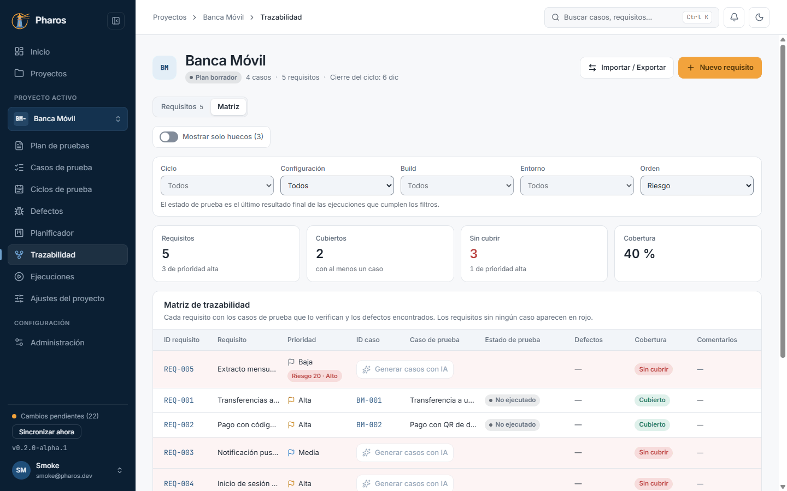

### 5.10. Orden por riesgo y filtros de resultados

Sobre la matriz, los filtros de resultados (ciclo, configuración, build y entorno) y el orden. Por defecto, los requisitos de más riesgo van primero; «ID de requisito» vuelve al orden por clave. El estado de prueba es el último resultado final de las ejecuciones que cumplen los filtros (capítulo 13).

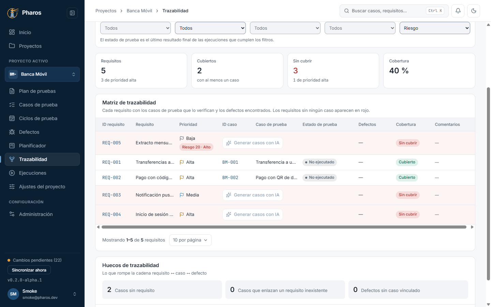

### 5.11. Solo los huecos

«Mostrar solo huecos» deja los requisitos sin ningún caso, lo primero que conviene resolver. Debajo, «Huecos de trazabilidad» lista también casos sin requisito, vínculos a requisitos inexistentes y defectos sin caso.

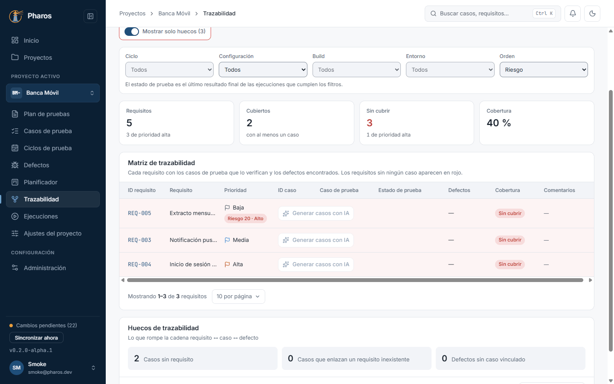

### 5.12. Migrar referencias escritas a mano

Si un caso menciona un ID de requisito en su texto libre (en este ejemplo, «Relacionado con REQ-003»), la matriz no lo cuenta. «Migrar trazabilidad» propone convertirlo en un vínculo real: marca los que quieras y pulsa «Aplicar».

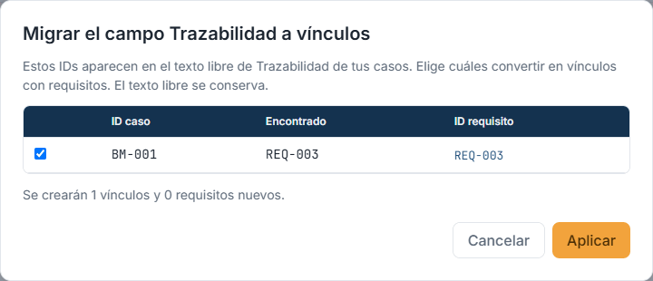

### 5.13. Exportar la matriz

«Importar / Exportar → Exportar matriz (.xlsx)» guarda requisitos, casos, estados y defectos en un libro de Excel, para compartirlos con quien no usa Pharos o adjuntarlos a una auditoría.

### 5.14. Eliminar un requisito

La papelera de la fila pide confirmación. El ID eliminado no se reutiliza: los casos que lo enlazaban lo muestran como vínculo a un requisito inexistente, y así aparecen en los huecos de trazabilidad.

### 5.15. Requisito eliminado

Al confirmar aparece el aviso con el requisito eliminado (en este ejemplo, «REQ-005 eliminado») y la lista deja de mostrarlo.

## Consejos

- Importa los requisitos de tu herramienta de gestión con un CSV: Pharos
  reconoce columnas en español o inglés («Título», «Title», «Clave», «ID»…) y
  actualiza los que ya existen por su ID.
- Un ID eliminado no se reutiliza nunca, para que ningún caso antiguo apunte
  a otro requisito por error.
- «Mostrar solo huecos» es la vista de trabajo antes de cerrar un ciclo.
- Evalúa el riesgo de los requisitos importantes: sin probabilidad e impacto,
  un requisito queda «Sin evaluar» al final de la matriz.
- Filtra por ciclo o por build para ver la foto de una ronda concreta; los
  filtros quedan en la dirección de la página, así que puedes guardarla o
  compartirla.
- La exportación a Excel trae la hoja «Resultados» con el run, la fecha y los
  defectos de cada caso, para revisarla fuera de la app.

## Véase también

- [Guía de pruebas de la beta](../guia-beta.md), apartados 4.4 «Trazabilidad» y 4.4e «Resultados en la matriz e informe de estado».
- Capítulo 13, «Ejecución manual»: los resultados en la matriz y el informe de estado.
- [Glosario](../GLOSARIO.md): «Requisito», «Clave de requisito», «Requisitos vinculados», «Trazabilidad (texto libre)», «Último resultado», «Desactualizado», «Re-test», «Banda de riesgo».

---

← [Casos de prueba](04-casos.md) · [Índice](README.md) · [Planificador](06-planificador.md) →
