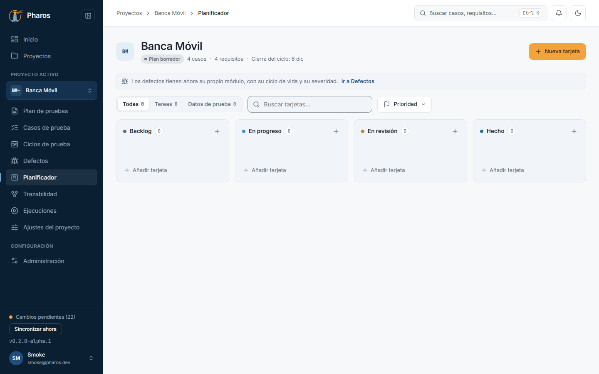
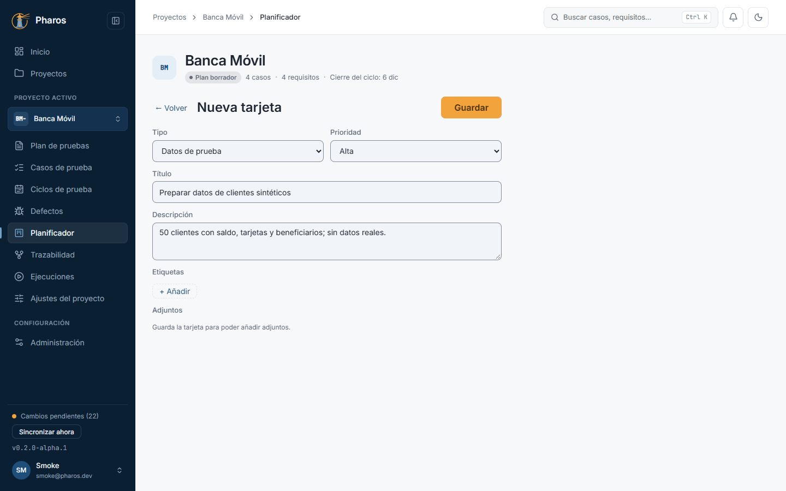
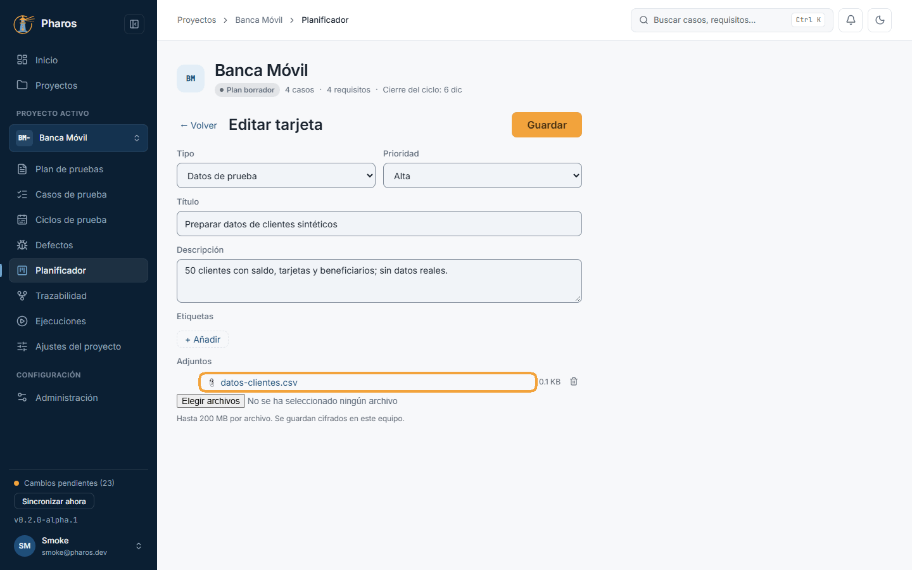
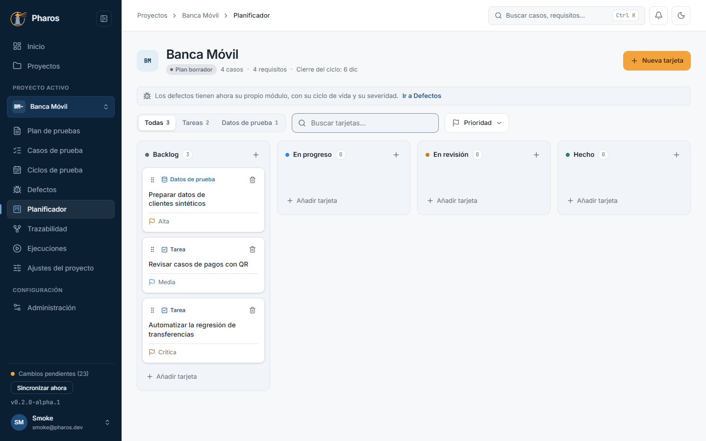
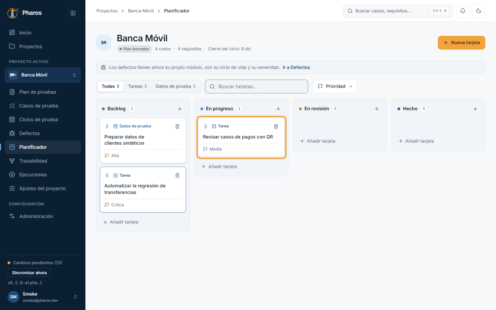
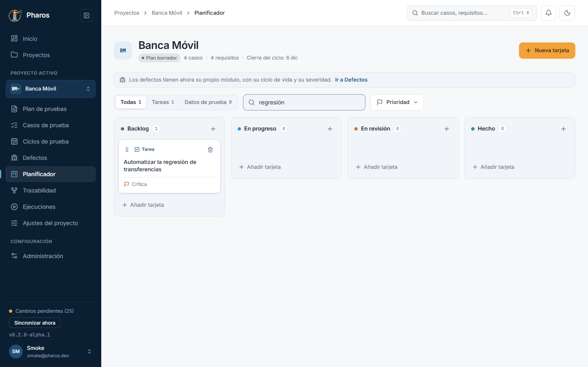
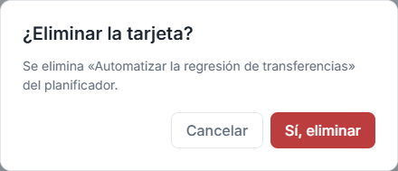

<!-- Generado por `npm run manual` desde e2e/tours/06-planificador.tour.ts y docs/manual/fuentes/planificador.md. No lo edites a mano: edita la fuente. -->

# 6. Planificador

## Para qué sirve

El **planificador** es un tablero kanban por proyecto para el trabajo del
equipo de QA que no es un caso ni un defecto: preparar datos de prueba,
revisar casos, automatizar una regresión. Cada tarjeta avanza de Backlog a
Hecho y puede llevar adjuntos.

## Paso a paso

### 6.1. El tablero del planificador

El planificador organiza el trabajo del equipo de pruebas que no es un caso: tareas y preparación de datos. Pulsa «Planificador» en el menú lateral: cuatro columnas (Backlog, En progreso, En revisión y Hecho) muestran en qué punto está cada tarjeta; el «+» de cada columna crea una tarjeta directamente en ella. Arriba, los filtros por tipo y prioridad y el buscador.

### 6.2. Nueva tarjeta

«Nueva tarjeta» abre el editor. Una tarjeta es una tarea o un conjunto de datos de prueba, con su prioridad, una descripción y etiquetas (en este ejemplo, «Preparar datos de clientes sintéticos», de tipo datos de prueba y prioridad alta). «Guardar» la deja en Backlog; una vez guardada, admite adjuntos.

### 6.3. Adjuntar archivos a una tarjeta

Con la tarjeta guardada, «Adjuntos» acepta archivos hasta el límite indicado (en este ejemplo, un .csv con los datos de clientes). Se guardan cifrados en este equipo y se abren desde la propia tarjeta; la papelera junto a cada archivo («Quitar: <archivo>») lo quita.

### 6.4. Archivos demasiado grandes

Un archivo de más de 200 MB no se adjunta: Pharos avisa con su nombre y el límite, y la tarjeta queda como estaba.

### 6.5. Tarjetas en el tablero

Cada tarjeta muestra su tipo, su prioridad y sus etiquetas, para ver de un vistazo qué es urgente. Un clic en el título la abre para editarla; el botón «Eliminar» (la papelera) la borra, tras pedir confirmación.

### 6.6. Mover una tarjeta (también con el teclado)

Cuando una tarea avanza, arrastra su tarjeta por el asa a la columna que corresponda (en este ejemplo, «Revisar casos de pagos con QR» pasa a «En progreso»). Con el teclado: lleva el foco al asa, pulsa Espacio para cogerla, muévela con las flechas y suéltala con Espacio.

### 6.7. Filtrar y buscar tarjetas

Con muchas tarjetas, filtra por tipo (tareas o datos de prueba) y por prioridad, o busca por texto (en este ejemplo, «regresión» deja una sola tarjeta). Los filtros solo cambian lo que ves; las tarjetas siguen en su columna.

### 6.8. Eliminar una tarjeta

El botón «Eliminar» de la tarjeta pide confirmación («¿Eliminar la tarjeta?») antes de borrarla con sus adjuntos.

### 6.9. Tarjeta eliminada

Al confirmar, la tarjeta desaparece del tablero.

## Consejos

- Los defectos tienen su propio módulo (capítulo 9); el planificador es para
  tareas y datos de prueba.
- Los adjuntos se guardan cifrados en el equipo, junto con los datos de
  Pharos; inclúyelos en tus copias.

## Véase también

- [Glosario](../GLOSARIO.md): «Planificador», «Tarjeta del planificador», «Columna del kanban», «Adjunto».

---

← [Trazabilidad y requisitos](05-trazabilidad.md) · [Índice](README.md) · [Ciclos y configuraciones](07-ciclos.md) →
