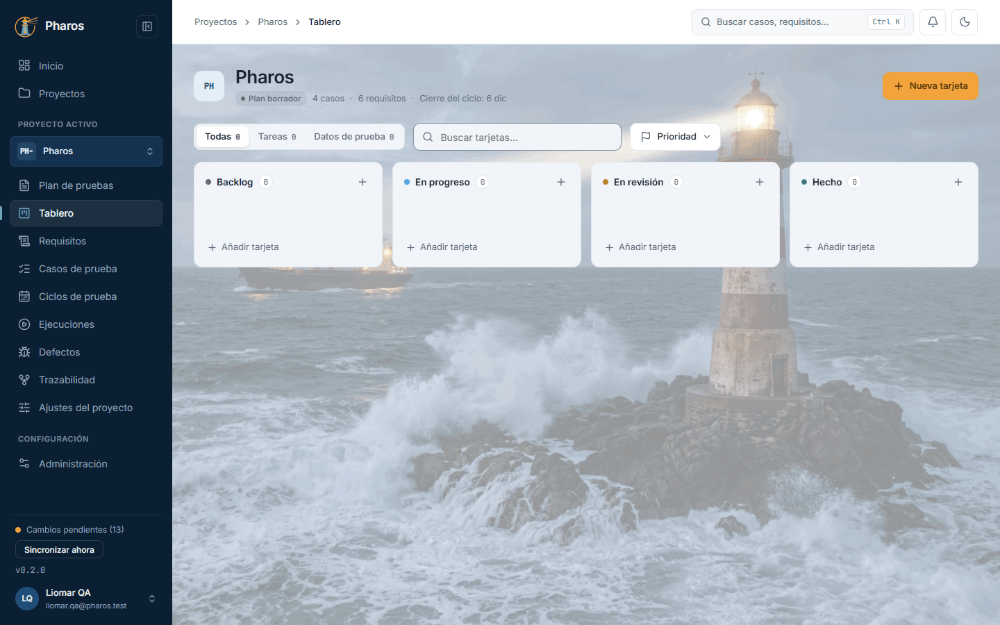
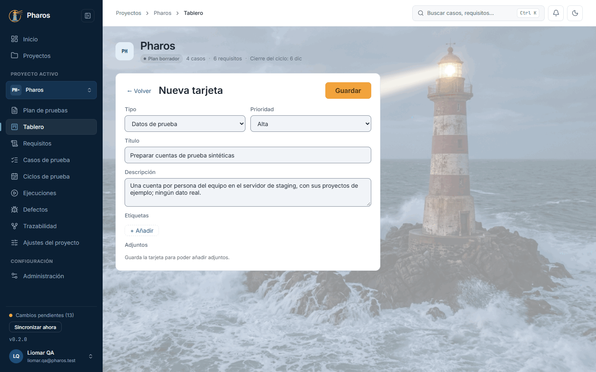
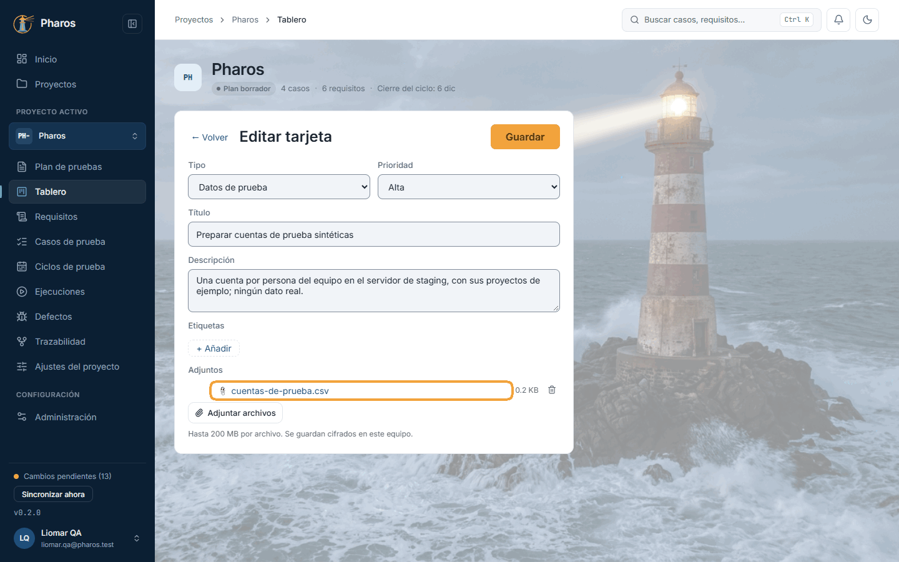
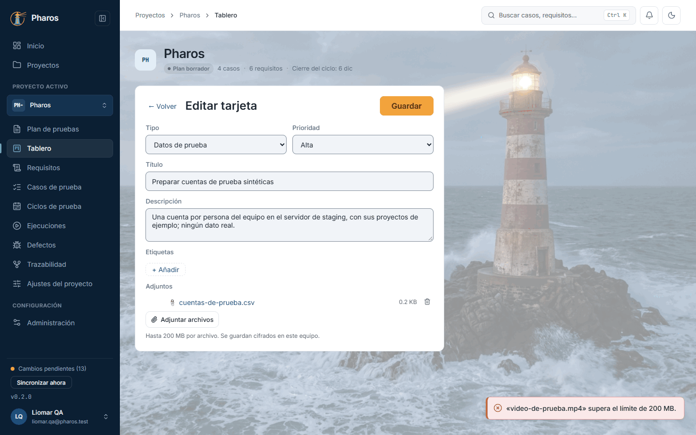
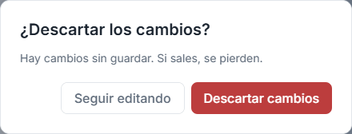
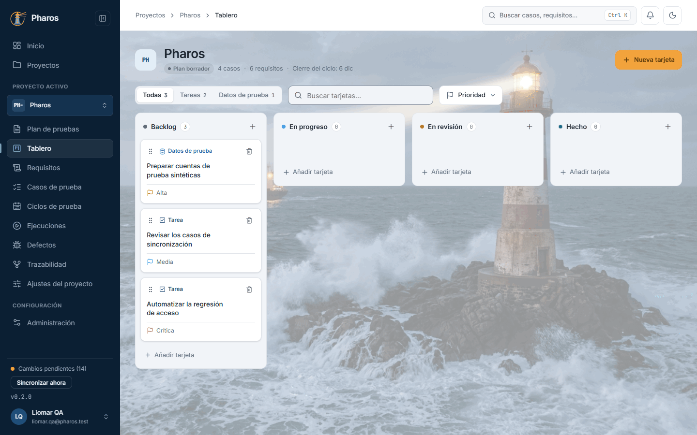
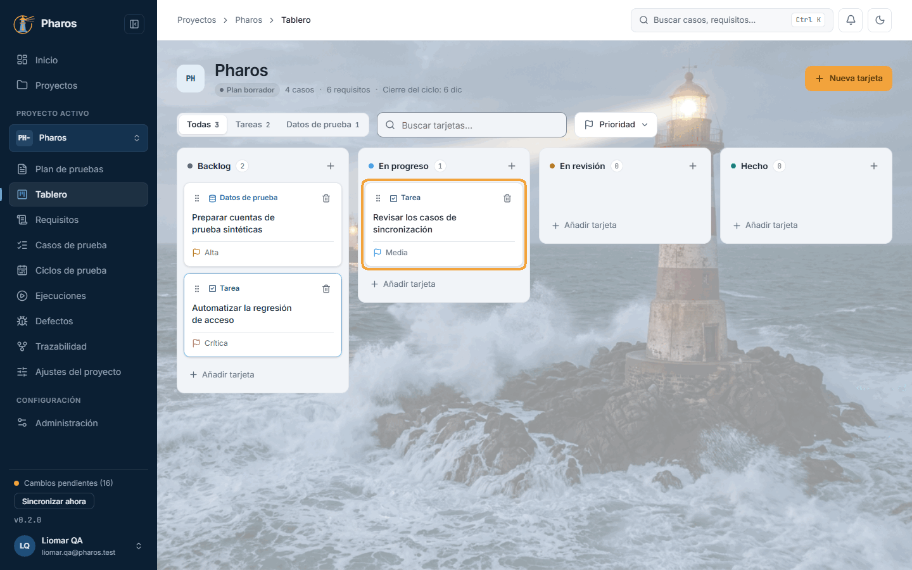
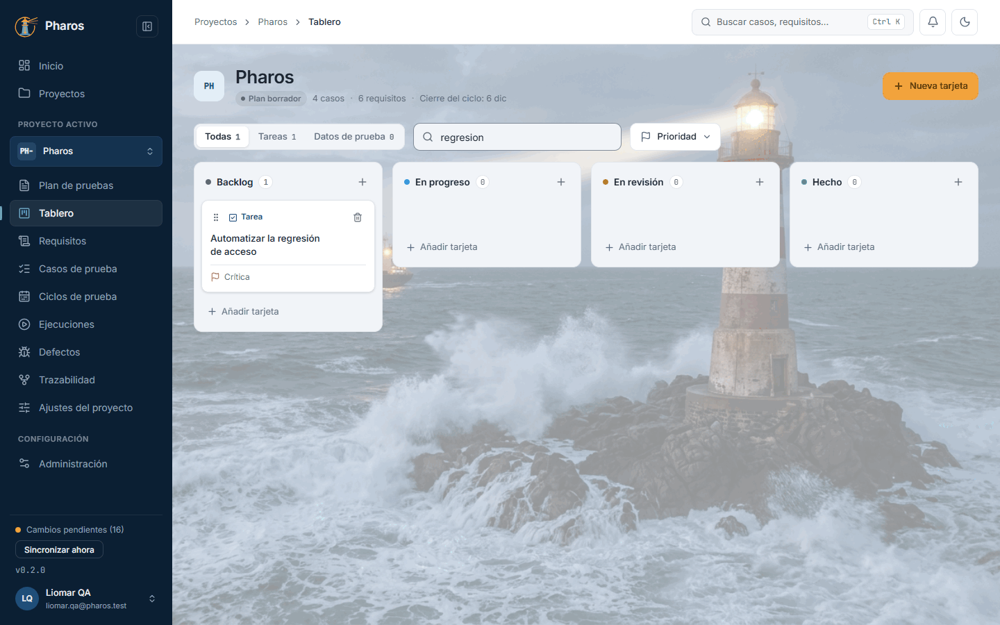
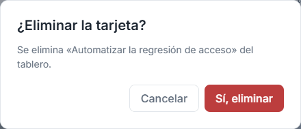
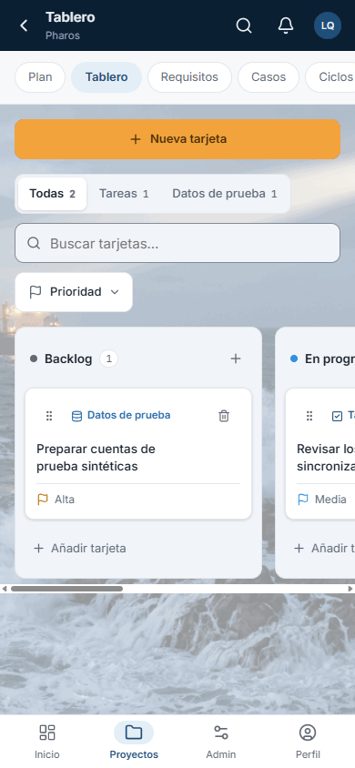

<!-- Generado por `npm run manual` desde e2e/tours/06-tablero.tour.ts y docs/manual/fuentes/tablero.md. No lo edites a mano: edita la fuente. -->

# 6. Tablero

## Para qué sirve

El **Tablero** es un kanban por proyecto para el trabajo del equipo de QA que
no es un caso ni un defecto: preparar datos de prueba, revisar casos,
automatizar una regresión. Cada tarjeta avanza de «Backlog» a «Hecho», con su
prioridad, sus etiquetas y sus adjuntos.

Es la sección en la que se abre un proyecto que ya existe: el sitio donde el
equipo mira cada día qué hay pendiente.

En este manual, el tablero de «Pharos» tiene las cuentas de prueba del
equipo, la revisión de los casos de sincronización y la automatización de la
regresión de acceso.

## Paso a paso

### 6.1. El tablero

El «Tablero» organiza el trabajo del equipo de pruebas que no es un caso ni un defecto: tareas (automatizar una regresión, revisar casos) y preparación de datos de prueba. Es la sección en la que se abre un proyecto que ya existe. Cuatro columnas, «Backlog», «En progreso», «En revisión» y «Hecho», muestran en qué punto está cada tarjeta, con su número al lado; el «+» de cada columna, o «Añadir tarjeta» al pie, crea una tarjeta directamente en ella. Arriba, los filtros por tipo y por prioridad y el buscador.

### 6.2. Nueva tarjeta

«Nueva tarjeta», en la cabecera, abre el editor: el tipo (tarea, defecto o datos de prueba), la prioridad (baja, media, alta o crítica), el título, que es obligatorio, una descripción y etiquetas. En este ejemplo, Liomar prepara las cuentas de prueba de Pharos: «Preparar cuentas de prueba sintéticas», de tipo datos de prueba y prioridad alta. «Guardar» la deja en Backlog; una vez guardada, admite adjuntos.

### 6.3. Adjuntar archivos a una tarjeta

Con la tarjeta guardada, «Adjuntar archivos», en «Adjuntos», acepta archivos de hasta 200 MB (en este ejemplo, «cuentas-de-prueba.csv» con las cuentas del equipo). Se guardan cifrados en este equipo; un clic en el nombre lo guarda en tu carpeta de descarga, y la papelera («Quitar: nombre del archivo») lo quita. Los adjuntos solo están en la app de escritorio.

### 6.4. Archivos demasiado grandes

Un archivo de más de 200 MB no se adjunta: Pharos avisa con su nombre y el límite («… supera el límite de 200 MB.») y la tarjeta queda como estaba. Para vídeos largos, enlaza dónde están en la descripción.

### 6.5. Salir con cambios sin guardar

Si cambias algo y pulsas «← Volver» (o vas a otra sección) sin guardar, Pharos pregunta antes de perderlo: «Seguir editando» te deja en la tarjeta; «Descartar cambios» vuelve al tablero sin guardar. Sin cambios, «← Volver» sale directamente.

### 6.6. Tarjetas en el tablero

Cada tarjeta muestra su asa de arrastre, su tipo, su título, sus etiquetas y la bandera de su prioridad, para ver de un vistazo qué es urgente. Un clic en el título la abre para editarla; la papelera la elimina, tras pedir confirmación. En este ejemplo hay tres: las cuentas de prueba, «Revisar los casos de sincronización» y «Automatizar la regresión de acceso», esta con prioridad crítica.

### 6.7. Mover una tarjeta (también con el teclado)

Cuando una tarea avanza, arrastra su tarjeta con el ratón a la columna que corresponda (en este ejemplo, «Revisar los casos de sincronización» pasa a «En progreso»). Con el teclado: lleva el foco al asa (⠿) con Tab, pulsa Espacio o Intro para cogerla, muévela con ← → entre columnas y con ↑ ↓ dentro de la columna, y suéltala con Espacio o Intro; Esc cancela. Un lector de pantalla anuncia cada movimiento.

### 6.8. Filtrar y buscar tarjetas

Con muchas tarjetas, filtra por tipo («Todas», «Tareas», «Datos de prueba», con su número) y por prioridad, o busca por título, clave o etiqueta sin preocuparte por los acentos (en este ejemplo, «regresion» deja una sola tarjeta). Los filtros solo cambian lo que ves: las tarjetas siguen en su columna.

### 6.9. Eliminar una tarjeta

La papelera de la tarjeta pide confirmación («¿Eliminar la tarjeta?») antes de borrarla con sus adjuntos. Esc no cierra este aviso: solo «Cancelar».

### 6.10. Tarjeta eliminada

Al confirmar, la tarjeta desaparece del tablero.

### 6.11. El tablero en el móvil

En el móvil, las columnas se recorren deslizando de lado y los filtros (tipo, búsqueda y prioridad) quedan arriba; el menú de prioridad se abre como una hoja desde abajo. «Nueva tarjeta» está en la fila de botones de la sección.

## Atajos de teclado

| Tecla | Dónde | Qué hace |
| --- | --- | --- |
| Tab | Tablero | Recorre los filtros, el buscador y, en cada tarjeta, su asa, su título y su papelera |
| Espacio o Intro | Asa de una tarjeta (⠿) | Coge la tarjeta para moverla; otra vez, la suelta |
| ← → | Tarjeta cogida | La lleva a la columna anterior o a la siguiente |
| ↑ ↓ | Tarjeta cogida | La sube o la baja dentro de su columna |
| Esc | Tarjeta cogida | Cancela el movimiento: vuelve a su sitio |
| Intro | Título de una tarjeta | La abre en el editor |
| ↑ ↓ e Intro | Menú «Prioridad» | Marcan o desmarcan cada prioridad |

## Si algo no sale

- **«No se pudo cargar el tablero.»** Pulsa «Reintentar». Si sigue, en la web
  comprueba la conexión.
- **«Guardar» no se activa.** Falta el título: es lo único obligatorio.
- **«No se pudo guardar la tarjeta. Inténtalo de nuevo.»** El cambio no se
  guardó y sigue en el editor. Vuelve a pulsar «Guardar».
- **«Guarda la tarjeta para poder añadir adjuntos.»** Los adjuntos se añaden a
  una tarjeta ya guardada: guárdala y vuelve a abrirla.
- **«… supera el límite de 200 MB.»** Ese archivo no se adjunta. Comprímelo o
  enlaza dónde está en la descripción.
- **«Por ahora solo está disponible en la app de escritorio.»** En la versión
  web, las tarjetas no admiten adjuntos.
- **No encuentro una tarjeta.** Revisa los filtros: el tipo, la prioridad y el
  buscador solo cambian lo que ves. Elige «Todas», desmarca las prioridades y
  borra la búsqueda.
- **¿Y los defectos?** Tienen su propio módulo (capítulo 12), con su ciclo de
  vida y sus vínculos a casos y requisitos. El tablero es para tareas y datos
  de prueba.

## En el móvil

- Las cuatro columnas se recorren deslizando de lado.
- Los filtros (tipo, búsqueda y prioridad) quedan arriba; el menú de prioridad
  se abre como una hoja desde abajo.
- «Nueva tarjeta» está en la fila de botones de la sección.
- El editor de una tarjeta ocupa toda la pantalla, con «← Volver» arriba.

## Consejos

- Usa las **etiquetas** para agrupar tarjetas de una misma versión o área
  (por ejemplo, «0.3.0» o «sincronización»): el buscador también busca en
  ellas.
- Pon los **datos de prueba** en tarjetas de tipo «Datos de prueba» con su
  archivo adjunto: así el equipo sabe dónde están y quién los preparó.
- Los adjuntos se guardan cifrados en el equipo, junto con los datos de
  Pharos: inclúyelos en tus copias (capítulo 16, «Evidencias»).

## Véase también

- Capítulo 4, «Proyectos»: un proyecto existente se abre en su Tablero.
- Capítulo 12, «Defectos».
- [Glosario](../GLOSARIO.md): «Tablero», «Tarjeta del tablero», «Columna del
  kanban», «Adjunto».

---

← [Plan de pruebas](05-plan.md) · [Índice](README.md) · [Requisitos](07-requisitos.md) →
