<!-- Generado por `npm run manual` desde e2e/tours/07-ciclos.tour.ts y docs/manual/fuentes/ciclos.md. No lo edites a mano: edita la fuente. -->

# 7. Ciclos y configuraciones

## Para qué sirve

Un **ciclo de prueba** reúne los casos que se van a ejecutar en una ronda
concreta (una regresión, un sprint), contra una build y en unas
**configuraciones** (por ejemplo, Chrome en Windows y Edge en Windows).
«Ejecutar» crea un run por configuración con todos los elementos del ciclo;
los resultados de esos runs alimentan el progreso del ciclo, «Inicio» y la
matriz de trazabilidad.

## Paso a paso

### 7.1. Ciclos de prueba

Un ciclo agrupa lo que se va a probar en una ronda concreta (una regresión, una versión candidata), dónde y contra qué build. Pulsa «Ciclos de prueba» en el menú lateral. Arriba, «Nuevo ciclo» y los filtros por estado; sin ciclos, la lista lo indica.

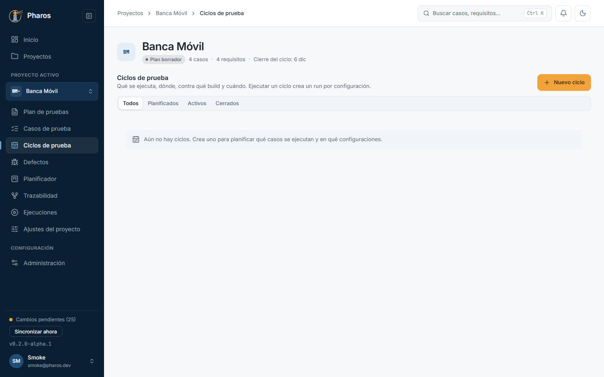

### 7.2. Nuevo ciclo

«Nuevo ciclo» pide título, build, entorno, hito y sprint del plan, fechas y las configuraciones en las que se ejecutará (las del capítulo 2).

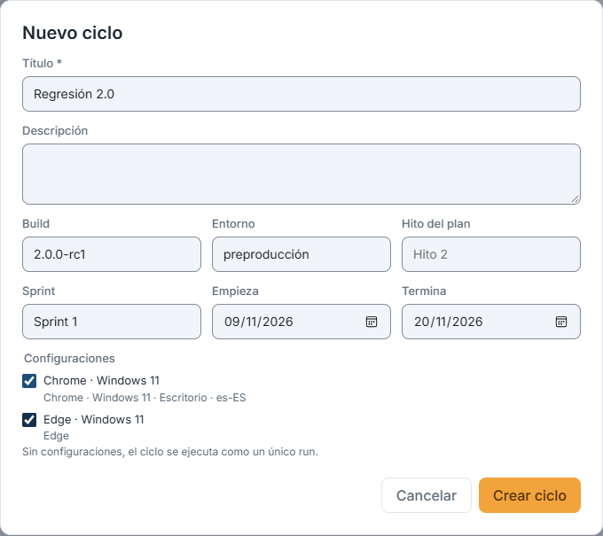

### 7.3. El ciclo, recién creado

«Crear ciclo» lo crea con su clave (en este ejemplo, CY-1) y abre su detalle: el resumen de resultados y las pestañas «Elementos», lo que hay que probar, y «Runs», las ejecuciones que se han lanzado.

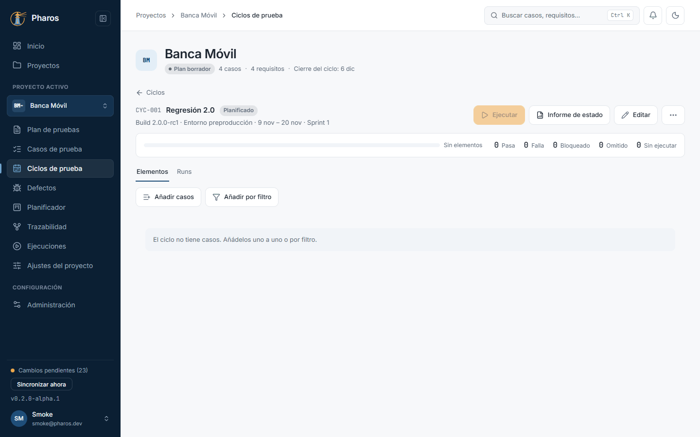

### 7.4. Añadir casos al ciclo

«Añadir casos» lista los casos del proyecto con buscador: marca los que entran en esta ronda, asígnalos a alguien si quieres y confirma. Pharos avisa si alguno no está aprobado, para que no pruebes un caso aún en borrador sin saberlo.

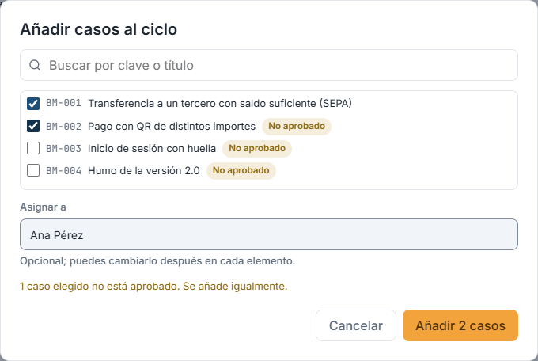

### 7.5. Añadir por filtro

Para no marcar caso por caso, «Añadir por filtro» los elige por etiquetas, prioridad, estado, requisitos o riesgo, por ejemplo, todos los de prioridad alta. El recuento se actualiza mientras marcas.

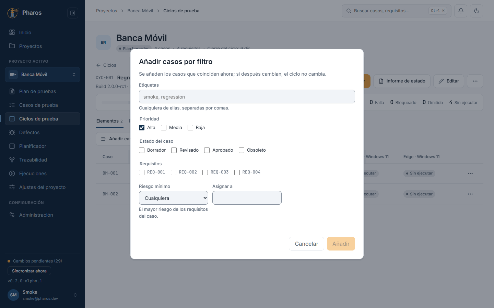

### 7.6. Los elementos del ciclo

Cada elemento muestra el caso, a quién está asignado (se edita en la propia fila; Intro guarda) y su resultado. El menú de la fila lo sube, lo baja o lo quita del ciclo.

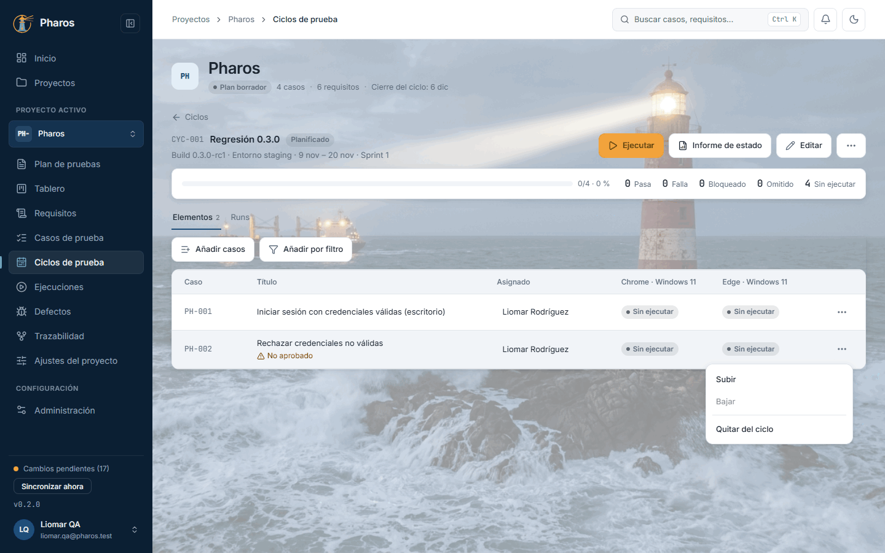

### 7.7. Ejecutar el ciclo

«Ejecutar» crea un run por configuración con todos los elementos: así cada entorno lleva su propio registro de resultados. Elige configuraciones, build y entorno y pulsa «Crear N runs».

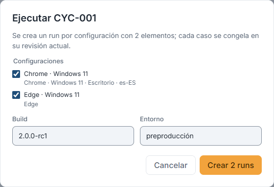

### 7.8. Los runs del ciclo

Los runs creados aparecen en la pestaña «Runs» y en «Ejecuciones» (capítulo 8), listos para registrar resultados.

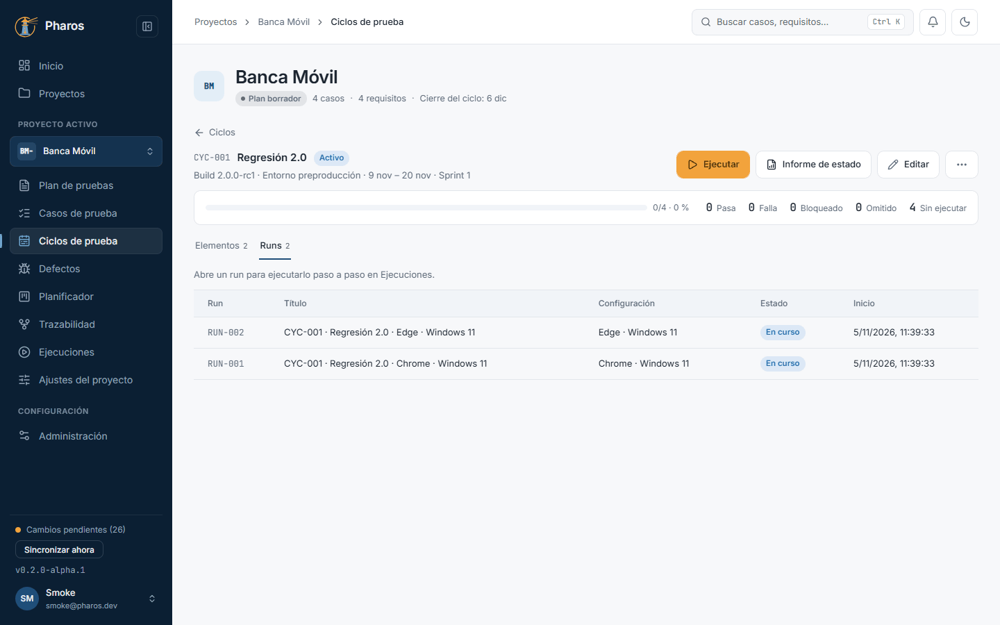

### 7.9. Informe de estado de un ciclo

«Informe de estado» en la cabecera del ciclo abre el informe con el alcance ya puesto en ese ciclo: el progreso cuenta cada caso en cada configuración, como la pestaña «Elementos». El informe completo se explica en el capítulo 13.

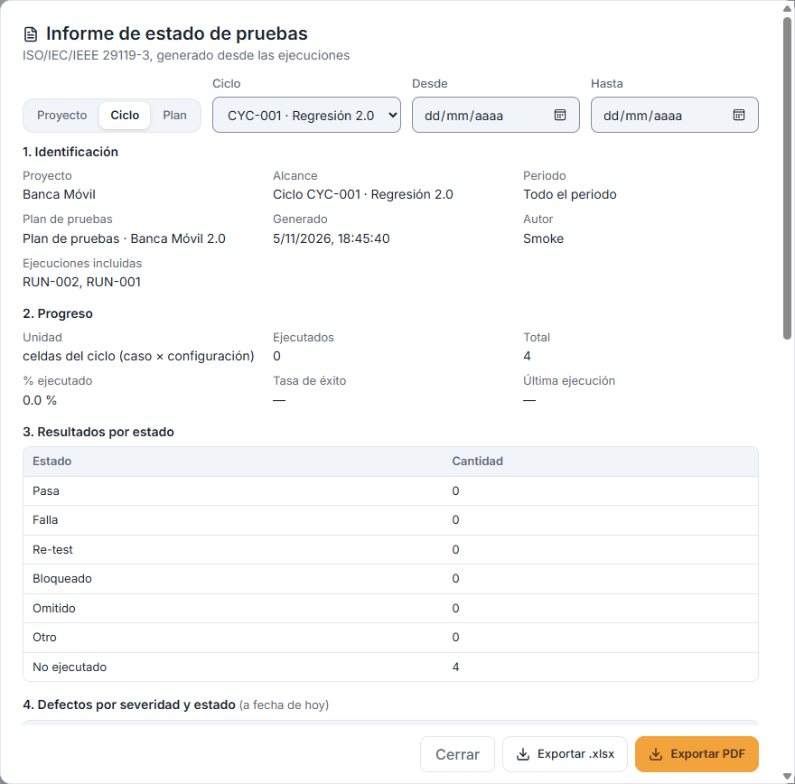

### 7.10. Clonar y eliminar un ciclo

El menú «⋯» del ciclo lo clona, con sus elementos y sin resultados, útil para repetir una regresión en la siguiente versión; también lo elimina, tras confirmar.

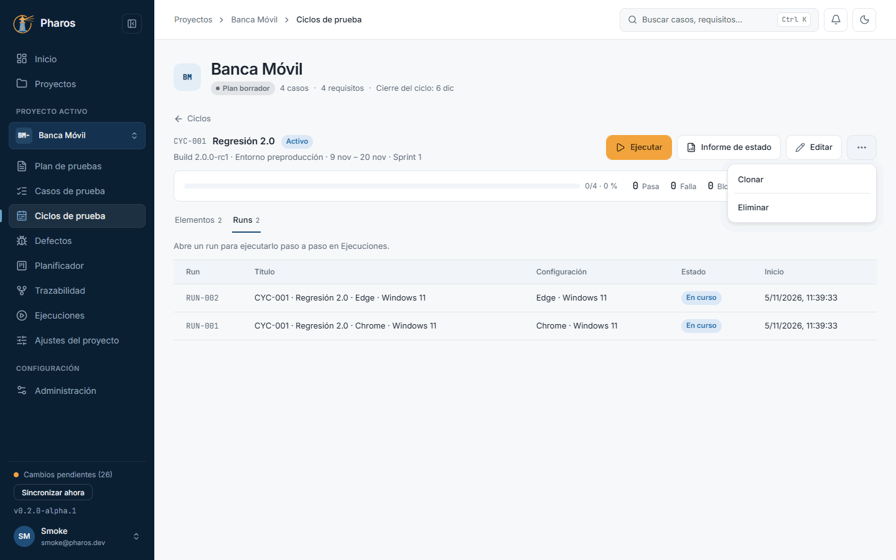

### 7.11. Confirmar la eliminación

Eliminar un ciclo pide confirmación. Los resultados no se pierden: sus runs se conservan en «Ejecuciones».

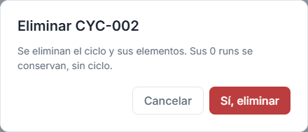

### 7.12. La lista de ciclos

La lista muestra cada ciclo con su estado, fechas, configuraciones, progreso y runs. Filtra por «Planificados», «Activos» o «Cerrados» para ver de un vistazo lo que está en curso.

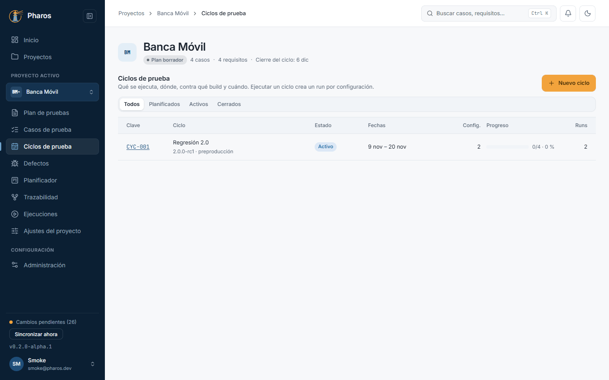

## Consejos

- Crea las configuraciones antes, en «Ajustes del proyecto».
- «Añadir por filtro» es la forma rápida de montar una regresión: por
  prioridad, estado, requisitos o riesgo.
- «Clonar» prepara la siguiente ronda con los mismos elementos y sin
  resultados.
- «Informe de estado» en la cabecera del ciclo resume esa ronda (progreso por
  caso y configuración, defectos, cobertura y criterios de salida) para
  enviarla en Excel o PDF.

## Véase también

- [Guía de pruebas de la beta](../guia-beta.md), apartado 4.4c.
- [Glosario](../GLOSARIO.md), sección «Execution model identifiers»: ciclo, elemento de ciclo, run, configuración.

---

← [Planificador](06-planificador.md) · [Índice](README.md) · [Ejecuciones e importación de resultados](08-ejecuciones.md) →
