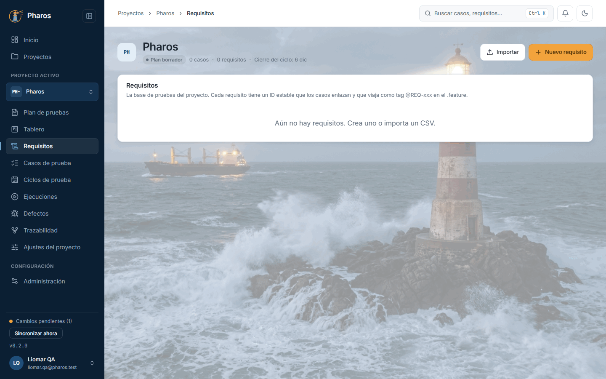
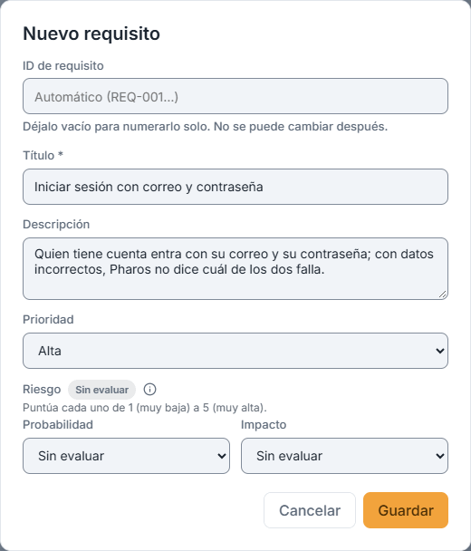
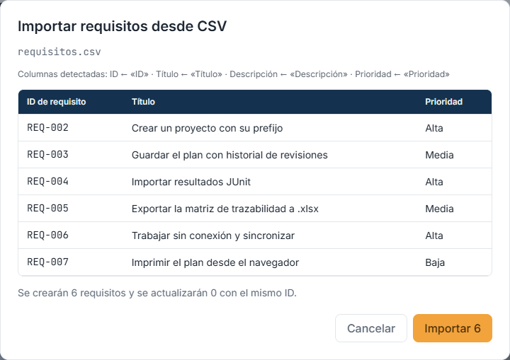
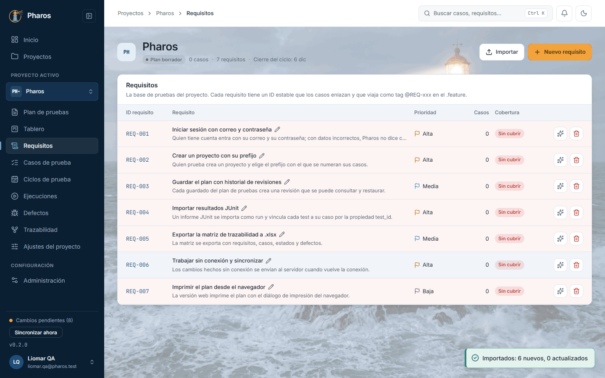
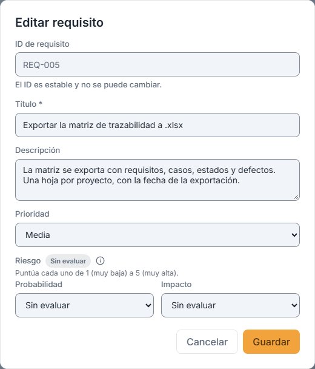
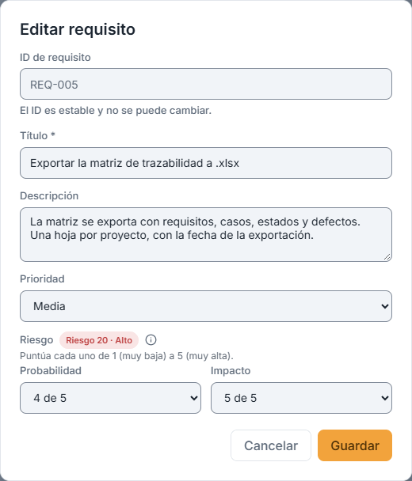
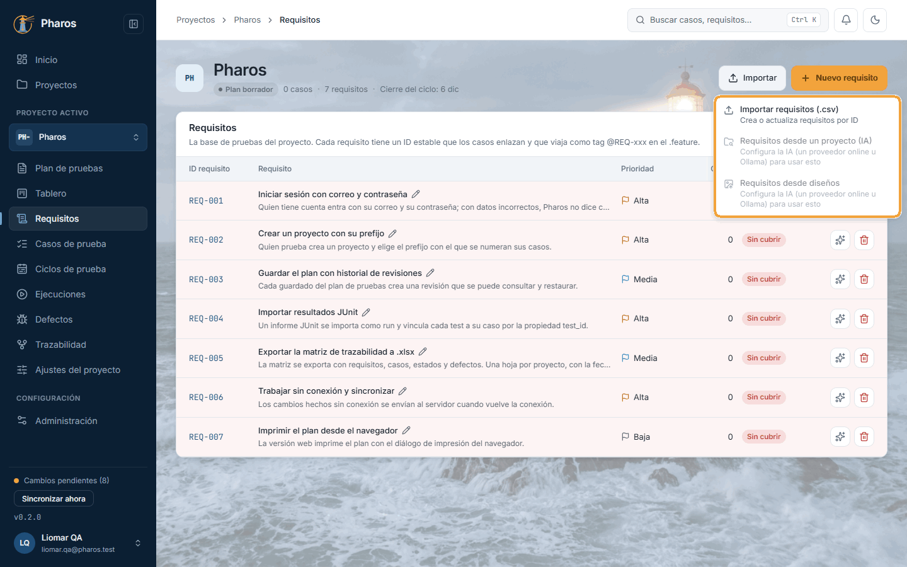
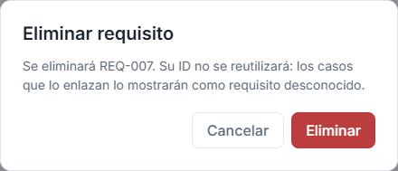
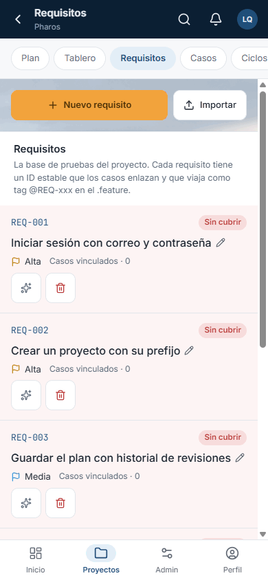

<!-- Generado por `npm run manual` desde e2e/tours/07-requisitos.tour.ts y docs/manual/fuentes/requisitos.md. No lo edites a mano: edita la fuente. -->

# 7. Requisitos

## Para qué sirve

Los **requisitos** son la base de prueba: lo que la aplicación debe hacer y,
por tanto, lo que hay que comprobar. Cada requisito tiene:

- un **ID estable** (`REQ-001`), que no cambia ni se reutiliza;
- un título, una descripción y una prioridad;
- un **riesgo** opcional: la probabilidad y el impacto, de 1 (muy baja) a 5 (muy
  alta) cada uno. Junto a «Riesgo» ves el resultado al momento, por ejemplo
  «Riesgo 12 · Medio»; el icono ⓘ explica las bandas (bajo 1–4, medio 5–12,
  alto 13–25), por las que la matriz ordena los requisitos.

Los casos de prueba enlazan los requisitos (capítulo 8) y el ID viaja como tag
(`@REQ-001`) en el Gherkin y en la automatización. Con esos vínculos, la
matriz de trazabilidad (capítulo 13) responde a «¿está probado este
requisito?».

Hay cuatro formas de tener requisitos en Pharos:

1. **A mano:** «Nuevo requisito».
2. **Desde una hoja de cálculo:** «Importar › Importar requisitos (.csv)».
3. **Desde la documentación y el código de un proyecto, con IA:** «Importar ›
   Requisitos desde un proyecto (IA)», solo en la app de escritorio.
4. **Desde capturas, bocetos y diseños, con IA:** «Importar › Requisitos desde
   diseños».

En las formas con IA, la IA solo **propone**. Tú revisas cada propuesta y
decides qué se aplica.

En este manual, Liomar escribe a mano el primer requisito de Pharos («Iniciar
sesión con correo y contraseña») e importa los demás de un CSV: crear un
proyecto, el historial del plan, importar JUnit, exportar la matriz, trabajar
sin conexión e imprimir el plan, este último descartado después.

## Paso a paso

### 7.1. Requisitos, sin requisitos todavía

Los requisitos son la base de prueba: lo que la aplicación debe hacer y, por tanto, lo que hay que comprobar. Por eso «Requisitos» va en el menú lateral justo antes de «Casos de prueba»: primero se sabe qué probar y después cómo. Arriba, «Importar» y «Nuevo requisito»; sin requisitos, la lista dice «Aún no hay requisitos. Crea uno o importa un CSV.».

### 7.2. Nuevo requisito

«Nuevo requisito» pide el título (obligatorio), una descripción, la prioridad y, si quieres, su riesgo. Si dejas vacío el «ID de requisito», Pharos lo numera solo (REQ-001, REQ-002…); también puedes escribir uno propio (letras, números y - _ . :). Una vez creado, el ID no cambia: viaja como tag @REQ-001 en los casos y en la automatización. En este ejemplo, el primer requisito de Pharos: «Iniciar sesión con correo y contraseña».

### 7.3. Importar requisitos desde CSV

Si tus requisitos ya están en una hoja de cálculo, «Importar › Importar requisitos (.csv)» acepta un CSV separado por comas o por punto y coma (como lo guarda Excel en español). Basta con una columna de título; si hay una de ID, crea o actualiza cada requisito por su ID. La vista previa muestra las columnas que reconoció, las primeras filas y cuántos se crearán o actualizarán, antes de tocar nada. Las líneas sin título o con un ID repetido o no válido se omiten, y la vista previa dice por qué.

### 7.4. La lista de requisitos

«Importar 6» los añade. Cada fila muestra el ID, el requisito con su descripción, la prioridad, cuántos casos lo enlazan y si está «Cubierto» o «Sin cubrir» (las filas sin cubrir se tiñen, para verlas enseguida). A la derecha, ✨ genera casos con IA desde ese requisito (capítulo 17) y la papelera lo elimina. Haz clic en el título para editarlo.

### 7.5. Editar un requisito

Al editar, el ID queda fijo («El ID es estable y no se puede cambiar.») y lo demás se puede corregir. En este ejemplo, Liomar precisa la descripción de REQ-005. «Guardar» lo confirma con el aviso «Requisito guardado».

### 7.6. El riesgo de un requisito

En el mismo diálogo, «Riesgo» pide la probabilidad de que falle y su impacto, de 1 a 5 cada uno («Sin evaluar» si aún no lo sabes). Su producto es el nivel de riesgo: hasta 4, bajo; hasta 12, medio; por encima, alto. La matriz de trazabilidad ordena por riesgo (capítulo 13) y «Añadir por filtro» de los ciclos puede elegir los casos de los requisitos más arriesgados (capítulo 9).

### 7.7. Cerrar un requisito sin guardar

Si cierras el diálogo con cambios sin guardar («Cancelar», Esc o un clic fuera), Pharos pregunta antes de perderlos: «Descartar cambios» los descarta y «Seguir editando» (o Esc) vuelve al formulario.

### 7.8. Más formas de traer requisitos: la IA

El menú «Importar» reúne las tres formas de traer requisitos: el CSV y dos con IA, que proponen requisitos para que tú decidas cuáles aplicar. «Requisitos desde un proyecto (IA)» lee la documentación y el código de una carpeta (solo en la app de escritorio); «Requisitos desde diseños» parte de capturas, bocetos, PDF o un proyecto de Claude Design. Sin un motor de IA configurado aparecen en gris, como aquí. El capítulo 17 los recorre paso a paso, con la IA activa, en «Las tres formas de traer requisitos».

### 7.9. Eliminar un requisito

La papelera de la fila pide confirmación (en este ejemplo, REQ-007, que queda fuera de la versión). El ID eliminado no se reutiliza: los casos que lo enlazaban lo muestran como «Requisito desconocido» y aparecen en los huecos de la trazabilidad. Esc no cierra este aviso: solo «Cancelar».

### 7.10. Requisito eliminado

Al confirmar aparece el aviso «REQ-007 eliminado» y la lista deja de mostrarlo.

### 7.11. Los requisitos en el móvil

En el móvil, cada requisito es una tarjeta con su ID, su título, su prioridad, «Casos vinculados · N» y si está cubierto. «Nuevo requisito» e «Importar» están en la fila de botones de la sección; el menú «Importar» se abre como una hoja desde abajo.

## Requisitos con IA

Estos flujos necesitan un motor de IA configurado (capítulo 15). Sin él, sus
entradas del menú y el botón ✨ aparecen en gris (apartado «Más formas de traer
requisitos: la IA»). El capítulo 17 los muestra paso a paso con otro producto, la
Billetera SafeGuard: «Las tres formas de traer requisitos», «Requisitos desde un
proyecto» y «Requisitos desde diseños».

- **✨ Generar casos desde un requisito** (en cada fila, y en la matriz):
  - La IA propone escenarios con su Gherkin.
  - Marcas los que quieres y «Crear N casos» los crea como borradores
    enlazados a ese requisito, con la marca «IA · pendiente de revisión».
- **Requisitos desde un proyecto (IA)**, solo en la app de escritorio:
  1. «Elegir carpeta…» lee la documentación y el código de una carpeta.
     Antes de enviar nada ves qué archivos se leen, agrupados por tipo, y cuánto
     cuestan (en tokens). Los secretos, las dependencias, los binarios y los
     archivos ocultos no se envían nunca, y las líneas con aspecto de secreto se
     sustituyen por «[secreto omitido]».
  2. Ajusta el presupuesto (300 000 tokens por defecto) y añade un contexto de
     hasta 300 caracteres.
  3. «Enviar y analizar» trabaja por lotes. Si alguno falla, puedes
     reintentarlo o seguir sin él.
- **Requisitos desde diseños**, en la app de escritorio y en la web:
  1. Añade capturas, bocetos, PDF, un `.excalidraw` o la carpeta o el ZIP de
     un proyecto de Claude Design. Puedes arrastrarlos, usar «Elegir
     archivos» o «Elegir carpeta», o pegar una captura con Ctrl+V. Desde
     Figma o Canva, exporta los frames como PNG o PDF.
  2. Añade una nota a cada imagen («alta, paso 2») y el contexto del producto:
     la IA acierta más.
  3. «Analizar». Se envían como mucho 8 imágenes o PDF por análisis. El
     análisis tiene dos pasos («Paso 1 de 2 · Leyendo el material con IA…» y
     «Paso 2 de 2 · Comparando…») y muestra los segundos que lleva: suele tardar
     entre uno y dos minutos. Pharos no
     guarda las imágenes: solo el nombre y la huella de cada archivo, salvo que
     al aplicar marques «Guardar las imágenes como adjunto de los requisitos»
     (solo en la app de escritorio).
  4. Con la casilla marcada, «Editar requisito › Fuente» muestra la miniatura
     de la imagen con la zona marcada; púlsala para verla a tamaño completo. Sin
     marcarla, «Fuente» dice «La imagen no se guardó en Pharos.».
- **La revisión de las propuestas**, común a las dos formas anteriores:
  - Las propuestas se agrupan en «Nuevos», «Mejoras», «Posibles duplicados» y
    «Eliminar por redundante». Los nuevos y las mejoras empiezan marcados.
  - Cada propuesta lleva su motivo y su fuente: el archivo y las líneas, o la
    imagen con la zona marcada.
  - Los criterios de aceptación van uno por bloque. Los que siguen Gherkin se
    leen una palabra clave por línea, en negrita (Given, When, Then, And, But),
    y el texto sigue en minúscula: «Given el campo vacío».
  - «Escrito en la fuente» significa que el texto está ahí. «Inferido» es una
    deducción, que llega con sus supuestos y sus preguntas abiertas, para que
    la confirmes. Lo deducido solo del código puede ser un defecto: confírmalo
    con quien conoce el producto.
  - Puedes «Editar» una propuesta antes de aplicarla. Un requisito con casos
    vinculados no se puede eliminar desde aquí.
  - «Aplicar N cambios» pide confirmación si alguno elimina requisitos.

## Atajos de teclado

| Tecla | Dónde | Qué hace |
| --- | --- | --- |
| Tab | Lista | Recorre, en cada fila, el título (abre el requisito), ✨ y la papelera |
| Intro | Diálogo del requisito | Guarda (si el título no está vacío) |
| Esc | Diálogo del requisito | Lo cierra; con cambios sin guardar, pregunta antes |
| ↑ ↓ e Intro | Menú «Importar» | Recorren y eligen una opción |
| Ctrl+V | Zona «Material para analizar» de «Requisitos desde diseños» | Pega una captura del portapapeles |
| Esc | Confirmación de eliminar | No la cierra: usa «Cancelar» |

## Si algo no sale

- **«No se encontró una columna de título (Título, Requisito, Descripción…).»**
  El CSV necesita una columna con el título. Pharos reconoce cabeceras en
  español o en inglés («Título», «Title», «Clave», «ID»…).
- **«Línea N: sin título, se omite.»** o **«… el ID «v» no es válido…».**
  Esas filas no se importan; corrige el CSV y vuelve a importarlo: los que ya
  existen se actualizan por su ID.
- **«No importados (son de requisitos borrados y no se reutilizan)».** El CSV
  trae el ID de un requisito eliminado. Usa otro ID o déjalo vacío.
- **«Solo letras, números y - _ . : (sin espacios).»** o **«Ya existe un
  requisito con este ID.»** Corrige el ID o déjalo vacío para que Pharos lo
  numere.
- **«No se pudo guardar el requisito».** Vuelve a pulsar «Guardar»; en la web,
  comprueba la conexión.
- **«No se pudo cargar la trazabilidad.»** Pulsa «Reintentar».
- **Las entradas de IA y ✨ están en gris.** Configura un motor de IA en
  Administración (capítulo 15). «Requisitos desde un proyecto» no aparece en la
  versión web.
- **«El modelo de IA configurado no ve imágenes…».** Para «Requisitos desde
  diseños» hace falta un modelo con visión (por ejemplo, Claude o Gemini).
  Elige otro en «Motor de IA».
- **«Como mucho 8 imágenes o PDF por análisis».** Desmarca algunas y haz
  varios análisis.

## En el móvil

- Cada requisito es una tarjeta con su ID, su título, su prioridad, «Casos
  vinculados · N» y si está cubierto.
- «Nuevo requisito» e «Importar» están en la fila de botones de la sección. El
  menú «Importar» se abre como una hoja desde abajo.

## Consejos

- Escribe o importa los requisitos **antes** que los casos: así cada caso
  nace enlazado a lo que comprueba.
- Evalúa el riesgo de los requisitos importantes. Sin probabilidad ni impacto,
  un requisito queda «Sin evaluar» al final de la matriz.
- Importa los requisitos de tu herramienta de gestión con un CSV; si vuelves a
  importarlo, los existentes se actualizan por su ID.
- Un ID eliminado no se reutiliza nunca, para que ningún caso antiguo apunte a
  otro requisito por error.

## Véase también

- Capítulo 8, «Casos de prueba»: vincular un requisito a un caso.
- Capítulo 13, «Trazabilidad»: la matriz.
- Capítulo 17, «Asistente de IA»: los flujos con IA paso a paso.
- [Glosario](../GLOSARIO.md): «Requisito», «Clave de requisito», «Banda de
  riesgo», «Propuesta de requisito».

---

← [Tablero](06-tablero.md) · [Índice](README.md) · [Casos de prueba](08-casos.md) →
