<!-- Generado por `npm run manual` desde e2e/tours/08-casos.tour.ts y docs/manual/fuentes/casos.md. No lo edites a mano: edita la fuente. -->

# 8. Casos de prueba

## Para qué sirve

Un **caso de prueba** describe cómo comprobar un comportamiento:
precondiciones, pasos y resultado esperado. En Pharos cada caso es a la vez un
formulario («Editor») y su escenario **Gherkin**, sincronizados: lo que
escribes en uno aparece en el otro, listo para automatizar con playwright-bdd o
Cucumber.

| Tipo | Para qué | En Gherkin |
| --- | --- | --- |
| Básico | Un escenario con sus pasos | Feature · Scenario · Given/When/Then |
| Básico avanzado | El mismo escenario con varios datos | Scenario Outline · Examples |
| Avanzado | Precondiciones comunes y varios flujos (principal y alternos) | Background · Rule · varios Scenario |
| Checklist | Una lista de comprobaciones (humo, accesibilidad) | No tiene Gherkin |

Cada caso tiene:

- un **ID** con el prefijo del proyecto (`PH-001`), que no cambia y viaja como
  tag (`@PH-001`);
- su prioridad, su estado (borrador, revisado, aprobado u obsoleto), su estado
  de automatización y su versión;
- los **requisitos** que comprueba (capítulo 7), que viajan como tags
  (`@REQ-001`) y alimentan la matriz de trazabilidad (capítulo 13).

En este manual, Liomar escribe los casos de acceso y de proyectos de Pharos:

- «Iniciar sesión con credenciales válidas» (PH-001, básico);
- «Rechazar credenciales no válidas» (PH-002, Outline con dos ejemplos);
- «Crear un proyecto» (PH-003, avanzado, con el flujo alterno «Nombre
  vacío»);
- la checklist «Humo de la versión 0.3.0» (PH-004).

## Paso a paso

### 8.1. La lista de casos, vacía

Los casos de prueba describen qué se comprueba y cómo, paso a paso. Pulsa «Casos de prueba» en el menú lateral, justo debajo de «Requisitos». Arriba están «Importar / Exportar», «Sugerir casos con IA» (necesita un motor de IA y el plan del proyecto, capítulo 17) y «Nuevo caso»; mientras el proyecto no tenga casos, la lista dice «Aún no hay casos. Crea el primero.».

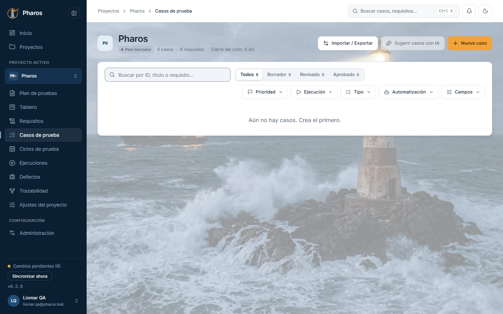

### 8.2. Elegir el tipo de escenario

«Nuevo caso» pregunta primero qué tipo de escenario quieres escribir: «Básico», un escenario Given/When/Then; «Básico avanzado», un Scenario Outline que se repite con una tabla de ejemplos; o «Avanzado», con precondiciones comunes (Background) y varios flujos. Empieza por el más simple que te sirva: un caso se puede subir de nivel después. «← Volver» sale sin crear nada.

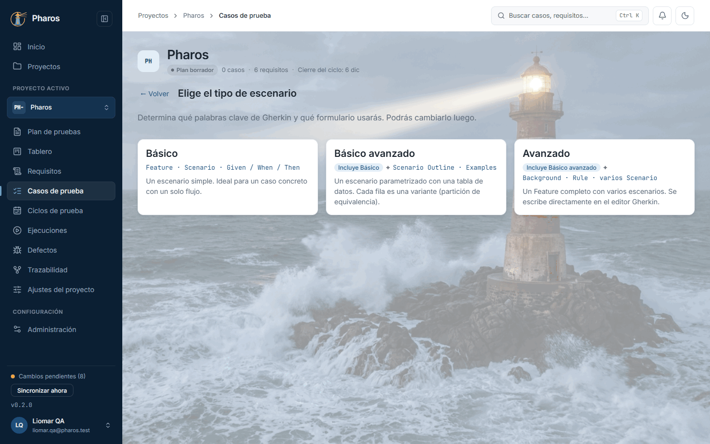

### 8.3. El título es obligatorio

El título es lo único obligatorio (y los campos personalizados que el proyecto marque como obligatorios). Si guardas un caso sin título, arriba aparece «No se puede guardar: revisa 1 campo.» con un enlace al campo, y Pharos no lo guarda hasta que lo escribas.

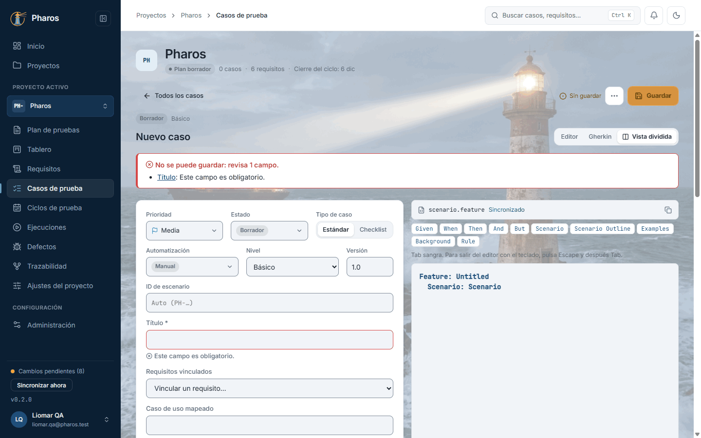

### 8.4. Un caso básico

Rellena el caso: el título (en este ejemplo, «Iniciar sesión con credenciales válidas»), las precondiciones, los pasos (cada uno con «+ Añadir paso»; la papelera de un paso lo quita, tras confirmarlo si tiene texto) y el resultado esperado, los que muestra la captura. Más arriba se clasifica: prioridad, estado (borrador, revisado, aprobado u obsoleto), tipo de caso, automatización, nivel y versión. En «Requisitos vinculados», «Vincular un requisito…» lo enlaza con lo que comprueba (en este ejemplo, REQ-001): el caso lleva el tag @REQ-001 en su Gherkin y la matriz lo cuenta como cubierto. Al guardarlo recibe su ID con el prefijo del proyecto (en este ejemplo, PH-001).

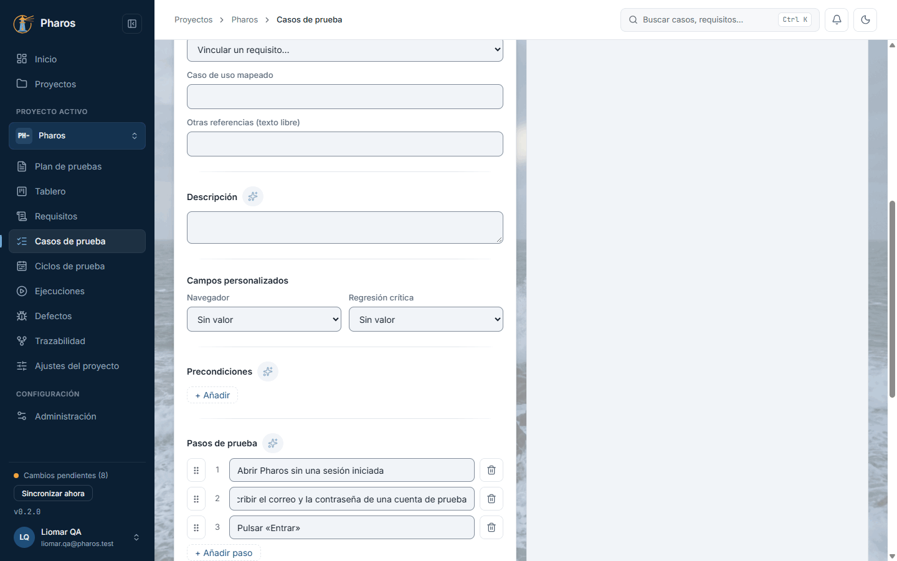

### 8.5. Campos personalizados en el caso

Los campos personalizados del proyecto (capítulo 14) aparecen al final del editor, en «Campos personalizados». Sirven para clasificar los casos con lo que tu equipo necesite y luego filtrar por ello (en este ejemplo, «Navegador», una selección, y «Regresión crítica», un sí/no). Si uno es obligatorio, el caso no se guarda sin él. «Guardar» confirma con «Caso de prueba guardado» y la cabecera del proyecto pasa a «1 caso».

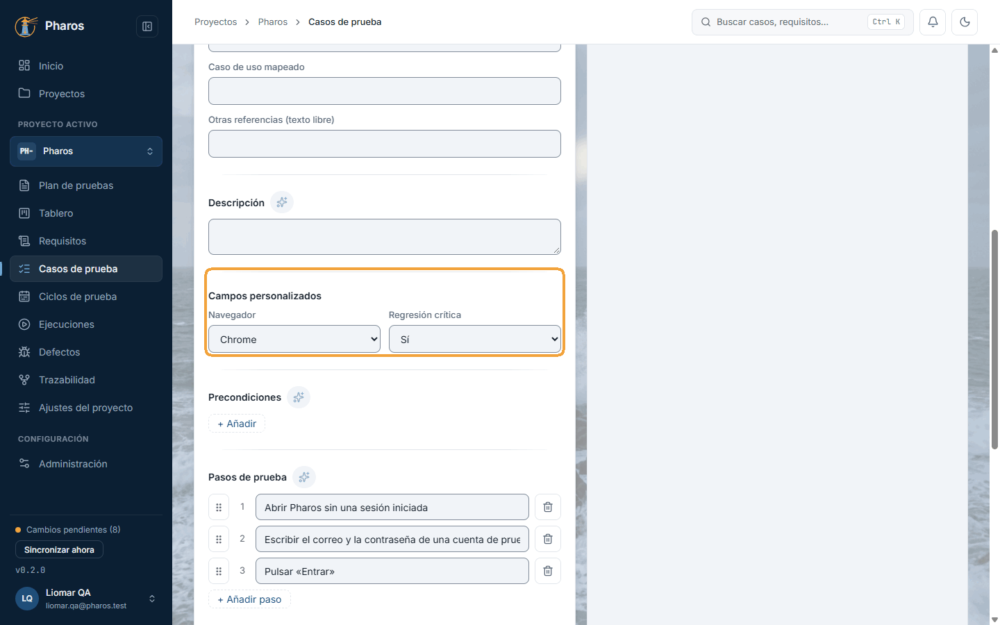

### 8.6. La vista Gherkin

El selector de vista, a la derecha del título, cambia entre «Editor», «Gherkin» y «Vista dividida». «Gherkin» muestra el mismo caso escrito como un escenario .feature. No son dos copias: es el mismo caso visto de dos formas, así que lo que escribes en el formulario aparece en el Gherkin y lo que editas en el Gherkin vuelve al formulario. La barra de palabras clave (Given, When, Then…) las inserta donde está el cursor; Tab sangra la línea, y para salir del editor con el teclado pulsa Esc y después Tab. Los tags de requisitos (@REQ-001) son enlaces.

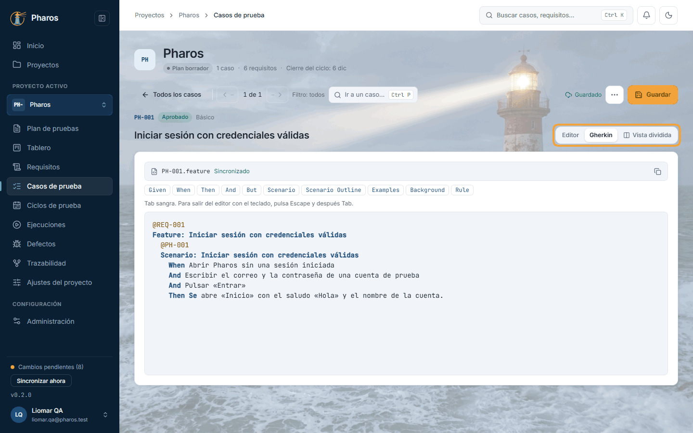

### 8.7. Vista dividida y copiar el Gherkin

«Vista dividida» pone el formulario y el Gherkin uno junto a otro, y es la forma más cómoda de ver cómo cada campo se traduce en el escenario mientras escribes; «Sincronizado», sobre el Gherkin, confirma que ambos coinciden. El botón de copiar, arriba a la derecha del Gherkin, lo lleva al portapapeles («Gherkin copiado») para pegarlo en tu proyecto de automatización.

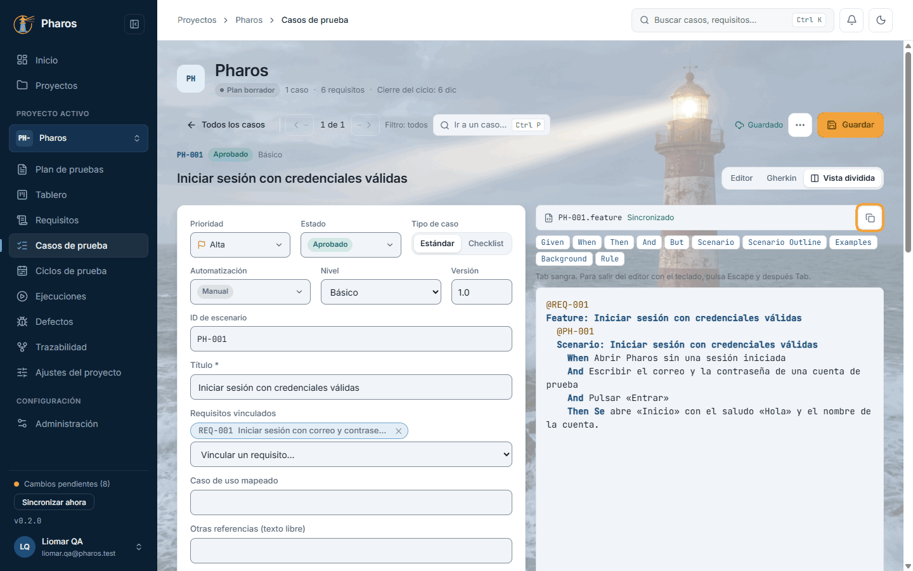

### 8.8. Un caso «Básico avanzado» (Outline)

Un caso «Básico avanzado» (Scenario Outline) prueba el mismo escenario con varios datos. En los pasos, los valores que cambian se escriben como marcadores entre ángulos (en este ejemplo, `<correo>` y `<contraseña>`), y Pharos crea solo una columna por marcador en la tabla «Examples»: cada fila es una ejecución del escenario (aquí, una contraseña equivocada y un correo sin cuenta). «+ Columna» y «+ Fila» amplían la tabla; la papelera quita una fila o una columna. Si una columna no tiene su marcador en los pasos, Pharos lo avisa.

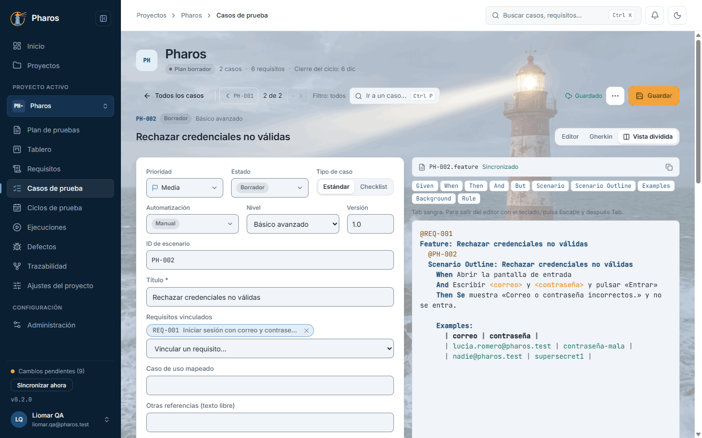

### 8.9. Un caso «Avanzado» con flujos alternos

El nivel «Avanzado» añade precondiciones compartidas (Background), que se cumplen antes de cada flujo, y flujos alternativos además del principal, cada uno con su nombre, sus pasos y su resultado (en este ejemplo, el caso «Crear un proyecto» con el flujo alterno «Nombre vacío»). En Gherkin, cada flujo es un Scenario. «+ Añadir flujo alterno» crea otro y la papelera junto al nombre lo quita. Cada flujo puede llevar su propia tabla de ejemplos.

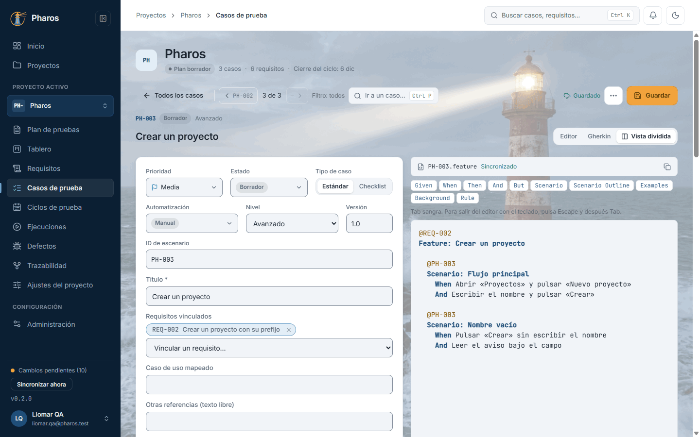

### 8.10. Un caso de tipo checklist

Con «Tipo de caso: Checklist», los pasos se convierten en una lista de comprobaciones sin Given/When/Then y sin Gherkin. Es útil para revisiones rápidas, como una prueba de humo o una revisión de accesibilidad, donde lo que importa es no olvidar nada (en este ejemplo, «Humo de la versión 0.3.0»). Los pasos y el Gherkin que tuviera se conservan, ocultos, por si vuelves a «Estándar». En «Otras referencias (texto libre)» se puede citar algo sin vincularlo (aquí, REQ-006): el capítulo 13 enseña a convertirlo en un vínculo.

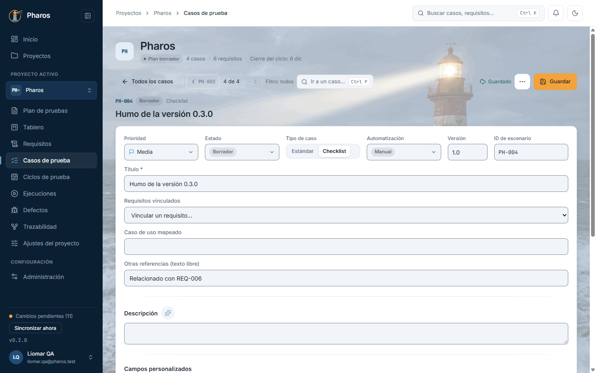

### 8.11. Reordenar con el teclado

Para cambiar el orden de los pasos (o de las comprobaciones de una checklist), arrastra el asa (⠿) que tiene cada uno. Con el teclado: lleva el foco al asa con Tab, pulsa Espacio o Intro para cogerlo, muévelo con ↑ ↓ y suéltalo con Espacio o Intro; Esc cancela. Un lector de pantalla anuncia cada movimiento («Paso 1 movido a la posición 2»).

### 8.12. La lista de casos

Con casos, la tabla muestra ID, título, requisito, prioridad, estado, «Ejecución» y fecha de la última edición. «Ejecución» es el último resultado de cada caso, el mismo que la matriz (capítulo 13): «Pasa», «Falla», «Bloqueado», «Omitido» o «Re-test»; «—» si aún no tiene ninguno. Si un caso tiene contenido sugerido por IA que nadie ha revisado, su estado (normalmente «Borrador») lleva un ✨ y un borde discontinuo, y al pasar el puntero lo explica. Busca por ID, título o requisito y filtra por estado (cada uno con su recuento), prioridad, resultado («Ejecución», con «Sin resultados» para los que aún no se han ejecutado), tipo, automatización o un campo personalizado de sí/no, para quedarte, por ejemplo, con los casos aprobados de prioridad alta. Haz clic en la cabecera de una columna para ordenar por ella. En este ejemplo, «credenciales» deja los dos casos de acceso.

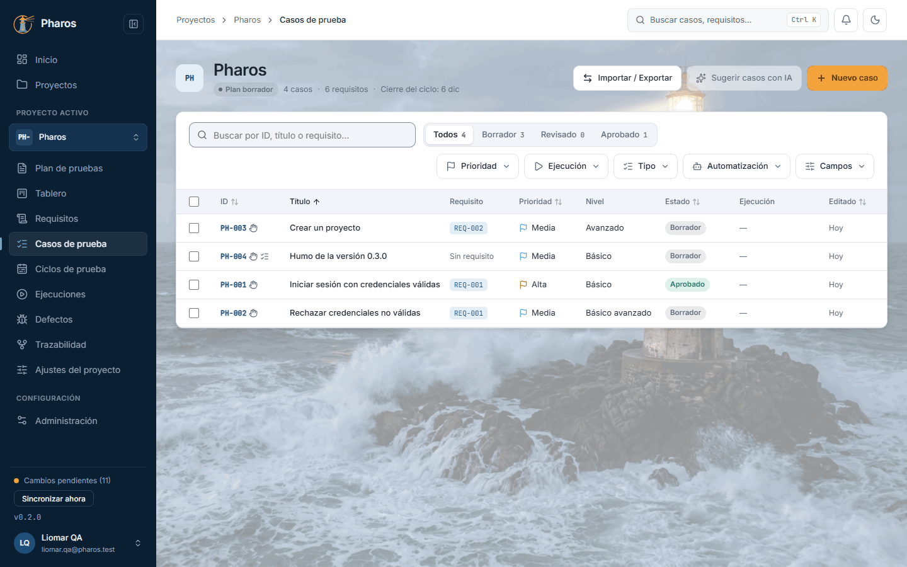

### 8.13. Ningún caso coincide

Si la búsqueda o los filtros no dejan ningún caso, la lista lo dice y ofrece «Quitar filtros» para volver a verlos todos.

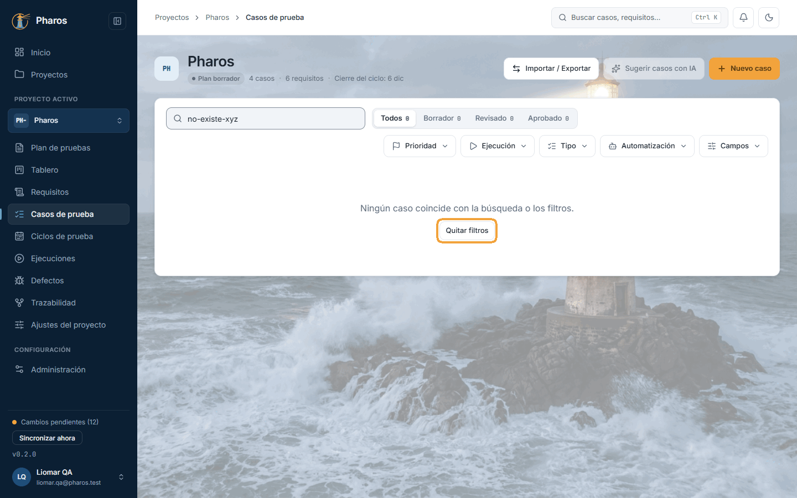

### 8.14. Editar y recorrer los casos

Con un caso abierto, la barra superior indica su posición en la lista (por ejemplo, «2 de 3») y sus flechas pasan al anterior o al siguiente respetando el filtro activo, para revisar varios casos seguidos sin volver a la lista. El orden del recorrido se fija al abrir el caso, aunque la lista cambie. A la derecha, el estado de guardado avisa si hay cambios sin guardar; si sales con cambios, Pharos pregunta antes de perderlos.

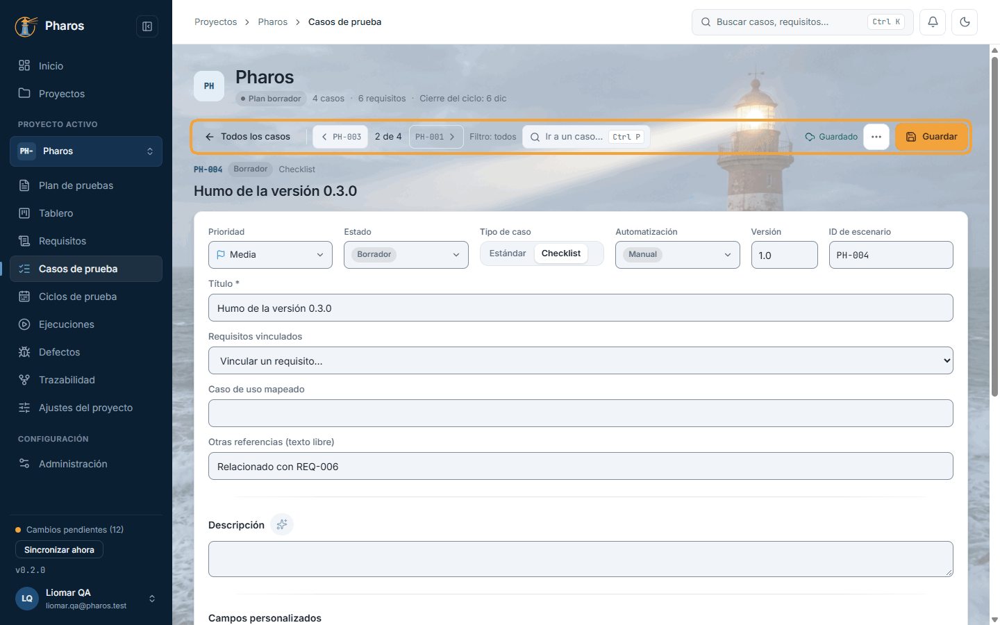

### 8.15. Ir a un caso (Ctrl+P)

«Ir a un caso…» (o Ctrl+P, ⌘P en Mac, desde el editor) abre un buscador: escribe parte del ID, del título o de un requisito, muévete con ↑ ↓ y pulsa Intro para abrirlo sin pasar por la lista; Esc lo cierra. En este ejemplo, «credenciales» encuentra los dos casos de acceso.

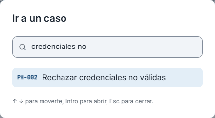

### 8.16. Revisiones y exportación de un caso

El menú «⋯» del caso reúne sus revisiones y la exportación a .xlsx, .pdf o .feature (este último no aparece en una checklist). Al exportar, un aviso dice dónde se guardó el archivo.

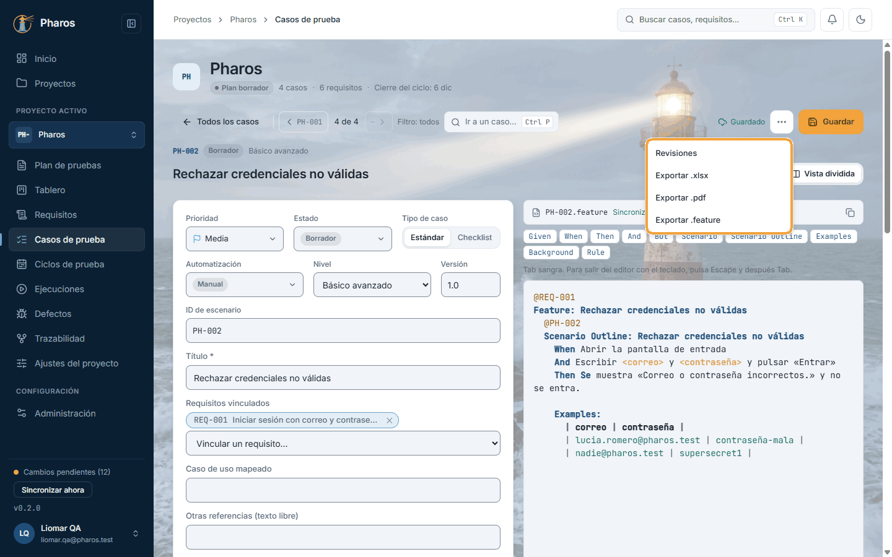

### 8.17. Las revisiones de un caso

Cada guardado crea una revisión, una copia fechada del caso. «⋯ → Revisiones» las lista con su número, su título y su fecha; la vigente dice «Actual» (en este ejemplo, Liomar añadió «(v2)» al título y guardó, así que hay dos). La clave del caso nunca cambia entre revisiones. En la versión web todavía no se guardan revisiones.

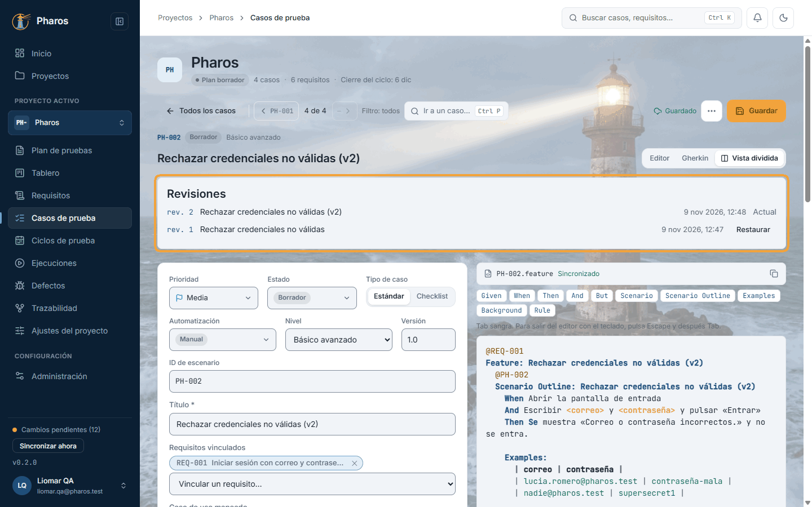

### 8.18. Restaurar una revisión

«Restaurar», junto a una revisión anterior, pregunta antes y carga su contenido en el editor, todavía sin guardar y con la misma clave: revísalo y, si es lo que buscabas, pulsa «Guardar». Se crea una revisión nueva y las anteriores se conservan, así que restaurar nunca borra el historial. Esc o «Cancelar» lo dejan todo como estaba.

### 8.19. Importar un caso desde .xlsx

Para traer un caso escrito en Excel, «Importar / Exportar → Importar .xlsx» lee una plantilla rellenada o un caso exportado antes. El informe enseña qué campos se reconocieron y «Aplicar» abre el editor con esos datos, todavía sin guardar.

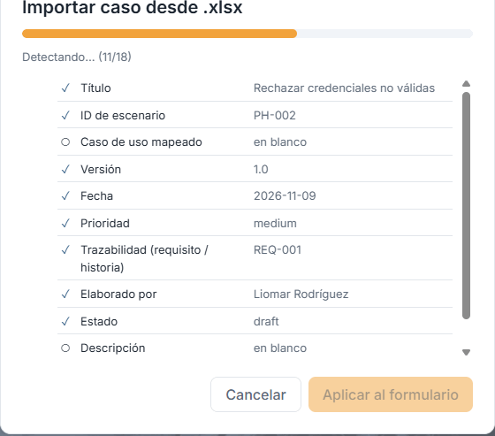

### 8.20. Caso importado

Revisa el caso importado y guárdalo: entra en la lista con el siguiente ID libre del proyecto.

### 8.21. Exportar todos los .feature

«Importar / Exportar › Exportar .feature» genera un ZIP con un archivo .feature por caso, listo para un proyecto de automatización con playwright-bdd o Cucumber; cada escenario lleva el tag de su ID (@PH-001) y de sus requisitos. Las checklists se omiten porque no tienen Gherkin, y el aviso lo dice.

### 8.22. Acciones con varios casos

Marca uno o varios casos con su casilla (en este ejemplo, la copia importada): aparece una barra con el número de casos seleccionados (también los de otras páginas) y lo que puedes hacer con todos a la vez: exportarlos a .feature, eliminarlos o «Quitar selección».

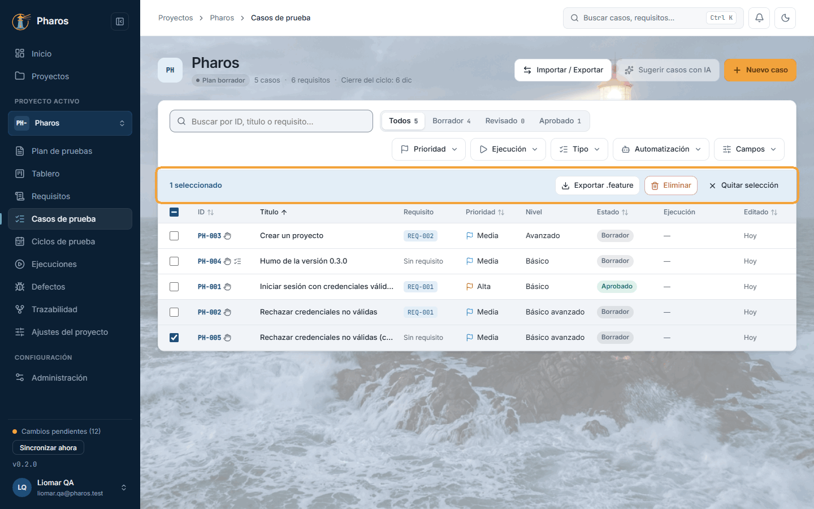

### 8.23. Eliminar casos

«Eliminar» pide confirmación antes de quitar los casos del proyecto («¿Eliminar 1 caso?», con sus IDs); «Cancelar» los deja como estaban. Esc no cierra este aviso.

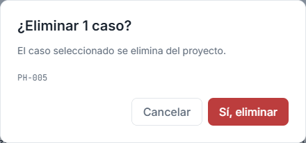

### 8.24. Casos eliminados

Al confirmar, un aviso dice cuántos casos se eliminaron y la lista deja de mostrarlos.

### 8.25. El Gherkin en el móvil

En el móvil, el editor del caso tiene dos vistas, «Editor» y «Gherkin» (no hay vista dividida). El Gherkin se lee sin editar; desliza el código de lado para las líneas largas. «Editar» lo abre a pantalla completa con una barra de teclas sobre el teclado del móvil (Given, When, Then, And, But, Scenario, Examples, |, <>, @tag y sangrar) y «Listo» vuelve. Abajo, «‹ Anterior · N de M · Siguiente ›» recorre los casos.

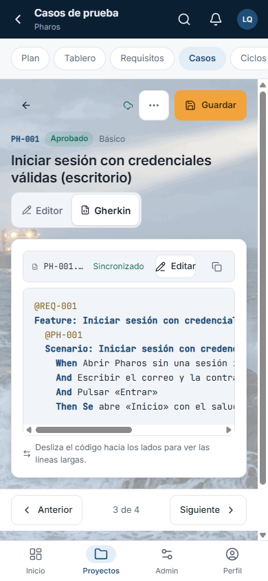

## Atajos de teclado

| Tecla | Dónde | Qué hace |
| --- | --- | --- |
| Ctrl+P (⌘P en Mac) | Editor de un caso abierto desde la lista | Abre «Ir a un caso» |
| ↑ ↓, Intro, Esc | «Ir a un caso» | Se mueven por los resultados, abren el elegido, cierran |
| Espacio o Intro | Asa (⠿) de un paso o una comprobación | Coge el paso; otra vez, lo suelta |
| ↑ ↓ | Paso cogido | Lo sube o lo baja |
| Esc | Paso cogido | Cancela el movimiento |
| Tab | Editor Gherkin | Sangra la línea |
| Esc y después Tab | Editor Gherkin | Sale del editor con el teclado |
| ← → | Selector de vista (Editor · Gherkin · Vista dividida) | Cambia de vista |
| ↑ ↓ e Intro | Menús de prioridad, estado y automatización, y «⋯» | Recorren y eligen una opción |

## Si algo no sale

- **«No se puede guardar: revisa 1 campo.»** Falta el título o un campo
  personalizado obligatorio. El enlace del aviso lleva al campo.
- **«Fila repetida: ya hay otra igual.»** Dos pasos o dos filas de ejemplos
  son iguales. El caso se guarda, pero conviene revisarlo.
- **«Columnas sin placeholder en los pasos».** Una columna de «Examples» no
  aparece como `<nombre>` en ningún paso: escribe el marcador o quita la
  columna.
- **No puedo bajar el «Nivel».** El Gherkin usa algo de un nivel superior
  (por ejemplo, un Outline). El aviso del selector dice cuál es el mínimo.
- **«Este proyecto aún no tiene requisitos (sección Requisitos).»** Crea o
  importa los requisitos antes (capítulo 7) para poder vincularlos.
- **«Requisito desconocido».** El caso enlaza un requisito eliminado. Quítalo
  con la ✕ de su etiqueta o vincula otro.
- **«Clave provisional: recibirá la definitiva al sincronizar.»** El caso se
  creó sin conexión. Su ID definitivo llega con la próxima sincronización, y
  mientras tanto su .feature se exporta sin tag de ID.
- **Ctrl+P no hace nada.** Solo funciona en un caso abierto desde la lista y
  sin otro diálogo abierto.
- **«Sugerir casos con IA» está en gris.** Necesita un motor de IA (capítulo
  15) y un plan de pruebas en el proyecto (capítulo 5).
- **«No se importaron estos valores…».** Al importar un .xlsx, los valores que
  no encajan con un campo personalizado (por ejemplo, una opción que no
  existe) se omiten.
- **El estado lleva ✨ y un borde discontinuo.** El caso tiene contenido
  sugerido por IA que nadie ha revisado. Ábrelo y pulsa «Marcar revisado» en
  cada marca de IA.

## En el móvil

- La lista muestra cada caso como una tarjeta. Un solo botón «Filtros», con el
  número de filtros activos, abre todos los filtros en una hoja desde abajo.
- El editor tiene dos vistas, «Editor» y «Gherkin»; no hay vista dividida.
- El Gherkin se lee sin editar. «Editar» lo abre a pantalla completa con una
  barra de teclas sobre el teclado del móvil, y «Listo» vuelve.
- Abajo, «‹ Anterior · N de M · Siguiente ›» recorre los casos.

## Consejos

- Vincula cada caso a su requisito al crearlo: es lo que hace útil la matriz
  de trazabilidad.
- Empieza en «Básico»: siempre puedes subir de nivel, pero no bajar por debajo
  de lo que ya usa el Gherkin.
- Usa marcadores entre ángulos (`<correo>`) y la tabla de ejemplos cuando el
  mismo escenario deba probarse con varios datos.
- Pasa a «Aprobado» los casos revisados: los ciclos avisan cuando añades
  casos sin aprobar (capítulo 9).
- Exporta los .feature para tu proyecto de automatización: cada escenario
  lleva el tag de su caso, y los resultados importados se vinculan solos por
  ese tag o por la propiedad `test_id` (capítulo 10).

## Véase también

- Capítulo 7, «Requisitos».
- Capítulo 9, «Ciclos de prueba»: añadir casos a un ciclo.
- Capítulo 13, «Trazabilidad».
- Capítulo 17, «Asistente de IA»: sugerir casos y revisar las listas de un
  caso.
- [Guía de pruebas de la beta](../guia-beta.md), apartado 4.3.
- [Glosario](../GLOSARIO.md): «Caso de prueba», «ID de escenario», «Pasos de
  prueba», «Prioridad», «Estado (del caso)».

---

← [Requisitos](07-requisitos.md) · [Índice](README.md) · [Ciclos de prueba](09-ciclos.md) →
