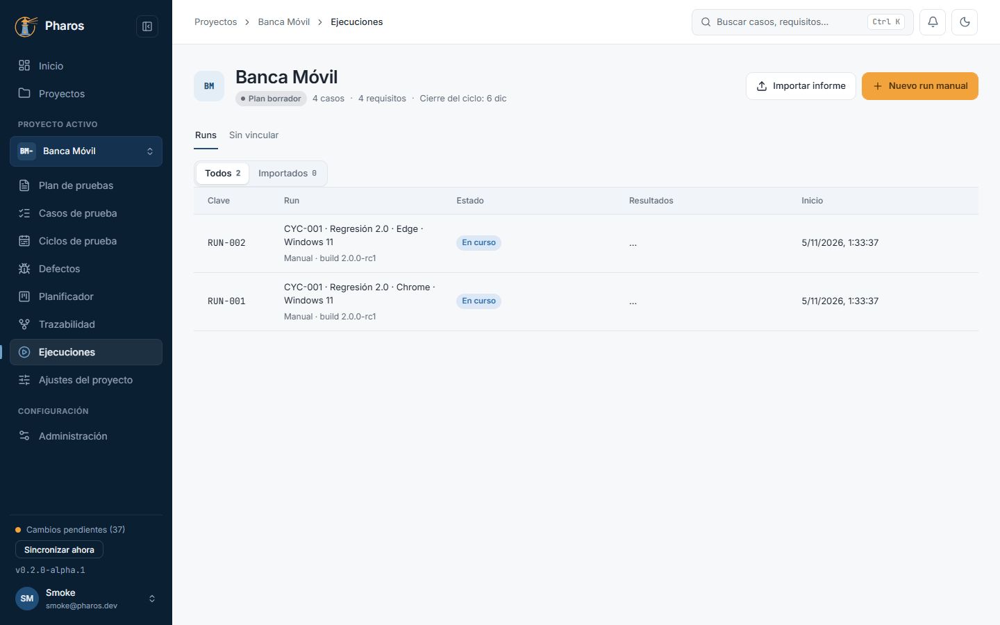
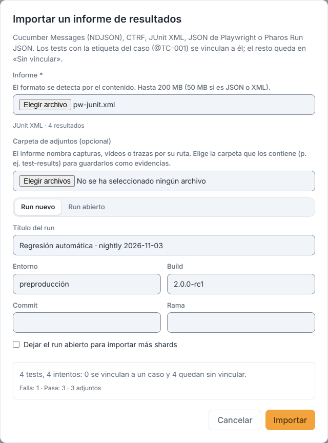
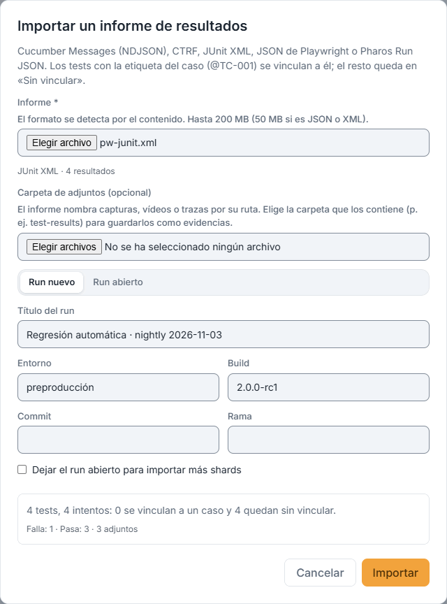
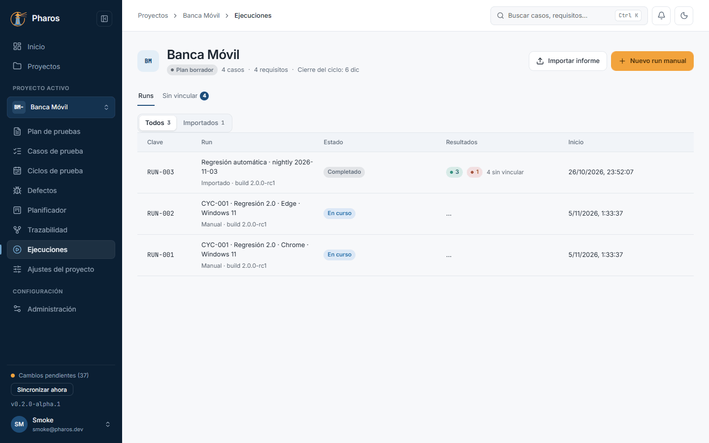
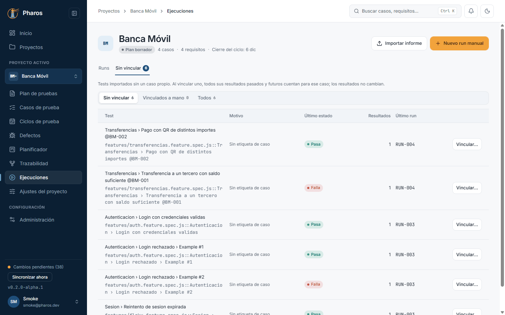
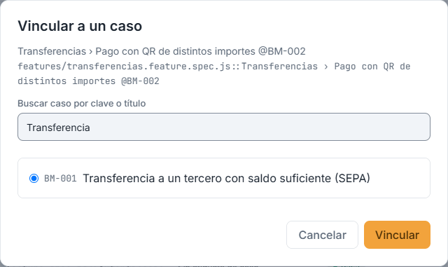
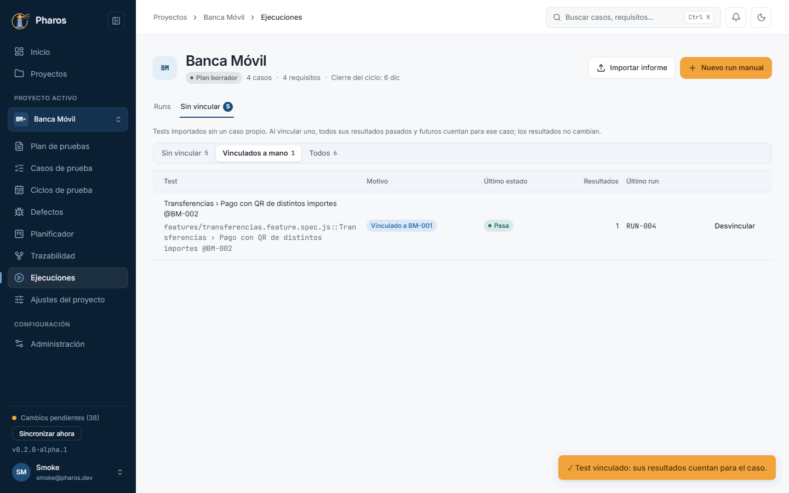

<!-- Generado por `npm run manual` desde e2e/tours/08-ejecuciones.tour.ts y docs/manual/fuentes/ejecuciones.md. No lo edites a mano: edita la fuente. -->

# 8. Ejecuciones e importación de resultados

## Para qué sirve

«Ejecuciones» reúne los **runs** del proyecto: los que crea un ciclo y los
que importas de tus pruebas automáticas. Pharos lee los informes de las
herramientas habituales (Cucumber Messages, CTRF, JUnit XML, JSON de
Playwright y su propio Pharos Run JSON), enlaza cada test con su caso por la
etiqueta (`@BM-001`) y deja en la bandeja «Sin vincular» los que no la
tienen, para que los vincules a mano una sola vez.

## Paso a paso

### 8.1. Ejecuciones

Pulsa «Ejecuciones» en el menú lateral. La pestaña «Runs» lista los runs con su estado y resultados; «Sin vincular», los tests importados que esperan un caso. Arriba, «Nuevo run manual» e «Importar informe».

### 8.2. Importar un informe

«Importar informe» acepta Cucumber Messages, CTRF, JUnit XML, JSON de Playwright o Pharos Run JSON. Elige el archivo y, si el informe enlaza capturas o vídeos, su carpeta de adjuntos.

### 8.3. Vista previa antes de importar

La vista previa dice cuántos tests e intentos trae el informe, cuántos se vinculan a casos por su etiqueta (@BM-001) y cuántos quedarán «sin vincular». Nada se guarda hasta pulsar «Importar».

### 8.4. Informe importado

Al terminar, el resumen dice qué run se creó y cuántos resultados quedan sin vincular. El run aparece en la lista como «Importado».

### 8.5. Un informe con adjuntos

Si el informe enlaza capturas, vídeos o trazas, elige también su «Carpeta de adjuntos»: Pharos busca cada archivo por su nombre y lo guarda, cifrado, como evidencia del resultado. Aquí, un JUnit de dos tests con la captura de un fallo.

### 8.6. Adjuntos guardados

El resumen confirma cuántos resultados se importaron y cuántos adjuntos se guardaron como evidencia.

### 8.7. La bandeja «Sin vincular»

Los tests del informe que no llevan la etiqueta de un caso del proyecto esperan en «Sin vincular», con el motivo (sin etiqueta, caso desconocido…), su último estado y cuántos resultados tienen.

### 8.8. Vincular un test a un caso

«Vincular…» abre el buscador de casos: elige el caso y pulsa «Vincular». Desde ese momento, todos sus resultados (también los de futuras importaciones) cuentan para el caso.

### 8.9. Vinculados a mano

El filtro «Vinculados a mano» muestra los tests que vinculaste; «Desvincular» deshace el vínculo.

### 8.10. Desvincular

«Desvincular» devuelve el test a la bandeja («Vínculo retirado»).

## Consejos

- Etiqueta tus escenarios con el ID del caso (`@BM-001`): se vinculan solos
  en cada importación.
- Si un informe enlaza capturas, vídeos o trazas, elige también su carpeta de
  adjuntos: se guardan como evidencias del resultado.
- Importar el mismo archivo dos veces no duplica nada: Pharos lo reconoce.
- Los shards de una misma ejecución se importan en el mismo run abierto
  («Dejar el run abierto para importar más shards»).

## Véase también

- [Guía de pruebas de la beta](../guia-beta.md), apartado 4.4c «Importar resultados de pruebas automáticas».
- [Formatos de importación](../formats/importers.md).
- [Glosario](../GLOSARIO.md), sección «Execution model identifiers».

---

← [Ciclos y configuraciones](07-ciclos.md) · [Índice](README.md) · [Defectos](09-defectos.md) →
