<!-- Generado por `npm run manual` desde e2e/tours/09-ciclos.tour.ts y docs/manual/fuentes/ciclos.md. No lo edites a mano: edita la fuente. -->

# 9. Ciclos de prueba

## Para qué sirve

Un **ciclo de prueba** reúne los casos que se van a ejecutar en una ronda
concreta (una regresión, un sprint, una versión candidata), contra una
**build** y un **entorno**, y en unas **configuraciones** (por ejemplo, Chrome
y Edge en Windows 11).

**Ejecutar** el ciclo crea un **run** por configuración con todos sus
elementos. Cada caso queda congelado en su revisión de ese momento, así que
cambiarlo después no altera lo que se está probando.

Los resultados de esos runs, manuales (capítulo 11) o importados de la
automatización (capítulo 10), alimentan varias pantallas:

- el progreso del ciclo;
- el informe de estado (capítulo 11) y, al cerrar, el informe de cierre;
- el Inicio (capítulo 3);
- la matriz de trazabilidad (capítulo 13).

Un ciclo pasa por tres estados: **Planificado**, **Activo** y **Cerrado**. Un
ciclo cerrado no admite cambios ni ejecuciones hasta que se reabre (editarlo y
cambiar su estado).

En este manual, Liomar prepara la «Regresión 0.6.0» de Pharos, la del plan
«Plan de pruebas de Pharos 0.6.0» (capítulo 5):

- **Build y entorno:** 0.6.0-beta.2, en staging.
- **Fechas:** las del Sprint 1 del plan.
- **Configuraciones:** Chrome y Edge.
- **Casos:** PH-001 y PH-002, añadidos a mano. El filtro de prioridad alta
  solo encuentra PH-001, que ya está en el ciclo, así que no añade nada.

El capítulo sigue el ciclo de principio a fin: lo crea, lo ejecuta y, más
adelante en la historia, lo cierra.

## Paso a paso

### 9.1. Ciclos de prueba

Un ciclo agrupa lo que se va a probar en una ronda concreta (una regresión, una versión candidata), dónde y contra qué build. Ejecutarlo crea un run por configuración, donde se registran los resultados (capítulos 10 y 11). Pulsa «Ciclos de prueba» en el menú lateral. Arriba, «Nuevo ciclo» y los filtros por estado; sin ciclos, la lista dice «Aún no hay ciclos…».

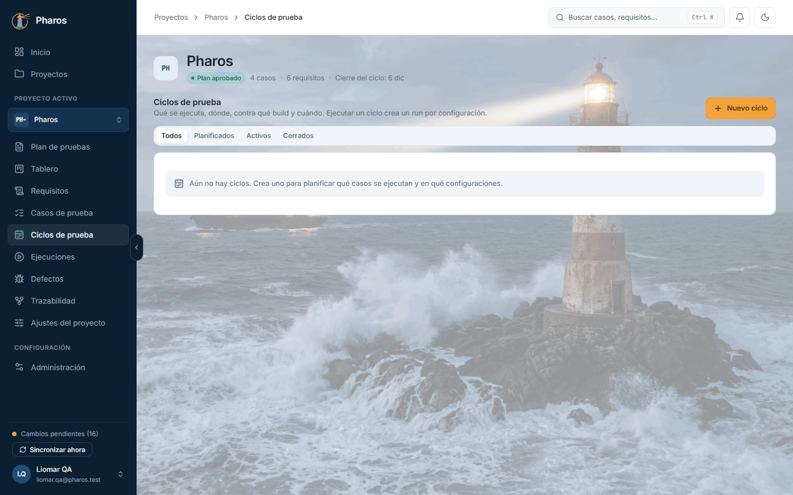

### 9.2. Nuevo ciclo

«Nuevo ciclo» pide el título (obligatorio), la build y el entorno contra los que se prueba, el hito y el sprint del plan, las fechas (se escriben dd/mm/aaaa o se eligen en el calendario de Pharos, capítulo 5; el de «Termina» abre en el mes de «Empieza» y no deja elegir un día anterior) y las configuraciones en las que se ejecutará (las de «Ajustes del proyecto», capítulo 14). En este ejemplo, «Regresión 0.6.0» de la build 0.6.0-beta.2 en staging, con las fechas del Sprint 1 del plan, en Chrome y en Edge sobre Windows 11. Sin configuraciones, el ciclo se ejecuta como un único run. Intro en un campo crea el ciclo.

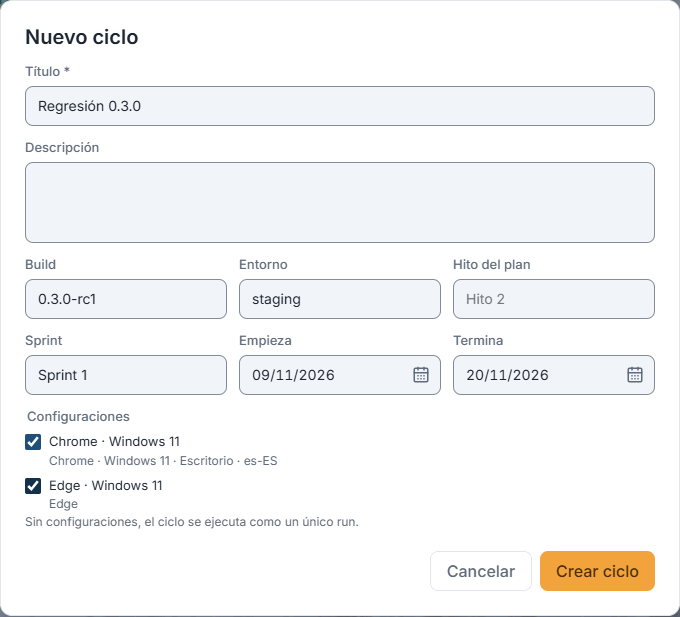

### 9.3. El ciclo, recién creado

«Crear ciclo» lo crea con su clave y abre su detalle: arriba, el estado, la build, el entorno, las fechas y el sprint; los botones «Ejecutar», «Informe de estado», «Editar», «Cerrar ciclo…» (al final del capítulo) y el menú «⋯»; el resumen de resultados (pasa, falla, bloqueado, omitido, sin ejecutar) y las pestañas «Elementos», lo que hay que probar, y «Runs», las ejecuciones lanzadas. «← Ciclos» vuelve a la lista. Un ciclo vacío no se puede ejecutar todavía.

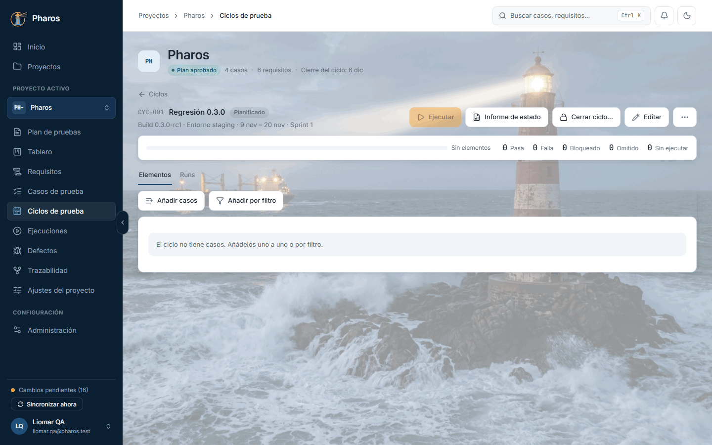

### 9.4. Añadir casos al ciclo

«Añadir casos» lista los casos del proyecto con buscador: marca los que entran en esta ronda, asígnalos a alguien si quieres (en este ejemplo, Liomar se los asigna a sí mismo) y confirma. Los que ya están en el ciclo salen marcados y bloqueados («Ya en el ciclo»). Pharos avisa si alguno no está aprobado («No aprobado»), para que no pruebes un caso aún en borrador sin saberlo; se añade igualmente.

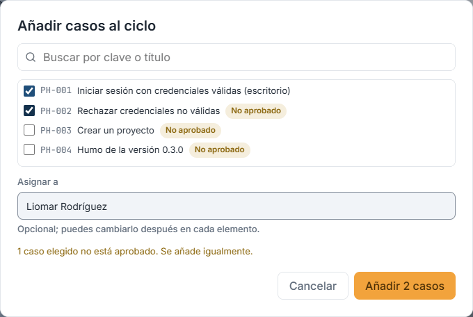

### 9.5. Añadir por filtro

Para no marcar caso por caso, «Añadir por filtro» los elige por etiquetas, prioridad, estado del caso, requisitos o riesgo mínimo de sus requisitos (por ejemplo, «Alto (≥ 13)»). El recuento («N casos coinciden») se actualiza mientras marcas. Se añaden los que coinciden en ese momento: si después cambian, el ciclo no cambia. En este ejemplo, Liomar marca la prioridad alta: solo coincide PH-001, que ya está en el ciclo, así que no se añade nada nuevo.

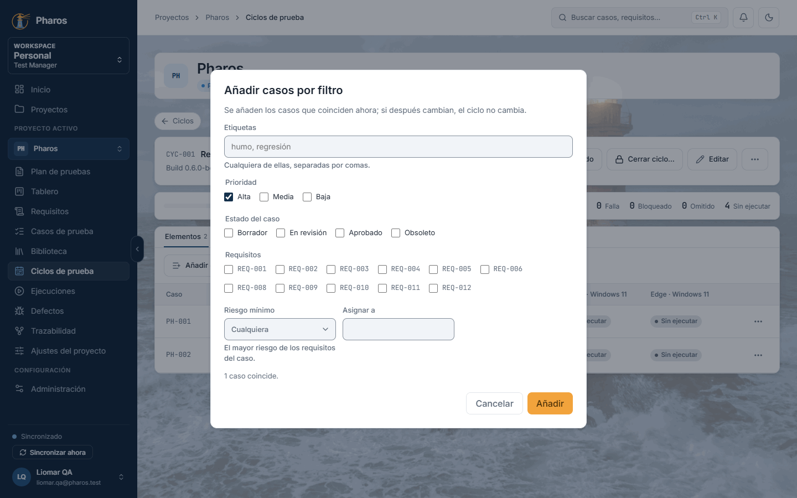

### 9.6. Los elementos del ciclo

Cada elemento muestra el caso, a quién está asignado y su resultado en cada configuración. El asignado se edita en la propia fila: Intro o salir del campo lo guarda (en este ejemplo, los dos casos ya están asignados a Liomar). El menú de la fila, «Acciones de PH-…», lo sube, lo baja o lo quita del ciclo. «Quitar del ciclo» pregunta antes; quitarlo no borra el caso ni sus resultados, y puedes volver a añadirlo.

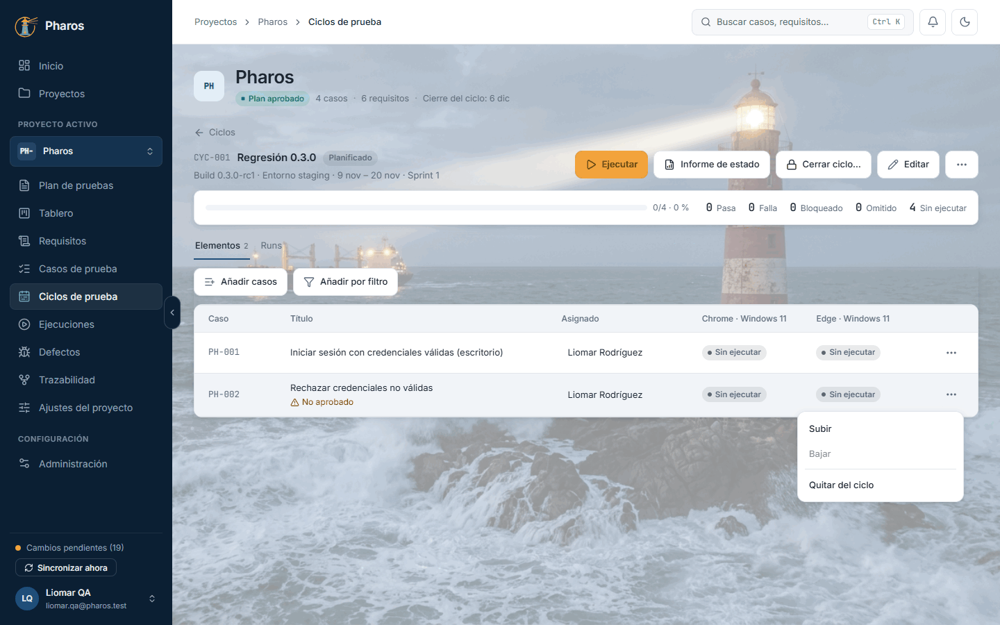

### 9.7. Quitar un elemento del ciclo

«Quitar del ciclo» pregunta antes de hacerlo. El caso deja de formar parte del ciclo, pero sus resultados ya registrados se conservan y puedes volver a añadirlo cuando quieras. Es una confirmación normal: Esc, un clic fuera o «Cancelar» lo dejan como estaba (en este ejemplo, Liomar cancela).

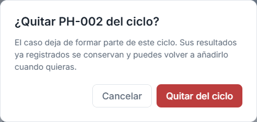

### 9.8. Ejecutar el ciclo

«Ejecutar» crea un run por configuración con todos los elementos: así cada navegador o equipo lleva su propio registro de resultados. Cada caso se congela en su revisión actual: si después cambia, el run ejecuta la versión que había. Elige configuraciones, build y entorno (vienen del ciclo) y pulsa «Crear N runs». En la web también se puede ejecutar.

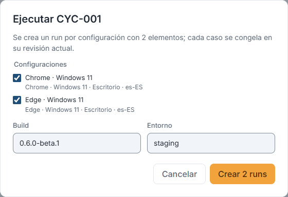

### 9.9. Los runs del ciclo

Los runs creados aparecen en la pestaña «Runs» (con su configuración, su estado y su inicio) y en «Ejecuciones» (capítulo 10), listos para registrar resultados. Un clic en su clave abre el run para ejecutarlo paso a paso (capítulo 11). El ciclo sigue «Activo» mientras se ejecuta: se cierra cuando ya tiene resultados, como se ve al final de este capítulo.

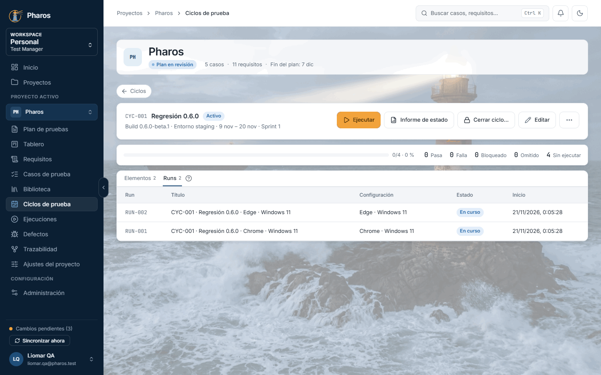

### 9.10. Clonar y eliminar un ciclo

El menú «⋯» del ciclo lo clona, con sus elementos y sin resultados, útil para repetir una regresión en la siguiente versión (el clon se abre solo); también lo elimina, tras confirmar.

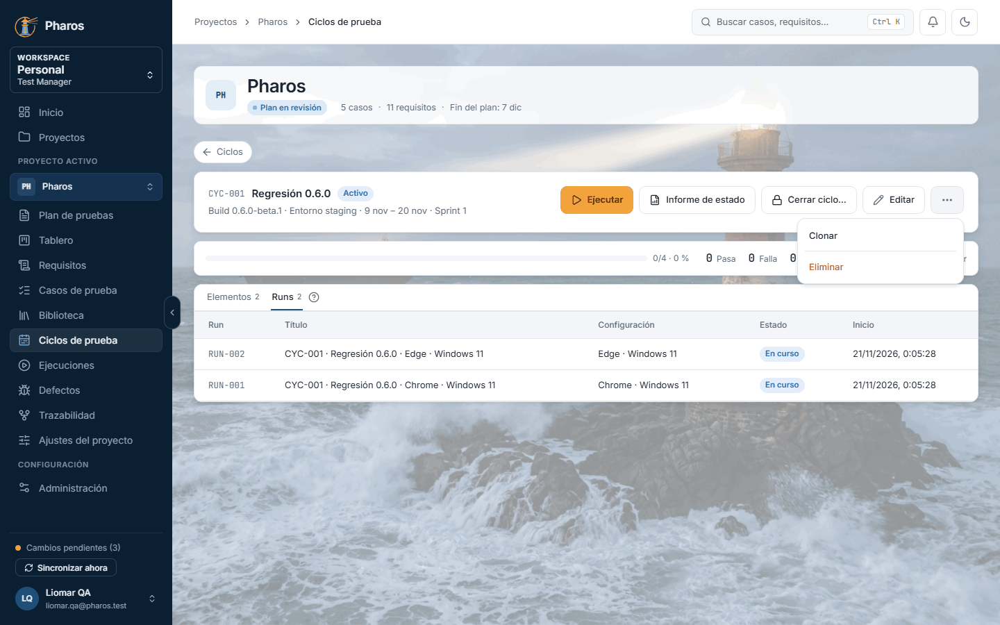

### 9.11. Confirmar la eliminación

Eliminar un ciclo pide confirmación, con cuántos runs tiene. Los resultados no se pierden: sus runs se conservan, sin ciclo, en «Ejecuciones». El ciclo eliminado pasa a la Papelera (Administración › General, capítulo 15), desde donde se restaura mientras dure la retención. Esc no cierra este aviso: solo «Cancelar». En este ejemplo, Liomar elimina el clon que acaba de crear.

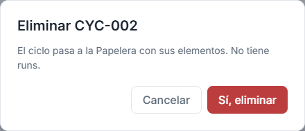

### 9.12. La lista de ciclos

La lista muestra cada ciclo con su clave, su título con la build y el entorno, su estado, sus fechas, sus configuraciones, su progreso y sus runs. Filtra por «Planificados», «Activos» o «Cerrados» (← → también cambian de filtro) para ver de un vistazo lo que está en curso; si ningún ciclo coincide, la lista lo dice.

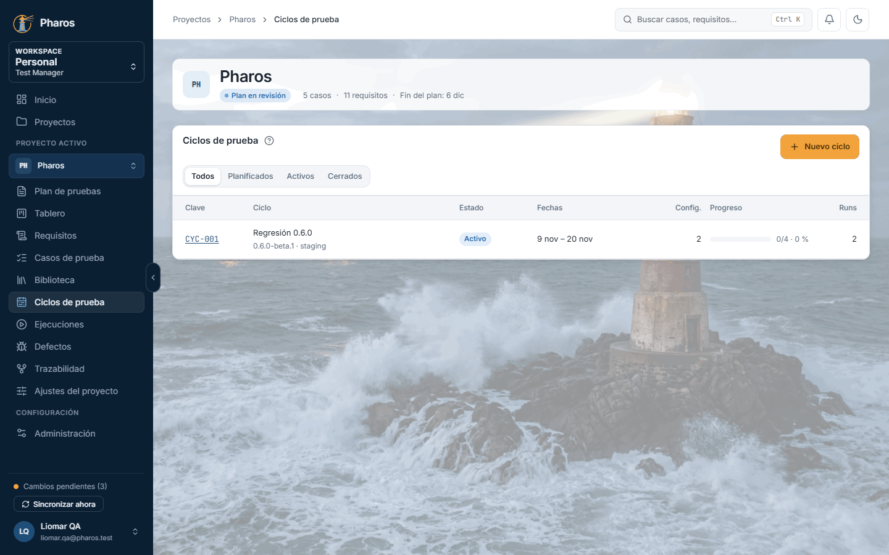

### 9.13. Los ciclos en el móvil

En el móvil, cada ciclo es una tarjeta con su clave, su estado, su título, sus fechas y su progreso; un toque lo abre.

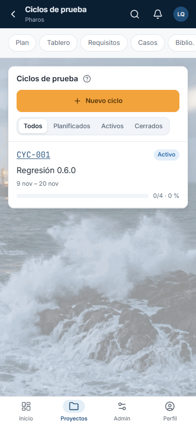

> **Más adelante en la historia.** Los pasos siguientes, desde «El ciclo,
> ejecutado», ocurren después de los capítulos 10 a 13: un ciclo se cierra
> cuando ya se ha ejecutado. Para entonces, Liomar ha importado el informe de la
> automatización en el ciclo (capítulo 10), ha registrado los resultados de
> Chrome y Edge como en el capítulo 11, ha abierto el defecto crítico del acceso
> (capítulo 12) y ha vinculado REQ-006 a PH-004 (capítulo 13), un requisito más
> que cuenta como cubierto. Con esas cifras, las que muestran las capturas,
> cierra el ciclo con **No-go**: la versión no sale hasta corregir el acceso.

### 9.14. El ciclo, ejecutado

Cuando la ronda termina, el ciclo reúne lo que se registró en sus runs: aquí, los resultados de Chrome y de Edge, ejecutados como en el capítulo 11, y el informe de la automatización importado en el ciclo en el capítulo 10. La pestaña «Elementos» muestra el resultado de cada caso en cada configuración y el resumen de arriba los cuenta: PH-001 falla en las dos configuraciones (su defecto crítico se registró en el capítulo 12) y PH-002 pasa. Con estos resultados, Liomar prepara el cierre.

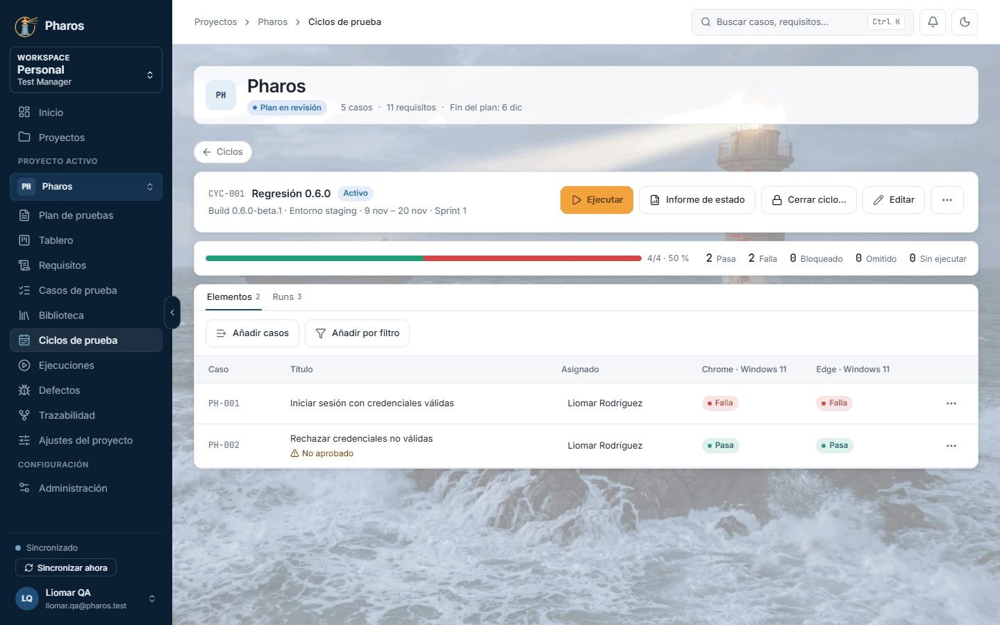

### 9.15. Informe de estado de un ciclo

«Informe de estado» en la cabecera del ciclo abre el informe con el alcance ya puesto en ese ciclo: el progreso cuenta cada caso en cada configuración, como la pestaña «Elementos». Aquí, las 4 celdas del ciclo están ejecutadas (100 %) con una tasa de éxito del 50 %, y «Ejecuciones incluidas» nombra los dos runs del ciclo y el importado. Más abajo siguen los defectos, la cobertura, los criterios de salida y el resumen: es lo que Liomar envía antes de decidir el cierre. El informe completo, con sus exportaciones a Excel y PDF, se explica en el capítulo 11.

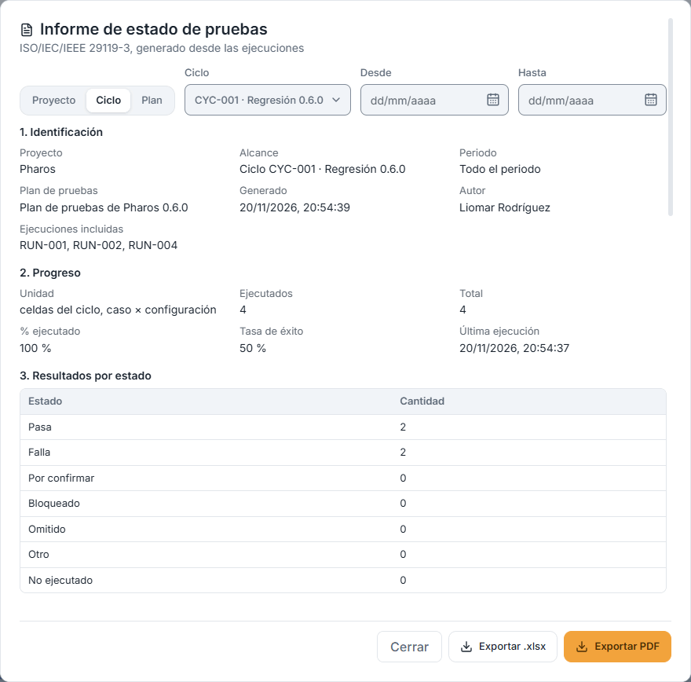

### 9.16. Cerrar el ciclo: el quality gate

Un ciclo se cierra con «Cerrar ciclo…», nunca desde «Editar». Pharos evalúa los criterios de salida del plan sobre los resultados del ciclo. Cada criterio obligatorio que no se cumple, o que no tiene datos, pide una justificación de al menos 20 caracteres: por qué se acepta el riesgo o por qué no, quién lo asume y cuándo se resuelve. Los criterios que Pharos no mide solo (aquí, «Casos críticos ejecutados» y «Satisfacción del producto en la demo») se marcan a mano con «Cumple» o «No cumple», y los orientativos solo informan. En este ejemplo se ejecutó todo, pero hay un defecto crítico abierto y la cobertura de requisitos no llega al objetivo: Liomar justifica cada uno y elige «No-go», porque con el acceso roto la versión no puede salir; «Go con riesgos» la dejaría salir con los riesgos justificados. Al pie se ve quién firma y cuándo: queda en Auditoría. Cerrar un ciclo también avisa en las notificaciones del equipo y a los webhooks del proyecto (capítulo 21).

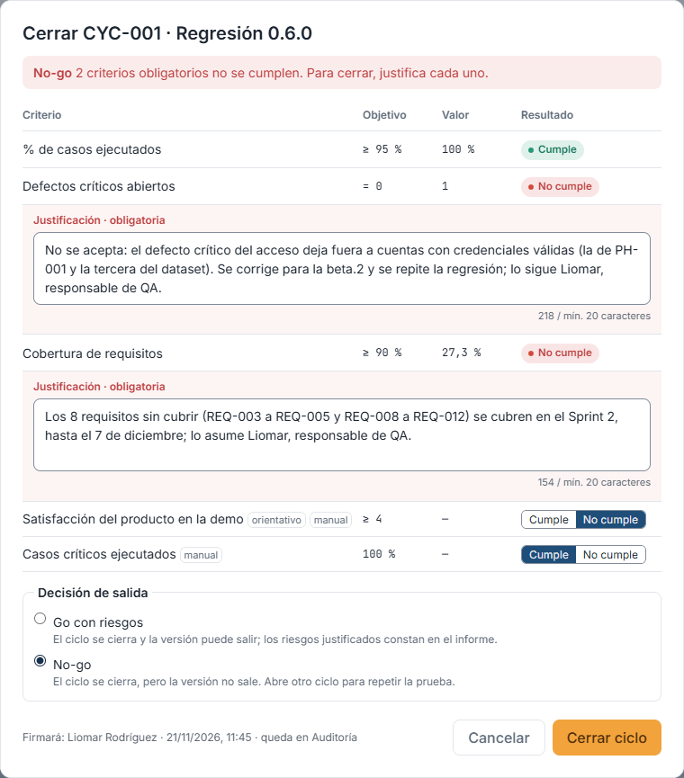

### 9.17. Salir del cierre sin cerrar

Si sales con Esc o «Cancelar» después de escribir una justificación o marcar un criterio, Pharos pregunta antes de descartarlo: «Seguir editando» vuelve al cierre tal como estaba.

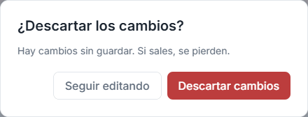

### 9.18. El veredicto del ciclo

«Cerrar ciclo» guarda la decisión con las cifras de ese momento, congeladas: el ciclo queda «Cerrado», con su veredicto al lado («No-go»), y ya no admite casos ni ejecuciones hasta que lo reabras desde «Editar». Su informe de estado empieza ahora por «Decisión de salida», con cada criterio, su justificación y las métricas frente al ciclo anterior, también en Excel y PDF. Inicio lo suma a «Tendencia de ciclos» (capítulo 3). Para repetir la regresión con la build corregida, «Clonar» prepara un ciclo nuevo con los mismos casos.

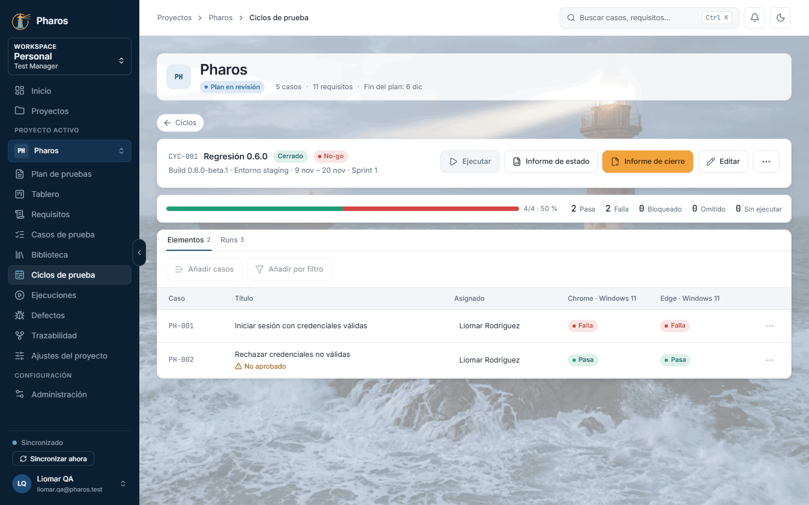

### 9.19. El informe de cierre

En un ciclo cerrado, «Cerrar ciclo…» deja paso a «Informe de cierre»: el informe final de la ronda según ISO/IEC/IEEE 29119-3, con su ID (TCR-…). Pharos rellena lo que sabe del cierre: las desviaciones respecto al plan (fecha de fin, casos sin ejecutar, criterios que no se cumplen), la «Decisión de salida» con sus justificaciones, lo que bloqueó el avance, las métricas frente al ciclo anterior y al objetivo del plan, los riesgos residuales (paso siguiente), los entregables y los activos reutilizables. Tú escribes el resumen, las lecciones aprendidas y los comentarios de cada apartado, marcas los entregables del plan y pulsas «Guardar»: queda en el ciclo, se sincroniza y sale en Excel y PDF.

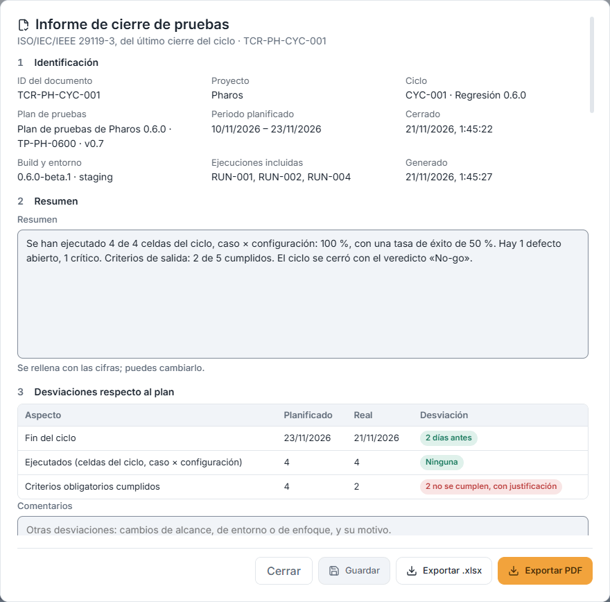

### 9.20. Los riesgos residuales

Más abajo, «Riesgos residuales» dice lo que queda pendiente al cerrar: los defectos del ciclo que siguen abiertos (aquí, el crítico del acceso, registrado desde PH-001 en el capítulo 12) y los requisitos sin cubrir o que fallan en el ciclo, del riesgo más alto al más bajo: encabezan la lista REQ-005, de riesgo alto y sin cubrir, y REQ-001, que falla; siguen los que aún no tienen casos. Si los runs del ciclo trajeran hallazgos abiertos o umbrales de rendimiento incumplidos (capítulo 10), también saldrían aquí. Es la lista con la que se planifica la siguiente ronda.

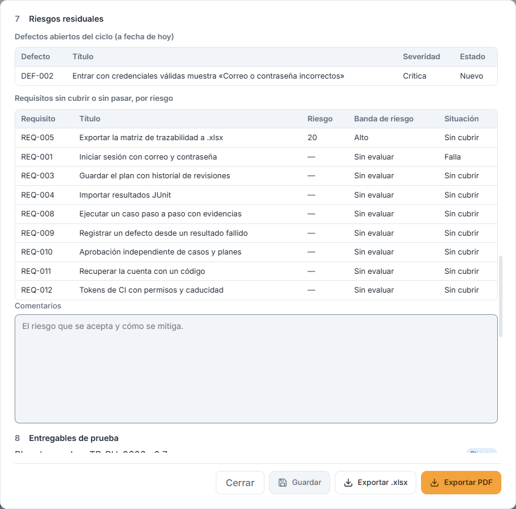

### 9.21. Aprobar el informe de cierre

Con todo guardado, «Aprobar informe» pide confirmación y deja tu nombre y la fecha en el apartado «Aprobación», en la cabecera del PDF y en el Excel. Si después cambias un texto, el informe pierde la aprobación al guardar. Si reabres el ciclo y lo vuelves a cerrar, el informe sigue al cierre nuevo: conserva los textos, pero hay que aprobarlo otra vez.

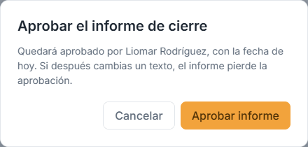

## Cerrar un ciclo: el quality gate

Los pasos del final del capítulo muestran el cierre. Además:

- **Un criterio orientativo** se muestra y queda en el informe, pero no
  bloquea.
- **Go con riesgos** cierra el ciclo y deja salir la versión con los riesgos
  justificados; **No-go** lo cierra sin que la versión salga: abre otro ciclo
  para repetir la prueba.
- La decisión queda con las cifras de ese momento, congeladas, y quién la
  tomó y cuándo (Auditoría). Sale también en la hoja «Decisión» del Excel y
  en el PDF del informe de estado, que compara las métricas del ciclo
  (tasa de éxito, densidad de defectos, escapes, tiempo de corrección,
  reapertura y flaky) con las del ciclo cerrado anterior.
- Si reabres un ciclo y lo vuelves a cerrar, se guarda un cierre nuevo; los
  anteriores no se pierden.

## El informe de cierre

Un ciclo cerrado muestra **«Informe de cierre»** en su cabecera, donde estaba
«Cerrar ciclo…». Es el informe final de la ronda según ISO/IEC/IEEE 29119-3
(*Test Completion Report*), con su propio ID (`TCR-` seguido del prefijo del
proyecto y la clave del ciclo). Tiene once apartados:

1. **Identificación:** proyecto, ciclo, plan, periodo planificado, cierre,
   build, entorno y ejecuciones.
2. **Resumen:** empieza con las cifras y el veredicto; puedes reescribirlo.
3. **Desviaciones respecto al plan:** la fecha de fin planificada frente al
   cierre, los casos sin ejecutar y los criterios obligatorios que no se
   cumplen, más tus comentarios.
4. **Evaluación frente a los criterios de salida:** la «Decisión de salida»
   del cierre, con cada justificación.
5. **Factores que bloquearon el avance:** casos bloqueados, por confirmar,
   flaky o de una revisión anterior, más tus comentarios.
6. **Medidas de prueba:** las métricas congeladas al cerrar, frente al ciclo
   anterior y al objetivo del plan (capítulo 5), y si se alcanza.
7. **Riesgos residuales:** los defectos del ciclo que siguen abiertos hoy,
   los hallazgos abiertos y los umbrales de rendimiento incumplidos de los
   runs del ciclo (capítulo 10), y los requisitos sin cubrir o que fallan en
   el ciclo, del riesgo más alto al más bajo.
8. **Entregables:** los que guarda Pharos y los del plan, que marcas como
   entregados.
9. **Activos reutilizables:** casos, configuraciones y datos de prueba.
10. **Lecciones aprendidas.**
11. **Aprobación.**

«Exportar PDF» y «Exportar .xlsx» lo guardan en Descargas. El Excel trae el
informe completo y las hojas «Decisión», «Medidas», «Riesgos residuales»,
«Entregables» y «Casos».

## Atajos de teclado

| Tecla | Dónde | Qué hace |
| --- | --- | --- |
| ← → | Filtro de estado (Todos · Planificados · Activos · Cerrados) | Cambia de filtro |
| ← → | Pestañas «Elementos» y «Runs» | Cambian de pestaña |
| Intro | Diálogo «Nuevo ciclo» / «Editar» | Guarda el ciclo |
| Alt+↓ | «Empieza» o «Termina» | Abre el calendario (flechas, RePág/AvPág, Inicio/Fin, Intro elige, Esc cierra; capítulo 5) |
| Intro | Campo «Asignado» de un elemento | Guarda el asignado (salir del campo también) |
| ↑ ↓ e Intro | Menú de un elemento («Subir», «Bajar», «Quitar del ciclo») y menú «⋯» del ciclo | Recorren y eligen |
| Esc | Confirmación de eliminar | No la cierra: usa «Cancelar» |

## Si algo no sale

- **«Ejecutar» está en gris.** Pasa en tres casos; el aviso del botón dice cuál:
  - el ciclo está cerrado: reábrelo;
  - no tiene elementos: añade casos;
  - tiene casos eliminados: quítalos del ciclo (los nombra el aviso).
- **«El ciclo termina antes de empezar.»** La fecha de fin es anterior a la de
  inicio. El calendario de «Termina» ya no deja elegir esos días, pero una
  fecha escrita a mano sí puede serlo.
- **«El proyecto no tiene configuraciones. Créalas en Ajustes del
  proyecto.»** Sin configuraciones, el ciclo se ejecuta como un único run.
  Créalas en el capítulo 14 si necesitas separar navegadores o equipos.
- **«Todas las configuraciones del ciclo están archivadas.»** Restaura alguna
  en «Ajustes del proyecto» o edita el ciclo.
- **«Elige al menos una configuración.»** Marca alguna en el diálogo
  «Ejecutar».
- **«N configuraciones aún no han llegado a este equipo y se saltaron.»**
  Sincroniza y vuelve a ejecutar para crear sus runs.
- **«No aprobado» en un elemento.** El caso está en borrador o en revisión. Se
  ejecuta igual, pero conviene aprobarlo antes (capítulo 8).
- **«No se pudieron cargar los ciclos.»** Pulsa «Reintentar».
- **«Este ciclo ya no existe.»** Se eliminó, quizá en otro equipo. Vuelve a la
  lista con «← Ciclos».
- **«Cerrar ciclo» no cierra y dice «Falta marcar algún criterio manual o
  justificar…».** Escribe la justificación de cada criterio obligatorio en rojo
  (20 caracteres como mínimo) y marca los manuales.
- **«Elige «Go con riesgos» o «No-go».»** Algún criterio obligatorio no se
  cumple: decide si la versión sale.
- **«Un ciclo se cierra con «Cerrar ciclo…»…».** Desde «Editar» ya no se
  puede elegir «Cerrado»: usa el botón de la cabecera del ciclo.

## En el móvil

- Cada ciclo es una tarjeta con su clave, su estado, su título, sus fechas y su
  progreso.
- Dentro de un ciclo, cada elemento es una tarjeta con su caso, el campo «Asignado»
  (se edita igual que en el escritorio) y una pastilla de resultado por
  configuración. Su menú «⋯» lo sube, lo baja o
  lo quita.
- En pantallas estrechas se ocultan las columnas menos importantes (fechas,
  configuraciones, runs); el asignado pasa bajo el título del caso y se sigue
  editando.

## Consejos

- Crea las configuraciones antes, en «Ajustes del proyecto».
- «Añadir por filtro» es la forma rápida de montar una regresión: por
  prioridad, estado, requisitos o riesgo de sus requisitos.
- Aprueba los casos antes de añadirlos: el ciclo avisa de los que no lo están.
- «Clonar» prepara la siguiente ronda con los mismos elementos y sin
  resultados.
- Un ciclo eliminado va a la Papelera (Administración › General, capítulo
  15) y se restaura mientras dure la retención; sus runs siguen en
  «Ejecuciones».
- Cerrar un ciclo avisa en las notificaciones del equipo y a los webhooks
  del proyecto (capítulo 21).
- Al importar un informe de la automatización (capítulo 10), elige el ciclo:
  sus resultados cuentan en el progreso sin editar nada después.
- «Informe de estado», en la cabecera del ciclo, resume esa ronda (progreso
  por caso y configuración, defectos, cobertura y criterios de salida) para
  enviarla en Excel o PDF.

## Véase también

- Capítulo 10, «Ejecuciones e importación de resultados».
- Capítulo 11, «Ejecución manual» y el informe de estado.
- Capítulo 14, «Ajustes del proyecto»: las configuraciones.
- [Guía de pruebas de la beta](../guia-beta.md), apartado 4.4c.
- [Glosario](../GLOSARIO.md), sección «Execution model identifiers»: ciclo,
  elemento de ciclo, run, configuración.

---

← [Casos de prueba](08-casos.md) · [Índice](README.md) · [Ejecuciones e importación de resultados](10-ejecuciones.md) →
