<!-- Generado por `npm run manual` desde e2e/tours/09-ciclos.tour.ts y docs/manual/fuentes/ciclos.md. No lo edites a mano: edita la fuente. -->

# 9. Ciclos de prueba

## Para qué sirve

Un **ciclo de prueba** reúne los casos que se van a ejecutar en una ronda
concreta (una regresión, un sprint, una versión candidata), contra una
**build** y un **entorno**, y en unas **configuraciones** (por ejemplo, Chrome
y Edge en Windows 11).

**Ejecutar** el ciclo crea un **run** por configuración con todos sus
elementos. Cada caso queda congelado en su revisión de ese momento, así que
cambiarlo después no altera lo que se está probando.

Los resultados de esos runs, manuales (capítulo 11) o importados de la
automatización (capítulo 10), alimentan varias pantallas:

- el progreso del ciclo;
- el informe de estado (capítulo 11);
- el Inicio (capítulo 3);
- la matriz de trazabilidad (capítulo 13).

Un ciclo pasa por tres estados: **Planificado**, **Activo** y **Cerrado**. Un
ciclo cerrado no admite cambios ni ejecuciones hasta que se reabre (editarlo y
cambiar su estado).

En este manual, Liomar prepara la «Regresión 0.3.0» de Pharos:

- **Build y entorno:** 0.3.0-rc1, en staging.
- **Fechas:** del 9 al 20 de noviembre.
- **Configuraciones:** Chrome y Edge.
- **Casos:** dos añadidos a mano y los de prioridad alta, añadidos por
  filtro.

## Paso a paso

### 9.1. Ciclos de prueba

Un ciclo agrupa lo que se va a probar en una ronda concreta (una regresión, una versión candidata), dónde y contra qué build. Ejecutarlo crea un run por configuración, donde se registran los resultados (capítulos 10 y 11). Pulsa «Ciclos de prueba» en el menú lateral. Arriba, «Nuevo ciclo» y los filtros por estado; sin ciclos, la lista dice «Aún no hay ciclos…».

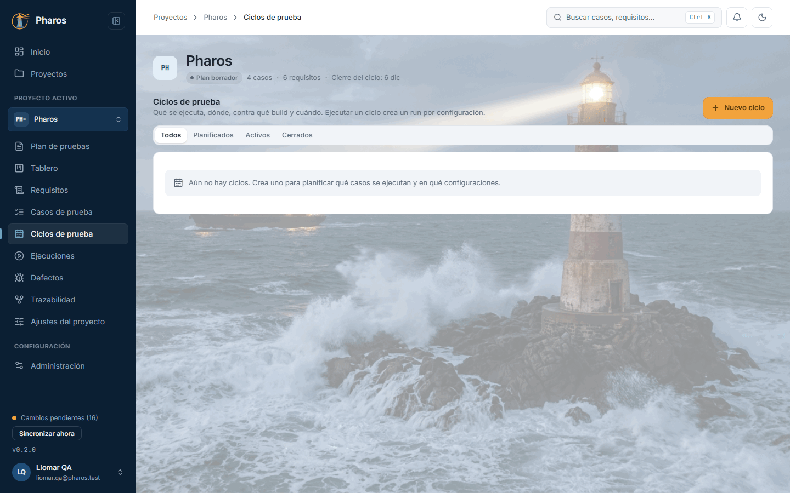

### 9.2. Nuevo ciclo

«Nuevo ciclo» pide el título (obligatorio), la build y el entorno contra los que se prueba, el hito y el sprint del plan, las fechas y las configuraciones en las que se ejecutará (las de «Ajustes del proyecto», capítulo 14). En este ejemplo, «Regresión 0.3.0» de la build 0.3.0-rc1 en staging, del 9 al 20 de noviembre, en Chrome y en Edge sobre Windows 11. Sin configuraciones, el ciclo se ejecuta como un único run. Intro en un campo crea el ciclo.

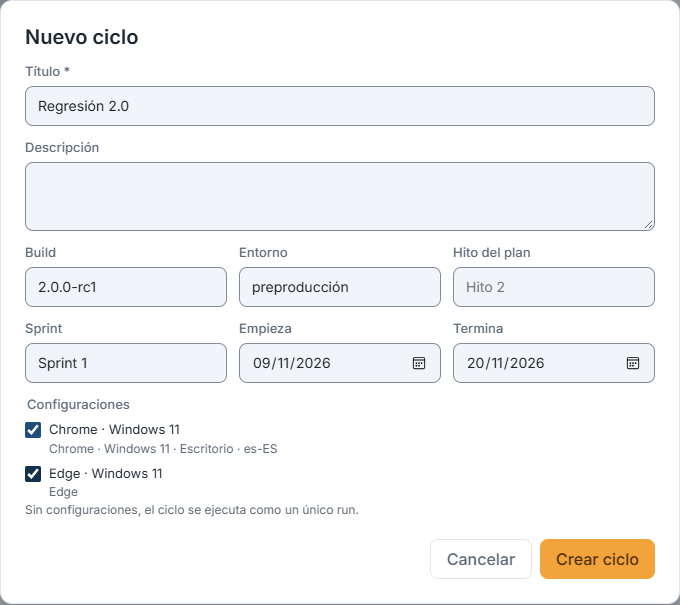

### 9.3. El ciclo, recién creado

«Crear ciclo» lo crea con su clave y abre su detalle: arriba, el estado, la build, el entorno, las fechas y el sprint; los botones «Ejecutar», «Informe de estado», «Editar» y el menú «⋯»; el resumen de resultados (pasa, falla, bloqueado, omitido, sin ejecutar) y las pestañas «Elementos», lo que hay que probar, y «Runs», las ejecuciones lanzadas. «← Ciclos» vuelve a la lista. Un ciclo vacío no se puede ejecutar todavía.

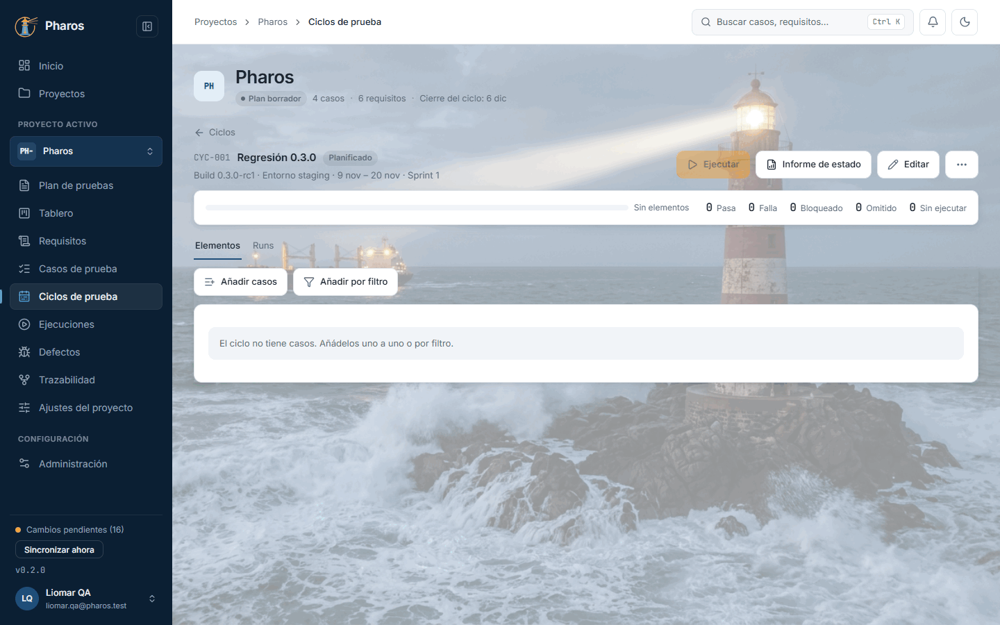

### 9.4. Añadir casos al ciclo

«Añadir casos» lista los casos del proyecto con buscador: marca los que entran en esta ronda, asígnalos a alguien si quieres (en este ejemplo, Liomar se los asigna a sí mismo) y confirma. Los que ya están en el ciclo salen marcados y bloqueados («Ya en el ciclo»). Pharos avisa si alguno no está aprobado («No aprobado»), para que no pruebes un caso aún en borrador sin saberlo; se añade igualmente.

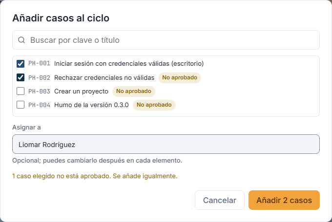

### 9.5. Añadir por filtro

Para no marcar caso por caso, «Añadir por filtro» los elige por etiquetas, prioridad, estado del caso, requisitos o riesgo mínimo de sus requisitos (por ejemplo, «Alto (≥ 13)»). El recuento («N casos coinciden») se actualiza mientras marcas. Se añaden los que coinciden en ese momento: si después cambian, el ciclo no cambia.

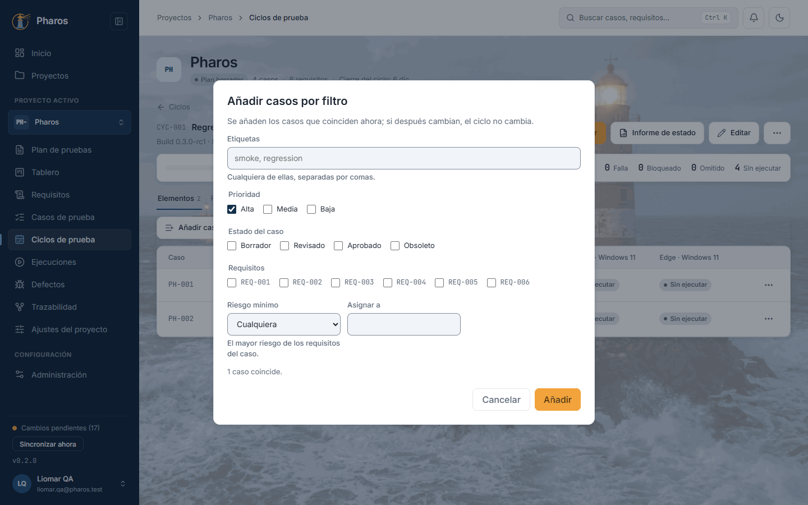

### 9.6. Los elementos del ciclo

Cada elemento muestra el caso, a quién está asignado y su resultado en cada configuración. El asignado se edita en la propia fila: Intro o salir del campo lo guarda (en este ejemplo, los dos casos ya están asignados a Liomar). El menú de la fila, «Acciones de PH-…», lo sube, lo baja o lo quita del ciclo. «Quitar del ciclo» pregunta antes; quitarlo no borra el caso ni sus resultados, y puedes volver a añadirlo.

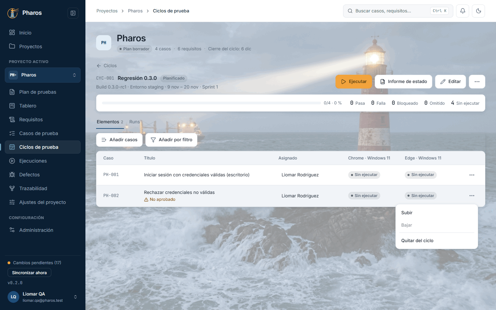

### 9.7. Quitar un elemento del ciclo

«Quitar del ciclo» pregunta antes de hacerlo. El caso deja de formar parte del ciclo, pero sus resultados ya registrados se conservan y puedes volver a añadirlo cuando quieras. Es una confirmación normal: Esc, un clic fuera o «Cancelar» lo dejan como estaba (en este ejemplo, Liomar cancela).

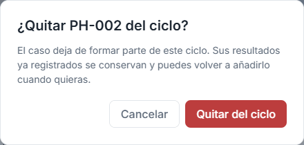

### 9.8. Ejecutar el ciclo

«Ejecutar» crea un run por configuración con todos los elementos: así cada navegador o equipo lleva su propio registro de resultados. Cada caso se congela en su revisión actual: si después cambia, el run ejecuta la versión que había. Elige configuraciones, build y entorno (vienen del ciclo) y pulsa «Crear N runs». En la web también se puede ejecutar.

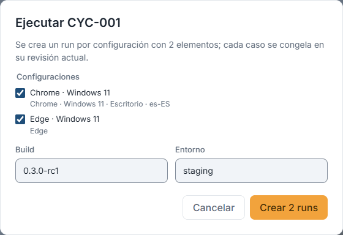

### 9.9. Los runs del ciclo

Los runs creados aparecen en la pestaña «Runs» (con su configuración, su estado y su inicio) y en «Ejecuciones» (capítulo 10), listos para registrar resultados. Un clic en su clave abre el run para ejecutarlo paso a paso (capítulo 11).

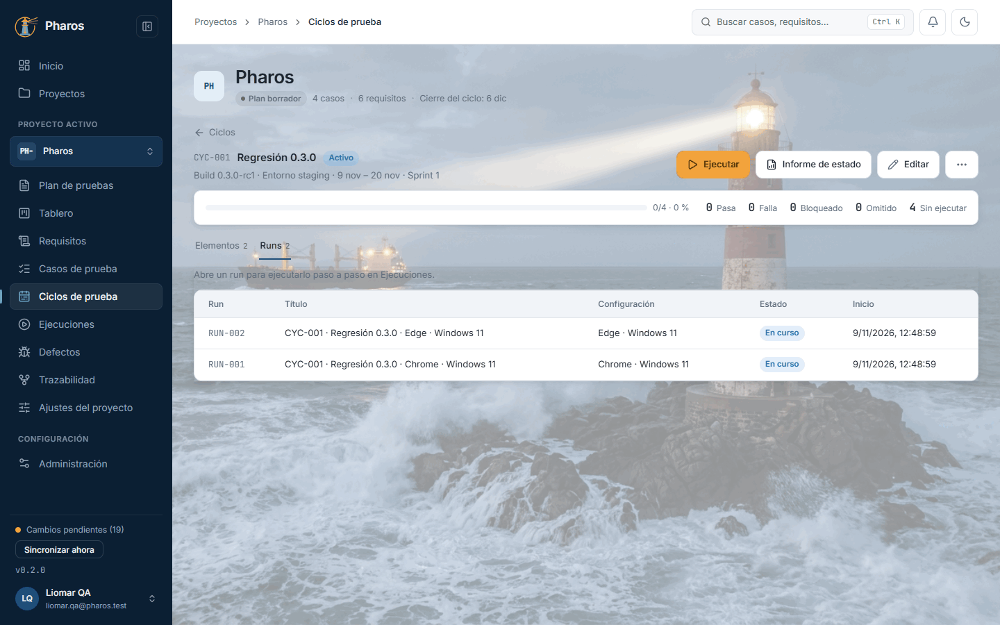

### 9.10. Informe de estado de un ciclo

«Informe de estado» en la cabecera del ciclo abre el informe con el alcance ya puesto en ese ciclo: el progreso cuenta cada caso en cada configuración, como la pestaña «Elementos». El informe completo, con sus exportaciones a Excel y PDF, se explica en el capítulo 11.

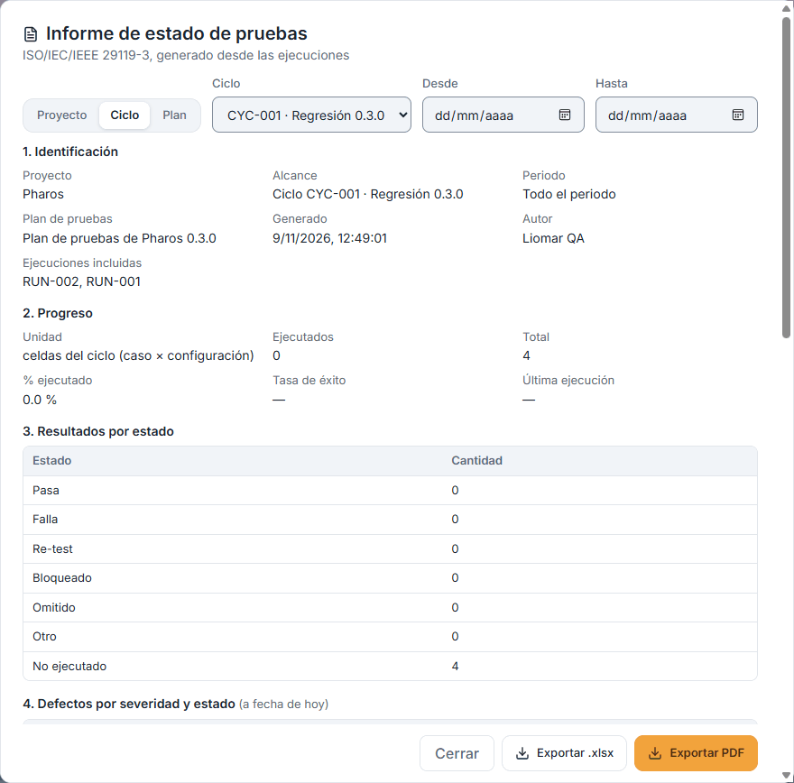

### 9.11. Clonar y eliminar un ciclo

El menú «⋯» del ciclo lo clona, con sus elementos y sin resultados, útil para repetir una regresión en la siguiente versión (el clon se abre solo); también lo elimina, tras confirmar.

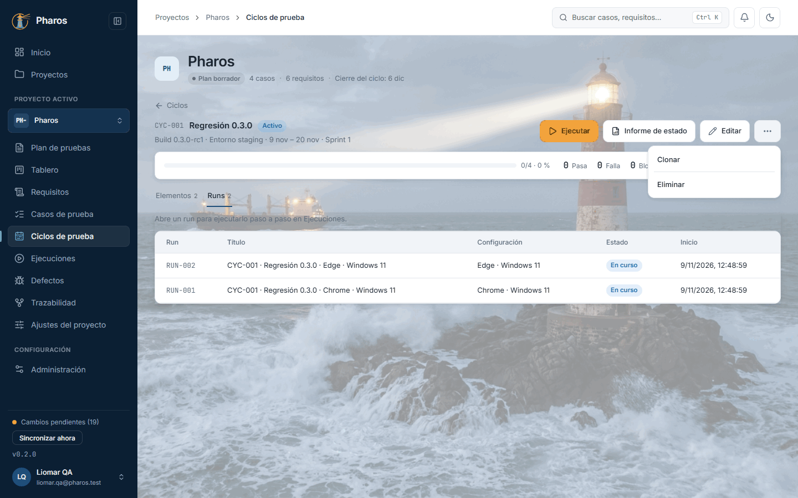

### 9.12. Confirmar la eliminación

Eliminar un ciclo pide confirmación, con cuántos runs tiene. Los resultados no se pierden: sus runs se conservan, sin ciclo, en «Ejecuciones». Esc no cierra este aviso: solo «Cancelar».

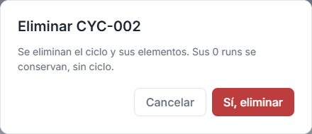

### 9.13. La lista de ciclos

La lista muestra cada ciclo con su clave, su título con la build y el entorno, su estado, sus fechas, sus configuraciones, su progreso y sus runs. Filtra por «Planificados», «Activos» o «Cerrados» (← → también cambian de filtro) para ver de un vistazo lo que está en curso; si ningún ciclo coincide, la lista lo dice.

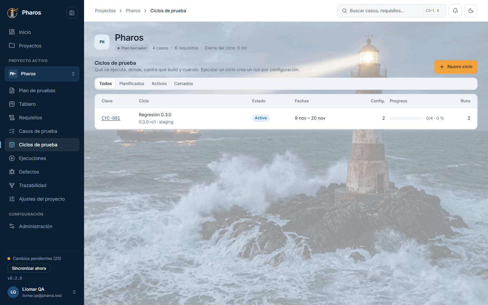

### 9.14. Los ciclos en el móvil

En el móvil, cada ciclo es una tarjeta con su clave, su estado, su título, sus fechas y su progreso. Dentro de un ciclo, cada elemento es una tarjeta con su caso, su asignado y una pastilla por configuración; su menú «⋯» lo sube, lo baja o lo quita. El asignado se cambia desde un ordenador.

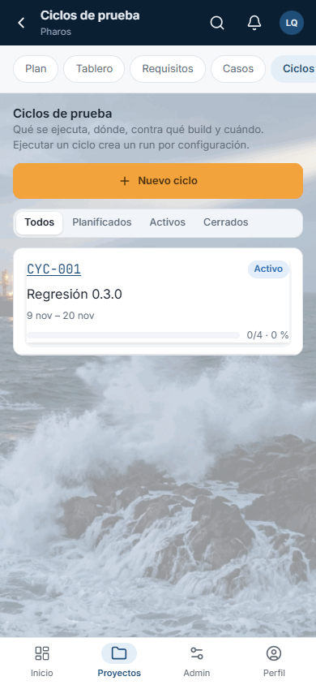

## Atajos de teclado

| Tecla | Dónde | Qué hace |
| --- | --- | --- |
| ← → | Filtro de estado (Todos · Planificados · Activos · Cerrados) | Cambia de filtro |
| ← → | Pestañas «Elementos» y «Runs» | Cambian de pestaña |
| Intro | Diálogo «Nuevo ciclo» / «Editar» | Guarda el ciclo |
| Intro | Campo «Asignado» de un elemento | Guarda el asignado (salir del campo también) |
| ↑ ↓ e Intro | Menú de un elemento («Subir», «Bajar», «Quitar del ciclo») y menú «⋯» del ciclo | Recorren y eligen |
| Esc | Confirmación de eliminar | No la cierra: usa «Cancelar» |

## Si algo no sale

- **«Ejecutar» está en gris.** Pasa en tres casos; el aviso del botón dice cuál:
  - el ciclo está cerrado: reábrelo;
  - no tiene elementos: añade casos;
  - tiene casos eliminados: quítalos del ciclo (los nombra el aviso).
- **«El ciclo termina antes de empezar.»** La fecha de fin es anterior a la de
  inicio.
- **«El proyecto no tiene configuraciones. Créalas en Ajustes del
  proyecto.»** Sin configuraciones, el ciclo se ejecuta como un único run.
  Créalas en el capítulo 14 si necesitas separar navegadores o equipos.
- **«Todas las configuraciones del ciclo están archivadas.»** Restaura alguna
  en «Ajustes del proyecto» o edita el ciclo.
- **«Elige al menos una configuración.»** Marca alguna en el diálogo
  «Ejecutar».
- **«N configuraciones aún no han llegado a este equipo y se saltaron.»**
  Sincroniza y vuelve a ejecutar para crear sus runs.
- **«No aprobado» en un elemento.** El caso está en borrador o revisado. Se
  ejecuta igual, pero conviene aprobarlo antes (capítulo 8).
- **«No se pudieron cargar los ciclos.»** Pulsa «Reintentar».
- **«Este ciclo ya no existe.»** Se eliminó, quizá en otro equipo. Vuelve a la
  lista con «← Ciclos».
- **No puedo cambiar el asignado en el móvil o en una tableta.** El asignado
  se edita en pantallas anchas; en las estrechas solo se ve.

## En el móvil

- Cada ciclo es una tarjeta con su clave, su estado, su título, sus fechas y su
  progreso.
- Dentro de un ciclo, cada elemento es una tarjeta con su caso, su asignado y
  una pastilla de resultado por configuración. Su menú «⋯» lo sube, lo baja o
  lo quita.
- En pantallas estrechas se ocultan las columnas menos importantes (fechas,
  configuraciones, runs, asignado).

## Consejos

- Crea las configuraciones antes, en «Ajustes del proyecto».
- «Añadir por filtro» es la forma rápida de montar una regresión: por
  prioridad, estado, requisitos o riesgo de sus requisitos.
- Aprueba los casos antes de añadirlos: el ciclo avisa de los que no lo están.
- «Clonar» prepara la siguiente ronda con los mismos elementos y sin
  resultados.
- Al importar un informe de la automatización (capítulo 10), elige el ciclo:
  sus resultados cuentan en el progreso sin editar nada después.
- «Informe de estado», en la cabecera del ciclo, resume esa ronda (progreso
  por caso y configuración, defectos, cobertura y criterios de salida) para
  enviarla en Excel o PDF.

## Véase también

- Capítulo 10, «Ejecuciones e importación de resultados».
- Capítulo 11, «Ejecución manual» y el informe de estado.
- Capítulo 14, «Ajustes del proyecto»: las configuraciones.
- [Guía de pruebas de la beta](../guia-beta.md), apartado 4.4c.
- [Glosario](../GLOSARIO.md), sección «Execution model identifiers»: ciclo,
  elemento de ciclo, run, configuración.

---

← [Casos de prueba](08-casos.md) · [Índice](README.md) · [Ejecuciones e importación de resultados](10-ejecuciones.md) →
