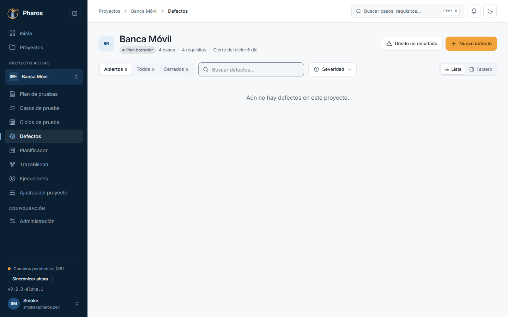
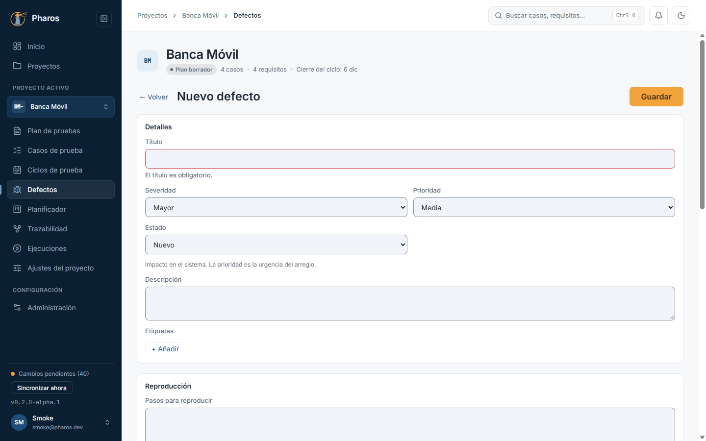
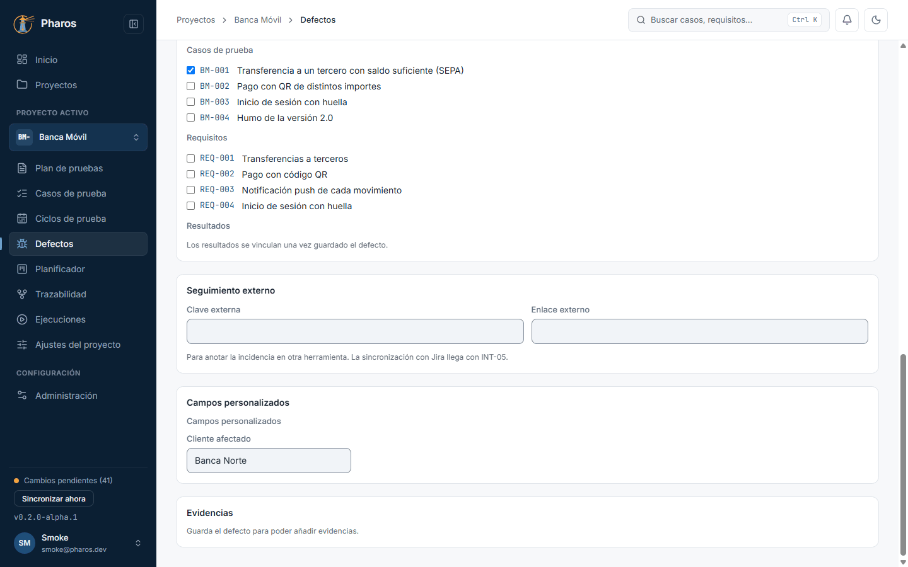
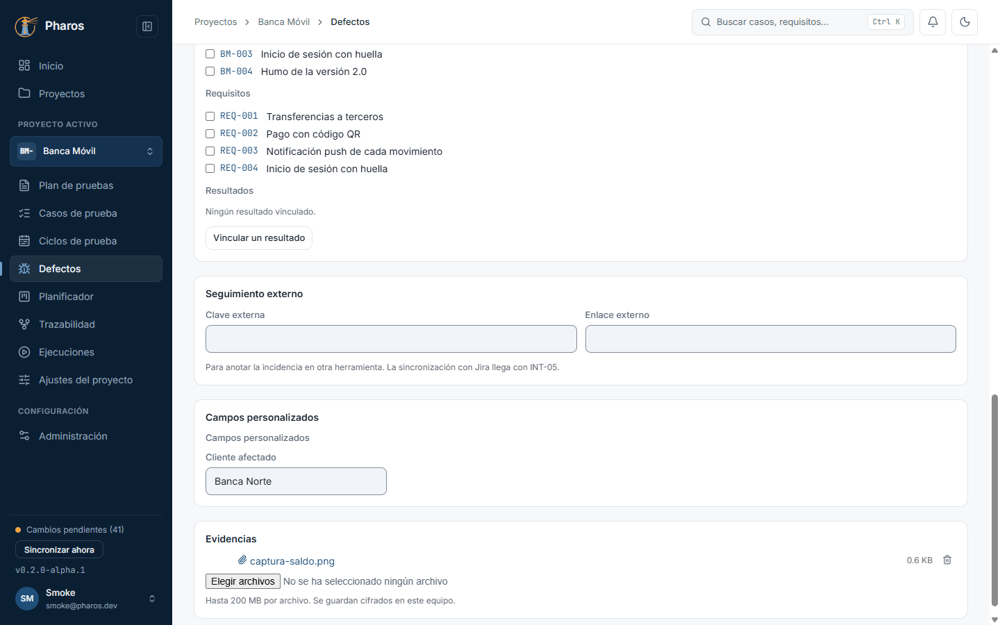
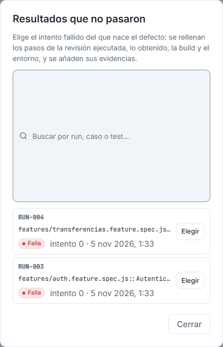
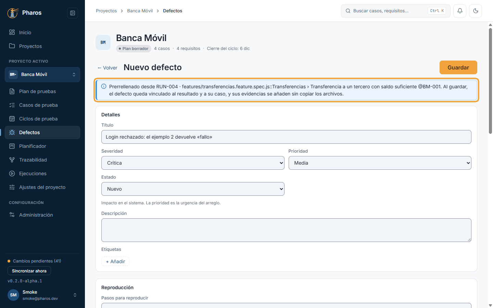
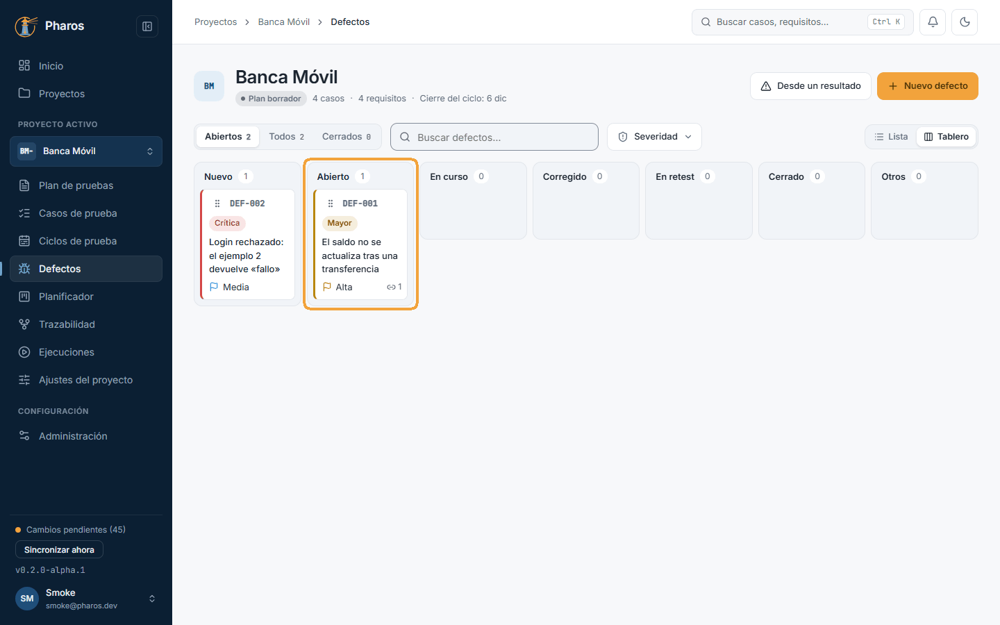
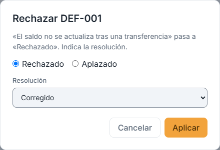
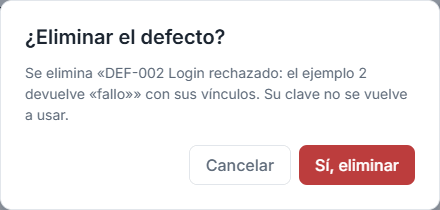

<!-- Generado por `npm run manual` desde e2e/tours/09-defectos.tour.ts y docs/manual/fuentes/defectos.md. No lo edites a mano: edita la fuente. -->

# 9. Defectos

## Para qué sirve

«Defectos» registra los fallos encontrados, con su ciclo de vida (nuevo,
abierto, en curso, corregido, en re-test, cerrado, y también rechazado o
aplazado), severidad, prioridad, pasos para reproducirlos, evidencias y
vínculos con los casos, requisitos y resultados de los que nacen. La matriz de
trazabilidad y «Inicio» los cuentan.

## Paso a paso

### 9.1. Defectos

Un defecto registra algo que no funciona como se esperaba, para que se corrija y se pueda volver a probar. Pulsa «Defectos» en el menú lateral. Arriba están «Desde un resultado» y «Nuevo defecto»; debajo, los filtros por estado (abiertos, todos, cerrados), la búsqueda, la severidad y el cambio entre «Lista» y «Tablero».

### 9.2. Nuevo defecto: el título es obligatorio

«Nuevo defecto» abre el editor. El título es obligatorio: sin él, Pharos lo indica en el campo y no guarda.

### 9.3. Rellenar el defecto

Un buen defecto permite reproducir el fallo sin preguntar a nadie. Rellena los detalles (severidad, prioridad, estado y etiquetas), la reproducción (pasos, resultado esperado y resultado obtenido), dónde se encontró (build y entorno), los vínculos con casos y requisitos y, si se sigue también fuera de Pharos, la referencia externa (en este ejemplo, «El saldo no se actualiza tras una transferencia», de severidad mayor, encontrado en la build 2.0.0-rc1).

### 9.4. Evidencias

Una vez guardado, «Evidencias» admite capturas, vídeos o registros que muestran el fallo (en este ejemplo, una captura del saldo). Se guardan cifrados en este equipo; la papelera de cada archivo («Quitar: nombre del archivo») lo quita.

### 9.5. Un defecto desde un resultado fallido

Cuando una prueba falla, lo más rápido es crear el defecto desde su resultado. «Desde un resultado» lista los intentos que no pasaron en los runs del proyecto (en este ejemplo, el del informe importado en el capítulo 8). Al elegir uno, el editor se rellena con el error y el defecto queda vinculado a ese resultado, así que la trazabilidad no depende de copiar y pegar.

### 9.6. Prerrellenado desde el resultado

El aviso azul de arriba indica de qué resultado nace el defecto. Revisa el título y la severidad que propone (en este ejemplo, se marca como crítico) y guarda.

### 9.7. La lista de defectos

La lista muestra ID, título, severidad, prioridad, estado, casos vinculados y fecha. Cambia entre abiertos, todos o cerrados, filtra por severidad o busca por texto (en este ejemplo, «saldo»).

### 9.8. El tablero de defectos

«Tablero» agrupa los defectos por estado, una columna por cada etapa de su ciclo de vida. Para avanzar un defecto, arrastra su tarjeta (o, con el teclado, lleva el foco a su asa y usa Espacio y las flechas). Pharos solo permite los cambios de estado válidos del ciclo de vida, así que una columna que no admite el defecto no lo acepta.

### 9.9. Cerrar un defecto

Al soltar un defecto en «Cerrado» (o en «Otros»: rechazado o aplazado), Pharos pide la resolución y, si quieres, la build en la que se corrigió. Así el cierre queda justificado y se sabe desde qué versión probar.

### 9.10. Eliminar un defecto

Normalmente un defecto se cierra, no se borra. Si se creó por error, la papelera de su fila («Eliminar») pide confirmación con «Sí, eliminar»; su clave no se vuelve a usar.

### 9.11. Defecto eliminado

Al confirmar, el defecto desaparece de la lista.

## Consejos

- Crea el defecto **desde el resultado** fallido siempre que puedas: hereda
  el error y queda vinculado al intento concreto.
- El tablero solo permite los cambios de estado válidos; al cerrar o rechazar
  pide la resolución.
- La clave de un defecto eliminado (`DEF-001`) no se reutiliza.

## Véase también

- [Guía de pruebas de la beta](../guia-beta.md), apartado 4.4b «Defectos».
- [Glosario](../GLOSARIO.md): «Clave de tarjeta», y la sección «Execution model identifiers».

---

← [Ejecuciones e importación de resultados](08-ejecuciones.md) · [Índice](README.md) · [Administración](10-administracion.md) →
