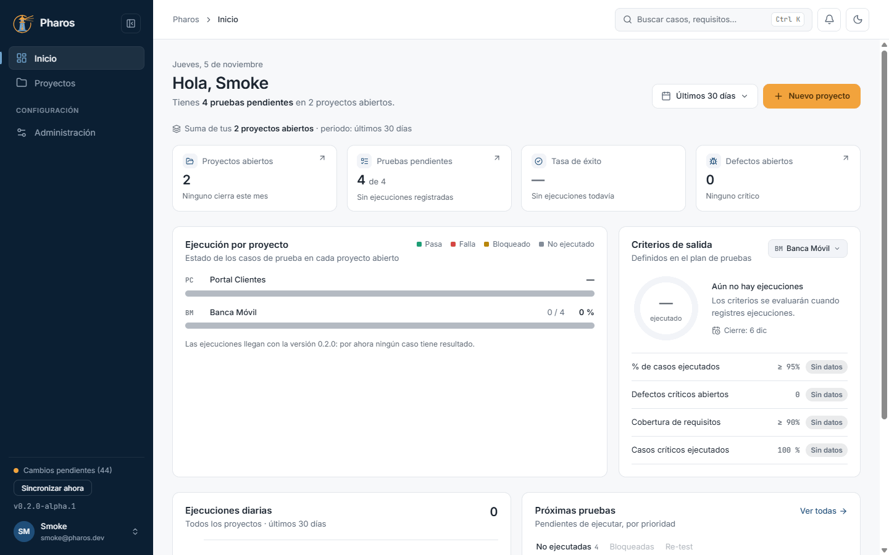
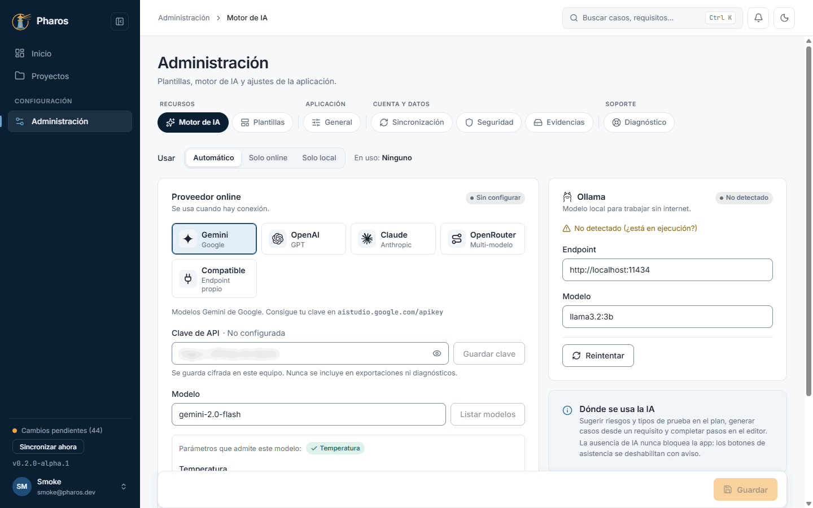
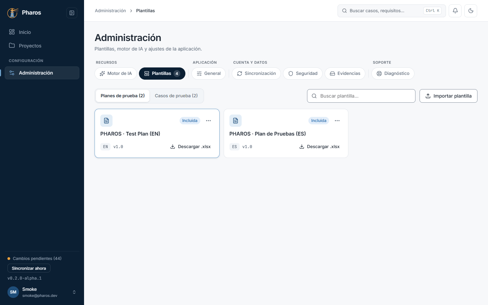
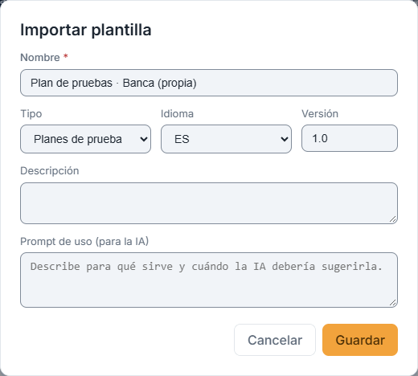
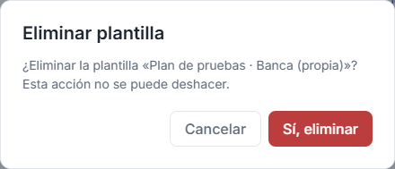
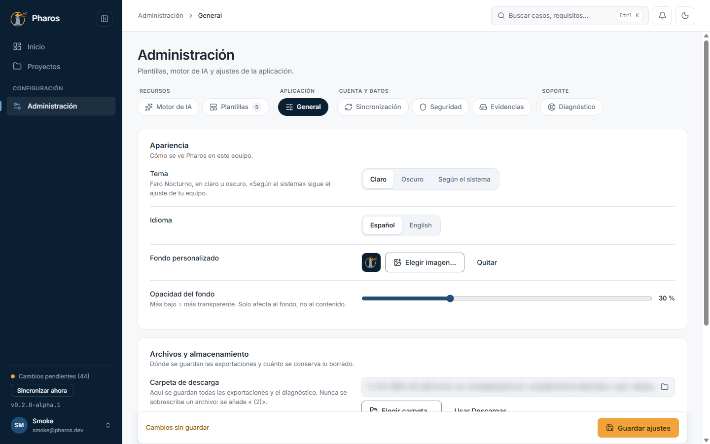
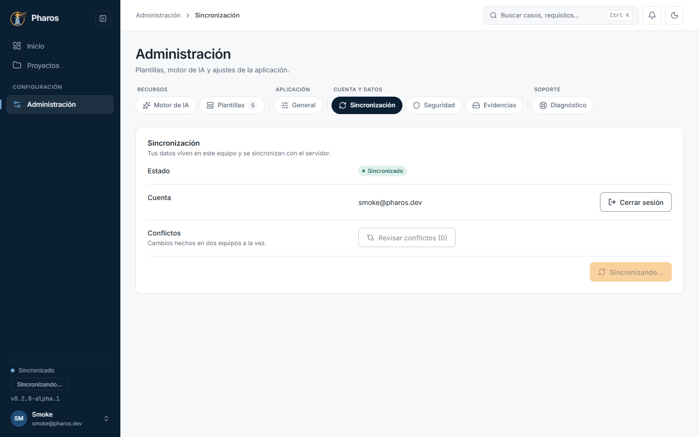
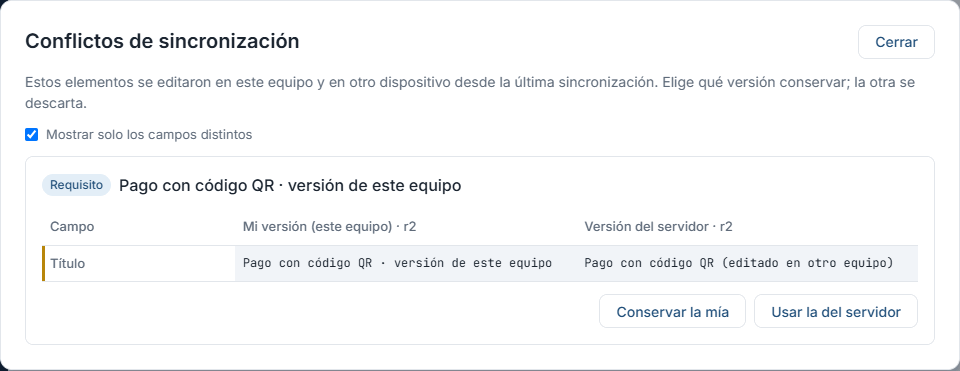
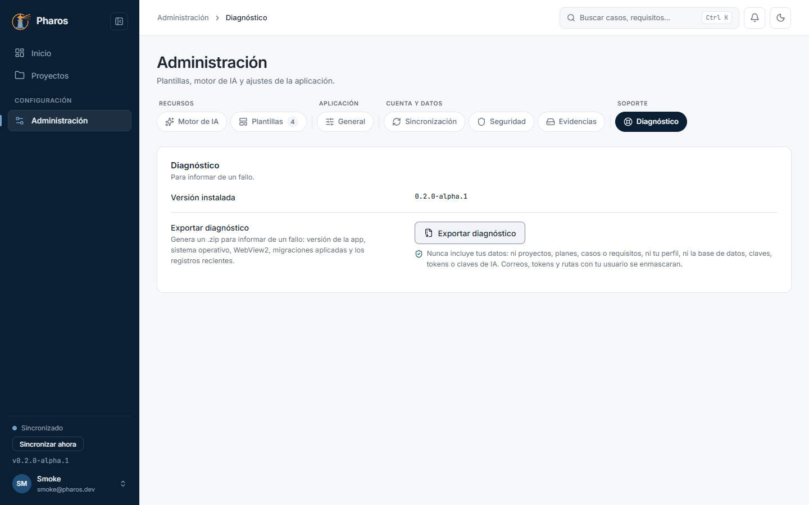

<!-- Generado por `npm run manual` desde e2e/tours/10-administracion.tour.ts y docs/manual/fuentes/administracion.md. No lo edites a mano: edita la fuente. -->

# 10. Administración

## Para qué sirve

«Administración» reúne lo que no pertenece a un proyecto: el **motor de IA**
y las **plantillas** (recursos), la apariencia y el almacenamiento
(General), la **sincronización** y la **seguridad** de tu cuenta y el
**diagnóstico** para informar de un fallo.

## Paso a paso

### 10.1. Inicio, con datos

Con proyectos en marcha, «Inicio» cuenta proyectos, pruebas pendientes, tasa de éxito y defectos abiertos (cada tarjeta lleva a su lista). «Criterios de salida» muestra los criterios de cierre del plan del proyecto que elijas.

### 10.2. Administración · Motor de IA

«Administración» agrupa los recursos (Motor de IA, Plantillas), la aplicación (General), la cuenta (Sincronización, Seguridad) y el soporte (Diagnóstico). El motor de IA elige modo (automático, solo online, solo local), proveedor, clave y modelo; la IA es opcional y nada se aplica sin que lo aceptes.

### 10.3. Cambiar de proveedor con una clave sin guardar

Si escribes una clave y cambias de proveedor sin pulsar «Guardar clave», Pharos avisa de que se descartará. La clave real se guarda en el almacén de credenciales de Windows, nunca en un archivo.

### 10.4. Plantillas

«Plantillas» guarda las de plan y de caso: las incluidas con Pharos y las tuyas. Cada tarjeta se descarga en .xlsx para rellenarla en Excel e importarla después en un plan o en un caso.

### 10.5. Importar una plantilla

«Importar plantilla» lee un .xlsx y pide nombre, tipo, idioma, versión, descripción y un «prompt de uso» que la IA usa al rellenarla.

### 10.6. Eliminar una plantilla propia

Las plantillas propias se editan o eliminan desde su menú (las incluidas no); eliminar pide confirmación.

### 10.7. General

Tema (claro, oscuro o según el sistema) e idioma se aplican al momento. También un fondo personalizado con su opacidad, la retención de elementos borrados y la carpeta donde se guardan las exportaciones.

### 10.8. Cambiar de pestaña con cambios sin guardar

Si cambias de pestaña sin «Guardar ajustes», Pharos pregunta si descartas los cambios. Aquí se descartan: el fondo vuelve a ser el de siempre.

### 10.9. Sincronización

Pharos trabaja sin conexión y sincroniza con el servidor al iniciar sesión o con «Sincronizar ahora» (también al pie del menú lateral). Aquí ves el estado, la cuenta y los conflictos pendientes.

### 10.10. Un cambio en dos equipos

Si el mismo dato se cambia en dos equipos antes de sincronizar (aquí, el título de REQ-002), el segundo en sincronizar recibe un conflicto: Pharos no pisa ninguno de los dos cambios y avisa.

### 10.11. Revisar conflictos

«Sincronización → Revisar conflictos» (o el aviso del menú lateral) muestra cada conflicto campo a campo: tu versión y la del servidor. Elige «Conservar la mía» o «Usar la del servidor».

### 10.12. Conflicto resuelto

Al elegir una versión, el conflicto desaparece de la lista («Conflicto resuelto») y la elegida se sincroniza.

### 10.13. Seguridad · clave de recuperación

La base de datos local está cifrada y su clave vive en el almacén de credenciales del equipo. «Mostrar clave de recuperación» pide confirmación: con esa clave y una copia de tus datos se recuperan en otro equipo.

### 10.14. Guarda la clave

La clave aparece en grupos (en este manual, difuminada). Cópiala a un gestor de contraseñas o escríbela en papel, marca «Ya la he guardado» y cierra.

### 10.15. Diagnóstico

«Exportar diagnóstico» guarda un ZIP con la versión, el sistema y el registro de la aplicación para informar de un fallo. Nunca incluye tus datos.

## Consejos

- Guarda la **clave de recuperación** el primer día: si cambias de equipo o
  reinstalas Windows, solo ella y una copia de `pharos.db.enc` devuelven tus
  datos. Pharos no puede recuperarla por ti.
- Si algo falla, adjunta el ZIP de «Exportar diagnóstico» al informe: no
  contiene tus proyectos ni tus casos.
- Las claves de IA se guardan en el almacén de credenciales de Windows, nunca
  en archivos de Pharos.

## Véase también

- [Guía de pruebas de la beta](../guia-beta.md), apartados 4.5 «Sincronización», 4.6 «Clave de recuperación», 4.9 «Diagnóstico» y 6 «Si algo sale mal con los datos».
- [Glosario](../GLOSARIO.md): «Pestaña de Administración», «Plantilla», «Papelera».

---

← [Defectos](09-defectos.md) · [Índice](README.md) · [Asistente de IA](11-ia.md) →
