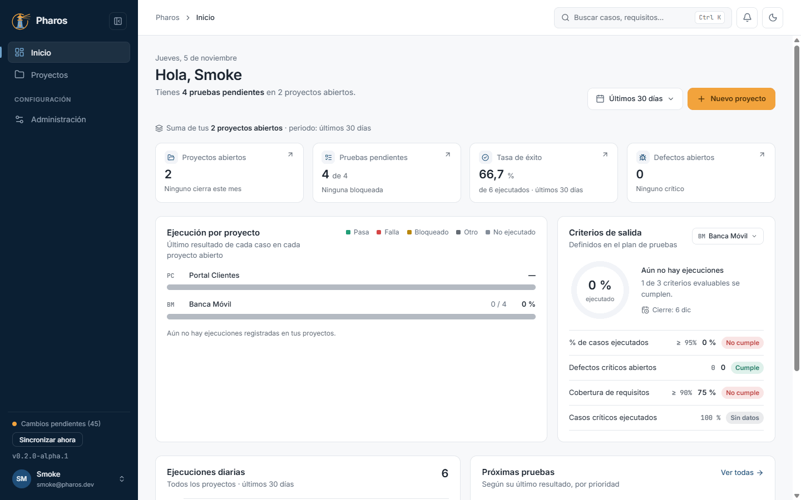
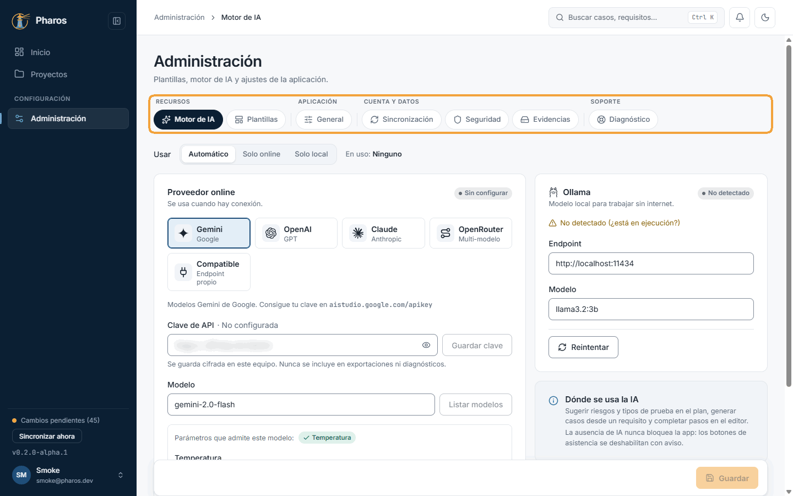
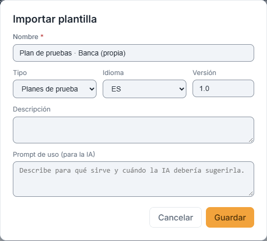
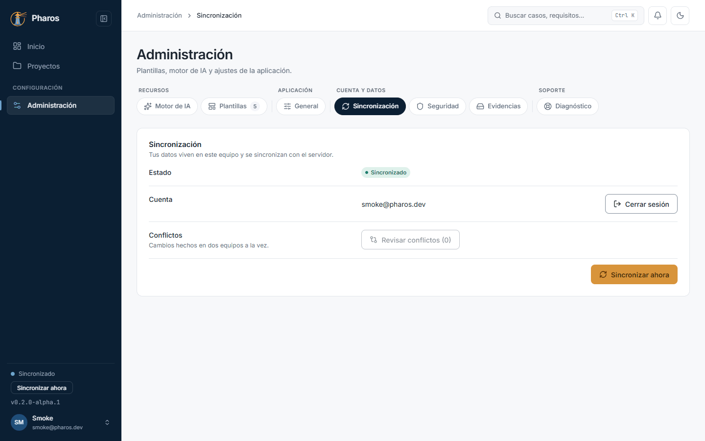
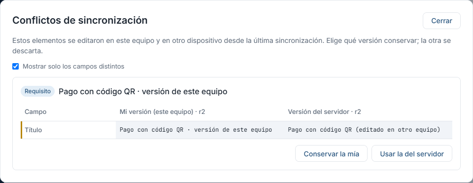
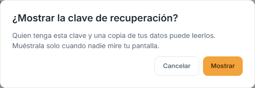
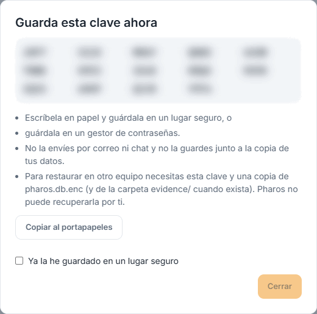
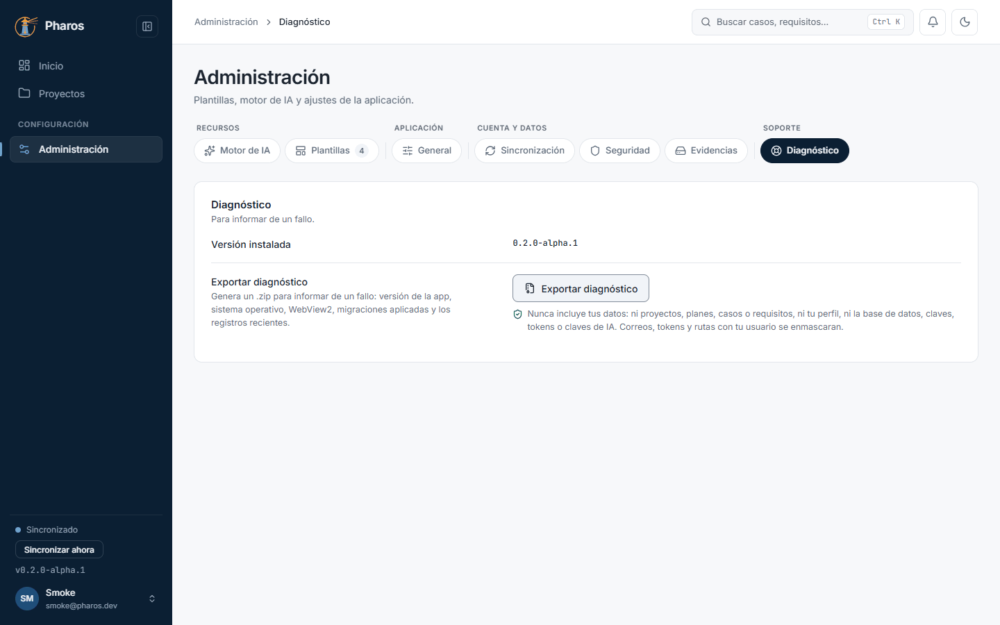

<!-- Generado por `npm run manual` desde e2e/tours/10-administracion.tour.ts y docs/manual/fuentes/administracion.md. No lo edites a mano: edita la fuente. -->

# 10. Administración

## Para qué sirve

«Administración» reúne lo que no pertenece a un proyecto: el **motor de IA**
y las **plantillas** (recursos), la apariencia y el almacenamiento
(General), la **sincronización** y la **seguridad** de tu cuenta y el
**diagnóstico** para informar de un fallo.

## Paso a paso

### 10.1. Inicio, con datos

Con proyectos en marcha, «Inicio» cuenta las pruebas pendientes (sin ejecutar o bloqueadas), la tasa de éxito del periodo y los defectos abiertos; cada tarjeta lleva a su lista. «Ejecución por proyecto» muestra, de cada proyecto, cuántos casos tienen ya resultado y cuál es el último; «Ejecuciones diarias», lo registrado cada día, manual o importado. «Criterios de salida» evalúa los del plan del proyecto que elijas (Cumple, No cumple o Sin datos), aunque todavía no haya ejecuciones.

### 10.2. Criterios de salida: en riesgo o cumplen

El selector de «Criterios de salida» busca por nombre o clave y filtra los proyectos: Todos, En riesgo (algún criterio no se cumple) o Cumplen (todos los que se pueden evaluar se cumplen). Están ordenados por fecha de cierre.

### 10.3. Próximas pruebas

«Próximas pruebas» separa los casos sin ejecutar, los bloqueados y los que esperan re-test (fallaron y su defecto ya está corregido), por prioridad. Cada fila abre el caso.

### 10.4. Administración · Motor de IA

«Administración» (en el menú de tu avatar o en el menú lateral) reúne la configuración de la aplicación en pestañas agrupadas: «Recursos» (Motor de IA, Plantillas), «Aplicación» (General), «Cuenta y datos» (Sincronización, Seguridad, Evidencias) y «Soporte» (Diagnóstico). En «Motor de IA» eliges cómo usar la IA (automático, solo online o solo local), el proveedor online, su clave y el modelo, o un modelo local con Ollama para trabajar sin internet. La IA es opcional: sin ella, los botones de asistencia se desactivan con un aviso y nada de lo que propone se aplica sin que lo aceptes.

### 10.5. Cambiar de proveedor con una clave sin guardar

Si escribes una clave y cambias de proveedor sin pulsar «Guardar clave», Pharos avisa de que se descartará, para que no la pierdas sin darte cuenta. Al guardarla, la clave queda cifrada en el almacén de credenciales de Windows, nunca en un archivo, y no se incluye en exportaciones ni diagnósticos.

### 10.6. Plantillas

«Plantillas» guarda las plantillas de plan y de caso: las incluidas con Pharos y las tuyas. Sirven para trabajar fuera de la aplicación: descarga una en .xlsx, rellénala en Excel (o pásala a quien no usa Pharos) e impórtala después en un plan (capítulo 3) o en un caso (capítulo 4).

### 10.7. Importar una plantilla

«Importar plantilla» añade una plantilla tuya desde un .xlsx: pide su nombre, el tipo (plan o caso), el idioma, la versión, una descripción y un «prompt de uso», las instrucciones que la IA sigue cuando rellena un documento con esa plantilla.

### 10.8. Eliminar una plantilla propia

Tus plantillas se editan o eliminan desde su menú; las incluidas con Pharos no se pueden borrar. Eliminar pide confirmación con «Sí, eliminar».

### 10.9. General

«General» reúne los ajustes de la aplicación en este equipo. El tema (claro, oscuro o según el sistema), el idioma y la carpeta de las exportaciones se guardan al momento. El fondo viene con una imagen predeterminada que puedes cambiar o quitar; al mover su opacidad ves el resultado antes de pulsar «Guardar ajustes». También eliges la retención de los elementos borrados.

### 10.10. Cambiar de pestaña con cambios sin guardar

Si cambias de pestaña sin «Guardar ajustes», Pharos pregunta si descartas los cambios (en este ejemplo se descartan y el fondo vuelve a ser el de siempre).

### 10.11. Sincronización

Pharos trabaja sin conexión: guarda todo en este equipo y lo sincroniza con el servidor al iniciar sesión o cuando pulsas «Sincronizar ahora» (también al pie del menú lateral). Esta pestaña muestra el estado, la cuenta, los cambios pendientes de enviar y si hay conflictos que revisar.

### 10.12. Un cambio en dos equipos

Si el mismo dato se cambia en dos equipos antes de sincronizar (en este ejemplo, el título del requisito REQ-002), el segundo que sincroniza recibe un conflicto: Pharos no pisa ninguno de los dos cambios, avisa y te deja decidir.

### 10.13. Revisar conflictos

«Sincronización → Revisar conflictos» (o el aviso del menú lateral) muestra cada conflicto campo a campo: tu versión y la del servidor, una junto a otra. Elige «Conservar la mía» o «Usar la del servidor»; la otra versión se descarta.

### 10.14. Conflicto resuelto

Al elegir una versión, el conflicto desaparece de la lista («Conflicto resuelto») y la versión elegida se sincroniza con el resto de tus equipos.

### 10.15. Seguridad · clave de recuperación

La base de datos de este equipo está cifrada y su clave vive en el almacén de credenciales de Windows. «Mostrar clave de recuperación» la enseña tras pedir confirmación: con esa clave y una copia de tus datos puedes recuperarlos en otro equipo si este falla. Guárdala ahora, no cuando la necesites.

### 10.16. Guarda la clave

La clave aparece en grupos de caracteres (en este manual, difuminada). Cópiala a un gestor de contraseñas o escríbela en papel y guárdala en un lugar seguro; marca «Ya la he guardado» y cierra. Quien tenga la clave y una copia de tus datos puede leerlos: no la compartas.

### 10.17. Diagnóstico

Si algo falla, «Exportar diagnóstico» guarda un ZIP con la versión, el sistema y el registro de la aplicación, para adjuntarlo al informar del problema. Nunca incluye tus datos ni tus claves.

### 10.18. Reemplazar una clave de IA guardada

Si ya hay una clave guardada y guardas otra sin probarla, Pharos pide confirmación, porque la anterior no se puede recuperar. «Probar conexión» comprueba la nueva sin reemplazar nada; si responde, se guarda sin preguntar.

## Consejos

- Guarda la **clave de recuperación** el primer día: si cambias de equipo o
  reinstalas Windows, solo ella y una copia de `pharos.db.enc` devuelven tus
  datos. Pharos no puede recuperarla por ti.
- Si algo falla, adjunta el ZIP de «Exportar diagnóstico» al informe: no
  contiene tus proyectos ni tus casos.
- Las claves de IA se guardan en el almacén de credenciales de Windows, nunca
  en archivos de Pharos.

## Véase también

- [Guía de pruebas de la beta](../guia-beta.md), apartados 4.5 «Sincronización», 4.6 «Clave de recuperación», 4.9 «Diagnóstico» y 6 «Si algo sale mal con los datos».
- [Glosario](../GLOSARIO.md): «Pestaña de Administración», «Plantilla», «Papelera».

---

← [Defectos](09-defectos.md) · [Índice](README.md) · [Asistente de IA](11-ia.md) →
