<!-- Generado por `npm run manual` desde e2e/tours/10-ejecuciones.tour.ts y docs/manual/fuentes/ejecuciones.md. No lo edites a mano: edita la fuente. -->

# 10. Ejecuciones e importación de resultados

## Para qué sirve

«Ejecuciones» reúne los **runs** del proyecto. Un run es una ejecución
concreta de pruebas, y puede salir de tres sitios:

- **De un ciclo:** «Ejecutar» crea un run por configuración (capítulo 9).
- **A mano:** «Nuevo run manual», con los casos que elijas (capítulo 11).
- **De tu automatización:** «Importar informe» lee los resultados de
  Playwright, Cucumber, JUnit, CTRF, .NET (TRX) o Allure (la carpeta
  `allure-results` comprimida en `.zip`) o Xcode (el JSON de
  `xcrun xcresulttool get test-results tests`), los hallazgos de un SARIF (Semgrep,
  Trivy, ZAP, CodeQL, ESLint…) o de axe, y las métricas del resumen de k6.

Al importar, Pharos enlaza cada test con su caso por la clave del caso. Los
que no la llevan esperan en la bandeja **«Sin vincular»**: vinculándolos una
sola vez, sus resultados pasados y futuros cuentan para el caso.

En este manual, la automatización de Pharos deja estos informes:

- la regresión nocturna con Playwright, cuyos 4 tests no llevan clave y van a
  la bandeja;
- un JUnit de los tests de acceso, ya vinculados a PH-001 y PH-002, con la
  captura de un fallo, importado en el ciclo «Regresión 0.6.0»;
- un JUnit con `example_row` del caso con dataset PH-005, una fila por test;
- la vista previa de un `.zip` de Allure (los tests de acceso, con un
  reintento) y de un TRX de .NET (las pruebas de la API v1);
- un análisis de Semgrep del servidor (SARIF), con un hallazgo vinculado a
  PH-002 y otro que Liomar marca como falso positivo;
- la auditoría de accesibilidad (axe) del diálogo «Nuevo requisito»;
- una prueba de carga de la API con k6, con un umbral incumplido.

Los runs que suben tu CI con `pharos upload` o «Conectar CI» (capítulo 21)
llegan a la misma lista, sin importar nada a mano.

## Paso a paso

### 10.1. Ejecuciones

Un run es una ejecución concreta de pruebas: manual, creada al ejecutar un ciclo, o importada de tu automatización. Pulsa «Ejecuciones» en el menú lateral. La pestaña «Runs» lista los runs con su clave, su título, su origen y su build, su estado (en curso, completado o cancelado), sus resultados (pasan, fallan, otros, sin vincular) y su inicio; en este ejemplo, los dos runs del ciclo «Regresión 0.6.0», todavía sin resultados. «Sin vincular» reúne los tests importados que esperan un caso. Arriba, «Informe de estado», «Importar informe» y «Nuevo run manual» (capítulo 11). Los runs que sube tu CI con `pharos upload` o «Conectar CI» (capítulo 21) aparecen aquí solos.

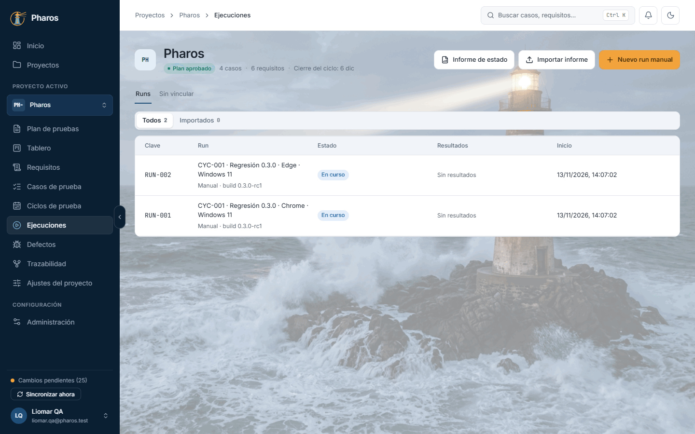

### 10.2. Importar un informe

«Importar informe» trae a Pharos los resultados de tu automatización: tests, hallazgos y métricas. La lista de formatos está tras el «?» del campo «Informe»: los tests de JUnit XML, CTRF, JSON de Playwright, Cucumber Messages (NDJSON), Pharos Run JSON, .NET (TRX), Allure (la carpeta `allure-results` comprimida en un .zip) y Xcode (el JSON de `xcresulttool`); los hallazgos de SARIF y axe, y las métricas del resumen de k6. Admite hasta 200 MB (50 MB si es JSON o XML). Solo en la app de escritorio.

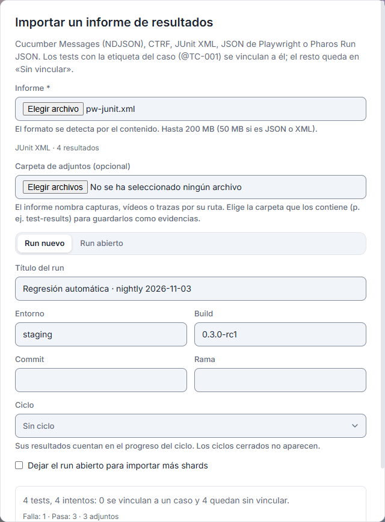

### 10.3. Vista previa antes de importar

Pulsa «Elegir archivo…»: el formato se detecta por el contenido, y Pharos rellena el título, la build, el commit, la rama y el entorno con lo que trae el informe; corrígelos si hace falta. En este ejemplo, el JUnit de la regresión nocturna de Pharos con Playwright. Abajo, la vista previa dice cuántos tests trae el informe y en cuántos intentos, y cuántos de esos intentos se vinculan a un caso y cuántos quedarán «sin vincular», con los avisos que haya. Un test se vincula solo si lleva la clave de un caso: en Cucumber, Playwright o CTRF, como tag (@PH-001); en JUnit, con la propiedad test_id; en TRX, con su categoría ([TestCategory("PH-001")]); en Allure, con la etiqueta `tag` o un enlace `tms`. Este informe no la lleva, así que sus 4 tests irán a la bandeja. Nada se guarda hasta pulsar «Importar». Si el archivo ya se importó, Pharos lo dice y no duplica nada.

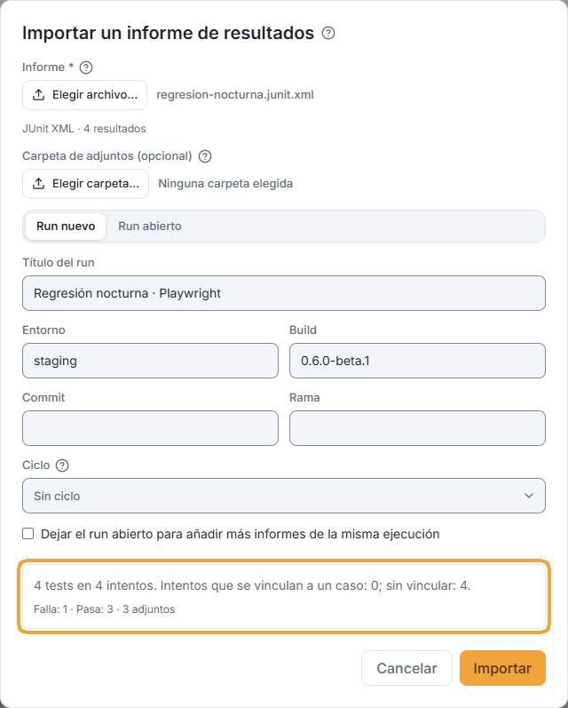

### 10.4. Informe importado

Al terminar, el resumen dice qué run se creó, cuántos resultados se importaron y cuántos quedan sin vincular; si el informe nombra adjuntos y no elegiste la «Carpeta de adjuntos», avisa de que no se guardaron (aquí, sus 3 capturas). Al cerrarlo, el run aparece en la lista como «Importado», con sus resultados; el filtro «Importados» deja solo los runs que vienen de un informe.

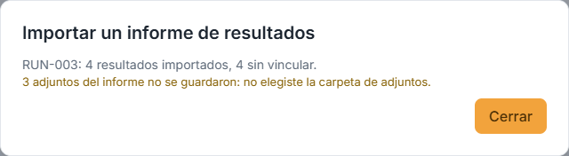

### 10.5. Un informe con adjuntos

Si el informe enlaza capturas, vídeos o trazas por su ruta, Pharos pide la «Carpeta de adjuntos» (por ejemplo, test-results): busca cada archivo por su nombre y lo guarda, cifrado, como evidencia del resultado. En este ejemplo, un JUnit de dos tests de acceso, vinculados a PH-001 y PH-002 por su test_id, con la captura de un fallo. «Ciclo» hace que el run nuevo sea del ciclo «Regresión 0.6.0»: sus resultados cuentan en el progreso del ciclo sin editar nada después (los ciclos cerrados no se ofrecen). «Run abierto» añade los resultados a un run en curso, para los shards de una misma ejecución.

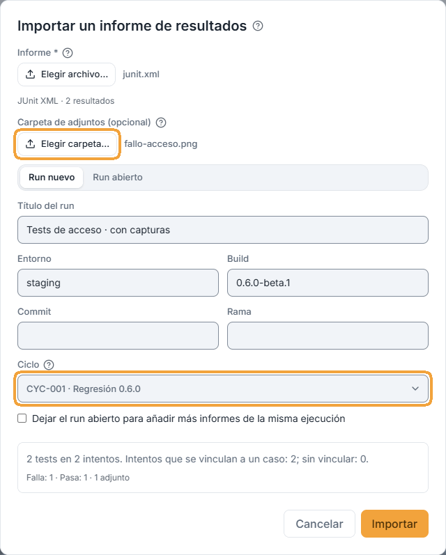

### 10.6. Adjuntos guardados

El resumen confirma cuántos resultados se importaron, que ninguno quedó sin vincular y cuántos adjuntos se guardaron como evidencia (o cuáles no se encontraron en la carpeta).

### 10.7. La bandeja «Sin vincular»

Los tests importados sin la clave de un caso del proyecto esperan en «Sin vincular» (la pestaña dice cuántos), con el motivo («Sin etiqueta de caso», «Dos etiquetas de caso», «PH-099 no es un caso del proyecto»…), su último estado, cuántos resultados tienen y su último run. Hasta que los vincules no cuentan para ningún caso, ni en el progreso ni en la matriz. Solo en la app de escritorio.

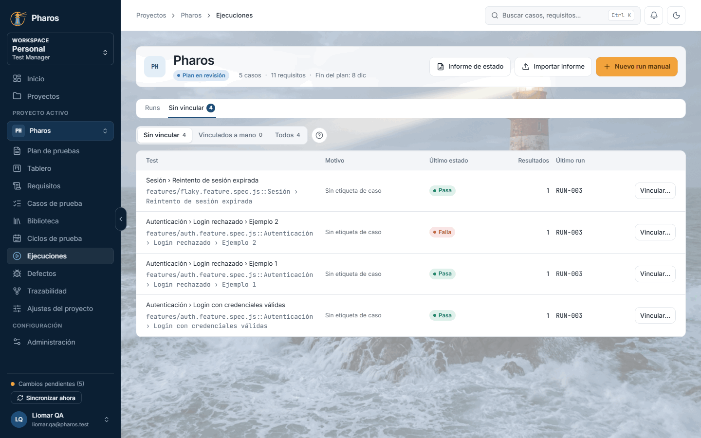

### 10.8. Vincular un test a un caso

«Vincular…» abre el buscador de casos: busca por clave o título (en este ejemplo, el test «Login con credenciales válidas» de la regresión nocturna es el caso «Iniciar sesión con credenciales válidas»), elige el caso y pulsa «Vincular». Desde ese momento, todos sus resultados, pasados y futuros, cuentan para el caso; los resultados en sí no cambian.

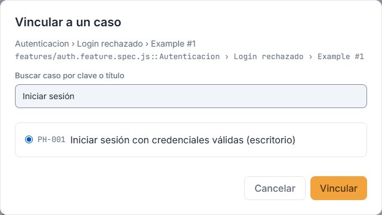

### 10.9. Vinculados a mano

El aviso confirma el vínculo («Test vinculado: sus resultados cuentan para el caso.»). El filtro «Vinculados a mano» muestra los tests que vinculaste, con su caso, para revisarlos; «Todos» enseña también los demás. «Desvincular» deshace el vínculo si te equivocaste.

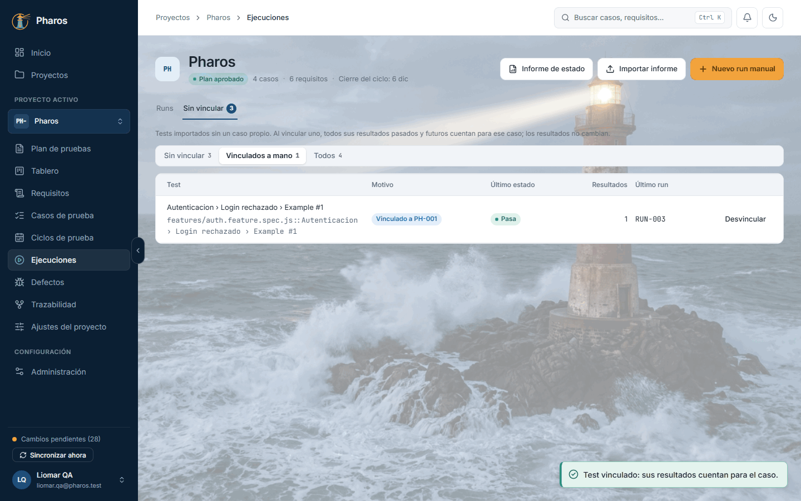

### 10.10. Desvincular

«Desvincular» pregunta antes: sus resultados, pasados y futuros, dejan de contar para el caso y el test vuelve a la bandeja («Vínculo retirado.»). Los resultados no cambian; si te equivocas, vuelve a vincularlo. Esc o «Cancelar» lo dejan como estaba. En este ejemplo, Liomar lo desvincula para ver cómo funciona: el test vuelve a la bandeja, y por eso los capítulos siguientes cuentan cuatro tests sin vincular.

### 10.11. Resultados por fila del dataset

Un caso con dataset (capítulo 8) se ejecuta una vez por fila. Si lo automatizas sin Cucumber, di qué fila ejecutó cada test con la propiedad `example_row` (en JUnit, `<property name="example_row" value="2"/>`; en CTRF, `extra.exampleRow`; en Playwright, la anotación `example_row`), contando desde 1. En este ejemplo, los tres tests de «Acceso con usuarios de prueba» (PH-005) llevan su fila: en la lista, el run nuevo cuenta dos que pasan y uno que falla, el de la tercera cuenta, cada uno en su fila del caso. La matriz de trazabilidad (capítulo 13) cuenta el caso por sus filas.

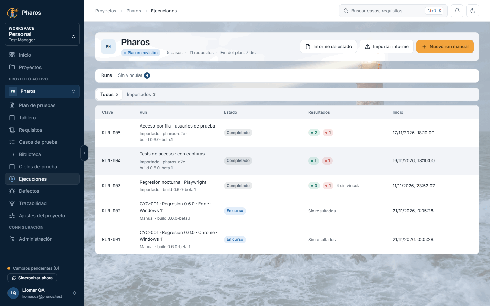

### 10.12. Los resultados de un run importado

Un clic en la clave de un run importado abre su pantalla, con los resultados que trajo el informe: cada test con su caso (clave y título) y, si la tiene, su fila del dataset, o «Sin vincular» si no tiene caso; su estado y sus intentos. El progreso los cuenta como ejecutados («3/3 ejecutados») y los filtros de arriba los separan por estado. Un run importado no ofrece «Añadir casos»: sus resultados vienen del informe; «Reabrir» lo deja en curso para añadirle más informes con «Run abierto». Aquí, el run de «Acceso con usuarios de prueba», con sus tres filas.

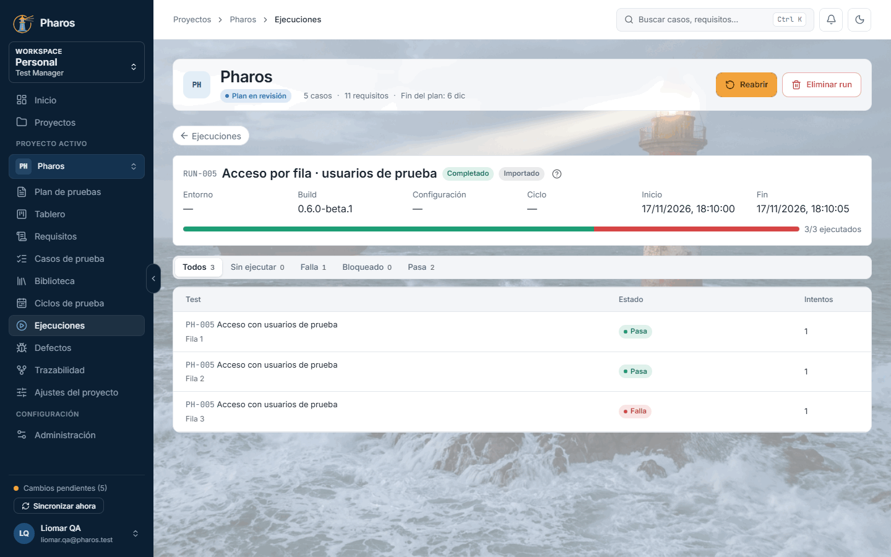

### 10.13. Importar resultados de Allure (.zip)

De Allure, comprime la carpeta `allure-results` y elige el .zip. Los reintentos son intentos del mismo test: uno que pasa tras fallar queda *flaky*. La etiqueta `tag` (`@PH-001`) o un enlace `tms` vinculan el test a su caso, y sus adjuntos se guardan como evidencias. En este ejemplo, los tests de acceso de Pharos con Allure: la vista previa cuenta 2 tests en 3 intentos, los 3 vinculados a su caso, y 1 adjunto.

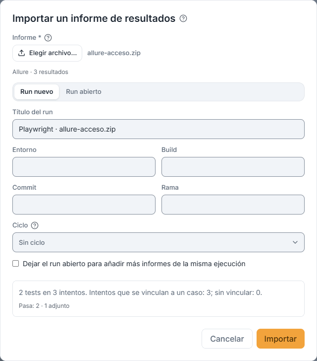

### 10.14. Importar un TRX de .NET

Un TRX (`dotnet test --logger trx`, también de NUnit y xUnit) vincula cada test por su categoría: `[TestCategory("PH-001")]` en MSTest, `[Category]` en NUnit. En este ejemplo, las pruebas .NET de la API v1 de Pharos llevan las categorías API-001 a API-003, claves del proyecto «API de sincronización», así que en «Pharos» la vista previa las deja sin vincular: se importan en el proyecto al que pertenecen. Para Xcode, exporta el JSON con `xcrun xcresulttool get test-results tests`; sus tests se vinculan desde la bandeja «Sin vincular».

### 10.15. Importar hallazgos de seguridad (SARIF)

Un SARIF (Semgrep, Trivy, ZAP, CodeQL, ESLint…), un informe de axe o el resumen de k6 no traen tests, sino hallazgos o métricas, y la vista previa los cuenta. En este ejemplo, Semgrep analizó el servidor de Pharos y encontró dos problemas: uno de severidad media, que la respuesta de /auth/login delata si un correo tiene cuenta, y otro bajo, una cadena de formato construida con una variable. El primero lleva el tag @PH-002: la matriz de trazabilidad (capítulo 13) lo cuenta en el caso «Rechazar credenciales no válidas».

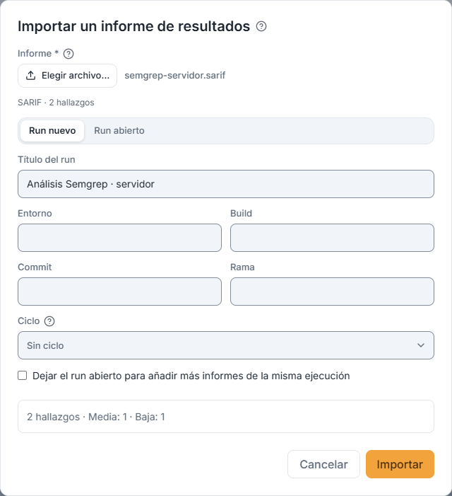

### 10.16. Los hallazgos de un run

En el run aparecen las pestañas «Hallazgos» y «Métricas» cuando hay algo que mostrar. «Hallazgos» los agrupa por regla, con su severidad, su ubicación (archivo y línea, o página y elemento) y sus referencias (CWE, WCAG…). «Nuevo» marca los que no estaban en el run anterior de la misma herramienta. Los filtros dejan ver solo una severidad, los abiertos, los que esperan revisión («A revisar») o los ya triados.

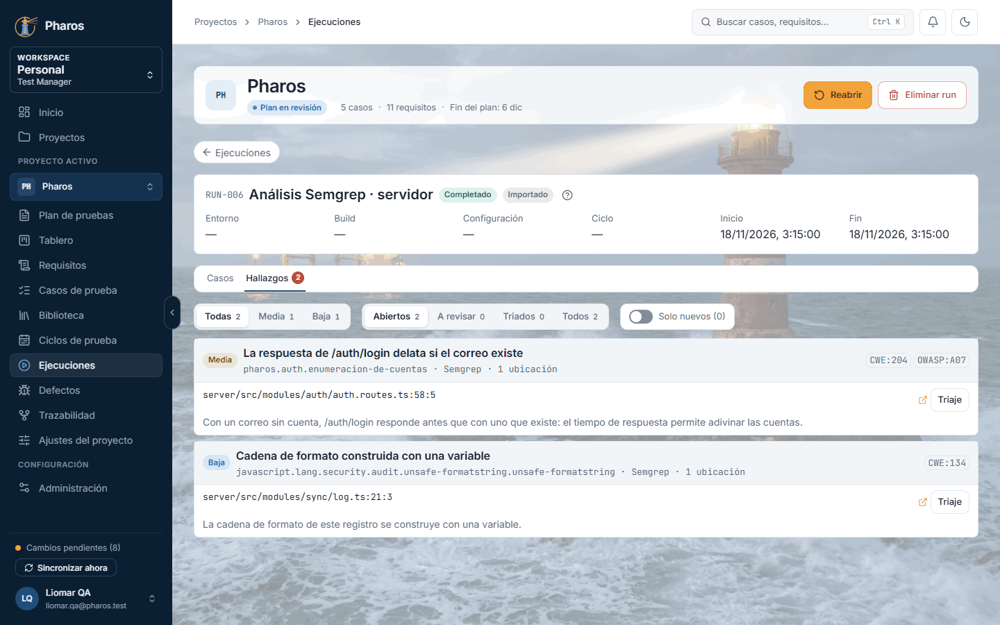

### 10.17. Triaje de un hallazgo

«Triaje» decide qué hacer con un hallazgo: falso positivo, riesgo aceptado o corregido, siempre con un motivo, o reabrirlo. La decisión vale para ese hallazgo en todos los runs del proyecto, así que el próximo análisis llega ya triado, y las decisiones anteriores quedan en su historial. En este ejemplo, Liomar marca como falso positivo la cadena de formato: es una constante del módulo y no viene de la petición.

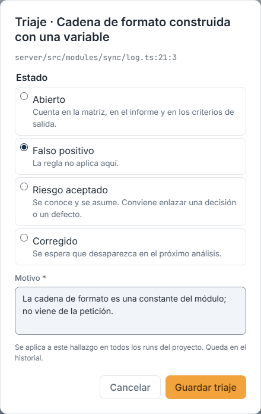

### 10.18. Hallazgo triado

Al guardar, el hallazgo sale de «Abiertos» (ya no cuenta en la matriz ni en los informes) y aparece en «Triados» con su estado.

### 10.19. Importar un informe de accesibilidad (axe)

Un informe de axe (axe-core, @axe-core/playwright…) trae las reglas de accesibilidad incumplidas en cada página, con su nivel WCAG. En este ejemplo, la auditoría del diálogo «Nuevo requisito» de Pharos trae una infracción de severidad alta, la página sin título (`document-title`), y una regla «A revisar», el contraste de color: axe no pudo decidirla, así que no cuenta como abierta hasta que alguien la mire y decida en «Triaje».

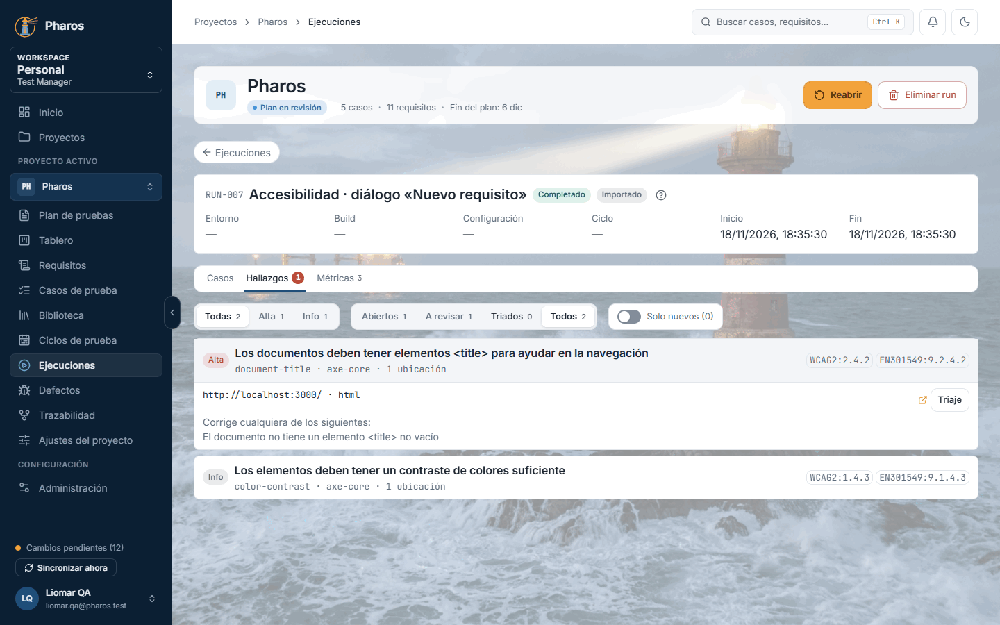

### 10.20. Las métricas de una prueba de carga (k6)

El resumen de k6 trae métricas: cada una con su agregación (p95, media, tasa…), su valor y su umbral, si lo tiene. «Métricas» pone primero los umbrales incumplidos (en este ejemplo, cinco usuarios contra la API de Pharos durante un minuto, con las peticiones fallidas por encima del 1 %), luego el resumen de cada métrica (con «Ver todas», cada agregación) y aparte los checks de k6. La métrica de entrar lleva `{case:PH-001}` y su check, `@PH-001`: un umbral incumplido de una métrica vinculada a un caso lo marca como fallido.

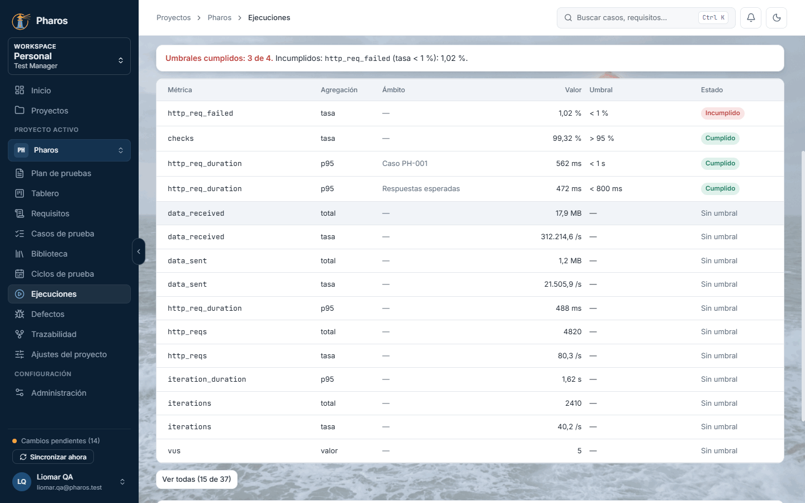

### 10.21. Los checks de k6

Debajo del resumen, «Checks» reúne en su propia tarjeta las comprobaciones del script de k6, cada una con cuántas veces se cumplió. El check de entrar lleva `@PH-001`, como su métrica: cuenta para ese caso.

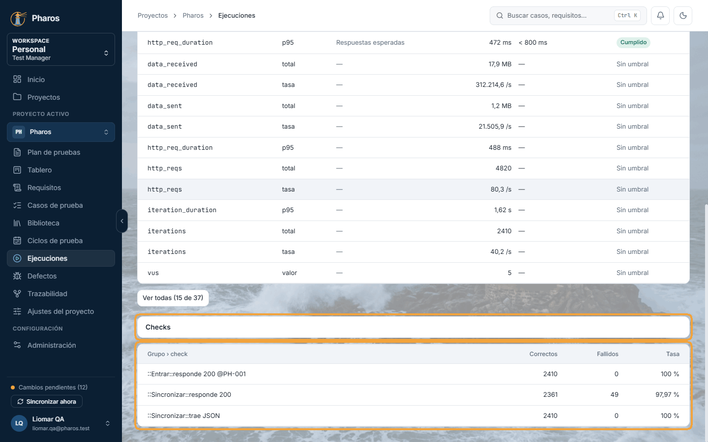

### 10.22. Hallazgos en la lista de runs

La lista de runs marca cada análisis con sus hallazgos abiertos, en el color del peor, y cada prueba de carga con sus umbrales incumplidos; un run que solo trae hallazgos o métricas ya no dice «Sin resultados». Fuera del run cuenta el último análisis de cada herramienta: lo que ya no aparece en él se da por corregido.

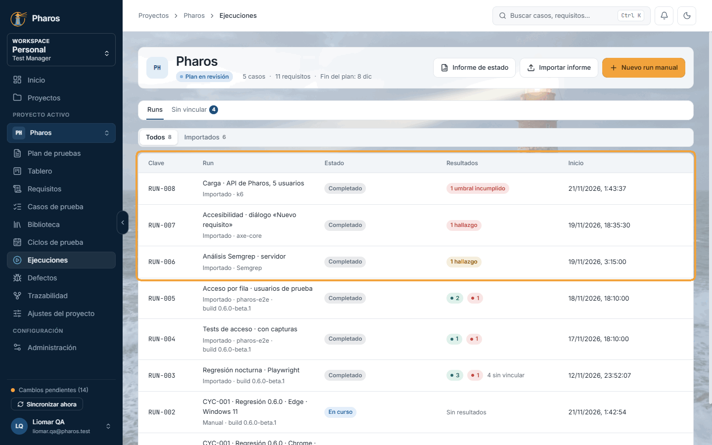

### 10.23. Las ejecuciones en el móvil

En el móvil, cada run es una tarjeta con su clave, su estado, su título y sus resultados; un toque lo abre. «Informe de estado», «Importar informe» y «Nuevo run manual» quedan en la fila de botones de la sección.

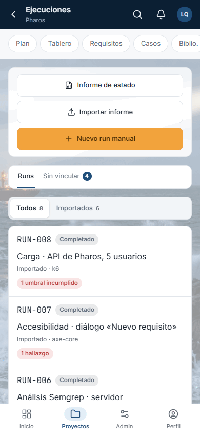

## Hallazgos y métricas

Un SARIF o un informe de axe no traen tests, sino **hallazgos**: una regla
incumplida en un sitio (un archivo y una línea, o una página y un elemento).
Un resumen de k6 trae **métricas**, con sus umbrales. Al importarlos, la vista
previa cuenta los hallazgos por severidad y los umbrales incumplidos.

En el run, las pestañas **«Hallazgos»** y **«Métricas»** aparecen solo si
hay algo que mostrar:

- «Hallazgos» los agrupa por regla, con la severidad y las referencias (WCAG,
  CWE…). «Nuevo» marca los que no estaban en el run anterior de la misma
  herramienta. Los que axe no pudo decidir quedan «A revisar» y no cuentan
  como abiertos.
- **«Triaje»** decide qué hacer con un hallazgo: falso positivo, riesgo
  aceptado o corregido, siempre con un motivo, o reabrirlo. La decisión vale
  para ese hallazgo en todos los runs del proyecto, y las anteriores quedan
  en su historial.
- «Métricas» pone primero los umbrales incumplidos. «Ver todas» muestra cada
  agregación, y los *checks* de k6 van aparte.

Fuera del run, cuenta el **último escaneo de cada herramienta** (lo que ya no
aparece en él se dio por corregido):

- La **lista de runs** muestra los hallazgos abiertos de cada run, con el color
  de la peor severidad, y sus umbrales incumplidos. Un run que solo trae
  hallazgos o métricas ya no figura como «Sin resultados».
- En la **matriz de trazabilidad**, un caso con hallazgos abiertos lleva una
  insignia con cuántos son y el color del peor, y la nota «Hallazgos
  abiertos». El interruptor **«Con hallazgos abiertos»** deja solo los
  requisitos afectados.
- El **informe de estado** añade la sección «7.1 Hallazgos y rendimiento»
  (abiertos por severidad, nuevos, triados, a revisar, umbrales cumplidos y
  los incumplidos), y el **informe de cierre** los lista entre los riesgos
  residuales. Si no hay hallazgos ni umbrales, la sección no aparece.

## Cómo se vincula un test a su caso

| Formato | Dónde va la clave del caso |
| --- | --- |
| Cucumber Messages (NDJSON), playwright-bdd | Tag del escenario: `@PH-001` |
| JSON de Playwright | Tag del test (`@PH-001`) o la anotación `test_id` |
| CTRF | Sus `tags` |
| JUnit XML | Propiedad `test_id` del `<testcase>` (`<property name="test_id" value="PH-001"/>`) o las propiedades `tag` / `tags`. JUnit no tiene tags propios, así que `@PH-001` en el nombre del test no basta |
| TRX (.NET) | La categoría del test: `[TestCategory("PH-001")]` (NUnit `[Category]`) |
| Allure | La etiqueta `tag` (`@PH-001` en el título con allure-playwright), `AS_ID` o un enlace `tms` |
| Xcode (`.xcresult`) | Desde la bandeja «Sin vincular»: los tags de Swift Testing son identificadores y no admiten el guion de `PH-001`. La vinculación se recuerda en las siguientes importaciones |
| Pharos Run JSON | Sus `tags` |

Si el caso tiene un dataset (Biblioteca) y lo automatizas sin Cucumber, di qué
fila ejecutó cada test: la propiedad `example_row` en JUnit
(`<property name="example_row" value="2"/>`), `"extra": { "exampleRow": 2 }`
en CTRF o la anotación `example_row` en Playwright. Cuenta desde 1, como la
tabla de datos del caso, y el resultado queda en esa fila de la matriz.

El detalle de cada formato está en [Formatos de importación](../formats/importers.md).

Si exportas los `.feature` desde Pharos (capítulo 8), cada escenario ya lleva
su tag.

## Atajos de teclado

| Tecla | Dónde | Qué hace |
| --- | --- | --- |
| ← → | Pestañas «Runs» y «Sin vincular» | Cambian de pestaña |
| ← → | Filtros «Todos» / «Importados» y los de la bandeja | Cambian de filtro |
| Tab | Diálogo «Importar un informe» | Recorre el archivo, la carpeta, el destino y los datos del run |
| ↑ ↓ y Espacio | Lista de casos de «Vincular a un caso» | Eligen el caso |
| Esc | Diálogos de importar y de vincular | Los cierran, salvo mientras se importa |

## Si algo no sale

- **«Importar informe» está en gris.** En la versión web no se importan
  informes: usa la app de escritorio.
- **Todos los tests quedan «sin vincular».** El informe no lleva la clave de
  los casos (ver la tabla de arriba). Vincúlalos a mano en la bandeja o añade
  la clave en tu automatización.
- **«Dos etiquetas de caso».** Un test lleva dos claves de caso: Pharos no
  adivina cuál es y lo deja sin vincular. Deja una sola.
- **«… no es un caso del proyecto».** La clave no existe aquí; quizá es de
  otro proyecto o el caso se eliminó.
- **«Este archivo ya está importado en RUN-…».** Importar dos veces el mismo
  archivo no duplica nada. Con «Run abierto» puedes completar los adjuntos que
  falten; con «Run nuevo», marca la casilla si de verdad quieres importarlo
  otra vez.
- **«N adjuntos no se encontraron en la carpeta elegida.»** Elige la carpeta
  que contiene los archivos (por ejemplo, `test-results`).
- **«N adjuntos del informe no se guardaron: no elegiste la carpeta de
  adjuntos.»** Para guardarlos como evidencias, elige la «Carpeta de
  adjuntos» antes de pulsar «Importar».
- **«El archivo supera…».** El límite es 200 MB (50 MB si es JSON o XML).
- **«El archivo no es un XML válido».** Desde la 0.6.0, un XML con una
  declaración DTD se rechaza: quítala del informe.
- **«Run abierto» está en gris.** No hay ningún run en curso en el proyecto.
- **«No se pudieron cargar los runs.»** Pulsa «Reintentar».
- **Un run dice «Sin resultados».** Todavía no se ha ejecutado nada en él:
  ábrelo para ejecutarlo (capítulo 11).

## En el móvil

- Cada run es una tarjeta con su clave, su estado, su título y sus
  resultados.
- Los botones de la sección quedan en una fila sobre la lista.
- La importación y la bandeja «Sin vincular» son de la app de escritorio.

## Consejos

- Pon la clave del caso en tu automatización: con el tag (`@PH-001`) o la
  propiedad `test_id` en JUnit, cada importación se vincula sola.
- Si un informe enlaza capturas, vídeos o trazas, elige también su carpeta de
  adjuntos: se guardan como evidencias del resultado.
- Importa en el ciclo: elige «Ciclo» al importar y sus resultados cuentan en
  el progreso del ciclo.
- Los shards de una misma ejecución se importan en el mismo run: marca «Dejar
  el run abierto para importar más shards» en el primero y usa «Run abierto»
  en los demás.

## Véase también

- Capítulo 9, «Ciclos de prueba».
- Capítulo 11, «Ejecución manual» y el informe de estado.
- Capítulo 13, «Trazabilidad»: el último resultado de cada caso y sus
  hallazgos.
- Capítulo 21, «Integraciones»: subir los informes desde el CI.
- [Guía de pruebas de la beta](../guia-beta.md), apartado 4.4c «Importar
  resultados de pruebas automáticas».
- [Formatos de importación](../formats/importers.md).
- [Glosario](../GLOSARIO.md), sección «Execution model identifiers».

---

← [Ciclos de prueba](09-ciclos.md) · [Índice](README.md) · [Ejecución manual](11-ejecucion-manual.md) →
