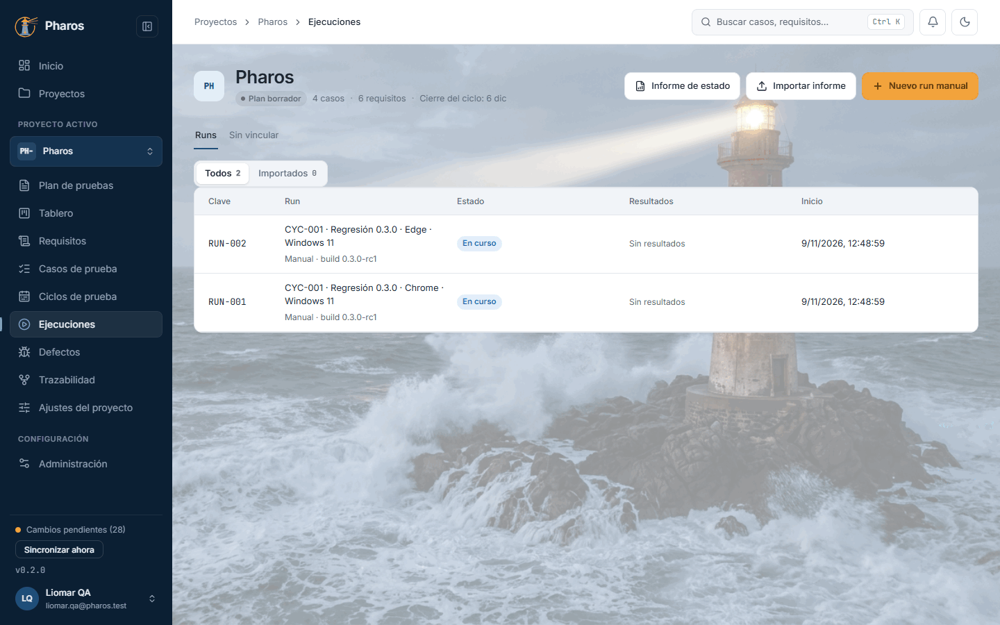
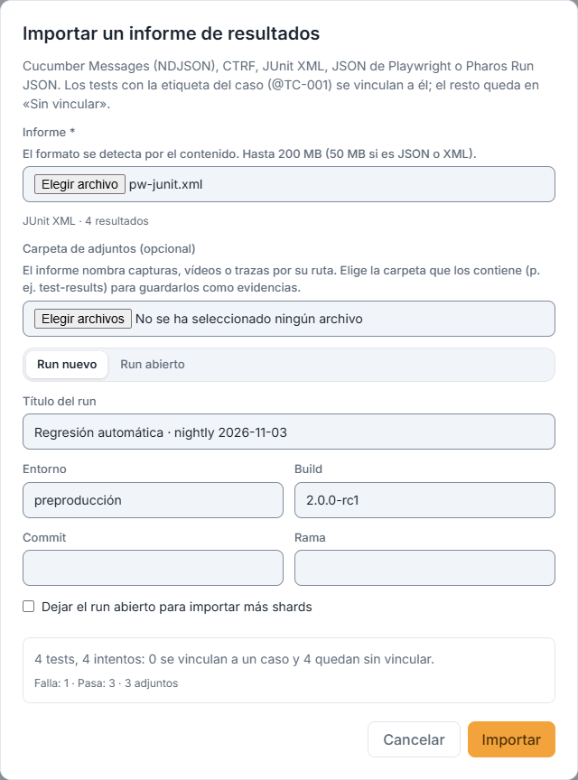
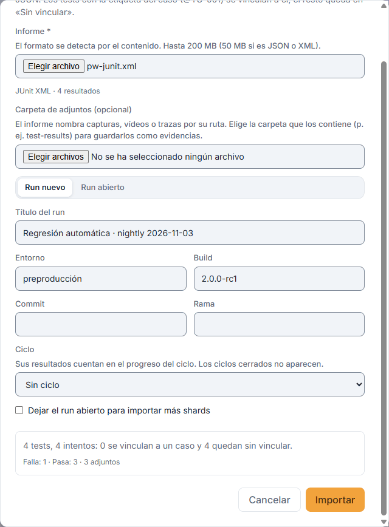
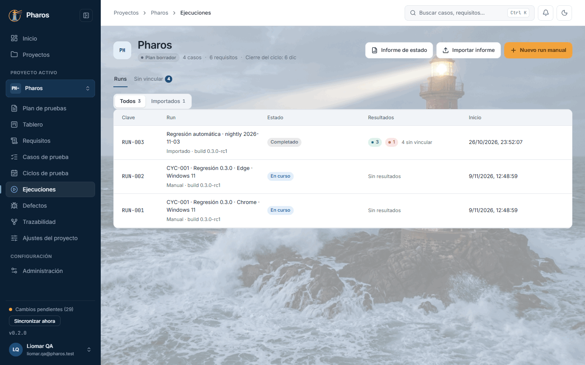
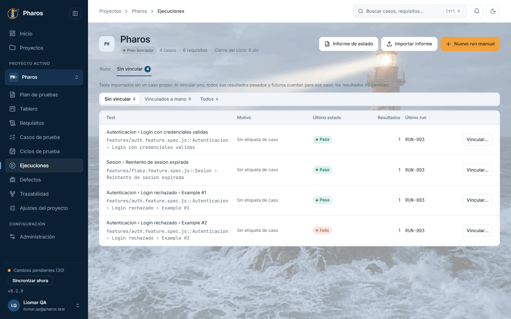
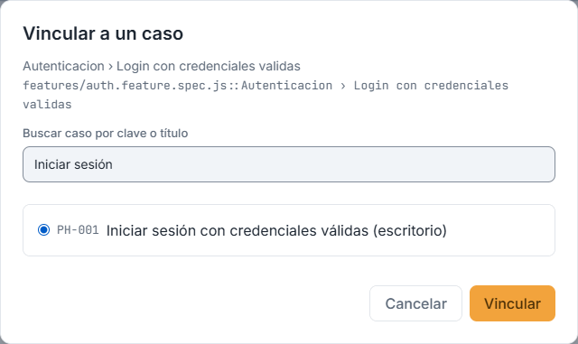
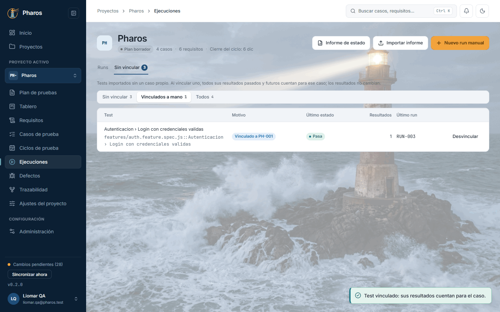
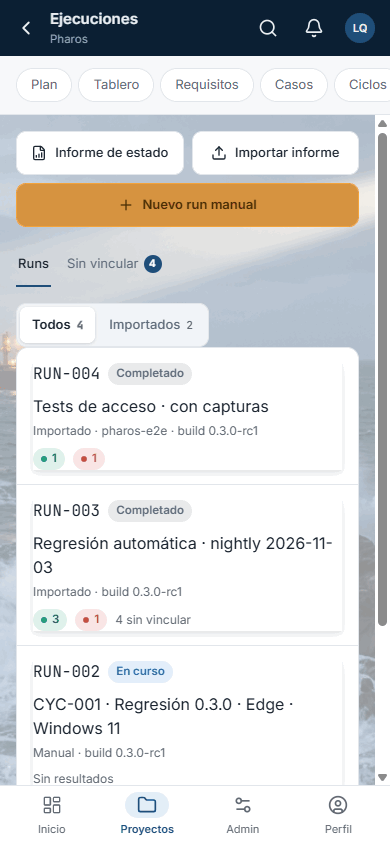

<!-- Generado por `npm run manual` desde e2e/tours/10-ejecuciones.tour.ts y docs/manual/fuentes/ejecuciones.md. No lo edites a mano: edita la fuente. -->

# 10. Ejecuciones e importación de resultados

## Para qué sirve

«Ejecuciones» reúne los **runs** del proyecto. Un run es una ejecución
concreta de pruebas, y puede salir de tres sitios:

- **De un ciclo:** «Ejecutar» crea un run por configuración (capítulo 9).
- **A mano:** «Nuevo run manual», con los casos que elijas (capítulo 11).
- **De tu automatización:** «Importar informe» lee los resultados de
  Playwright, Cucumber, JUnit o CTRF.

Al importar, Pharos enlaza cada test con su caso por la clave del caso. Los
que no la llevan esperan en la bandeja **«Sin vincular»**: vinculándolos una
sola vez, sus resultados pasados y futuros cuentan para el caso.

En este manual, la automatización de Pharos deja dos informes:

- la regresión nocturna con Playwright, cuyos 4 tests no llevan clave y van a
  la bandeja;
- un JUnit de los tests de acceso, ya vinculados a PH-001 y PH-002, con la
  captura de un fallo, importado en el ciclo «Regresión 0.3.0».

## Paso a paso

### 10.1. Ejecuciones

Un run es una ejecución concreta de pruebas: manual, creada al ejecutar un ciclo, o importada de tu automatización. Pulsa «Ejecuciones» en el menú lateral. La pestaña «Runs» lista los runs con su clave, su título, su origen y su build, su estado (en curso, completado o cancelado), sus resultados (pasan, fallan, otros, sin vincular) y su inicio; en este ejemplo, los dos runs del ciclo «Regresión 0.3.0», todavía sin resultados. «Sin vincular» reúne los tests importados que esperan un caso. Arriba, «Informe de estado», «Importar informe» y «Nuevo run manual» (capítulo 11).

### 10.2. Importar un informe

«Importar informe» trae a Pharos los resultados de tu automatización: Cucumber Messages (NDJSON), CTRF, JUnit XML, JSON de Playwright o Pharos Run JSON, hasta 200 MB (50 MB si es JSON o XML). El formato se detecta por el contenido. Al elegir el archivo, Pharos rellena el título, la build, el commit, la rama y el entorno con lo que trae el informe; corrígelos si hace falta. En este ejemplo, el JUnit de la regresión nocturna de Pharos con Playwright. Solo en la app de escritorio.

### 10.3. Vista previa antes de importar

La vista previa dice cuántos tests e intentos trae el informe, cuántos se vinculan a un caso y cuántos quedarán «sin vincular», con los avisos que haya. Un test se vincula solo si lleva la clave de un caso: en Cucumber, Playwright o CTRF, como tag (@PH-001); en JUnit, con la propiedad test_id. Este informe no la lleva, así que sus 4 tests irán a la bandeja. Nada se guarda hasta pulsar «Importar». Si el archivo ya se importó, Pharos lo dice y no duplica nada.

### 10.4. Informe importado

Al terminar, el resumen dice qué run se creó, cuántos resultados se importaron y cuántos quedan sin vincular. El run aparece en la lista como «Importado», con sus resultados. El filtro «Importados» deja solo los runs que vienen de un informe.

### 10.5. Un informe con adjuntos

Si el informe enlaza capturas, vídeos o trazas por su ruta, Pharos pide la «Carpeta de adjuntos» (por ejemplo, test-results): busca cada archivo por su nombre y lo guarda, cifrado, como evidencia del resultado. En este ejemplo, un JUnit de dos tests de acceso, vinculados a PH-001 y PH-002 por su test_id, con la captura de un fallo. «Ciclo» hace que el run nuevo sea del ciclo «Regresión 0.3.0»: sus resultados cuentan en el progreso del ciclo sin editar nada después (los ciclos cerrados no se ofrecen). «Run abierto» añade los resultados a un run en curso, para los shards de una misma ejecución.

### 10.6. Adjuntos guardados

El resumen confirma cuántos resultados se importaron, que ninguno quedó sin vincular y cuántos adjuntos se guardaron como evidencia (o cuáles no se encontraron en la carpeta).

### 10.7. La bandeja «Sin vincular»

Los tests importados sin la clave de un caso del proyecto esperan en «Sin vincular» (la pestaña dice cuántos), con el motivo («Sin etiqueta de caso», «Dos etiquetas de caso», «PH-099 no es un caso del proyecto»…), su último estado, cuántos resultados tienen y su último run. Hasta que los vincules no cuentan para ningún caso, ni en el progreso ni en la matriz. Solo en la app de escritorio.

### 10.8. Vincular un test a un caso

«Vincular…» abre el buscador de casos: busca por clave o título (en este ejemplo, «Iniciar sesión»), elige el caso y pulsa «Vincular». Desde ese momento, todos sus resultados, pasados y futuros, cuentan para el caso; los resultados en sí no cambian.

### 10.9. Vinculados a mano

El aviso confirma el vínculo («Test vinculado: sus resultados cuentan para el caso.»). El filtro «Vinculados a mano» muestra los tests que vinculaste, con su caso, para revisarlos; «Todos» enseña también los demás. «Desvincular» deshace el vínculo si te equivocaste.

### 10.10. Desvincular

«Desvincular» pregunta antes: sus resultados, pasados y futuros, dejan de contar para el caso y el test vuelve a la bandeja («Vínculo retirado.»). Los resultados no cambian; si te equivocas, vuelve a vincularlo. Esc o «Cancelar» lo dejan como estaba.

### 10.11. Las ejecuciones en el móvil

En el móvil, cada run es una tarjeta con su clave, su estado, su título y sus resultados; un toque lo abre. «Informe de estado», «Importar informe» y «Nuevo run manual» quedan en la fila de botones de la sección.

## Cómo se vincula un test a su caso

| Formato | Dónde va la clave del caso |
| --- | --- |
| Cucumber Messages (NDJSON), playwright-bdd | Tag del escenario: `@PH-001` |
| JSON de Playwright | Tag del test (`@PH-001`) o la anotación `test_id` |
| CTRF | Sus `tags` |
| JUnit XML | Propiedad `test_id` del `<testcase>` (`<property name="test_id" value="PH-001"/>`) o las propiedades `tag` / `tags`. JUnit no tiene tags propios, así que `@PH-001` en el nombre del test no basta |
| Pharos Run JSON | Sus `tags` |

El detalle de cada formato está en [Formatos de importación](../formats/importers.md).

Si exportas los `.feature` desde Pharos (capítulo 8), cada escenario ya lleva
su tag.

## Atajos de teclado

| Tecla | Dónde | Qué hace |
| --- | --- | --- |
| ← → | Pestañas «Runs» y «Sin vincular» | Cambian de pestaña |
| ← → | Filtros «Todos» / «Importados» y los de la bandeja | Cambian de filtro |
| Tab | Diálogo «Importar un informe» | Recorre el archivo, la carpeta, el destino y los datos del run |
| ↑ ↓ y Espacio | Lista de casos de «Vincular a un caso» | Eligen el caso |
| Esc | Diálogos de importar y de vincular | Los cierran, salvo mientras se importa |

## Si algo no sale

- **«Importar informe» está en gris.** En la versión web no se importan
  informes: usa la app de escritorio.
- **Todos los tests quedan «sin vincular».** El informe no lleva la clave de
  los casos (ver la tabla de arriba). Vincúlalos a mano en la bandeja o añade
  la clave en tu automatización.
- **«Dos etiquetas de caso».** Un test lleva dos claves de caso: Pharos no
  adivina cuál es y lo deja sin vincular. Deja una sola.
- **«… no es un caso del proyecto».** La clave no existe aquí; quizá es de
  otro proyecto o el caso se eliminó.
- **«Este archivo ya está importado en RUN-…».** Importar dos veces el mismo
  archivo no duplica nada. Con «Run abierto» puedes completar los adjuntos que
  falten; con «Run nuevo», marca la casilla si de verdad quieres importarlo
  otra vez.
- **«N adjuntos no se encontraron en la carpeta elegida.»** Elige la carpeta
  que contiene los archivos (por ejemplo, `test-results`).
- **«El archivo supera…».** El límite es 200 MB (50 MB si es JSON o XML).
- **«Run abierto» está en gris.** No hay ningún run en curso en el proyecto.
- **«No se pudieron cargar los runs.»** Pulsa «Reintentar».
- **Un run dice «Sin resultados».** Todavía no se ha ejecutado nada en él:
  ábrelo para ejecutarlo (capítulo 11).

## En el móvil

- Cada run es una tarjeta con su clave, su estado, su título y sus
  resultados.
- Los botones de la sección quedan en una fila sobre la lista.
- La importación y la bandeja «Sin vincular» son de la app de escritorio.

## Consejos

- Pon la clave del caso en tu automatización: con el tag (`@PH-001`) o la
  propiedad `test_id` en JUnit, cada importación se vincula sola.
- Si un informe enlaza capturas, vídeos o trazas, elige también su carpeta de
  adjuntos: se guardan como evidencias del resultado.
- Importa en el ciclo: elige «Ciclo» al importar y sus resultados cuentan en
  el progreso del ciclo.
- Los shards de una misma ejecución se importan en el mismo run: marca «Dejar
  el run abierto para importar más shards» en el primero y usa «Run abierto»
  en los demás.

## Véase también

- Capítulo 9, «Ciclos de prueba».
- Capítulo 11, «Ejecución manual» y el informe de estado.
- Capítulo 13, «Trazabilidad»: el último resultado de cada caso.
- [Guía de pruebas de la beta](../guia-beta.md), apartado 4.4c «Importar
  resultados de pruebas automáticas».
- [Formatos de importación](../formats/importers.md).
- [Glosario](../GLOSARIO.md), sección «Execution model identifiers».

---

← [Ciclos de prueba](09-ciclos.md) · [Índice](README.md) · [Ejecución manual](11-ejecucion-manual.md) →
