<!-- Generado por `npm run manual` desde e2e/tours/11-ejecucion-manual.tour.ts y docs/manual/fuentes/ejecucion-manual.md. No lo edites a mano: edita la fuente. -->

# 11. Ejecución manual

## Para qué sirve

La **ejecución manual** es donde se prueba a mano. Un run reúne los casos que
hay que ejecutar: los de un ciclo (capítulo 9) o los que eliges con «Nuevo
run manual». El **ejecutor** muestra los pasos de cada caso para que puedas:

- marcarlos uno a uno: Pasa, Falla, Bloqueado u Omitido;
- anotar lo obtenido;
- adjuntar evidencias;
- medir el tiempo.

Cada vez que guardas se registra un **intento**, que ya no cambia: repetir la
prueba crea otro, así que el historial de lo que pasó se conserva. Los
resultados alimentan:

- el progreso del run y del ciclo;
- el Inicio (capítulo 3);
- el informe de estado;
- la matriz de trazabilidad (capítulo 13).

Desde aquí se sale también el **informe de estado** (ISO/IEC/IEEE 29119-3), el
documento que resume una ronda de pruebas para quien decide.

En este manual, Liomar repite a mano los dos casos de acceso de Pharos. PH-001
falla en el paso 3: Pharos se queda en la entrada con «Correo o contraseña
incorrectos.». De ese fallo saca un defecto, que sigue en el capítulo 12.

## Paso a paso

### 11.1. Nuevo run manual

Para las pruebas que se hacen a mano fuera de un ciclo, «Nuevo run manual», en «Ejecuciones», crea un run: el título (obligatorio; propone «Run manual» y la fecha), el entorno, la build, la configuración y los casos que entran, con buscador y el recuento de los elegidos. Cada caso entra con su revisión vigente, así que el resultado queda ligado a la versión del caso que se ejecutó. En este ejemplo, Liomar repite a mano los dos casos de acceso de Pharos. «Crear y abrir» lo crea y abre su pantalla.

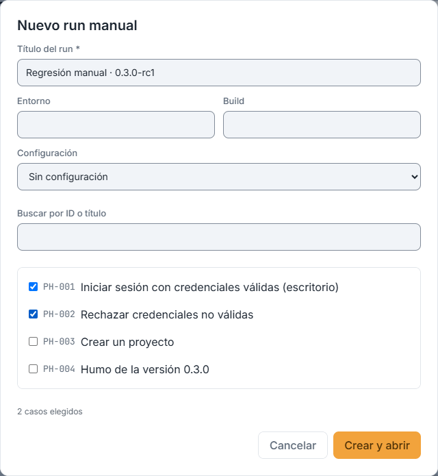

### 11.2. La pantalla del run

La pantalla del run muestra su cabecera (clave, título, estado, origen, entorno, build, configuración, ciclo y fechas), el progreso («0/3 ejecutados») y sus elementos, que se filtran por resultado. Un caso Outline o con flujos se ejecuta una vez por fila o por flujo (en este ejemplo, PH-002 tiene dos filas de ejemplos). Arriba, «Añadir casos», «Editar datos», «Cerrar run» y «Eliminar run»; «Ejecutar el siguiente» abre el primer elemento pendiente.

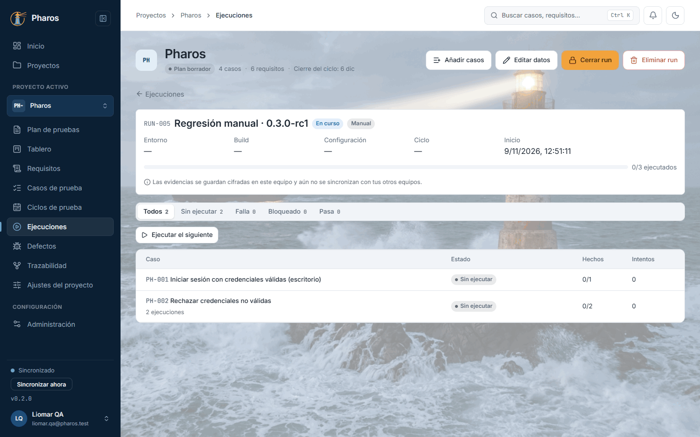

### 11.3. El ejecutor

Un clic en un caso abre el ejecutor junto a la lista: los pasos del caso con su resultado esperado. Marca cada paso como «Pasa», «Falla», «Bloqueado» u «Omitido» (repetir la marca la quita). Falla y Bloqueado abren «Obtenido / notas» para escribir qué pasó (en este ejemplo, el paso 3 falla: Pharos se queda en la entrada con «Correo o contraseña incorrectos.»). Con el teclado es más rápido: P, F, B y S marcan el paso enfocado; J o ↓ y K o ↑ cambian de paso; N abre las notas; T pone en marcha o pausa el cronómetro.

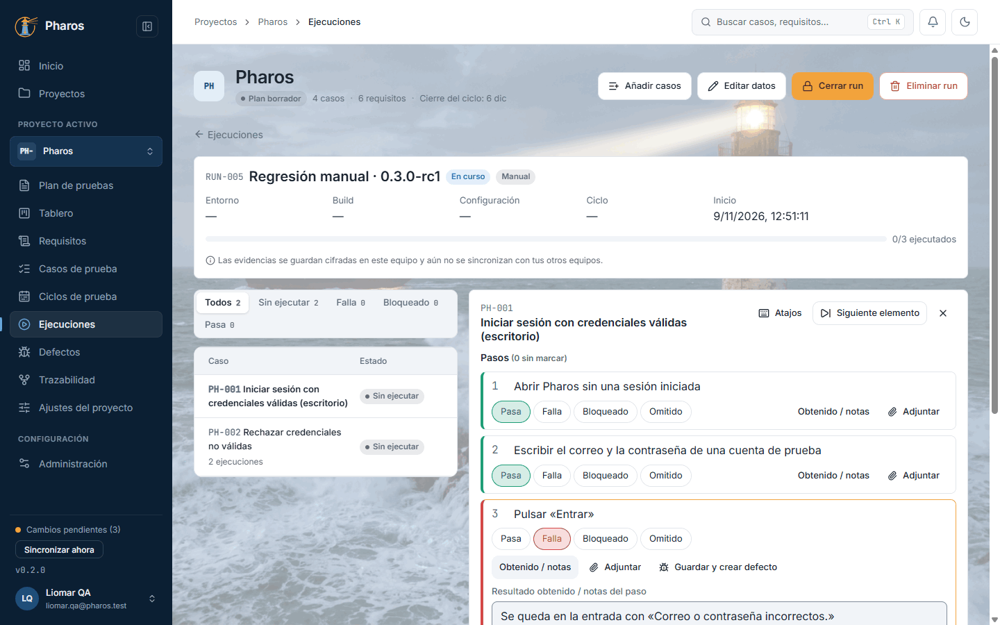

### 11.4. Los atajos de teclado

«Atajos» (o la tecla «?») muestra todas las teclas del ejecutor: P / F / B / S marcan, J / K y las flechas cambian de paso, N abre las notas, T el cronómetro, Ctrl+Enter guarda el resultado, Ctrl+Mayús+N pasa al siguiente elemento y Ctrl+V pega una captura. Las letras solo actúan cuando no estás escribiendo en un campo; Ctrl+Enter y Ctrl+Mayús+N, también dentro de un campo.

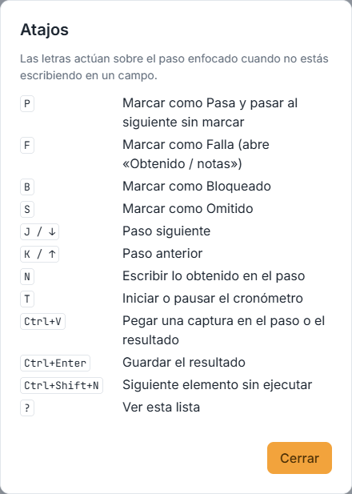

### 11.5. Adjuntar evidencias

El clip de cada paso («Adjuntar») y «Adjuntar al resultado» añaden archivos de hasta 200 MB: capturas, vídeos, registros. Se guardan cifrados en este equipo y se muestran como fichas con su miniatura. Mientras ejecutas, todo es un borrador que se guarda solo (lo dice el pie: «Borrador guardado en este equipo»): si cierras la app, lo encuentras al volver. Los adjuntos solo están en la app de escritorio.

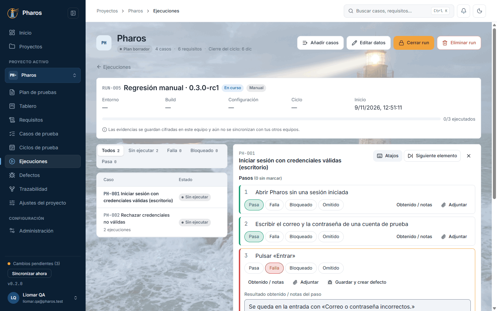

### 11.6. Pegar una captura

Con el foco en un paso o en el resultado, Ctrl+V pega la imagen del portapapeles como evidencia, sin guardarla antes en un archivo: haz la captura con Win+Mayús+S (⌘⇧4 en Mac) y pega. «Pegar captura» hace lo mismo con un clic. La imagen se llama «captura-» con la fecha y la hora.

### 11.7. Quitar una evidencia

La papelera de cada ficha («Quitar «nombre»») borra esa evidencia, y no se puede recuperar. Por eso es una confirmación crítica: Esc y el clic fuera no hacen nada; solo responden «Cancelar» o «Quitar», en rojo (en este ejemplo, Liomar quita la captura pegada y conserva la del fallo).

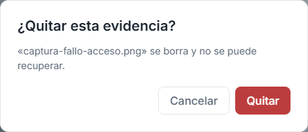

### 11.8. Guardar el resultado

«Guardar resultado (Falla)» (o Ctrl+Enter) registra el intento con el estado que resulta de los pasos; el selector «Resultado» permite fijar otro a mano. Los pasos sin marcar se guardan como Omitido, y el aviso lo dice antes. Un intento guardado no cambia: repetir la prueba crea otro intento («Intento 2»), así que el historial de lo que pasó se conserva en «Intentos», debajo.

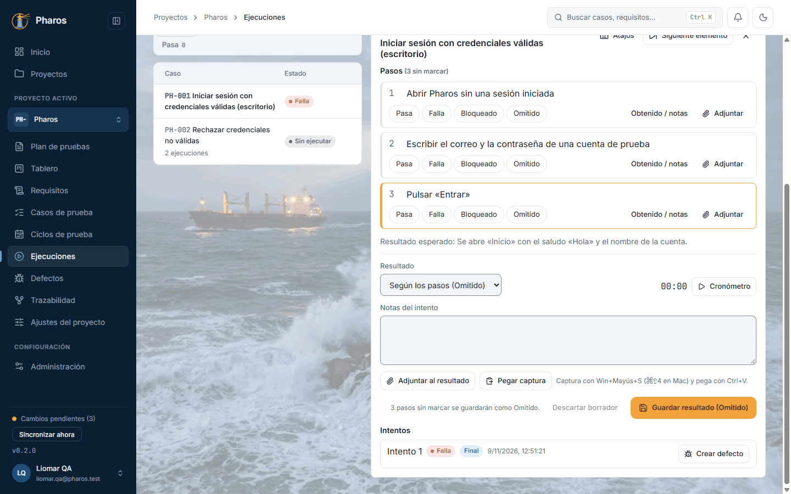

### 11.9. Crear un defecto desde el intento fallido

En un intento fallido o bloqueado, «Crear defecto» abre el editor de defectos relleno con los pasos de la revisión ejecutada, lo obtenido, la build y el entorno, ya vinculado al resultado y a su caso, y con sus evidencias (sin copiar los archivos). «Guardar y crear defecto», en un paso que falla, hace lo mismo sin guardar antes el intento. Los vínculos ofrecen los casos y los requisitos del proyecto, como en «Defectos» (capítulo 12).

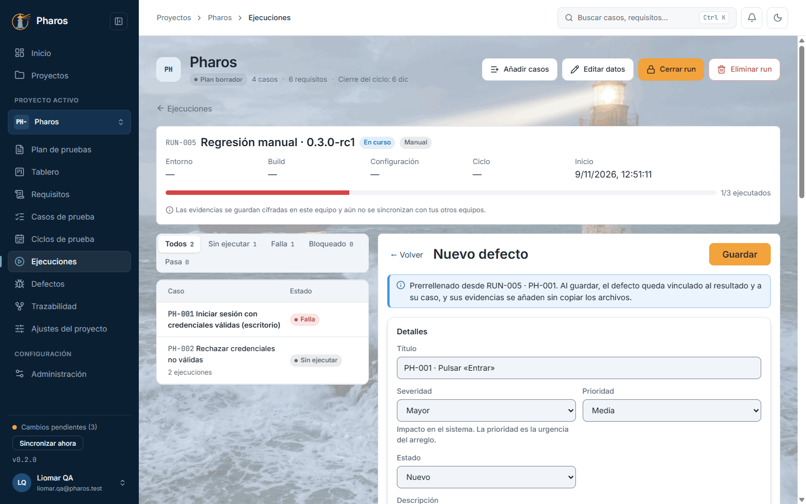

### 11.10. Descartar un borrador

Si un borrador no te sirve, «Descartar borrador» tira sus marcas, notas y adjuntos, después de confirmarlo («¿Descartar el borrador?»). Los intentos ya guardados no cambian.

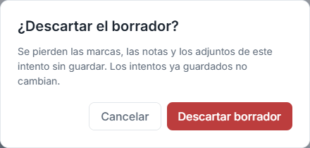

### 11.11. Editar los datos del run

«Editar datos» corrige el título, el entorno o la build del run, si te equivocaste al crearlo.

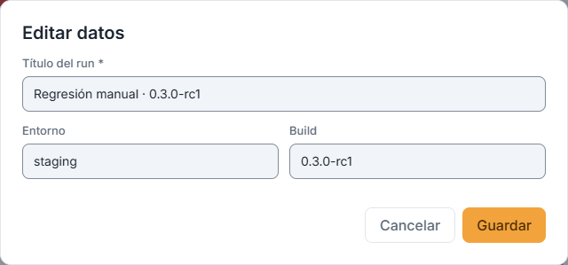

### 11.12. Cerrar el run

«Cerrar run» avisa de lo que queda sin ejecutar y de los borradores sin guardar, y pide cómo se cierra: «Completado» o «Cancelado» (cancelar descarta los borradores). Un run cerrado no admite intentos nuevos; «Reabrir» lo vuelve a abrir, salvo que su ciclo esté cerrado.

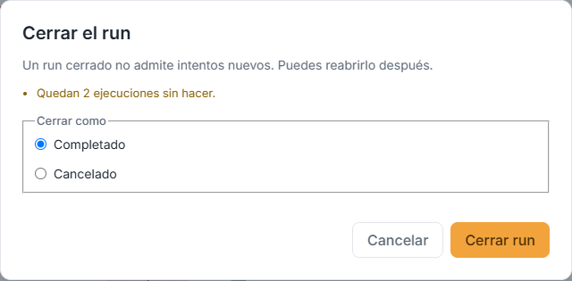

### 11.13. Run cerrado y reabierto

Tras cerrar, el run queda en solo lectura: se ven sus intentos, pero no se ejecuta. «Reabrir» permite volver a ejecutar, por ejemplo, si faltó un caso.

### 11.14. El run en el móvil

En pantallas estrechas, el ejecutor ocupa toda la pantalla en lugar de la lista: al tocar un caso se abre, y «Cerrar la ejecución» (✕) vuelve a la lista. Los adjuntos y «Pegar captura» son de la app de escritorio; en la web, el borrador se guarda en el navegador.

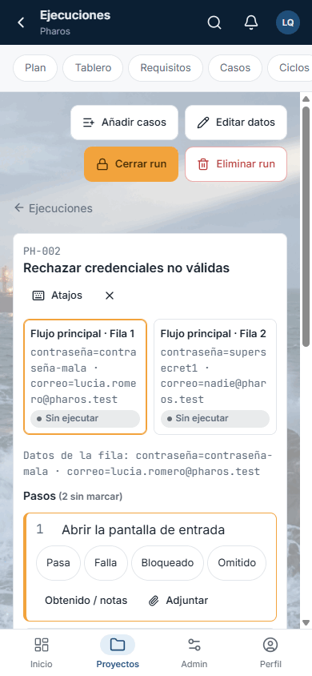

### 11.15. Informe de estado

En «Ejecuciones» (o en la cabecera de un ciclo), «Informe de estado» genera el informe de estado de pruebas (ISO/IEC/IEEE 29119-3) del proyecto, de un ciclo o del plan, entre las fechas que elijas: identificación, progreso, resultados por estado, defectos por severidad (a fecha de hoy), cobertura y riesgos, los criterios de salida del plan (cumple / no cumple / sin datos), bloqueos, resumen y recomendaciones. El resumen se rellena solo con las cifras y se puede cambiar; en este ejemplo, Liomar escribe sus recomendaciones. Los dos se guardan solo en este equipo y van en las exportaciones.

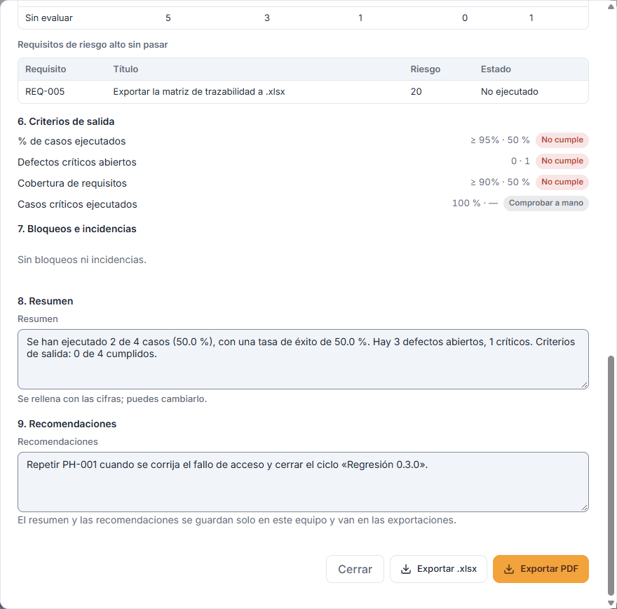

### 11.16. Exportar el informe a Excel

«Exportar .xlsx» guarda el informe en tu carpeta de descarga: una hoja «Resumen» con las nueve secciones y hojas con los resultados por caso, los defectos y la cobertura por requisito. Un aviso dice el nombre del archivo.

### 11.17. Exportar el informe a PDF

«Exportar PDF» guarda el mismo informe como documento, listo para enviar o firmar.

### 11.18. Eliminar un run

«Eliminar run», en la cabecera de un run (solo en la app de escritorio), lo quita de las listas y del progreso, en este equipo y en los que sincronicen. En este ejemplo, Liomar elimina un run que creó por error. Antes dice qué se oculta: elementos, resultados, evidencias, borradores que se descartan, el ciclo cuyo progreso deja de contarlo y los defectos vinculados. Los resultados nunca se borran a mano: la purga se los lleva con el run pasada la retención (Administración › General). Un run de un ciclo cerrado no se puede eliminar.

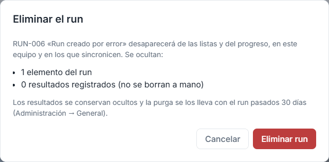

### 11.19. Run eliminado

Al confirmar vuelves a la lista de runs, donde ya no aparece; el registro de auditoría guarda la eliminación con lo que ocultó.

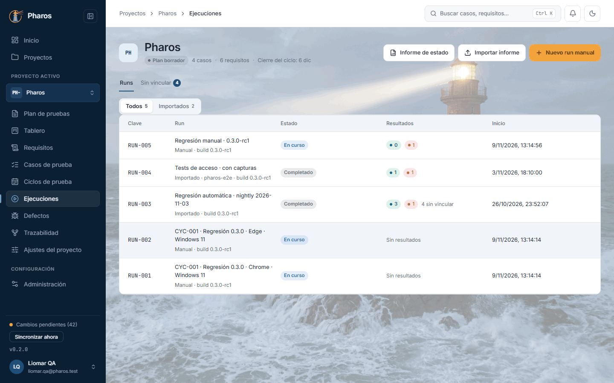

## Atajos de teclado

| Tecla | Qué hace | Dentro de un campo |
| --- | --- | --- |
| P | Marca el paso enfocado como Pasa y salta al siguiente sin marcar | No |
| F | Lo marca como Falla, se queda en él y abre «Obtenido / notas» | No |
| B | Lo marca como Bloqueado, se queda en él y abre las notas | No |
| S | Lo marca como Omitido y pasa al siguiente | No |
| J o ↓ / K o ↑ | Paso siguiente / anterior | No |
| N | Abre «Obtenido / notas» del paso | No |
| T | Pone en marcha o pausa el cronómetro | No |
| ? | Muestra la lista de atajos | No |
| Ctrl+Enter (⌘+Enter) | Guarda el resultado | Sí |
| Ctrl+Mayús+N | Pasa al siguiente elemento del run | Sí |
| Ctrl+V | Pega la captura del portapapeles en el paso enfocado o en el resultado | Sí |

Las letras no hacen nada mientras escribes en un campo, con Ctrl o Alt
pulsado, con un diálogo abierto o en un run cerrado. En un run cerrado solo
funcionan «?» y Ctrl+Mayús+N.

## Si algo no sale

- **«El run está cerrado: puedes ver sus intentos, pero para ejecutar hay que
  reabrirlo.»** Pulsa «Reabrir» en la cabecera. Si dice que el ciclo está
  cerrado, reabre antes el ciclo (capítulo 9).
- **«El caso cambió después de añadirlo al run: se ejecuta la revisión N…».**
  Es lo esperado: el run ejecuta la versión del caso que tenía al crearlo. Si
  quieres la nueva, añade el caso a otro run.
- **«La revisión ejecutada no tiene pasos.»** Marca directamente el resultado
  global, abajo.
- **«Los adjuntos solo están disponibles en el escritorio.»** En la web se
  ejecuta igual, pero sin archivos; el borrador se queda en ese navegador.
- **«El portapapeles no tiene ninguna imagen…».** Haz la captura (Win+Mayús+S
  o ⌘⇧4) y vuelve a pegar. Si dice que no se pudo leer el portapapeles, pulsa
  Ctrl+V sobre el paso o el resultado.
- **«El archivo supera los 200 MB.»** Ese adjunto no se guarda.
- **«Este intento ya se guardó o lo cambió otra ventana…».** El mismo
  elemento estaba abierto en otra ventana o pestaña. Pharos recarga lo
  guardado.
- **«No se pudo guardar el borrador. Lo que marcaste sigue en pantalla.»**
  Sigue: lo marcado se guarda al registrar el resultado.
- **«Eliminar run» no se puede pulsar o está en gris.** Solo existe en la app
  de escritorio, y un run de un ciclo cerrado no se puede eliminar.
- **El informe de estado no ofrece «Ciclo» o «Plan».** El proyecto no tiene
  ciclos o no tiene plan; con el plan ausente, se usan los criterios de salida
  por defecto.

## En el móvil

- El ejecutor ocupa toda la pantalla en lugar de la lista. Al tocar un caso se
  abre, y «Cerrar la ejecución» (✕) vuelve.
- Desde 1280 px de ancho, en cambio, la lista y el ejecutor van uno junto al
  otro.
- Los adjuntos y «Pegar captura» son de la app de escritorio.

## Consejos

- Trabaja con el teclado: es mucho más rápido marcar con P, F, B y S y guardar
  con Ctrl+Enter.
- El borrador se guarda solo mientras marcas: puedes cerrar y seguir después.
- Escribe siempre lo obtenido en un paso que falla: es lo primero que leerá
  quien tenga que corregirlo, y pasa al defecto.
- Si solo quieres dejar de ejecutar un run, ciérralo como «Cancelado» en vez
  de eliminarlo.
- En la matriz de trazabilidad gana siempre el último resultado final, sea de
  un run manual o de un informe importado: repetir la prueba a mano después de
  un informe de Playwright cambia lo que muestra la matriz.
- En el informe de estado, los defectos se cuentan «a fecha de hoy», no por el
  periodo elegido. El resumen y las recomendaciones se guardan solo en este
  equipo, pero van en el Excel y en el PDF.

## Véase también

- Capítulo 9, «Ciclos de prueba»: los runs de un ciclo.
- Capítulo 10, «Ejecuciones e importación de resultados».
- Capítulo 12, «Defectos».
- Capítulo 13, «Trazabilidad»: el último resultado de cada caso.
- [Glosario](../GLOSARIO.md), sección «Execution model identifiers»: run,
  elemento, objetivo, intento, último resultado, informe de estado, criterio de
  salida evaluado.

---

← [Ejecuciones e importación de resultados](10-ejecuciones.md) · [Índice](README.md) · [Defectos](12-defectos.md) →
