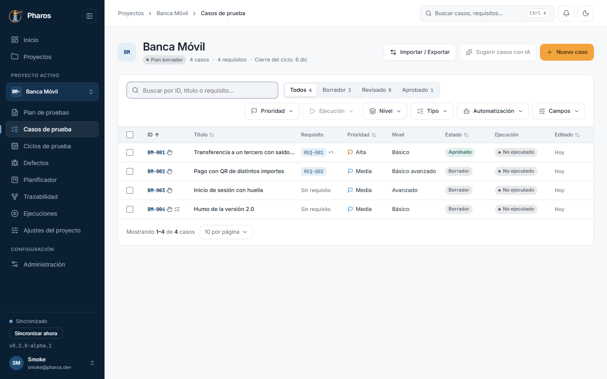
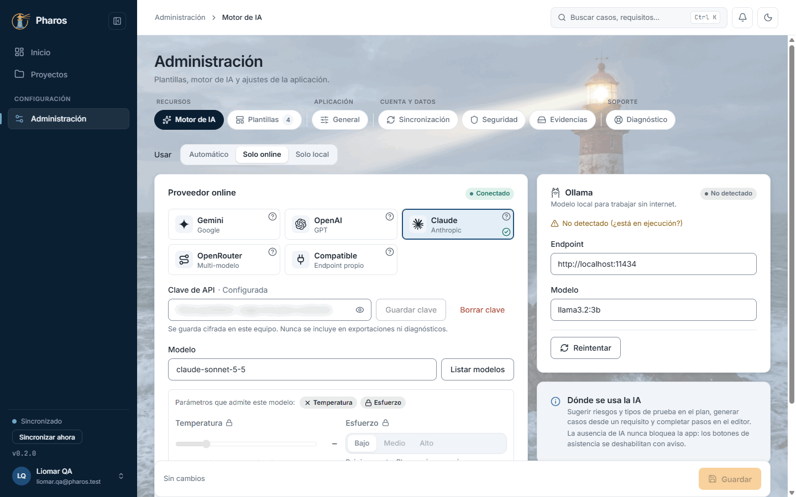
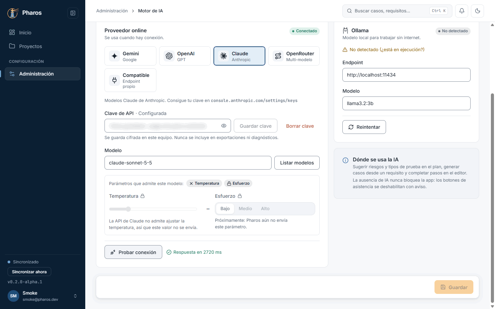
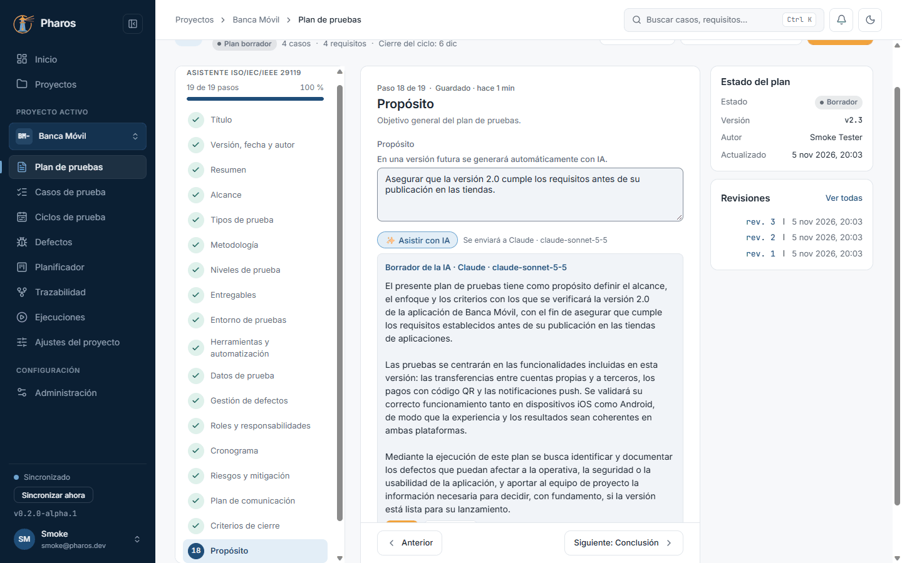
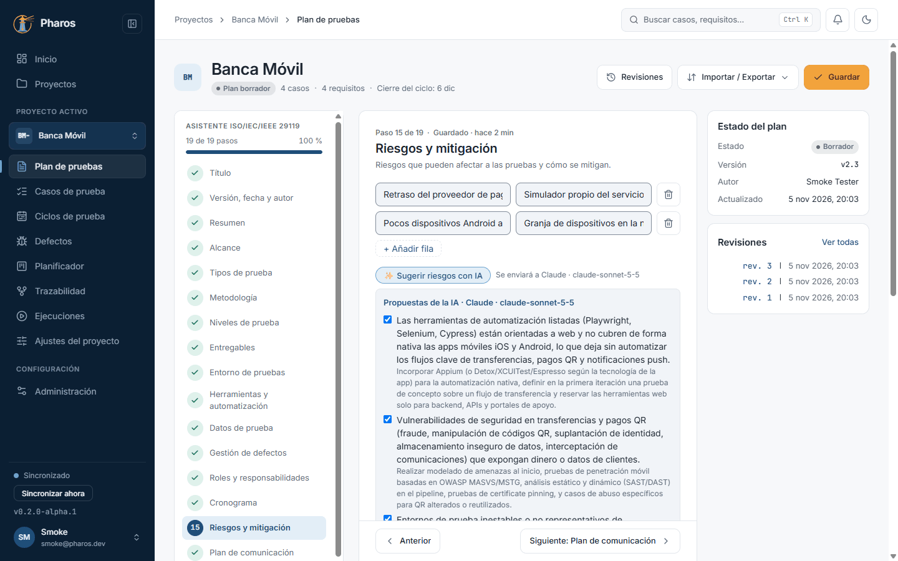
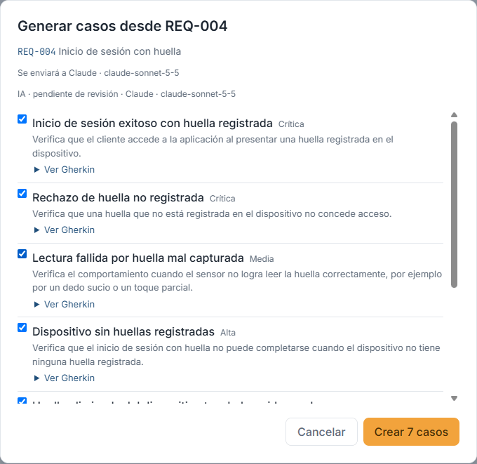
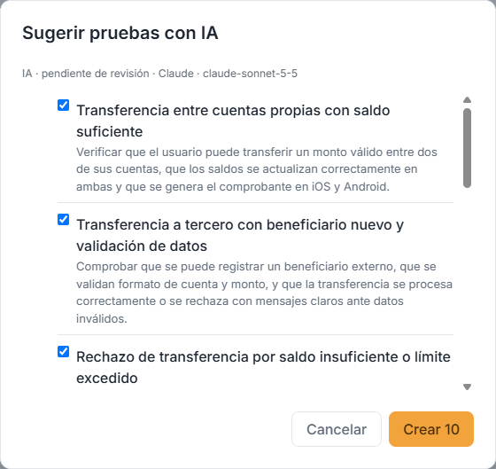
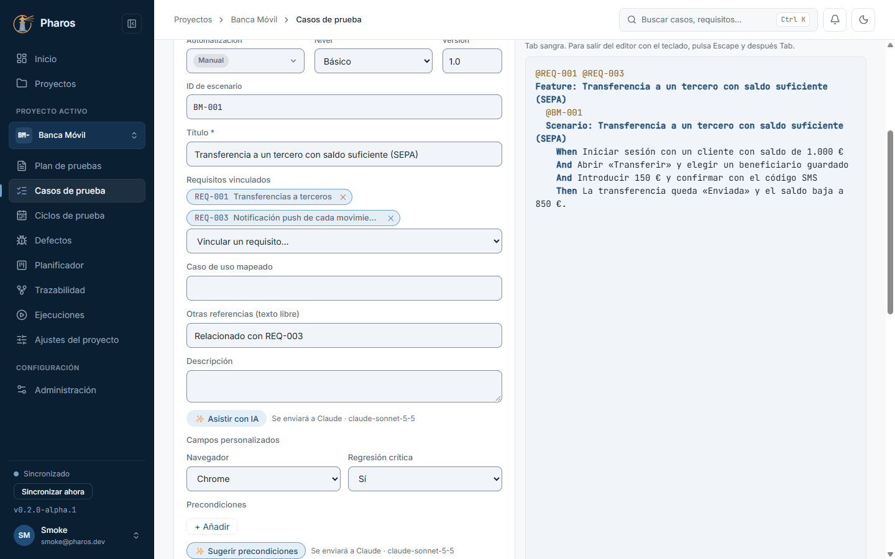

<!-- Generado por `npm run manual` desde e2e/tours/11-ia.tour.ts y docs/manual/fuentes/ia.md. No lo edites a mano: edita la fuente. -->

# 11. Asistente de IA

## Para qué sirve

La IA de Pharos es **opcional**: con tu propia clave de un proveedor online
(Gemini, OpenAI, Claude, OpenRouter o un servicio compatible) o sin internet
con Ollama, redacta borradores de campos del plan, sugiere riesgos y
precondiciones y propone casos a partir de un requisito o del plan. **Nada se
aplica sin que lo aceptes**, y lo aceptado queda marcado como generado por IA.

## Paso a paso

### 11.1. Sin IA configurada

La IA es opcional. Mientras no configures un proveedor (o Ollama), los botones de IA aparecen deshabilitados y explican por qué; el resto de Pharos funciona igual.

### 11.2. Configurar el proveedor

En «Administración → Motor de IA», elige el proveedor, pega tu clave y pulsa «Guardar clave»: queda en el almacén de credenciales de Windows y el campo muestra «Configurada» (en este manual, difuminado). Después elige un modelo («Listar modelos») y guarda.

### 11.3. Probar la conexión

Antes de confiar en la configuración, «Probar conexión» envía una pregunta mínima y muestra el tiempo de respuesta. Si falla, dice por qué (clave, modelo o red).

### 11.4. «Asistir con IA» en un campo

En los campos de texto del plan, «✨ Asistir con IA» propone un borrador a partir del resto del plan. Revisa el «Borrador de la IA» y pulsa «Usar» o «Descartar»: nada se aplica solo, y lo aceptado queda marcado como generado por IA.

### 11.5. Sugerir riesgos

En «Riesgos y mitigación», «✨ Sugerir riesgos con IA» propone riesgos con su mitigación, un buen punto de partida que conviene revisar: marca los que te sirvan y pulsa «Añadir».

### 11.6. Generar casos desde un requisito

En «Trazabilidad», el botón de IA de un requisito propone escenarios Gherkin y casos para él. Revisa cada propuesta («Ver Gherkin»), marca las buenas y pulsa «Crear N casos»: quedan vinculados al requisito.

### 11.7. Sugerir casos a partir del plan

En «Casos de prueba», «Sugerir casos con IA» propone casos según los tipos y niveles del plan (capítulo 3); elige los que quieras crear y revísalos como cualquier otro caso.

### 11.8. Sugerir precondiciones

En el editor de un caso, «✨ Sugerir precondiciones» propone las condiciones previas a partir del título y los pasos, las que más se suelen olvidar al escribir un caso.

### 11.9. Borrar la clave

«Borrar clave» la quita del almacén de credenciales, por ejemplo, si cambias de cuenta o vas a dejar el equipo; la IA vuelve a quedar sin configurar.

## Consejos

- Elige un modelo rápido y económico para el día a día; para generar casos de
  un requisito complejo, uno más capaz.
- Revisa siempre las propuestas: la IA no conoce tu producto mejor que tú.
- Los textos que envías a un proveedor online salen de tu equipo; para datos
  sensibles, usa Ollama («Solo local»).

## Véase también

- [Guía de pruebas de la beta](../guia-beta.md), apartado 4.7 «IA (opcional)».

---

← [Administración](10-administracion.md) · [Índice](README.md) · [Pantallas estrechas y móvil](12-movil.md) →
