<!-- Generado por `npm run manual` desde e2e/tours/12-defectos.tour.ts y docs/manual/fuentes/defectos.md. No lo edites a mano: edita la fuente. -->

# 12. Defectos

## Para qué sirve

Un **defecto** registra algo que no funciona como se esperaba, para que se
corrija y se pueda volver a probar. Cada defecto lleva:

- **Severidad:** el impacto en el sistema (crítica, mayor, menor, trivial).
- **Prioridad:** la urgencia del arreglo (crítica, alta, media, baja). Un
  defecto puede ser de severidad menor y prioridad alta, por ejemplo una
  errata en la pantalla de entrada justo antes de una demostración.
- **Reproducción:** pasos, resultado esperado y resultado obtenido, con la
  build y el entorno en que se encontró.
- **Vínculos** con los casos, los requisitos y los resultados de los que nace.
  La matriz de trazabilidad (capítulo 13), el informe de estado (capítulo 11)
  y el Inicio (capítulo 3) los cuentan.
- **Evidencias:** capturas, vídeos o registros, guardados cifrados en este
  equipo.

Su **ciclo de vida**: Nuevo → Abierto → En curso → Corregido → En retest →
Cerrado, y además Rechazado (con su resolución) o Aplazado. Rechazado y
Cerrado piden siempre una **resolución**. Un defecto aplazado sigue contando
como abierto.

Cuando el último resultado de un caso es un fallo y uno de sus defectos llega
a «Corregido» o «En retest» (y ninguno sigue nuevo, abierto o en curso), el
caso pasa a **Re-test** en la matriz y en el Inicio: toca volver a probarlo.

En este manual, Liomar registra dos defectos de Pharos:

- **«El menú lateral sigue mostrando el prefijo anterior»** (mayor, media),
  escrito a mano, con su captura y vinculado al caso PH-003 y al requisito
  REQ-002. Lo aplaza a la 0.4.0.
- **«Entrar con credenciales válidas muestra “Correo o contraseña
  incorrectos”»** (crítico), creado desde el resultado fallido de la prueba
  automática de acceso que importó en el capítulo 10.

## Paso a paso

### 12.1. Defectos

Un defecto registra algo que no funciona como se esperaba, para que se corrija y se pueda volver a probar. Pulsa «Defectos» en el menú lateral. Arriba están «Desde un resultado» y «Nuevo defecto»; debajo, los filtros por estado (abiertos, todos, cerrados), la búsqueda, la severidad y el cambio entre «Lista» y «Tablero». Sin defectos, la lista lo dice.

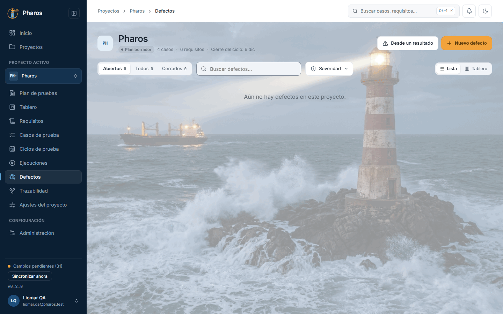

### 12.2. Nuevo defecto: el título es obligatorio

«Nuevo defecto» abre el editor. El título es obligatorio: si pulsas «Guardar» sin él, Pharos lo indica en el campo y no guarda nada.

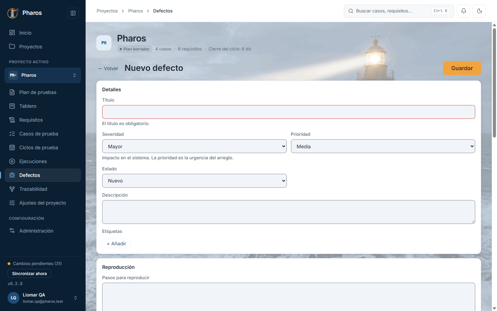

### 12.3. Rellenar el defecto

Un buen defecto permite reproducir el fallo sin preguntar a nadie. Rellena el título, la severidad (el impacto en el sistema) y la prioridad (la urgencia del arreglo), los pasos para reproducirlo, el resultado esperado y el obtenido, y dónde se encontró (build y entorno). En «Vínculos», marca los casos y los requisitos afectados: la matriz de trazabilidad (capítulo 13) los mostrará junto al defecto. Los campos propios del proyecto aparecen al final (aquí, «Sistema operativo», creado en el capítulo 14). En este ejemplo, Liomar registra que, al cambiar el prefijo en los ajustes, el menú lateral sigue mostrando el anterior: severidad mayor, prioridad media, build 0.3.0-rc1, vinculado al caso «Crear un proyecto» (PH-003) y al requisito REQ-002.

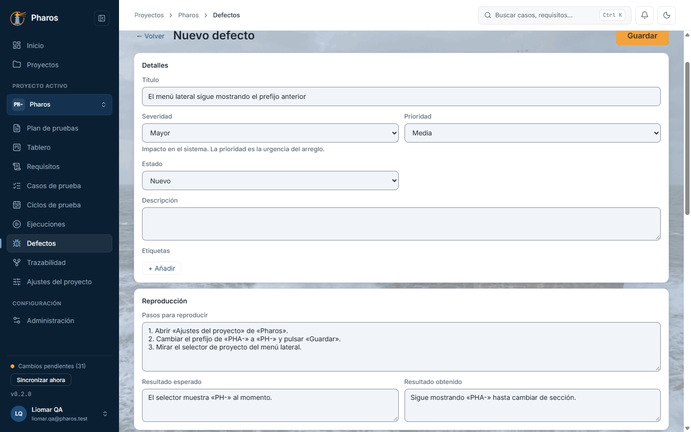

### 12.4. Evidencias

Una vez guardado el defecto, «Evidencias» admite capturas, vídeos o registros que muestran el fallo, de hasta 200 MB cada uno: «Adjuntar archivos» abre el selector de archivos (en este ejemplo, una captura del menú lateral). Se guardan cifrados en este equipo; un clic en el nombre descarga una copia.

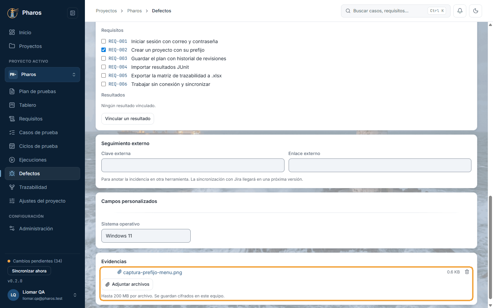

### 12.5. Quitar una evidencia

La papelera de cada archivo («Quitar: nombre») borra esa evidencia, y no se puede recuperar. Por eso Pharos pregunta con una confirmación crítica: Esc y el clic fuera no hacen nada; solo responden «Cancelar» o «Quitar», en rojo. En este ejemplo, Liomar cancela y la captura se queda.

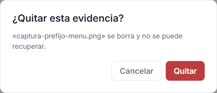

### 12.6. Un defecto desde un resultado fallido

Cuando una prueba falla, lo más rápido es crear el defecto desde su resultado. «Desde un resultado» lista los intentos que no pasaron en los runs del proyecto (en este ejemplo, la prueba automática de acceso del informe JUnit importado en el capítulo 10). Al elegir uno, el editor se rellena con el error y el defecto queda vinculado a ese resultado y a su caso, así que la trazabilidad no depende de copiar y pegar.

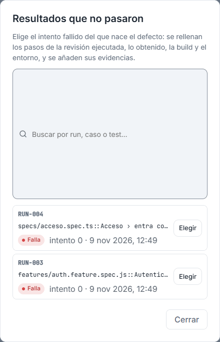

### 12.7. Prerrellenado desde el resultado

El aviso azul de arriba indica de qué resultado nace el defecto. Revisa el título y la severidad que propone y guarda. En este ejemplo, Liomar lo titula «Entrar con credenciales válidas muestra “Correo o contraseña incorrectos”» y lo marca como crítico: nadie puede entrar en la aplicación.

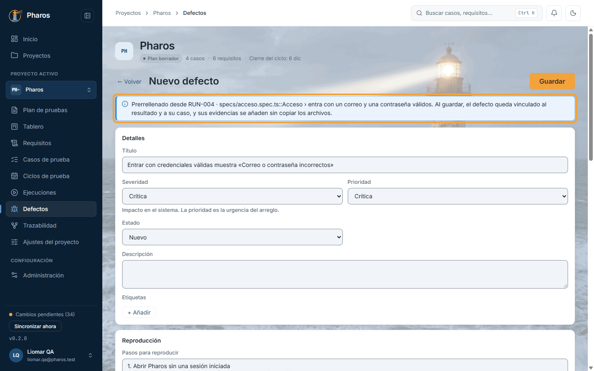

### 12.8. Quitar el vínculo con un resultado

Una vez guardado, los resultados vinculados aparecen como fichas en «Vínculos»; la ✕ de una ficha quita el vínculo, tras preguntarlo. Es una confirmación normal, porque el resultado no se borra y se puede volver a vincular: Esc, un clic fuera o «Cancelar» lo dejan como estaba (en este ejemplo, Liomar cancela).

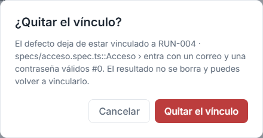

### 12.9. La lista de defectos

La lista muestra ID, título, severidad, prioridad, estado, casos vinculados y fecha. Cambia entre abiertos, todos o cerrados, filtra por severidad o busca por texto (en este ejemplo, «prefijo» deja solo el del menú lateral). Un clic en el título abre el defecto.

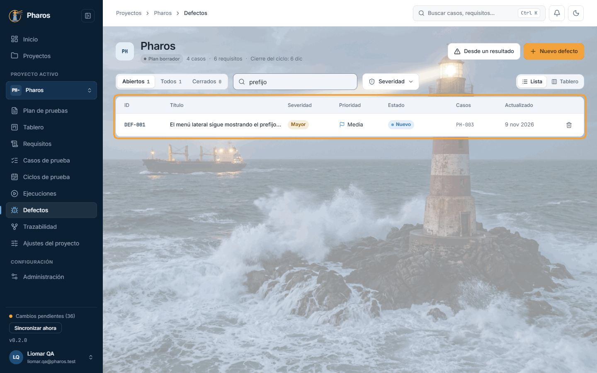

### 12.10. El tablero de defectos

«Tablero» agrupa los defectos por estado, una columna por cada etapa de su ciclo de vida: nuevo, abierto, en curso, corregido, en re-test, cerrado y «Otros» (rechazado o aplazado). Para avanzar un defecto, arrastra su tarjeta o, con el teclado, lleva el foco a su asa y usa Espacio y las flechas. Pharos solo permite los cambios de estado válidos, así que una columna que no admite el defecto no lo acepta. En este ejemplo, Liomar confirma el del menú lateral y lo pasa a «Abierto».

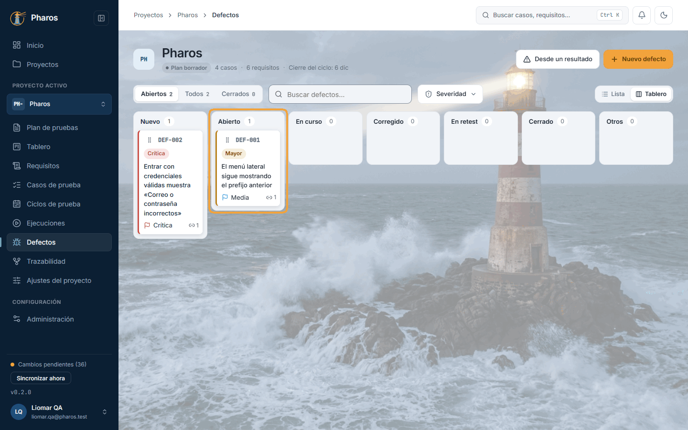

### 12.11. Rechazar o aplazar un defecto

Al soltar un defecto en «Otros», Pharos pregunta a qué estado pasa: «Rechazado» pide la resolución (duplicado, no reproducible, no se corregirá, funciona según el diseño…) y «Aplazado» lo deja abierto para más adelante. Al soltarlo en «Cerrado», pide la resolución y, si quieres, la build en la que se corrigió, para saber desde qué versión volver a probar. En este ejemplo, Liomar aplaza el del menú lateral a la 0.4.0: es molesto, pero no bloquea la entrega.

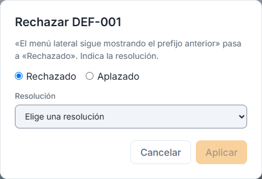

### 12.12. Eliminar un defecto

Normalmente un defecto se cierra o se rechaza, no se borra. Si se creó por error (en este ejemplo, Liomar registró dos veces el fallo de acceso), la papelera de su fila («Eliminar defecto») lo borra tras una confirmación crítica: solo responden «Cancelar» y «Sí, eliminar». Su clave no se vuelve a usar.

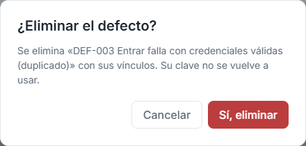

### 12.13. Defecto eliminado

Al confirmar, el defecto desaparece de la lista. Si no se pudiera eliminar, un aviso lo dice y el defecto sigue ahí.

## Atajos de teclado

| Tecla | Dónde | Qué hace |
| --- | --- | --- |
| ← → | Filtro de estado (Abiertos · Todos · Cerrados) y «Lista / Tablero» | Cambian de opción |
| Espacio o Intro | Asa de una tarjeta del tablero | La coge para moverla; otra vez, la suelta |
| ← → | Tarjeta cogida | La lleva a la columna anterior o siguiente |
| Esc | Tarjeta cogida | Cancela el movimiento; la tarjeta vuelve a su sitio |
| Esc | Quitar el vínculo con un resultado | Equivale a «Cancelar» |
| Esc | Quitar una evidencia o eliminar un defecto | No la cierra: usa «Cancelar» |

## Si algo no sale

- **«El título es obligatorio.»** Escribe el título antes de guardar.
- **No veo «Evidencias» o dice «Guarda el defecto para poder añadir
  evidencias.»** Los archivos se adjuntan a un defecto ya guardado: guárdalo y
  vuelve a abrirlo.
- **«Los adjuntos solo están disponibles en el escritorio.»** En la versión
  web no se adjuntan archivos; usa la app de escritorio.
- **«“nombre” supera el límite de 200 MB.»** Recorta el vídeo o comprime el
  registro.
- **«Este archivo no está en este equipo…»** El archivo caducó o se copió la
  carpeta de datos sin su carpeta de evidencias.
- **«Un defecto “Nuevo” no puede pasar a “Cerrado”.»** El tablero solo admite
  los cambios del ciclo de vida. Avánzalo paso a paso o usa el campo
  «Estado» del editor, que solo ofrece los estados siguientes.
- **«Aplicar» está en gris al rechazar o cerrar.** Falta elegir la
  resolución.
- **«No hay resultados fallidos en los runs de este proyecto.»** Todo pasó, o
  aún no hay runs. Crea el defecto con «Nuevo defecto».
- **«No se pudo vincular el resultado.» o «No se pudo quitar el
  vínculo.»** El defecto se queda como estaba; vuelve a intentarlo.
- **«No se pudieron cargar los defectos.»** Pulsa «Reintentar».
- **«Ningún defecto coincide con los filtros.»** Pulsa «Quitar filtros».

## En el móvil

- La lista es una pila de tarjetas con la clave, la severidad, el estado y el
  título; un toque abre el defecto.
- El tablero enseña una columna cada vez: desliza a los lados para pasar de
  un estado a otro.
- Eliminar un defecto, por ahora, solo se puede desde la tabla en escritorio
  o tableta.

## Consejos

- Crea el defecto **desde el resultado** fallido siempre que puedas: hereda
  los pasos de la revisión ejecutada, lo obtenido, la build, el entorno y las
  evidencias, y queda vinculado al intento concreto.
- Un buen título describe el síntoma, no la causa supuesta: «El menú lateral
  sigue mostrando el prefijo anterior», no «Falla la caché del menú».
- Vincula los requisitos afectados: la matriz mostrará qué requisitos tienen
  defectos abiertos antes de una entrega.
- Cierra o rechaza en vez de eliminar: el historial dice qué pasó. La clave de
  un defecto eliminado (`DEF-003`) no se reutiliza.
- Para seguirlo también en otra herramienta, anota su clave y su enlace en
  «Seguimiento externo».

## Véase también

- Capítulo 10, «Ejecuciones e importación de resultados»: de dónde salen los
  resultados fallidos.
- Capítulo 11, «Ejecución manual»: «Crear defecto» desde un intento.
- Capítulo 13, «Trazabilidad»: los defectos en la matriz.
- Capítulo 14, «Ajustes del proyecto»: los campos de los defectos.
- [Glosario](../GLOSARIO.md): «Re-test», y la sección «Execution model
  identifiers».

---

← [Ejecución manual](11-ejecucion-manual.md) · [Índice](README.md) · [Trazabilidad](13-trazabilidad.md) →
