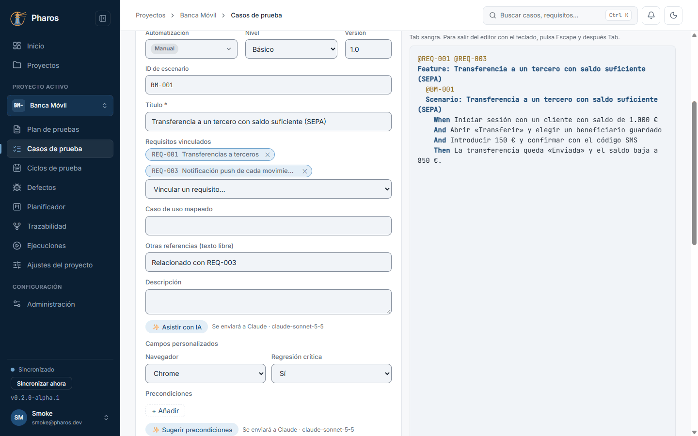
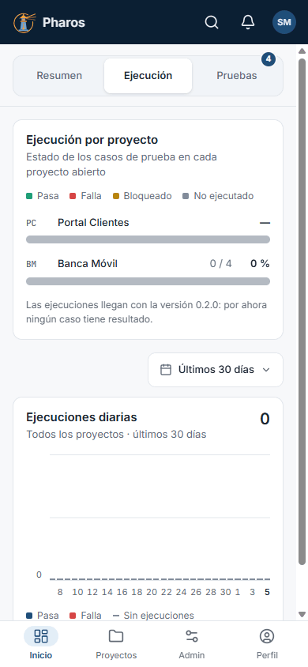
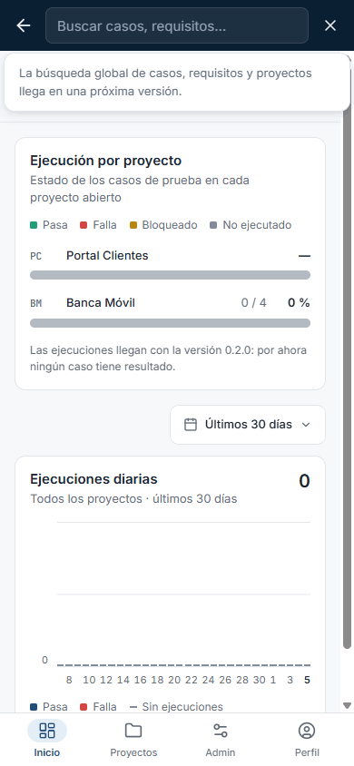
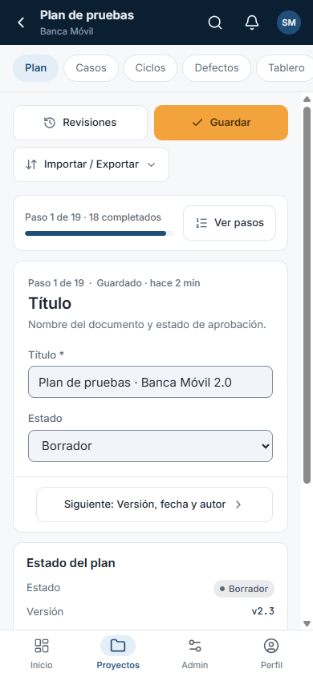
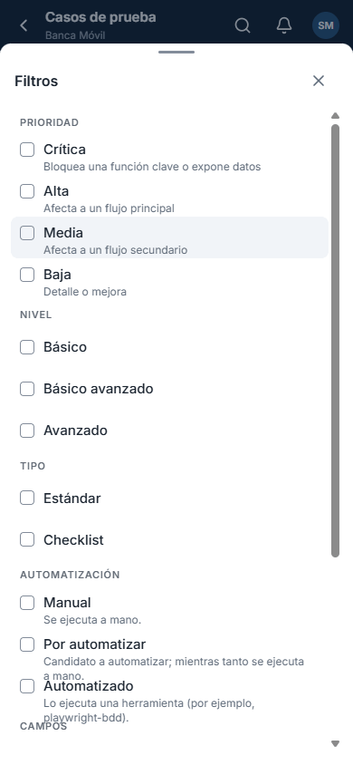
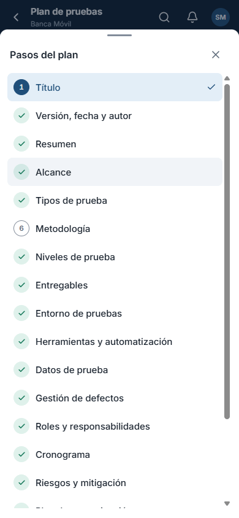

<!-- Generado por `npm run manual` desde e2e/tours/12-movil.tour.ts y docs/manual/fuentes/movil.md. No lo edites a mano: edita la fuente. -->

# 12. Pantallas estrechas y móvil

## Para qué sirve

Pharos se adapta al ancho de la ventana: menú lateral completo desde 1280 px,
una tira de iconos en pantallas medianas y, por debajo de 600 px, una barra
superior compacta con una barra inferior, como una app móvil. Las listas se
convierten en tarjetas y los menús y filtros se abren como hojas desde abajo.

## Paso a paso

### 12.1. Pantallas medianas: menú de iconos

Por debajo de 1280 px, el menú lateral se reduce a una tira de iconos con su nombre corto; el contenido gana espacio.

### 12.2. En el móvil: barra inferior

A 390 px, Pharos usa una barra superior compacta y una barra inferior con Inicio, Proyectos, Administración y Perfil.

### 12.3. Buscar en el móvil

La lupa convierte la barra superior en un campo de búsqueda; la flecha (o Esc) la cierra.

### 12.4. Secciones del proyecto en el móvil

Dentro de un proyecto, las secciones (Plan, Casos, Ciclos…) se recorren con las píldoras bajo el título; la flecha vuelve a Proyectos.

### 12.5. Filtros en una hoja inferior

En la lista de casos, «Filtros» abre una hoja desde abajo con los mismos filtros que en el escritorio.

### 12.6. Los pasos del plan en el móvil

En el plan de pruebas, «Ver pasos» abre la lista de los 19 pasos en una hoja inferior.

### 12.7. De vuelta al escritorio

Al ensanchar la ventana, Pharos vuelve al menú lateral completo.

## Consejos

- Todo lo que se hace en el escritorio se puede hacer en una ventana
  estrecha; solo cambia dónde están los controles.
- En una hoja inferior, la ✕ o Esc la cierran.

## Véase también

- [Guía de pruebas de la beta](../guia-beta.md), apartado 4.10 «Interfaz rediseñada».

---

← [Asistente de IA](11-ia.md) · [Índice](README.md) · [Ejecución manual](13-ejecucion-manual.md) →
