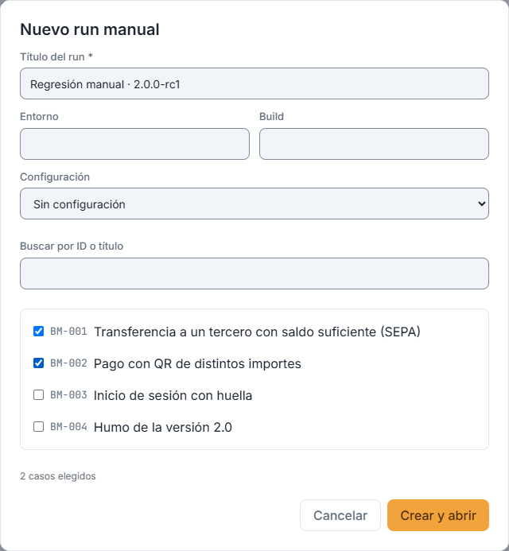
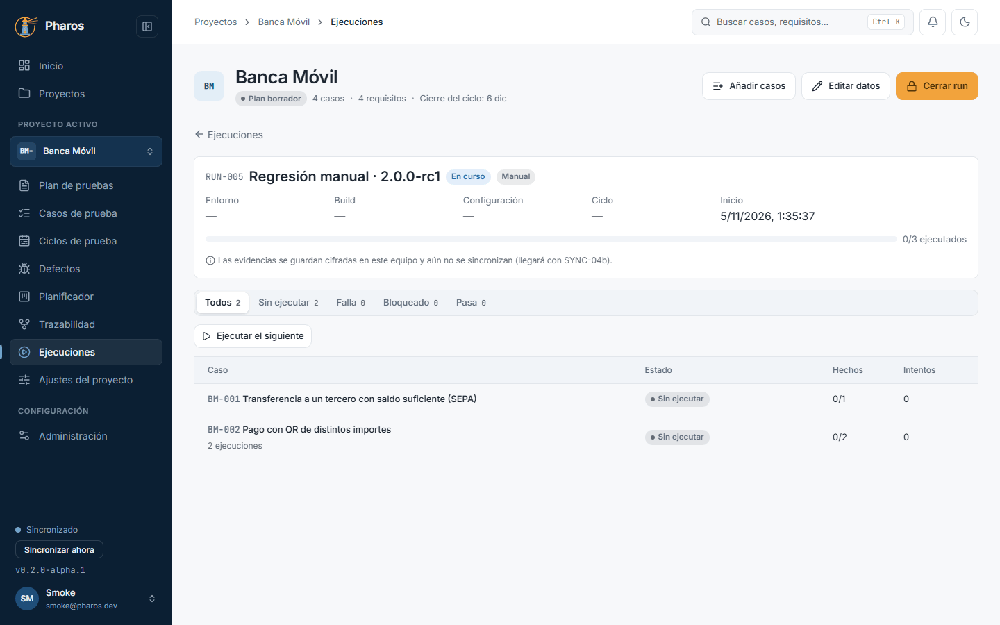
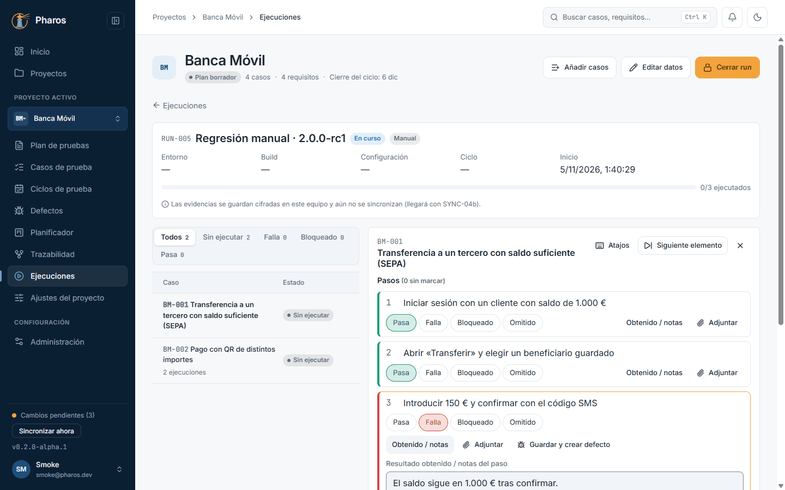
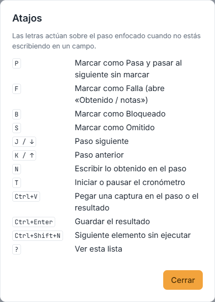
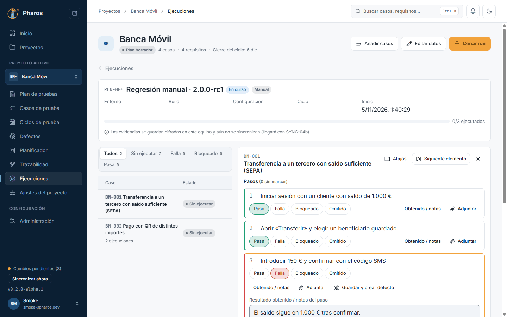
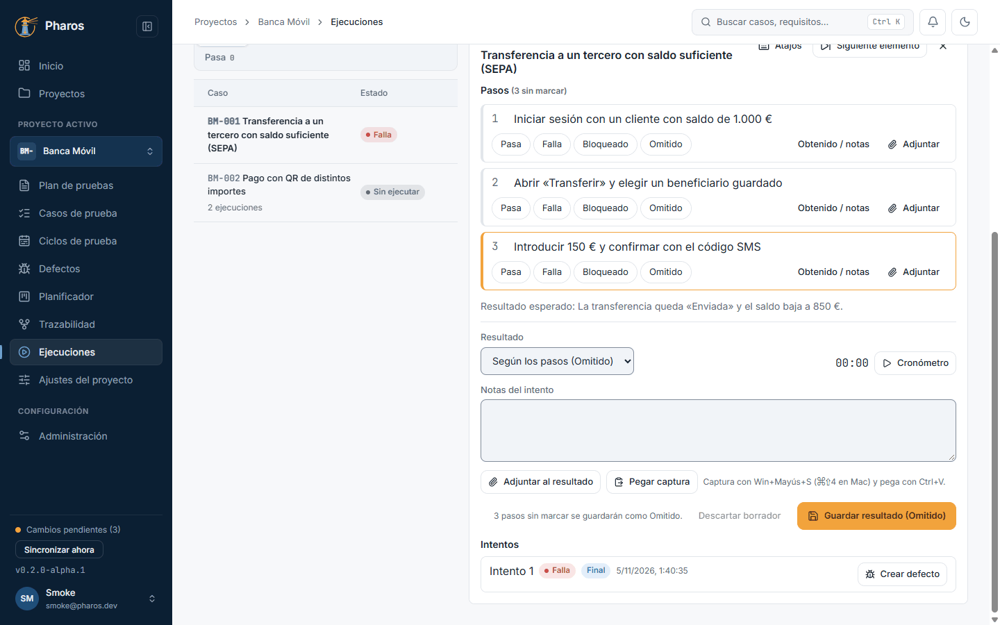
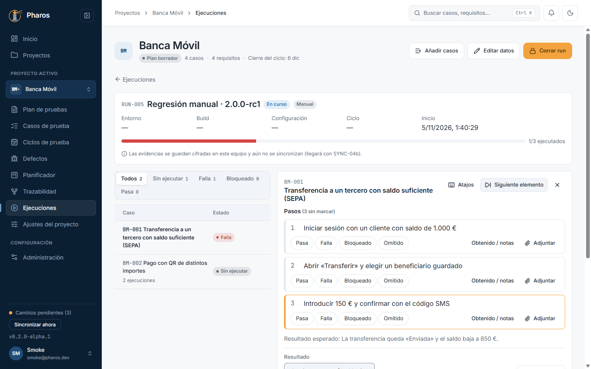
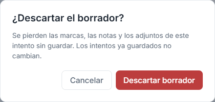
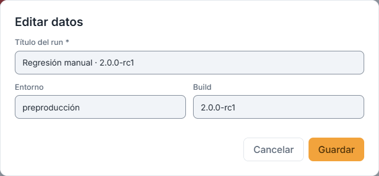
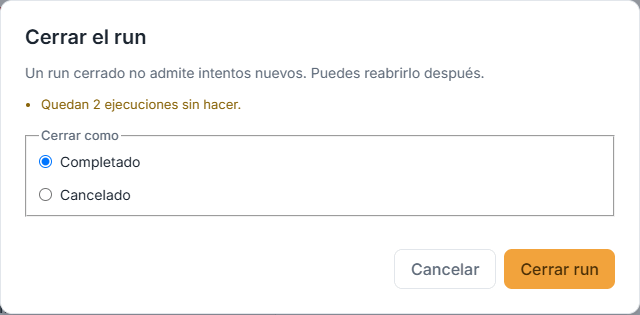

<!-- Generado por `npm run manual` desde e2e/tours/13-ejecucion-manual.tour.ts y docs/manual/fuentes/ejecucion-manual.md. No lo edites a mano: edita la fuente. -->

# 13. Ejecución manual

## Para qué sirve

La **ejecución manual** es donde se prueba a mano: un run con sus casos, y un
ejecutor que muestra los pasos de cada caso para marcarlos uno a uno (Pasa,
Falla, Bloqueado, Omitido), anotar lo obtenido y adjuntar evidencias. Cada
vez que guardas se registra un **intento** que no cambia; repetir la prueba
crea otro. Los resultados alimentan el progreso del run y del ciclo, «Inicio»
y la matriz de trazabilidad.

## Paso a paso

### 13.1. Nuevo run manual

En «Ejecuciones», «Nuevo run manual» crea un run para ejecutar a mano: título, entorno, build, configuración y los casos que entran (con su revisión vigente).

### 13.2. La pantalla del run

El run abierto muestra su cabecera (clave, entorno, build, configuración, estado), el progreso por resultado y sus elementos. Cada caso Outline o con flujos se ejecuta una vez por fila o por flujo.

### 13.3. El ejecutor

«Ejecutar» abre el ejecutor junto a la lista: los pasos del caso con su resultado esperado. Marca cada paso como Pasa, Falla, Bloqueado u Omitido; con el teclado, P / F / B / S marcan y J / K (o las flechas) cambian de paso.

### 13.4. Los atajos de teclado

«Atajos» (o «?») muestra todas las teclas del ejecutor.

### 13.5. Adjuntar evidencias

Cada paso y el resultado admiten archivos, una imagen pegada (Ctrl+V o «Pegar captura») o una captura del sistema. Se cifran en este equipo al adjuntarlas. El borrador se guarda solo: si cierras, lo encuentras al volver.

### 13.6. Pegar una captura

Con el foco en un paso o en el resultado, Ctrl+V pega la imagen del portapapeles (una captura hecha con Win+Mayús+S) como evidencia, sin guardarla antes en un archivo.

### 13.7. Guardar el resultado

«Guardar resultado» (o Ctrl+Enter) registra el intento con el estado que resulta de los pasos (aquí, Falla). Un intento guardado no cambia: repetir la prueba crea otro intento.

### 13.8. Crear un defecto desde el intento fallido

En un intento fallido, «Crear defecto» abre el editor de defectos relleno con el caso, el paso y lo obtenido, ya vinculado al resultado.

### 13.9. Descartar un borrador

«Descartar» tira el borrador del elemento (y sus adjuntos) después de confirmarlo.

### 13.10. Editar los datos del run

«Editar datos» cambia el título, el entorno, la build o la configuración del run.

### 13.11. Cerrar el run

«Cerrar run» avisa de lo que queda sin ejecutar y de los borradores pendientes (que se pueden descartar); un run cerrado no admite intentos nuevos. «Reabrir» lo vuelve a abrir.

### 13.12. Run cerrado y reabierto

Tras cerrar, el run queda en solo lectura; «Reabrir» permite volver a ejecutar.

## Consejos

- Trabaja con el teclado: P / F / B / S marcan, J / K mueven, N escribe lo
  obtenido, T pone en marcha el cronómetro, Ctrl+Enter guarda y
  Ctrl+Shift+N pasa al siguiente elemento; «?» muestra la lista.
- El borrador se guarda solo mientras marcas: puedes cerrar y seguir después.
- Pega capturas con Ctrl+V sobre el paso o el resultado; se cifran en este
  equipo al adjuntarlas.
- Si el caso cambió después de añadirlo al run, se ejecuta la revisión que el
  run congeló: el resultado siempre apunta a lo que se probó.

## Véase también

- Capítulo 7, «Ciclos y configuraciones» (los runs de un ciclo) y capítulo 9, «Defectos».
- [Glosario](../GLOSARIO.md), sección «Execution model identifiers»: run, elemento, objetivo, intento.

---

← [Pantallas estrechas y móvil](12-movil.md) · [Índice](README.md) · [Evidencias](14-evidencias.md) →
