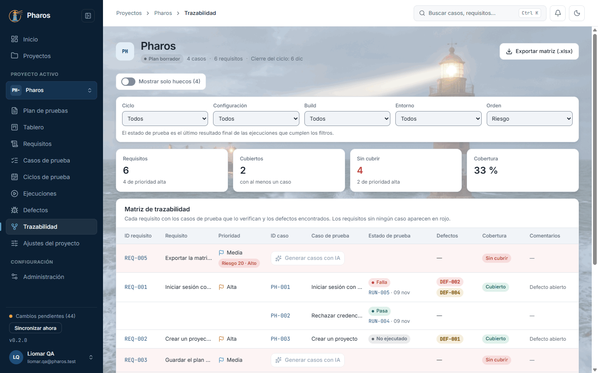
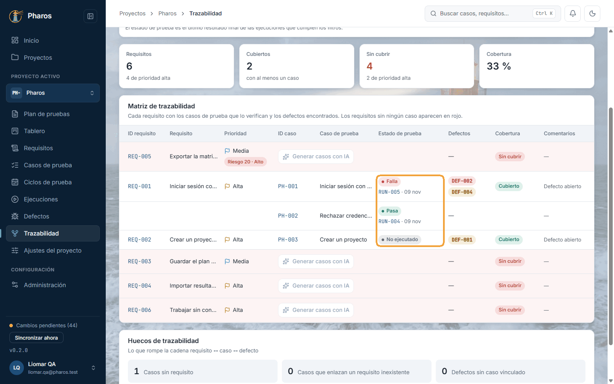
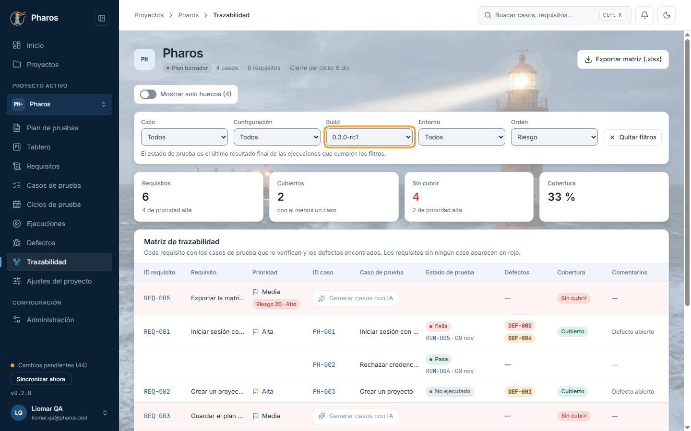
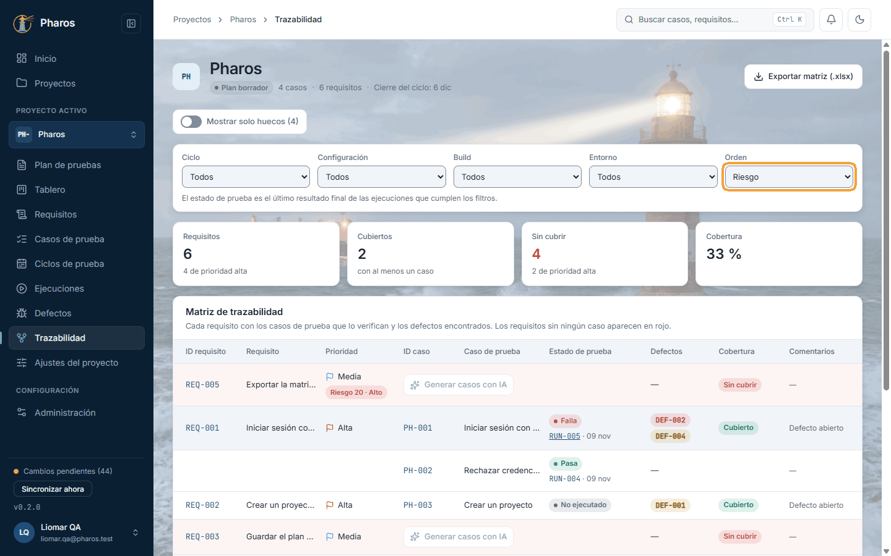
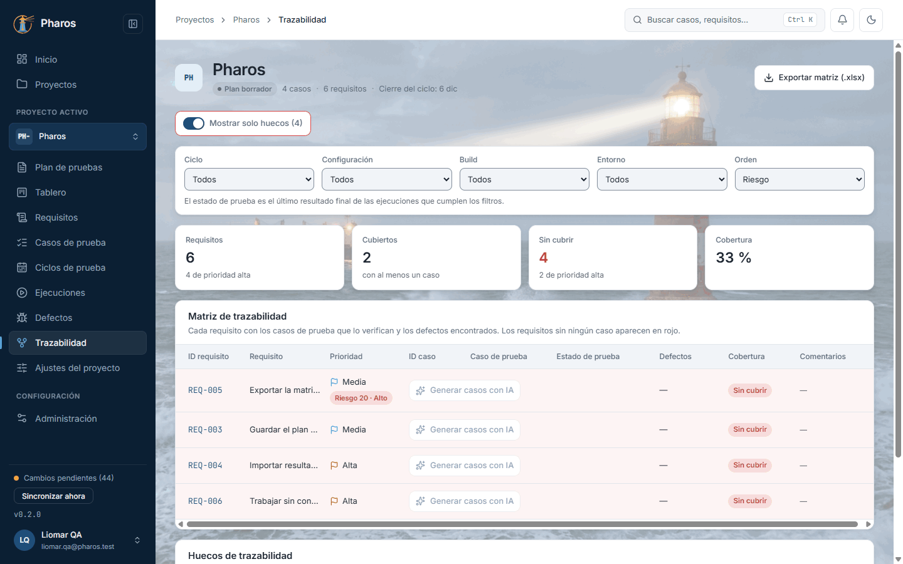
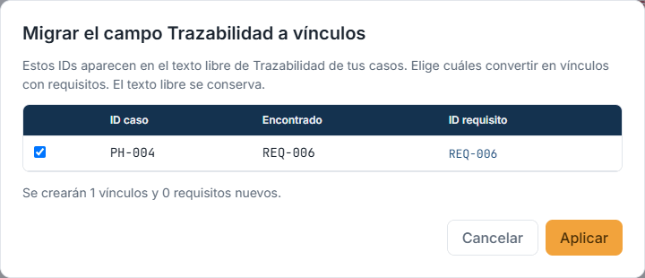

<!-- Generado por `npm run manual` desde e2e/tours/13-trazabilidad.tour.ts y docs/manual/fuentes/trazabilidad.md. No lo edites a mano: edita la fuente. -->

# 13. Trazabilidad

## Para qué sirve

La **matriz de trazabilidad** responde a «¿está probado este requisito?».
Cruza cuatro cosas que se hacen en otros capítulos:

- los **requisitos** (capítulo 7), con su prioridad y su riesgo;
- los **casos** que los verifican (capítulo 8), enlazados por la clave del
  requisito (`@REQ-001` en su Gherkin);
- el **último resultado** de cada caso, de los runs manuales (capítulo 11) o
  de los informes importados (capítulo 10);
- los **defectos** de cada caso (capítulo 12).

Un requisito está **cubierto** si tiene al menos un caso vivo que no esté
obsoleto. La **cobertura** es el porcentaje de requisitos cubiertos; los que
no tienen ningún caso salen en rojo.

El **estado de prueba** de un caso es el último resultado final de sus
ejecuciones, con la clave del run y la fecha. Gana siempre el más reciente,
sea manual o importado: repetir a mano una prueba después de un informe de
Playwright cambia lo que muestra la matriz. Lo matizan tres avisos:

- **Flaky:** el test pasó después de fallar.
- **Desactualizado:** se ejecutó una revisión anterior del caso.
- **Re-test:** el caso falló y su defecto ya está corregido; toca repetirlo.

El **riesgo** del requisito (probabilidad × impacto) ordena la matriz: lo más
arriesgado, primero.

En este manual, Liomar revisa qué está probado de Pharos 0.3.0 cuando ya
tiene la importación de JUnit, la ejecución manual y los dos defectos.

## Paso a paso

### 13.1. La matriz de trazabilidad

«Trazabilidad», al final del menú del proyecto, responde a «¿está probado cada requisito?». Arriba, las cifras: cuántos requisitos hay, cuántos están cubiertos (con al menos un caso), cuántos no y la cobertura. Debajo, la matriz: cada requisito con su prioridad, los casos que lo verifican, el estado de prueba de cada caso y sus defectos. Un requisito sin ningún caso sale en rojo. Va al final del menú porque mide el resultado de todo lo anterior: es la vista que enseñar cuando alguien pregunta qué se ha probado. En este ejemplo, Liomar revisa la 0.3.0 de Pharos después de la importación del capítulo 10, la ejecución manual del capítulo 11 y los defectos del capítulo 12.

### 13.2. El último resultado de cada caso

«Estado de prueba» es el último resultado final de cada caso, venga de un run manual o de un informe importado: el estado, la clave del run y la fecha. Los avisos lo matizan: «Flaky» (pasó tras fallar), «Desactualizado» (se ejecutó una revisión anterior del caso) y «Re-test» (falló y su defecto ya está corregido). «Defectos» enseña los de cada caso, con su severidad; los cerrados, atenuados. En este ejemplo, el caso de acceso PH-001 falla en el último run y lleva su defecto crítico.

### 13.3. Filtrar los resultados

Sobre la matriz, los filtros de resultados limitan el estado de prueba a las ejecuciones de un ciclo, una configuración, una build o un entorno: la foto de una ronda concreta. Los requisitos y los casos no cambian; solo qué resultados cuentan. Los filtros quedan en la dirección de la página, así que se pueden guardar o compartir, y «Quitar filtros» vuelve a todos. En este ejemplo, Liomar mira solo la build 0.3.0-rc1.

### 13.4. Del resultado a su run

La clave del run (RUN-…) de un resultado abre la pantalla de ese run, con todos sus elementos e intentos (capítulos 10 y 11). «Atrás» vuelve a la matriz.

### 13.5. Ordenar por riesgo

«Orden» decide cómo se listan los requisitos. Por defecto, «Riesgo»: primero los de más riesgo (probabilidad × impacto, capítulo 7), para que lo más arriesgado se revise antes; los que no tienen riesgo evaluado van al final. «ID de requisito» los ordena por su clave.

### 13.6. Solo los huecos

«Mostrar solo huecos» deja los requisitos sin ningún caso, lo primero que conviene resolver antes de cerrar un ciclo. Debajo, «Huecos de trazabilidad» reúne lo que rompe la cadena requisito ↔ caso ↔ defecto: casos sin requisito, casos que enlazan un requisito inexistente y defectos sin caso vinculado.

### 13.7. Migrar referencias escritas a mano

Si un caso menciona un ID de requisito en su texto libre («Otras referencias (texto libre)»), la matriz no lo cuenta. «Migrar trazabilidad» propone convertirlo en un vínculo real: marca los que quieras y pulsa «Aplicar». En este ejemplo, la checklist de humo (PH-004) citaba REQ-006 en el capítulo 8.

### 13.8. Exportar la matriz

«Exportar matriz (.xlsx)», en la cabecera, guarda la matriz en un libro de Excel: requisitos, casos, estados y defectos, más la hoja «Resultados» con el run, la fecha y los defectos de cada caso, y anotados los filtros que estaban activos. Sirve para compartirla con quien no usa Pharos o adjuntarla a una auditoría. El archivo va a tu carpeta de descarga y un aviso dice su nombre.

## Atajos de teclado

| Tecla | Dónde | Qué hace |
| --- | --- | --- |
| Tab | Filtros, orden e interruptor «Mostrar solo huecos» | Recorre los controles |
| Espacio | Interruptor «Mostrar solo huecos» | Lo activa o lo desactiva |
| ↑ ↓ | Selectores de filtro y de orden | Cambian la opción |
| Esc | Diálogo «Migrar trazabilidad» | Lo cierra sin aplicar nada |

## Si algo no sale

- **«Aún no hay requisitos…».** La matriz se llena con los requisitos del
  proyecto. «Ir a Requisitos» lleva al capítulo 7.
- **Un requisito sale en rojo.** No tiene ningún caso. Enlázale uno desde el
  editor del caso (capítulo 8) o genera casos desde él.
- **Un caso enlazado no cuenta.** Está obsoleto: un caso obsoleto no cubre
  (la columna «Comentarios» lo dice).
- **Todo dice «No ejecutado».** No hay resultados con los filtros elegidos.
  Pulsa «Quitar filtros».
- **«No se pudieron leer los resultados: la matriz muestra los casos como no
  ejecutados.»** Los requisitos y los casos se ven igual; recarga la sección.
- **El caso menciona el requisito pero la matriz no lo cuenta.** La mención
  está en «Otras referencias (texto libre)». Usa «Migrar trazabilidad».
- **«Todos los requisitos tienen al menos un caso. No hay huecos.»** Con
  «Mostrar solo huecos» activo, es buena señal.

## En el móvil

- La matriz pasa a una lista: cada requisito es una tarjeta con sus casos,
  sus estados y sus defectos, cada dato con su etiqueta.

## Consejos

- «Mostrar solo huecos» es la vista de trabajo antes de cerrar un ciclo.
- Evalúa el riesgo de los requisitos importantes: sin probabilidad e impacto,
  quedan «Sin evaluar» al final de la matriz.
- Filtra por ciclo o por build para ver la foto de una ronda concreta. Los
  filtros quedan en la dirección de la página: guárdala o compártela.
- «Exportar matriz (.xlsx)» trae la hoja «Resultados» con el run, la fecha y
  los defectos de cada caso, y los filtros activos anotados, para revisarla
  fuera de la app o adjuntarla a una auditoría.

## Véase también

- Capítulo 7, «Requisitos»: crear, importar y evaluar el riesgo.
- Capítulo 8, «Casos de prueba»: enlazar requisitos.
- Capítulo 11, «Ejecución manual»: el informe de estado, que resume la misma
  información por ronda.
- [Glosario](../GLOSARIO.md): «Último resultado», «Desactualizado»,
  «Re-test», «Banda de riesgo».

---

← [Defectos](12-defectos.md) · [Índice](README.md) · [Ajustes del proyecto](14-ajustes.md) →
