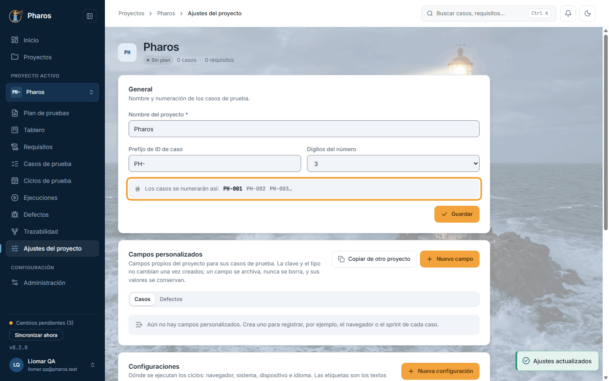
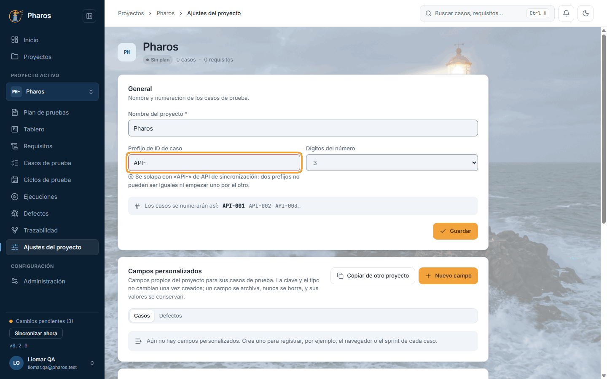
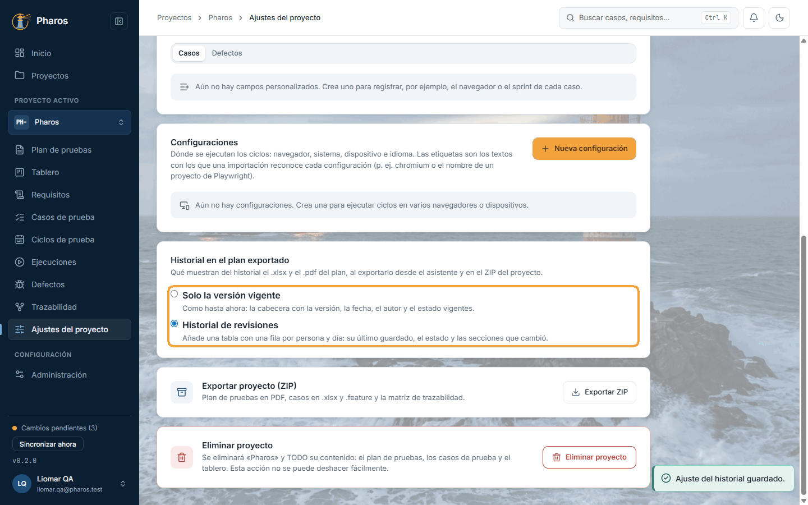
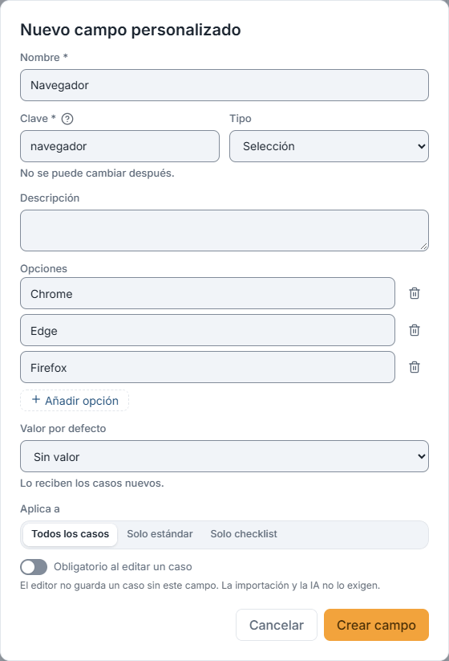
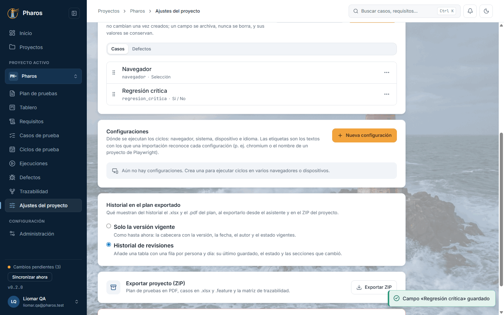
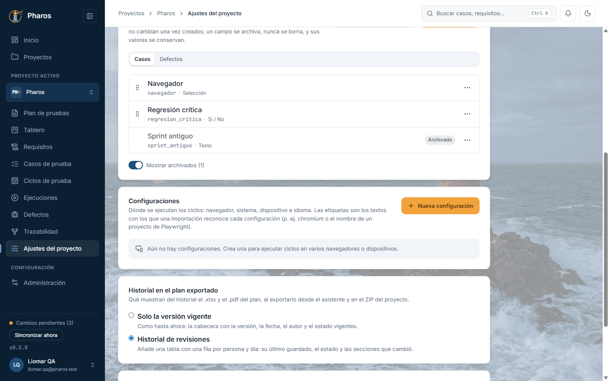
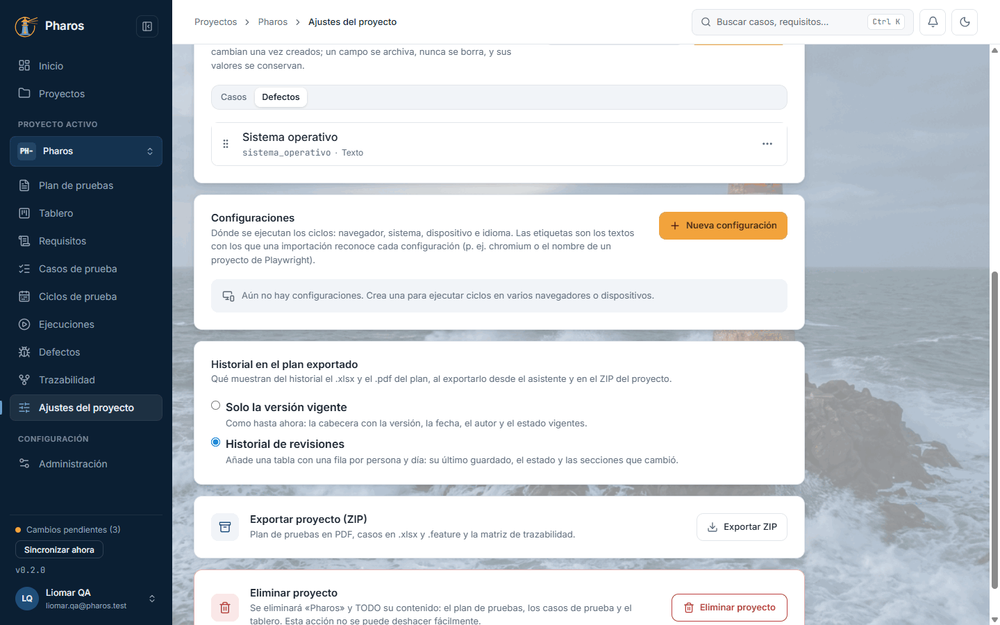
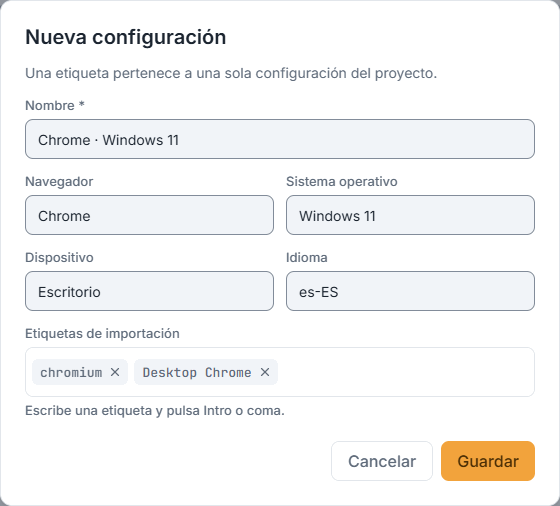
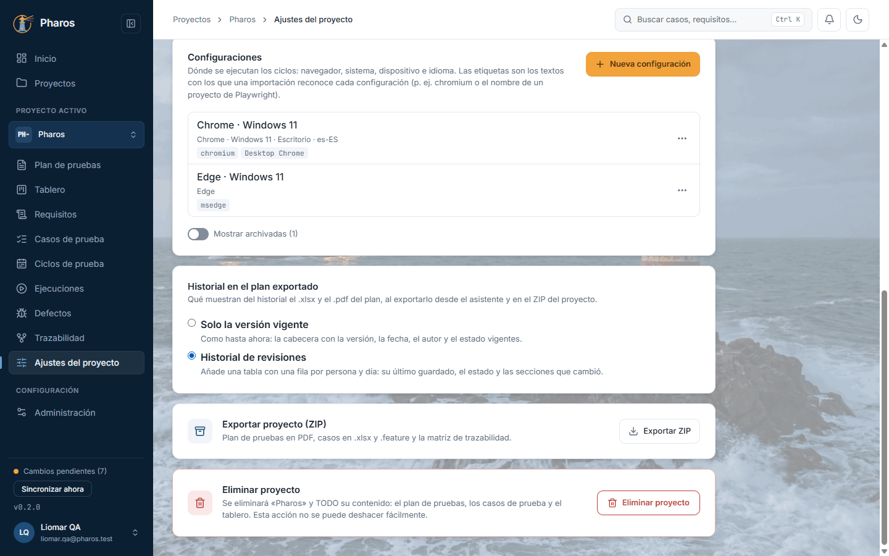
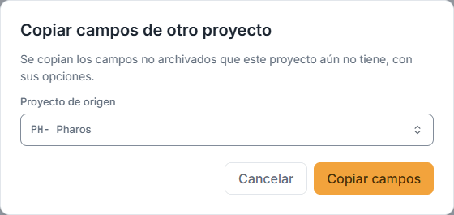

<!-- Generado por `npm run manual` desde e2e/tours/14-ajustes.tour.ts y docs/manual/fuentes/ajustes.md. No lo edites a mano: edita la fuente. -->

# 14. Ajustes del proyecto

## Para qué sirve

En «Ajustes del proyecto», la última sección del menú del proyecto, se decide:

- cómo se llama el proyecto y cómo se numeran sus casos: el **prefijo** y los
  **dígitos** del número (con `PH-` y 3 dígitos, PH-001, PH-002…);
- qué historial llevan el .pdf y el .xlsx del **plan exportado**;
- qué **campos personalizados** tienen sus casos y sus defectos;
- en qué **configuraciones** (navegadores, sistemas, dispositivos) se ejecutan
  sus ciclos;
- cómo **exportar** el proyecto entero en un ZIP o **eliminarlo** (capítulo 4).

Dos proyectos no pueden tener prefijos que se **solapen**: iguales, sin
contar el guion o el guion bajo final ni las mayúsculas, o uno que empiece por
el otro (`PH-` y `PHA-`), porque una búsqueda o una importación por `PH`
encontraría los casos de los dos.

Los **campos personalizados** añaden lo que tu equipo necesite y Pharos no trae
de serie: texto, texto largo, número, número entero, fecha, sí/no, selección,
selección múltiple, usuario o URL. Cada campo tiene un nombre, una clave fija
(minúsculas, números y guion bajo), si es obligatorio y, opcionalmente, un
valor por defecto para los casos nuevos. Los de los casos y los de los
defectos se definen por separado, con el selector «Casos / Defectos».

Una **configuración** describe dónde se ejecuta una prueba: navegador,
sistema, dispositivo e idioma. Sus **etiquetas de importación** son los nombres
con los que un informe de la automatización la reconoce (por ejemplo,
`chromium` o `msedge` en Playwright).

En este manual, Liomar ajusta «Pharos» antes de escribir nada: el prefijo
`PH-` con 3 dígitos, el historial de revisiones en el plan exportado, un
campo «Navegador» para los casos y otro «Sistema operativo» para los defectos,
y las configuraciones Chrome y Edge en Windows 11.

## Paso a paso

### 14.1. Ajustes del proyecto: prefijo de los casos

«Ajustes del proyecto», en el menú lateral, permite cambiar el nombre y cómo se numeran sus casos: el prefijo (en este ejemplo, Liomar acorta a «PH-» el «PHA-» que Pharos sugirió al crearlo) y el número de dígitos. La vista previa muestra cómo quedará el ID del siguiente caso (PH-001). Elige el prefijo pronto: es el que verás en informes, defectos y exportaciones. «Guardar» lo confirma con «Ajustes actualizados».

### 14.2. Un prefijo que se solapa

Dos proyectos no pueden usar prefijos que se solapen: iguales (sin contar el guion o el guion bajo final, ni mayúsculas) o uno que empiece por el otro, como «PH-» y «PHA-», porque «PHA-001» también empieza por «PH». Si escribes uno así, el campo dice con qué proyecto choca (en este ejemplo, «API-» es el de «API de sincronización») y «Guardar» no guarda hasta que lo cambies. Los proyectos que ya compartían prefijo de una versión anterior (todos empezaban con «ATS_») pueden seguir guardando su nombre; el aviso solo aparece al cambiar el prefijo.

### 14.3. El historial en el plan exportado

«Historial en el plan exportado» decide qué llevan del historial el .xlsx y el .pdf del plan (capítulo 5), tanto al exportarlo desde el asistente como en el ZIP del proyecto. «Solo la versión vigente», la opción de partida, pone en la cabecera la versión, la fecha, el autor y el estado actuales. «Historial de revisiones» añade una tabla con una fila por persona y día: su último guardado, el estado y las secciones que cambió. Se guarda al elegirlo, sin pulsar «Guardar» («Ajuste del historial guardado.»). En este ejemplo, Liomar elige el historial: el plan de Pharos pasa por revisiones y quiere que se vean al firmarlo.

### 14.4. Nuevo campo personalizado

Los campos personalizados añaden a los casos lo que tu equipo necesite clasificar y que Pharos no trae de serie. En «Campos personalizados», «Nuevo campo» abre el diálogo: nombre, clave, tipo (texto, número, fecha, sí/no, selección…), opciones y si es obligatorio. El botón [?] junto a «Clave» explica su formato (minúsculas, números y guion bajo) al pasar el ratón, con el tabulador o al tocarlo; debajo se recuerda que no se puede cambiar después. En este ejemplo, una selección «Navegador» con tres opciones.

### 14.5. El campo, en la lista

«Crear campo» lo guarda y aparece en la lista; desde ese momento, los casos del proyecto pueden usarlo (capítulo 8). Se reordena arrastrando o con el menú de cada campo: ese es el orden en que se ve en el editor.

### 14.6. Archivar un campo

Un campo no se borra, para no perder lo que ya se escribió en él: se archiva desde su menú («Archivar») y sus valores se conservan. «Mostrar archivados» lo enseña y «Desarchivar» lo recupera.

### 14.7. Cerrar sin guardar

Si cierras el diálogo de un campo con cambios sin guardar, Pharos pregunta antes de descartarlos, para que no los pierdas por un clic.

### 14.8. Campos de los defectos

El selector «Casos / Defectos» de la tarjeta elige de qué entidad son los campos. Con «Defectos», «Nuevo campo» crea un campo que aparece en el editor de cada defecto (en este ejemplo, «Sistema operativo»). Los campos de casos y de defectos son independientes, y «Copiar de otro proyecto» copia los de la entidad elegida.

### 14.9. Nueva configuración

Una configuración describe dónde se ejecuta una prueba, para saber en qué entorno pasó o falló. En «Configuraciones», «Nueva configuración» pide navegador, sistema, dispositivo e idioma (en este ejemplo, «Chrome · Windows 11»). Las etiquetas de importación (Intro o coma para añadir cada una) son los nombres con los que un informe importado reconoce la configuración.

### 14.10. Configuraciones del proyecto

«Guardar» la añade a la lista. En este ejemplo hay dos activas (Chrome y Edge); una tercera se archivó desde su menú y solo se ve con «Mostrar archivadas»: así deja de ofrecerse en ciclos nuevos sin perder su historia.

### 14.11. Copiar los campos a otro proyecto

Un segundo proyecto (en este ejemplo, «API de sincronización», con el prefijo «API-») no tiene que definir sus campos desde cero: en sus ajustes, «Copiar de otro proyecto» trae los campos personalizados de otro, con sus opciones. Solo se copian los que aún no tiene; los demás no se tocan.

## Atajos de teclado

| Tecla | Dónde | Qué hace |
| --- | --- | --- |
| Intro o coma | Campo «Etiquetas de importación» de una configuración | Añade la etiqueta escrita |
| Retroceso | Campo de etiquetas vacío | Quita la última etiqueta |
| Espacio o Intro, flechas | Asa de un campo personalizado | Lo coge, lo mueve arriba o abajo y lo suelta; Esc cancela |
| Esc | Diálogo de un campo o de una configuración | Lo cierra; con cambios, pregunta antes |

## Si algo no sale

- **«Se solapa con «PH-» de Pharos…».** Otro proyecto ya usa ese prefijo o uno
  que empieza igual. Elige otro.
- **«Escribe un prefijo, por ejemplo «PHA-».»** El prefijo no puede quedar
  vacío.
- **«Clave no válida…».** La clave de un campo empieza por una letra minúscula
  y solo admite minúsculas, números y guion bajo (hasta 40).
- **«Ya hay un campo con esta clave en el proyecto (puede estar
  archivado).»** Las claves no se reutilizan: restaura el archivado o usa otra.
- **«Añade al menos una opción.» o «Hay dos opciones con el mismo nombre.»**
  Una selección necesita opciones distintas.
- **«La etiqueta ya la usa otra configuración…».** Cada etiqueta de importación
  pertenece a una sola configuración del proyecto.
- **No encuentro una configuración en un ciclo nuevo.** Está archivada: márcala
  con «Mostrar archivadas» y restáurala desde su menú.
- **«No se pudo guardar el ajuste del historial.»** Vuelve a elegir la opción.

## En el móvil

- Las tarjetas de ajustes van una debajo de otra, a todo el ancho.

## Consejos

- Elige el **prefijo** al principio: la clave de un caso no cambia una vez
  asignada, porque viaja como tag (`@PH-001`) en la automatización.
- Los **campos personalizados** nunca se borran, se archivan: así no se pierden
  los valores que ya tienen los casos y los defectos.
- Escribe las **etiquetas de importación** exactamente como las nombra tu
  herramienta (el nombre del proyecto de Playwright, `chromium`): así cada
  resultado importado cae en su configuración.
- Al crear un segundo proyecto, «Copiar de otro proyecto» trae los campos del
  primero en un paso.

## Véase también

- Capítulo 4, «Proyectos»: crear, exportar y eliminar proyectos.
- Capítulo 5, «Plan de pruebas»: el historial en el plan exportado.
- Capítulo 9, «Ciclos de prueba»: las configuraciones de un ciclo.
- [Glosario](../GLOSARIO.md): «Prefijo de ID de caso», «Campo personalizado»,
  «Configuración».

---

← [Trazabilidad](13-trazabilidad.md) · [Índice](README.md) · [Administración](15-administracion.md) →
