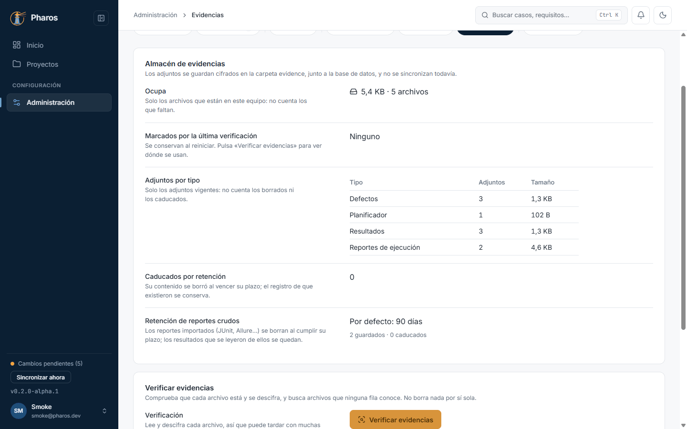

<!-- Generado por `npm run manual` desde e2e/tours/14-evidencias.tour.ts y docs/manual/fuentes/evidencias.md. No lo edites a mano: edita la fuente. -->

# 14. Evidencias

## Para qué sirve

Las **evidencias** son los archivos que adjuntas: capturas, vídeos y
registros de defectos, tarjetas, resultados y reportes importados. Pharos los
guarda cifrados en la carpeta `evidence`, junto a la base de datos.
«Administración → Evidencias» dice cuánto ocupan y de qué tipo son, y
comprueba que todos siguen ahí y se pueden leer.

## Paso a paso

### 14.1. El almacén de evidencias

En «Administración», pulsa la pestaña «Evidencias». «Almacén de evidencias» da el espacio que ocupan, los adjuntos por tipo (planificador, defectos, reportes, resultados, borradores…) y la retención de los reportes importados.

### 14.2. Verificar las evidencias

«Verificar evidencias» comprueba que cada archivo está y se descifra, y busca archivos que ninguna fila conoce (huérfanos). No borra nada por sí sola; puedes seguir trabajando mientras tanto.

### 14.3. Borrar los huérfanos

Los huérfanos aparecen en su bloque con su tamaño; «Borrar seleccionados» pide confirmación antes de eliminarlos. Los que faltan o están dañados se listan con el elemento que los usa.

### 14.4. Huérfanos borrados

Al confirmar se borran y el informe se actualiza; cada borrado queda en el registro de auditoría.

## Consejos

- Verifica las evidencias después de restaurar una copia o de mover la
  carpeta de datos: el informe dice qué falta o está dañado y dónde se usa.
- Los huérfanos (archivos que ya nadie usa) solo se borran cuando tú lo
  confirmas, y nunca los de las últimas 24 horas.
- Las evidencias no se sincronizan todavía: inclúyelas en tus copias.

## Véase también

- Capítulo 10, «Administración», y la [guía de pruebas de la beta](../guia-beta.md), apartado 6 «Si algo sale mal con los datos».

---

← [Ejecución manual](13-ejecucion-manual.md) · [Índice](README.md) · [Si algo sale mal](15-errores.md) →
