<!-- Generado por `npm run manual` desde e2e/tours/15-administracion.tour.ts y docs/manual/fuentes/administracion.md. No lo edites a mano: edita la fuente. -->

# 15. Administración

## Para qué sirve

«Administración» reúne lo que no pertenece a un proyecto, en pestañas
agrupadas:

- **Recursos**
  - **Motor de IA:** cómo se usa la IA (automático, solo online o solo
    local), el proveedor online (Gemini, OpenAI, Claude, OpenRouter o uno
    compatible), su clave y su modelo, o un modelo local con Ollama para
    trabajar sin internet.
  - **Plantillas:** las de plan y de caso, las incluidas con Pharos y las
    tuyas.
- **Aplicación**
  - **General:** tema, idioma, fondo, sombra de las tarjetas, carpeta de
    descarga y retención de lo borrado.
- **Cuenta y datos**
  - **Sincronización:** estado, cuenta, conflictos, «Sincronizar ahora» y la
    sincronización automática.
  - **Seguridad:** la clave de recuperación de tus datos.
  - **Evidencias:** retención y espacio de las evidencias (capítulo 16).
- **Soporte**
  - **Diagnóstico:** un ZIP para informar de un fallo.

Se abre desde el menú de tu avatar o desde «Administración», en el menú
lateral, bajo «Configuración». La pestaña abierta queda en la dirección de la página.

La IA es opcional: sin ella, los botones de asistencia se desactivan con un
aviso, y nada de lo que propone se aplica sin que lo aceptes. Las claves de IA
se guardan cifradas en el almacén de credenciales de Windows, nunca en un
archivo, y no se incluyen en exportaciones ni diagnósticos.

En este manual, Liomar deja preparado su Pharos: una plantilla de plan
propia, la sincronización, su clave de recuperación guardada y el diagnóstico
a mano por si algo falla.

## Paso a paso

### 15.1. Administración · Motor de IA

«Administración» (en el menú de tu avatar o en el menú lateral) reúne la configuración de la aplicación en pestañas agrupadas: «Recursos» (Motor de IA, Plantillas), «Aplicación» (General), «Cuenta y datos» (Sincronización, Seguridad, Evidencias) y «Soporte» (Diagnóstico). En «Motor de IA» eliges cómo usar la IA (automático, solo online o solo local), el proveedor online, su clave y el modelo, o un modelo local con Ollama para trabajar sin internet. La IA es opcional: sin ella, los botones de asistencia se desactivan con un aviso y nada de lo que propone se aplica sin que lo aceptes.

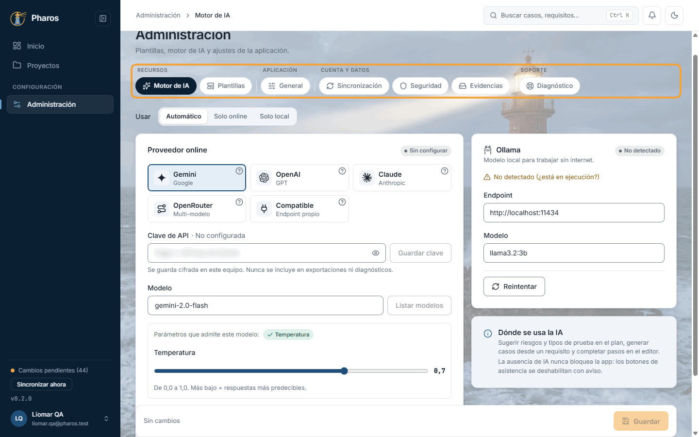

### 15.2. Cambiar de proveedor con una clave sin guardar

Si escribes una clave y cambias de proveedor sin pulsar «Guardar clave», Pharos avisa de que se descartará, para que no la pierdas sin darte cuenta. Al guardarla, la clave queda cifrada en el almacén de credenciales de Windows, nunca en un archivo, y no se incluye en exportaciones ni diagnósticos.

### 15.3. Plantillas

«Plantillas» guarda las plantillas de plan y de caso: las incluidas con Pharos y las tuyas. Sirven para trabajar fuera de la aplicación: descarga una en .xlsx, rellénala en Excel (o pásala a quien no usa Pharos) e impórtala después en un plan (capítulo 5) o en un caso (capítulo 8).

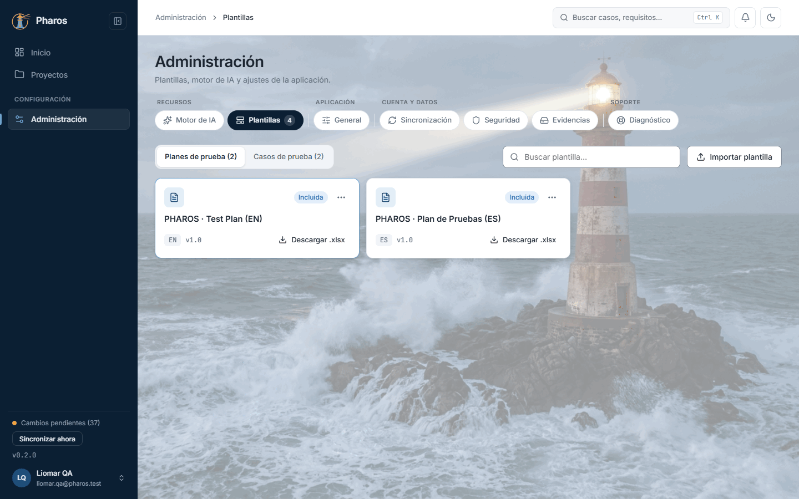

### 15.4. Importar una plantilla

«Importar plantilla» añade una plantilla tuya desde un .xlsx: pide su nombre, el tipo (plan o caso), el idioma, la versión, una descripción y un «prompt de uso», las instrucciones que la IA sigue cuando rellena un documento con esa plantilla. En este ejemplo, Liomar importa la plantilla de plan que acaba de descargar como «Plan de pruebas · Pharos (propia)».

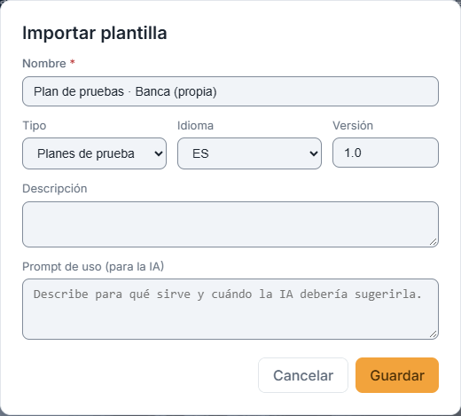

### 15.5. Eliminar una plantilla propia

Tus plantillas se editan o eliminan desde su menú; las incluidas con Pharos no se pueden borrar. Eliminar pide confirmación con «Sí, eliminar».

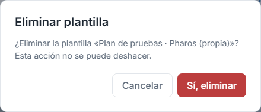

### 15.6. General

«General» reúne los ajustes de la aplicación en este equipo. El tema (claro, oscuro o según el sistema), el idioma y la carpeta de las exportaciones se guardan al momento. El fondo viene con una imagen predeterminada que puedes cambiar o quitar; al mover su opacidad ves el resultado antes de pulsar «Guardar ajustes». También eliges la retención de los elementos borrados.

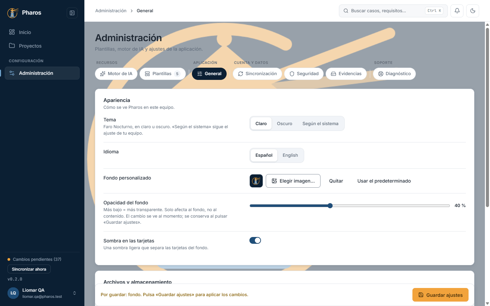

### 15.7. Cambiar de pestaña con cambios sin guardar

Si cambias de pestaña sin «Guardar ajustes», Pharos pregunta si descartas los cambios (en este ejemplo se descartan y el fondo vuelve a ser el de siempre).

### 15.8. Sincronización

Pharos trabaja sin conexión: guarda todo en este equipo y lo sincroniza con el servidor al iniciar sesión, al recuperar la conexión, cada pocos minutos si lo activas y cuando pulsas «Sincronizar ahora» (también al pie del menú lateral). Esta pestaña muestra el estado, la cuenta, los cambios pendientes de enviar y si hay conflictos que revisar. «Sincronizar ahora» envía y recibe al momento y avisa de cuántos cambios fueron (↑) y vinieron (↓).

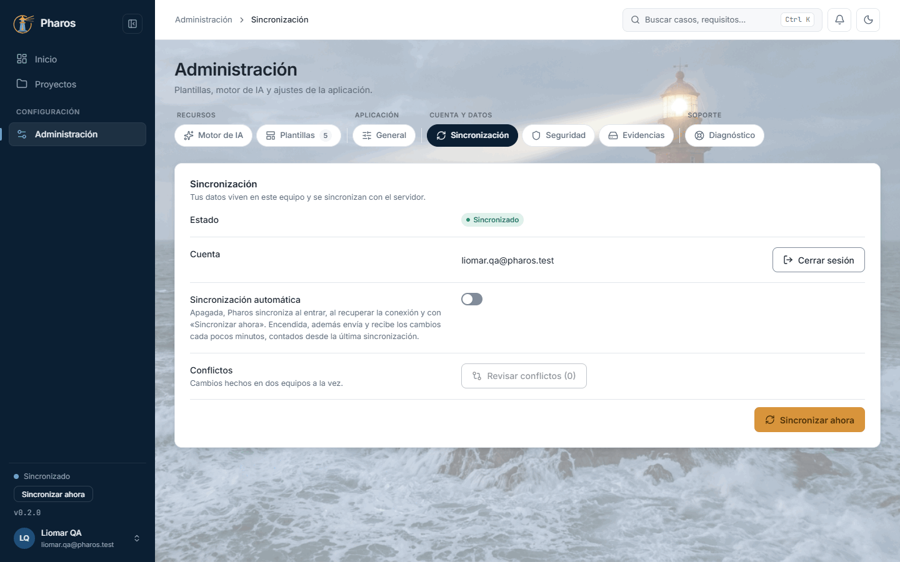

### 15.9. Sincronización automática

«Sincronización automática» viene apagada. Al activarla aparece «Cada», con 1, 5 (preseleccionado), 15 o 30 minutos, y se aplica al momento, sin «Guardar». Los minutos se cuentan desde la última sincronización, sea automática, manual o al reconectar: tras «Sincronizar ahora», la siguiente automática llega N minutos después. Sin conexión, o si ya hay una sincronización en curso, esa vuelta se salta. Apagada, Pharos sigue sincronizando al entrar, al recuperar la conexión y con «Sincronizar ahora».

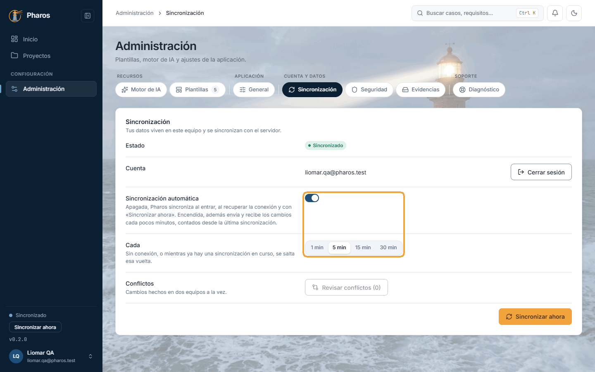

### 15.10. Un cambio en dos equipos

Si el mismo dato se cambia en dos equipos antes de sincronizar (en este ejemplo, el título del requisito REQ-002), el segundo que sincroniza recibe un conflicto: Pharos no pisa ninguno de los dos cambios, avisa y te deja decidir.

### 15.11. Revisar conflictos

«Sincronización → Revisar conflictos» (o el aviso del menú lateral) muestra cada conflicto campo a campo: tu versión y la del servidor, una junto a otra. Elige «Conservar la mía» o «Usar la del servidor»; la otra versión se descarta.

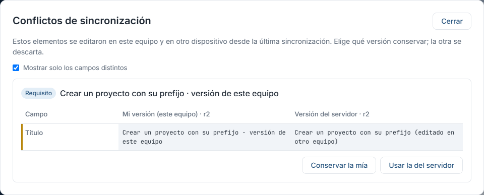

### 15.12. Conflicto resuelto

Al elegir una versión, el conflicto desaparece de la lista («Conflicto resuelto») y la versión elegida se sincroniza con el resto de tus equipos.

### 15.13. Seguridad · clave de recuperación

La base de datos de este equipo está cifrada y su clave vive en el almacén de credenciales de Windows. «Mostrar clave de recuperación» la enseña tras pedir confirmación: con esa clave y una copia de tus datos puedes recuperarlos en otro equipo si este falla. Guárdala ahora, no cuando la necesites.

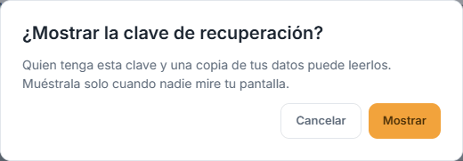

### 15.14. Guarda la clave

La clave aparece en grupos de caracteres (en este manual, difuminada). Cópiala a un gestor de contraseñas o escríbela en papel y guárdala en un lugar seguro; marca «Ya la he guardado» y cierra. Quien tenga la clave y una copia de tus datos puede leerlos: no la compartas.

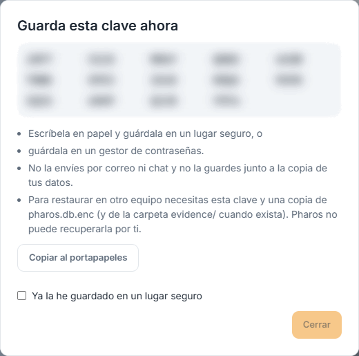

### 15.15. Diagnóstico

Si algo falla, «Exportar diagnóstico» guarda un ZIP con la versión, el sistema y el registro de la aplicación, para adjuntarlo al informar del problema. Nunca incluye tus datos ni tus claves.

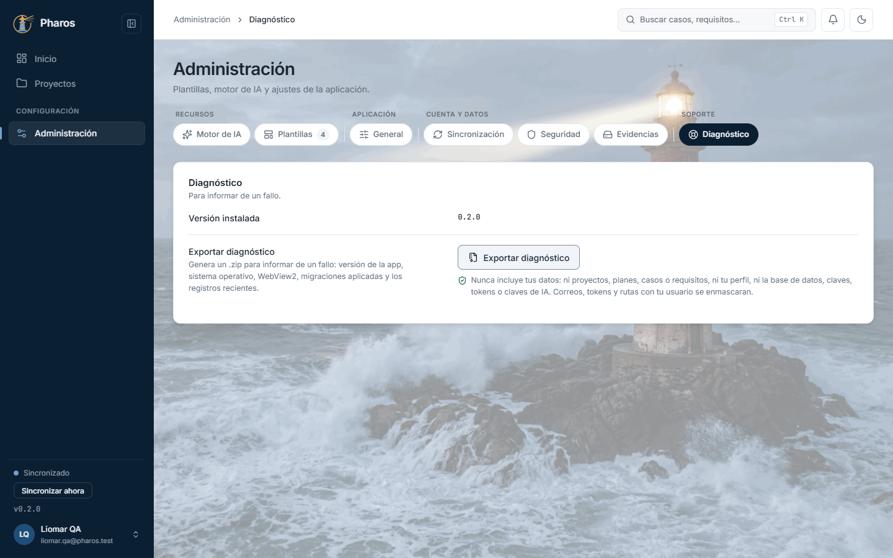

### 15.16. Reemplazar una clave de IA guardada

Si ya hay una clave guardada y guardas otra sin probarla, Pharos pide confirmación, porque la anterior no se puede recuperar. «Probar conexión» comprueba la nueva sin reemplazar nada; si responde, se guarda sin preguntar.

## Atajos de teclado

| Tecla | Dónde | Qué hace |
| --- | --- | --- |
| ← → | Pestañas de Administración | Pasan a la pestaña anterior o siguiente |
| Inicio, Fin | Pestañas de Administración | Van a la primera o a la última |
| Esc | Diálogos de plantilla y de conflictos | Los cierran; con cambios, preguntan antes |
| Esc | Clave de recuperación mostrada | No la cierra: marca «Ya la he guardado» |

## Si algo no sale

- **«No detectado (¿está en ejecución?)» en Ollama.** Ollama no está
  instalado o no está abierto en este equipo. Ábrelo y pulsa «Reintentar», o
  usa un proveedor online.
- **«Falta la clave de…» o «Escribe un modelo para probar la clave».**
  «Probar conexión» necesita la clave y el modelo. Para listar los modelos,
  guarda antes la clave.
- **«El proveedor rechazó la clave…».** La clave no es válida o no tiene
  saldo. Revísala en la web del proveedor.
- **«No hay IA disponible…».** No hay ningún proveedor online configurado ni
  Ollama en marcha: configura uno de los dos.
- **«“Listar modelos” solo está disponible en la app de escritorio.»** En la
  web, escribe el nombre del modelo.
- **Al cambiar de pestaña pregunta «¿Descartar los cambios?».** Hay ajustes
  sin guardar en la pestaña actual: guárdalos o descártalos.
- **«Conflictos (N)» en el menú lateral.** El mismo dato cambió en dos
  equipos. «Revisar conflictos» te deja elegir qué versión conservar.
- **«No se pudo leer la clave de recuperación.»** Pasa si el almacén de
  credenciales de Windows no está disponible. Vuelve a intentarlo; en la web
  no existe esta opción.

## En el móvil

- Las pestañas se desplazan de lado; desliza para ver las demás.
- La clave de recuperación y «Listar modelos» son de la app de escritorio.

## Consejos

- Guarda la **clave de recuperación** el primer día: si cambias de equipo o
  reinstalas Windows, solo ella y una copia de `pharos.db.enc` devuelven tus
  datos. Pharos no puede recuperarla por ti.
- Pulsa **«Probar conexión»** antes de guardar una clave nueva: si responde, se
  guarda sin preguntar y sabes que funciona.
- Activa la **sincronización automática** si trabajas en varios equipos; en
  uno solo, «Sincronizar ahora» al terminar basta.
- Si algo falla, adjunta el ZIP de **«Exportar diagnóstico»** al informe: lleva
  la versión, el sistema y los registros recientes, y nunca tus proyectos,
  tus casos ni tus claves.

## Véase también

- Capítulo 16, «Evidencias»: la pestaña «Evidencias».
- Capítulo 17, «Asistente de IA»: cómo saber qué modelo está activo y qué
  hace la IA en cada pantalla.
- [Glosario](../GLOSARIO.md): «Pestaña de Administración», «Plantilla»,
  «Papelera».

---

← [Ajustes del proyecto](14-ajustes.md) · [Índice](README.md) · [Evidencias](16-evidencias.md) →
