<!-- Generado por `npm run manual` desde e2e/tours/15-administracion.tour.ts y docs/manual/fuentes/administracion.md. No lo edites a mano: edita la fuente. -->

# 15. Administración

## Para qué sirve

«Administración» reúne lo que no pertenece a un proyecto, en pestañas
agrupadas:

- **Recursos**
  - **Motor de IA:** cómo se usa la IA (automático, solo online o solo
    local), el proveedor online (Gemini, OpenAI, Claude, OpenRouter o uno
    compatible), su clave y su modelo, o un modelo local con Ollama para
    trabajar sin internet. En el escritorio, «Usar esta clave también en la
    web» sube una copia cifrada de la clave a tu servidor para usar la IA en
    la web (capítulo 17).
  - **Plantillas:** las de plan y de caso, las incluidas con Pharos y las
    tuyas, que viajan con tu workspace (editarlas requiere ser Test Manager
    o Test Analyst).
- **Aplicación**
  - **General:** tema, idioma, fondo, sombra de las tarjetas, carpeta de
    descarga, retención de lo borrado y la papelera.
  - **Usuarios** (solo si administras el servidor): las cuentas del
    servidor, restablecer contraseñas, nombrar o quitar administradores,
    desactivar o reactivar cuentas y revocar sus tokens.
- **Cuenta y datos**
  - **Sincronización:** estado, cuenta, conflictos, «Sincronizar ahora» y la
    sincronización automática.
  - **Seguridad:** la clave de recuperación de tus datos.
  - **Evidencias:** retención y espacio de las evidencias (capítulo 16).
  - **Auditoría:** cada cambio de tu cuenta, con quién lo hizo (tú, un agente
    en tu nombre o el sistema), el antes y el después, la comprobación de que
    el registro está íntegro y la exportación a Excel o CSV.
- **Soporte**
  - **Diagnóstico:** un ZIP para informar de un fallo, con la versión, el
    sistema, los registros recientes y, solo como números, cuánto ocupan el
    registro de cambios y la auditoría.

Se abre desde el menú de tu avatar o desde «Administración», en el menú
lateral, bajo «Configuración». La pestaña abierta queda en la dirección de la página.

La IA es opcional: sin ella, los botones de asistencia se desactivan con un
aviso, y nada de lo que propone se aplica sin que lo aceptes. Las claves de IA
se guardan cifradas en el almacén de credenciales de Windows, nunca en un
archivo, y no se incluyen en exportaciones ni diagnósticos.

En este manual, Liomar, QA y Test Manager de su workspace, deja preparado su
Pharos: una plantilla de plan propia, la sincronización (con un cambio que
se combina solo y un conflicto que resuelve campo a campo), su clave de
recuperación guardada y el diagnóstico a mano por si algo falla, y repasa en
«Auditoría» lo que ha cambiado hoy. Liomar no administra el servidor, así
que no ve «Usuarios»: la última parte del capítulo la recorre la cuenta
«Administrador», que gestiona la cuenta de su compañero Jorge L. Meneses
Yero.

## Paso a paso

### 15.1. Administración · Motor de IA

«Administración» (en el menú de tu avatar o en el menú lateral) reúne la configuración de la aplicación en pestañas agrupadas: «Recursos» (Motor de IA, Plantillas), «Aplicación» (General y, si administras el servidor, Usuarios), «Cuenta y datos» (Sincronización, Seguridad, Evidencias, Auditoría) y «Soporte» (Diagnóstico). Liomar no administra el servidor, así que no ve «Usuarios». En «Motor de IA» eliges cómo usar la IA (automático, solo online o solo local), el proveedor online, su clave y el modelo, o un modelo local con Ollama para trabajar sin internet. La IA es opcional: sin ella, los botones de asistencia se desactivan con un aviso y nada de lo que propone se aplica sin que lo aceptes.

### 15.2. Cambiar de proveedor con una clave sin guardar

Si escribes una clave y cambias de proveedor sin pulsar «Guardar clave», Pharos avisa de que se descartará, para que no la pierdas sin darte cuenta. Al guardarla, la clave queda cifrada en el almacén de credenciales de Windows, nunca en un archivo, y no se incluye en exportaciones ni diagnósticos.

### 15.3. Plantillas

«Plantillas» guarda las plantillas de plan y de caso: las incluidas con Pharos y las tuyas, que viajan con tu workspace (editarlas requiere ser Test Manager o Test Analyst). Sirven para trabajar fuera de la aplicación: descarga una en .xlsx, rellénala en Excel (o pásala a quien no usa Pharos) e impórtala después en un plan (capítulo 5) o en un caso (capítulo 8).

### 15.4. Importar una plantilla

«Importar plantilla» añade una plantilla tuya desde un .xlsx: pide su nombre, el tipo (plan o caso), el idioma, la versión, una descripción y un «prompt de uso», las instrucciones que la IA sigue cuando rellena un documento con esa plantilla. En este ejemplo, Liomar importa la plantilla de plan que acaba de descargar como «Plan de pruebas · Pharos (propia)».

### 15.5. Eliminar una plantilla propia

Tus plantillas se editan o eliminan desde su menú; las incluidas con Pharos no se pueden borrar. Eliminar pide confirmación con «Sí, eliminar»: la plantilla pasa a la papelera y puedes restaurarla desde «Administración › General › Papelera» hasta que se elimine para siempre.

### 15.6. General

«General» reúne los ajustes de la aplicación en este equipo. El tema (claro, oscuro o según el sistema), el idioma y la carpeta de las exportaciones se guardan al momento. El fondo viene con una imagen predeterminada que puedes cambiar o quitar; al mover su opacidad ves el resultado detrás de la página antes de pulsar «Guardar ajustes», y un aviso dice qué queda «Por guardar». También eliges la retención de los elementos borrados.

### 15.7. Cambiar de pestaña con cambios sin guardar

«Elegir imagen» cambia el fondo por una imagen tuya, también como borrador. Si cambias de pestaña sin «Guardar ajustes», Pharos pregunta si descartas los cambios (en este ejemplo se descartan: el fondo y su opacidad vuelven a ser los de siempre).

### 15.8. Papelera

Al final de «General», la «Papelera» reúne lo que has borrado en este equipo y aún no se ha eliminado para siempre: el número de elementos, su desglose por tipo (proyectos, casos, requisitos, defectos…) y, en cada fila, cuándo se borró y en cuántos días se eliminará según la retención. Marca filas para «Restaurar» (vuelven a su sitio con su clave y su historial, y se sincronizan) o «Eliminar para siempre»; un proyecto vuelve con lo que se borró con él. «Vaciar papelera» pide confirmación y conserva lo que tiene cambios sin sincronizar. En la web no se guarda lo borrado: la papelera está en la app de escritorio. Los botones del desglose filtran la lista: aquí, «Plantillas» deja solo la plantilla que Liomar acaba de eliminar; «Todo» la muestra entera, con, entre otros, el requisito REQ-007 que borró en el capítulo 7.

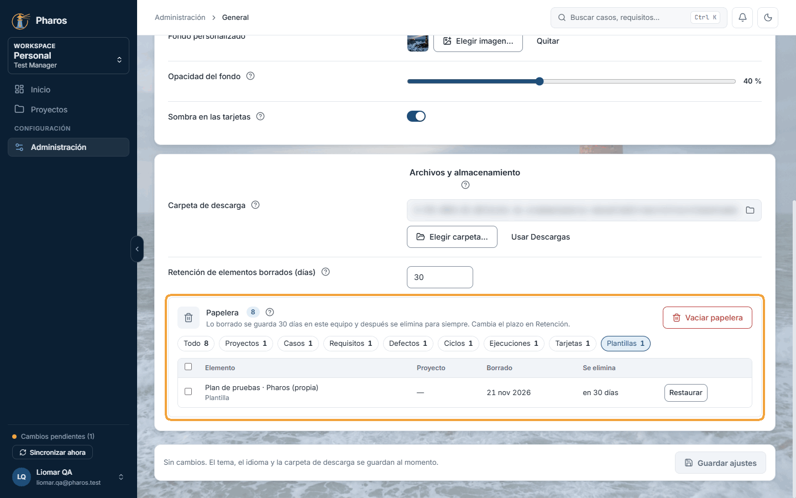

### 15.9. Sincronización

Pharos trabaja sin conexión: guarda todo en este equipo y lo sincroniza con el servidor al iniciar sesión, al recuperar la conexión, cada pocos minutos si lo activas y cuando pulsas «Sincronizar ahora» (también al pie del menú lateral). Esta pestaña muestra el estado, la cuenta, los cambios pendientes de enviar (si los hay) y si hay conflictos que revisar. «Sincronizar ahora» envía y recibe al momento y avisa de cuántos cambios fueron (↑) y vinieron (↓). Una vez al día, después de sincronizar, Pharos borra de su registro interno los cambios que el servidor ya tiene, para que la base de datos no crezca sin necesidad: tus datos, su historial y la auditoría siguen igual.

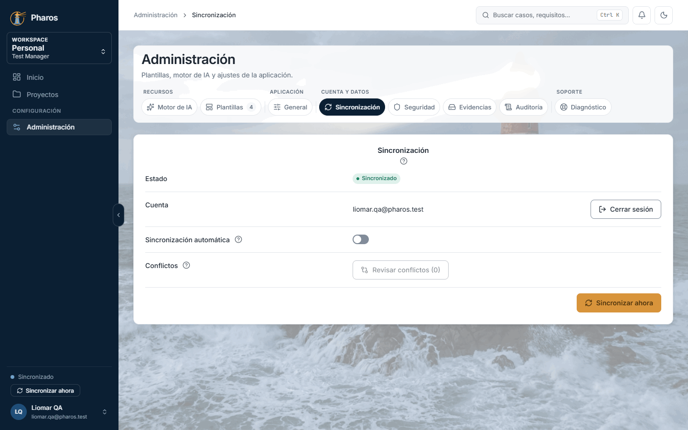

### 15.10. Sincronización automática

«Sincronización automática» viene apagada. Al activarla aparece «Cada», con 1, 5 (preseleccionado), 15 o 30 minutos, y se aplica al momento, sin «Guardar». Los minutos se cuentan desde la última sincronización, sea automática, manual o al reconectar: tras «Sincronizar ahora», la siguiente automática llega N minutos después. Sin conexión, o si ya hay una sincronización en curso, esa vuelta se salta. Apagada, Pharos sigue sincronizando al entrar, al recuperar la conexión y con «Sincronizar ahora».

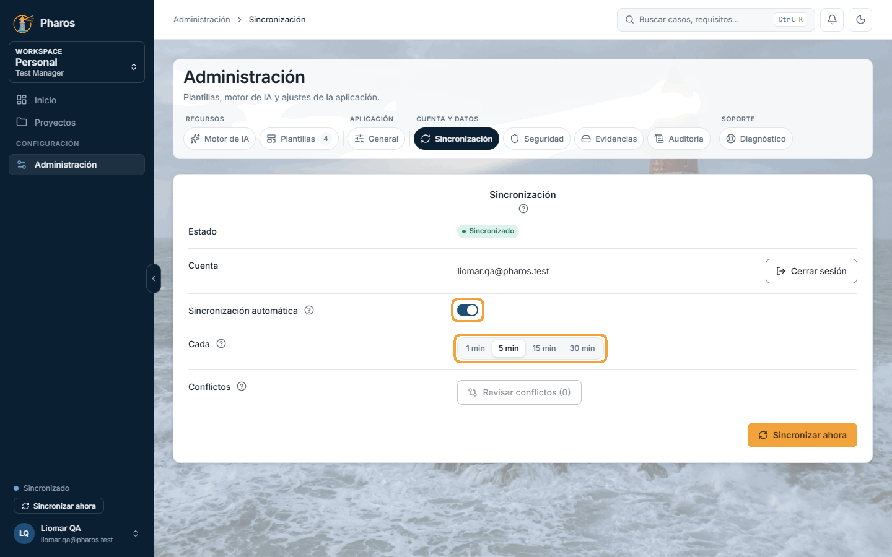

### 15.11. Cambios en campos distintos: se combinan solos

Si el mismo elemento se cambia en dos sitios antes de sincronizar, Pharos lo combina campo a campo. En este ejemplo, Liomar empieza desde su portátil la descripción del requisito REQ-006 con una frase («Si cambian el mismo campo, Pharos pregunta cuál queda.») y, en este equipo, sin sincronizar entre medias, su título («…con el servidor»). Al sincronizar, como tocó campos distintos, Pharos se queda con los dos cambios sin preguntar: el requisito tiene el título nuevo y la descripción del portátil. Un aviso lo dice («Se combinaron tus cambios con los hechos a la vez en otro equipo o por otra persona en 1 elemento…»), y el elemento queda en «Auditoría» como «Conflicto resuelto», con «Se quedó: Combinado».

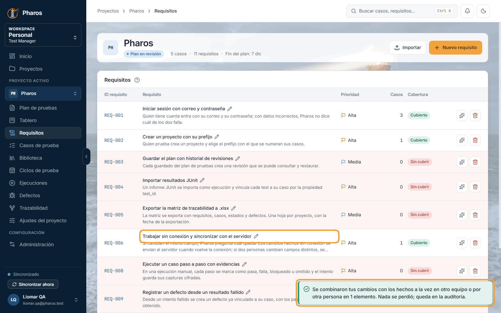

### 15.12. El mismo campo cambiado en dos equipos

Si en cambio los dos cambian el mismo campo, Pharos no pisa ninguno de los dos: lo que no choca se combina y por lo que choca pregunta. En este ejemplo, desde el portátil Liomar cambia el título y la descripción de REQ-006 y, en este equipo, otra vez el título. Al sincronizar, «Sincronizar ahora» avisa de que hay un conflicto por revisar.

### 15.13. Notificaciones

La campana de la barra superior abre las notificaciones, agrupadas por día: invitaciones, revisiones, defectos asignados, ciclos cerrados, cambios en los miembros, avisos de la cuenta y conflictos. Un número sobre la campana dice cuántas hay sin leer; «Sin leer» las filtra y «Marcar todo como leído» las da por vistas. Cada una lleva su acción: aquí, «1 conflicto de sincronización por revisar» con «Resolver». Se guardan 90 días.

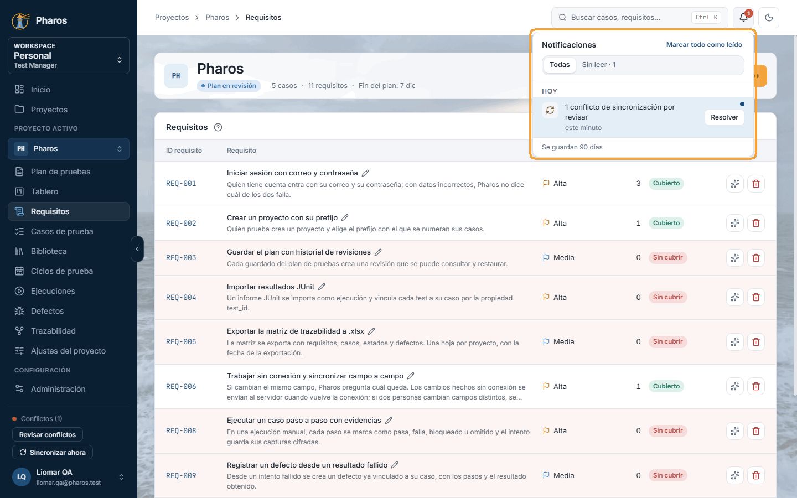

### 15.14. Revisar conflictos

«Resolver» (o «Sincronización › Revisar conflictos», o el aviso «Conflictos» del menú lateral) abre el panel de conflictos. Solo muestra los campos que chocan, con tu versión y la del servidor una junto a otra; lo que cambió en campos distintos ya está combinado, y el panel lo dice («Se combinó 1 campo sin preguntar»: aquí, la descripción del portátil). En cada campo eliges una versión y pulsas «Aplicar»; «La mía en todo» y «La del servidor en todo» conservan una versión entera.

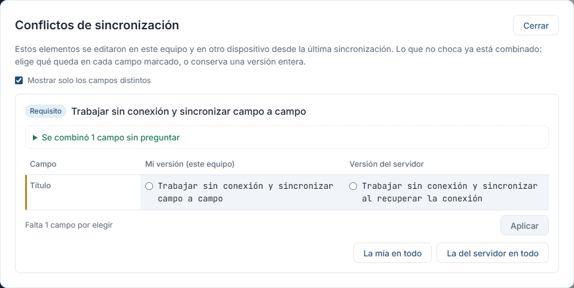

### 15.15. Conflicto resuelto

Al aplicar, el conflicto desaparece de la lista («Conflicto resuelto») y lo elegido se sincroniza con el resto de tus equipos. Aquí Liomar se queda con su título («…campo a campo»), y la descripción del portátil se conserva.

### 15.16. Seguridad · clave de recuperación

«Seguridad» lo dice en una línea, «La base de datos de este equipo está cifrada.», y su «?» lo explica: los datos de este equipo (el archivo pharos.db y la carpeta evidence) están cifrados y su clave vive en el almacén de credenciales de Windows. «Mostrar clave de recuperación» la enseña: con esa clave y una copia de tus datos puedes recuperarlos en otro equipo si este falla. Guárdala ahora, no cuando la necesites.

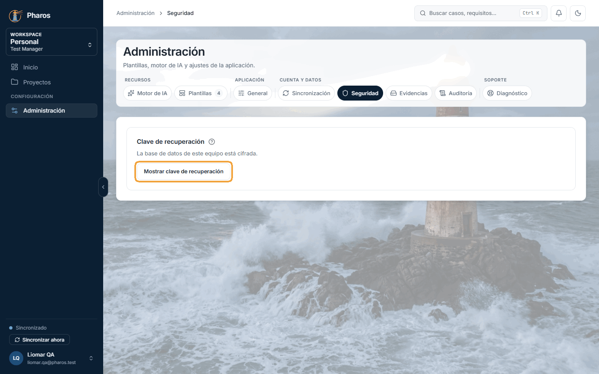

### 15.17. Antes de mostrarla

«Mostrar clave de recuperación» pide confirmación antes de enseñar la clave: muéstrala solo cuando nadie más vea tu pantalla.

### 15.18. Guarda la clave

Al confirmar, la clave aparece en grupos de caracteres (en este manual, difuminada). Cópiala a un gestor de contraseñas o escríbela en papel y guárdala en un lugar seguro; marca «Ya la he guardado» y cierra. Quien tenga la clave y una copia de tus datos puede leerlos: no la compartas.

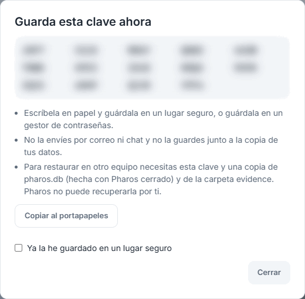

### 15.19. Diagnóstico

Si algo falla, «Exportar diagnóstico» guarda un ZIP con la versión, el sistema y el registro de la aplicación y, solo como números, cuánto ocupan el registro de cambios y la auditoría, para adjuntarlo al informar del problema. Nunca incluye tus datos ni tus claves.

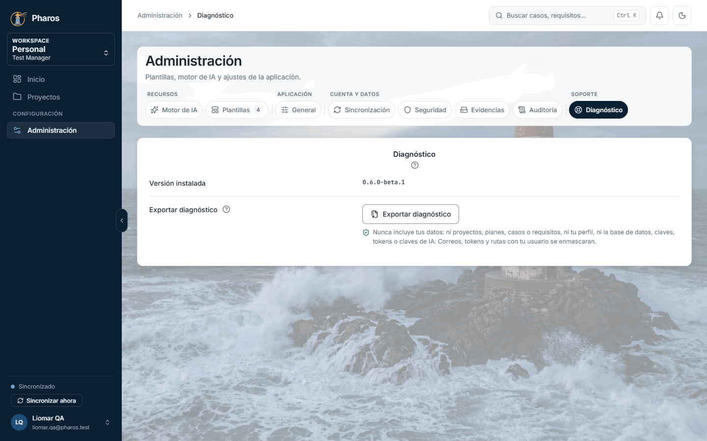

### 15.20. Auditoría

«Auditoría» lista cada cambio de tu cuenta, el más reciente arriba: quién lo hizo (tú, un agente en tu nombre o el sistema), qué acción, sobre qué elemento y desde dónde (este equipo, la web u otro equipo). Por defecto ves los últimos 30 días; filtra por periodo, quién, elemento, acción o proyecto, o busca una clave. Arriba, Pharos comprueba que el registro está íntegro: ningún cambio se ha borrado, reordenado ni modificado. Aquí Liomar busca «REQ-006»: cada cambio de su título sale como «Editado», y cada conflicto de sincronización como «Conflicto resuelto», con lo que se quedó («Se quedó: Combinado»: se juntaron los cambios de los dos equipos) y los campos que tocó.

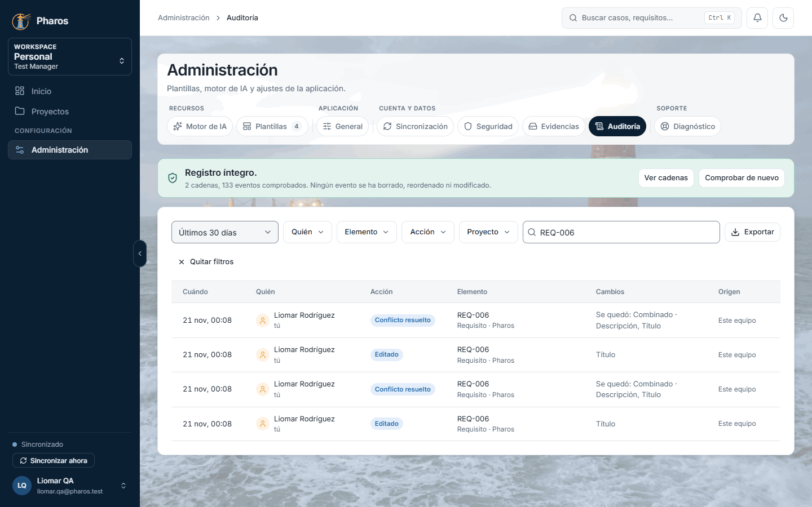

### 15.21. El antes y el después de un cambio

Pulsa un elemento de la lista para ver el cambio campo a campo: lo que había, tachado en rojo, y lo que hay ahora, en verde. Una importación o un borrado en cascada muestra sus recuentos. «Ver todo su historial» lista todos los cambios de ese elemento; «Copiar como JSON» copia el evento tal como se guardó. Aquí, el conflicto de REQ-006 que Liomar acaba de resolver: «Conflicto resuelto», con la descripción que llegó del portátil.

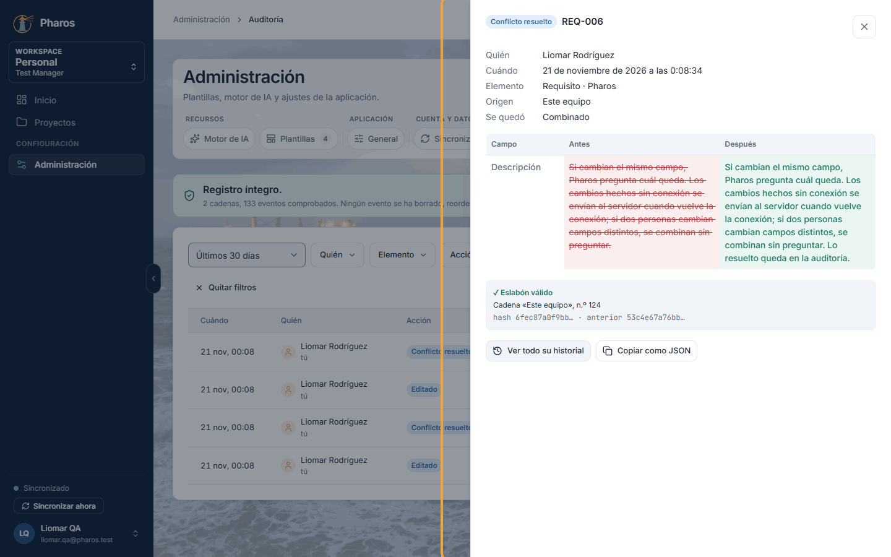

### 15.22. Exportar la auditoría

«Exportar» guarda lo que muestran los filtros, todas las páginas, en Excel (.xlsx) o CSV: una fila por campo cambiado, con quién, cuándo, el antes y el después. El Excel lleva una hoja «Integridad» con el resultado de la comprobación.

### 15.23. Reemplazar una clave de IA guardada

Si ya hay una clave guardada y guardas otra sin probarla, Pharos pide confirmación, porque la anterior no se puede recuperar. «Probar conexión» comprueba la nueva sin reemplazar nada; si responde, se guarda sin preguntar.

### 15.24. Usar la clave de IA también en la web

«Usar esta clave también en la web» viene apagado. Al activarlo, Pharos explica qué implica antes de que la clave salga del equipo: el servidor guarda una copia cifrada y nunca la muestra, quien administre el servidor y tenga su base de datos y su clave maestra podría leerla, y lo que pidas desde la web se cobra a tu clave. «Subir la clave» solo se activa al marcar la casilla. Lo sube el núcleo de la app, directamente desde el almacén de credenciales de Windows.

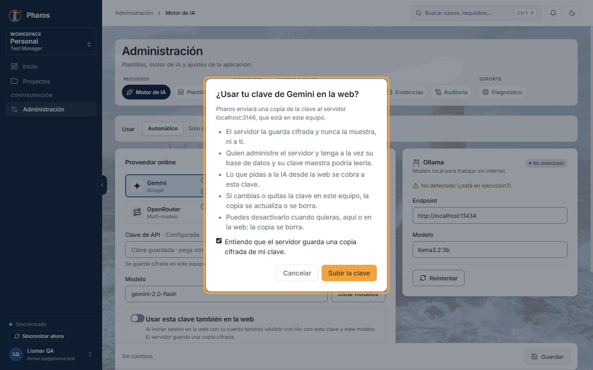

### 15.25. La clave, disponible en la web

Con el interruptor activado, Motor de IA dice qué usa la web (proveedor y modelo), desde cuándo y en qué servidor. Al iniciar sesión en la web con tu cuenta, «Asistir con IA» funciona con esa clave. Si guardas aquí una clave nueva del mismo proveedor, la copia se actualiza sola.

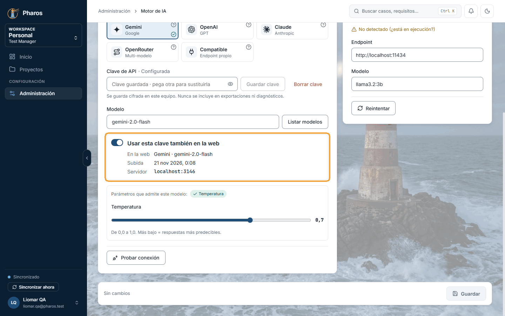

### 15.26. Cambiar el modelo que usa la web

Si cambias el modelo en el escritorio, la web sigue con el anterior hasta que lo confirmas: Motor de IA lo avisa y «Usar el nuevo modelo en la web» pregunta antes. Cambiar de proveedor sube otra clave, así que vuelve a pedir el consentimiento.

### 15.27. Dejar de usar la clave en la web

Al desactivar el interruptor, Pharos pregunta y borra la copia del servidor: la web se queda sin IA en línea. En la web también puedes pulsar «Dejar de usarla en la web».

### 15.28. Quitar una clave que la web también usa

Si quitas del escritorio una clave que la web también usa, Pharos avisa de que la copia del servidor se borra con ella.

### 15.29. Para quien administra el servidor: «Usuarios»

Esta parte es para quien administra el servidor de Pharos, no para el trabajo diario de QA. «Usuarios», en el grupo «Aplicación», solo la ve un administrador del servidor: la primera cuenta que se registró en él (aquí, la cuenta «Administrador», con la que se entra para estos pasos), las que nombre otro administrador y las que configure quien gestiona el servidor (PHAROS_ADMINS). Es un rol de todo el servidor, distinto del Test Manager de un workspace, y no da acceso a los proyectos de nadie. La lista muestra todas las cuentas, con su correo, su alta, si tienen códigos de recuperación («Sin códigos»: si olvidan la contraseña, solo un administrador puede ayudarles) y su estado. En tu propia fila («Tú») no hay «Restablecer contraseña»: la tuya se cambia en «Mi perfil».

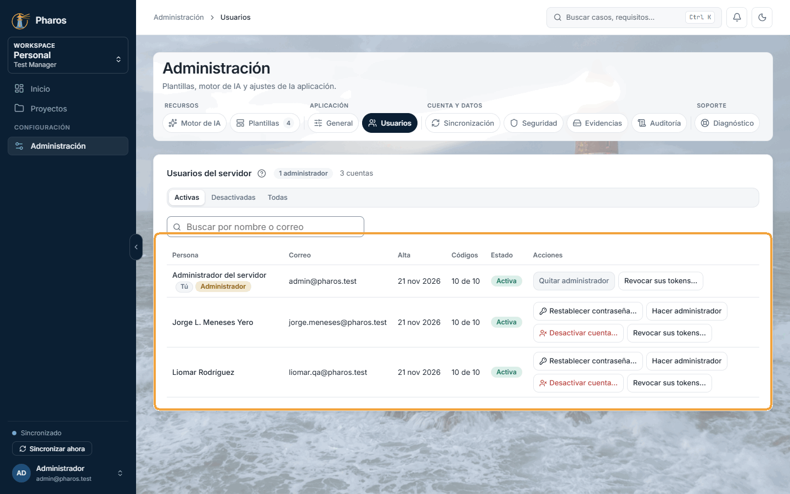

### 15.30. Restablecer la contraseña de otra cuenta

Si Jorge olvida su contraseña y no le quedan códigos de recuperación, «Restablecer contraseña…» en su fila explica qué pasará y, con «Generar enlace», crea un enlace de un solo uso que dura 24 horas. Si el servidor envía correo, «Enviar por correo» se lo manda y tú no lo ves; si no, o si eliges «Prefiero entregarlo yo», se muestra una sola vez (en este manual, difuminado): cópialo y dáselo por un canal privado. Como este servidor no tiene dirección web configurada, aquí es un código que Jorge pega en «¿Olvidaste tu contraseña?» de su app. Nunca ves ni pones su contraseña. Al usarlo se cierran todas sus sesiones; Jorge recibe un aviso y queda en la auditoría de los dos.

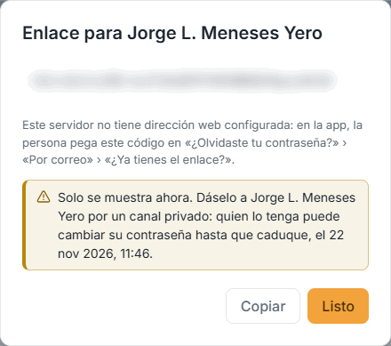

### 15.31. Nombrar a otro administrador

«Hacer administrador» pide confirmación y explica qué podrá hacer: ver todas las cuentas, restablecer contraseñas y nombrar o quitar administradores, sin acceso a los proyectos de nadie. La persona recibe un aviso.

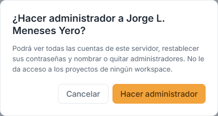

### 15.32. Quitar el rol de administrador

«Quitar administrador» también pide confirmación y avisa a la persona. Siempre tiene que quedar un administrador: el botón del último sale deshabilitado.

### 15.33. Revocar los tokens de una cuenta

«Revocar sus tokens…» anula de una vez todos los tokens de API de esa cuenta, personales y de proyecto, por ejemplo si se filtró uno. La confirmación los nombra (aquí, «CLI de Jorge», un token personal que Jorge se creó para su línea de comandos) y avisa de que no se puede deshacer: los CI que los usan dejan de subir resultados hasta que tengan uno nuevo.

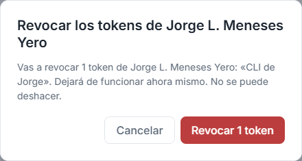

### 15.34. Desactivar una cuenta

Cuando alguien deja el equipo, «Desactivar cuenta…» cierra al momento todas sus sesiones (web, escritorio y API) sin borrar nada: sus datos, su autoría y su auditoría se conservan, y lo que tenga en su equipo se queda allí. Puedes escribir un motivo, que solo ven los administradores, y confirmas escribiendo su correo. Si fuera el único Test Manager activo de un workspace compartido, aquí mismo eliges quién pasa a serlo. No puedes desactivarte a ti ni al último administrador activo.

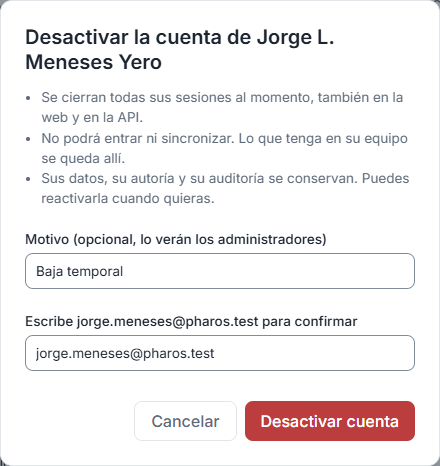

### 15.35. Cuentas desactivadas

La lista muestra primero las cuentas activas; «Desactivadas» y «Todas» enseñan las demás. Una cuenta desactivada lleva «Desactivada · fecha»; al pasar el ratón, quién la desactivó y por qué. Si Jorge intenta entrar, Pharos le dice que su cuenta está desactivada.

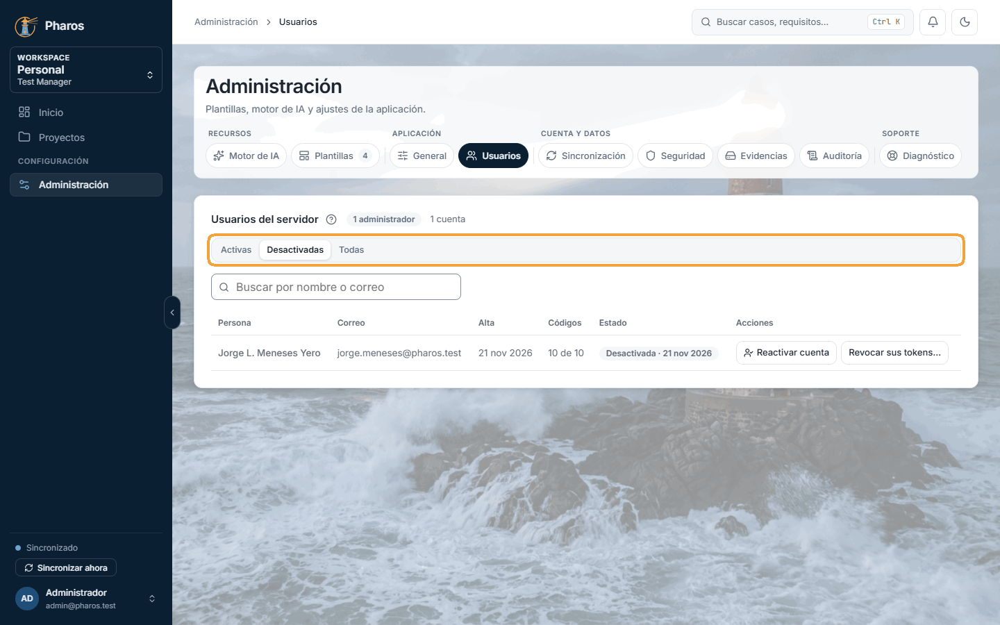

### 15.36. Reactivar una cuenta

«Reactivar cuenta» pide confirmación y la devuelve: Jorge vuelve a entrar con su contraseña y conserva sus roles; sus sesiones anteriores no vuelven. Con esto termina la parte del administrador: la app vuelve a la sesión de Liomar.

## Notificaciones

La **campana** de la barra superior abre las notificaciones, agrupadas por
día: invitaciones, revisiones de casos, defectos asignados, ciclos cerrados,
cambios en los miembros de un workspace, avisos de tu cuenta (por ejemplo,
que un administrador generó un enlace para restablecer tu contraseña) y
conflictos de sincronización. Un número sobre la campana dice cuántas hay
sin leer.

- «Sin leer» filtra las pendientes y «Marcar todo como leído» las da por
  vistas.
- Cada notificación lleva su acción: «Revisar», «Ver defecto», «Resolver»…
- Se guardan 90 días.

## Copias de seguridad y datos de este equipo

- Tus datos viven en este equipo, en la carpeta de datos de Pharos: el
  archivo `pharos.db` (cifrado) y la carpeta `evidence` (los adjuntos,
  también cifrados). Para una copia de seguridad, **cierra Pharos** y copia
  los dos juntos; guarda aparte tu clave de recuperación.
- **Al actualizar desde la 0.5,** la primera vez que abres la 0.6 Pharos
  convierte tus datos al nuevo formato («Actualizando el formato de tus
  datos») y antes guarda el archivo anterior, intacto, como
  `pharos.db.enc.bak-…`. Pasa una sola vez. Si falta espacio en el disco,
  lo dice y no cambia nada (capítulo 19).
- **Varias ventanas y el CLI.** Puedes tener dos ventanas de Pharos abiertas
  y usar el CLI `pharos` a la vez: lo que guarda una aparece en la otra en
  unos segundos, sin tocar lo que estés escribiendo.
- **La base de datos crece menos.** Una vez al día, después de sincronizar,
  Pharos borra de su registro interno los cambios que el servidor ya tiene.
  No se pierde nada: tus datos, su historial y la auditoría siguen igual. El
  diagnóstico dice cuánto ocupan ese registro y la auditoría.

## La papelera

- Está al final de «General», solo en la app de escritorio: la web no guarda
  lo borrado.
- Muestra cuántos elementos hay, su desglose por tipo y, en cada fila, cuándo
  se borró y en cuántos días se eliminará para siempre según la retención.
- **Restaurar** devuelve lo marcado a su sitio, con su clave y su historial, y
  lo sincroniza como cualquier cambio. Un proyecto vuelve con lo que se borró
  con él; lo de un proyecto que está en la papelera espera a su proyecto. Un
  defecto vuelve sin sus adjuntos.
- **Eliminar para siempre** y **Vaciar papelera** piden confirmación. Lo que
  tiene cambios sin sincronizar o un conflicto se conserva hasta que se envíe
  («Pendiente de sincronizar»). Las claves eliminadas no se reutilizan.

## Workspaces y miembros

Con un servidor que tiene workspaces compartidos (desde 0.5.0), el
**selector de workspace** aparece arriba del menú lateral. Muestra el
workspace en el que trabajas y, debajo, tu rol en él. La lista
«Proyectos» solo enseña los proyectos de ese workspace.

- **Personal.** Es tu workspace. Todos tus proyectos empiezan aquí, y en la
  primera sincronización con un servidor que tiene workspaces, los proyectos
  de este equipo pasan a él. Antes, Pharos guarda una copia de seguridad de
  tus datos (`pharos.db.bak-…-workspaces`; con una versión anterior a la
  0.6, `pharos.db.enc.bak-…-workspaces`).
- **Crear workspace.** Abre el selector y elige «Crear workspace». Tú serás
  su Test Manager.
- **Invitar.** En «Miembros y roles», «Invitar» crea un código de un solo
  uso con el rol de la persona: Test Manager, Test Analyst, Automation
  Engineer, Product Owner o Viewer (solo lectura). Copia el texto de la
  invitación, que lleva también la dirección del servidor, y envíaselo por
  el canal que uséis. El código solo se muestra una vez y caduca en 1, 7
  o 30 días.
- **Unirse.** Quien recibe la invitación elige «Unirse con un código…»,
  pega el código, comprueba a qué workspace entra y con qué rol, y pulsa
  «Unirme». Los proyectos llegan con la siguiente sincronización.
- **Compartir un proyecto.** En «Proyectos», el menú «⋯» de un proyecto de
  tu workspace Personal tiene «Compartir con un workspace…». Lo mueve
  entero, con su plan, casos, requisitos, ciclos, ejecuciones, defectos,
  adjuntos y auditoría, a un workspace compartido del que eres Test Manager.
- **Roles.** Solo el Test Manager cambia roles, quita a personas, gestiona
  invitaciones y ve la auditoría. El workspace nunca se queda sin Test
  Manager. Un Viewer ve y exporta todo, pero no cambia nada: Pharos se lo
  recuerda con un aviso de solo lectura, y el servidor rechaza cualquier
  cambio suyo. «¿Qué puede hacer cada rol?», al pie de «Miembros y roles»,
  resume los permisos.
- **Paso a paso.** El capítulo 20, «Trabajo en equipo», recorre con Jorge
  la invitación, los roles y la aprobación independiente.
- **Reglas: «Aprobación independiente».** En «Miembros y roles», la sección
  «Reglas» dice quién aprueba planes y casos (capítulos 5 y 8). Activada, que
  es lo normal en un workspace compartido, aprueba quien tiene el rol (Test
  Manager para planes; Test Manager o Test Analyst para casos) y no es el
  autor. Desactivada, aprueba cualquiera que pueda editar, también el autor,
  y queda como «aprobación propia». Solo un Test Manager la cambia; apagarla
  pide confirmación y queda en la auditoría. En tu workspace Personal está
  siempre desactivada, porque trabajas solo. Las aprobaciones que ya existen
  no cambian.
- **Cambios de dos sitios a la vez.** Si tú y otra persona (u otro equipo
  tuyo) cambiáis el mismo elemento sin sincronizar entre medias, Pharos los
  combina campo a campo: si cambiasteis campos distintos (tú el título, ella
  la prioridad; tú un paso, ella otro), se queda con los dos y no pregunta.
  Un aviso dice cuántos elementos se combinaron «en otro equipo o por otra
  persona», y cada uno queda en la auditoría como «Conflicto resuelto», con
  «Se quedó: Combinado» junto a los campos.
  - Solo pregunta por lo que choca: el mismo campo cambiado de dos formas,
    un paso que uno borró y el otro editó, o los pasos reordenados de dos
    maneras distintas. En el panel de conflictos eliges, campo a campo, «Mi
    versión» o «Versión del servidor», y «Aplicar». «La mía en todo» y «La
    del servidor en todo» siguen ahí.
  - Un texto largo (una descripción) no se mezcla por líneas: si los dos lo
    cambiasteis, eliges uno.
  - Si uno aprobó o revisó el elemento y el otro cambió su contenido, eliges
    una versión entera: una aprobación no puede cubrir un contenido que no
    vio. Lo mismo al cerrar un ciclo que otro editaba.
  - En la web pasa igual al guardar: si otros campos cambiaron mientras
    editabas, se combina y se guarda («Este elemento cambió en otro equipo o
    lo cambió otra persona mientras lo editabas…»); si cambiaron los mismos, un diálogo te deja elegir qué queda en cada uno, o
    volver al formulario sin guardar.
- **Rechazado por permisos.** Si cambias algo que tu rol ya no permite (por
  ejemplo, te cambiaron el rol mientras no tenías conexión), el servidor no
  lo guarda. El cambio espera en el panel de conflictos hasta que lo
  descartas, y entonces vuelve la versión del servidor.
- **Si te quitan de un workspace,** un aviso lo dice y ofrece eliminar su
  copia de este equipo. No se borra nada hasta que lo confirmas.

## Usuarios del servidor

Este apartado es para **quien administra el servidor** de Pharos, no para el
trabajo diario de QA. El **administrador del servidor** es un rol de todo el
servidor, no de un workspace: un Test Manager no lo es por serlo, y ser
administrador no da acceso a los proyectos de nadie. En este manual lo es la
cuenta «Administrador», la primera que se registró en el servidor; Liomar no
lo es.

- **Quién lo es.** La primera cuenta que se registró en el servidor (en un
  servidor que ya existía, la más antigua), las que nombre otro administrador
  y las que configure quien gestiona el servidor con `PHAROS_ADMINS`. «Mi
  perfil» lo indica con «Administrador del servidor».
- **La lista.** Todas las cuentas del servidor, con su correo, su alta y si
  tienen códigos de recuperación. «Sin códigos» quiere decir que, si esa
  persona olvida la contraseña, solo un administrador puede ayudarla.
- **Restablecer contraseña…** Genera un enlace de un solo uso que dura 24
  horas. Tú nunca ves ni pones la contraseña de la otra persona.
  - Si el servidor envía correo, «Enviar por correo» se lo manda y tú no lo
    ves. Si no, o si eliges «Prefiero entregarlo yo», el enlace se muestra
    una sola vez: cópialo y dáselo por un canal privado.
  - Al usarlo se cierran todas sus sesiones y se borra su clave de IA de la
    web. Recibe un aviso, y el cambio queda en tu auditoría y en la suya.
  - Tu propia contraseña no se cambia aquí, sino en «Mi perfil».
- **Hacer administrador / Quitar administrador.** Piden confirmación y
  avisan a la persona. Siempre tiene que quedar un administrador: el del
  último sale deshabilitado.
- **Activas, Desactivadas, Todas.** La lista muestra primero las cuentas
  activas. Una desactivada lleva «Desactivada · fecha»; al pasar el ratón,
  quién la desactivó y por qué.
- **Desactivar cuenta…** Para alguien que deja el equipo, sin borrar nada.
  - Se cierran todas sus sesiones al momento (web, escritorio y API), y ya no
    puede entrar ni sincronizar. Lo que tenga en su equipo se queda allí.
  - Sus datos, su autoría y su auditoría se conservan.
  - Si es el único Test Manager activo de un workspace compartido, eliges
    quién pasa a serlo entre los demás miembros activos. Si no hay nadie
    más, el workspace queda sin Test Manager activo hasta que la reactives.
  - Puedes escribir un motivo (lo ven los administradores) y confirmas
    escribiendo su correo. Los Test Manager de sus workspaces reciben un
    aviso, y queda en tu auditoría y en la suya.
  - No puedes desactivarte a ti ni al último administrador activo.
- **Reactivar cuenta.** La persona vuelve a entrar con su contraseña y
  conserva sus roles; si nombraste un sucesor, también lo sigue siendo.
- **Revocar sus tokens…** Anula al momento todos los tokens de API de esa
  cuenta, personales y de proyecto, por ejemplo si se filtró uno. La
  confirmación los nombra; no se puede deshacer. Su CI deja de subir
  resultados hasta que tenga un token nuevo (capítulo 21).

## Lo que viaja con tu cuenta

- El idioma, el tema, la sombra de las tarjetas, la opacidad del fondo y el
  fondo predeterminado o ninguno se aplican en todos tus equipos: en Perfil
  lo indica «Se aplica en todos tus equipos». Gana el cambio más reciente.
- Una imagen de fondo propia, la retención, la sincronización automática y la
  carpeta de descarga dependen del equipo y se quedan en él.

## Atajos de teclado

| Tecla | Dónde | Qué hace |
| --- | --- | --- |
| ← → | Pestañas de Administración | Pasan a la pestaña anterior o siguiente |
| Inicio, Fin | Pestañas de Administración | Van a la primera o a la última |
| Esc | Diálogos de plantilla y de conflictos | Los cierran; con cambios, preguntan antes |
| Esc | Clave de recuperación mostrada | No la cierra: marca «Ya la he guardado» |
| Esc | Detalle de un evento de auditoría | Lo cierra |

## Si algo no sale

- **No veo «Usuarios».** Solo la ve un administrador del servidor. Pide a uno
  que te nombre, o a quien gestiona el servidor que añada tu correo a
  `PHAROS_ADMINS`.
- **«Ya no eres administrador de este servidor.»** Otro administrador te
  quitó el rol mientras tenías la pestaña abierta.
- **«Tiene que haber al menos un administrador.»** No se puede quitar el rol
  al último. Nombra antes a otra persona.
- **«Este servidor no envía correos. Entrega tú el enlace.»** Elige
  «Prefiero entregarlo yo».
- **«Esta cuenta está desactivada…» al entrar.** Un administrador del
  servidor la desactivó. Pídele que la reactive; tus datos siguen en tu
  equipo y en el servidor.
- **«Tu cuenta está desactivada en el servidor» al sincronizar.** Lo mismo:
  la sincronización se para y tus cambios pendientes esperan en el equipo.
- **«No detectado (¿está en ejecución?)» en Ollama.** Ollama no está
  instalado o no está abierto en este equipo. Ábrelo y pulsa «Reintentar», o
  usa un proveedor online.
- **«Falta la clave de…» o «Escribe un modelo para probar la clave».**
  «Probar conexión» necesita la clave y el modelo. Para listar los modelos,
  guarda antes la clave.
- **«El proveedor rechazó la clave…».** La clave no es válida o no tiene
  saldo. Revísala en la web del proveedor.
- **«No hay IA disponible…».** No hay ningún proveedor online configurado ni
  Ollama en marcha: configura uno de los dos.
- **«“Listar modelos” solo está disponible en la app de escritorio.»** En la
  web, escribe el nombre del modelo.
- **Al cambiar de pestaña pregunta «¿Descartar los cambios?».** Hay ajustes
  sin guardar en la pestaña actual: guárdalos o descártalos.
- **«Conflictos (N)» en el menú lateral.** El mismo campo cambió en dos
  equipos (lo que no choca ya está combinado). «Revisar conflictos» te deja
  elegir qué queda en cada campo, o una versión entera.
- **«No se pudo leer la clave de recuperación.»** Pasa si el almacén de
  credenciales de Windows no está disponible. Vuelve a intentarlo; en la web
  no existe esta opción.
- **«La cadena de … está rota en el evento n.º N».** Alguien modificó o
  borró el registro de auditoría fuera de Pharos (editando la base de datos),
  o se restauró a mano una copia `.bak` en este equipo. Pharos no repara el
  registro: «Ver evento» lleva a ese cambio; exporta la auditoría y el
  diagnóstico si necesitas investigarlo.
- **«Auditoría» no muestra cambios de otra persona.** La pestaña lista los
  cambios de tu cuenta; la auditoría de todo un workspace compartido solo la
  ve su Test Manager.
- **«Ningún evento coincide con los filtros».** El periodo por defecto son
  los últimos 30 días: elige «Todo» o quita algún filtro.

## En el móvil

- Las pestañas se desplazan de lado; desliza para ver las demás.
- La clave de recuperación y «Listar modelos» son de la app de escritorio.
- En «Auditoría», la lista se ve como tarjetas y el detalle de un cambio se
  abre desde abajo.

## Consejos

- Guarda la **clave de recuperación** el primer día: si cambias de equipo o
  reinstalas Windows, solo ella y una copia de `pharos.db` (hecha con Pharos
  cerrado) y de la carpeta `evidence` devuelven tus datos. Pharos no puede
  recuperarla por ti.
- Pulsa **«Probar conexión»** antes de guardar una clave nueva: si responde, se
  guarda sin preguntar y sabes que funciona.
- Activa la **sincronización automática** si trabajas en varios equipos; en
  uno solo, «Sincronizar ahora» al terminar basta.
- Si algo falla, adjunta el ZIP de **«Exportar diagnóstico»** al informe: lleva
  la versión, el sistema y los registros recientes, y nunca tus proyectos,
  tus casos ni tus claves.
- Para revisar qué hizo un **agente de IA** en tu nombre, filtra «Auditoría»
  por «Quién» y elige el agente; copia la dirección de la página para volver
  a esa vista.

## Véase también

- Capítulo 16, «Evidencias»: la pestaña «Evidencias».
- Capítulo 17, «Asistente de IA»: cómo saber qué modelo está activo y qué
  hace la IA en cada pantalla.
- Capítulo 19, «Si algo sale mal»: la conversión de los datos al actualizar
  y las pantallas de error de la base de datos.
- Capítulo 20, «Trabajo en equipo»: invitar, roles y aprobación
  independiente, paso a paso.
- [Glosario](../GLOSARIO.md): «Pestaña de Administración», «Plantilla»,
  «Papelera», «Registro de auditoría».

---

← [Ajustes del proyecto](14-ajustes.md) · [Índice](README.md) · [Evidencias](16-evidencias.md) →
