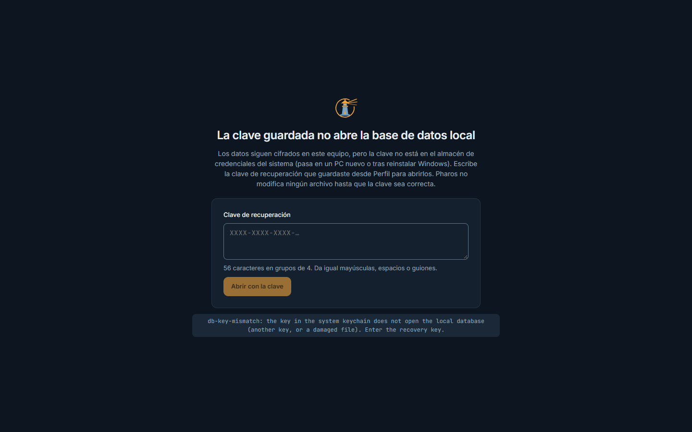
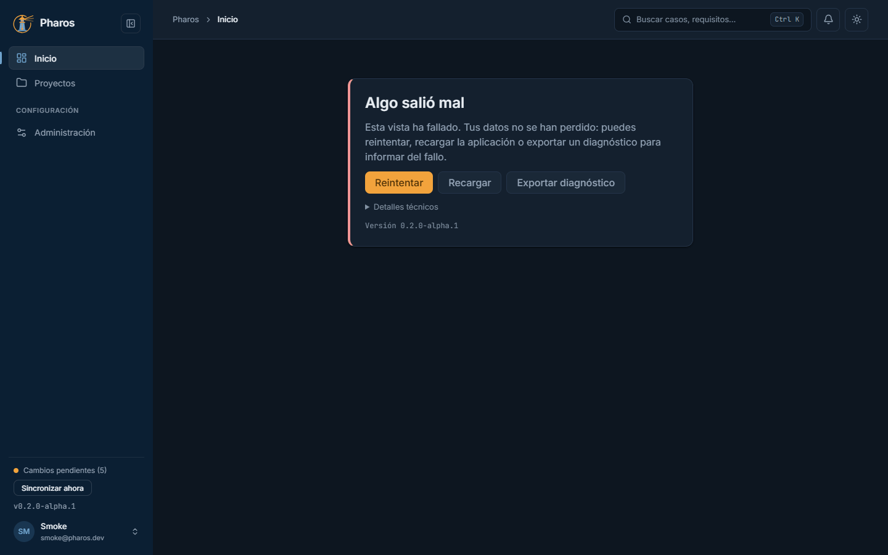

<!-- Generado por `npm run manual` desde e2e/tours/15-errores.tour.ts y docs/manual/fuentes/errores.md. No lo edites a mano: edita la fuente. -->

# 15. Si algo sale mal

## Para qué sirve

Este capítulo enseña las pantallas que aparecen cuando algo falla, para que
las reconozcas y sepas qué hacer. En ninguna de ellas Pharos borra ni
modifica tus datos.

## Paso a paso

### 15.1. Si la base de datos local no abre

Si los datos locales no se pueden abrir (un archivo dañado, una versión más nueva o la clave que falta en un equipo nuevo), Pharos lo explica, no modifica ningún archivo y, cuando falta la clave, ofrece abrirlos con la clave de recuperación.

### 15.2. Restaurar la copia

Con el archivo original de vuelta (o una copia de pharos.db.enc), Pharos abre como siempre.

### 15.3. «Algo salió mal»

Si una vista falla, Pharos no se cierra: muestra «Algo salió mal» con «Reintentar», «Recargar» y «Exportar diagnóstico», y tus datos siguen a salvo. «Detalles técnicos» enseña el error para el informe.

### 15.4. Reintentar

«Reintentar» vuelve a mostrar la vista cuando el fallo ya no se repite.

## Consejos

- En «Algo salió mal», prueba primero «Reintentar»; si se repite, exporta el
  diagnóstico y adjúntalo al informe del fallo.
- Si la base de datos local no abre en un equipo nuevo, ten a mano la clave
  de recuperación y una copia de `pharos.db.enc`.
- Nunca adjuntes a un informe `pharos.db.enc`, tu clave de recuperación ni
  claves de IA.

## Véase también

- [Guía de pruebas de la beta](../guia-beta.md), apartados 5 «Cómo informar de un problema» y 6 «Si algo sale mal con los datos».

---

← [Evidencias](14-evidencias.md) · [Índice](README.md)
