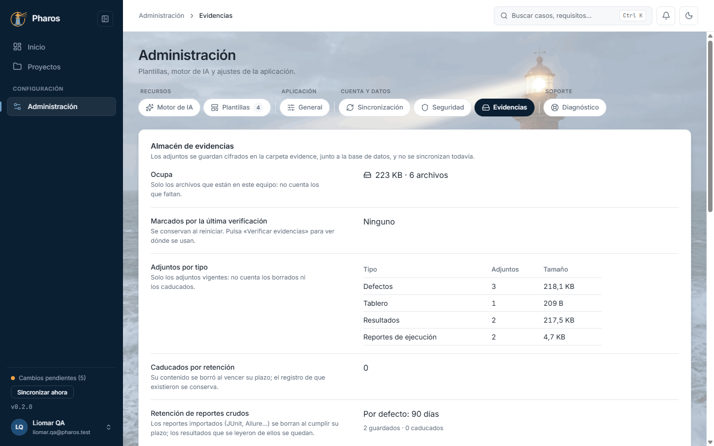
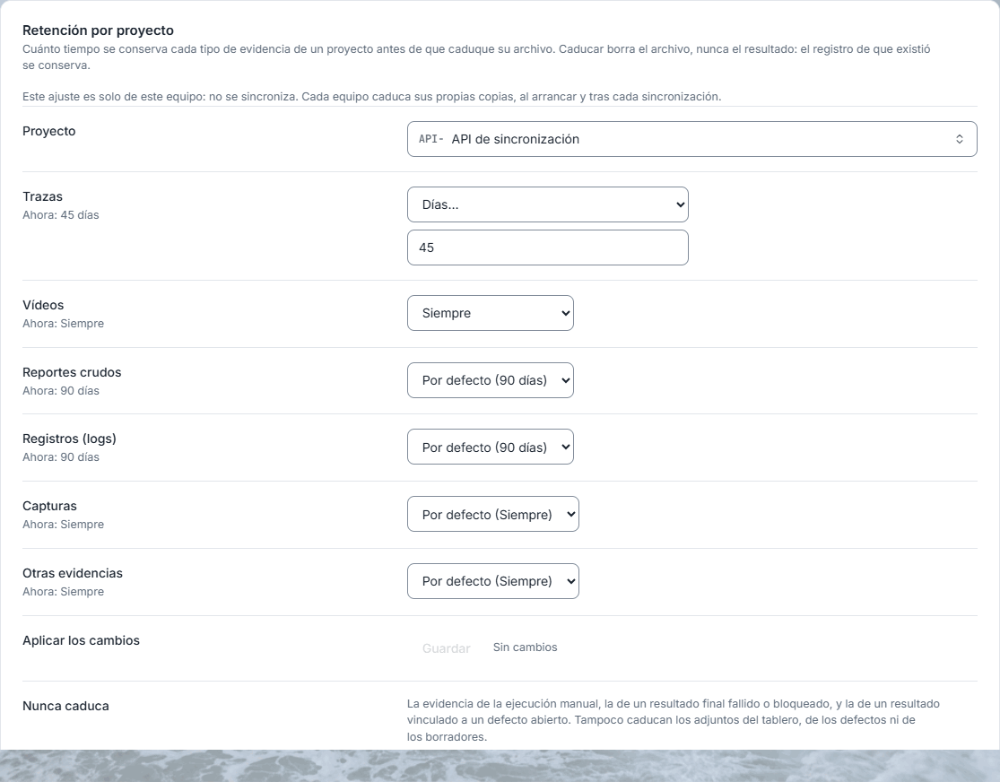
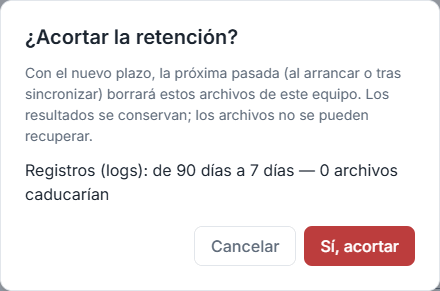
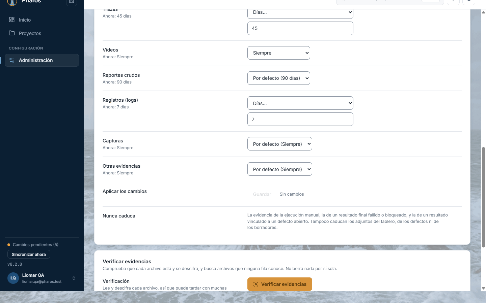
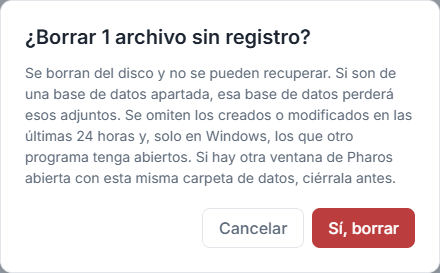

<!-- Generado por `npm run manual` desde e2e/tours/16-evidencias.tour.ts y docs/manual/fuentes/evidencias.md. No lo edites a mano: edita la fuente. -->

# 16. Evidencias

## Para qué sirve

Las **evidencias** son los archivos que adjuntas: capturas, vídeos, registros
y trazas de las tarjetas del Tablero, de los defectos, de los resultados y de
los informes importados. Pharos los guarda **cifrados** en la carpeta
`evidence`, junto a la base de datos, en este equipo. Todavía no se
sincronizan con tus otros equipos.

«Administración › Evidencias» (solo en la app de escritorio) tiene tres
partes:

- **Almacén de evidencias:** cuánto ocupan, cuántos adjuntos hay de cada tipo,
  cuántos han caducado y la retención de los reportes importados.
- **Retención por proyecto:** cuánto se conserva cada tipo de evidencia de un
  proyecto (trazas, vídeos, reportes crudos, registros, capturas y otras)
  antes de que caduque su archivo. Caducar borra el archivo, nunca el
  resultado: el registro de que existió se conserva.
- **Verificar evidencias:** comprueba que cada archivo sigue ahí y se
  descifra, y busca **huérfanos**, archivos que ya ningún elemento usa.

Nunca caducan la evidencia de la ejecución manual, la de un resultado final
fallido o bloqueado, la de un resultado vinculado a un defecto abierto, ni los
adjuntos del Tablero, de los defectos o de los borradores.

En este manual, Liomar guarda más tiempo las trazas y los vídeos de Pharos,
acorta los registros y limpia un archivo huérfano.

## Paso a paso

### 16.1. El almacén de evidencias

Las evidencias son los archivos que adjuntas: capturas, vídeos, registros y trazas de las tarjetas del Tablero, los defectos, los resultados y los informes importados. Pharos los guarda cifrados en este equipo. En «Administración», la pestaña «Evidencias» empieza por «Almacén de evidencias»: el espacio que ocupan, los adjuntos por tipo (tablero, defectos, reportes, resultados, borradores…) y la retención de los reportes importados. En este ejemplo, las de Pharos: las capturas del fallo de acceso, la del menú lateral y el informe JUnit.

### 16.2. Retención por proyecto

«Retención por proyecto» fija, para cada tipo de evidencia de un proyecto, cuánto se conserva antes de que caduque su archivo: el valor por defecto (30 días las trazas y los vídeos, 90 los reportes y los registros), «Siempre» o un número de días. Nunca caduca la evidencia de la ejecución manual, la de un resultado final fallido o bloqueado ni la de un resultado vinculado a un defecto abierto. Nada se guarda hasta pulsar «Guardar». Es un ajuste solo de este equipo: no se sincroniza. En este ejemplo, Liomar guarda 45 días las trazas de Playwright y siempre los vídeos, porque los usa para comparar entre versiones.

### 16.3. Acortar la retención

Un plazo más corto que el actual pide confirmación y dice cuántos archivos caducarían en la próxima pasada (al arrancar o tras sincronizar). Los resultados se conservan; los archivos caducados no se recuperan. Por eso es una confirmación crítica: Esc no la cierra; solo responden «Cancelar» y el botón de confirmar. En este ejemplo, Liomar baja los registros a 7 días.

### 16.4. Retención acortada

Al confirmar, el nuevo plazo se guarda en este equipo.

### 16.5. Verificar las evidencias

«Verificar evidencias» comprueba que cada archivo está y se descifra, y busca archivos que ninguna fila conoce (huérfanos). No borra nada por sí sola; puedes seguir trabajando mientras tanto.

### 16.6. Borrar los huérfanos

Los huérfanos aparecen en su bloque con su tamaño; «Borrar seleccionados» pide una confirmación crítica antes de eliminarlos, porque no se pueden recuperar. Solo se ofrecen los de más de 24 horas, para no tocar un archivo que se está guardando. Los que faltan o están dañados se listan con el elemento que los usa, para que sepas qué volver a adjuntar.

### 16.7. Huérfanos borrados

Al confirmar se borran y el informe se actualiza; cada borrado queda en el registro de auditoría.

## Atajos de teclado

| Tecla | Dónde | Qué hace |
| --- | --- | --- |
| Tab | Retención por proyecto | Recorre los tipos y su plazo |
| ↑ ↓ | Selector de plazo de un tipo | Cambian entre «Por defecto», «Siempre» y «Días…» |
| Esc | Confirmación de acortar la retención o de borrar huérfanos | No la cierra: usa «Cancelar» |

## Si algo no sale

- **«Las evidencias se guardan cifradas en este equipo: su uso y su
  verificación solo están en la app de escritorio.»** Estás en la web: abre la
  app de escritorio.
- **«No se pudo leer el almacén de evidencias…».** Comprueba que la carpeta de
  datos está en su sitio y vuelve a abrir la pestaña.
- **Un adjunto dice «Este archivo no está en este equipo…».** Caducó por
  retención, o la carpeta de datos se copió sin su carpeta `evidence`.
  «Verificar evidencias» dice qué falta y dónde se usa.
- **Un huérfano no se puede marcar.** Tiene menos de 24 horas: puede ser un
  archivo que se está guardando. Vuelve a verificar mañana.
- **«Por guardar: …».** Hay plazos cambiados sin guardar: pulsa «Guardar».

## En el móvil

- La pestaña «Evidencias» es de la app de escritorio; en el móvil no está.

## Consejos

- Verifica las evidencias después de restaurar una copia o de mover la carpeta
  de datos: el informe dice qué falta o está dañado y dónde se usa.
- Incluye la carpeta `evidence` en tus copias: las evidencias todavía no se
  sincronizan.
- Antes de acortar un plazo, mira cuántos archivos caducarían: la confirmación
  lo dice, y los caducados no se recuperan.
- La retención es un ajuste de cada equipo: si trabajas en varios,
  configúrala en cada uno.

## Véase también

- Capítulo 15, «Administración».
- Capítulo 19, «Si algo sale mal»: restaurar una copia.
- [Guía de pruebas de la beta](../guia-beta.md), apartado 6 «Si algo sale mal
  con los datos».

---

← [Administración](15-administracion.md) · [Índice](README.md) · [Asistente de IA](17-ia.md) →
