<!-- Generado por `npm run manual` desde e2e/tours/17-ia.tour.ts y docs/manual/fuentes/ia.md. No lo edites a mano: edita la fuente. -->

# 17. Asistente de IA

## Para qué sirve

La IA de Pharos es **opcional**. Con tu propia clave de un proveedor online
(Gemini, OpenAI, Claude, OpenRouter o un servicio compatible), o sin internet
con Ollama, puede:

- redactar borradores de los campos del plan y sugerir sus riesgos, las
  responsabilidades de sus roles, sus supuestos, sus criterios de entrada y
  de cierre (capítulo 5);
- proponer casos a partir de un requisito (capítulo 7) o del plan
  (capítulo 8);
- sugerir y revisar las listas de un caso: precondiciones, pasos,
  postcondiciones y criterios (capítulo 8);
- proponer requisitos a partir de la carpeta de un proyecto o de capturas,
  bocetos y diseños (capítulo 7).

En este manual, la IA trabaja con material del propio Pharos: un extracto de
su API de sincronización como carpeta de proyecto y un boceto de su panel de
notificaciones como diseño. Lo que propone cambia de una vez a otra: las
capturas muestran qué tipo de propuesta sale, no un texto que vayas a ver
igual.

**Nada se aplica sin que lo aceptes**, y lo aceptado queda marcado como
generado por IA hasta que alguien lo revisa.

En este manual, Liomar trabaja con **Claude** (Anthropic).

## Paso a paso

### 17.1. Sin IA configurada

La IA es opcional. Mientras no configures un proveedor (o Ollama), los botones de IA, como «Sugerir casos con IA», aparecen deshabilitados; el resto de Pharos funciona igual.

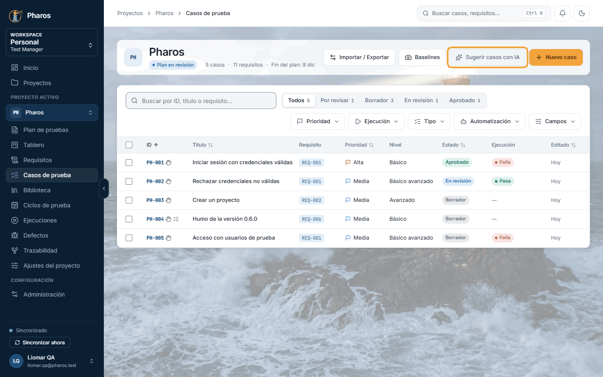

### 17.2. Configurar el proveedor

En «Administración → Motor de IA», elige el proveedor, pega tu clave y pulsa «Guardar clave»: queda en el almacén de credenciales de Windows, ese proveedor pasa a ser el activo y el campo muestra «Configurada» (en este manual, difuminado). Después elige un modelo («Listar modelos») y guarda. Para saber qué IA está activa, mira la tarjeta con la marca ✓ (al pasar el cursor dice «En uso»), el estado «Conectado» y el campo «Modelo»: es la que Pharos usará. Guardar la clave de otro proveedor no lo cambia; lo cambia elegir otra tarjeta y guardar. Con «Usar: Automático», Pharos usa el proveedor online si está configurado y, si no, Ollama. En este ejemplo, Liomar trabaja con Claude (Anthropic) en «Solo online», con un modelo de Claude.

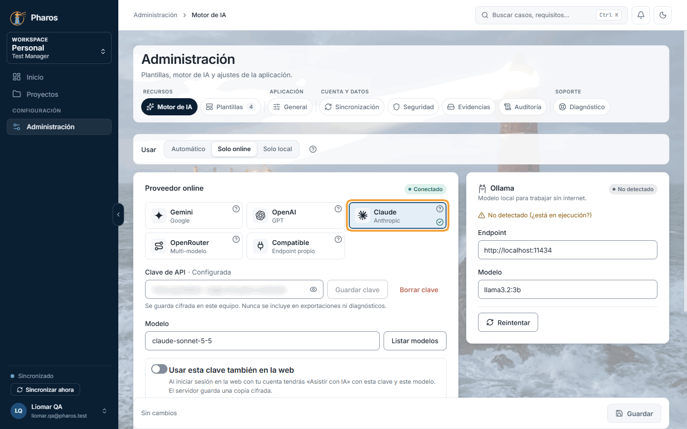

### 17.3. Probar la conexión

Antes de confiar en la configuración, «Probar conexión» envía una pregunta mínima al proveedor activo y muestra el tiempo de respuesta («Respuesta en N ms»): es la prueba de que esa IA, con ese modelo, contesta. Si falla, dice por qué (clave, modelo o red). Con una clave recién escrita, la prueba sin guardarla: si no funciona, la anterior sigue intacta.

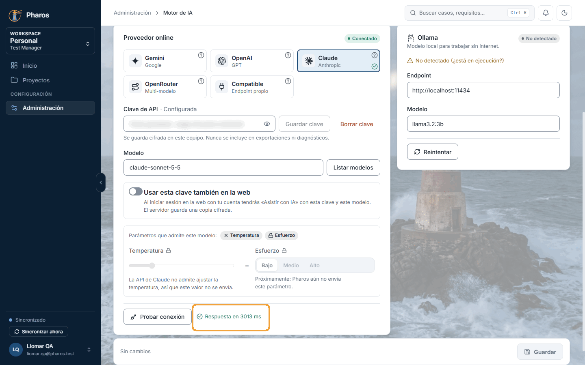

### 17.4. Las tres formas de traer requisitos

Con un motor de IA configurado, el menú «Importar» de «Requisitos» tiene sus tres opciones activas: «Importar requisitos (.csv)» crea o actualiza requisitos por su ID; «Requisitos desde un proyecto (IA)» propone requisitos a partir de la documentación y el código de una carpeta (solo en la app de escritorio); y «Requisitos desde diseños» los propone a partir de capturas, bocetos, PDF, un dibujo de Excalidraw o un proyecto de Claude Design. Con las de IA, nada se crea hasta que revisas y aplicas las propuestas.

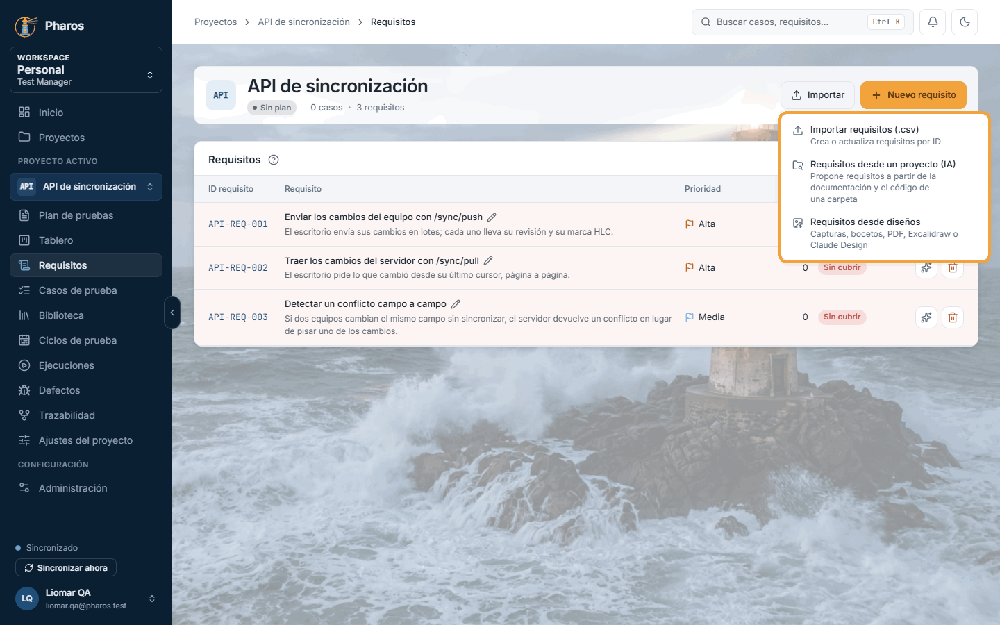

### 17.5. Requisitos desde un proyecto: la carpeta

«Requisitos desde un proyecto (IA)» abre su diálogo; «Elegir carpeta…» abre el selector de carpetas de Windows. Elige la carpeta de un proyecto en marcha o de su documentación: aquí, un extracto del propio Pharos, su API de sincronización, con su README, dos documentos, el código que combina los cambios y sus pruebas. Pharos lista lo que leería, agrupado por tipo, sin enviar nada todavía. Desmarca lo que no quieras enviar; las dependencias, los builds, los archivos ocultos, los binarios y los archivos con secretos nunca se envían. Abajo ves cuántos archivos, cuántos tokens (aproximados) y cuántas llamadas a la IA supone, y puedes ajustar el presupuesto y añadir un contexto que ayude a la IA (en este ejemplo, que es la API de sincronización de Pharos).

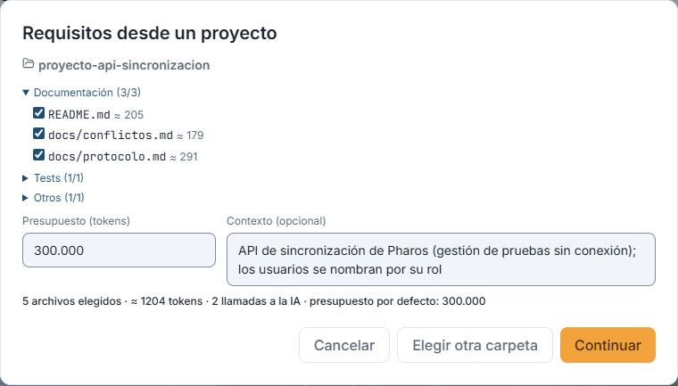

### 17.6. Antes de enviar

«Continuar» resume lo que saldrá del equipo: cuántos archivos, cuántos tokens (aproximados, contados sobre el texto ya leído, así que pueden diferir un poco de los del paso anterior) y en cuántas llamadas, y a qué proveedor van. Las líneas con aspecto de secreto (claves, tokens) se sustituyen por «[secreto omitido]» antes de enviar. «Volver» te deja cambiar la selección; «Enviar y analizar» empieza.

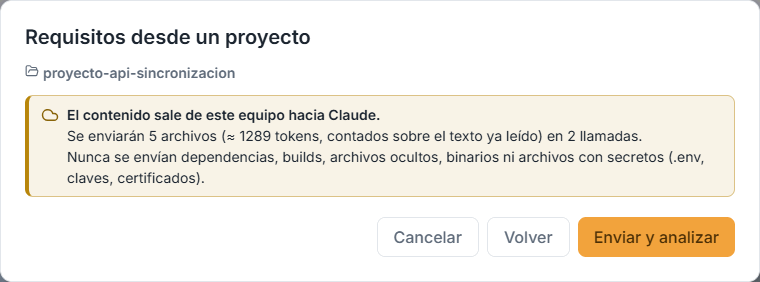

### 17.7. Las propuestas desde el proyecto

La IA lee los archivos por lotes («Analizando: lote 1 de N…»; «Detener» lo para) y compara lo que encuentra con los requisitos que ya tiene el proyecto. Propone requisitos nuevos, mejoras de los que ya existen, posibles duplicados y requisitos que sobran, cada uno con su motivo, su fuente (el archivo y las líneas) y sus criterios de aceptación. «Escrito en la fuente» es lo que el material dice; «Inferido», una deducción con sus supuestos y sus preguntas abiertas, para que la confirmes. Marca lo que quieras y pulsa «Aplicar N cambios»: lo aplicado queda «IA · pendiente de revisión».

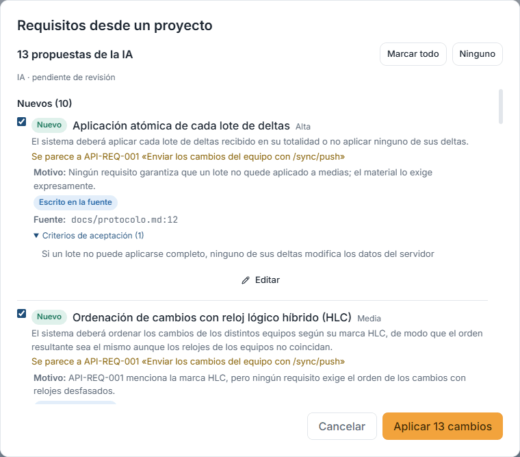

### 17.8. Requisitos desde diseños: el material

Tras aplicar, «Importar › Requisitos desde diseños» parte de lo que se ve: capturas, bocetos, PDF, un dibujo de Excalidraw o la carpeta o el ZIP de un proyecto de Claude Design (desde Figma o Canva, exporta los frames como PNG o PDF). Arrástralos, pega una captura con Ctrl+V o usa «Elegir archivos» o «Elegir carpeta». Aquí, un boceto del panel de notificaciones de Pharos, que aún no tiene requisitos. Cada imagen muestra su tamaño y una estimación de tokens; añádele una nota (aquí, «campana y panel de notificaciones») y escribe el contexto del producto: la IA acierta más. Se envían como mucho 8 imágenes o PDF por análisis, y el aviso dice a qué proveedor van.

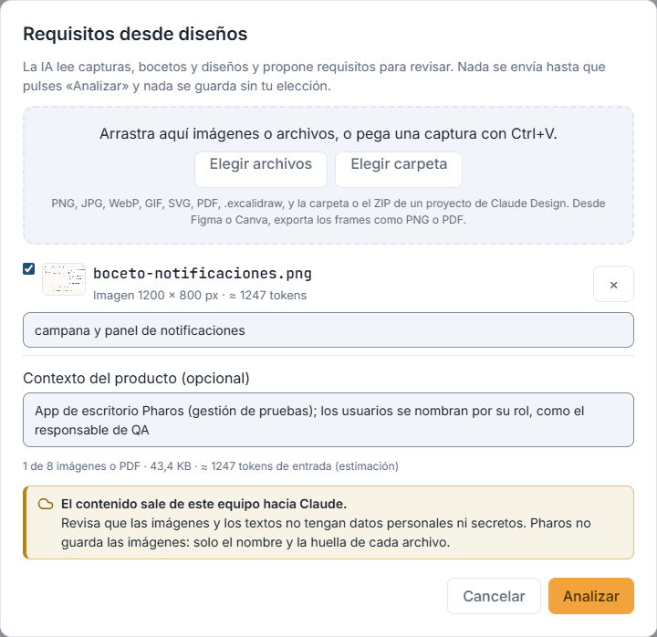

### 17.9. Analizar: dos pasos

«Analizar» envía el material. El análisis tiene dos pasos: primero la IA lee las imágenes («Paso 1 de 2 · Leyendo el material con IA…») y después compara lo que encontró con los requisitos del proyecto («Paso 2 de 2»). Al lado ves los segundos que lleva: suele tardar uno o dos minutos, no se ha quedado colgado. «Cancelar» lo deja.

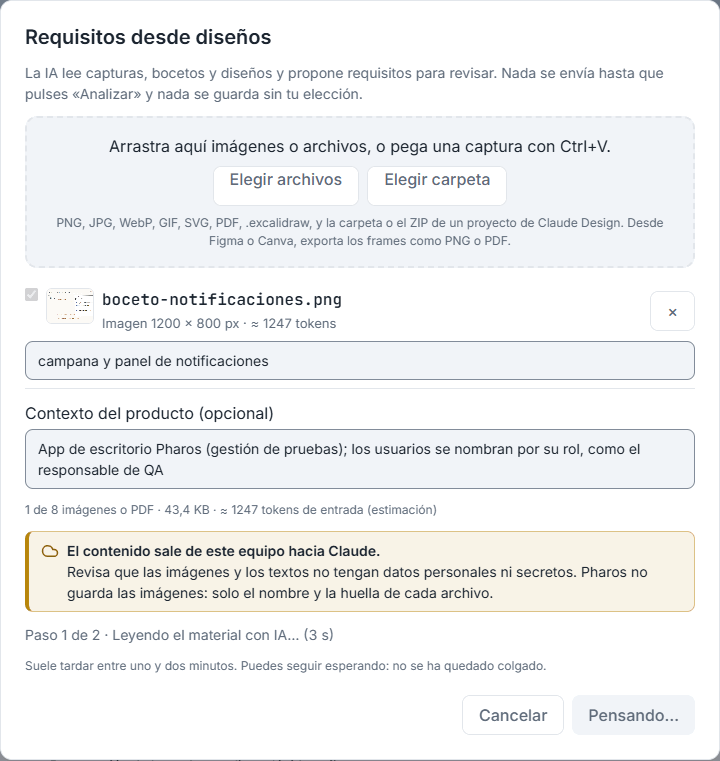

### 17.10. Las propuestas desde el boceto

Las propuestas se revisan igual que las de un proyecto. La fuente de cada una es la imagen, con un recuadro en la zona de la que sale el requisito. Los criterios de aceptación van uno por bloque (los que la IA escribe en Gherkin se muestran con una palabra clave por línea, en negrita). Abajo, «Guardar las imágenes como adjunto de los requisitos» viene desmarcada (Pharos no guarda las imágenes salvo que lo pidas); Liomar la marca para guardarlas cifradas junto a cada requisito y verlas después.

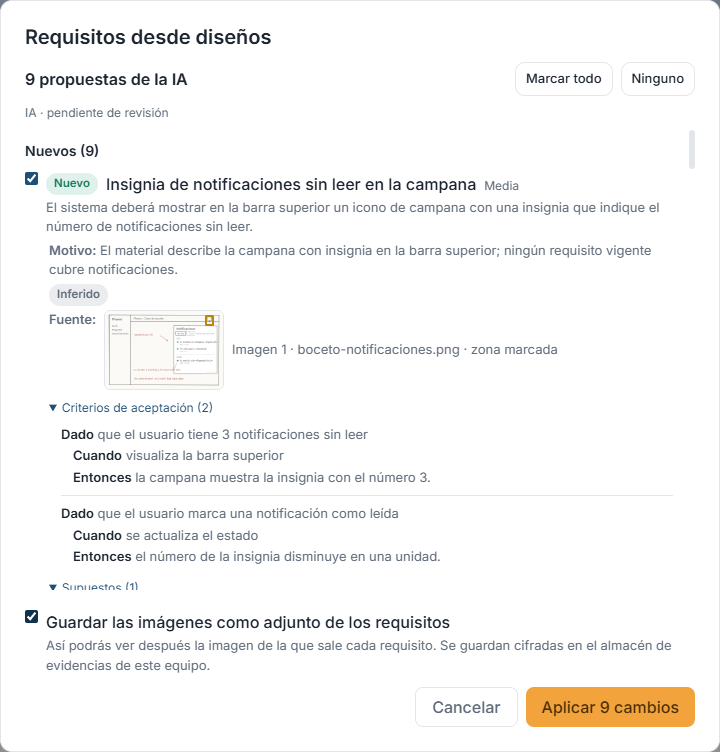

### 17.11. La imagen de la que sale un requisito

La imagen a tamaño completo, con la zona de la que sale el requisito marcada. Se llega así: con la casilla marcada, abre un requisito («Editar requisito»), despliega «Fuente» y pulsa la miniatura; «Cerrar» o Esc vuelven. Si no se guardó, «Fuente» lo dice («La imagen no se guardó en Pharos.»). Las imágenes guardadas cuentan en «Administración › Evidencias» como «Requisitos» y solo se ven en la app de escritorio.

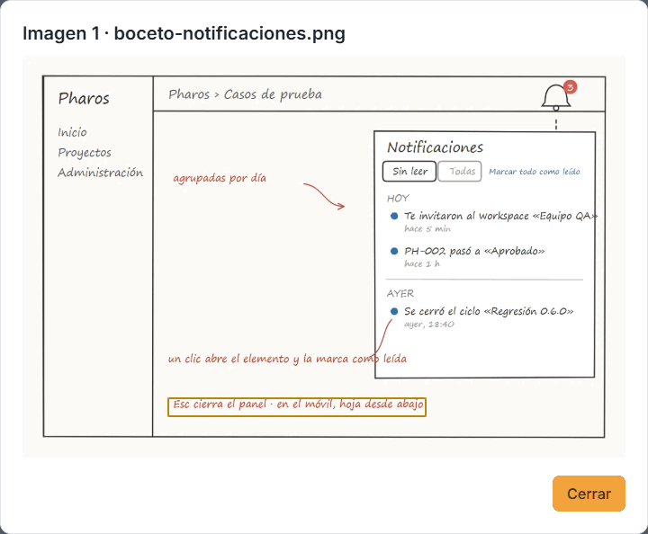

### 17.12. «Asistir con IA» en un campo

En los campos de texto del plan, el botón de IA (✨, «Asistir con IA») propone un borrador breve a partir del resto del plan, con lo que pide el syllabus ISTQB para esa sección. En «Conclusión», valora el plan frente a sus objetivos y criterios de salida, y no inventa resultados. Revisa el «Borrador de la IA» y pulsa «Usar» o «Descartar»: nada se aplica solo, y lo aceptado queda marcado como generado por IA. A la derecha, el «Historial» del plan sigue mostrando el recorrido del capítulo 5: aprobado, marcado obsoleto y reactivado, otra vez «En revisión» con la nota de su primer envío.

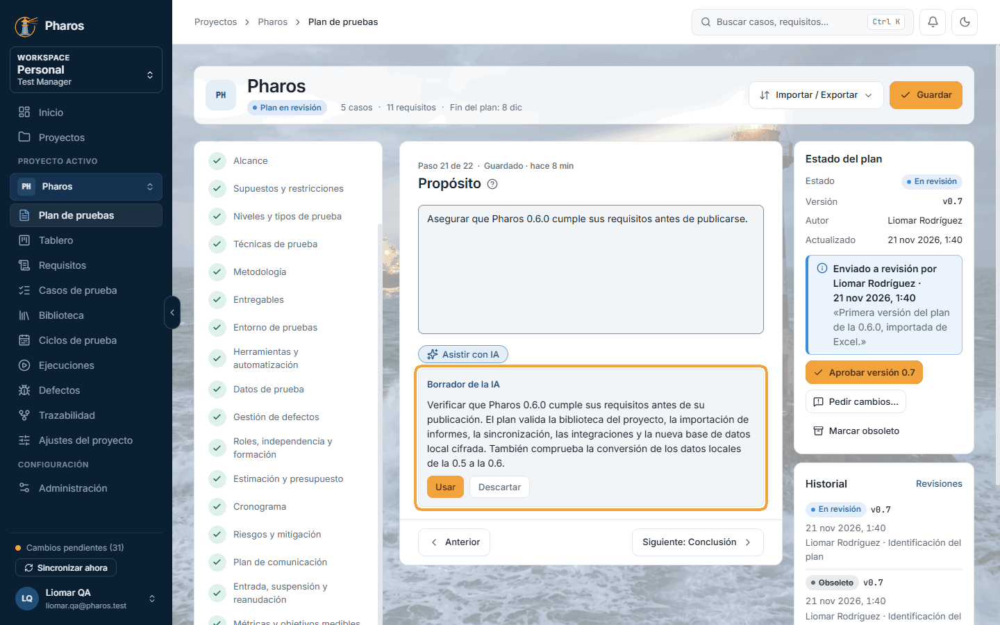

### 17.13. Lo que escribió la IA queda marcado

«Usar» pasa el borrador al campo, donde puedes corregirlo como cualquier texto; se guarda con el plan («Guardar»). Junto al campo queda la marca «IA · pendiente de revisión» hasta que alguien lo lea y pulse «Marcar revisado». La marca también guarda qué proveedor y qué modelo lo generaron (en este ejemplo, Claude y su modelo), que se leen al pasar el cursor por ella: así se sabe, también después, qué IA escribió cada cosa.

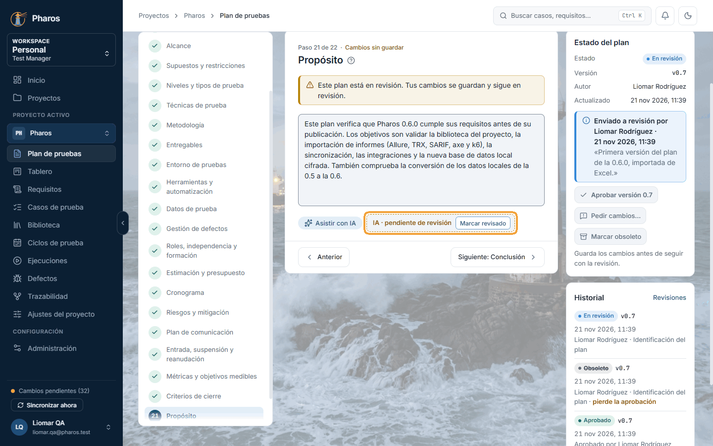

### 17.14. Sugerir riesgos

En «Riesgos y mitigación», «Sugerir riesgos con IA» propone riesgos con su mitigación, un buen punto de partida que conviene revisar: marca los que te sirvan y pulsa «Añadir».

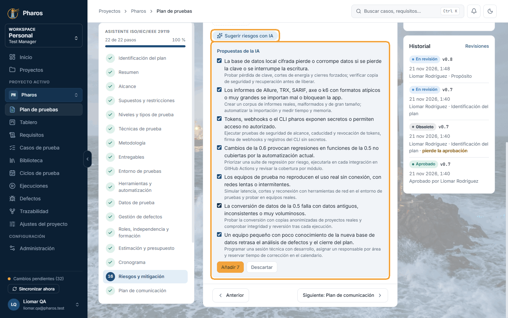

### 17.15. Generar casos desde un requisito

En «Requisitos», el botón de IA de un requisito propone escenarios Gherkin y casos para él. Revisa cada propuesta («Ver Gherkin»), marca las buenas y pulsa «Crear N casos»: quedan vinculados al requisito.

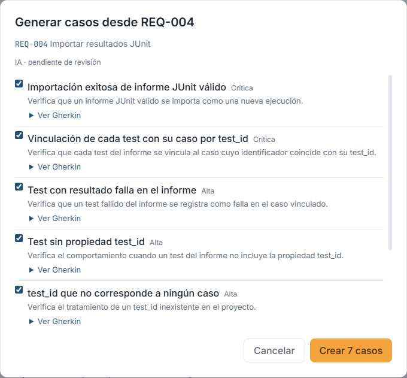

### 17.16. Sugerir casos a partir del plan

En «Casos de prueba», «Sugerir casos con IA» propone casos según los tipos y niveles del plan (capítulo 5); elige los que quieras crear y revísalos como cualquier otro caso.

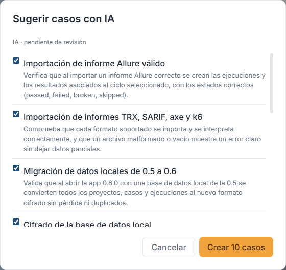

### 17.17. Sugerir y revisar el caso con IA

En el editor de un caso, cada lista tiene su botón de IA (✨) junto a su título; su nombre aparece al pasar el cursor. «Sugerir precondiciones» las propone a partir del resto del caso (en este ejemplo, PH-002, «Rechazar credenciales no válidas», que aún no tiene ninguna), y con la lista ya escrita pasa a «Revisar precondiciones». Igual en pasos, postcondiciones y criterios, en cada flujo de un caso avanzado y en las comprobaciones de una checklist. La revisión propone añadir, reformular o eliminar, y cada propuesta dice por qué; si la lista ya está bien, lo dice y no aplica nada. Reformular y eliminar empiezan sin marcar: solo se aplican si los marcas. Datos de prueba y Notas no llevan IA.

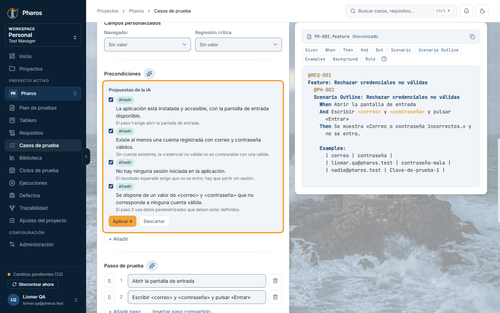

### 17.18. Borrar la clave

«Borrar clave» la quita del almacén de credenciales, por ejemplo, si cambias de cuenta o vas a dejar el equipo; la IA vuelve a quedar sin configurar.

## ¿Qué IA está activa?

- En «Administración › Motor de IA», la tarjeta del proveedor con la marca
  **✓** (al pasar el cursor dice «En uso») es la que Pharos usará, con el modelo que dice el campo
  **«Modelo»**.
- Tener guardada la clave de otro proveedor (por ejemplo, de Gemini) no lo
  activa. Se activa al elegir su tarjeta y guardar, o al guardar su clave con
  «Guardar clave».
- Con **«Usar: Automático»**, Pharos usa el proveedor online si está
  configurado y, si no, Ollama. «Solo online» y «Solo local» fijan uno de los
  dos.
- **«Probar conexión»** pregunta al proveedor activo y responde «Respuesta en N
  ms»: si contesta, esa es la IA que trabaja.
- Cada texto que pone la IA lleva la marca **«IA · pendiente de revisión»**.
  Al pasar el cursor por ella se ve qué proveedor y qué modelo lo generaron
  (por ejemplo, «Claude · …»), también semanas después.

## En la web

- La IA en línea de la web usa **la clave de tu escritorio**. En Pharos de
  escritorio, en «Administración › Motor de IA», activa «Usar esta clave
  también en la web». Antes de subirla, Pharos te dice qué implica y te pide
  que lo confirmes:
  - el servidor guarda una copia cifrada y nunca la muestra;
  - quien administre el servidor y tenga su base de datos y su clave maestra
    podría leerla;
  - lo que pidas desde la web se cobra a tu clave.
- En la web, «Motor de IA» muestra «IA disponible» con el proveedor y el
  modelo que usa. Para cambiarlos, hazlo en el escritorio: si guardas una
  clave nueva del mismo proveedor, la copia se actualiza sola; si cambias el
  modelo o el proveedor, Pharos te pregunta antes.
- **Para dejar de usarla**, desactiva el interruptor en el escritorio o pulsa
  «Dejar de usarla en la web» en la web: la copia se borra del servidor. Si
  quitas la clave del escritorio, la copia también se borra.
- Si recuperas tu cuenta con un código de recuperación o un enlace para
  restablecer la contraseña, la copia se borra. Vuelve a activarla desde el
  escritorio. Cambiar la contraseña desde «Mi perfil» no la borra.
- No está disponible con «Compatible», ni si tu servidor no tiene activada la
  IA en la web (lo configura quien lo administra).

## Atajos de teclado

| Tecla | Dónde | Qué hace |
| --- | --- | --- |
| Tab, Intro | Botón ✨ de un campo o de una lista | Lo alcanza y pide la propuesta |
| Espacio | Casilla de una propuesta | La marca o la desmarca |
| Ctrl+V | Material de «Requisitos desde diseños» | Pega una captura |
| Esc | Diálogos de propuestas («Generar casos», «Sugerir casos») | Los cierran sin crear nada |

## Si algo no sale

- **Los botones de IA están en gris.** No hay IA configurada: el aviso del
  botón lo dice. Configúrala en el capítulo 15.
- **«No hay IA disponible…».** Ni un proveedor online con clave y modelo, ni
  Ollama en marcha. En la web: activa en el escritorio «Usar esta clave también
  en la web».
- **«Has hecho muchas peticiones seguidas».** El servidor limita la IA de la
  web por cuenta. Espera un minuto.
- **«Hay que volver a subirla».** El servidor cambió su clave maestra. En el
  escritorio, pulsa «Volver a subir» en Motor de IA.
- **«Falló la conexión con la IA…» o «El proveedor rechazó la clave…».**
  Revisa la clave, el modelo y la red con «Probar conexión».
- **«El proveedor respondió vacío».** Prueba otro modelo o vuelve a pedirlo.
- **La propuesta no sirve.** Descártala: no se ha aplicado nada. Puedes
  pedirla otra vez.
- **«Requisitos desde diseños» no lee las imágenes.** El modelo no ve
  imágenes: elige uno con visión.
- **Una propuesta habla de personas o datos que no existen.** La IA rellena
  huecos. Escribe en el contexto qué es el producto (y, si quieres, «sin
  nombres de personas») y descarta lo inventado: nada se aplica sin tu
  marca.

## En el móvil

- «Requisitos desde un proyecto» y «Listar modelos» son de la app de
  escritorio; el resto de la IA funciona también en la web, con la clave de tu
  escritorio.

## Consejos

- Elige un modelo rápido y económico para el día a día; para generar casos de
  un requisito complejo, uno más capaz.
- Revisa siempre las propuestas: la IA no conoce tu producto mejor que tú. Lo
  aceptado queda marcado hasta que alguien lo revisa.
- Los textos que envías a un proveedor online salen de tu equipo; para datos
  sensibles, usa Ollama («Solo local»).
- Antes de analizar un proyecto, Pharos dice si el contenido sale del equipo y
  hacia qué proveedor, y cuántos tokens y llamadas costará. Baja el presupuesto
  o quita archivos si el proyecto es grande. Con Ollama, los lotes son más
  pequeños y el análisis tarda más.
- Para «Requisitos desde diseños», el modelo tiene que ver imágenes:
  - Claude, Gemini y GPT-4o o posteriores las ven y leen PDF.
  - En Ollama, elige un modelo de visión como `gemma3`, `qwen2.5vl` o
    `llama3.2-vision`. El modelo por defecto, `llama3.2:3b`, no ve imágenes, y
    Ollama no lee PDF.
  - Como mucho se envían 8 imágenes o PDF por análisis. Pharos las reduce antes
    de enviarlas y no las guarda.

## Véase también

- Capítulo 15, «Administración»: el motor de IA.
- [Guía de pruebas de la beta](../guia-beta.md), apartado 4.7 «IA (opcional)».

---

← [Evidencias](16-evidencias.md) · [Índice](README.md) · [Pantallas estrechas y móvil](18-movil.md) →
