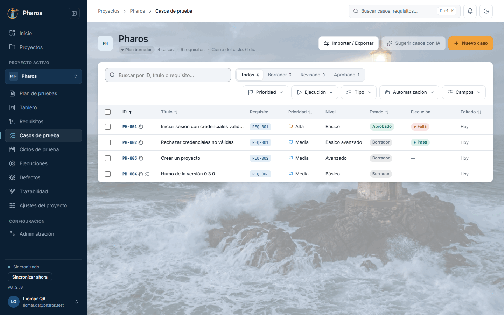
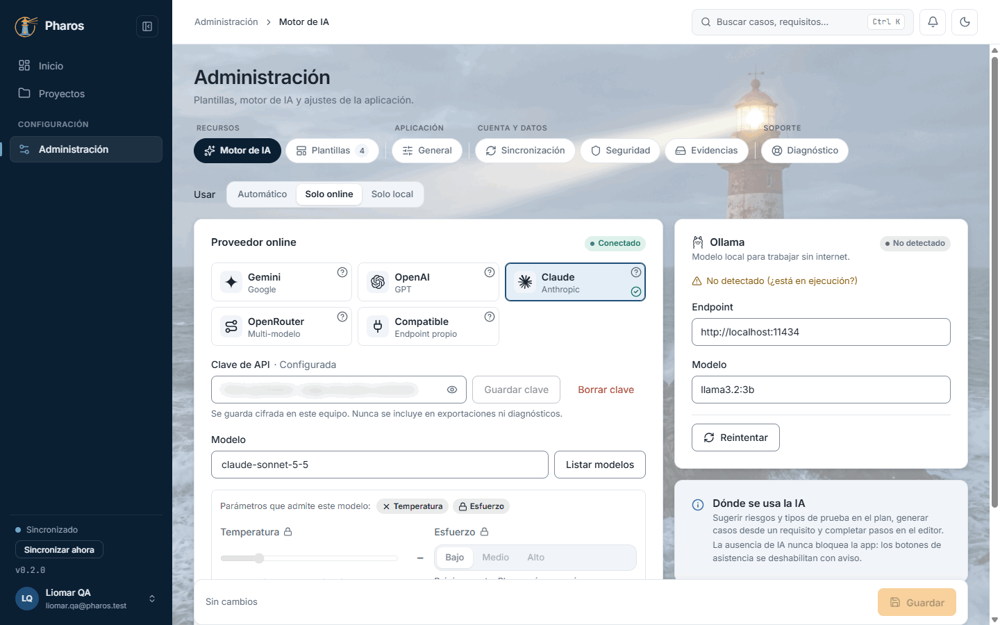
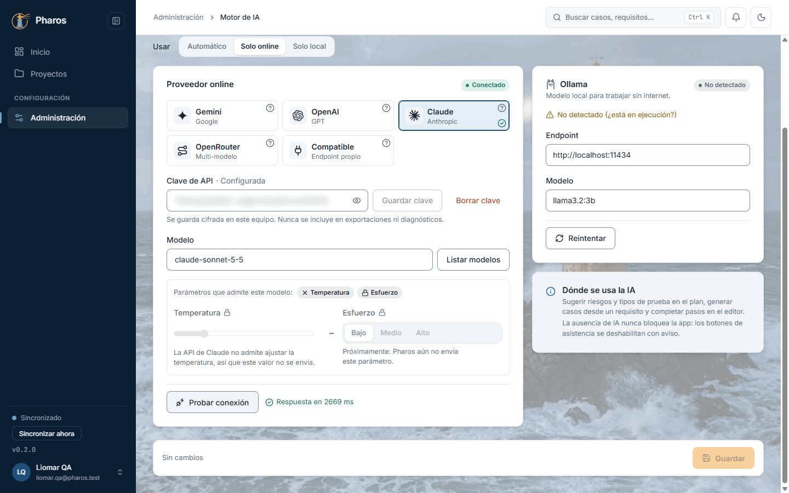
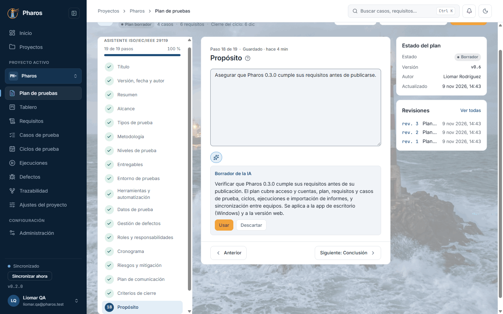
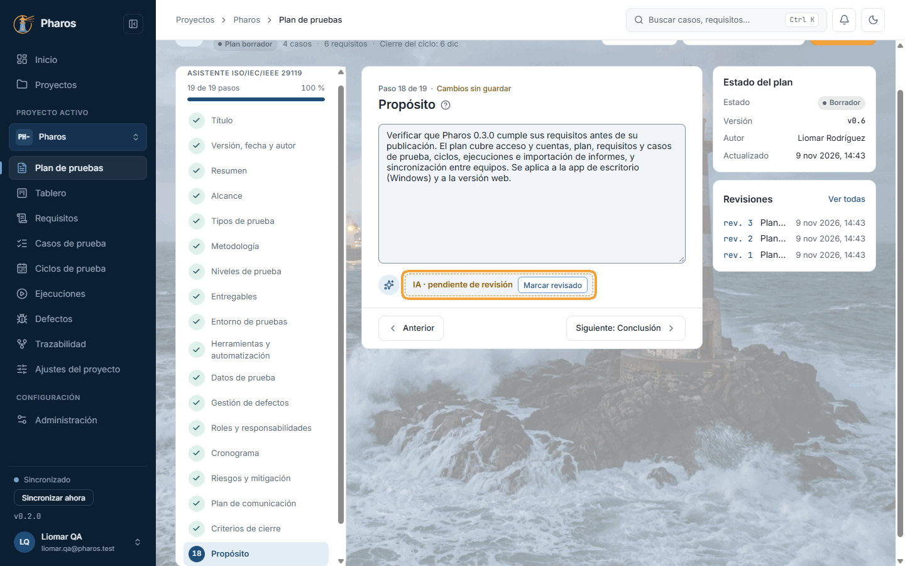
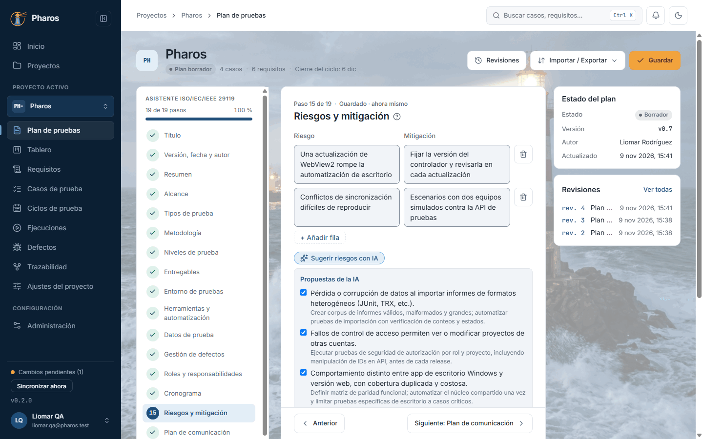
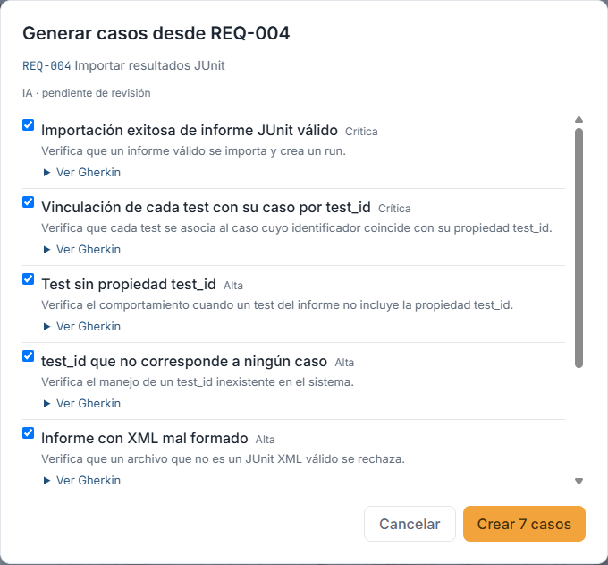
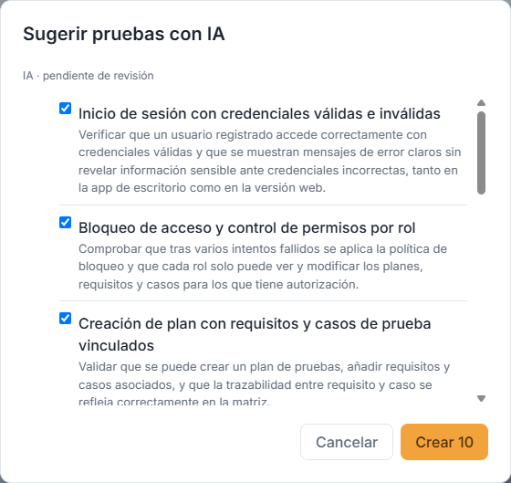
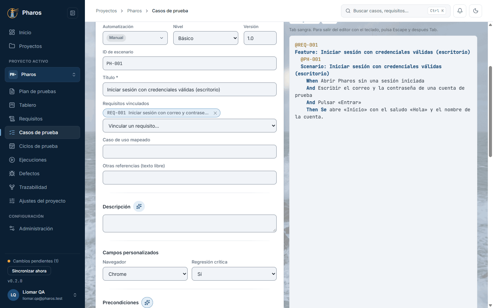

<!-- Generado por `npm run manual` desde e2e/tours/17-ia.tour.ts y docs/manual/fuentes/ia.md. No lo edites a mano: edita la fuente. -->

# 17. Asistente de IA

## Para qué sirve

La IA de Pharos es **opcional**. Con tu propia clave de un proveedor online
(Gemini, OpenAI, Claude, OpenRouter o un servicio compatible), o sin internet
con Ollama, puede:

- redactar borradores de los campos del plan y sugerir sus riesgos
  (capítulo 5);
- proponer casos a partir de un requisito (capítulo 7) o del plan
  (capítulo 8);
- sugerir y revisar las listas de un caso: precondiciones, pasos,
  postcondiciones y criterios (capítulo 8);
- proponer requisitos a partir de la carpeta de un proyecto o de capturas,
  bocetos y diseños (capítulo 7).

**Nada se aplica sin que lo aceptes**, y lo aceptado queda marcado como
generado por IA hasta que alguien lo revisa.

En este manual, Liomar trabaja con **Claude** (Anthropic).

## Paso a paso

### 17.1. Sin IA configurada

La IA es opcional. Mientras no configures un proveedor (o Ollama), los botones de IA aparecen deshabilitados y explican por qué; el resto de Pharos funciona igual.

### 17.2. Configurar el proveedor

En «Administración → Motor de IA», elige el proveedor, pega tu clave y pulsa «Guardar clave»: queda en el almacén de credenciales de Windows, ese proveedor pasa a ser el activo y el campo muestra «Configurada» (en este manual, difuminado). Después elige un modelo («Listar modelos») y guarda. Para saber qué IA está activa, mira la tarjeta con la marca ✓ (al pasar el cursor dice «En uso»), el estado «Conectado» y el campo «Modelo»: es la que Pharos usará. Guardar la clave de otro proveedor no lo cambia; lo cambia elegir otra tarjeta y guardar. Con «Usar: Automático», Pharos usa el proveedor online si está configurado y, si no, Ollama. En este ejemplo, Liomar trabaja con Claude (Anthropic) en «Solo online», con un modelo de Claude.

### 17.3. Probar la conexión

Antes de confiar en la configuración, «Probar conexión» envía una pregunta mínima al proveedor activo y muestra el tiempo de respuesta («Respuesta en N ms»): es la prueba de que esa IA, con ese modelo, contesta. Si falla, dice por qué (clave, modelo o red). Con una clave recién escrita, la prueba sin guardarla: si no funciona, la anterior sigue intacta.

### 17.4. «Asistir con IA» en un campo

En los campos de texto del plan, el botón de IA (✨, «Asistir con IA») propone un borrador breve a partir del resto del plan, con lo que pide el syllabus ISTQB para esa sección. En «Conclusión», valora el plan frente a sus objetivos y criterios de salida, y no inventa resultados. Revisa el «Borrador de la IA» y pulsa «Usar» o «Descartar»: nada se aplica solo, y lo aceptado queda marcado como generado por IA.

### 17.5. Lo que escribió la IA queda marcado

«Usar» pasa el borrador al campo, donde puedes corregirlo como cualquier texto; se guarda con el plan («Guardar»). Junto al campo queda la marca «IA · pendiente de revisión» hasta que alguien lo lea y pulse «Marcar revisado». Al pasar el cursor por la marca se ve qué proveedor y qué modelo lo generaron (en este ejemplo, Claude y su modelo): así se sabe, también después, qué IA escribió cada cosa.

### 17.6. Sugerir riesgos

En «Riesgos y mitigación», «Sugerir riesgos con IA» propone riesgos con su mitigación, un buen punto de partida que conviene revisar: marca los que te sirvan y pulsa «Añadir».

### 17.7. Generar casos desde un requisito

En «Requisitos», el botón de IA de un requisito propone escenarios Gherkin y casos para él. Revisa cada propuesta («Ver Gherkin»), marca las buenas y pulsa «Crear N casos»: quedan vinculados al requisito.

### 17.8. Sugerir casos a partir del plan

En «Casos de prueba», «Sugerir casos con IA» propone casos según los tipos y niveles del plan (capítulo 5); elige los que quieras crear y revísalos como cualquier otro caso.

### 17.9. Sugerir y revisar el caso con IA

En el editor de un caso, cada lista tiene su botón de IA (✨) junto a su título; su nombre aparece al pasar el cursor. «Sugerir precondiciones» las propone a partir del resto del caso, y con la lista ya escrita pasa a «Revisar precondiciones». Igual en pasos, postcondiciones y criterios, en cada flujo de un caso avanzado y en las comprobaciones de una checklist. La revisión propone añadir, reformular o eliminar, y cada propuesta dice por qué. Reformular y eliminar empiezan sin marcar: solo se aplican si los marcas. Datos de prueba y Notas no llevan IA.

### 17.10. Borrar la clave

«Borrar clave» la quita del almacén de credenciales, por ejemplo, si cambias de cuenta o vas a dejar el equipo; la IA vuelve a quedar sin configurar.

## ¿Qué IA está activa?

- En «Administración › Motor de IA», la tarjeta del proveedor con la marca
  **✓** (al pasar el cursor dice «En uso») es la que Pharos usará, con el modelo que dice el campo
  **«Modelo»**.
- Tener guardada la clave de otro proveedor (por ejemplo, de Gemini) no lo
  activa. Se activa al elegir su tarjeta y guardar, o al guardar su clave con
  «Guardar clave».
- Con **«Usar: Automático»**, Pharos usa el proveedor online si está
  configurado y, si no, Ollama. «Solo online» y «Solo local» fijan uno de los
  dos.
- **«Probar conexión»** pregunta al proveedor activo y responde «Respuesta en N
  ms»: si contesta, esa es la IA que trabaja.
- Cada texto que pone la IA lleva la marca **«IA · pendiente de revisión»**.
  Al pasar el cursor por ella se ve qué proveedor y qué modelo lo generaron
  (por ejemplo, «Claude · …»), también semanas después.

## Atajos de teclado

| Tecla | Dónde | Qué hace |
| --- | --- | --- |
| Tab, Intro | Botón ✨ de un campo o de una lista | Lo alcanza y pide la propuesta |
| Espacio | Casilla de una propuesta | La marca o la desmarca |
| Esc | Diálogos de propuestas («Generar casos», «Sugerir casos») | Los cierran sin crear nada |

## Si algo no sale

- **Los botones de IA están en gris.** No hay IA configurada: el aviso del
  botón lo dice. Configúrala en el capítulo 15.
- **«No hay IA disponible…».** Ni un proveedor online con clave y modelo, ni
  Ollama en marcha.
- **«Falló la conexión con la IA…» o «El proveedor rechazó la clave…».**
  Revisa la clave, el modelo y la red con «Probar conexión».
- **«El proveedor respondió vacío».** Prueba otro modelo o vuelve a pedirlo.
- **La propuesta no sirve.** Descártala: no se ha aplicado nada. Puedes
  pedirla otra vez.
- **«Requisitos desde diseños» no lee las imágenes.** El modelo no ve
  imágenes: elige uno con visión.

## En el móvil

- «Requisitos desde un proyecto» y «Listar modelos» son de la app de
  escritorio; el resto de la IA funciona también en la web.

## Consejos

- Elige un modelo rápido y económico para el día a día; para generar casos de
  un requisito complejo, uno más capaz.
- Revisa siempre las propuestas: la IA no conoce tu producto mejor que tú. Lo
  aceptado queda marcado hasta que alguien lo revisa.
- Los textos que envías a un proveedor online salen de tu equipo; para datos
  sensibles, usa Ollama («Solo local»).
- Antes de analizar un proyecto, Pharos dice si el contenido sale del equipo y
  hacia qué proveedor, y cuántos tokens y llamadas costará. Baja el presupuesto
  o quita archivos si el proyecto es grande. Con Ollama, los lotes son más
  pequeños y el análisis tarda más.
- Para «Requisitos desde diseños», el modelo tiene que ver imágenes:
  - Claude, Gemini y GPT-4o o posteriores las ven y leen PDF.
  - En Ollama, elige un modelo de visión como `gemma3`, `qwen2.5vl` o
    `llama3.2-vision`. El modelo por defecto, `llama3.2:3b`, no ve imágenes, y
    Ollama no lee PDF.
  - Como mucho se envían 8 imágenes o PDF por análisis. Pharos las reduce antes
    de enviarlas y no las guarda.

## Véase también

- Capítulo 15, «Administración»: el motor de IA.
- [Guía de pruebas de la beta](../guia-beta.md), apartado 4.7 «IA (opcional)».

---

← [Evidencias](16-evidencias.md) · [Índice](README.md) · [Pantallas estrechas y móvil](18-movil.md) →
