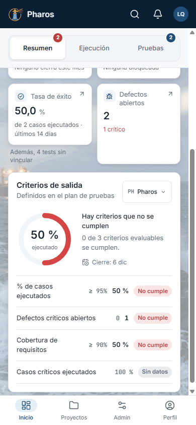
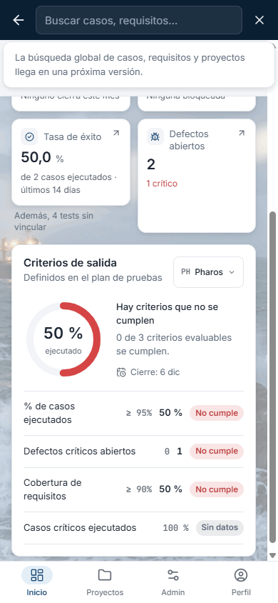
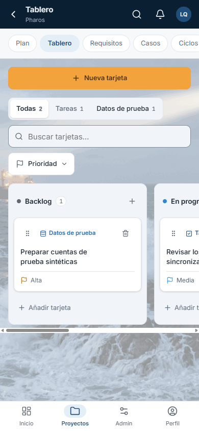
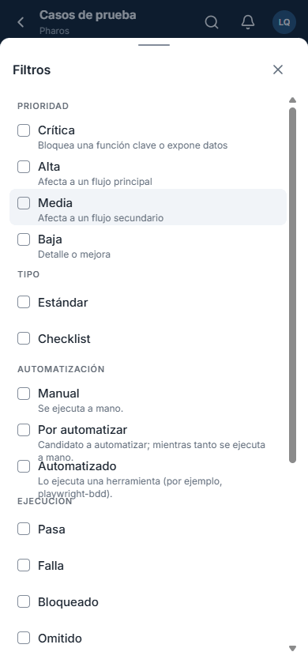
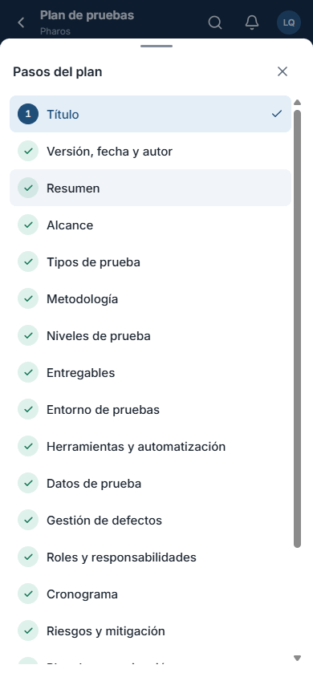

<!-- Generado por `npm run manual` desde e2e/tours/18-movil.tour.ts y docs/manual/fuentes/movil.md. No lo edites a mano: edita la fuente. -->

# 18. Pantallas estrechas y móvil

## Para qué sirve

Pharos se adapta al **ancho de la ventana**, no al aparato: una ventana de
escritorio estrecha se ve igual que un móvil. Hay tres diseños:

| Ancho | Diseño | Navegación |
| --- | --- | --- |
| Desde 1280 px | Escritorio | Menú lateral completo, que se puede plegar a una tira de iconos |
| De 600 a 1279 px | Pantalla mediana (tableta, ventana a media pantalla) | Siempre la tira de iconos; el buscador se reduce a la lupa (capítulo 2) |
| Menos de 600 px | Móvil | Barra superior compacta y barra inferior |

En el móvil:

- la **barra superior** lleva la flecha para volver y el nombre de la sección
  (en Inicio, el logotipo), la lupa, las notificaciones y tu avatar;
- la **barra inferior** lleva Inicio, Proyectos, Admin (Administración) y
  Perfil;
- dentro de un proyecto, sus nueve secciones se recorren con **píldoras** bajo
  el título;
- las **tablas** pasan a tarjetas y ocultan las columnas menos importantes;
- los **menús y filtros** se abren como hojas desde abajo, con la ✕ para
  cerrarlas.

Es la misma aplicación, con los mismos datos: lo que se hace en el escritorio
se puede hacer en el móvil, salvo lo que depende del equipo (adjuntar
archivos, la clave de recuperación, las evidencias, «Listar modelos» de la IA
o «Requisitos desde un proyecto»), que es de la app de escritorio.

En este manual, Liomar repasa su proyecto Pharos desde el móvil.

## Paso a paso

### 18.1. En el móvil: barra inferior

Por debajo de 600 px de ancho (aquí, 390 px, el de un móvil), Pharos usa una barra superior compacta (la flecha para volver y el nombre de la sección, o el logotipo en Inicio; la lupa, las notificaciones y tu avatar) y una barra inferior con Inicio, Proyectos, Admin y Perfil, al alcance del pulgar. Es la misma aplicación, con los mismos datos: en este ejemplo, Liomar repasa su proyecto Pharos desde el móvil.

### 18.2. Buscar en el móvil

La lupa convierte la barra superior en un campo de búsqueda; la flecha (o Esc) la cierra.

### 18.3. Secciones del proyecto en el móvil

Dentro de un proyecto, sus secciones (Plan, Tablero, Requisitos, Casos, Ciclos, Ejecuciones, Defectos, Trazabilidad y Ajustes) se recorren con las píldoras bajo el título, que se desplazan de lado; la flecha de la barra superior vuelve a Proyectos.

### 18.4. Filtros en una hoja inferior

En la lista de casos, «Filtros» abre una hoja desde abajo con los mismos filtros que en el escritorio, para que la lista conserve la pantalla.

### 18.5. Los pasos del plan en el móvil

En el plan de pruebas, «Ver pasos» abre la lista de los 17 pasos en una hoja inferior.

### 18.6. De vuelta al escritorio

Al ensanchar la ventana, Pharos vuelve al menú lateral completo.

## Atajos de teclado

| Tecla | Dónde | Qué hace |
| --- | --- | --- |
| Esc | Hoja inferior abierta | La cierra |
| Esc | Búsqueda abierta en la barra superior | La cierra |
| Ctrl+K | Cualquier pantalla | Abre la búsqueda, también en ventanas estrechas |

## Si algo no sale

- **No veo el menú lateral.** La ventana es estrecha: usa la barra inferior y
  las píldoras del proyecto, o ensancha la ventana.
- **Una tabla no enseña una columna.** En pantallas estrechas se ocultan las
  menos importantes; ábrela en una ventana más ancha o abre el elemento.
- **No veo el botón de adjuntar.** Los adjuntos son de la app de escritorio;
  en la web del móvil no se adjuntan archivos.
- **No llego a mi avatar en una ventana baja.** Desplaza la tira de iconos
  hacia abajo.

## Consejos

- Para revisar el día (Inicio, resultados, defectos) el móvil basta; para
  escribir un plan o muchos casos, mejor una pantalla ancha.
- En la ejecución manual, el ejecutor ocupa toda la pantalla del móvil y se
  marca con un toque (capítulo 11).

## Véase también

- Capítulo 2, «La aplicación de un vistazo»: la tira de iconos de las
  pantallas medianas.
- El apartado «En el móvil» de cada capítulo.
- [Guía de pruebas de la beta](../guia-beta.md), apartado 4.10 «Interfaz
  rediseñada».

---

← [Asistente de IA](17-ia.md) · [Índice](README.md) · [Si algo sale mal](19-errores.md) →
