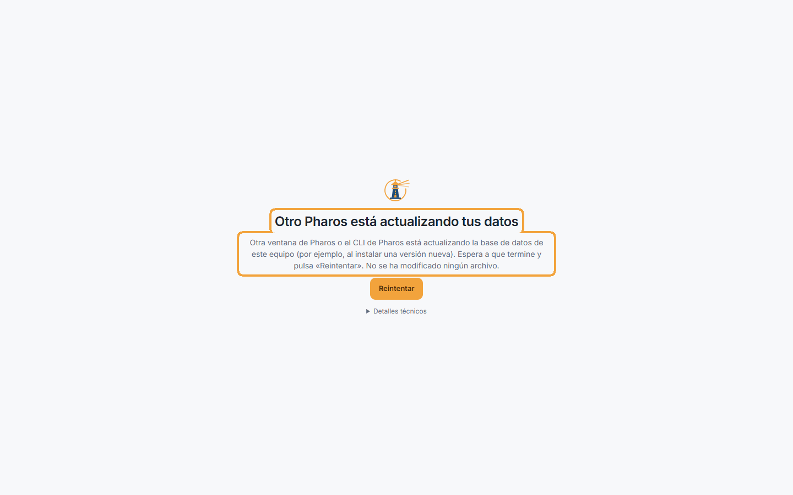
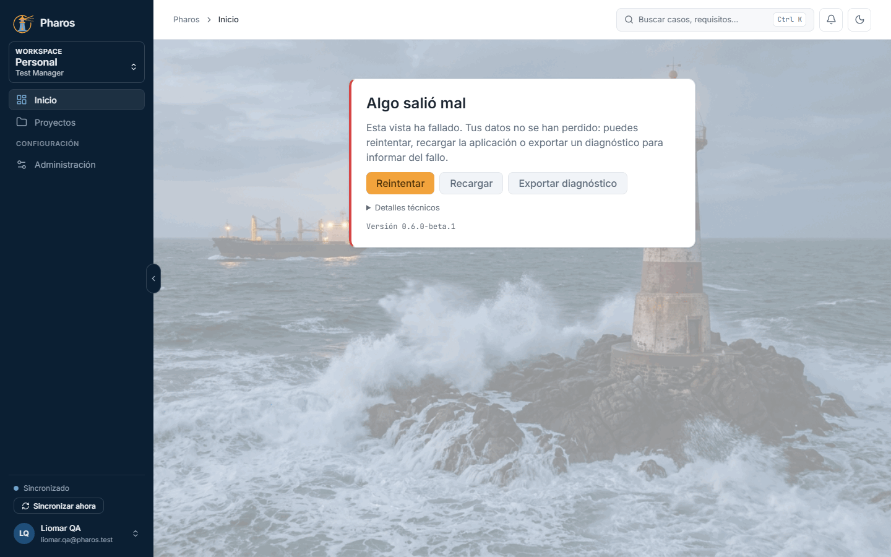

<!-- Generado por `npm run manual` desde e2e/tours/19-errores.tour.ts y docs/manual/fuentes/errores.md. No lo edites a mano: edita la fuente. -->

# 19. Si algo sale mal

## Para qué sirve

Este capítulo enseña las pantallas que aparecen cuando algo falla de verdad,
para que las reconozcas y sepas qué hacer. En ninguna de ellas Pharos borra ni
modifica tus datos.

- **La base de datos local no abre.** Al arrancar, en lugar de la
  aplicación, una pantalla dice por qué:
  - **«No se pudo abrir la base de datos local»:** el archivo está dañado o
    hay otro problema. Cierra la app y vuelve a intentarlo; si sigue, comparte
    el detalle con soporte.
  - **«Estos datos son de una versión más nueva de Pharos»:** los guardó una
    versión más reciente. Instala esa versión o una posterior; esta no los
    abre para no estropearlos.
  - **«Falta la clave de la base de datos local»** o **«La clave guardada no
    abre la base de datos local»:** pasa en un equipo nuevo o tras reinstalar
    Windows. Escribe la clave de recuperación (56 caracteres en grupos de 4;
    dan igual mayúsculas, espacios o guiones) y pulsa «Abrir con la clave».
  - **«Otro Pharos está actualizando tus datos»:** otra ventana de Pharos o
    el CLI `pharos` están convirtiendo o actualizando la carpeta de datos (por
    ejemplo, al instalar una versión nueva). Pharos espera unos segundos antes
    de decirlo; cuando el otro termina, pulsa «Reintentar».
  - **«Falta espacio para actualizar tus datos»:** para convertir tus datos
    con seguridad, Pharos necesita sitio para una copia y para la base nueva.
    La pantalla dice cuánto; libéralo y pulsa «Reintentar». No se ha tocado
    nada.
  - **«Falta el archivo de tus datos»:** tus datos ya están en `pharos.db`,
    pero ese archivo no está en la carpeta de datos. Vuelve a ponerlo allí (o
    una copia `pharos.db.bak-…`); Pharos no crea una base vacía en su lugar.

  Todas tienen «Detalles técnicos», con el error exacto para el informe.
- **«Actualizando el formato de tus datos».** La primera vez que abres la
  0.6 con datos de una versión anterior, Pharos los convierte a su nuevo
  formato (`pharos.db`) y antes guarda una copia del archivo anterior
  (`pharos.db.enc.bak-…`). Pasa una sola vez: espera y no cierres la app; si
  se cierra, la próxima vez sigue donde se quedó. Si la conversión falla,
  «No se pudieron actualizar tus datos» lo dice: el original sigue intacto y
  puedes reintentarlo.
- **«Algo salió mal».** Una vista ha fallado, pero la aplicación sigue
  abierta y tus datos, a salvo. Ofrece «Reintentar», «Recargar» y «Exportar
  diagnóstico»; «Detalles técnicos» enseña el error para el informe.

En este manual, otro Pharos tiene ocupados los datos de Liomar justo cuando
abre la app, y después se simula el fallo de una vista; todo vuelve a la
normalidad.

## Paso a paso

### 19.1. Si la base de datos local no abre

Si los datos locales no se pueden abrir, Pharos lo dice al arrancar, en lugar de la aplicación, y no modifica ningún archivo. La pantalla cambia según la causa: «Otro Pharos está actualizando tus datos» (otra ventana de Pharos o el CLI los está convirtiendo o actualizando, como en este ejemplo), «Estos datos son de una versión más nueva de Pharos» (instala esa versión o una posterior), «Falta la clave de la base de datos local» (un equipo nuevo o Windows reinstalado), que ofrece escribir la clave de recuperación, o, al actualizar desde la 0.5, «Falta espacio para actualizar tus datos». Cuando la causa puede pasar sola, ofrece «Reintentar»; «Detalles técnicos» despliega el error exacto para el informe.

### 19.2. Cuando el otro Pharos termina

En cuanto el otro Pharos termina, «Reintentar» abre los datos sin reiniciar y Liomar vuelve a su Inicio, con todo como estaba. Si en cambio el archivo estuviera dañado, la salida es restaurar una copia de pharos.db: por eso conviene guardar la clave de recuperación y hacer copias (capítulo 15).

### 19.3. «Algo salió mal»

Si una vista falla, Pharos no se cierra: muestra «Algo salió mal» con «Reintentar», «Recargar» y «Exportar diagnóstico», y tus datos siguen a salvo. «Detalles técnicos» enseña el error para el informe.

### 19.4. Reintentar

«Reintentar» vuelve a mostrar la vista cuando el fallo ya no se repite. Si se repite, exporta el diagnóstico para informar de él.

## Varias ventanas y el CLI

Puedes tener dos ventanas de Pharos abiertas y usar el CLI `pharos` a la vez
sobre los mismos datos: no se pisan. Lo que guarda una aparece en la otra en
unos segundos, sin recargar y sin tocar lo que estés escribiendo. Solo
mientras una de ellas convierte o actualiza los datos, la otra espera
(«Otro Pharos está actualizando tus datos»).

## Atajos de teclado

| Tecla | Dónde | Qué hace |
| --- | --- | --- |
| Tab, Intro | Botones de «Algo salió mal» | Llegan a «Reintentar», «Recargar» o «Exportar diagnóstico» y los pulsan |
| Intro | Campo «Clave de recuperación» | Abre los datos con la clave |

## Si algo no sale

- **«La clave tiene un error de escritura…».** Revisa cada grupo de 4
  caracteres y vuelve a intentarlo.
- **«La clave es válida, pero no abre esta base de datos…».** Es la clave de
  otro equipo, o el archivo está dañado. Comprueba que sea la de este equipo;
  si lo es, prueba con una copia `pharos.db.bak-…` (o, de antes de la 0.6,
  `pharos.db.enc.bak-…`).
- **«Algo salió mal» vuelve a salir tras «Reintentar».** Pulsa «Recargar»; si
  se repite, exporta el diagnóstico e informa del fallo.

## Consejos

- En «Algo salió mal», prueba primero «Reintentar»; si se repite, exporta el
  diagnóstico y adjúntalo al informe del fallo, con la versión que aparece en
  la pantalla de entrada o en «Acerca de Pharos» (un clic en el logotipo del
  menú lateral).
- Guarda la clave de recuperación el primer día (capítulo 15) y haz copias de
  `pharos.db` (con Pharos cerrado) y de su carpeta `evidence`: con la clave,
  son lo único que devuelve tus datos en otro equipo.
- Para volver a la 0.5 tras actualizar, restaura la copia
  `pharos.db.enc.bak-…` que guardó la conversión. Lo que cambiaste en la 0.6
  y no llegó a sincronizarse no viaja con ella (README, «Local data
  backups»).
- Nunca adjuntes a un informe `pharos.db`, tu clave de recuperación ni claves
  de IA. El diagnóstico ya los excluye.

## Véase también

- Capítulo 15, «Administración»: la clave de recuperación y el diagnóstico.
- Capítulo 16, «Evidencias»: verificar los archivos tras restaurar una copia.
- [Guía de pruebas de la beta](../guia-beta.md), apartados 5 «Cómo informar
  de un problema» y 6 «Si algo sale mal con los datos».

---

← [Pantallas estrechas y móvil](18-movil.md) · [Índice](README.md) · [Trabajo en equipo](20-equipo.md) →
