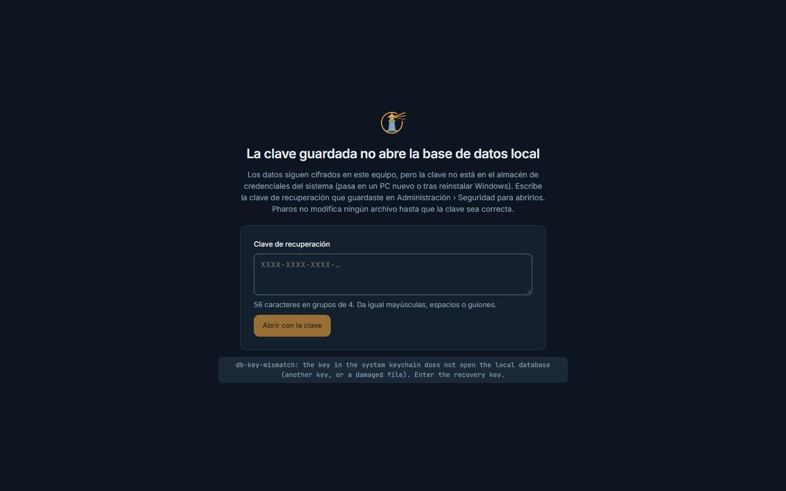
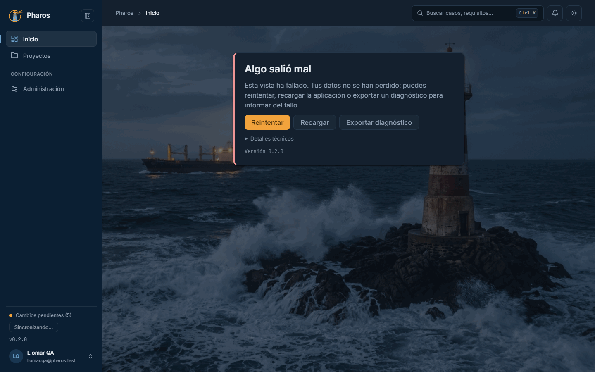

<!-- Generado por `npm run manual` desde e2e/tours/19-errores.tour.ts y docs/manual/fuentes/errores.md. No lo edites a mano: edita la fuente. -->

# 19. Si algo sale mal

## Para qué sirve

Este capítulo enseña las pantallas que aparecen cuando algo falla de verdad,
para que las reconozcas y sepas qué hacer. En ninguna de ellas Pharos borra ni
modifica tus datos.

- **La base de datos local no abre.** Al arrancar, en lugar de la
  aplicación, una pantalla dice por qué:
  - **«No se pudo abrir la base de datos local»:** el archivo está dañado o
    hay otro problema. Cierra la app y vuelve a intentarlo; si sigue, comparte
    el detalle con soporte.
  - **«Estos datos son de una versión más nueva de Pharos»:** los guardó una
    versión más reciente. Instala esa versión o una posterior; esta no los
    abre para no estropearlos.
  - **«Falta la clave de la base de datos local»** o **«La clave guardada no
    abre la base de datos local»:** pasa en un equipo nuevo o tras reinstalar
    Windows. Escribe la clave de recuperación (56 caracteres en grupos de 4;
    dan igual mayúsculas, espacios o guiones) y pulsa «Abrir con la clave».
- **«Algo salió mal».** Una vista ha fallado, pero la aplicación sigue
  abierta y tus datos, a salvo. Ofrece «Reintentar», «Recargar» y «Exportar
  diagnóstico»; «Detalles técnicos» enseña el error para el informe.

En este manual, el tour daña a propósito una copia de la base de datos de
Liomar y simula un fallo de una vista; después todo vuelve a la normalidad.

## Paso a paso

### 19.1. Si la base de datos local no abre

Si los datos locales no se pueden abrir, Pharos lo dice al arrancar y no modifica ningún archivo. La pantalla cambia según la causa: «No se pudo abrir la base de datos local» (un archivo dañado, como en este ejemplo), «Estos datos son de una versión más nueva de Pharos» (instala esa versión o una posterior) o «Falta la clave de la base de datos local» (un equipo nuevo o Windows reinstalado), que ofrece escribir la clave de recuperación (56 caracteres en grupos de 4) para abrirlos.

### 19.2. Restaurar la copia

Con el archivo original de vuelta (o una copia de pharos.db.enc), Pharos abre como siempre y Liomar vuelve a su Inicio: por eso conviene guardar la clave de recuperación y hacer copias (capítulo 15).

### 19.3. «Algo salió mal»

Si una vista falla, Pharos no se cierra: muestra «Algo salió mal» con «Reintentar», «Recargar» y «Exportar diagnóstico», y tus datos siguen a salvo. «Detalles técnicos» enseña el error para el informe.

### 19.4. Reintentar

«Reintentar» vuelve a mostrar la vista cuando el fallo ya no se repite. Si se repite, exporta el diagnóstico para informar de él.

## Atajos de teclado

| Tecla | Dónde | Qué hace |
| --- | --- | --- |
| Tab, Intro | Botones de «Algo salió mal» | Llegan a «Reintentar», «Recargar» o «Exportar diagnóstico» y los pulsan |
| Intro | Campo «Clave de recuperación» | Abre los datos con la clave |

## Si algo no sale

- **«La clave tiene un error de escritura…».** Revisa cada grupo de 4
  caracteres y vuelve a intentarlo.
- **«La clave es válida, pero no abre esta base de datos…».** Es la clave de
  otro equipo, o el archivo está dañado. Comprueba que sea la de este equipo;
  si lo es, prueba con una copia `pharos.db.enc.bak-…`.
- **«Algo salió mal» vuelve a salir tras «Reintentar».** Pulsa «Recargar»; si
  se repite, exporta el diagnóstico e informa del fallo.

## Consejos

- En «Algo salió mal», prueba primero «Reintentar»; si se repite, exporta el
  diagnóstico y adjúntalo al informe del fallo, con la versión que aparece en
  la pantalla de entrada o al pie del menú lateral.
- Guarda la clave de recuperación el primer día (capítulo 15) y haz copias de
  `pharos.db.enc` y de su carpeta `evidence`: son lo único que devuelve tus
  datos en otro equipo.
- Nunca adjuntes a un informe `pharos.db.enc`, tu clave de recuperación ni
  claves de IA. El diagnóstico ya los excluye.

## Véase también

- Capítulo 15, «Administración»: la clave de recuperación y el diagnóstico.
- Capítulo 16, «Evidencias»: verificar los archivos tras restaurar una copia.
- [Guía de pruebas de la beta](../guia-beta.md), apartados 5 «Cómo informar
  de un problema» y 6 «Si algo sale mal con los datos».

---

← [Pantallas estrechas y móvil](18-movil.md) · [Índice](README.md)
