<!-- Generado por `npm run manual` desde e2e/tours/20-equipo.tour.ts y docs/manual/fuentes/equipo.md. No lo edites a mano: edita la fuente. -->

# 20. Trabajo en equipo

## Para qué sirve

Hasta aquí, Liomar ha trabajado solo, en su workspace «Personal». Este
capítulo enseña a trabajar con otras personas en un **workspace compartido**,
que vive en el servidor:

- crear el workspace y llevar a él un proyecto con todo lo que tiene;
- invitar a un compañero con un código de un solo uso y darle un rol;
- ver quién es miembro, cambiar su rol o quitarlo;
- pedirle que **revise y apruebe** tu trabajo: con la «Aprobación
  independiente», nadie aprueba lo que escribió;
- repartir el trabajo (un defecto se asigna a un miembro, que recibe el
  aviso) y enterarte de lo que hace el equipo: las notificaciones y la
  auditoría.

En este ejemplo, Liomar crea «Equipo QA», lleva allí el proyecto «Pharos» e
invita a Jorge como Test Analyst. Jorge revisa la checklist de humo de la
versión desde su equipo y, cuando Liomar lo hace Test Manager, aprueba
también el plan. Las capturas son siempre de Liomar: lo que hace Jorge se ve
con su nombre en los avisos, en la revisión y en la auditoría.

Un workspace compartido necesita conexión con el servidor para crearlo,
invitar, cambiar roles o mover proyectos. El trabajo de cada día (escribir,
ejecutar, revisar) sigue funcionando sin conexión y se envía al sincronizar.

## Paso a paso

### 20.1. Un workspace para el equipo

Tu workspace «Personal» es solo tuyo. Para trabajar con otras personas se crea un workspace compartido, que vive en el servidor: en el selector de workspace, arriba en el menú lateral, «Crear workspace». Quien lo crea es su Test Manager y después invita a los demás. En este ejemplo, Liomar crea «Equipo QA» para trabajar con su compañero de QA, Jorge L. Meneses Yero.

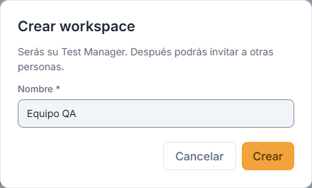

### 20.2. Llevar un proyecto al workspace

Un proyecto nace en tu workspace personal. Para que el equipo lo vea se lleva al compartido: en «Proyectos», con «Personal» elegido en el selector, el menú «⋯» de su fila › «Compartir con un workspace…». Se mueve entero (plan, casos, requisitos, ciclos, ejecuciones, defectos, adjuntos y su auditoría) y sus claves no cambian. Hace falta conexión con el servidor y ser Test Manager del destino. En este ejemplo, Liomar lleva «Pharos» a «Equipo QA»; «API de sincronización» se queda en su espacio personal.

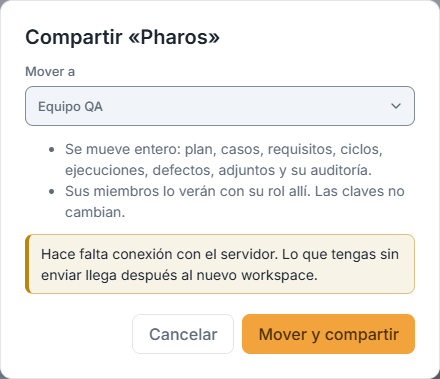

### 20.3. Cambiar de workspace

El selector de workspace lista tus workspaces con tu rol en cada uno: «Personal» y, ahora, «Equipo QA», donde Liomar es Test Manager. Al elegir uno, «Proyectos» muestra sus proyectos, y lo que creas allí lo ven sus miembros. Debajo están «Crear workspace», «Unirse con un código…» y «Miembros y roles».

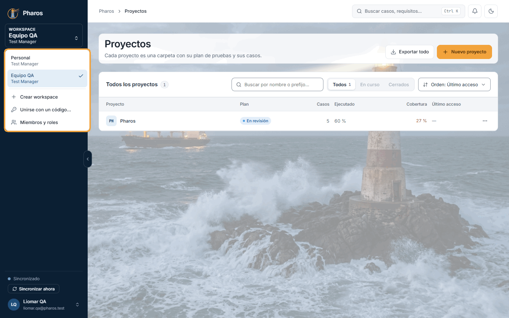

### 20.4. Miembros y roles

«Miembros y roles», en el selector, abre la página del workspace, con su nombre por título («Equipo QA»). La pestaña «Miembros» lista a cada persona con su correo, su rol y desde cuándo está; debajo, las «Reglas» del workspace y las invitaciones pendientes. Al pie, «¿Qué puede hacer cada rol?» se despliega con un resumen de los cinco roles: Test Manager, Test Analyst, Automation Engineer, Product Owner y Viewer (solo lectura). Por ahora Liomar es el único miembro.

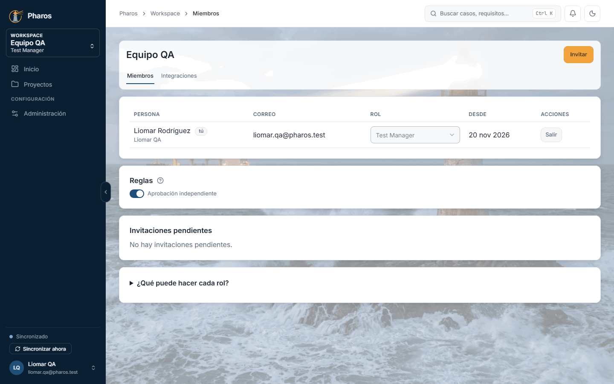

### 20.5. Invitar a un compañero

«Invitar» crea una invitación de un solo uso: eliges el rol con el que entrará la persona (debajo, qué puede hacer con él), una nota para acordarte de para quién es, que no se envía, y cuándo caduca (1, 7 o 30 días). Liomar invita a Jorge como Test Analyst, el rol más bajo que puede escribir, revisar y aprobar casos.

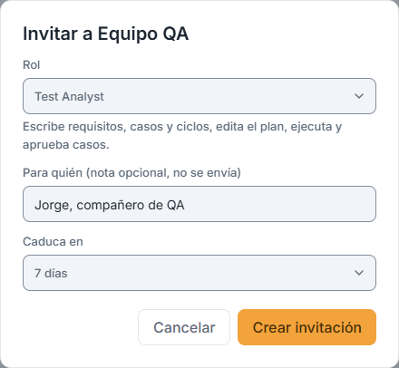

### 20.6. El código, una sola vez

«Crear invitación» muestra el código y, debajo, la dirección del servidor del equipo: la misma con la que Liomar se conecta, a la que Jorge debe poder llegar desde su ordenador. Pharos no envía correos: «Copiar texto de invitación» copia un mensaje con el workspace, el servidor y el código, para que se lo mandes por el canal que uséis. El código solo se ve ahora; si se pierde, revoca la invitación y crea otra. En este manual, el código y la dirección van difuminados.

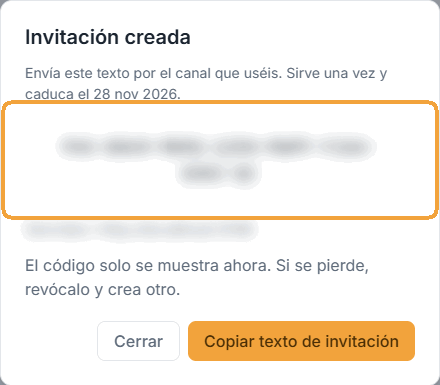

### 20.7. Unirse con un código

Así se une quien recibe la invitación: en su Pharos, en el selector de workspace, «Unirse con un código…». Pega el código y pulsa «Comprobar»: Pharos le dice a qué workspace entra, con qué rol y quién le invitó; «Unirme» lo confirma, y los proyectos del workspace llegan a su equipo en la siguiente sincronización. Su workspace «Personal» no cambia. Jorge ya lo ha hecho desde la web; aquí se ve la página, vacía, en el Pharos de Liomar.

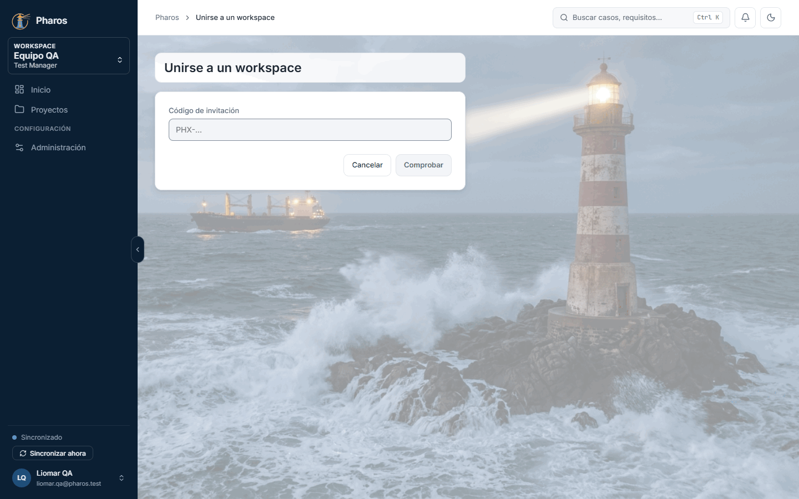

### 20.8. Jorge, en el equipo

De vuelta en «Miembros y roles», Jorge L. Meneses Yero aparece como Test Analyst, con su correo y el día en que se unió. Su invitación ya no figura en «Invitaciones pendientes», que solo lista las que siguen sin usar o han caducado: ahora dice «No hay invitaciones pendientes.». Como Test Manager, Liomar puede cambiar el rol de cada miembro en la columna «Rol» o quitarlo del workspace; el workspace nunca se queda sin un Test Manager.

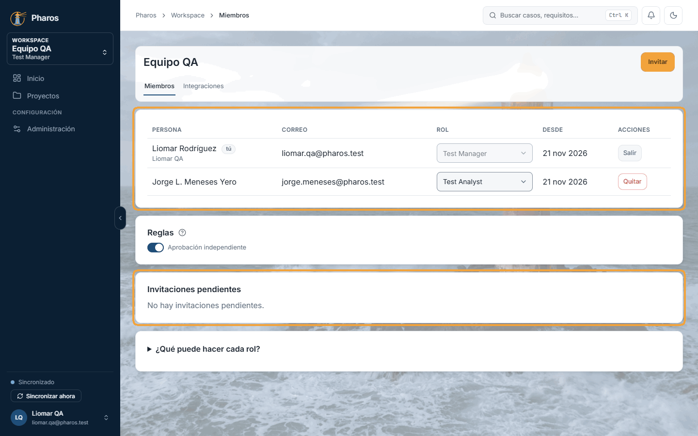

### 20.9. Aprobación independiente

En la misma página, «Reglas»: un workspace compartido nace con «Aprobación independiente» activada. Un caso lo aprueba un Test Manager o un Test Analyst que no sea su autor, y un plan, un Test Manager que no sea su autor. Solo un Test Manager la cambia, y desactivarla pide confirmación: entonces cualquiera que pueda editar algo puede aprobarlo, también el autor, y queda como «aprobación propia». Las aprobaciones que ya existen no cambian. En el workspace Personal está siempre desactivada, porque allí trabajas solo. Liomar cancela: la regla sigue activada.

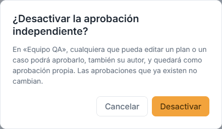

### 20.10. Enviar un caso a revisión

Liomar abre «PH-004 Humo de la versión 0.6.0», la checklist de humo de la versión, y pulsa «Enviar a revisión» con una nota para quien revise. Como «Pharos» está en un workspace compartido, los demás miembros reciben el aviso de que hay un caso por revisar.

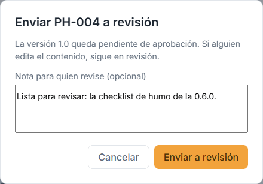

### 20.11. Tu propio caso no lo apruebas tú

Con la aprobación independiente, el «Aprobar versión N» de Liomar está en gris y explica por qué: «Este workspace pide aprobación independiente: lo tiene que aprobar otra persona.». El caso espera «En revisión» a que lo revise Jorge.

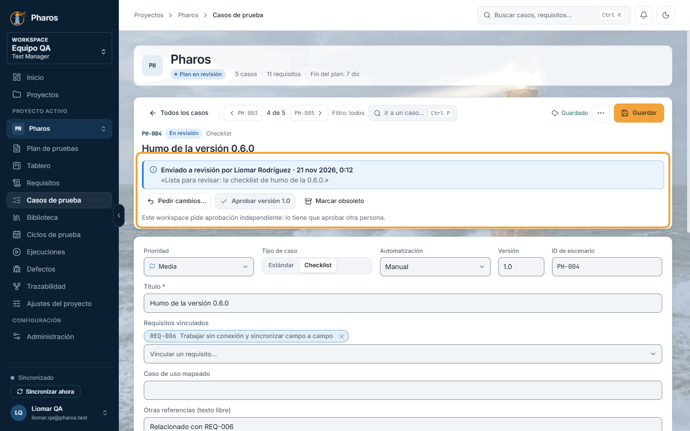

### 20.12. Jorge pide cambios

Jorge revisa el caso desde la web y pulsa «Pedir cambios…» con su comentario. Al sincronizar, Liomar ve en el caso el aviso «Cambios pedidos por Jorge L. Meneses Yero», con la fecha y el comentario, y recibe una notificación. El caso sigue en revisión.

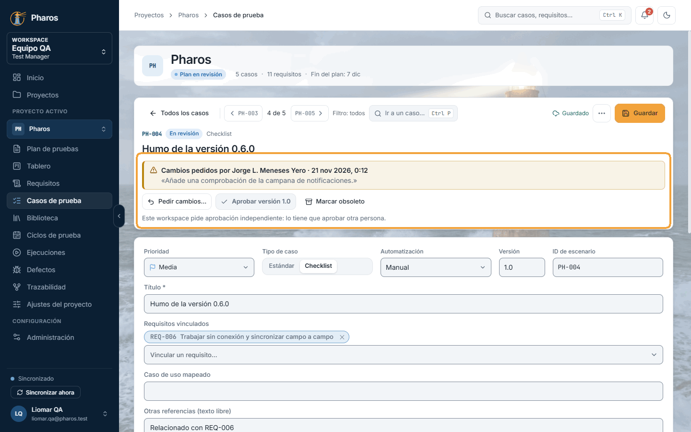

### 20.13. Hacer los cambios

Liomar añade la comprobación que pidió Jorge («+ Añadir comprobación» en «Comprobaciones») y guarda. El caso sigue «En revisión», y el aviso pasa a «Cambios guardados tras la petición de Jorge L. Meneses Yero», con su comentario; debajo, «Cambios desde el …», con la fecha de la revisión que Jorge vio, enseña la comprobación añadida, para que Jorge sepa qué mirar.

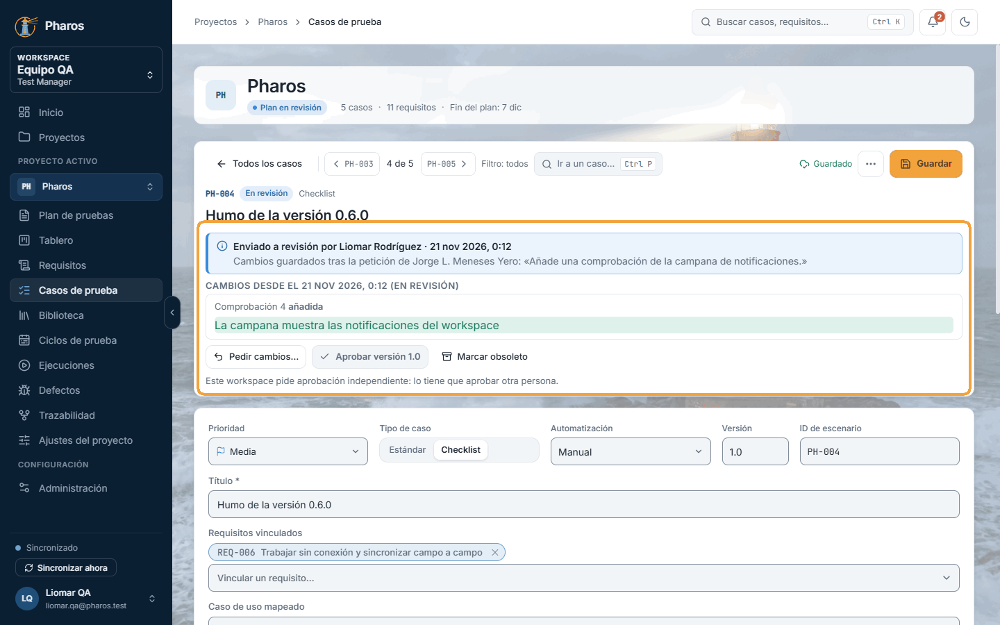

### 20.14. Jorge aprueba el caso

Jorge lo vuelve a revisar desde la web y lo aprueba. Tras sincronizar, el caso de Liomar muestra «Aprobado por Jorge L. Meneses Yero», con la fecha y la versión, sin «aprobación propia»: lo aprobó otra persona. Liomar recibe la notificación.

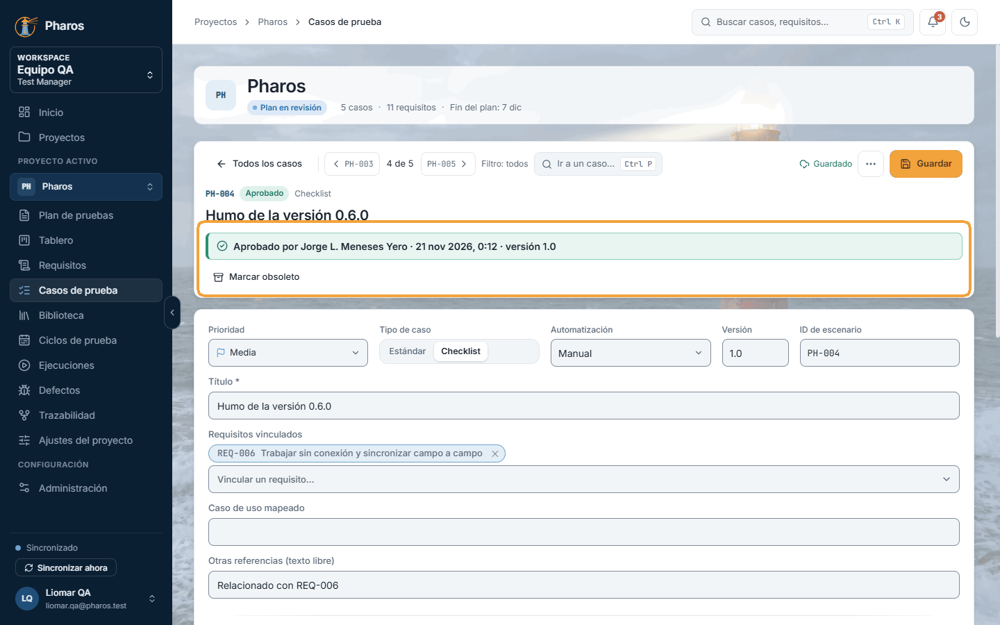

### 20.15. Quién aprueba el plan

El plan de «Pharos» llega al equipo «En revisión», tal como Liomar lo dejó en los capítulos 5 y 17 (un borrador se envía con «Enviar a revisión»). En «Estado del plan», el «Aprobar versión N» de Liomar está en gris: lo aprueba un Test Manager que no sea el autor del plan. Jorge, como Test Analyst, puede revisarlo y pedir cambios, pero no aprobarlo.

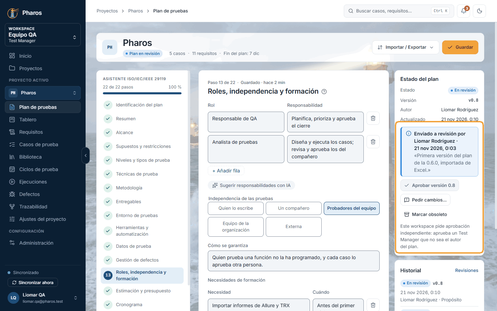

### 20.16. «Pedir cambios…» en el plan

Quien revisa un plan que no está listo pulsa «Pedir cambios…» en «Estado del plan»: el comentario es obligatorio y el plan sigue «En revisión», con un aviso para su autor. Este es el diálogo que Jorge usa en su Pharos; Liomar lo abre aquí solo para verlo y cancela.

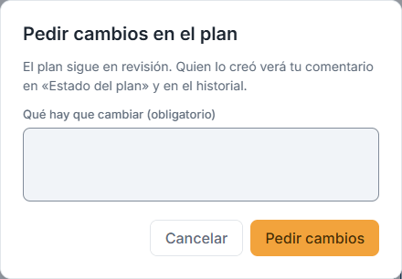

### 20.17. Cambios pedidos en el plan

Jorge revisa el plan desde la web y pide un cambio: que «Roles» diga quién aprueba el plan en el equipo. Al sincronizar, «Estado del plan» de Liomar muestra «Cambios pedidos por Jorge L. Meneses Yero» con su comentario. Liomar añade la fila en «Roles, independencia y formación» y pulsa «Guardar»: el plan sigue «En revisión» y el aviso pasa a «Cambios guardados tras la petición de Jorge L. Meneses Yero».

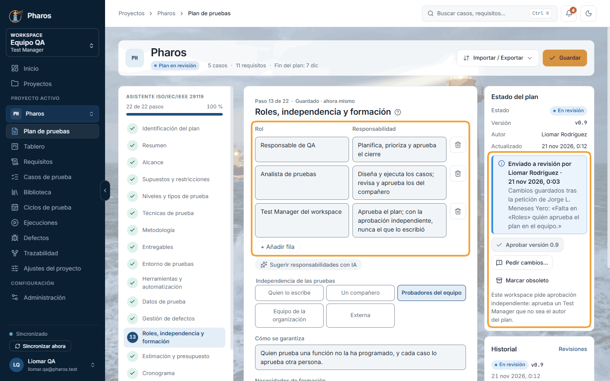

### 20.18. Cambiar el rol de un miembro

Para que otra persona pueda aprobar planes, el equipo necesita un segundo Test Manager. En «Miembros y roles», Liomar cambia el rol de Jorge a «Test Manager» en su fila: se aplica al momento y Pharos lo confirma («Rol de Jorge L. Meneses Yero: Test Manager»). Con dos Test Manager, el workspace no se queda sin uno si alguno se va.

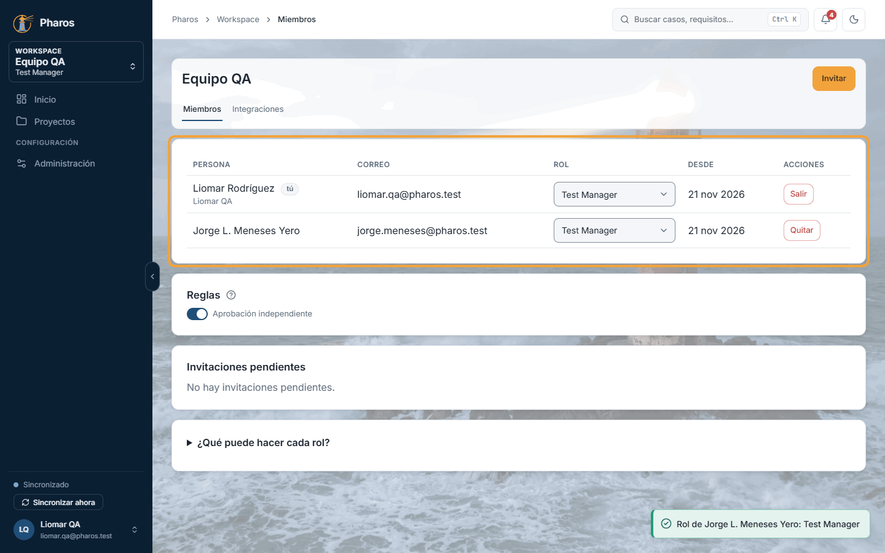

### 20.19. Otra persona aprueba el plan

Jorge, ya Test Manager, aprueba el plan desde la web. Tras sincronizar, «Estado del plan» muestra «Aprobado» con su nombre y la fecha, sin «aprobación propia»; el «Historial» y los exportes del plan lo recogen también.

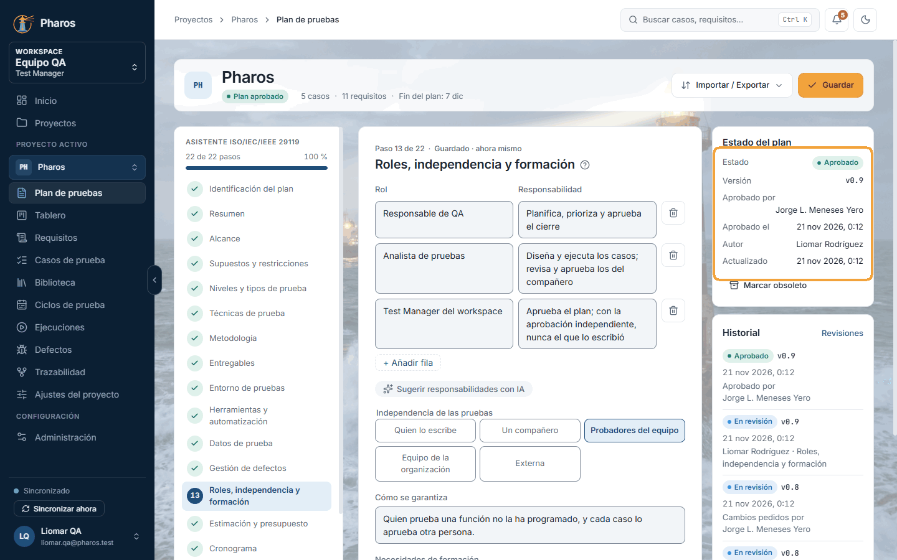

### 20.20. Asignar trabajo a Jorge

En un workspace compartido, «Asignado a» de un defecto elige entre los miembros activos del workspace (o «Sin asignar»). Liomar abre «El menú lateral sigue mostrando el prefijo anterior» en «Defectos», elige «Jorge L. Meneses Yero» y guarda. Jorge recibe en su Pharos el aviso «Liomar Rodríguez te asignó…», con la clave y el título del defecto; en la campana de Liomar no aparece, porque el aviso es para quien recibe el trabajo. Del mismo modo, «Asignar a», al añadir casos a un ciclo, reparte su ejecución.

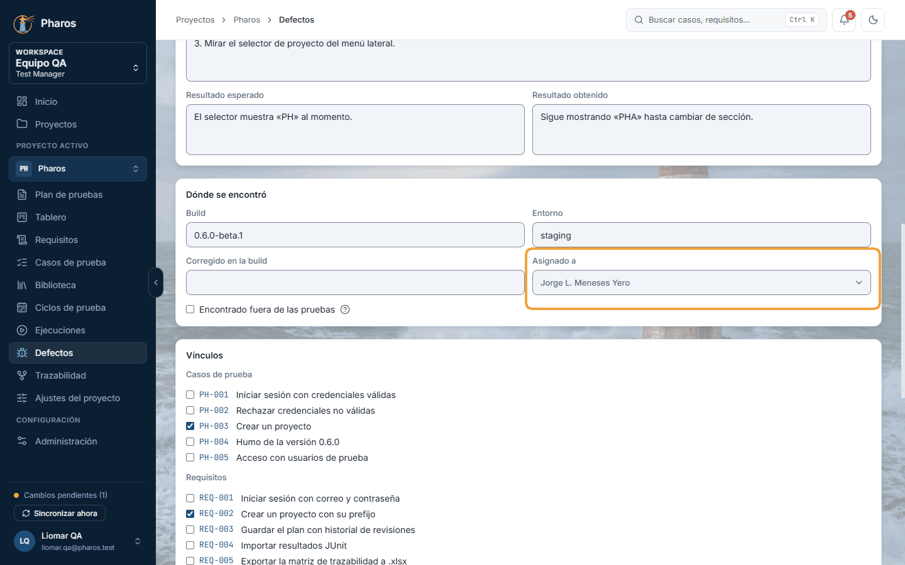

### 20.21. Lo que te llega del equipo

La campana de la barra superior reúne lo que el equipo hizo y te concierne, agrupado por día: aquí, entre otros avisos, que Jorge L. Meneses Yero se unió a «Equipo QA», que pidió cambios en el plan y lo aprobó, y que devolvió el caso con cambios y lo aprobó. Cada aviso lleva su acción directa («Ver miembros», «Abrir plan», «Abrir caso»…). «Marcar todo como leído» los da por vistos; se guardan 90 días.

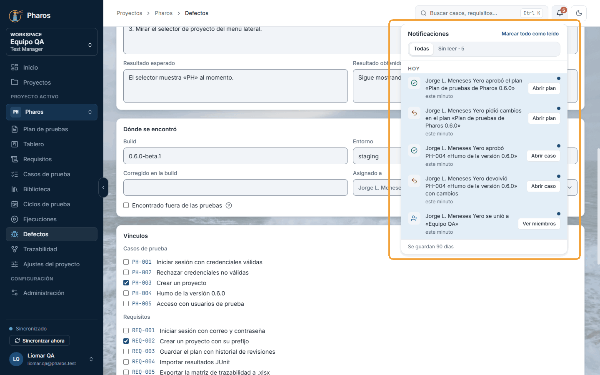

### 20.22. La auditoría del equipo

En «Administración › Auditoría», el Test Manager de un workspace compartido ve también lo que hicieron los demás miembros, con su nombre. Liomar busca «PH-004»: cada paso de la revisión del caso sale por su nombre, «Enviado a revisión» (Liomar), «Cambios pedidos» y «Aprobado» (Jorge L. Meneses Yero), con los campos que cambió («Aprobación, Revisión, Estado»).

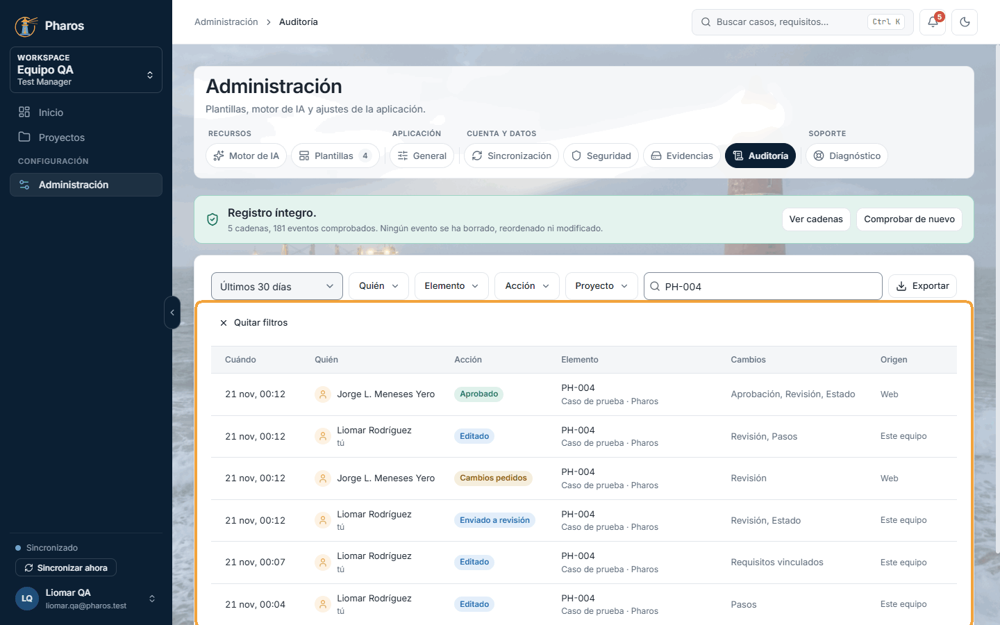

### 20.23. Quitar a alguien del workspace

«Quitar», en la fila de un miembro, pide confirmación: la persona deja de ver el workspace y la copia de sus proyectos en sus equipos se borra en su próxima sincronización, y lo que no haya sincronizado se pierde; su cuenta sigue existiendo. Quien no es Test Manager solo ve «Salir» en su propia fila. Aquí Liomar cancela: Jorge sigue en el equipo.

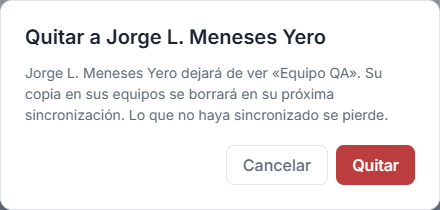

## Qué puede hacer cada rol

Cada miembro tiene un rol en cada workspace (en «Personal» eres siempre Test
Manager). «¿Qué puede hacer cada rol?», en «Miembros y roles», lo resume:

| Rol | Qué puede hacer |
| --- | --- |
| Test Manager | Todo lo de un Test Analyst y, además, gestiona miembros, invitaciones y reglas, lleva proyectos al workspace, aprueba planes, crea los tokens de CI y los webhooks, y ve la auditoría del workspace. |
| Test Analyst | Escribe requisitos, casos y ciclos, edita el plan, ejecuta, importa resultados, gestiona defectos y aprueba casos (no planes). |
| Automation Engineer | Escribe casos y configuraciones, ejecuta, importa resultados y gestiona defectos. |
| Product Owner | Escribe requisitos, crea defectos (no los edita) y añade adjuntos; ve todo lo demás. |
| Viewer (solo lectura) | Ve y exporta todo, pero no cambia nada. |

Con la **«Aprobación independiente»** activada (lo está al crear un
workspace compartido), un caso lo aprueba un Test Manager o un Test Analyst
que no sea su autor, y un plan, un Test Manager que no sea su autor. Las
aprobaciones de antes no cambian.

Un workspace siempre tiene al menos un Test Manager: Pharos no deja quitar ni
bajar de rol al último. Con dos, el equipo no se queda sin quien gestione el
workspace, apruebe planes o reasigne los tokens de CI si alguien se va.

## Atajos de teclado

| Tecla | Dónde | Qué hace |
| --- | --- | --- |
| Esc | «Crear workspace», «Compartir…» e «Invitar» | Cierra el diálogo sin cambiar nada |
| Esc | «Invitación creada» | Cierra el diálogo: el código ya no se vuelve a ver |

## Si algo no sale

- **El compañero no aparece en «Miembros y roles».** Comprueba que usó el
  código antes de que caducara y vuelve a abrir la página. Una invitación
  usada desaparece de «Invitaciones pendientes»; si la suya sigue ahí, aún no
  la ha usado, y si dice «Caducada», revócala y crea otra.
- **«Este código ya se usó o caducó».** Cada código sirve una vez. Revoca la
  invitación y crea otra.
- **No veo «Compartir con un workspace…».** Aparece en «Proyectos» con tu
  workspace «Personal» elegido, y solo si eres Test Manager de algún workspace
  compartido.
- **«… todavía no está en el servidor».** Acabas de crear el proyecto y aún no
  se había enviado: Pharos lo envía en ese momento. Vuelve a pulsar «Mover y
  compartir» en unos segundos.
- **«Aprobar versión N» está en gris.** El aviso de al lado dice por qué: eres
  su autor y el workspace pide aprobación independiente, o tu rol no aprueba
  eso (un Test Analyst aprueba casos, no planes). Pide la revisión a otra
  persona.
- **«Rechazado por permisos».** Tu rol no permite ese cambio y el servidor no
  lo guardó. «Descartar» vuelve a la versión del servidor.
- **Veo un aviso de solo lectura.** Tu rol en ese workspace es Viewer: puedes
  ver y exportar, pero no cambiar nada.
- **«Ya no eres miembro de…».** Un Test Manager te quitó del workspace. La
  copia de sus proyectos en tu equipo se borra cuando lo confirmas; lo que no
  habías sincronizado no llega al servidor.

## Consejos

- Invita a cada persona con el rol más bajo que le baste: un Test Analyst ya
  puede escribir, revisar y aprobar casos.
- Ten al menos dos Test Manager en cada workspace compartido.
- Manda el código de invitación por un canal privado y con caducidad corta;
  si no sabes si llegó, revócalo y crea otro.
- Al enviar algo a revisión, deja una nota que diga qué mirar: quien revisa
  la ve junto a los cambios desde la última versión revisada.
- Sincroniza antes de revisar: verás los cambios y las peticiones de los
  demás.

## Véase también

- Capítulo 8, «Casos de prueba», y capítulo 5, «Plan de pruebas»: la revisión
  y la aprobación paso a paso.
- Capítulo 21, «Integraciones»: los tokens de CI y los webhooks del
  workspace.
- Capítulo 15, «Administración»: la auditoría y las cuentas del servidor.

---

← [Si algo sale mal](19-errores.md) · [Índice](README.md) · [Integraciones](21-integraciones.md) →
