<!-- Generado por `npm run manual` desde e2e/tours/20-integraciones.tour.ts y docs/manual/fuentes/integraciones.md. No lo edites a mano: edita la fuente. -->

# 20. Integraciones

## Para qué sirve

Las **integraciones** dejan que otras herramientas hablen con Pharos sin abrir
la app:

- **Tokens de proyecto:** un CI (GitHub Actions, Jenkins…) sube los
  resultados de sus pruebas a un proyecto, crea y cierra sus runs y lee casos,
  ciclos, defectos y requisitos. Los crea un Test Manager en
  «Integraciones».
- **Conectar CI:** el paso de GitHub Actions que sube los informes de cada
  pull request a un proyecto, listo para copiar, con los secretos que hay que
  crear en GitHub.
- **Tokens personales:** tu propia línea de comandos (el CLI `pharos`) actúa
  en tu nombre, en todos tus workspaces o en uno. Se crean en «Mi perfil».
- **Webhooks:** Pharos avisa a otra herramienta (Slack, un bot de PRs,
  Jenkins) cuando pasa algo en el workspace, con cada envío firmado.

Un token actúa siempre **en nombre de su dueño** y nunca puede más que su rol
actual. Pharos lo enseña **una sola vez**, al crearlo; después solo guarda una
huella. Caduca en el plazo que elijas (como mucho un año) y su dueño recibe un
aviso 7 días antes.

La guía de la API, [api-v1.md](../../api-v1.md), explica con ejemplos de
`curl` cómo subir resultados, leer datos y comprobar la firma de un webhook.

### La línea de comandos (`pharos`)

La app instala también el programa `pharos`, que se usa desde una terminal
(PowerShell, Símbolo del sistema). El instalador lo añade al PATH: funciona en
cualquier terminal que abras después de instalar.

- **`pharos upload informe.xml --project PAG`** sube un informe. Sin
  servidor, lo importa en el Pharos de este equipo, también con la app
  abierta: el run aparece en ella en unos segundos. Con `--server https://…`
  (o con un servidor guardado), lo sube a tu servidor.
- **`pharos login --server https://…`** guarda tu token personal para ese
  servidor. «Mi perfil» › «Tokens personales» › «Usar en el CLI» da el comando
  listo para copiar.
- **`pharos doctor`** comprueba la instalación, la sesión, la base de datos y
  el servidor, y dice qué falta.
- **`pharos projects`** lista tus proyectos y su prefijo, que es lo que pide
  `--project`.
- **`pharos help`** lo explica todo. Los mensajes salen en español o en
  inglés, según el idioma de Windows.

En este equipo lee Pharos Run JSON y JUnit; en el servidor, también SARIF, k6,
axe, CTRF, Playwright y Cucumber. La referencia completa, con todas las
opciones y los códigos de salida, está en [cli.md](../../cli.md).

## Paso a paso

### 20.1. Un workspace para el equipo

Los tokens de CI y los webhooks pertenecen a un workspace compartido: el espacio que comparte un equipo en el servidor. Se crea desde el selector de workspace, arriba en el menú lateral, con «Crear workspace». Quien lo crea es su Test Manager. En este ejemplo, Liomar crea «Equipo QA» para su equipo.

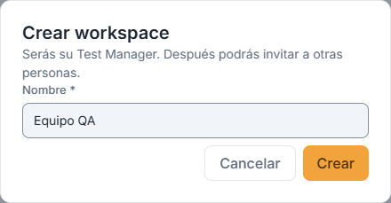

### 20.2. Llevar un proyecto al workspace

Un proyecto nuevo nace en tu workspace personal. Para que el equipo lo vea, y para darle un token de CI, se lleva al workspace compartido: en «Proyectos», el menú «⋯» de su fila › «Compartir con un workspace…». Se mueve entero (plan, casos, requisitos, ciclos, ejecuciones, defectos, adjuntos y su auditoría) y sus claves no cambian. Hace falta conexión con el servidor y ser Test Manager del destino. En este ejemplo, Liomar crea «Pagos Web» y lo lleva a «Equipo QA».

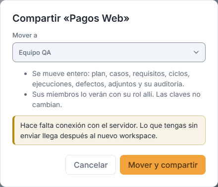

### 20.3. Trabajar en el workspace del equipo

El selector de workspace cambia entre tu espacio personal y los compartidos. Liomar elige «Equipo QA»: Pharos muestra sus proyectos, y lo que crea a partir de ahí lo ven sus miembros.

### 20.4. La pestaña «Integraciones»

En el selector de workspace, «Miembros y roles» abre la página del workspace, con dos pestañas: «Miembros» e «Integraciones». «Integraciones» reúne los tokens de proyecto y los webhooks. Solo existe en un workspace compartido y necesita el servidor. Cualquier miembro la ve; solo un Test Manager crea, revoca o reasigna.

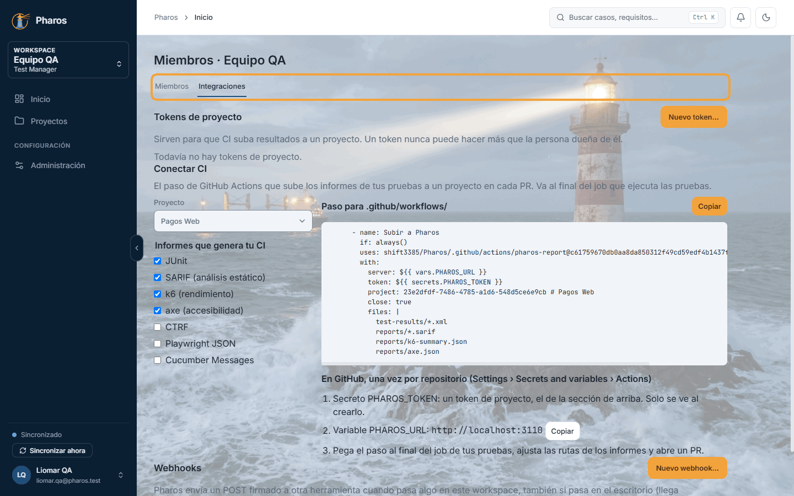

### 20.5. Nuevo token de proyecto

«Nuevo token…» abre el formulario: un nombre que diga dónde se usa («CI de Pagos Web»), el proyecto, los permisos (scopes) y la caducidad, entre 30 días y un año (90 por defecto). El token actúa en nombre de quien lo crea y nunca puede más que su rol: si ese rol cambia, el token cambia con él. Para un CI que sube resultados basta «Subir resultados y cerrar runs».

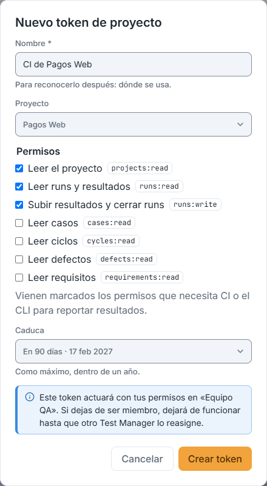

### 20.6. El token, una sola vez

Al pulsar «Crear token», Pharos lo muestra una sola vez, con un ejemplo de cómo usarlo en el CI. Cópialo y guárdalo como secreto del CI (por ejemplo, `PHAROS_TOKEN` en GitHub Actions): Pharos solo guarda una huella y no puede volver a enseñarlo. Para cerrar, marca «Lo he guardado en un sitio seguro» y pulsa «Hecho». La guía de la API (docs/api-v1.md) explica cómo subir resultados con él.

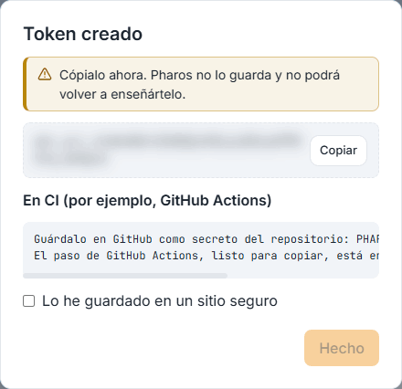

### 20.7. Rotar un token

«Rotar» cambia el secreto de un token sin tocar su nombre, su proyecto ni sus permisos. «Rotar ahora» anula el antiguo al momento, si se ha filtrado. «Mantener 24 h» lo deja funcionar un día más, para cambiar el CI sin cortes. El token nuevo, como siempre, se ve una sola vez.

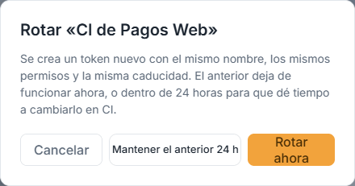

### 20.8. Los tokens del workspace

La tabla lista los tokens de proyecto del workspace: nombre, proyecto, permisos, dueño, caducidad, último uso y estado. Siete días antes de caducar, el dueño recibe un aviso. Si el dueño sale del workspace o se desactiva su cuenta, el token deja de funcionar y los Test Manager reciben un aviso: «Reasignar» lo pasa a otro Test Manager sin cambiar el secreto del CI. «Rotar» da un token nuevo (el antiguo puede seguir 24 h, mientras cambias el CI) y «Revocar» lo anula al momento.

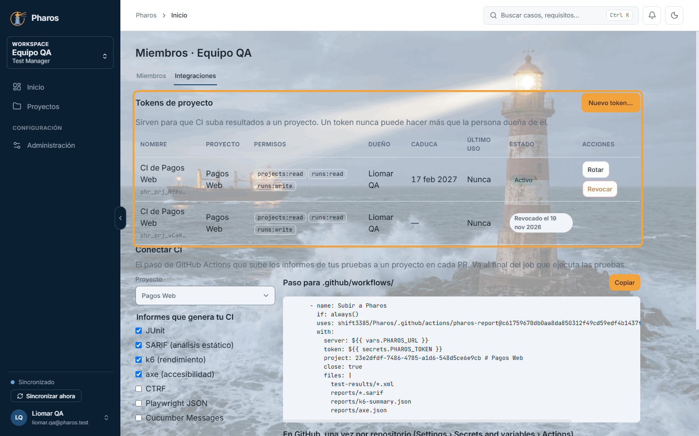

### 20.9. Conectar CI: el paso de GitHub Actions

«Conectar CI», debajo de los tokens, prepara el paso de GitHub Actions que sube los informes de tus pruebas a este proyecto en cada pull request. Elige el proyecto y marca los informes que genera tu CI: por defecto, JUnit (pruebas), SARIF (análisis estático), k6 (rendimiento) y axe (accesibilidad). El paso se actualiza al momento y ya lleva tu servidor y tu proyecto, pero nunca el token. «Copiar» lo copia. Si el aviso pide cambiar el SHA de la acción, pon el del commit de la versión de Pharos que uses: fijar la acción por SHA impide que alguien la cambie sin que lo sepas.

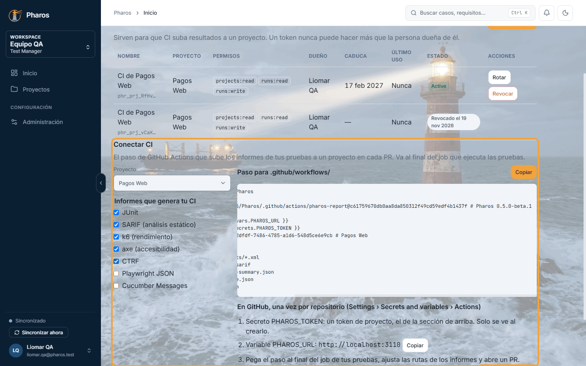

### 20.10. Conectar CI: en GitHub

En GitHub, una vez por repositorio, en Settings › Secrets and variables › Actions: crea el secreto PHAROS_TOKEN con un token de proyecto (el de la sección de arriba, que solo se ve al crearlo; si no eres Test Manager, la sección te dice que se lo pidas a uno) y la variable PHAROS_URL con la dirección de este servidor, que tiene su propio botón «Copiar». Después pega el paso al final del job de tus pruebas, ajusta las rutas de los informes y abre un PR: la página del job enseña una tabla con lo subido y el run aparece en Pharos, en «Ejecuciones» (capítulo 10). En un PR desde un fork no hay secretos: no se sube nada y el job no falla.

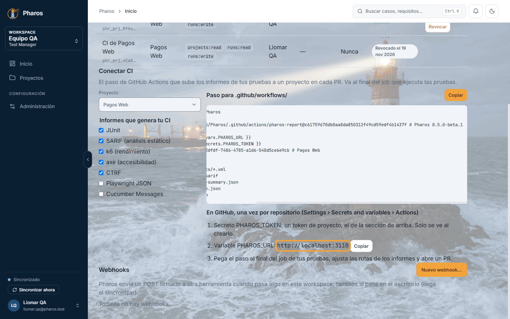

### 20.11. Nuevo webhook

Un webhook avisa a otra herramienta (Slack, un bot de PRs, Jenkins) cuando pasa algo en el workspace: se crea un run, se suben resultados, se cierra un ciclo, cambia un defecto o se decide una revisión. «Nuevo webhook…» pide un nombre, la URL de destino (https y fuera de la red privada, salvo que el servidor lo permita), los eventos y, si quieres, un proyecto. Pharos firma cada envío para que el destino compruebe que viene de tu servidor.

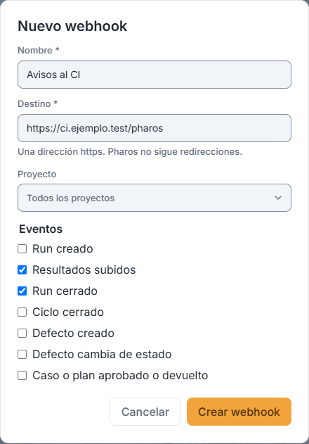

### 20.12. El secreto de firma, una sola vez

Al guardar, Pharos enseña el secreto de firma (`whsec_…`) una sola vez. El destino lo usa para comprobar la firma de cada envío; la guía de la API trae el código para hacerlo en Node y en Python. Si se pierde, «Rotar secreto» da otro y el anterior sigue firmando 24 h.

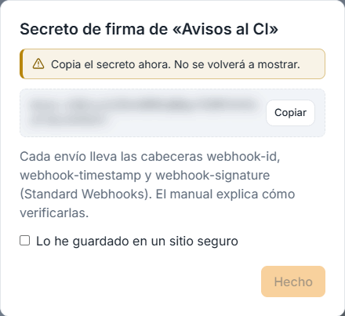

### 20.13. Probar un webhook y ver sus entregas

«Enviar prueba» manda un evento `ping` al destino. «Entregas» lista los envíos de los últimos 30 días con su estado, el intento, la respuesta del destino y cuándo será el siguiente. En este ejemplo el destino no existe, así que la entrega falla: Pharos la reintenta durante unas 22 horas y, tras 50 fallos seguidos, desactiva el webhook y avisa a los Test Manager. «Reintentar ahora» la envía de nuevo al momento.

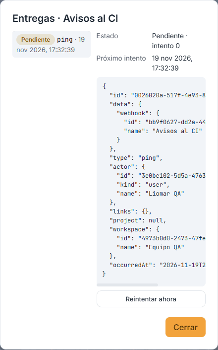

### 20.14. Rotar el secreto de un webhook

«Rotar secreto» da un secreto de firma nuevo, que se ve una sola vez. Durante 24 h Pharos firma cada envío con los dos, el nuevo y el anterior, para que cambies el destino sin perder avisos.

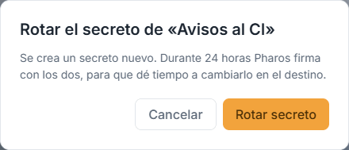

### 20.15. Borrar un webhook

«Borrar» quita el webhook y deja de enviar sus avisos; Pharos pregunta antes. Un webhook que falla 50 veces seguidas no se borra: se desactiva solo, y «Activar» lo enciende otra vez cuando el destino vuelve a responder.

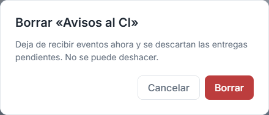

### 20.16. Tokens personales

Para tu propia línea de comandos (el CLI `pharos`) usa un token personal: en «Mi perfil», «Tokens personales» › «Nuevo token…». Puede servir para todos tus workspaces o solo para uno, con los permisos y la caducidad que elijas, y también se ve una sola vez. Como los de proyecto, actúa en tu nombre y avisa 7 días antes de caducar. Debajo, «Usar en el CLI» da el comando `pharos login --server <este servidor>`, que pide el token y lo guarda en el Administrador de credenciales de Windows: el token nunca va escrito en el comando. «Revocar» lo anula; el administrador del servidor puede revocar todos los de una cuenta si se filtran.

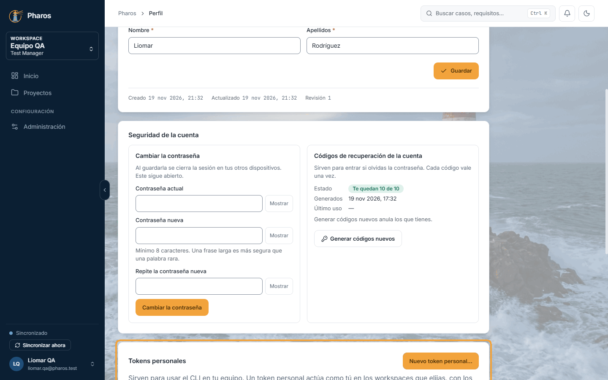

## Atajos de teclado

| Tecla | Dónde | Qué hace |
| --- | --- | --- |
| Tab | Formulario de un token o de un webhook | Recorre el nombre, el proyecto, los permisos y la caducidad |
| Espacio | Permisos y eventos | Marca o desmarca la casilla |
| Esc | Token o secreto recién creado | No lo cierra: marca «Lo he guardado en un sitio seguro» y pulsa «Hecho» |

## Si algo no sale

- **No veo la pestaña «Integraciones».** Solo existe en un workspace
  compartido y con conexión al servidor. En tu workspace personal no hay
  integraciones: crea uno compartido desde el selector de workspace.
- **«Solo un Test Manager del workspace crea, rota o revoca tokens».** Pide
  a uno que cree el token de CI, o crea un token personal en «Mi perfil»
  para tu CLI.
- **El proyecto no aparece al crear un token.** Sigue en tu workspace
  personal: llévalo al workspace con «Compartir con un workspace…» (menú «⋯»
  de su fila en «Proyectos»).
- **«… todavía no está en el servidor».** Acabas de crear el proyecto y aún no
  se había enviado: Pharos lo envía en ese momento. Vuelve a pulsar «Mover y
  compartir» en unos segundos.
- **El CI responde 401 `token_inactive`.** El dueño del token salió del
  workspace o se desactivó su cuenta. Un Test Manager puede «Reasignar» el
  token: el secreto del CI no cambia.
- **El CI responde 403 `insufficient_scope`.** Al token le falta ese permiso.
  Crea otro con el permiso que necesita: los permisos no se editan.
- **«Los webhooks no están disponibles en este servidor».** Falta
  `WEBHOOK_SECRETS_KEY`: quien administra el servidor la configura
  (docs/despliegue.md).
- **«Usa una dirección https»** o **«Este servidor no permite enviar a
  direcciones de la red privada…».** Un webhook solo envía a `https` y fuera
  de la red privada, salvo que el servidor lo permita
  (`WEBHOOK_ALLOW_PRIVATE` o `WEBHOOK_ALLOW_HOSTS`).
- **El paso de GitHub dice «No token (a pull request from a fork…)».** Es un
  PR desde un fork, que no tiene acceso a los secretos. No se sube nada y el
  job no falla.
- **`HTTP 401 [token_expired]` o `[token_revoked]`, en GitHub o en el CLI.**
  Crea un token nuevo en «Tokens de proyecto» y cambia el secreto
  `PHAROS_TOKEN`.
- **La terminal no encuentra `pharos`.** Abre una terminal nueva después de
  instalar. Si sigue sin encontrarlo, `pharos.exe` está en la carpeta `bin`
  de la instalación de Pharos.
- **Las entregas fallan.** «Entregas» enseña la respuesta del destino. Corrige
  el destino y pulsa «Reintentar ahora». Tras 50 fallos seguidos Pharos
  desactiva el webhook y avisa a los Test Manager: «Activar» lo enciende otra
  vez.

## En el móvil

- Los tokens y los webhooks se gestionan igual en una pantalla estrecha: las
  tablas se desplazan de lado y los formularios ocupan toda la pantalla.

## Consejos

- Un token por CI y por proyecto, con el nombre de dónde se usa: si se filtra,
  revocas solo ese.
- Da a cada token solo los permisos que necesita. Para subir resultados basta
  «Subir resultados y cerrar runs».
- Guarda el token como secreto del CI (`PHAROS_TOKEN`), nunca en el
  repositorio ni en la URL: Pharos rechaza un token en la URL.
- Antes de que caduque, «Rotar» da uno nuevo y deja el antiguo 24 h para
  cambiar el CI sin cortes.
- En el destino de un webhook, comprueba siempre la firma y descarta los
  envíos repetidos por su `webhook-id`.

## Véase también

- Capítulo 10, «Ejecuciones e importación de resultados»: lo que sube un CI
  aparece ahí, como una importación.
- Capítulo 15, «Administración»: «Usuarios» › «Revocar sus tokens…», si un
  token se filtra.
- [Guía de la API v1](../../api-v1.md) y [despliegue](../../despliegue.md).

---

← [Si algo sale mal](19-errores.md) · [Índice](README.md)
