<!-- Generado por `npm run manual` desde e2e/tours/21-integraciones.tour.ts y docs/manual/fuentes/integraciones.md. No lo edites a mano: edita la fuente. -->

# 21. Integraciones

## Para qué sirve

Las **integraciones** dejan que otras herramientas hablen con Pharos sin abrir
la app:

- **Tokens de proyecto:** un CI (GitHub Actions, Jenkins…) sube los
  resultados de sus pruebas a un proyecto, crea y cierra sus runs y lee casos,
  ciclos, defectos y requisitos. Los crea un Test Manager en
  «Integraciones».
- **Conectar CI:** el paso de GitHub Actions que sube los informes de cada
  pull request a un proyecto, listo para copiar, con los secretos que hay que
  crear en GitHub.
- **Tokens personales:** tu propia línea de comandos (el CLI `pharos`) actúa
  en tu nombre, en todos tus workspaces o en uno. Se crean en «Mi perfil».
- **Webhooks:** Pharos avisa a otra herramienta (Slack, un bot de PRs,
  Jenkins) cuando pasa algo en el workspace, con cada envío firmado. Los
  avisos salen también por lo que se hace en la app de escritorio, cuando
  llega al servidor al sincronizar.

**Antes de empezar:** todo esto vive en un workspace compartido. En este
manual es «Equipo QA», donde Liomar llevó el proyecto «Pharos» y al que se
unió su compañero Jorge L. Meneses Yero (capítulo 20, «Trabajo en equipo»).
Si trabajas solo, crea antes un workspace compartido y lleva a él el proyecto.

Un token actúa siempre **en nombre de su dueño** y nunca puede más que su rol
actual. Pharos lo enseña **una sola vez**, al crearlo; después solo guarda una
huella. Caduca en el plazo que elijas (como mucho un año) y su dueño recibe un
aviso 7 días antes.

La guía de la API, [api-v1.md](../api-v1.md), explica con ejemplos de
`curl` cómo subir resultados, leer datos y comprobar la firma de un webhook.

## Paso a paso

### 21.1. La pestaña «Integraciones»

Los tokens de CI y los webhooks pertenecen a un workspace compartido (capítulo 20). En el selector de workspace, con «Equipo QA» elegido, «Miembros y roles» abre la página del workspace, con dos pestañas: «Miembros» e «Integraciones». «Integraciones» reúne los tokens de proyecto, «Conectar CI» y los webhooks. Solo existe en un workspace compartido y necesita el servidor. Cualquier miembro la ve; solo un Test Manager crea, rota, revoca o reasigna.

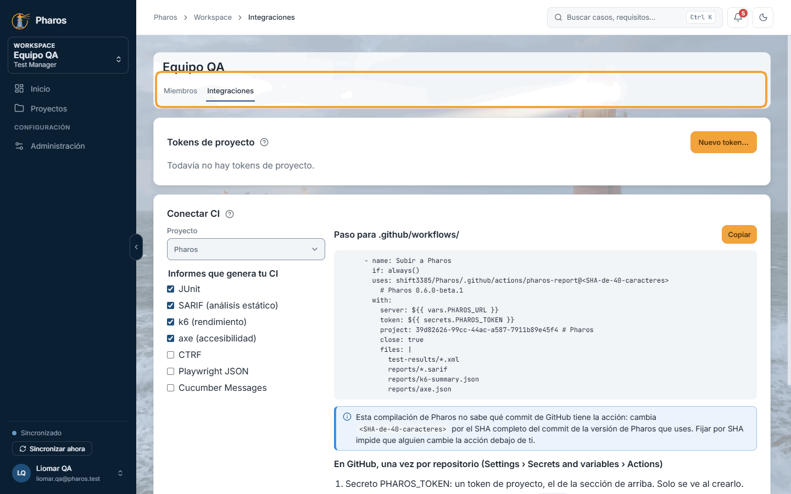

### 21.2. Nuevo token de proyecto

«Nuevo token…» abre el formulario: un nombre que diga dónde se usa (en este ejemplo, «CI de Pharos»), el proyecto, los permisos (scopes) y la caducidad, entre 30 días y un año (90 por defecto). El token actúa en nombre de quien lo crea y nunca puede más que su rol: si ese rol cambia, el token cambia con él. Para un CI que sube resultados basta «Subir resultados y cerrar ejecuciones».

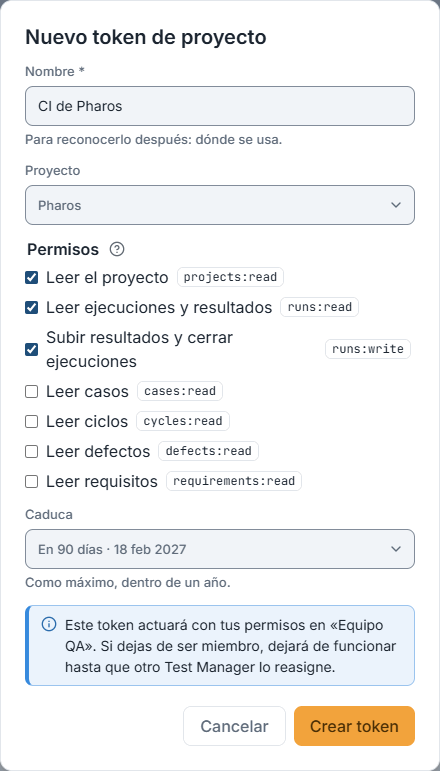

### 21.3. El token, una sola vez

Al pulsar «Crear token», Pharos lo muestra una sola vez, con un ejemplo de cómo usarlo en el CI. Cópialo y guárdalo como secreto del CI (por ejemplo, `PHAROS_TOKEN` en GitHub Actions): Pharos solo guarda una huella y no puede volver a enseñarlo. Para cerrar, marca «Lo he guardado en un sitio seguro» y pulsa «Hecho». La guía de la API explica cómo subir resultados con él (véase el final del capítulo).

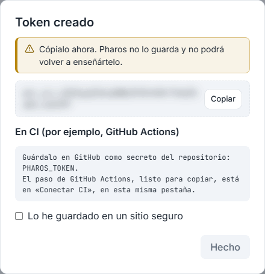

### 21.4. Rotar un token

«Rotar» cambia el secreto de un token sin tocar su nombre, su proyecto ni sus permisos. «Rotar ahora» anula el antiguo al momento, si se ha filtrado. «Mantener el anterior 24 h» lo deja funcionar un día más, para cambiar el CI sin cortes. El token nuevo, como siempre, se ve una sola vez.

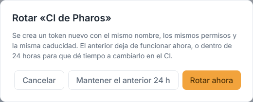

### 21.5. Los tokens del workspace

La tabla lista los tokens de proyecto del workspace: nombre, proyecto, permisos, dueño, caducidad, último uso y estado. Siete días antes de caducar, el dueño recibe un aviso. Si el dueño sale del workspace o se desactiva su cuenta, el token deja de funcionar y los Test Manager reciben un aviso: «Reasignar a mí» lo pasa al Test Manager que lo pulsa, sin cambiar el secreto del CI (paso siguiente). «Rotar» da un token nuevo (el antiguo puede seguir 24 h, mientras cambias el CI) y «Revocar» lo anula al momento. Aquí se ven los tokens de Liomar y el «CI nocturno de Pharos» que Jorge creó desde su equipo.

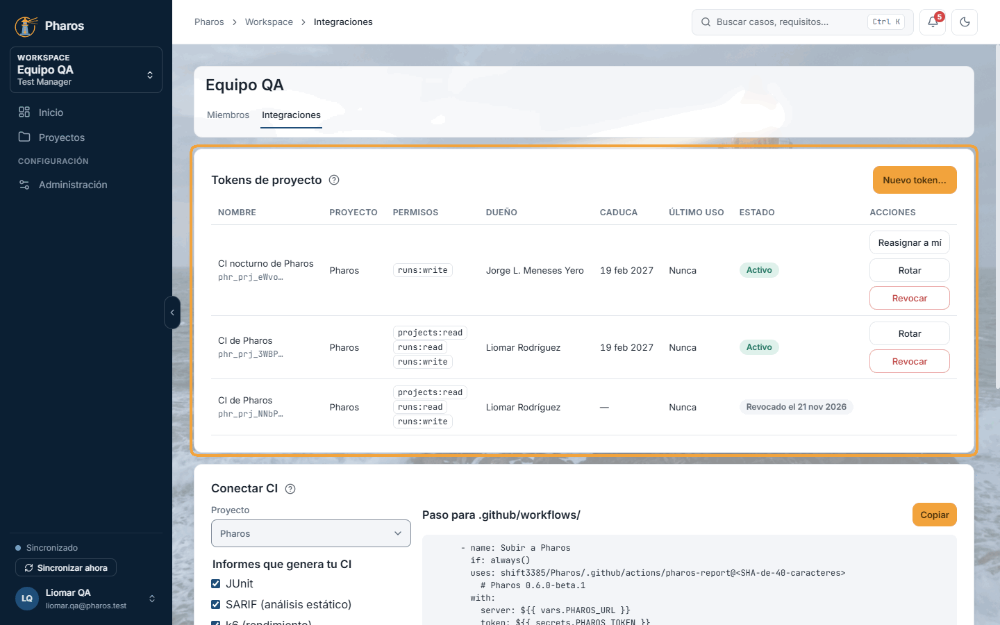

### 21.6. Reasignar un token de otra persona

Jorge, el otro Test Manager del workspace, creó desde su equipo el token «CI nocturno de Pharos» para el CI de cada noche. Un token actúa con los permisos de su dueño; si Jorge sale del workspace o se desactiva su cuenta, deja de funcionar y los Test Manager reciben un aviso. «Reasignar a mí» lo pasa a quien lo pulsa, después de confirmar: el secreto no cambia, así que el CI sigue funcionando sin tocar nada.

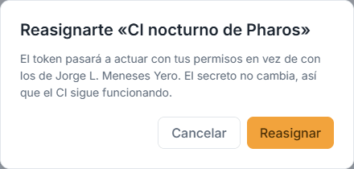

### 21.7. Conectar CI: el paso de GitHub Actions

«Conectar CI», debajo de los tokens, prepara el paso de GitHub Actions que sube los informes de tus pruebas a este proyecto en cada pull request. Elige el proyecto y marca los informes que genera tu CI: por defecto, JUnit (pruebas), SARIF (análisis estático), k6 (rendimiento) y axe (accesibilidad). El paso se actualiza al momento y ya lleva tu servidor y tu proyecto, pero nunca el token. Una línea larga sigue en la línea de abajo, con sangría, para que se lea entera; «Copiar» copia el YAML exacto, sin esos saltos. Si el aviso pide cambiar el SHA de la acción, pon el del commit de la versión de Pharos que uses: fijar la acción por SHA impide que alguien la cambie sin que lo sepas.

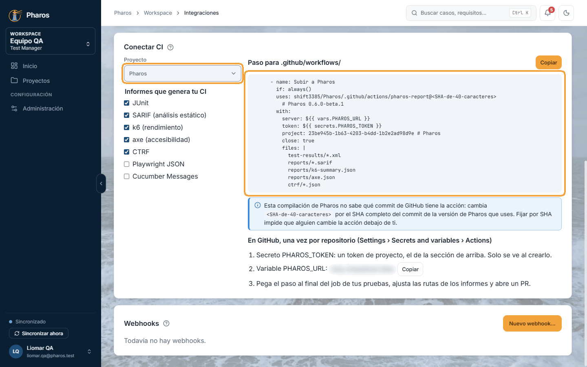

### 21.8. Conectar CI: en GitHub

En GitHub, una vez por repositorio, en Settings › Secrets and variables › Actions: crea el secreto PHAROS_TOKEN con un token de proyecto (el de la sección de arriba, que solo se ve al crearlo; si no eres Test Manager, la sección te dice que se lo pidas a uno) y la variable PHAROS_URL con la dirección del servidor de tu equipo, la que muestra la sección con su propio botón «Copiar» (en las capturas va difuminada: es la del servidor de pruebas de este manual, que un CI no alcanzaría). Después pega el paso al final del job de tus pruebas, ajusta las rutas de los informes y abre un PR: la página del job enseña una tabla con lo subido y el run aparece en Pharos, en «Ejecuciones» (capítulo 10). En un PR desde un fork no hay secretos: no se sube nada y el job no falla.

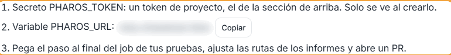

### 21.9. Nuevo webhook

Un webhook avisa a otra herramienta (Slack, un bot de PRs, Jenkins) cuando pasa algo en el workspace: se crea un run, se suben resultados, se cierra un ciclo, cambia un defecto o se decide una revisión. «Nuevo webhook…» pide un nombre, la URL de destino (https y fuera de la red privada, salvo que el servidor lo permita), los eventos y, si quieres, un proyecto. Pharos firma cada envío para que el destino compruebe que viene de tu servidor.

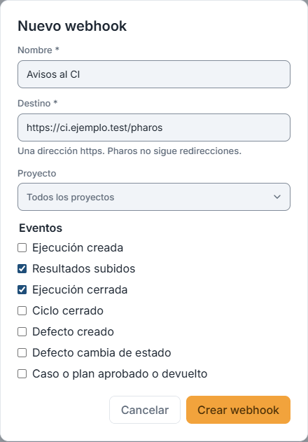

### 21.10. El secreto de firma, una sola vez

Al guardar, Pharos enseña el secreto de firma (`whsec_…`) una sola vez. El destino lo usa para comprobar la firma de cada envío; la guía de la API trae el código para hacerlo en Node y en Python. Si se pierde, «Rotar secreto» da otro y el anterior sigue firmando 24 h.

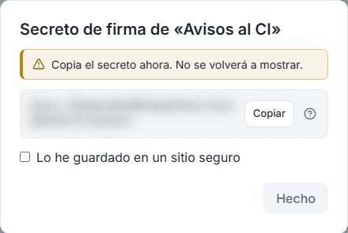

### 21.11. Probar un webhook y ver sus entregas

«Enviar prueba» manda un evento `ping` al destino. «Entregas» lista los envíos de los últimos 30 días con su estado, el intento, la respuesta del destino y cuándo será el siguiente. En este ejemplo el destino no existe, así que la entrega falla: Pharos la reintenta durante unas 22 horas y, tras 50 fallos seguidos, desactiva el webhook y avisa a los Test Manager. «Reintentar ahora» la envía de nuevo al momento.

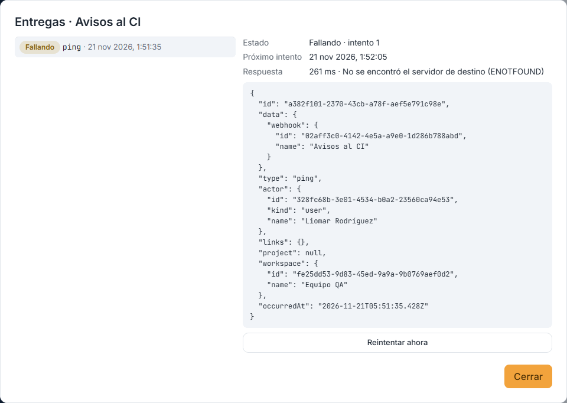

### 21.12. Rotar el secreto de un webhook

«Rotar secreto» da un secreto de firma nuevo, que se ve una sola vez. Durante 24 h Pharos firma cada envío con los dos, el nuevo y el anterior, para que cambies el destino sin perder avisos.

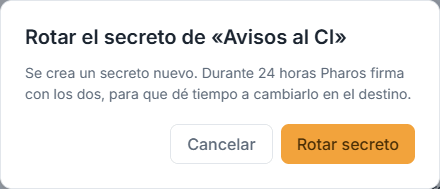

### 21.13. Borrar un webhook

«Borrar» quita el webhook y deja de enviar sus avisos; Pharos pregunta antes. Un webhook que falla 50 veces seguidas no se borra: se desactiva solo, y «Activar» lo enciende otra vez cuando el destino vuelve a responder.

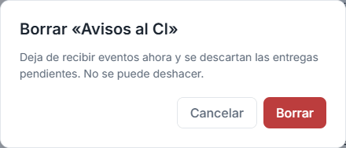

### 21.14. Tokens personales

Para tu propia línea de comandos (el CLI `pharos`) usa un token personal: en «Mi perfil», «Tokens personales» › «Nuevo token personal…». Puede servir para todos tus workspaces o solo para uno, con los permisos y la caducidad que elijas, y también se ve una sola vez. Como los de proyecto, actúa en tu nombre y avisa 7 días antes de caducar. Debajo, «Usar en el CLI» da el comando `pharos login --server <este servidor>`, con la dirección del servidor de tu equipo (en las capturas, difuminada: es la del servidor de pruebas de este manual), que pide el token y lo guarda en el Administrador de credenciales de Windows: el token nunca va escrito en el comando. «Revocar» lo anula; el administrador del servidor puede revocar todos los de una cuenta si se filtran.

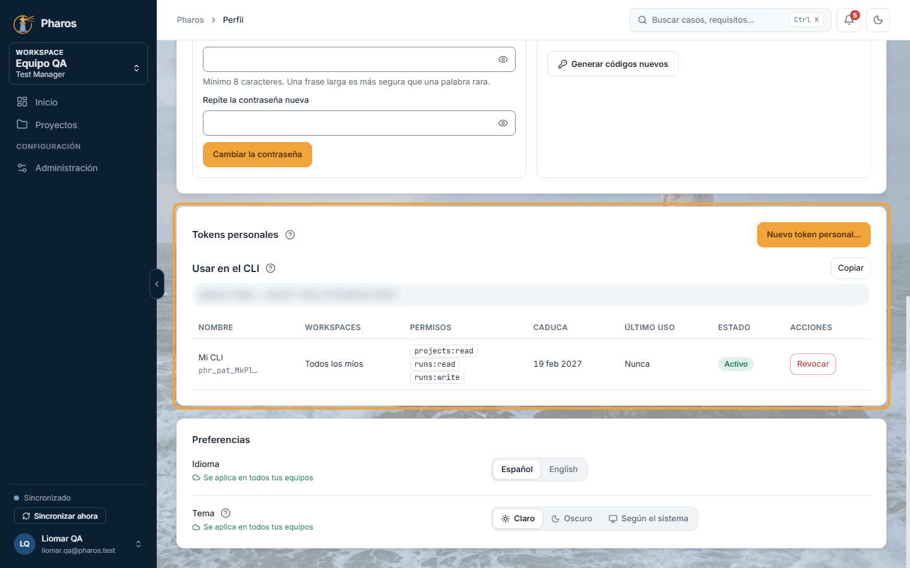

## La línea de comandos «pharos»

La app instala también el programa `pharos`, que se usa desde una terminal
(PowerShell o el Símbolo del sistema). La referencia completa, con todas las
opciones y los códigos de salida, está en [cli.md](../cli.md); aquí van los
trabajos de cada día.

**Instalarlo.** El instalador de Pharos deja `pharos.exe` en la carpeta `bin`
de la instalación y añade esa carpeta al PATH de tu usuario: funciona en
cualquier terminal que abras **después** de instalar. Si el instalador no pudo
tocar el PATH, o usas el MSI, llámalo por su ruta completa. Para un CI sin la
app, cada versión publica también el CLI suelto para Windows y Linux, con su
`SHA256SUMS` para comprobarlo.

**Comprobar que todo está bien.** `pharos doctor` dice qué versión tienes,
dónde está el CLI, en qué modo trabaja y qué falta: en este equipo, la sesión
de la app y la base de datos; con un servidor, si responde y de quién es el
token, con sus permisos y su caducidad. `pharos projects` lista tus proyectos
con su prefijo (en este ejemplo, `PH` de «Pharos»), que es lo que pide
`--project`.

**Local o remoto.** El CLI trabaja de dos maneras:

- **Local**, sin servidor: escribe en el Pharos de este equipo, como la cuenta
  que tiene la sesión iniciada en la app, también con la app abierta (el run
  aparece en ella en unos segundos, sin recargar). Lee **Pharos Run JSON y
  JUnit**; para otros formatos dice que los subas al servidor o uses
  «Importar informe». No funciona en un CI.
- **Remoto**, con `--server https://…`, con la variable `PHAROS_URL` o con un
  servidor guardado: sube el informe tal cual a tu servidor, que es quien lo
  lee. El servidor acepta **JUnit, CTRF, Playwright JSON, Cucumber Messages,
  SARIF, k6, axe, Pharos Run JSON, Allure** (la carpeta `allure-results`
  comprimida en un `.zip`), **TRX** de .NET y el JSON de un **`.xcresult`**
  de Xcode (el que saca `xcrun xcresulttool`).

La primera línea de cada comando dice el modo, el proyecto y la cuenta.

**Entrar y salir.** `pharos login --server https://…` pide tu token personal
(no se ve al escribirlo), lo comprueba con el servidor y lo guarda en el
Administrador de credenciales de Windows; ese servidor queda como el de por
defecto. «Mi perfil» › «Tokens personales» › «Usar en el CLI» da el comando
listo para copiar. `pharos logout` borra ese token del equipo. El token nunca
se escribe en el comando: en un CI va en la variable `PHAROS_TOKEN`.

**Subir un informe.** `pharos upload test-results/junit.xml --project PH`
crea un run con el informe. Acepta varios ficheros o un patrón
(`"reports/*.xml"`), que van todos al mismo run; `--run-name` le da nombre y
`--cycle` lo mete en un ciclo abierto. Subir dos veces el mismo fichero no
duplica nada. Con `--dry-run` ves qué haría sin escribir nada.

**Ejecutar y subir de una vez.** `pharos watch -p PH --report
"test-results/*.xml" -- npm test` comprueba antes el proyecto y el token (un
token caducado se descubre en segundos, no al final), ejecuta tus pruebas en
la misma terminal, sube solo los informes que escribieron o cambiaron y sale
con el código de las pruebas: tu CI sigue fallando cuando fallan.

**Cerrar el run de un CI.** En remoto, los jobs de una matriz de GitHub
Actions suben al mismo run, que queda abierto. `pharos run close`, en el
último job, lo cierra; `--close` cierra el run al terminar una subida suelta.

`pharos help` lo explica todo. Los mensajes salen en español o en inglés,
según el idioma de Windows (o `--lang es`).

## Atajos de teclado

| Tecla | Dónde | Qué hace |
| --- | --- | --- |
| Tab | Formulario de un token o de un webhook | Recorre el nombre, el proyecto, los permisos y la caducidad |
| Espacio | Permisos y eventos | Marca o desmarca la casilla |
| Esc | Token o secreto recién creado | No lo cierra: marca «Lo he guardado en un sitio seguro» y pulsa «Hecho» |

## Si algo no sale

- **No veo la pestaña «Integraciones».** Solo existe en un workspace
  compartido y con conexión al servidor. En tu workspace personal no hay
  integraciones: crea uno compartido desde el selector de workspace
  (capítulo 20).
- **«Solo un Test Manager del workspace crea, rota o revoca tokens».** Pide
  a uno que cree el token de CI, o crea un token personal en «Mi perfil»
  para tu CLI.
- **El proyecto no aparece al crear un token.** Sigue en tu workspace
  personal: llévalo al workspace con «Compartir con un workspace…» (menú «⋯»
  de su fila en «Proyectos», capítulo 20).
- **El CI responde 401 `token_inactive`.** El dueño del token salió del
  workspace o se desactivó su cuenta. Un Test Manager puede «Reasignar a mí»
  el token: el secreto del CI no cambia.
- **El CI responde 403 `insufficient_scope`.** Al token le falta ese permiso.
  Crea otro con el permiso que necesita: los permisos no se editan.
- **«Los webhooks no están disponibles en este servidor».** Falta
  `WEBHOOK_SECRETS_KEY`: quien administra el servidor la configura
  ([despliegue](../despliegue.md)).
- **«Usa una dirección https»** o **«Este servidor no permite enviar a
  direcciones de la red privada…».** Un webhook solo envía a `https` y fuera
  de la red privada, salvo que el servidor lo permita
  (`WEBHOOK_ALLOW_PRIVATE` o `WEBHOOK_ALLOW_HOSTS`).
- **El paso de GitHub dice «No token (a pull request from a fork…)».** Es un
  PR desde un fork, que no tiene acceso a los secretos. No se sube nada y el
  job no falla.
- **`HTTP 401 [token_expired]` o `[token_revoked]`, en GitHub o en el CLI.**
  Crea un token nuevo en «Tokens de proyecto» y cambia el secreto
  `PHAROS_TOKEN`.
- **La terminal no encuentra `pharos`.** Abre una terminal nueva después de
  instalar. Si sigue sin encontrarlo, `pharos.exe` está en la carpeta `bin`
  de la instalación de Pharos.
- **`[project-not-found]`.** El prefijo no es el de ninguno de tus proyectos:
  mira cuáles tienes con `pharos projects`.
- **`[no-server]` o `[no-token]`.** Falta el servidor (`--server`,
  `PHAROS_URL`) o el token (`pharos login` o `PHAROS_TOKEN`).
- **`[format-not-local]`.** Ese formato solo lo lee el servidor: súbelo con
  `--server` o usa «Importar informe» en la app.
- **`[not-signed-in]`.** En modo local, el CLI usa la sesión de la app: abre
  Pharos e inicia sesión.
- **`[db-in-use]` o `[db-busy]`.** Otro Pharos está actualizando tus datos o
  escribiendo mucho a la vez (una sincronización grande). Espera unos segundos
  y repite.
- **Las entregas fallan.** «Entregas» enseña la respuesta del destino. Corrige
  el destino y pulsa «Reintentar ahora». Tras 50 fallos seguidos Pharos
  desactiva el webhook y avisa a los Test Manager: «Activar» lo enciende otra
  vez.

## En el móvil

- Los tokens y los webhooks se gestionan igual en una pantalla estrecha: las
  tablas se desplazan de lado y los formularios ocupan toda la pantalla.

## Consejos

- Un token por CI y por proyecto, con el nombre de dónde se usa: si se filtra,
  revocas solo ese.
- Da a cada token solo los permisos que necesita. Para subir resultados basta
  «Subir resultados y cerrar ejecuciones».
- Guarda el token como secreto del CI (`PHAROS_TOKEN`), nunca en el
  repositorio ni en la URL: Pharos rechaza un token en la URL, y el CLI no
  tiene opción `--token` para que no quede en el historial de la terminal.
- Antes de que caduque, «Rotar» da uno nuevo y deja el antiguo 24 h para
  cambiar el CI sin cortes.
- Con dos Test Manager en el workspace, un token de CI no se queda huérfano si
  su dueño se va: el otro lo reasigna.
- En el destino de un webhook, comprueba siempre la firma y descarta los
  envíos repetidos por su `webhook-id`.

## Véase también

- Capítulo 20, «Trabajo en equipo»: el workspace compartido, sus miembros y
  sus roles.
- Capítulo 10, «Ejecuciones e importación de resultados»: lo que sube un CI
  aparece ahí, como una importación.
- Capítulo 15, «Administración»: «Usuarios» › «Revocar sus tokens…», si un
  token se filtra.
- [Guía de la API v1](../api-v1.md), [referencia del CLI](../cli.md) y
  [despliegue](../despliegue.md).

---

← [Trabajo en equipo](20-equipo.md) · [Índice](README.md)
